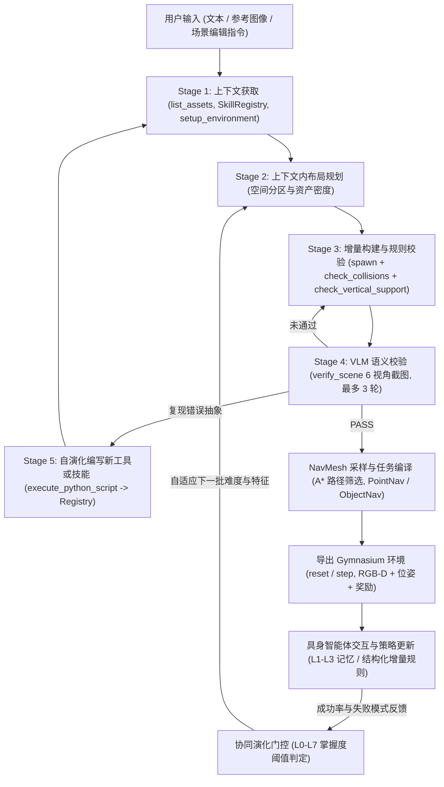

# SimWorld Studio: Automatic Environment Generation with Evolving Coding Agent for Embodied Agent Learning

## 一句话定义

**SimWorld Studio** 是基于 Unreal Engine 5 的具身学习环境自动生成平台，由工具/技能增强的自演化编码智能体 **SimCoder** 驱动，从文本、图像或编辑指令合成经物理与语义校验的 3D 场景、导出标准 Gymnasium 任务接口，并根据具身智能体表现动态调节难度以实现协同演化。

## 英文缩写速查

| 缩写 | 英文全称 | 简要说明 |
|---|---|---|
| MCP | Model Context Protocol | 连接 SimCoder 与 UE5 后端工具/技能库的标准化协议桥 |
| UE5 | Unreal Engine 5 | 底层高保真渲染与物理仿真引擎（实测版本 UE5.3.2） |
| AABB | Axis-Aligned Bounding Box | 轴对齐包围盒，用于场景构建中的碰撞重叠与垂向支撑规则检测 |
| NavMesh | Navigation Mesh | UE5 自动生成的导航网格，用于保证起终点可达性与计算最短测地路径 |
| SR | Success Rate | 导航成功率，终点距离目标小于 1.0 m 的测试回合占比 |
| SPL | Success weighted by Path Length | 路径长度加权成功率，联合衡量任务完成度与路径效率 |
| SoftSPL | Soft Success weighted by Path Length | 连续松弛版 SPL，奖励向目标靠近的部分进度 |
| nDTW | Normalized Dynamic Time Warping | 归一化动态时间规整指标，度量执行轨迹与参考最短路径的贴合度 |
| GEPA | Reflective Prompt Evolution（文中指代规则演化基线） | 提示词演化方法；本文提出其增量有序规则变体用于导航策略更新 |

## 为什么重要

- **填补“静态 3D 场景”到“可训练具身环境”的鸿沟：** 传统具身平台（如 AI2-THOR、CARLA、Habitat）依赖高成本手工场景，程序化生成（如 ProcTHOR、Infinigen）受限于预设模板，而多数 LLM 3D 生成器只产静态网格或布局，缺乏可验证任务、奖励信号与标准学习接口。SimWorld Studio 直接在 UE5 中生成物理合法、可交互且开箱支持 `reset()` / `step()` 的 Gymnasium 环境。
- **将环境生成器本身纳入自演化与协同演化闭环：** 不仅具身智能体在环境中学习，编码智能体 **SimCoder** 也能把校验修复经验沉淀为持久化 MCP 工具与 Markdown 技能，并依据学习者成功率动态生成难度梯度课程，避免固定难度下的训练饱和。

## 核心信息

| 字段 | 内容 |
|---|---|
| 作者 | Haoqiang Kang\*, Xiaokang Ye\*, Yuhan Liu, Siddhant Hitesh Mantri, Lingjun Mao, James Fleming, Drishti Regmi, Lianhui Qin |
| 机构 | 加州大学圣地亚哥分校（UC San Diego）；纽约大学（New York University） |
| 发表时间 | 2026-05-13（arXiv v2；v1 提交于 2026-05-10） |
| 论文链接 | [arXiv:2605.09423](https://arxiv.org/abs/2605.09423) · [arXiv HTML v2](https://arxiv.org/html/2605.09423) |
| 项目与代码 | [SimWorld-AI/SimWorld-Studio](https://github.com/SimWorld-AI/SimWorld-Studio) |
| 清单分类 | `environment.reconstruction`, `environment.task_generation` |
| 来源条目 | `survey_ax_2605_09423` |
| 开源状态 | **宣称将开源但尚未确认可运行代码**（截至 2026-11-27 核查：论文声明将在接收后于上述 GitHub 地址开源平台与实验，但该 URL 当前返回 HTTP 404） |

## 核心原理

SimWorld Studio 继承自 [SimWorld](paper-sa-2512-01078-simworld-an-open-ended-simulator-for-agents-in-p.md)（UE5.3.2 运行时与城市资产库），由两大核心机制构成：**SimCoder 自动环境生成（§2.1）** 与 **自适应课程协同演化（§2.2）**。

### 1. SimCoder：MCP 工具、技能库与五阶段生成流水线

SimCoder 通过 **MCP 桥** 操纵 UE5 后端，核心基础设施包括 14 个原语工具（Appendix C.1 Table 4）与分层技能库（Appendix C.3）：

- **14 个 MCP 工具：**
  - **Actor 管理（8 个）：** `spawn_blueprint_actor`、`spawn_actor`、`delete_actor`、`delete_all_spawned`、`get_actors_in_level`、`find_actors_by_name`、`set_actor_transform`、`take_screenshot`。
  - **环境与资产（2 个）：** `setup_environment`（初始化光照、天空、雾效、地面与视距，必须在生成前调用）、`list_assets`。
  - **场景评估（3 个）：** `check_collisions`（世界空间 AABB 重叠检测，返回相交面积 $\text{cm}^2$）、`check_vertical_support`（检测未贴地且无支撑的悬空物体）、`verify_scene`（VLM 接收原始指令、当前 Actor 列表与 6 张多角度截图，返回 `PASS` / `NEEDS_IMPROVEMENT` / `FAIL`）。
  - **Python 逃生舱（1 个）：** `execute_python_script`，在 UE5 内置 Python 解释器中执行任意 `unreal` 脚本；多次有效复用的模式可经自演化注册为一等工具或技能。
- **技能库（Skill Library）：** 位于工具之上，采用带 YAML frontmatter 的 Markdown 文档并可附带 `python_util` 辅助脚本。系统预置 5 个内置技能：`building-placement`（覆盖 127 类建筑尺寸与间距）、`city-layout`、`street-furniture`、`weather-and-mood`、`screenshot-tour`。
- **五阶段生成流程（Appendix C.2）：**
  1. **上下文获取：** 调用 `list_assets`、检索 `SkillRegistry` 并执行 `setup_environment`；
  2. **布局规划：** 结合文本指令与可选参考图在上下文内规划空间分区与密度；
  3. **增量构建与规则校验：** 分批生成 Actor 后立即调用 `check_collisions` 与 `check_vertical_support`，就地修复几何冲突；
  4. **VLM 语义校验：** 每个功能区块完成后调用 `verify_scene`，若非 `PASS` 则定向修改，最多 3 轮修正；
  5. **技能编写（自演化）：** 将跨回合反复出现的错误修复过程（如集装箱迷宫中的去冗余障碍 `clear_maze.md` 或 L/T 型路口生成）抽象为泛化技能写回目录。

### 2. 任务生成与 Gymnasium 编译

场景通过校验后，SimCoder 利用 UE5 **NavMesh** 构建可行走区域，采样起终点并通过 A\* 搜索计算参考测地最短路径 $L^*$，保留满足可达且 $3\,\text{m} \le L^* \le 20\,\text{m}$ 的回合，生成 **PointNav**（目标坐标）与 **ObjectNav**（语义物体类别，且要求目标在最短路径至少一个航点可见）任务，并导出为标准 `env.reset()` / `env.step(action)` Gymnasium 接口（提供 $224\times224$ RGB/RGB-D、目标方位角、测地距离与步数观测，以及 `move_forward(0.25m)`、`turn_left(15°)`、`turn_right(15°)`、`stop` 离散动作）。

### 3. 协同演化：三通道反馈与掌握度门控课程

在协同演化闭环中，SimCoder 保持底层 LLM 参数冻结，接收三类抽象层级的具身智能体反馈（场景级物理/对齐反馈、结果级成功率/回报统计、轨迹级经验），通过上下文重加权或难度参数调节产出下一批环境。在 Case Study 3 的具体实例化中：

- **具身智能体侧（结构化增量规则演化，Appendix G.1）：** 为避免标准 GEPA 全量重写提示词覆盖有效策略，系统维护有序优先规则列表 $\mathcal{R}_t = [r_1,\dots,r_k]$（上限 30 条），针对五类失败模式（方向错误、循环行为、目标邻近失败、避障失败、500 步超时）生成非矛盾增量规则：

$$\mathcal{R}_{t+1} = \mathcal{R}_t \cup \Delta\mathcal{R}(\mathcal{F}_t)$$

  并剪枝连续 20 个回合未被激活的规则。
- **环境生成侧（L0–L7 掌握度门控，Appendix G.2）：** 沿着路径长度（400–800 cm 至 2500–3500 cm）、初始航向偏差（0–15° 至 0–180°）与动态障碍密度（0.00 至 0.35）划分 8 个难度等级 $\ell \in \{0,\dots,7\}$。仅当最近 5 个 epoch 平均成功率 $\bar{S}_t$ 达到当前等级阈值 $\tau_{\ell_t}$ 时晋级：

$$\ell_{t+1} = \ell_t + \mathbf{1}\!\bigl[\bar{S}_t \ge \tau_{\ell_t}\bigr], \quad (\tau_0,\dots,\tau_7) = (0.80, 0.75, 0.70, 0.65, 0.60, 0.55, 0.50, 0.45)$$

## 流程总览

## 源码运行时序图

**不适用**（截至 2026-11-27 核查：论文在摘要与 §1 给出仓库地址 `https://github.com/SimWorld-AI/SimWorld-Studio` 并注明将在接收后开源，但该地址目前返回 HTTP 404，尚未确认可运行的官方源码实现；系统内部已验证交互逻辑详见上文基于论文 Appendix C.1–C.4 整理的 14 个 MCP 工具与四轮运行案例）。

## 实验与评测

论文通过三个递进式 Case Study 验证平台能力（所有数值均来自原文 Table 1–2、Fig. 5、Fig. 8–9 及 Appendix E–G）：

### 1. Case Study 1：场景生成质量与组件消融（§3.1 & Appendix E）

在 S1（Text-to-Scene）、S2（Image+Text-to-Scene）、S3（Scene Editing）各 3 档难度（共 9 个场景）上，使用 Claude Code 统一驱动不同底座模型（规则检查 + VLM 0–10 分归一化至 $[0,1]$）：

| 模型 | S1 平均分 | S1 无碰撞 | S2 平均分 | S2 无碰撞 | S3 平均分 | S3 无碰撞 |
|---|---|---|---|---|---|---|
| Qwen3.5-9B | 0.36 | 0.37 | 0.45 | 0.33 | 0.34 | 0.37 |
| Qwen3.5-27B | 0.59 | 0.99 | 0.67 | 0.75 | 0.52 | 0.99 |
| Claude Sonnet 4.6 | 0.70 | **1.00** | 0.73 | 0.81 | 0.74 | **0.98** |
| Claude Opus 4.6 | **0.77** | 0.99 | **0.79** | **0.86** | **0.75** | **0.98** |

- **关键发现：** 图像参考对中等开源模型提升明显（Qwen3.5-27B 从 S1 0.59 升至 S2 0.67）；Opus 4.6 与 Sonnet 4.6 在全部设定下无碰撞率均保持 $\ge 0.98$。
- **平台组件消融（Fig. 5，9 个留出测试场景）：** 原始基础代码智能体仅得 **0.16**；加入定制 MCP 工具后跃升至 **0.45（+0.29）**；加入规则/VLM 校验循环提升至 **0.55（+0.10）**；加入技能自演化进一步达到 **0.76（+0.21）**。分难度消融详表见 Appendix Table 9。

### 2. Case Study 2：生成环境训练具身导航与跨基准迁移（§3.2 & Appendix F）

在 $190\,\text{m}\times 190\,\text{m}$ 城市块（5 类城市场景原型）上采样 1,200 训练回合，采用无梯度的三层非参数记忆（L1 步级、L2 轨迹级、L3 每 10 回合蒸馏任务级原则），在 329 个留出测试回合与外部基准 **SimWorld-MMNav** 上评估：

| 模型 | 设定 | PointNav SR (%) | PointNav SPL | ObjectNav SR (%) | ObjectNav SPL |
|---|---|---|---|---|---|
| Qwen3.5-27B | Baseline | 20.21 | 0.0931 | 22.56 | 0.0795 |
| Qwen3.5-27B | + Memory | **26.76** | **0.1266** | **31.59** | **0.1429** |
| Qwen3.5-9B | Baseline | 0.40 | 0.0039 | 0.00 | 0.0000 |
| Qwen3.5-9B | + Memory | 7.43 | 0.0722 | 14.62 | 0.1408 |
| Qwen3.5-2B | Baseline | 1.38 | 0.0138 | 0.24 | 0.0024 |
| Qwen3.5-2B | + Memory | 6.23 | 0.0528 | 4.58 | 0.0389 |

- **场景多样性效应（Fig. 8 左）：** 固定总训练预算为 200 回合，仅将不同训练环境数量从 1 增至 30，即可使 Qwen3.5-27B 测试成功率提升 **+5.5 pp**。
- **跨基准迁移（Fig. 8 右）：** 在生成环境中学习的记忆策略无需微调权重即可迁移至独立构建的 SimWorld-MMNav，例如 Qwen3.5-2B 取得 **+12.0 pp** 提升。
- **观测模态消融（Table 10，100 训练 / 30 未见测试）：** Qwen3.5-27B 使用 RGB（Unseen SR 0.833）、Depth（0.667）或 RGB+Depth（0.667）均高于纯文本标量输入（0.500）；而在 9B 尺度下，仅 RGB+Depth 在未见测试集上取得非零成功率（0.167）。

### 3. Case Study 3：闭环协同演化（§3.3 & Appendix G）

使用 Qwen3.5-9B 训练 25 epochs（每 epoch 20 回合，共 500 回合），每 5 个 epoch 在 329 回合的 **SimWorld-MMNav** 上测试：

- **协同演化（L0–L7 自适应课程 + 规则累积）：** 最终测试 SR 达到 **90%**（呈现明显的“难度晋级时短暂下降—规则累积后快速回升”动态）。
- **固定难度基线（固定在 L3 中等难度 + 规则累积）：** 中期出现能力饱和，最终测试 SR 为 **72%**（协同演化高出 **+18 pp**）。
- **未训练基线：** 测试 SR 为 **50%**（协同演化高出 **+40 pp**）。

## 与其他工作对比

结合论文 §4 与 Table 3 的横向对比：

| 平台 / 方法 | 引擎 | 大规模多样生成 | 物理/视觉真实度 | Gymnasium 接口 | 自演化（工具/技能） | 协同演化（课程反馈） |
|---|---|---|---|---|---|---|
| CARLA | UE4 | 不支持 | 高（+++） | 不支持 | 不支持 | 不支持 |
| AI2-THOR / ThreeDWorld | Unity | 不支持 | 中（++） | 不支持 | 不支持 | 不支持 |
| Habitat 3.0 | Habitat-Sim | 不支持 | 中（++） | 支持 | 不支持 | 不支持 |
| ProcTHOR | Unity | 支持 | 中（++） | 不支持 | 不支持 | 不支持 |
| Holodeck | AI2-THOR/Unity | 支持 | 中（++） | 不支持 | 不支持 | 不支持 |
| SAGE | Isaac Sim | 支持 | 高（+++） | 不支持 | 支持 | 不支持 |
| GenEnv | AlfWorld/Text | 不支持 | 低（+） | 不支持 | 不支持 | 支持 |
| [SimWorld](paper-sa-2512-01078-simworld-an-open-ended-simulator-for-agents-in-p.md) | UE5 | 城市程序化/编辑 | 高（+++） | 类 Gym 接口 | 不支持 | 不支持 |
| **SimWorld Studio** | **UE5** | **支持** | **高（+++）** | **支持** | **支持** | **支持** |

- 相比只负责底层城市运行时的 [SimWorld](paper-sa-2512-01078-simworld-an-open-ended-simulator-for-agents-in-p.md)，SimWorld Studio 新增了面向开发/生成层的 **SimCoder**（MCP 桥 + 双校验循环 + 技能持久化）以及基于学习者反馈的 **L0–L7 协同演化调度**。

## 结论

**一句话总判：SimWorld Studio 的核心价值在于用「MCP 约束动作空间 + 规则/VLM 双校验 + 技能持久化 + 掌握度门控课程」打通了“代码生成 3D 场景”到“闭环自适应具身训练”的完整工程链路。**

1. **结构化工具契约是硬前提，自演化打破静态上限：** 消融显示，仅靠通用代码智能体（0.16）难以稳定建场，专用 MCP 工具带来首要跳升（+0.29），而跨回合技能自演化贡献了打破平台期的最大增幅（+0.21）。
2. **环境多样性直接兑换为泛化收益：** 在固定 200 回合预算下把环境数从 1 扩到 30 即可带来 +5.5 pp 成功率提升，证明低成本合成差异化 UE5 场景能替代单纯堆叠同质经验。
3. **协同演化需要“可保底的策略累积”配合：** Case Study 3 的 +18 pp 优势来自 L0–L7 难度门控与增量有序规则（非全量重写）的联合作用，防止难度跃迁时遗忘既有策略。
4. **当前工程落地仍受闭源未发布与 UE5 资源门槛制约：** 由于官方仓库暂为 404 且运行高度依赖 UE5.3.2 与高显存 GPU（并行 8 实例需 8×H100 级算力），近期更适合作为方法架构与 MCP 校验设计参考。

## 工程实践

- **最低系统配置（Appendix C.6 Table 5）：**
  - **系统与驱动：** Linux（推荐 Ubuntu 20.04+），NVIDIA Driver 525+（需支持 Vulkan）。
  - **硬件与存储：** 8 GB+ VRAM NVIDIA GPU（文中在 T4、L40S、A100 上测试），至少 40 GB 可用磁盘（15 GB 下载 + 21 GB 解压）。
  - **运行时依赖：** UE5.3.2、SimWorld 资产库、Node.js 18+、Python 3.9+ 及 Gymnasium。
- **大规模训练吞吐参考（Appendix F.1）：** 在 8×H100 服务器上并行部署 8 个 SimWorld Studio 实例执行 rollout，跑完 1,200 个导航训练回合约需 8 小时。
- **规则校验工程经验（Appendix C.4 & E.2）：** 对 `Demo_` 或新生成 Actor 在每次修改后立即执行轻量 AABB 重叠与垂向支撑（`±200` 单位地面容差、`|x|, |y| <= 9500` 边界）检测，并将冲突对直接注入下一轮上下文，是避免多轮布局误差累积的关键；VLM 校验限定最多 3 轮以控制推理开销。

## 局限与风险

- **空间推理上限受底座编码模型制约（Appendix A）：** 在复杂多物体精细排布或长程空间约束下（尤其 S3 编辑与 Hard 难度），小参数模型（如 Qwen3.5-9B 编辑完成度仅 0.23）仍频繁出现计数或语义偏差。
- **下游验证集中在导航与上下文规则/记忆更新：** Case Study 2 和 3 主要验证了 PointNav/ObjectNav 及无参数记忆/规则演化；平台虽导出标准 Gymnasium 接口，但尚未展示复杂桌面接触操作（manipulation）、关节级全身控制或大规模梯度 RL（如 PPO/VLA）端到端训练结果。
- **开源可用性与商业资产许可风险（Appendix B & C.7）：** 截至 2026-11-27 官方 GitHub 仓库尚不可访问（404）；且实际复现需遵守 Epic Games Unreal Engine EULA、SimWorld 资产许可及商用模型 API 条款。

## 关联页面

- [Agentic Robots 综述](paper-towards-agentic-robots-survey.md)
- [全量项目节点清单](../overview/awesome-agentic-robots-node-index.md)
- [SimWorld 底层仿真器实体](paper-sa-2512-01078-simworld-an-open-ended-simulator-for-agents-in-p.md)
- [VLA 方法背景](../methods/vla.md)
- [机器人仿真场景生成](../methods/robot-simulation-scene-generation.md)
- [编码智能体验证闭环](../methods/coding-agent-verification-loops.md)
- [智能体工具调用接口](../methods/agent-tool-use-interface.md)
- [智能体技能封装](../methods/agent-skill-packaging.md)
- [机器人仿真系统集成](../methods/robot-simulation-integration.md)
- [视觉语言导航任务](../tasks/vision-language-navigation.md)
- [零样本目标导航任务](../tasks/zero-shot-object-navigation.md)

## 推荐继续阅读

- [SimWorld Studio 原文 HTML v2（arXiv:2605.09423）](https://arxiv.org/html/2605.09423)
- [SimWorld 原论文（NeurIPS 2025 / arXiv:2512.01078）](https://arxiv.org/abs/2512.01078)
- [SimWorld-MMNav 外部评测基准（arXiv:2512.10046）](https://arxiv.org/abs/2512.10046)
- [Anthropic Model Context Protocol（MCP）规范介绍](https://www.anthropic.com/news/model-context-protocol)

## 参考来源

- [SimWorld Studio arXiv 原文核对归档](../../sources/papers/paper-agentic-2605-09423.md)
- [官方 Awesome 快照归档](../../sources/repos/awesome-agentic-robots-survey-index.md)
- [arXiv 论文摘要页（2605.09423）](https://arxiv.org/abs/2605.09423)
- [SimWorld Studio 宣称官方 GitHub 入口（2026-11-27 核查返回 404）](https://github.com/SimWorld-AI/SimWorld-Studio)
