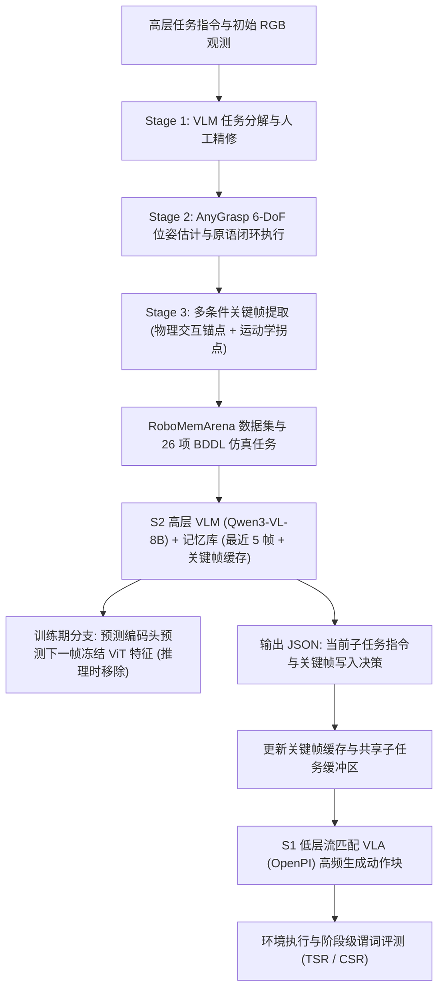
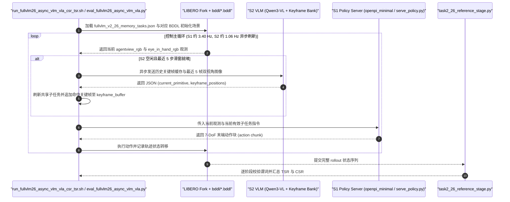

# RoboMemArena: A Comprehensive and Challenging Robotic Memory Benchmark

## 一句话定义

RoboMemArena 是一个面向部分可观测长程机器人操作的具身记忆评测基准，包含 26 项带原生关键帧与子任务标注的仿真任务及 5 项配套真机任务，并提出了基于预测编码增强关键帧敏感度的异步双系统记忆策略 **PrediMem**。

## 英文缩写速查

| 缩写 | 英文全称 | 简要说明 |
|---|---|---|
| VLA | Vision-Language-Action | 视觉-语言-动作统一策略模型，本文中 S1 低层动作执行器即采用此类架构 |
| VLM | Vision-Language Model | 视觉-语言模型，用于基准构建阶段的任务分解及 PrediMem 高层规划器 S2 |
| TSR | Task Success Rate | 任务级成功率，要求一条长程轨迹的所有阶段验证谓词全部满足 |
| CSR | Cumulative Success Rate | 累积阶段成功率，衡量单个长程任务中已完成验证阶段的比例，避免二元指标掩盖部分进度 |
| BDDL | Behavior Domain Definition Language | 行为域定义语言，用于形式化描述 RoboMemArena 26 项 LIBERO 兼容仿真任务的初始状态与目标谓词 |
| S1 / S2 | System 1 / System 2 | 双系统架构中的低层高频动作执行器（约 3.40 Hz）与高层低频记忆规划器（约 1.06 Hz） |

## 为什么重要

现有机器人操作基准大多在当前帧即可观测到全部决策信息，反应式策略（Reactive Policy，如仅依赖当前观测的 $\pi_{0.5}$）就能取得较高成功率，无法真正将「记忆能力」分离为主要瓶颈；而少数面向记忆的基准普遍存在三项短板：缺乏同时覆盖视觉关键帧与语言子任务的多模态记忆监督信号、轨迹偏短且记忆依赖子任务占比有限、以及缺少与仿真对应的真机物理验证。RoboMemArena 将 26 项任务的平均轨迹长度拉升至 1,076 步、记忆依赖子任务占比提高到 68.9%，并通过跨视角关键帧标注与真机双臂套件，使记忆管理机制（何时写入、保留多少、如何异步调度）得以在统一基准上做定量归因。

## 核心信息

| 字段 | 内容 |
|---|---|
| 作者 | Huashuo Lei, Wenxuan Song, Huarui Zhang, Jieyuan Pei, Jiayi Chen, Haodong Yan, Han Zhao, Pengxiang Ding, Zhipeng Zhang, Lida Huang, Donglin Wang, Yan Wang, Haoang Li |
| 机构 | 香港科技大学（广州）（HKUST-GZ）、浙江大学（ZJU）、西湖大学（Westlake University）、清华大学（Tsinghua）、浙江工业大学（ZJUT）、上海交通大学（SJTU） |
| 发表时间 | 2026-05-11（arXiv:2605.10921v1；仓库于 2026-06-20 更新数据集与阶段判定脚本） |
| 论文链接 | [arXiv:2605.10921](https://arxiv.org/abs/2605.10921) / [HTML 全文](https://arxiv.org/html/2605.10921) |
| 项目与代码 | [项目主页](https://robomemarena.github.io) / [榜单](https://robomemarena.github.io/leaderboard.html) / [GitHub 仓库](https://github.com/OpenHelix-Team/RoboMemArena) / [Hugging Face 数据集](https://huggingface.co/datasets/RoboMemArenaBenchmark/RoboMemArena) |
| 清单分类 | `environment.benchmarking`（来源条目 `survey_ax_2605_10921`） |
| 开源状态 | **已开源**：26 任务 BDDL、LIBERO 仿真分支、RLDS 构建脚本、异步双系统评测参考代码、PrediMem S2 `predictive_coding_head/` 训练插件及演示数据集均已公开 |

## 核心原理

### 1. RoboMemArena 基准设计：四类记忆需求与三阶段自动管线

RoboMemArena 针对反应式策略在长程部分可观测环境中的典型失效模式设计了 26 项仿真任务（每任务 100 条成功演示，共 2,600 条轨迹、15,100 个关键帧对齐片段，平均 1,076 步/任务）：

1. **Multi-Object Transferring（4 项）：** 在外观相似的容器（如两个相同盘子或柜子）之间依次转移多个物体，必须记住源-目标映射与已完成转移的对象。
2. **Multi-Object Occlusion（11 项）：** 将物体放入抽屉或微波炉等可关闭容器中，或在检查多个抽屉后关门再放置，视觉重置后状态发生别名冲突（State Aliasing），占比最大。
3. **Multi-Object Counting（7 项）：** 连续执行指定次数的重复动作（如倒番茄酱或牛奶恰好两次后收起瓶子），连续重复前的视觉场景几乎一致。
4. **Multi-Object Sequence（4 项）：** 后续步骤依赖前置子任务的结果或顺序约束（例如将第二个物体放入前一步所选容器）。

在数据采集上，论文提出三阶段流水线兼顾规模与细粒度时序标注：
- **Stage 1（VLM 任务分解与人工精修）：** 将高层自然语言指令与初始 RGB 图像输入 VLM，生成绑定到预定义规划器集合 `{Move, Place, Pour, Open, Close}` 的严格 JSON 子任务序列，再对不一致分解进行人工修正。
- **Stage 2（AnyGrasp 闭环执行）：** 通过点云 6-DoF 抓取估计器 AnyGrasp 预测抓取位姿并调度原子原语，引入后置条件检查器对失败子任务自动重采抓取位姿并重试。
- **Stage 3（多条件关键帧提取）：** 对轨迹 $\tau = \{(s_t, a_t)\}_{t=1}^T$ 取物理交互锚点 $\mathcal{K}_{\mathrm{phys}}$ 与运动学拐点 $\mathcal{K}_{\mathrm{kin}}$ 的并集：
  $$\mathcal{K} = \mathcal{K}_{\mathrm{phys}} \cup \mathcal{K}_{\mathrm{kin}}$$
  其中 $\mathcal{K}_{\mathrm{phys}} = \{t \in [1, T] \mid g_t \neq g_{t-1}\}$ 捕获夹爪开合状态 $g_t \in \{0,1\}$ 的跳变，$\mathcal{K}_{\mathrm{kin}} = \{t \in [1, T] \mid \|\mathbf{v}_t\| < \epsilon \lor \frac{\mathbf{v}_t \cdot \mathbf{v}_{t-1}}{\|\mathbf{v}_t\|\,\|\mathbf{v}_{t-1}\|} < \cos(\theta)\}$ 捕获末端线速度极小值与急剧转向时刻。

在 151 个总子任务中，有 104 个无法仅从当前帧观测推断，基准级记忆依赖比例 $R_{\mathrm{mem}} = 104 / 151 = 68.9\%$。评测端通过每任务 $K_i \in [3, 9]$ 个阶段级验证谓词 $\psi(s_i^{(k)})$ 计算全任务成功率 **TSR** 与部分进度 **CSR**：
$$\mathrm{TSR} = \frac{1}{N}\sum_{i=1}^{N}\prod_{k=1}^{K_i}\mathbf{1}\!\left[\psi\!\left(s_i^{(k)}\right)\right], \qquad \mathrm{CSR} = \frac{1}{N}\sum_{i=1}^{N}\frac{1}{K_i}\sum_{k=1}^{K_i}\mathbf{1}\!\left[\psi\!\left(s_i^{(k)}\right)\right].$$

### 2. PrediMem 模型：分层记忆库与训练期预测编码

**PrediMem** 采用异步双系统 VLA 架构：
- **记忆库 $\mathcal{M}_t$：** 由长期关键帧缓存 $\mathcal{M}_t^{\mathrm{key}}$（默认不设上限）与最近滑动窗口 $\mathcal{M}_t^{\mathrm{rec}}$（默认 5 个时间步，每步含顶视 `agentview_rgb` 与腕部 `eye_in_hand_rgb` 两张 $256 \times 256$ 图像）共同构成，即 $\mathcal{M}_t = \mathcal{M}_t^{\mathrm{key}} \cup \mathcal{M}_t^{\mathrm{rec}}$。
- **高层规划器 S2：** 基于 Qwen3-VL-8B-Instruct（冻结 ViT 视觉编码器，其余参数全量微调），联合读取历史关键帧与最近 5 步视觉窗口，输出严格 JSON 格式的 `current_primitive`（当前有效子任务指令）与 `keyframe_positions`（当前窗口内 1-indexed 关键帧位置）。若判定存在关键帧，则将其写入 $\mathcal{M}_t^{\mathrm{key}}$ 供后续规划长期引用。
- **预测编码头 $f_{\mathrm{Pre}}$（仅训练期启用）：** 为解决传统 SFT 下 VLM 隐状态对微妙物理状态切换（如抽屉闭合、倒酱完成）不够敏感的问题，在训练阶段附加预测编码头，从当前隐状态 $h_t$ 预测下一帧视觉潜表示 $\hat{Z}_{t+1} = f_{\mathrm{Pre}}(h_t)$，以冻结 ViT 输出的下一帧特征 $Z_{t+1}$ 为停梯度教师信号：
  $$\mathcal{L}_{\mathrm{Pre}} = \mathrm{MSE}\!\bigl(\hat{Z}_{t+1},\mathrm{sg}(Z_{t+1})\bigr) + \Bigl(1 - \cos\!\bigl(\hat{Z}_{t+1},\mathrm{sg}(Z_{t+1})\bigr)\Bigr), \qquad \mathcal{L}_{\mathrm{S2}} = \mathcal{L}_{\mathrm{text}} + 0.1\,\mathcal{L}_{\mathrm{Pre}}.$$
  **推理部署时移除 $f_{\mathrm{Pre}}$**，因此不引入额外推理延迟或显存开销。
- **低层执行器 S1：** 沿用 $\pi_{0.5}$ / OpenPI 流匹配动作头，以当前观测 $o_t$ 与 S2 缓冲区中最近更新的子任务 $c_t$ 为条件，以高频（3.40 Hz）输出动作块 $a_t = \pi_{\mathrm{S1}}(o_t, c_t)$。

## 流程总览

## 源码运行时序图

在官方仓库 `OpenHelix-Team/RoboMemArena` 中，异步双系统仿真评测的主入口为 `evaluation_benchmark/async_vlm26_reference/run_fullvlm26_async_vlm_vla_csr_tsr.sh`，它调用 `eval_fullvlm26_async_vlm_vla.py` 加载 `fullvlm_v2_26_memory_tasks.json` 与 `evaluation_benchmark/libero_fork/` 环境，同时连接通过 OpenPI（默认 `third_party/openpi_minimal` 或外部 `OPENPI_ROOT/scripts/serve_policy.py`）提供的低层策略服务，并由 `evaluation_benchmark/scripts/task2_26_reference_stage.py` 执行分阶段 TSR/CSR 判定。

## 实验与评测

### 1. 仿真主实验结果（Table 2，26 项任务平均，指标为 TSR / CSR %）

| 方法 / 变体 | Transferring | Occlusion | Counting | Sequence | Average (TSR / CSR) |
|---|---|---|---|---|---|
| $\pi_{0.5}$（反应式基线） | 20.0 / 42.8 | 12.7 / 17.2 | 14.3 / 50.9 | 60.0 / 71.6 | 21.5 / 38.7 |
| HiF-VLA | 17.5 / 38.9 | 12.7 / 27.1 | 8.6 / 45.9 | 42.5 / 70.2 | 16.9 / 39.8 |
| MemoryVLA | 15.0 / 37.2 | 7.3 / 13.1 | 14.3 / 55.1 | 37.5 / 65.2 | 15.0 / 35.3 |
| MemER（双系统关键帧检索） | 20.0 / 36.1 | 16.4 / 33.2 | 27.1 / 65.1 | 65.0 / 79.1 | 27.3 / 49.1 |
| Qwen3-VL-8B（冻结参数） | 15.0 / 34.6 | 0.0 / 6.8 | 9.3 / 44.6 | 7.5 / 39.2 | 6.0 / 26.2 |
| GPT-5.4（闭源大模型作为 S2） | 13.8 / 32.9 | 1.8 / 9.2 | 12.9 / 50.7 | 15.0 / 47.3 | 8.7 / 30.5 |
| **PrediMem（Qwen3-VL-8B，完整版）** | 22.5 / 45.2 | **27.3 / 38.4** | **45.7 / 69.3** | **72.5 / 89.5** | **38.5 / 55.2** |
| Ground Truth（Oracle S2 参考上限） | 32.5 / 54.8 | 33.6 / 49.8 | 51.4 / 75.6 | 85.0 / 92.3 | 46.1 / 64.8 |

### 2. 消融实验与规模扩展（Table 2c–d、Table 3、Figure 4）

- **预测编码头消融：** 移除预测编码头（w/o Predictive Coding Head）后，平均 TSR 由 38.5% 降至 32.3%，CSR 由 55.2% 降至 49.0%；其中 Occlusion（27.3% → 19.5%）、Counting（45.7% → 38.6%）与 Sequence（72.5% → 63.8%）下降明显，而 Transferring 小幅变动（22.5% → 25.0%）。损失权重 $\lambda_{\mathrm{Pre}}$ 在 `{0.0, 0.1, 0.5, 1}` 扫描下的平均 TSR 分别为 `32.3% / 38.5% / 31.0% / 29.8%`，`0.1` 为最优平衡点。
- **关键帧记忆库消融：** 移除关键帧缓存（w/o Keyframe Bank）后平均 TSR 暴跌至 17.7%（CSR 41.6%），Occlusion 类 TSR 从 27.3% 跌至 6.4%。容量扫描表明：最近窗口取 3–5 帧即可捕获短时转变，过长反而增加 VLM 延迟并降低与 S1 的同步性；关键帧缓存容量为 2 时早期的关键观测很快被驱逐，4–8 逐步改善，**不设上限**效果最好。
- **S2 模型规模扩展：** 在一致的训练数据与架构下，将 S2 从 Qwen3-1.7B（19.9% TSR / 41.4% CSR）扩展至 Qwen3-4B（31.9% / 51.7%）和 Qwen3-8B（38.5% / 55.2%），全部任务类别呈现单调提升。
- **异步推理时序画像（Table S1，`a0005` 配置）：** 高层 S2 稳态刷新率 1.06 Hz（p50 延迟 0.939 s，p95 1.136 s，含冷启动均值 1.752 s）；低层 S1 执行频率 3.40 Hz（均值 0.294 s，p50 0.289 s，p95 0.365 s），每次 S2 更新约跨越 2.92 个 S1 动作块。

### 3. 真机双臂评测结果（Table 4，AgileX Cobot Mobile Aloha，每任务 10 次 rollout，成功率 %）

| 方法 | Pour Bottle × 2 | Brush Plates with Swap | Transfer Objects | Shell Game | IHMB（最长超 3 分钟） | 平均成功率 |
|---|---|---|---|---|---|---|
| $\pi_{0.5}$ | 20 | 10 | 60 | 10 | 0 | 20 |
| MemER | 30 | 50 | 80 | 40 | 0 | 40 |
| **PrediMem** | **60** | **60** | **80** | **50** | **10** | **52** |

## 与其他工作对比

1. **与反应式及短时上下文 VLA 对比：** 仅使用当前观测的 $\pi_{0.5}$ 在状态重置后出现严重的「状态别名（State Aliasing）」与「约束遗忘（Constraint Forgetting）」——例如抽屉关上后反复重开同一个抽屉，或刚看到空抽屉就直接放置而忘记「先全部检查一遍」的全局约束。引入运动表征的 HiF-VLA 与 Token 级工作记忆的 MemoryVLA 平均 TSR 仅 16.9% 与 15.0%，难以对齐决定长程任务进展的稀疏物理跳变事件。
2. **与同类关键帧双系统框架 MemER 对比：** MemER 同样采用关键帧检索与双系统解耦，但缺少预测编码对隐空间的动力学约束，高层 VLM 对物理状态切换不够敏感，导致关键帧选择准确度不足，仿真平均 TSR 为 27.3%，低于 PrediMem 的 38.5%。
3. **与零样本闭源多模态大模型对比：** 冻结的 Qwen3-VL-8B（6.0% TSR）与闭源 GPT-5.4（8.7% TSR）在 RoboMemArena 上均大幅落后于经过机器人轨迹微调的 S2 规划器，说明通用多模态记忆尚不能直接泛化至长程物理操作中的动作语义与状态转移判定。
4. **与既有机器人记忆基准对比（Table 1）：** 相较于 RoboCerebra、Behavior-1K、LIBERO-Long、RMBench、RoboMME、MIKASA 与 MemoryBench，RoboMemArena 在「超 1,000 步长程轨迹」「VLM 自动指令分解」「原子子目标」「AnyGrasp 自主抓取可扩展生成」「程序化状态 Oracle」「原生关键帧标注」及「真机配套评测」8 个维度上覆盖最全，且 68.9% 的记忆依赖子任务比例居对比基准首位。

## 结论

**一句话总判：RoboMemArena 用 68.9% 记忆依赖占比和千步级长程操作任务把反应式策略的「伪记忆」漏洞暴露无遗，同时证明在双系统 VLA 的高层 VLM 中引入训练期预测编码监督，能在零额外推理开销下显著提升关键帧记忆决策精度。**

1. **记忆基准设计必须剥离局部可观测捷径：** 仅依赖最终二元成功率容易掩盖长程记忆衰减，结合阶段谓词（CSR）与遮挡/计数/序列任务才能有效区分记忆能力强弱。
2. **无推理开销的预测编码适合作为 VLM 记忆训练正则项：** 预测下一帧冻结 ViT 潜特征可令 VLM 隐空间在 t-SNE 下形成更紧凑、可分的关键帧聚类，避免过拟合稀疏关键帧标签。
3. **机器人领域微调不可被闭源通用 VLM 替代：** 即使是前沿闭源模型（GPT-5.4）在未针对机器人记忆数据微调时也仅有 8.7% TSR，高语义推理仍需对齐物理动作边界。
4. **长期关键帧缓存不宜过早截断：** 在需要回溯早期检查结果的抽屉遮挡任务中，小容量固定缓存（如 2 帧）会丢失早期关键状态，而最近 5 帧滑窗配合无上限关键帧缓存能取得最优权衡。

## 工程实践

- **数据格式与转换：** 公开数据集包含按任务与随机种子切分的 `subtask_data/*.hdf5`（每文件存储单子任务与关键帧切片）以及 ModelScope 提供的 `full_trajectory/` 完整轨迹；训练完整任务时需按 `task_id` 与 `seed` 分组并依 `subtask_order` 拼接，或使用仓库根目录的 `RoboMemArena_dataset_builder.py`（Python 3.9 + `tensorflow==2.13.0`）转为 RLDS 格式。
- **训练超参参考：** PrediMem S2 基于 Qwen3-VL-8B-Instruct，冻结视觉塔并在 4×H100 上以 $1\times 10^{-5}$ 学习率微调 2 个 epoch（$\lambda_{\mathrm{Pre}}=0.1$）；相关可复用插件位于仓库 `predictive_coding_head/` 目录，S1 低层策略训练与推理复用官方 OpenPI 框架。
- **评测部署与版本同步：** 本地仿真需将 `evaluation_benchmark/libero_fork/` 加入 `PYTHONPATH` 并指定 `LIBERO_BDDL_PATH`；官方于 2026 年 6 月 20 日发布了数据与评测修复（修正 Task 6 阶段脚本 `task2_26_reference_stage.py`、增强 Tasks 1–3 双相同篮筐的记忆依赖性并重采 Tasks 4–5 物体随机摆位），复现时需使用更新后的数据集版本。

## 局限与风险

- **Oracle 上限仍有明显空间：** 即便为低层 S1 提供 Ground Truth 真实子任务指令，仿真平均 TSR 也仅为 46.1%（CSR 64.8%），说明当前底层流匹配动作执行器在长程累积误差与精细抓取上仍是重要瓶颈。
- **极长程真机任务成功率仍偏低：** 在持续时间超过 3 分钟的真机模仿做早餐任务（IHMB）上，只有 PrediMem 取得非零成功率，但也仅达 10%（10 次成功 1 次），距实际家庭部署尚有较大距离。
- **关键帧定义依赖物理先验与无上限缓存：** 多条件关键帧提取主要围绕夹爪状态跳变与末端速度拐点构建，对于无显著夹爪开合或纯视觉状态变化（如液体颜色/温度变化）的触发事件可能欠敏感；同时无上限关键帧缓存可能在超长连续运行中带来上下文长度膨胀风险。
- **许可证元数据缺失：** 官方 GitHub 仓库根目录及 API 元数据未附带全局开源许可证文件（仅 `baselines/astra_codex/LICENSE` 存在子目录许可），商业或二次分发前需向作者确认授权条款。

## 关联页面

- [具身大模型评测基准选型闭环](../queries/embodied-eval-benchmark-selection-loop.md)：对照评测基准设计与指标选型闭环。
- [Agentic Robots 综述](paper-towards-agentic-robots-survey.md)
- [全量项目节点清单](../overview/awesome-agentic-robots-node-index.md)
- [VLA 方法背景](../methods/vla.md)
- [具身智能体评测方法](../methods/embodied-agent-benchmarking.md)：对照任务设置、接口与评估指标
- [智能体操作策略（Agentic Manipulation Policies）](../methods/agentic-manipulation-policies.md)：对照双系统规划与执行解耦设计
- [动作分块（Action Chunking）](../methods/action-chunking.md)：理解 S1 高频动作块执行与异步刷新机制
- [抓取位姿估计（Grasp Pose Estimation）](../methods/grasp-pose-estimation.md)：了解数据生成管线 Stage 2 所用的 6-DoF 抓取估计基础
- [π0 / π0.5 策略背景](../methods/pi0-policy.md)：对照论文中的反应式基线及 S1 流匹配低层策略架构
- [机器人学习数据管线](../methods/robot-learning-data-pipelines.md)：对比自动化子任务分解与关键帧切片的数据构建范式
- [机器人操作任务（Manipulation）](../tasks/manipulation.md)
- [双臂操作任务（Bimanual Manipulation）](../tasks/bimanual-manipulation.md)：对照 AgileX Cobot Mobile Aloha 平台上的 5 项真机记忆评测

## 推荐继续阅读

- [RoboMemArena 官方项目主页与 26 任务总览](https://robomemarena.github.io)
- [RoboMemArena 官方 Leaderboard 榜单](https://robomemarena.github.io/leaderboard.html)
- [OpenHelix-Team/RoboMemArena 官方代码仓库](https://github.com/OpenHelix-Team/RoboMemArena)
- [Hugging Face 官方公开数据集（RoboMemArenaBenchmark/RoboMemArena）](https://huggingface.co/datasets/RoboMemArenaBenchmark/RoboMemArena)

## 参考来源

- [论文原文核对归档（arXiv:2605.10921）](../../sources/papers/paper-agentic-2605-10921.md)
- [官方代码仓库结构核对归档（OpenHelix-Team/RoboMemArena）](../../sources/repos/paper-agentic-2605-10921.md)
- [Awesome Agentic Robots 索引快照归档](../../sources/repos/awesome-agentic-robots-survey-index.md)
- [arXiv 论文主页（2605.10921）](https://arxiv.org/abs/2605.10921)
- [arXiv HTML 全文（2605.10921）](https://arxiv.org/html/2605.10921)
- [RoboMemArena 官方项目页](https://robomemarena.github.io)
