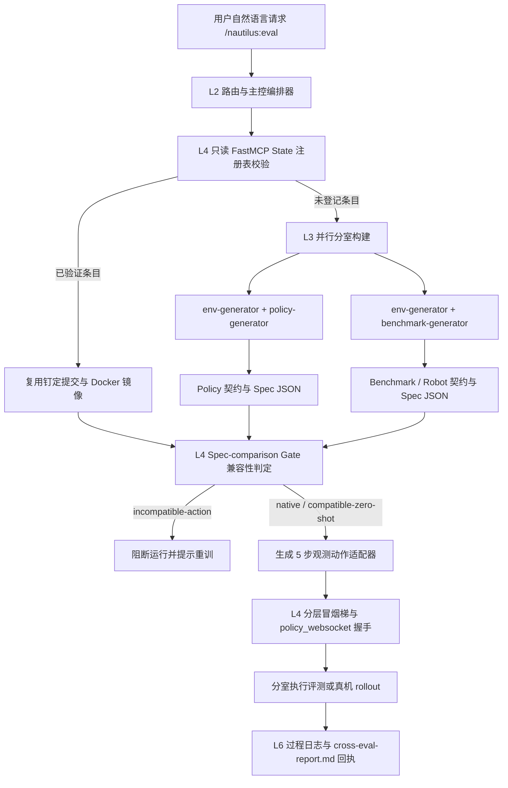
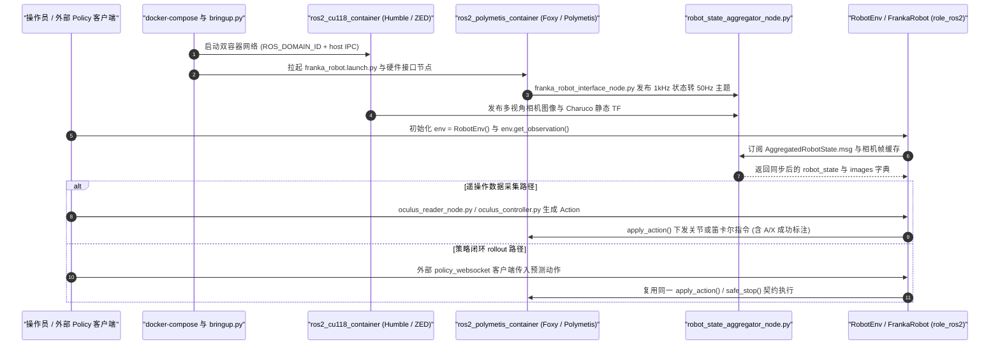

# Nautilus: From One Prompt to Plug-and-Play Robot Learning

## 一句话定义

**Nautilus** 是一个基于 Claude Code 插件构建的**机器人学习科研执行框架（Research Harness）**：它通过强类型接口契约、容器分室隔离与统一跨模块传输为底层，叠加机器人领域技能指引（Guides）、运行时校验哨兵（Sensors）与只读 MCP 注册表（State），将一句自然语言指令自动转化为可复现、可交叉评测、可微调并可迁移至真机的完整工作流。

## 英文缩写速查

| 缩写 | 英文全称 | 简要说明 |
|---|---|---|
| VLA | Vision-Language-Action | 视觉-语言-动作多模态策略家族，如 $\pi_0$、$\pi_{0.5}$、OpenVLA、SmolVLA |
| WAM | World Action Model | 基于学习动力学/世界模型的动作预测策略家族，如 cosmos-policy、Motus |
| IL / RL | Imitation Learning / Reinforcement Learning | 模仿学习（如 Diffusion Policy、ACT）与强化学习（如 PPO、SAC、TD3） |
| MCP | Model Context Protocol | 模型上下文协议；Nautilus 用于暴露只读 FastMCP 注册表工具 |
| DDS | Data Distribution Service | ROS 2 底层数据分发服务，承担真机本地高带宽控制与状态同步 |
| TFDS / RLDS | TensorFlow Datasets / Reinforcement Learning Datasets | 面向机器人轨迹的标准化数据格式，兼容 DROID 与 LeRobot 生态 |

## 为什么重要

1. **解决科研生态的 $\Theta(N \cdot M \cdot K)$ 组合爆炸：** 机器人学习横跨 $N$ 类策略（IL / VLA / RL / WAM）、$M$ 套仿真基准（LIBERO、RoboCasa、ManiSkill、RoboTwin、ALOHA、Loco-Mujoco）与 $K$ 种真实机器人构型（单臂、双臂、灵巧手、人形）。传统做法每次交叉评测都需手写 Dockerfile、观测转换与评测脚本，领域总体维护代价为 $\Theta(N \cdot M \cdot K)$；Nautilus 将工作单元从“成对胶水”重构为“面向共享契约的单边接入”，把复杂度降至 $\Theta(N + M + K)$。
2. **揭示“瓶颈在 Harness 而非模型能力”：** 通用编程智能体（如 Claude Code、OpenHands、SWE-agent）虽能零星修通单个仓库，但因缺少机器人学科的验证规范与固定接口表面，无法产出可复用模块。Nautilus 消融实验证明，移除接口模板或验证镜像带来的成功率暴跌和 Token 暴涨，远大于切换底层 LLM 模型的差异。
3. **打通仿真复现到真机部署的边界：** 同一份在仿真基准通过“跨策略交叉验证”的策略容器，无需修改任何策略源码即可对接 `nautilus-collect` 硬件容器完成 Franka 机械臂与 Unitree H1 人形机器人的闭环 rollout。

## 核心信息

| 字段 | 内容 |
|---|---|
| **作者** | Yufeng Jin*、Jianfei Guo*、Xiaogang Jia、Yu Deng、Zechu Li、Han Liu、Weiran Liao、Vignesh Prasad、Mathias Franzius、Gerhard Neumann、Georgia Chalvatzaki（* Equal contribution） |
| **机构** | 达姆施塔特工业大学（TU Darmstadt）、卡尔斯鲁厄理工学院（KIT）、FZI、Hessian.AI、Robotics Institute Germany、Honda Research Institute Europe |
| **发表时间** | 2026-05-12（arXiv v1）/ 2026-07-28（arXiv:2605.11665v2 [cs.RO]） |
| **论文链接** | [arXiv:2605.11665](https://arxiv.org/abs/2605.11665) / [arXiv HTML v2](https://arxiv.org/html/2605.11665) |
| **项目与代码** | [项目页](https://yufengjin.github.io/nautilus/) / [GitHub: YufengJin/role-ros2（`nautilus-collect`）](https://github.com/YufengJin/role-ros2) |
| **清单分类** | `model.training`（条目 `survey_ax_2605_11665`） |
| **开源状态** | **部分开源**（`nautilus-collect` / `role-ros2` 已以 Apache-2.0 开源；项目页显示 Nautilus 主插件仓库仍标为 `Nautilus (Coming Soon)`） |

## 核心原理

Nautilus 采用“**二层核心概念（Substrate + Content Layer）→ 六层插件工程栈（L1–L6）**”的设计（原文 §3、Table 6 及 Appendix A–G），在不可替换的契约基底之上运行可替换的通用编程智能体循环。

### 1. 基底层（Substrate）：三大工程不变量（§3.2, App. A–B）

1. **强类型接口契约（Typed Interface Contracts，Algorithm 1 / 3 / 4）：**
   - `Policy`：`reset() -> None` 与 `infer(obs: Observation) -> Action`（返回 `{"actions": ...}`），屏蔽权重加载、图像预处理与 chunk 调度差异。
   - `Benchmark / Env`：`reset(seed: int) -> Observation` 与 `step(action: Action) -> Transition`，携带任务定义、成功判据与确定性随机种子。
   - `Robot`：`reset() -> Observation`、`get_observation() -> Observation`、`apply_action(action: Action) -> None` 与 `safe_stop() -> None`，屏蔽底层厂家驱动、逆运动学（IK）与限位保护。
2. **分室隔离执行（Chambered Execution，App. E.1）：** 针对策略依赖与仿真/驱动依赖（CUDA、PyTorch、MuJoCo、Isaac Sim、SAPIEN、ROS 2）冲突问题，采用 **Docker + `uv`**（入口显式拒绝 conda/poetry/pipenv）将每个模块放入一次性构建的独立容器室。`env-generator` 将异构仓库归约为标准 `docker/` 布局与 `.classification` 标签（`plain`、`benchmark`、`policy`、`robot`），并用 `# --- NAUTILUS OPEN/CLOSE: ... ---` 哨兵注释块保证重跑幂等性。
3. **双层统一通信（Two-Tier Transport，App. A.2 & B）：**
   - **Tier 1（机器人本地）：** 保留在硬件容器与平台容器之间的高带宽实时链路——采用 ROS 2 DDS + 宿主机共享内存 IPC（`nautilus-collect` 内驱动运行在 1 kHz，状态聚合 50 Hz，策略/基准控制环 15 Hz）。
   - **Tier 2（跨模块统一传输）：** 智能体唯一可见的通信平面是独立零外部框架依赖的 `policy_websocket` 包（`BasePolicy`、`WebsocketPolicyServer`、`WebsocketClientPolicy`、`ActionChunkBroker`）。其连接建立时即推送 `metadata`（`action_dim`、`execute_steps` 等）做启动前校验；循环期使用持久 WebSocket + **msgpack NumPy 扩展**（避免 Base64 膨胀，本机 RTT 约 $0.3\,\text{ms}$），每帧回传 `server_timing`（`infer_ms`、`prev_total_ms`）；服务端异常则附带完整 traceback 并以 `INTERNAL_ERROR` 触发客户端 `RuntimeError`，配合 `GET /healthz` 供容器探活。

### 2. 内容层（Content Layer）：Guides + Sensors + State + Workspace Artefacts（§3.3, App. D–G）

在外部 Claude Code 循环（**L1**）之上，Nautilus 贡献 **L2–L6**：

- **Guides（L2 路由 + L3 子智能体 + L5 领域参考库）：**
  - **L2 斜杠命令（Table 7）：** `/nautilus:eval`、`/nautilus:train`、`/nautilus:benchmark`、`/nautilus:policy`、`/nautilus:robot`、`/nautilus:help`。
  - **L3 专用子智能体（Table 8）：** `env-generator`（环境探测与基础 Docker/`uv` 构建）、`benchmark-generator`（按 `step()` 是否返回有意义奖励切分 IL 与 RL，并进一步拆为 `dispatcher` 与 `sb3` 模式）、`policy-generator`（扫描 `forward/predict/infer` 入口并为多步动作自动套用 `ActionChunkBroker`）、`train-generator`（支持基准原生数据集 Mode A 与 LeRobot Hugging Face 数据集 Mode B，统一复用跨评测规则生成数据变换并执行 $\sim 8$ 步 / 30 分钟上限的 1-epoch 冒烟）、`model-finetune`（LoRA / 冻结主干 / 全量微调，支持 PyTorch 与 JAX/Flax）以及尚处于接口桩阶段的 `robot-generator`。
  - **L5 领域知识库：** 固化 `InstallationPlan` 模式、IL-vs-RL 分类协议、能力匹配规则与观测/动作映射规则。
- **Sensors（L4 六重运行时校验哨兵，Table 9）：**
  1. *Pre-action filter*：通过 Claude Code `PreToolUse` hook 拦截 `rm -rf /`、fork bomb、`docker volume prune --force` 等危险命令；
  2. *Render-time auditor*：防止私有镜像 URL 泄漏进用户可从头重建的 `docker-compose` 路径；
  3. *Interface verify*：确保捕获的观测、本体状态与动作规范具有任务不变性；
  4. *Spec-comparison gate*：在构建任何 Docker 容器前，仅依据注册表 JSON Spec 将 `(Policy, Benchmark/Robot)` 归类为 `native`、`compatible-zero-shot`（按**键重命名 → chunk 切分 → 维度切片 → 尾部零填充 → HWC uint8 转 CHW float32 归一化**五条固定序规则自动生成推理侧适配器）或 `incompatible-action`（阻断并提示重训）；
  5. *Tiered smoke ladder*：基准侧分层执行 L1（`reset`+10 随机步）、L2（100 步奖励非退化）、L3-IL（随机动作 WebSocket 握手）或 L3-RL（100 步训练 loss 有限且下降）；策略侧支持 `with_ckpt`、`mock_forward`（大模型无需权重即可验证容器全生命周期）与 `skipped` 三模式；
  6. *Cross-run verification*：跨多策略复现验证后才允许基准升格为 `verified`。
- **State（L4 只读 FastMCP 注册表，App. F）：** 拆分为轻量索引层与 JSON-Schema 契约规范层，对外仅暴露只读 MCP 工具（四级模糊匹配：精确名 → 精确 URL → URL 基名 → 归一化键），运行期禁止智能体篡改已认证条目。
- **Workspace Artefacts（L6 运行留痕，App. D.2）：** 每个任务均在目标仓库写出追加式工程日志（`.nautilus/run-log/NN-<task>.md`）与覆写式人类交接回执（`install.md`、`history.md`、`benchmark.md`、`cross-eval-report.md`）。

## 流程总览

## 源码运行时序图

当前官方公开仓库 [`YufengJin/role-ros2`](https://github.com/YufengJin/role-ros2) 实现 Nautilus 的 **`nautilus-collect`** 硬件控制与数据采集室（主插件仓库在项目页仍标为 `Nautilus (Coming Soon)`）。以下时序图依据该仓库 `docker/ros2_cu118_franka_0.18.x/docker-compose.yaml`、`launch/franka_robot.launch.py`、`nodes/franka_robot_interface_node.py`、`nodes/robot_state_aggregator_node.py`、`nodes/oculus_reader_node.py`、`role_ros2/robot_env.py` 与 `role_ros2/robot/franka/robot.py` 静态核查绘制，展示“双容器隔离 + ROS 2 状态聚合 + `RobotEnv` 统一契约”在遥操作采集与闭环策略执行中的共享路径：

核心入口为依据 `docker/ros2_cu118_franka_0.18.x/docker-compose.yaml` 启动双容器并在工作区编译后运行 `python3 scripts/bringup.py`（或直接实例化 `role_ros2.robot_env.RobotEnv` 与 `FrankaRobot`）；由于硬件依赖 Franka 实机与本地尚未启动容器，上述流程经静态代码核对确认，未做本地真机实跑。

## 实验与评测

### 1. 基准包装器可信度验证（RQ1，§4.1 Table 2 & App. I Table 10）

作者采用“跨策略交叉验证”验证自动生成的基准包装器是否忠实复现原论文官方指标（不设硬性一刀切阈值，而是公开记录偏差 $\Delta$）：

| 策略家族 | 方法 | 基准套件 | Nautilus 复现成功率 (%) | 官方参考值 (%) | 偏差 $\Delta$ (%) |
|---|---|---|---|---|---|
| IL | Diffusion Policy | LIBERO | 70.2 | 72.4 | -2.2 |
| IL | Diffusion Policy | ManiSkill | 32.4 | 30.2 | +2.2 |
| IL | Diffusion Policy | RoboTwin | 26.4 | 28.0 | -1.6 |
| IL | Diffusion Policy | ALOHA | 75.8 | 77.5 | -1.7 |
| IL | ACT | RoboTwin | 30.0 | 29.7 | +0.3 |
| IL | ACT | ALOHA | 72.8 | 72.3 | +0.5 |
| VLA | $\pi_0$ | LIBERO | 93.6 | 94.2 | -0.6 |
| VLA | $\pi_0$ | RoboTwin | 42.6 | 46.4 | -3.8 |
| VLA | $\pi_{0.5}$ | LIBERO | 97.0 | 96.8 | +0.2 |
| VLA | $\pi_{0.5}$ | RoboCasa | 18.6 | 16.9 | +1.7 |
| VLA | OpenVLA | LIBERO | 78.2 | 76.5 | +1.7 |
| VLA | OpenVLA | ManiSkill | 4.0 | 4.8 | -0.8 |
| VLA | SmolVLA | LIBERO | 88.2 | 87.3 | +0.9 |
| WAM | cosmos-policy | LIBERO | 98.4 | 98.5 | -0.1 |
| WAM | cosmos-policy | RoboCasa | 66.7 | 67.1 | -0.4 |
| WAM | Motus | RoboTwin | 86.9 | 87.0 | -0.1 |

此外，Appendix I（Table 10 与 Fig. 5）还在 RoboCasa 上补充了 $\pi_0$（15.2% vs. 14.8%）和 Diffusion Policy Atomic-Seen（15% vs. 15.7%），并在 JAX 版 Loco-Mujoco 上验证了 PPO 与从 Stable-Baselines3 重写的 SAC、TD3 均能稳定学得双足行走策略。

### 2. 可扩展性与消融测试床（RQ2，§4.2 Table 3 & App. J Table 11）

作者在三组经“外科手术式剔除单一基准支持（Surgical-pruning）”的隔离代码库上开展评测（$\mathrm{OpenPI}^{\setminus \mathrm{LIBERO}}$、$\mathrm{OpenPI}^{\setminus \mathrm{ALOHA}}$、$\mathrm{OpenVLA}^{\setminus \mathrm{LIBERO}}$，每组 10 次独立试验），对比 Claude Opus 4.7 / Claude Sonnet 4.6 的均值表现：

| 配置 | 包装成功率 ↑ (Opus / Sonnet) | 任务成功率 ↑ (Opus / Sonnet) | 智能体推理耗时 ↓ | 交互轮次 ↓ | 总 Token / 峰值上下文 ↓ | 费用 USD ↓ |
|---|---|---|---|---|---|---|
| Vanilla agent（无契约一次性胶水） | 100.0% / 98.8% | 95.4% / 93.2% | 16m30s / 14m21s | 161.9 / 158.0 | 12.2M (123.1k) / 12.4M (130.0k) | $5.10 / $5.19 |
| **Nautilus（完整框架）** | **100.0% / 100.0%** | **98.7% / 98.0%** | 23m51s / 17m00s | **152.4 / 115.5** | 13.8M (152.1k) / **9.5M** (136.0k) | $6.36 / **$4.76** |
| w/o template（仅 Opus 于 OpenVLA） | 55.3% / — | 55.1% / — | 26m00s / — | 607.5 / — | 41.7M (219.2k) / — | $74.94 / — |
| w/o verified image（重造基准） | 100.0% / 100.0% | 87.6% / 79.2% | 25m18s / 15m40s | 431.2 / 287.5 | 16.2M (135.5k) / 9.8M (123.9k) | $14.80 / $9.75 |

- **成本持平与弱模型增益：** 在获得可复用、符合全局契约的模块前提下，Nautilus 整体开销与一次性手搓的 Vanilla agent 处于同一量级；在相对较弱的 Sonnet 4.6 上，Nautilus 的轮次（115.5 vs. 158.0）、Token（9.5M vs. 12.4M）与费用（$4.76 vs. $5.19）均低于 Vanilla agent。
- **核心消融验证：** 剥离 Tier-2 WebSocket 契约模板（`w/o template`）使 Opus 包装成功率腰斩至 55.3%、成本飙升至 $74.94；剥离已验证基准镜像（`w/o verified image`）则导致 Opus 轮次激增近 3 倍（431.2 vs. 152.4）、费用上升 2.3 倍（$14.80），任务成功率分别跌至 87.6%（Opus）与 79.2%（Sonnet）。

### 3. 真机跨本体部署路径（RQ3，§4.3 & App. B/H）

Nautilus 已按统一的四方法 `Robot` 契约集成四类硬件（Table 5）：Franka Panda 7-DoF（单/双臂，Polymetis/libfranka 1 kHz，Ubuntu 20.04 / ROS 2 Foxy）、UFactory xArm 7（Python SDK，Humble）、Allegro Hand 16-DoF（原生 ROS 2，Humble）与 Unitree H1（C++ SDK，Humble）。实机验证中，将 Table 2 复现出的 $\pi_{0.5}$ LIBERO 策略容器零代码修改切换至 Franka Panda 抓取放置测试（项目页记录从仿真通过到首次真机 rollout 约 1.5 小时，主要耗时在 Docker 构建），以及将 RL 行走策略通过同一 WebSocket 与平台容器部署到 Unitree H1，仅替换硬件容器与启动命名空间。

## 与其他工作对比

| 平台 / 框架 | 覆盖策略家族（IL/VLA/WAM/RL） | 跨基准内置覆盖 | 真机异构硬件接口 | 智能体自动化扩展（新策略 / 新基准 / 新硬件） |
|---|---|---|---|---|
| **Nautilus** | IL / VLA / WAM / RL 全覆盖 | LIBERO、RoboCasa、ManiSkill、RoboTwin、ALOHA、Loco-Mujoco | 单臂、双臂、灵巧手、人形 | 新策略 ✓ / 新基准 ✓ / 新硬件 ∘（桩模板 + 人工参数） |
| LeRobot | IL / VLA / RL（缺 WAM） | 仅原生集成 LIBERO | 单臂、双臂、人形（缺灵巧手） | ✗（需人工修改框架代码） |
| RoboTwin Platform | IL / VLA / RL∘（缺 WAM） | 仅 RoboTwin | 单臂、双臂 | ✗ |
| Isaac Lab / Lab-Arena | Lab-Arena 覆盖 IL/VLA/RL | 偏重各自仿真生态 | 仅 Isaac Lab 社区人形 ∘ | ✗ |
| robomimic / robosuite | 各自偏重 IL 或 RL | 无上述多外部基准统一包装 | ✗ | ✗ |
| 通用 Coding Agents（Claude Code 等） | 理论通用但无领域协议 | 无已验证基准注册表 | 无硬件契约 | 仅一次性胶水接线，缺乏 Sensors 与契约复用 |

## 结论

**一句话总判：在机器人学习科研自动化中，决定可扩展性与可信度的关键不是换用更强的大模型，而是围绕“强类型契约 + 分室容器 + 运行时校验哨兵 + 只读注册表”构建领域专用的 Harness 基础设施。**

1. **先立契约再做容器化，拒绝一次性胶水：** 通过 `Policy`、`Benchmark`、`Robot` 三组极简契约与单一 `policy_websocket` 传输层隔离依赖冲突，把 $\Theta(N \cdot M \cdot K)$ 联调变成 $\Theta(N + M + K)$ 单边接入。
2. **用只读注册表与前移门禁节省昂贵试错：** 在构建容器前用 `Spec-comparison gate` 秒级拦截维度与键名不匹配，并借助已验证镜像把交互轮次和美元开销压低 2–3 倍（尤其对轻量模型收益更显著）。
3. **验证应逐层定位而非端到端一把梭：** 将仿真冒烟拆为环境构建（L1）、奖励/观测数值（L2）与接口/训练（L3-IL/RL），并用 `mock_forward` 解除数十 GB VLA 权重下载对管线校验的阻塞。
4. **“采集-微调-部署”共路设计最务实：** 开源 VLA 权重往往无法零样本解决新实验室真机任务，`nautilus-collect` 让人类遥操作与策略推理共享同一套 `Robot` 契约与 DROID 兼容 TFDS 格式，缩短闭环迭代路径。

## 工程实践

- **硬件与感知隔离部署（`YufengJin/role-ros2`）：** 利用 `docker/ros2_cu118_franka_0.18.x/docker-compose.yaml` 将需要 CUDA 11.8/ZED SDK 的 ROS 2 Humble 感知容器与绑定旧版 Polymetis 的 ROS 2 Foxy Franka 控制容器彻底拆离，通过 `network_mode: host` 与共享 `ROS_DOMAIN_ID` 互通。
- **在线标注减少后处理成本：** 在 Oculus Quest 遥操作采集中，长按 A/X（0.5 s）直接标记成功并重置，长按 B/Y（0.5 s）丢弃失败轨迹；接触密集型任务则可无缝切换为 1:1 关节映射的 GELLO 主手，无需更改采集与下游训练格式。
- **跨基准适配规则：** 当模型期望键名或图像布局与基准不一致时（如 LIBERO `agentview_rgb` 对接 OpenPI $\pi_0$ 的 `image`），统一在策略侧 `infer` 前注入自动生成的五步适配器，保持已验证基准容器镜像只读不变。

## 局限与风险

1. **主插件代码尚待公开：** 截至 2026-11-27，公开仓库 `YufengJin/role-ros2` 仅涵盖 `nautilus-collect` 硬件与数据采集模块；论文所述的 L2–L6 Claude Code 插件、`policy_websocket` 主包与基准注册表在项目页仍标为 `Coming Soon`，尚无法直接本地复现全部智能体自动化指令。
2. **环境 API 统一不等价于物理引擎统一：** 不同仿真器（MuJoCo、Isaac Sim、SAPIEN）在接触动力学与渲染光照上的差异依然存在，跨仿真器结果仍须按具体仿真器单独解读。
3. **硬件接入与物理安全仍依赖人工介入：** `robot-generator` 尚为接口桩，新增机器人的 SDK 映射、关节限位、默认阻抗增益与故障恢复仍需人工（或人机协同）设定；且自动化拉起真机容器降低了误部署未充分验证策略的门槛，论文所提的人机在环高风险审批门禁尚属后续计划。
4. **覆盖边界与平台绑定：** 当前仅实装了复现、评测、部署与初步微调四类工作流，自主科研假设提出与超参搜索仍在未来工作之列；且整体插件深度绑定 Claude Code 的工具与 hook 接口，需承担上游底座演进风险。

## 关联页面

- [Agentic Robots 综述](paper-towards-agentic-robots-survey.md)
- [全量项目节点清单](../overview/awesome-agentic-robots-node-index.md)
- [VLA 方法背景](../methods/vla.md)
- [机器人策略学习流程](../methods/robot-policy-learning.md)：了解任务、训练信号与策略评估
- [Robot Agent Harness · 机器人智能体执行框架](../methods/robot-agent-harness.md)：对照执行期任务编排与科研期 Harness 的分层边界
- [Agent Skill Packaging · 智能体技能封装](../methods/agent-skill-packaging.md)：L2/L3/L5 技能与领域先验封装范式
- [Claude Code 动态工作流](../methods/claude-code-dynamic-workflows.md)：基于斜杠命令、子智能体与 hook 的编排基础
- [Coding Agent 验证闭环](../methods/coding-agent-verification-loops.md)：与 Nautilus 的 Sensors 分层校验设计直接呼应
- [机器人软件集成](../methods/robot-software-integration.md)：ROS 2 双容器隔离与接口契约工程实践
- [具身智能体基准评测](../methods/embodied-agent-benchmarking.md)：LIBERO、RoboCasa、ManiSkill 等多基准交叉评测背景
- [pi0 策略](../methods/pi0-policy.md)：本文贯穿全篇的运行示例与重点复现基线
- [机器人操作任务](../tasks/manipulation.md)
- [遥操作任务](../tasks/teleoperation.md)：`nautilus-collect` 中 Oculus VR 与 GELLO 双模态遥操作背景

## 推荐继续阅读

- [Nautilus 项目主页](https://yufengjin.github.io/nautilus/)（含架构图解、16 组基准结果交互汇总与硬件视频演示）
- [arXiv:2605.11665v2 HTML 全文](https://arxiv.org/html/2605.11665)（附录 A–J 包含完整契约代码、Sensors 清单与消融分项表）
- [role-ros2 / nautilus-collect 官方开源仓库](https://github.com/YufengJin/role-ros2)（查看 Franka 单双臂 ROS 2 节点、Docker 配置与 TFDS 导出流水线）

## 参考来源

- [Nautilus 原文精读档案](../../sources/papers/paper-agentic-2605-11665.md)
- [官方 Awesome 快照归档](../../sources/repos/awesome-agentic-robots-survey-index.md)
- [YufengJin/role-ros2（nautilus-collect）仓库档案](../../sources/repos/paper-agentic-2605-11665.md)
- [arXiv:2605.11665 官方页面](https://arxiv.org/abs/2605.11665)
- [Nautilus 官方项目主页](https://yufengjin.github.io/nautilus/)
- [GitHub: YufengJin/role-ros2](https://github.com/YufengJin/role-ros2)
