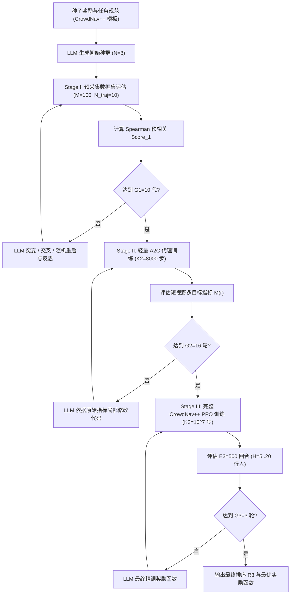

# EvoNav: Evolutionary Reward Function Design for Robot Navigation with Large Language Models

## 一句话定义

EvoNav 是一种结合大语言模型（LLM）与渐进保真度（progressive-fidelity）三阶段评估流程的进化式奖励函数自动设计框架，用于在动态人群环境中高效合成兼顾成功率、避障安全与路径效率的机器人导航强化学习奖励函数。

## 英文缩写速查

| 缩写 | 英文全称 | 简要说明 |
|---|---|---|
| LLM | Large Language Model | 大语言模型，负责生成、突变、交叉与精调可执行 Python 奖励函数代码 |
| RL | Reinforcement Learning | 强化学习，将设计好的奖励函数用于训练人群导航策略 |
| MDP | Markov Decision Process | 马尔可夫决策过程，用于形式化离散时间平面人群导航任务 |
| PPO | Proximal Policy Optimization | 近端策略优化算法，Stage III 完整人群导航策略（CrowdNav++ 骨干）的训练优化器 |
| A2C | Advantage Actor-Critic | 优势行动者-评论家算法，Stage II 轻量代理策略 $\pi_\phi^{\text{proxy}}$ 的快速训练器 |
| ORCA | Optimal Reciprocal Collision Avoidance | 最优互惠避碰算法，用于构建对比基线及仿真中的行人运动模型 |
| SR / CR / TR | Success Rate / Collision Rate / Timeout Rate | 成功率、碰撞率与超时率，衡量人群导航任务成败的核心安全与完成度指标 |
| ITR / SD | Intrusion Time Ratio / Social Distance | 侵入时间比（进入行人预测轨迹空间的占比）与社交距离（与最近行人的平均最小距离） |

## 为什么重要

在动态人群导航任务中，强化学习策略的表现高度依赖奖励函数的设计。传统做法依赖领域专家手工设计并反复调节由“目标推进、碰撞惩罚、社交礼让”等加权项组成的奖励函数，不仅开发周期长、难以迁移到约束更严格的新场景，还容易引入隐蔽的归纳偏置（如奖励黑客或局部激进穿行）。

另一方面，尽管 Eureka、CARD 等代表性 LLM 自动奖励设计方法能够生成可读的 Python 奖励代码，但它们通常需要为每个候选奖励从头执行完整规模的策略训练，在仿真耗时较长的人群导航中面临严重的算力瓶颈。EvoNav 通过“解析规则粗筛 $\rightarrow$ 轻量代理模型快速推演 $\rightarrow$ 完整策略集中精调”的三阶段设计，将大量探索开销前移到极低成本的代理信号上，从而在有限预算内实现更充分的奖励空间搜索。

## 核心信息

| 项目 | 内容 |
|---|---|
| 作者 | Zhikai Zhao, Chuanbo Hua, Federico Berto, Zihan Ma, Kanghoon Lee, Jiachen Li, Jinkyoo Park |
| 机构 | KAIST, Radical Numerics, UC Riverside, Omelet (AI4CO) |
| 发表时间 | 2026-05-12（arXiv:2605.11859v1 [cs.RO]） |
| 论文链接 | [arXiv HTML](https://arxiv.org/html/2605.11859) · [arXiv 摘要](https://arxiv.org/abs/2605.11859) |
| 项目与代码 | 论文未提供独立项目页或官方代码仓库链接 |
| 清单分类 | `model.training`（来源条目：`survey_ax_2605_11859`） |
| 开源状态 | 未确认开源代码（截至 2026-11-27 未检索到官方代码仓库） |

## 核心原理

### 1. 问题形式化与奖励代码表示

EvoNav 考虑离散时间 $t \in \{0, \dots, T-1\}$ 下，全向移动机器人（半径 $r_0$、最大速度 $v_{\max}$、运动学 $x_{t+1} = x_t + \Delta t \, a_t$）在二维平面工作空间 $\mathcal{W} \subset \mathbb{R}^2$ 中穿越 $H$ 名动态行人的导航任务。状态 $s_t = [e_t, h_t, m_t]$ 包含自车状态 $e_t$、周围行人状态 $h_t$ 及辅助轨迹预测输出 $m_t$（未来 $K$ 步预测位置）。问题被建模为有限视野 MDP $\mathcal{M} = (\mathcal{S}, \mathcal{A}, P, R_\theta, \gamma, \rho_0)$，目标是通过优化参数化奖励 $R_\theta$ 引导策略最大化期望折扣回报 $J(\pi_\phi; R_\theta)$。

候选奖励 $r_\theta$ 以可执行 Python 函数表示（论文主文抽象接口记为 `cal_reward(s_t)`，Appendix C.6 与 D.1/D.5 提示词模板中的具体签名是 `compute_reward(inst, traj)` / `seed_reward_func(inst, traj)`），所有权重和阈值均内联为函数局部变量，输出单帧标量浮点奖励。

### 2. 渐进保真度三阶段流程（Warm-Up-Boost）

基于“早期低保真代理排序与最终完整训练结果呈正相关（Proxy Consistency）”的假设，EvoNav 从一个源自 CrowdNav++ 的通用种子奖励（成功奖励 $+10$、碰撞惩罚 $-20$ 与距离进度塑形）出发，初始化 $N=8$ 个候选函数，并依次经历以下三个阶段：

1. **Stage I — 解析规则驱动演化（Warm-up，$G_1=10$ 代，零策略训练）：**
   在包含 $M=100$ 个预采集场景（每场景 $N_{\text{traj}}=10$ 条多样化轨迹、约 $F_j \approx 200$ 帧）的数据集 $\mathcal{D}$ 上评估候选奖励。对于每个场景 $j$ 与帧 $f$，比较基于规则的真实质量排序 $\text{rank}_{\text{rules}}^{(j,f)}$（优先级：成功 $>$ 进度 $>$ 碰撞）与候选累计奖励排序 $\text{rank}_{r_\theta}^{(j,f)}$ 之间的 Spearman 秩相关：
   $$\text{Score}_1(r_\theta) = \frac{1}{M}\sum_{j=1}^{M}\frac{1}{F_j}\sum_{f=1}^{F_j} \text{Corr}\big(\text{rank}_{\text{rules}}^{(j,f)}, \text{rank}_{r_\theta}^{(j,f)}\big)$$
   LLM 根据相关性排名与累积反思笔记，执行**突变（Mutation）**、**交叉（Crossover）**与**随机重启（Random Restart）**，每代仅需数分钟 CPU 计算。

2. **Stage II — 轻量代理模型推演（Boost，$G_2=16$ 轮，低成本训练）：**
   将 Stage I 演化出的 $N=8$ 个候选函数投入轻量代理策略 $\pi_\phi^{\text{proxy}}$（A2C）从零训练，每轮仅训练 $K_2=8{,}000$ 步并在 $E_2=50$ 个短视野（$T_{\text{short}}=100$ 步）回合中评估多目标指标元组 $M(r) = (\text{SR}, \text{NT}, \text{PL}, \text{ITR}, \text{SD})$。LLM 直接阅读原始多目标数值（而非仅看名次），对每个候选代码进行局部精细修正（如增强安全区分度、抑制振荡），并在第 $G_2$ 轮后由 LLM 综合排序输出 $\mathcal{R}_2$。

3. **Stage III — 完整策略精调（Final Refinement，$G_3=3$ 轮，高保真对齐）：**
   将经过前两阶段筛选与打磨的候选奖励接入完整 CrowdNav++ 网络架构，使用 PPO 训练 $K_3=10^7$ 环境步，并在 $E_3=500$ 个测试回合（行人数量 $H \in \{5, 10, 15, 20\}$）上评估全套指标，再经 LLM 小幅度微调与最终排序 $\mathcal{R}_3$，锁定最终部署奖励函数。

## 流程总览

## 源码运行时序图

**不适用**（截至 2026-11-27，论文原文 [arXiv:2605.11859](https://arxiv.org/html/2605.11859) 及补查材料均未给出官方代码仓库或可运行源码入口，仅在 Appendix D 展示了提示词与 `seed_reward_func` 示例片段，无法进行源码运行时序核验）。

## 实验与评测

### 1. 仿真环境与配置

- **环境：** $12 \times 12\ \text{m}^2$ 二维连续空间，传感器视野 $R_{\text{sense}}=5\ \text{m}$，机器人最大速度 $v_{\max}=1\ \text{m/s}$，最多 $H=20$ 名由 ORCA 控制的动态行人（行人仅对其他行人反应、不主动避让机器人）。
- **测试场景：** 含随机化（`w/ random`：行人可中途切换目标，$v_{h,\max}\in[0.5,1.5]\ \text{m/s}$，$r_h\in[0.3,0.5]\ \text{m}$）与无随机化（`w/o random`：行人属性与目标固定）。
- **对比公平性控制：** EvoNav、Eureka、CARD 与 CrowdNav++ 在主实验（Table 1）中均采用完全相同的 CrowdNav++ 策略架构与 PPO 训练流程（NVIDIA A6000 GPU），默认生成器为本地 vLLM 部署的开源模型 `gpt-oss-120B`，性能差异纯由奖励函数质量决定。

### 2. 主实验结果（Table 1）

| 场景设置 | 方法 | SR (%) ↑ | CR (%) ↓ | TR (%) ↓ | NT ↓ | PL ↓ | ITR ↓ | SD ↑ |
|---|---|---|---|---|---|---|---|---|
| w/ random | SF | 29.30 | 21.42 | 49.55 | 17.68 | 15.93 | 17.68 | 0.37 |
| w/ random | ORCA | 69.11 | 24.21 | 6.68 | 19.61 | 17.67 | 19.61 | 0.38 |
| w/ random | DS-RNN | 64.14 | 25.41 | 10.45 | 23.91 | 19.63 | 23.91 | 0.34 |
| w/ random | CrowdNav++ | 89.35 ± 0.68 | 7.88 ± 0.54 | 2.77 ± 0.13 | 15.03 ± 0.32 | 21.31 ± 0.48 | 4.18 ± 0.26 | 0.44 ± 0.01 |
| w/ random | Eureka | 86.71 ± 0.74 | 10.03 ± 0.60 | 3.26 ± 0.15 | 15.63 ± 0.28 | 20.87 ± 0.37 | 7.26 ± 0.34 | 0.44 ± 0.01 |
| w/ random | CARD | 91.35 ± 0.69 | 6.12 ± 0.48 | 2.53 ± 0.12 | 15.15 ± 0.30 | 20.83 ± 0.41 | 7.20 ± 0.33 | 0.42 ± 0.01 |
| w/ random | **EvoNav** | **93.22 ± 0.61** | **4.47 ± 0.42** | **2.31 ± 0.10** | 15.26 ± 0.27 | 20.38 ± 0.36 | 7.71 ± 0.30 | 0.42 ± 0.01 |
| w/o random | CrowdNav++ | 94.03 ± 0.66 | 4.88 ± 0.45 | 1.09 ± 0.08 | 17.64 ± 0.35 | 22.51 ± 0.40 | 3.06 ± 0.24 | 0.43 ± 0.01 |
| w/o random | Eureka | 92.71 ± 0.62 | 5.89 ± 0.46 | 1.40 ± 0.10 | 17.49 ± 0.32 | 22.18 ± 0.38 | 7.71 ± 0.29 | 0.41 ± 0.01 |
| w/o random | CARD | 94.33 ± 0.58 | 4.71 ± 0.40 | 0.96 ± 0.08 | 17.52 ± 0.30 | 22.03 ± 0.36 | 7.47 ± 0.27 | 0.41 ± 0.01 |
| w/o random | **EvoNav** | **95.61 ± 0.55** | **4.01 ± 0.36** | **0.38 ± 0.06** | 17.01 ± 0.28 | 19.98 ± 0.33 | 8.89 ± 0.25 | 0.40 ± 0.01 |

### 3. 阶段消融、LLM 消融与算力成本（Table 2, 8, 9）

- **三阶段累积收益（Table 2，w/ random）：** CrowdNav++ 基准 SR 为 $89.35\pm0.68\%$（CR $7.88\%$，TR $2.77\%$）；仅经过 **Stage I** 提升至 SR $90.11\pm0.60\%$（CR $7.60\%$，TR $2.60\%$）；**Stage I+II** 达到 SR $92.93\pm0.58\%$（CR $5.85\%$，TR 降至 $1.35\pm0.10\%$），此时已超过 CARD；加入 **Stage III** 后达到 SR $93.22\pm0.61\%$，碰撞率进一步降至 $4.47\pm0.42\%$。
- **不同 LLM 骨干消融（Table 8）：** 在该对照实验配置下（CrowdNav++ 基准 SR $84.3\%$），五种 LLM 均稳定超越手工基线：GPT-4o-mini（$86.2\%$）、Llama-3.1-70B（$88.5\%$）、Llama-3.1-405B（$90.1\%$）、GPT-4o（$90.8\%$）、GPT-OSS-120B（$91.2\%$）。
- **成本对比（Table 9）：** CARD 消耗 36 GPU 小时（$\$18.00$）+ 72K LLM tokens（$\$0.02$），总计 $\$18.02$；EvoNav 虽然使用了 10 倍以上的 LLM tokens（720K tokens，$\$0.21$），但 GPU 仅需 9.2 小时（$\$4.60$），总计 $\$4.81$，实现 **74% GPU 成本节省**与 **73% 总成本节省**。
- **行为定性规律（§5.3）：** 演化出的奖励函数自发形成了三类机制——随距离变化的非均匀安全惩罚（近距重罚、远距宽松）、随目标接近度递增的目标导向权重（远距离允许灵活绕行、近目标收紧直行），以及抑制无意义晃动的几何路径偏离惩罚。

## 与其他工作对比

| 维度 | CrowdNav++（手工） | Eureka | CARD | EvoNav（本文） |
|---|---|---|---|---|
| 奖励设计方式 | 专家手工加权公式 | LLM 代码生成 + 反思演化 | LLM + 轨迹偏好初筛（TPE） | LLM + 三阶段渐进保真度演化 |
| 候选评估代价 | 需人工反复重训调参 | 每个候选均需完整策略训练 | 过滤后候选仍需完整策略训练 | 前两阶段使用解析与轻量代理，仅末轮完整训练 |
| w/ random SR / CR | 89.35% / 7.88% | 86.71% / 10.03% | 91.35% / 6.12% | **93.22%** / **4.47%** |
| 算力开销（对比 Table 9） | 人工调参隐性成本高 | 需全量训练 | 36h GPU / \$18.02 | **9.2h GPU / \$4.81（降幅 73%）** |
| 主要优势与侧重 | 结构简洁、ITR 较低（4.18） | 通用性强 | 引入 TPE 减少部分无效训练 | 搜索预算高度聚焦，SR 与 CR 均衡 |

## 结论

**一句话总判：EvoNav 的核心贡献并非提出新的导航策略网络，而是用“解析秩相关 $\rightarrow$ 轻量短视野 A2C $\rightarrow$ 完整 PPO”的三级过滤漏斗破解了 RL 奖励搜索的评估瓶颈，在人群导航中以约 1/4 的 GPU 开销获得了比手工和现有自动奖励方案更高的成功率与更低碰撞率。**

1. **前置过滤极具性价比** — Stage I 零训练筛选与 Stage II 仅 $8{,}000$ 步的短视野代理训练（Stage I+II 在 `w/ random` 下已达 92.93% SR）承担了绝大多数搜索工作，证明粗粒度代理足以保留优质奖励的相对排序。
2. **用少量 Token 换取大量 GPU 时间** — 相比 CARD，EvoNav 将 LLM token 消耗提高 10 倍（$\$0.02 \to \$0.21$），换来 GPU 小时数从 36h 降至 9.2h（节省 74% GPU 成本），在多卡 RL 算力受限的场景下尤为实用。
3. **成功率与礼让指标存在微弱权衡** — 尽管 EvoNav 的 SR、CR、TR 和路径长度 PL 全面优于 CrowdNav++，但其侵入时间比 ITR（`w/ random` 7.71 vs 4.18）高于手工奖励、社交距离 SD 略低（0.42 vs 0.44），说明进化奖励更偏向高效且不碰撞的绕行而非刻意保持极大社交缓冲。
4. **对 LLM 规模不敏感但受益于更强推理** — 从 GPT-4o-mini（86.2%）到 GPT-OSS-120B（91.2%），所有测试模型均显著超越手工基线（84.3%），本地部署开源 120B 模型即可达到最佳效果。

## 工程实践

1. **构建 Stage I 离线轨迹数据集：** 预先利用基础策略、规则控制器或随机策略在目标仿真器中采集覆盖成功、碰撞与超时样本的多样化轨迹（文中 $M=100$ 场景 $\times 10$ 轨迹），确保解析排序 `rank_rules` 具备足够区分度。
2. **保持轻量代理与完整策略的状态/奖励接口一致：** 无论是在 Stage I 的离线轨迹回放、Stage II 的轻量 A2C（$T_{\text{short}}=100, K_2=8{,}000$）还是 Stage III 的完整 PPO（$K_3=10^7$）中，均严格固定奖励函数签名与局部变量参数化约束（禁止向函数签名追加外部超参）。
3. **向 LLM 反馈原始多目标指标而非仅排名：** Stage II/III 中必须将 `(SR, NT, PL, ITR, SD)` 等原始数值暴露给反思与精调提示词，否则 LLM 无法判断需要修正“碰撞过高”还是“绕行冗余”。
4. **若在项目实际部署，建议重加权 Stage II/III 社交惩罚：** 若业务场景对行人舒适度（低 ITR、高 SD）要求高于路径长度，应在多目标排序提示词与 Stage I 规则排序中显式提升 ITR/SD 的权重。

## 局限与风险

1. **未确认开源实现与可复现细节缺失：** 论文未公开官方代码仓库，且文中（`cal_reward(s_t)`）与附录提示词（`compute_reward(inst, traj)`）的函数签名描述存在细微表述差异，Appendix D.5 展示的 `seed_reward_func` 示例中亦存在距离计算索引笔误（`prev_dist` 使用了 `start_x, start_y`），复现时需依据 CrowdNav++ 原版奖励逻辑校准。
2. **代理一致性（Proxy Consistency）依赖任务特征：** 论文主要通过可视化分布验证（Figure 5）及设定 $\rho_{12}, \rho_{23} > 0.5$ 阈值来支撑代理一致性，但在更复杂的长视野稀疏奖励或非完整约束（non-holonomic）三维物理仿真中，8,000 步短视野代理是否仍能保序尚待验证。
3. **仿真假设简化与 Sim2Real 鸿沟：** 实验仅在二维连续平面内针对全向机器人与 ORCA 行人验证，且假设行人不会对机器人做出交互避让；未涉及激光雷达/视觉感知噪声、真实人群非合作行为或真机动力学约束下的泛化评测。
4. **侵入时间比（ITR）上升：** 如 Table 1 所示，EvoNav 在两种设置下的 ITR 均高于手工设计的 CrowdNav++ 基准，提示在高度强调社交礼让的物理部署中可能需要额外加入人机个人空间硬约束或显式 ITR 惩罚项。

## 关联页面

- [Agentic Robots 综述](paper-towards-agentic-robots-survey.md)
- [全量项目节点清单](../overview/awesome-agentic-robots-node-index.md)
- [VLA 方法背景](../methods/vla.md)
- [机器人导航与路径执行](../methods/robot-navigation-workflow.md)：对照导航目标、规划与执行。
- [强化学习（RL）基础](../methods/reinforcement-learning.md)：MDP 建模与奖励函数塑形核心背景。
- [近端策略优化（PPO）](../methods/ppo.md)：EvoNav Stage III 完整人群导航策略训练所使用的优化算法。
- [遗传编程（Genetic Programming）](../methods/genetic-programming.md)：对照基于代码表示的演化搜索与 LLM 反思式程序进化。

## 推荐继续阅读

- [EvoNav arXiv HTML 全文](https://arxiv.org/html/2605.11859)（包含完整三阶段公式、消融表、提示词模板与种子函数）
- [EvoNav arXiv 摘要页](https://arxiv.org/abs/2605.11859)

## 参考来源

- [EvoNav 原文核对归档](../../sources/papers/paper-agentic-2605-11859.md)
- [官方 Awesome 快照归档](../../sources/repos/awesome-agentic-robots-survey-index.md)
- [EvoNav arXiv HTML 全文](https://arxiv.org/html/2605.11859)
- [EvoNav arXiv 摘要页](https://arxiv.org/abs/2605.11859)
