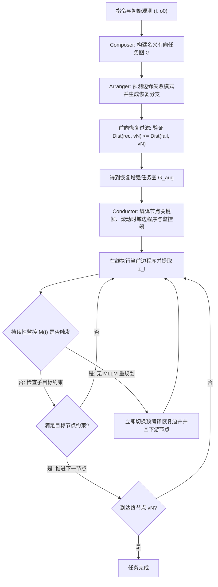
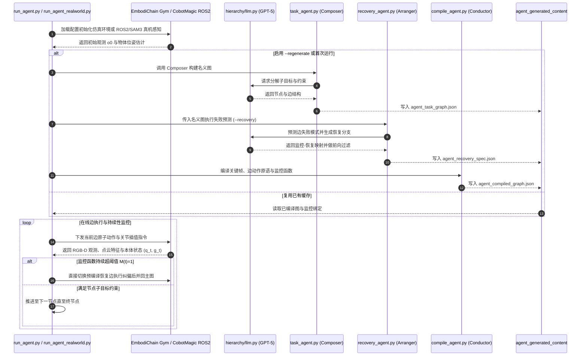

# From Reaction to Anticipation: Proactive Failure Recovery through Agentic Task Graph for Robotic Manipulation

## 一句话定义

**AgentChord** 是一个面向长时程机器人操作的智能体系统框架：它在执行前由三类协同智能体把任务建模为带“前向恢复分支”的增强有向任务图并编译为可中断约束程序，使执行期一旦触发低延迟在线监控即可直接切入预编译恢复分支，而无需重新调用多模态大模型重规划或全流程回退。

## 英文缩写速查

| 缩写 | 英文全称 | 简要说明 |
|---|---|---|
| MLLM | Multimodal Large Language Model | 多模态大语言模型（实验中各方法统一使用 GPT-5），负责任务图构建与失败模式推理 |
| VQA | Visual Question Answering | 视觉问答，传统反应式失败检测范式将异常判定建模为高频 VQA 查询 |
| PCA | Principal Component Analysis | 主成分分析，本文用于从物体点云提取主方向轴以监测倾倒等姿态偏差 |
| SDF / ESDF | Signed Distance Field / Euclidean Signed Distance Field | 有符号距离场，用于节点与路径约束求解中的体素化碰撞惩罚 |
| SLSQP | Sequential Least Squares Programming | 序列最小二乘规划，本文配合 Dual Annealing 进行节点子目标局部精修 |
| IK | Inverse Kinematics | 逆运动学，将末端执行器 $SE(3)$ 位姿命令映射为机械臂关节角配置 |

## 为什么重要

1. **打破“检测—推理—恢复”的反应式延迟瓶颈：** 传统 MLLM 失败恢复（如 Inner Monologue、DoReMi）依赖频繁 VQA 询问或失败后重新请求大模型，API 与本地推理耗时高且语言指导空间粒度粗糙；即便 Code-as-Monitor 已将监控编译为代码，失败后仍需重调上层推理管线。AgentChord 将失败预测与恢复规划前移到执行前，显著压缩在线恢复延迟。
2. **用前向恢复分支替代脆弱的回溯策略：** 现有代码化约束方法（如 ReKep）依赖向后回溯（backtracking）重放，在含异步与同步协同的双臂操作任务（如双臂倒水、积木交接）中容易引入冗余动作甚至失败。AgentChord 对每条恢复路径施加图上剩余代价非增约束，避免盲目回退。
3. **兼顾执行鲁棒性与下游策略数据生成：** 生成的可恢复轨迹可直接用于微调下游视觉-语言-动作（VLA）策略，在杯子移位扰动评测中将 Sim2Real-VLA 成功率由 `26/50` 提升至 `39/50`。

## 核心信息

| 字段 | 内容或状态 |
|---|---|
| 作者 | Sheng Xu, Ruixing Jin, Huayi Zhou, Bo Yue, Guanren Qiao, Yunxin Tai, Kui Jia, Guiliang Liu |
| 机构 | 香港中文大学（深圳）数据科学学院、跨维智能（DexForce Technology）、深圳河套研究院 |
| 发表时间 | arXiv v1 提交于 2026-05-12；已录用于 RSS 2026 |
| 论文链接 | [arXiv:2605.11951 (HTML v1)](https://arxiv.org/html/2605.11951) / [arXiv 摘要页](https://arxiv.org/abs/2605.11951) |
| 项目与代码 | [官方项目页 (shengxu.net)](https://shengxu.net/AgentChord/) / [GitHub 官方仓库 (EDEM-AI/AgentChord)](https://github.com/EDEM-AI/AgentChord) / [论文附录仓库 (Jasonxu1225/AgentChord)](https://github.com/Jasonxu1225/AgentChord) |
| 清单分类 | harness.monitoring_and_recovery |
| 来源条目 | `survey_ax_2605_11951` |
| 开源状态 | 已开源（Apache-2.0，基于 EmbodiChain 发布层次化智能体、原子动作、监控函数、3 项仿真配置及 CobotMagic 真机部署脚本；更多监控与恢复模板仍在扩展） |

## 核心原理

### 1. 感知接口与任务相关特征抽取（§III-A, Appendix C-D）

系统配备三类工具：感知工具 $\mathcal{F}_{\text{perc}}$（SAM3 开放词汇分割与跨帧追踪、AnyGrasp 6-DoF 抓取位姿生成、FoundationPose）、10 个原子动作原语 $\mathcal{F}_{\text{action}}$（`drive`、`grasp`、`open_gripper`、`close_gripper`、`move_to_obj`、`move_to_target`、`move_by_offset`、`rotate_eef`、`place`、`back`）以及多模态模型接口 $\mathcal{F}_{\text{mllm}}$。

不同于 ReKep / Code-as-Monitor 固定依赖 VLM 提取关键点，AgentChord 定义可组合的任务特征向量：

$$z_t = \Phi(\hat{x}_t, \xi_t), \quad \hat{x}_t = \Psi(o_t), \quad \xi_t = (q_t, g_t)$$

其中 $\hat{x}_t$ 来自双目 RGB-D 观测 $o_t$ 的 SAM3 掩码 $m_t^k$ 与深度融合点云 $\mathcal{P}_t^k \in \mathbb{R}^{N_k \times 3}$，$\Phi$ 从中提取质心、极值/边界点、PCA 主方向轴及物体比例位置（如瓶身四分之一处），并与机器人关节角 $q_t$ 及夹爪开合状态 $g_t$ 拼接，同时服务于约束求解与失败监测。

### 2. 三智能体协同与恢复增强任务图（§III-B–§III-C）

AgentChord 模仿乐团编排划分为三个角色：

- **Task Structuring Agent（Composer）：** 输入语言指令 $\mathcal{I}$ 与初始观测 $o_0$，构建名义有向图 $\mathcal{G} = (V, E)$。每个节点 $v^i \in V$ 对应语义子目标及不等式子目标约束 $\mathcal{C}_{\text{sub}}^i$（$c(z^i) \le 0$）；每条边 $\varepsilon^{i\rightarrow j} \in E$ 对应过渡运动及路径约束 $\mathcal{C}_{\text{path}}^{i\rightarrow j}$（$c(z_t) \le 0$）。
- **Recovery Orchestration Agent（Arranger）：** 在执行前扫描每条名义边 $\varepsilon^{i\rightarrow j}$，预测可能失败模式集合 $\mathcal{F}^{i\rightarrow j} = \{f_1^{i\rightarrow j}, f_2^{i\rightarrow j}, \dots\}$，为每种失效配置恢复节点 $v_m^{\text{rec}(i,j)} \in V_{\text{rec}}$ 与恢复边 $E_{\text{rec}}$（从失败上下文跳至恢复节点，再并回候选下游节点 $v^k \in K_m^{i\rightarrow j}$），形成增强任务图 $\mathcal{G}_{\text{aug}} = (V \cup V_{\text{rec}}, E \cup E_{\text{rec}})$。若恢复意图与已有名义节点一致，则直接并回而不增设节点。
- **前向恢复过滤原则（Forward-Moving Recovery）：** 设 $\mathrm{Dist}(u, v)$ 为 $\mathcal{G}_{\text{aug}}$ 上以物理执行步数等代价为边权的最短路径代价，当边 $\varepsilon^{i\rightarrow j}$ 执行出错时记失败上下文 $v^{\text{fail}} := v^i$，仅保留满足下式的恢复分支，杜绝无效回退：

$$\mathrm{Dist}\!\left(v_m^{\text{rec}(i,j)}, v^N\right) \le \mathrm{Dist}\!\left(v^{\text{fail}}, v^N\right)$$

### 3. 层次化约束编译与持续性监控触发（§III-D, Appendix C-E–C-G）

**Execution Compilation Agent（Conductor）** 统一对名义边与恢复边做两级求解与监控编译：

- **节点合成（Eq. 9）：** 采用 Dual Annealing 全局搜索 + SLSQP 局部精修求解目标末端位姿 $e^i = \arg\min_e \lambda_{\text{sub}}^i(e; \hat{x}^i)$，满足硬约束 $\mathcal{C}_{\text{sub}}^i$，软代价包含体素 ESDF/SDF 碰撞惩罚、IK 可达性残差、参考位姿正则、跨帧一致性 $\|e - e_{\text{prev}}^i\|^2$ 及双臂手腕间距/臂间防自碰项。
- **边合成（Eq. 10）：** 采用滚动时域（receding-horizon）优化未来 $H$ 步位姿序列 $\mathbf{e}_{t:t+H}^*$ 并仅执行前 $M=5$ 步，随后用当下感知更新重规划，目标 $\lambda_{\text{path}}^{i\rightarrow j}$ 惩罚轨迹平顺度、SDF 安全余量与 IK 残差。
- **监控与低延迟切换（Eq. 11–19）：** 将失败检测与路径约束解耦，编译为标量违背函数 $f_m^{i\rightarrow j}(z_t) \le 0$（涵括物体移位 $f_{\text{shift}}^k$、倾倒 $f_{\text{tilt}}^k$、未抓牢/滑脱 $f_{\text{grasp}}, f_{\text{attach}}^k$、遮挡丢点 $f_{\text{vis}}^k$ 与双物相对对齐偏差 $f_{\text{rel}}^{k,l}$）。为抑制瞬时感知噪声，仅当连续 $K$ 步超出鲁棒余量 $\epsilon$ 时触发切换：

$$\mathcal{M}_m^{i\rightarrow j}(t) = \mathbb{I}\!\left[f_m^{i\rightarrow j}(z_{t'}) > \epsilon,\ \forall t' \in \{t-K+1,\dots,t\}\right], \quad \rho(\varepsilon^{i\rightarrow j}, f_m^{i\rightarrow j}) = \varepsilon^{i\rightarrow \text{rec}(i,j,m)}$$

## 流程总览

## 源码运行时序图

以下时序图依据官方仓库 [EDEM-AI/AgentChord](https://github.com/EDEM-AI/AgentChord) 的 `README.md` 与目录清单编写，对应仿真入口 `embodichain/lab/scripts/run_agent.py`、真机入口 `embodichain/deploy/run_agent_realworld.py` 及核心层次智能体模块 `embodichain/agents/hierarchy/`（`task_agent.py`、`recovery_agent.py`、`compile_agent.py`、`llm.py`）：

关键复现入口：在配置好 `LLM_URL` 与 `OPENAI_API_KEY` 后，仿真端可通过 `python embodichain/lab/scripts/run_agent.py --gym_config ... --agent_config ... --task_name SinglePourWater --recovery --interactive_error_injection` 运行并在终端按 `f` 注入位移/倾倒扰动；真机端则先拉起 `can_left`/`can_right` 与 `piper` ROS 2 驱动，再运行 `python embodichain/deploy/run_agent_realworld.py --recovery` 完成感知与图执行（详见 [官方代码库档案](../../sources/repos/paper-agentic-2605-11951.md)）。

## 实验与评测

所有方法均统一接入 **GPT-5** API 与相同功能工具集，在 **AgileX CobotMagic**（双 6-DoF 机械臂、最大张开 10 cm 平行夹爪）及双 10 Hz 双目 RGB-D 相机设置下评测，每项任务 20 次试验并随机采样物体实例与初始位姿。

### 1. 仿真扰动评测（EmbodiChain，Table I）

在单臂倒水、双臂倒水、桌面整理 3 项任务中，每步原子动作以概率 $p \in \{0.05, 0.10\}$ 随机掉落手中物体，使用仿真真实物体位姿隔离感知误差：

| 指标（3 任务 6 组设置均值） | Inner Monologue (IM) | DoReMi (DRM) | ReKep | Code-as-Monitor (CaM) | **AgentChord** |
|---|---|---|---|---|---|
| **平均成功率 (%) ↑** | 79.2 | 92.5 | 92.5 | 97.5 | **99.2** |
| **平均执行时间 (s) ↓** | - | 105.9 | 54.4 | 78.1 | **41.5** |
| **平均执行步数 ↓** | - | 373 | 391 | 356 | **352** |

分任务看，高扰动双臂倒水（$p=0.10$）中，ReKep 因单纯回溯不适应双臂异步/同步协同降至 `75%`（531 步 / 93.1 s），CaM 为 `90%`（492 步 / 110.0 s），AgentChord 达 **`95%`**（483 步 / 63.4 s）。

### 2. 真机 6 项长时程操作评测（Table II）

真机每回合随机人为施加 1–2 次抓取干扰或强行移走手中物体的扰动（`Rearrange table` 与 `Fold towel` 因细长/柔性物体本身亦会自然失效）：

| 真机任务（各 20 trials） | IM 成功率 | DRM 成功率 / 耗时 | ReKep 成功率 / 耗时 | CaM 成功率 / 耗时 | **AgentChord 成功率 / 耗时** |
|---|---|---|---|---|---|
| **Single-arm pour water** | 70% | 80% / 130.5 s | 85% / 87.0 s | 90% / 119.5 s | **95% / 75.9 s** |
| **Dual-arm pour water** | 60% | 65% / 185.0 s | 60% / 130.8 s | 70% / 167.2 s | **80% / 110.7 s** |
| **Rearrange table** | 80% | 85% / 113.4 s | **95%** / 85.4 s | 90% / 99.3 s | 90% / **71.0 s** |
| **Handover block** | 60% | 70% / 178.6 s | 60% / 149.5 s | 75% / 170.2 s | **85% / 130.1 s** |
| **Fold towel** | 40% | 50% / 117.5 s | 50% / 83.7 s | 50% / 108.1 s | **55% / 78.4 s** |
| **Setup coffee tray** | 45% | 50% / 135.8 s | 40% / 105.9 s | **60%** / 121.3 s | **60% / 87.3 s** |
| **6 任务均值** | 59.2% | 66.7% / 143.5 s | 65.0% / 107.1 s | 72.5% / 130.9 s | **77.5% / 92.2 s** |

### 3. 前向恢复图消融（Table V）与策略数据增强（Table III）

- **前向恢复分支消融（Table V）：** 将 AgentChord 去掉预编译恢复节点/边、改为触发监控后回退至上一节点重放的变体 `AC-BT` 与原版对比（3 项真机任务）：平均成功率从 `ReKep` `68.3%`、`AC-BT` `73.3%` 跃升至 `AgentChord` **`86.7%`**，平均耗时从 `122.4 s` / `128.4 s` 降至 **`105.6 s`**。
- **恢复轨迹赋能 VLA 微调（Table III）：** 在仿真单臂倒水“抓瓶后杯子被移位”场景（50 次评测）中，将 `Sim2Real-VLA` 的 40 条微调轨迹中一半替换为 AgentChord 生成的可恢复轨迹得到 `Sim2Real-VLA (rec)`，成功率由 `26/50` 提升至 **`39/50`**（同期基线 RDT `16/50`、$\pi_0$ `20/50`、GR00T N1.5 `15/50`）。

## 与其他工作对比

| 对比维度 | Inner Monologue / DoReMi | ReKep | Code-as-Monitor (CaM) | **AgentChord** |
|---|---|---|---|---|
| **失败检测方式** | 子目标或高频 VQA 询问 | VLM 关键点约束代码 | 约束绘制器 + 监控脚本 | 任意几何/本体特征向量 $z_t$ + 持续性窗口编译监控 |
| **恢复触发机制** | 失败后重调 VLM 推理 | 回退至先前节点重执行 | 失败后重调上层 MLLM 管线 | 预编译恢复分支直接映射切换，在线零 MLLM 调用 |
| **双臂协同支持** | 延迟高且语言粒度粗 | 回溯策略在异步双臂下易失灵 | 步数接近但频繁调用耗时大 | 前向恢复代价过滤 + 双臂防自碰/协同正则求解 |
| **数据副产物价值** | 仅用于当前回合纠错 | 无前向纠偏恢复分支 | 反应式重试轨迹 | 可恢复轨迹可直接提升下游 VLA 恢复能力 |

## 结论

**一句话总判：把 MLLM 的失败推理与恢复分支构建从“事故发生后在线急救”前移为“执行前静态编排并过滤为前向恢复图”，是在不牺牲真机双臂成功率的条件下大幅压低恢复延迟的关键工程路径。**

1. **编译监控必须配合前向恢复边，不能只做监控+回退：** 消融表（Table V）显示仅用灵活特征与编译监控做回退（`AC-BT`）耗时反增至 `128.4 s`、成功率仅 `73.3%`；加入前向恢复分支后成功率提至 `86.7%` 且耗时降至 `105.6 s`。
2. **检测特征需贴合物理交互本质并设持续性滤波：** 论文实测指出，判别是否夹牢物体时直接监测夹爪开合度（$g_t$）远比依赖 noisy 点云计算物体-夹爪距离可靠，同时需通过窗口 $K$ 与余量 $\epsilon$ 避免瞬时接触抖动误触发。
3. **预编译图无法覆盖的罕见/复合异常仍需保底回退：** 工程落地时应在子目标超时或未匹配分支时保留 MLLM 边界核查兜底，而不是完全移除在线诊断。
4. **恢复轨迹具备跨范式复用价值：** AgentChord 产生的纠偏轨迹可用于混合微调底层 VLA 策略（Sim2Real-VLA 从 `26/50` 升至 `39/50`），适合作为数据合成与自动纠错前端。

## 工程实践

- **仿真快速验证：** 按 [EDEM-AI/AgentChord](https://github.com/EDEM-AI/AgentChord) README 安装 EmbodiChain 依赖（或拉取 `dexforce/embodichain:ubuntu22.04-cuda12.8` 容器），配置 `LLM_URL` 与 `OPENAI_API_KEY`，运行 `embodichain/lab/scripts/run_agent.py` 并开启 `--recovery` 与 `--interactive_error_injection`，即可对比名义图与恢复图在手动注入位置偏移/倒地故障下的执行差异；图与编译缓存落于 `embodichain/database/agent_generated_content/sim/<task_name>/`。
- **真机部署要点：** CobotMagic 真机依赖 ROS 2、Piper 双臂驱动（`can_left`/`can_right` 1 Mbps）、Kingfisher 双目相机与自行下载的 `sam3.pt` 权重，且须保证任务提示词、`--object_names`、SAM 分割提示词与 affordance 配置中的物体名称严格一致。
- **与站内架构对照：** 本文把高层图编排与低层约束求解/原子动作解耦，可结合 [机器人智能体执行框架](../methods/robot-agent-harness.md) 与 [智能体规划与反馈执行](../methods/agent-planning-feedback.md) 评估监控契约设计。

## 局限与风险

1. **未预判异常的盲区（§IV-D, §V）：** 若出现罕见、复合或非手部直接引发的异常，或者 Arranger 推理遗漏/选错并回节点（例如交接移位时需先撤回右臂并重开夹爪），预编译分支可能无法覆盖；作者建议在子目标边界或超时时引入 MLLM 校验器作为兜底。
2. **IK 可达性与重抓几何瓶颈（§IV-D）：** 即使高层选择了合理恢复意图，当物体倾倒或被推入不利姿态时，6-DoF 机械臂受限于关节限位与工作空间仍可能出现 IK 无解。
3. **感知与特征提取敏感性（§IV-D, §V）：** 柔性毛巾折叠（真机仅 55%）等场景下物体形变或透明/无规则物体会导致 SAM3 掩码波动及 PCA 主方向估计不稳定；此外编译期若错选距离类而非夹爪开合度特征，也会引发误检或漏检。
4. **重算与部署前置条件：** 图构建阶段目前依赖云端 `gpt-5` 推理，且官方仓库尚标注更多失败监控函数与恢复模板处于待扩展状态；真机默认深度依赖 Kingfisher 相机与用户自备 SAM3 权重。

## 关联页面

- [Agentic Robots 综述](paper-towards-agentic-robots-survey.md)
- [全量项目节点清单](../overview/awesome-agentic-robots-node-index.md)
- [VLA 方法背景](../methods/vla.md)
- [机器人智能体执行框架](../methods/robot-agent-harness.md)：对照执行前契约编译、监控隔离与确定性恢复路由。
- [智能体规划与反馈执行](../methods/agent-planning-feedback.md)：对照从反应式 VQA 重规划转向预编译任务图分支的范式差异。
- [智能体操作策略](../methods/agentic-manipulation-policies.md)：对照高层任务图生成与底层原子技能/VLA 策略微调协同。
- [轨迹优化](../methods/trajectory-optimization.md)：对照节点 Dual Annealing+SLSQP 与边滚动时域约束优化设计。
- [机器人操作](../tasks/manipulation.md)：了解物体操作和抓取任务。
- [双臂操作任务](../tasks/bimanual-manipulation.md)：对照本文重点评测的双臂同步/异步协作与交接场景。

## 推荐继续阅读

- [arXiv 原文 HTML 全文 (2605.11951)](https://arxiv.org/html/2605.11951)
- [官方项目主页（含仿真与真机 6 任务对比视频）](https://shengxu.net/AgentChord/)
- [官方代码仓库：EDEM-AI/AgentChord](https://github.com/EDEM-AI/AgentChord)

## 参考来源

- [论文原文核查归档](../../sources/papers/paper-agentic-2605-11951.md)
- [官方代码库静态核查归档](../../sources/repos/paper-agentic-2605-11951.md)
- [官方 Awesome 快照归档](../../sources/repos/awesome-agentic-robots-survey-index.md)
- [arXiv:2605.11951 原文](https://arxiv.org/abs/2605.11951)
- [官方代码仓库 (EDEM-AI/AgentChord)](https://github.com/EDEM-AI/AgentChord)
