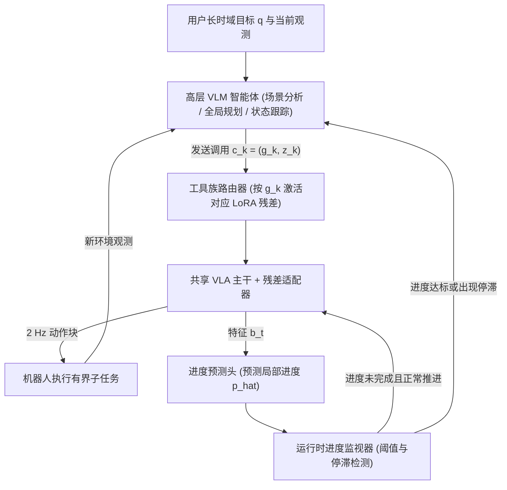

# Towards Long-horizon Embodied Agents with Tool-Aligned Vision-Language-Action Models

## 一句话定义

**VLAs-as-Tools** 是一种将端到端视觉-语言-动作（VLA）模型封装为显式工具族、并配合**工具对齐后训练（TAPT）**与**局部进度反馈**让高层 VLM 智能体按事件触发调度物理执行的分层具身控制框架。

## 英文缩写速查

| 缩写 | 英文全称 | 简要说明 |
|---|---|---|
| VLA | Vision-Language-Action | 视觉-语言-动作模型，直接将观测与语言指令映射为机器人连续控制动作 |
| VLM | Vision-Language Model | 视觉-语言模型，在本框架中担任高层场景理解、规划与失败恢复智能体 |
| TAPT | Tool-Aligned Post-Training | 工具对齐后训练，围绕调用单元重构模仿学习与强化学习训练以对齐工具接口 |
| IA | Invocation-Aligned | 调用对齐，指按智能体调用粒度切分、标注并组织的训练阶段（IA Post-train / IA SFT） |
| GRPO | Group Relative Policy Optimization | 组相对策略优化，用于子任务有界 MDP 下的强化学习微调 |
| LIBERO-IF | LIBERO-Instruction Following | 基于 LIBERO-10 构建的反事实指令遵循评测集，衡量 Faithful Rate 与 Non-biased Rate |

## 为什么重要

现有端到端 VLA 策略在单任务物理执行上表现突出，但在长时域（long-horizon）操作中同时承受「长程闭环规划、状态记忆与失败恢复」与「多样化底层物理操作」的双重负担；而传统的分层具身智能体虽然具备高层推理能力，底层却往往依赖手工编写的刚性技能或启发式 API，物理泛化能力受限。

直接把标准微调（SFT）后的 VLA 放进大模型规划器循环往往适得其反——在 LIBERO-Long 上甚至出现显著掉点，因为普通 VLA 容易受视觉先验与训练集轨迹惯性支配，而不是忠实服从当前子任务调用指令。VLAs-as-Tools 通过显式的**工具族调用-反馈接口**与**工具对齐后训练（TAPT）**打通了智能体规划与 VLA 执行之间的鸿沟。

## 核心信息

| 字段 | 内容 |
|---|---|
| 作者 | Zixing Lei, Changxing Liu, Yichen Xiong, Minhao Xiong, Yuanzhuo Ding, Zhipeng Zhang, Weixin Li, Siheng Chen |
| 机构 | 上海交通大学（SJTU）、北京中关村学院（Zhongguancun Academy）、北京航空航天大学（BUAA） |
| 发表时间 | 2026-05-13 提交 v1，2026-10-12 修订 arXiv:2605.13119v2 |
| 论文链接 | [arXiv:2605.13119](https://arxiv.org/abs/2605.13119) / [HTML 全文](https://arxiv.org/html/2605.13119) |
| 项目与代码 | 暂未公开仓库链接（摘要声明 `"Code will be released."`） |
| 清单分类 | `harness.orchestration`（来源条目 `survey_ax_2605_13119`） |
| 开源状态 | 宣称将开源或未列链接（截至 2026-11-27 未确认公开 GitHub 仓库或项目页） |

## 核心原理

### 1. 形式化交互接口 $\mathcal{I} = (\mathcal{C}, \mathcal{R})$

框架将高层 VLM 智能体 $\Pi_\phi$ 与低层 VLA 工具族 $\mathcal{T} = \{T_g\}_{g \in \mathcal{G}}$ 解耦并通过双向类型化消息接口连接：

- **调用消息（Agent-to-Tool）** $c_k = \Pi_\phi(q, s_k) = (g_k, z_k) \in \mathcal{C} = \mathcal{G} \times \mathcal{Z}$：
  - $g_k \in \mathcal{G}$ 为离散工具族标签，在数据驱动下区分自由空间运动与接触交互（在 DROID 上归纳出 11 类：`reach`, `grasp`, `move`, `release`, `flip`, `rotate`, `push`, `pull`, `insert`, `press`, `strike`；LIBERO 与 RoboTwin 使用其中 7 类）。
  - $z_k \in \mathcal{Z}$ 为结合当前场景的局部子任务指令（目标物体、空间关系与预期局部效果）。
- **有界执行与反馈（Tool-to-Agent）**：选中的工具 $T_{g_k}$ 在有限时域 $H_k$ 内生成动作 $a_t \sim T_{g_k}(\cdot \mid o_t, z_k, h_t)$，同时由挂载在主干末层池化特征 $b_t$ 上的轻量 MLP（$D \to 1024 \to 256 \to 1$ + Sigmoid）以 2 Hz 同步预测**局部进度反馈** $\hat{p}_t = \psi_\omega(b_t) \in [0, 1]$。
- **事件触发状态更新**：运行时监视器结合完成阈值（如 $\tau = 0.90$）、连续采样平滑与回溯进度增量判断「继续当前调用 / 切换下一工具 / 停滞重规划」，再通过 $s_{k+1} = U(s_k, c_k, \tau_k, r_k)$ 更新智能体全局状态，无需高频轮询 VLM。

### 2. 工具对齐后训练（TAPT）

TAPT 将训练单元、模型路由与优化目标全部对齐到推理时的调用粒度 $(g, z)$：

1. **自动切分与调用对齐数据单元（Appendix B）**：通过「全局视频理解 → 基于夹爪开合及相对速度的状态变化切分 → 基于操作定义的工具族标注与一致性校验」流水线，将原始轨迹转为 $x_{\mathrm{IL}} = (o_{1:T}, z, g, a_{1:T}, p^\star_{1:T})$，其中监督进度代理为 $p^\star_t = (t-1)/(T-1)$。
2. **工具族残差参数化（Tool-Family Residual Adapters）**：在共享预训练 VLA 主干线性层 $W$ 上为每个工具族挂接低秩 LoRA 残差 $\Delta W_g = B_g A_g$，前向计算 $y = Wx + \Delta W_g x$。标签 $g_k$ 决定性路由对应残差路径，仅带来约 +9% 参数量与 +7% 推理耗时（OpenVLA-OFT 基准），同时隔离不同接触动力学并保留共享语义表征。
3. **两阶段监督训练与目标函数**：经 `IA Post-train`（DROID-split 1 epoch）与 `IA SFT`（目标数据集 split）联合优化动作克隆损失与进度回归损失（$\lambda_{\mathrm{prog}} = 0.1$）：

$$\mathcal{L}_{\mathrm{TAPT}} = \mathbb{E}_{(o,z,g,a,p^\star)\sim \mathcal{D}_{\mathrm{mid}}^{\mathrm{inv}}}\left[-\sum_{t=1}^{T}\log \pi_{\theta,\phi_g}(a_t \mid o_t, z, h_t) + \frac{\lambda_{\mathrm{prog}}}{T}\sum_{t=1}^{T}\|\hat{p}_t - p_t^\star\|_2^2\right]$$

4. **子任务有界强化学习（RLinf + GRPO）**：针对单个调用 $(z, g)$ 构造子任务 MDP，从边界状态池 $\mathcal{S}^0_{z,g}$ 采样重置，依据仿真状态完成谓词 $\psi_{z,g}(s) \in \{0,1\}$ 给予 0/1 奖励并用 GRPO 优化；首轮 RL 后执行 **Reset-state pool refresh**，用更新后策略产生的实际交接状态刷新下游重置池，消除子任务衔接的分布偏移。

## 流程总览

## 源码运行时序图

**不适用**（截至 2026-11-27，论文摘要仅声明 `"Code will be released."`，原文及索引均未给出公开 GitHub 仓库或可运行源码入口，故无可核实源码实现。）

## 实验与评测

作者在三个 VLA 主干（OpenVLA、OpenVLA-OFT、$\pi_{0.5}$）、六个仿真基准与三项真实 Franka Research 3 任务上进行了系统评测（§5 及 Appendix C–G）。在直接匹配 $\pi_{0.5}$ 基线的五个仿真任务成功率基准上，VLAs-as-Tools 平均提升 **8.9 个百分点**。

### 1. 仿真模仿学习（LIBERO-Long 50 次/任务；RoboTwin-SA 8 任务 × 20 次）

| 基础模型 | 适配方式 | 部署模式 | LIBERO-Long SR (%) | RoboTwin-SA SR (%) |
|---|---|---|---|---|
| OpenVLA | SFT | Standalone | 77.2 | 1.88 |
| OpenVLA | SFT | Direct planner | 77.0 | 13.80 |
| OpenVLA | TAPT | VLA tool-family interface | **82.4** (+5.2) | **5.00** (+3.12) |
| OpenVLA-OFT | SFT | Standalone | 92.0 | 16.88 |
| OpenVLA-OFT | SFT | Direct planner | 80.2 | 18.80 |
| OpenVLA-OFT | TAPT | VLA tool-family interface | **95.6** (+3.6) | **48.75** (+31.87) |
| $\pi_{0.5}$ | SFT | Standalone | 92.4 | 39.38 |
| $\pi_{0.5}$ | SFT | Direct planner | 80.4 | 30.00 |
| $\pi_{0.5}$ | TAPT | VLA tool-family interface | **97.2** (+4.8) | **62.50** (+23.12) |

### 2. 目标域强化学习与现代长时域基准

- **LIBERO-Long RL（Figure 3a）：**
  - OpenVLA-OFT：Standard RL 78.8% → IA RL 79.0% → TAPT 80.0% → TAPT + 接口 **82.6%**（+3.8）。
  - $\pi_{0.5}$：Standard RL 80.0% → IA RL 89.0% → TAPT 89.2% → TAPT + 接口 **91.2%**（+11.2）。
- **CALVIN_D 原生子任务划分 RL（Figure 3b）：** Standard RL 76.0% → IA RL 78.8% → 完整 TAPT **82.3%**。
- **现代长时域基准（Table 2，统一 2,500 步预算）：**
  - **RoboMemArena**（26 任务 × 10 种子）：标准 $\pi_{0.5}$ 全任务 SR 26.15% / 部分进度 48.99% → VLAs-as-Tools **30.00%**（+3.85）/ **58.16%**（+9.17）。
  - **RoboLab-120**（120 任务 × 5 种子）：标准 $\pi_{0.5}$ 全任务 SR 28.5% / 部分进度 36.7% → VLAs-as-Tools **34.8%**（+6.3）/ **42.8%**（+6.1）。

### 3. 调用忠实度与真机评测

- **LIBERO-IF 反事实指令遵循（Table 3，10 个场景、后继窗口 100 步）：**
  - OpenVLA-OFT：基线 Faithful 19.4% / Non-biased 31.2% → 完整 TAPT **54.0%**（+34.6）/ **47.4%**（+16.2）。
  - $\pi_{0.5}$：基线 Faithful 24.8% / Non-biased 39.6% → 完整 TAPT **54.8%**（+30.0）/ **54.6%**（+15.0）。
- **真机 Franka Research 3 + 单俯视 RealSense D435（Table 5，同数据 30 demos/任务、30K 步、20 次/任务）：**
  - `Simple`：微调 $\pi_{0.5}$ 4/20（20.0%） vs. VLAs-as-Tools **13/20（65.0%）**。
  - `Conditioned`（存在同一视觉外观对应不同后续阶段的状态别名）：微调 $\pi_{0.5}$ 1/20（5.0%） vs. VLAs-as-Tools **13/20（65.0%）**。
  - `Long`（含 24 次顺序工具调用）：微调 $\pi_{0.5}$ 5/20（25.0%） vs. VLAs-as-Tools **9/20（45.0%）**。
  - 三任务平均：10/60（16.7%） → **35/60（58.3%）**。

### 4. 核心消融与效率验证（Table 4, 7, 8, 11–14）

- **组件消融（Table 4, LIBERO-Long）：** 仅套用接口不作 TAPT 时，OpenVLA-OFT / $\pi_{0.5}$ 降至 80.2% / 80.4%；在 $\pi_{0.5}$ 上若仅做 IA Post-train 而不加残差适配器会从 93.4% 暂时跌至 91.2%（开源后训练数据分布与 $\pi_{0.5}$ 差异所致），加入工具族残差适配器后回升至 96.0%，结合接口后达 **97.2%**。
- **规划器鲁棒性与调用开销（Table 13–14）：** 固定 OpenVLA-OFT 工具族并切换 Gemini 3 Flash（95.6%）、GPT 5.4（95.4%）、Qwen3.5-397B-A17B（95.4%）、Qwen3VL-235B-A22B（95.0%），成功率极差仅 0.6 个百分点；相比每 5 步轮询 VLM，进度触发重规划将每回合运行时 VLM 请求由 109.5 / 58.2 / 57.2 次降至 **1.988 / 0.304 / 0.228** 次。
- **少样本与增量扩展（Table 8, 12）：** LIBERO-Long 10-shot 下 OpenVLA-OFT 从 8.0% 升至 19.5%（+11.5）；无数据回放分阶段新增 `pull` 与 `push` 适配器可保持 **97.6%** 旧技能保留率（端到端顺序微调仅 86.4%）。

## 与其他工作对比

| 对比维度 | 端到端长时域 VLA（如 $\pi_{0.5}$ 独立部署） | 传统具身智能体（SayCan / Code as Policies） | 内部原语分层系统（如 AtomicVLA / RoboClaw） | **VLAs-as-Tools（本文）** |
|---|---|---|---|---|
| 高层规划与状态记忆 | 隐含于单策略或内部子任务 token，易受视觉别名干扰 | 由 LLM/VLM 显式规划与跟踪 | 由高层规划器或控制器编排 | 独立 VLM 智能体 $\Pi_\phi$ 负责分解、记忆与恢复 |
| 底层执行器形态 | 单一端到端策略 | 手工脚本、固定抓放或几何 API | 系统内部隐式技能/原语模块 | 带工具族标签 $g$ 的标准化可调用 VLA 工具集 |
| 监控与重规划粒度 | 无显式工具级进度反馈，局部出错易级联失败 | 依赖技能完成回调或定期 VLM 轮询 | 依赖系统内部状态检查 | 2 Hz 局部进度头 $\hat{p}_t$ 驱动的事件触发低频重规划 |
| 参数隔离与扩展性 | 全参数微调易遗忘旧技能 | 需人工扩展技能库 | 技能专家化或统一微调 | 共享主干 + 按 $g$ 路由的低秩 LoRA 残差（+9% 参数） |

## 结论

**一句话总判：VLAs-as-Tools 证明了「将 VLA 改造为带局部进度反馈与工具族残差路由的可调用工具」，相比端到端长时域微调或直接套壳规划器，能以极低的高层调用代价显著提升长时域成功率、反事实指令忠实度与视觉别名消歧能力。**

1. **不要直接给未对齐的 SFT VLA 套规划器**：直接套用规划器（Direct planner）在 LIBERO-Long 上导致 OpenVLA-OFT 和 $\pi_{0.5}$ 分别掉点 11.8 与 12.0 个百分点，必须先通过调用对齐切分与 TAPT 消除视觉快捷路径与轨迹偏置。
2. **用轻量工具族残差替代多套全量模型**：按工具族 $g$ 决定性路由 LoRA 残差仅增加约 9% 参数和 7% 延迟，却能避免端到端后训练对 $\pi_{0.5}$ 原生表征的破坏，并支持无回放的增量技能扩展。
3. **局部进度头是降低 VLM 通信成本的关键**：将局部进度预测附着在 VLA 2 Hz 推理路径上，使运行时 VLM 请求降至每回合不到 2 次（$\pi_{0.5}$ 仅 0.228 次），兼顾失败恢复与实时性。
4. **子任务强化学习必须刷新交接边界状态**：多阶段工具组合做子任务 RL 时，需在首轮训练后用已更新策略重新收集下游重置状态池（Reset-state pool refresh），否则上游动作微变会导致下游分布失配。

## 工程实践

- **工具族粒度无需过度细分**：Appendix C.1 对比 5 类粗粒度（96.6%）与 7 类细分（97.2%）差距有限，但「将自由空间运动（`reach`、`move`）与接触交互（`grasp`、`push`、`pull`）分离」提供了稳定的归纳偏置。
- **进度监督的工程含义**：进度目标 $p^\star_t = (t-1)/(T-1)$ 本质上是分段内的归一化时间代理，配合阈值 $\tau = 0.90$、连续帧平滑及回溯增量检测工作，因此在工程部署时更适合用于检测「动作停滞/超时」而非精确定量几何完成度。
- **数据切分流水线依赖单臂接触线索**：当前自动切分脚本依托夹爪开合跳变与末端相对物体运动速度提取候选边界，再由多模态模型结合全局摘要校验，适合单臂桌面抓取与推拉类操作的数据整理。

## 局限与风险

- **代码尚未公开**：截至 2026-11-27 尚未释放公开代码与模型权重，自动切分流水线提示词、超参数细节与进度监视器阈值配置暂无法通过源码逐行核实。
- **任务与形态覆盖边界**：真机实验仅在单个 Franka Research 3 与单个固定前视 RealSense D435 上验证了三类桌面任务，自动切分也主要针对单臂操作设计，未验证双臂强协同或移动操作场景。
- **新物理原语仍依赖新增演示**：如 Appendix C.2 所述，对于预训练和适配数据中完全未出现的新物理原语，无论端到端还是工具化 VLA 都无法可靠零样本完成，仍需收集对应工具族的演示并训练新适配器。
- **时间代理进度头的误判风险**：由于 $\hat{p}_t$ 学习自切分窗口的时间进度而非物理传感器力/触觉真值，遇到外观接近但物理卡滞的场景时，进度估计可能与真实语义完成度存在偏差。

## 关联页面

- [Agentic Robots 综述](paper-towards-agentic-robots-survey.md)
- [全量项目节点清单](../overview/awesome-agentic-robots-node-index.md)
- [VLA 方法背景](../methods/vla.md)
- [机器人智能体执行框架](../methods/robot-agent-harness.md)：对照规划、执行接口与反馈机制
- [智能体工具使用接口](../methods/agent-tool-use-interface.md)：显式工具调用协议与参数化接口
- [智能体规划反馈循环](../methods/agent-planning-feedback.md)：事件触发重规划与执行进度监控
- [智能体操作策略](../methods/agentic-manipulation-policies.md)：长时域桌面操作中的规划-控制结合
- [GRPO 策略优化](../methods/grpo.md)：子任务有界 MDP 中使用的组相对强化学习方法
- [机器人操作任务](../tasks/manipulation.md)：桌面操作基准与真机任务场景背景

## 推荐继续阅读

- [arXiv:2605.13119 论文原文（HTML）](https://arxiv.org/html/2605.13119)
- [arXiv:2605.13119 摘要页](https://arxiv.org/abs/2605.13119)

## 参考来源

- [论文精读归档：paper-agentic-2605-13119](../../sources/papers/paper-agentic-2605-13119.md)
- [官方 Awesome 快照归档](../../sources/repos/awesome-agentic-robots-survey-index.md)
- [论文或官方原始入口（arXiv:2605.13119）](https://arxiv.org/abs/2605.13119)
