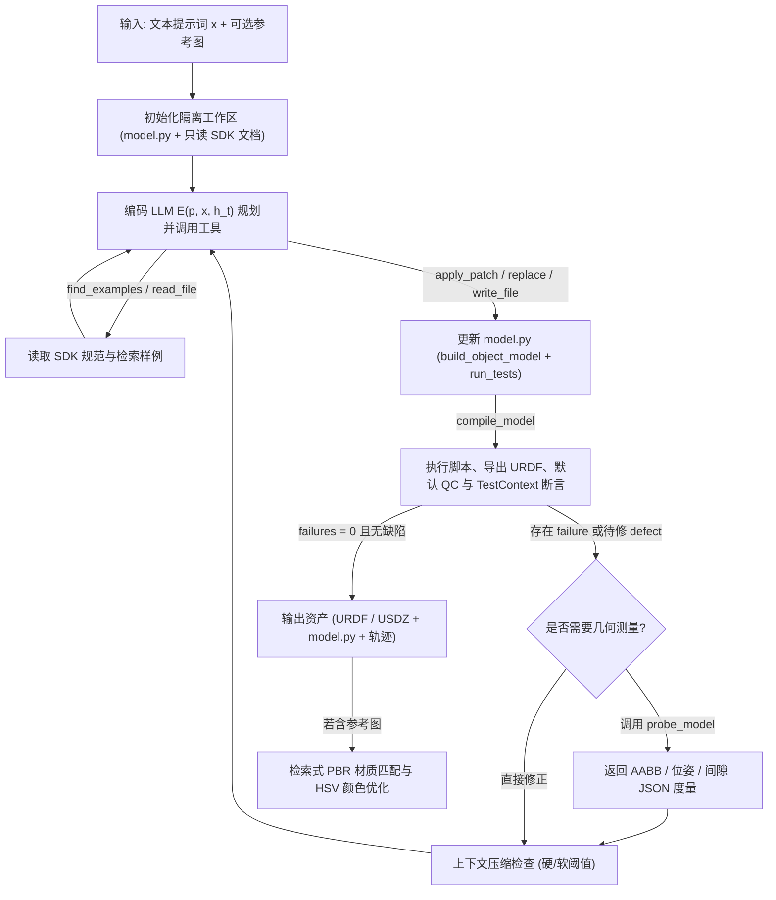
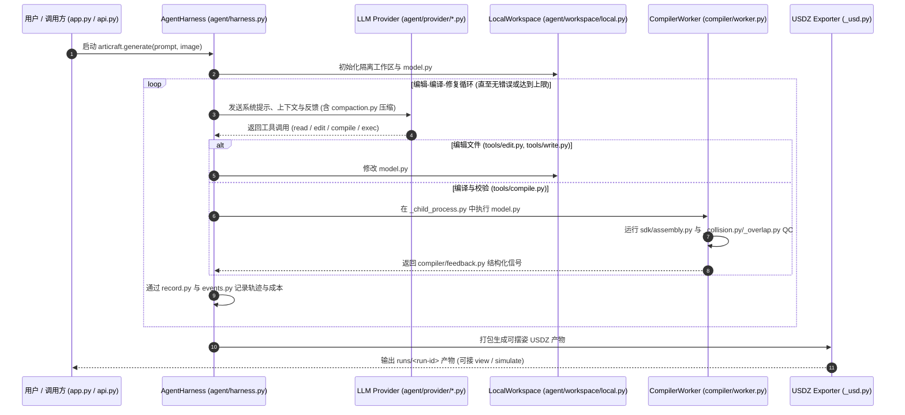

# Articraft: An Agentic System for Scalable Articulated 3D Asset Generation

## 一句话定义

Articraft 是一套将「可动关节（articulated）3D 资产生成」归约为「在受限执行外壳（Harness）内迭代编写并验证领域专用 Python 构建程序」的智能体系统，可在纯 CPU 环境下低成本生成直接用于物理仿真的 URDF/USDZ 资产与大规模 Articraft-10K 数据集。

## 英文缩写速查

| 缩写 | 英文全称 | 简要说明 |
|---|---|---|
| URDF | Unified Robot Description Format | 统一机器人描述格式，以 XML 记录刚体连杆、网格与关节运动副 |
| USDZ | Universal Scene Description (Zipped) | 通用场景描述打包格式，工程仓库支持导出的可摆姿 3D 资产格式 |
| SDK | Software Development Kit | 软件开发工具包，本文专指封装部件、关节与几何断言的 Python 建模接口 |
| PBR | Physically Based Rendering | 基于物理的渲染材质系统，图像条件生成阶段结合检索与反照率优化恢复 |
| QC | Quality Control | 质量控制，指 Harness 编译后自动执行的连通性、穿插重叠与运行错误检查 |
| AABB | Axis-Aligned Bounding Box | 轴对齐包围盒，`probe_model` 探针返回给智能体的关键几何空间度量 |

## 为什么重要

1. **打破可动 3D 资产的数据瓶颈**：学习可动关节感知与交互控制长期受限于数据规模与类别覆盖度（例如经典 PartNet-Mobility 仅含 46 类约 2.3K 资产，AKB-48 含 48 类约 2.0K 资产，RoboCasa365 中可动类别仅 12 类约 0.5K 资产）。Articraft 以平均约 $1.14/次的 API 成本将规模扩展至 245 类、10,018 个可动资产。
2. **验证「专有任务接口优于通用编程智能体」**：同样使用 GPT-5.5，直接用通用编程智能体 Codex 编写 URDF 在人工盲测中排名倒数第二；而赋予相同的底层 LLM 面向领域的 Python SDK 与结构化反馈外壳后，生成质量超越对比的扩散/自回归及多视角 VLM 智能体方法。
3. **摆脱重型渲染与外部软件依赖**：与依赖 Blender 渲染或多视角图像反复审查的管线不同，Articraft 本地完全在纯 CPU 环境下通过几何断言与只读探针完成校验与修复，显著降低单资产生成开销并便于大规模并发扩展。

## 核心信息

| 字段 | 内容 |
|---|---|
| 作者 | Matt Zhou, Ruining Li, Xiaoyang Lyu, Zhaomou Song, Zhening Huang, Chuanxia Zheng, Christian Rupprecht, Andrea Vedaldi, Shangzhe Wu |
| 机构 | 南洋理工大学（NTU）、牛津大学（University of Oxford）、剑桥大学（University of Cambridge） |
| 发表时间 | 2026-05-14（arXiv:2605.15187v1） |
| 论文链接 | [arXiv:2605.15187](https://arxiv.org/abs/2605.15187) · [HTML 全文](https://arxiv.org/html/2605.15187) |
| 项目与代码 | [项目主页](https://articraft3d.github.io/) · [官方仓库 articraftresearch/Articraft](https://github.com/articraftresearch/Articraft)（Apache-2.0，替代早期原型 `mattzh72/articraft`） |
| 清单分类 | `environment.reconstruction`（来源条目：`survey_ax_2605_15187`） |
| 开源状态 | **已开源**（官方代码仓库含完整 Harness、SDK、CLI/API、仿真脚本与基准；论文同时规划公开 Articraft-10K 数据集、源码与推理轨迹） |

## 核心原理

Articraft 将自然语言描述 $x$（及可选参考图像）映射为单一可执行的 Python 构建脚本 $y$（固定命名为 `model.py`），通过「推理—编辑—编译校验—探针检查—修复」多轮闭环生成可动 3D 资产 $a$：

$$(y_{t+1}, a_{t+1}, s_{t+1}) = C\big(E(p, x, h_t), y_t, a_t\big), \qquad h_{t+1} = h_t \cup \{(y_{t+1}, a_{t+1}, s_{t+1})\}$$

其中 $E$ 为外部编码 LLM，$p$ 为系统提示词，$h_t$ 为历史轨迹，$C$ 为隔离的执行外壳，输出更新后的脚本、资产及结构化反馈 $s_{t+1}$。

### 1. 领域专用编程接口（Articraft SDK）

`model.py` 遵循简洁契约，对外暴露 `build_object_model() -> ArticulatedObject`（绑定至 `object_model`）和 `run_tests() -> TestReport` 两个入口，使模型专注几何与机构逻辑而非底层 XML 拼接：

- **语义部件与多层次几何构造**：以 `ArticulatedObject` 为根容器，挂载带语义名称的 `Part`（命名规范严格约束为无状态词、反映固有局部坐标系的下划线短词）、`Material` 与 `Inertial.from_geometry`。几何构建同时提供基础体素（`Box`、`Cylinder`、`Sphere`、`ConeGeometry`）、面向机械制造细节的 `CadQuery` 封装（`LoftGeometry`、`SweepGeometry`、`section_loft`、`partition_shell`、布尔切割）以及高频机构件生成器（`WheelGeometry`、`BarrelHingeGeometry`、`PianoHingeGeometry`、`KnobGeometry`、`VentGrilleGeometry`、`ClevisBracketGeometry`、`WirePath` 等）。
- **显式运动学关节绑定**：支持 `REVOLUTE`（转动）、`PRISMATIC`（平移）、`CONTINUOUS`（连续旋转）和 `FIXED`（固定）关节，通过 `ArticulationType`、`Origin`、`axis`、`MotionLimits`（起止限位、力矩与速度上限）与 `Mimic` 将运动副直接绑定到具名 `Part` 上，确保部件尺寸修改与关节轴对齐同步演化。
- **自校验断言与豁免机制**：模型在 `run_tests()` 中实例化 `TestContext(object_model)`，编写特定物理与装配约束断言（如 `expect_contact` 检查铰链叶与箱体贴合、`expect_within` 检查抽屉在滑轨行程内、`ctx.pose(...)` 检验极限位姿关系），并在必要时用 `allow_overlap(...)` 或 `allow_isolated_part(...)` 显式声明合理嵌套（如销轴穿入轮毂孔、伸缩杆穿过导向套）以消除误报。

### 2. 受限智能体执行外壳（Articraft Harness）

Harness 遵循任务专用智能体-计算机接口设计原则，主动裁剪通用编程代理的多余自由度：

- **单文件隔离工作区**：仅向模型开放唯一可写文件 `model.py` 及只读 `docs/` 目录（预先加载 `quickstart.md`、`probe-tooling.md`、`testing.md` 等精简文档），禁止访问外部文件系统或执行任意 Shell 命令。
- **五类受限动作空间**：
  1. `read_file`：精确读取 `model.py` 与只读 SDK 文档；
  2. 代码编辑工具（OpenAI 后端使用 `apply_patch`，Gemini/Anthropic/OpenRouter 使用 `replace` 与 `write_file`）；
  3. `find_examples`：按自然语言描述从精选案例库检索结构参考片段；
  4. `compile_model`：运行脚本并导出 URDF，执行默认 QC（运行异常、孤立悬浮部件 `isolated_part`、未声明穿插重叠 `overlap`）与 `run_tests()`，返回带标签的结构化 `<compile_signals>`（按 `failure` / `warning` / `note` / `response_rules` 分级）；
  5. `probe_model`：在只读上下文中执行短 Python 探针，返回 AABB 包围盒、世界坐标、间距与可用辅助函数清单等 JSON 度量，用于精准对齐尺寸。
- **长程上下文压缩（Context Compaction）**：为防止多轮修复超出上下文或陷入修补僵局，Harness 设置了硬阈值（达到压力上限 0.9 倍触发）与软阈值（连续编译失败平台期触发）：OpenAI GPT-5.4/5.5（阈值 272k tokens）及 GPT-5.2/5.3-Codex（280k）调用 Responses API 压缩，Gemini 3.1 Pro/2.5（700k）使用专用 JSON 摘要压缩，Anthropic 后端在当前实现中未启用服务端压缩。

### 3. 单图条件生成与全场景重建

当输入包含参考图像时，Harness 将其置入初始用户消息并在整个多轮循环中设为最高几何真值，防止编辑过程向类别默认先验漂移。得到带基础近似着色的 URDF 后，系统接入基于 LiteReality 的检索式材质绘制流程：从 MatSynth 过滤的 PBR 材质库经三层语言类别筛选、DINOv2 视觉特征排序与 LLM 终选，再配合基于 HSV 中心对齐的纯反照率（albedo-only）重渲染颜色优化循环，恢复真实纹理。结合苹果 RoomPlan RGB-D 室内扫描检测的布局框，可将场景中标记为可动的家具/电器切片送入 Articraft 即时生成可交互部件，其余静态物品保留检索路径，从而组装出可交互的房间级数字孪生。

## 流程总览

## 源码运行时序图

在官方开源仓库 `articraftresearch/Articraft` 中，用户通过 CLI 入口 `uv run articraft`（对应 `src/articraft/app.py`）或 Python API（`src/articraft/api.py` 中的 `generate()` / `generate_async()`）发起生成请求，驱动 `AgentHarness`（`src/articraft/agent/harness.py`）在独立子进程编译工作器（`src/articraft/compiler/worker.py`）与大模型提供方之间完成多轮构建并导出可摆姿 USDZ（`src/articraft/_usd.py`）。

## 实验与评测

### 1. Articraft-10K 数据集构建与成本统计（Table 4 & Table 5）

作者首先通过人工探索与规则筛选确定了 245 个可动类别（归为 15 个超类），并采用 1–5 分制三准则人工评审（整体与部件几何真实感、预期关节是否缺失、运动是否符合物理常识，每项轻微瑕疵扣 1 分，致命错误或总分低于 4 分剔除），最终保留 **10,018 / 10,909** 个资产（总保留率 **91.8%**）。本地流水线全程纯 CPU 运行（零 GPU 需求）：

| 模型后端 | Cost 日志条数 | 总生成数 | 保留数 ($\ge 4$ 分) | 保留率 | 总 API 成本 | 单次均值 / 中位成本 | 平均 / 中位轮次 |
|---|---|---|---|---|---|---|---|
| GPT-5.4 | 6,572 | 6,601 | 5,903 | 89.4% | $6,693.89 | $1.019 / $0.887 | 16.9 / 15 |
| GPT-5.5 | 4,010 | 4,010 | 3,828 | 95.5% | $5,305.18 | $1.323 / $1.240 | 16.4 / 15 |
| Gemini 3.1 Pro | 298 | 298 | 287 | 96.3% | $387.91 | $1.302 / $0.711 | 19.5 / 10 |
| **合计** | **10,880** | **10,909** | **10,018** | **91.8%** | **$12,386.99** | **$1.139 / $1.030** | **16.8 / 15** |

注：全部保留的 10,018 个资产对应 API 成本约 $11.33K（均值约 $1.13/个），其中 **85.7%** 的输入 prompt tokens 命中了服务商缓存折扣。

### 2. 跨方法用户盲测评估（Section 5, Fig. 6）

在 PartNet-Mobility 的 46 个类别上每类构建 5 个文本提示词（共 230 题，并为纯图生输入基线生成对应参考图），由 125 名非专家大学生完成 5,000 次六选三（按提示词对齐度与整体质量排序）盲测。对比方法包括 Articulate-Anything、PhysX-Anything、URDF-Anything+、直接生成 URDF 的 Codex（GPT-5.5，开放全部编程与搜索工具），以及 Articraft（w/ GPT-5.4）与 Articraft（w/ GPT-5.5）。结果显示：直接使用 Codex（GPT-5.5）排名倒数第二，而相同底层模型配合 Articraft SDK 与 Harness 后，Articraft（w/ GPT-5.5）与 Articraft（w/ GPT-5.4）均显著领先各基线方法。

### 3. 下游前馈模型训练增益（Lightwheel 基准，Table 3 & Table 6）

将 Articraft-10K 加入 Particulate 的训练数据（原为 PartNet-Mobility + GRScenes）得到 Particulate-Articraft，在 Lightwheel 14 类基准上评测：

| 模型 | 静止姿态 gIoU $\uparrow$ | 静止姿态 PC $\downarrow$ | 静止姿态 mIoU $\uparrow$ | 关节几何 gIoU $\uparrow$ | 关节几何 PC $\downarrow$ | 关节几何 OC $\downarrow$ |
|---|---|---|---|---|---|---|
| Particulate | 0.332 | 0.168 | 0.576 | 0.305 | 0.208 | 0.009 |
| **Particulate-Articraft** | **0.394** | **0.144** | **0.607** | **0.361** | **0.179** | **0.008** |

Table 6 的分品类细目显示，增强增益主要来自原本训练集中缺失的域外类别，例如抽油烟机（Range Hood）静止 gIoU 从 `-0.088` 提升至 `0.232`、立式搅拌机（Stand Mixer）从 `-0.071` 提升至 `0.179`、烤箱（Oven）从 `0.203` 提升至 `0.435`、烤面包机烤箱（Toaster Oven）静止 mIoU 从 `0.490` 提升至 `0.650`。

### 4. 模型与推理强度消融（Table 7, Appendix B.4）

在同一折叠四旋翼无人机（带折叠旋翼臂、连续旋转桨叶、俯仰云台相机）固定提示词下，`high` 推理强度时 GPT-5.5（22 轮，$1.37，961K/19.2K tokens）产出 78 个视觉元件，Claude Opus 4.7（26 轮，$1.97，1.61M/27.6K tokens）产出 43 个，Gemini 3.1 Pro（26 轮，$3.14，1.54M/5.3K tokens）产出 13 个；三者均准确还原了全部关节拓扑。对 GPT-5.5 调节推理强度 `low` / `med` / `high`，视觉元件数依次增至 39（17 轮，$0.60）、51（15 轮，$1.08）和 78（22 轮，$1.37），表明提高推理强度主要丰富几何表面与结构细节。

### 5. 机器人仿真与 VR 交互验证（Section 6 & B.3）

生成的 URDF 资产直接导入 NVIDIA Isaac Sim，利用 LLM 自动补充部件质量与阻尼等物理属性后，结合标准逆运动学（IK）控制 Franka 机械臂抓取并拉开抽屉等可动部件；同时在 VR 环境中通过手部碰撞触发脚本驱动 URDF 关节运动。

## 与其他工作对比

| 对比维度 | PartNet-Mobility / AKB-48 | Infinigen-Sim | Articulate-Anything | ArtiCAD | Codex（直接写 URDF） | **Articraft（本文）** |
|---|---|---|---|---|---|---|
| 生成方式 | 人工标注 / 真实扫描 | 手工编写程序化规则 | VLM 智能体 + 部件检索 | 多智能体 CAD + 多视角渲染 | 通用编程智能体直接输出 XML | **领域专用 Python SDK + 受限 Harness** |
| 类别与规模 | 46–48 类，2.0K–2.3K 资产 | 18 类，20K 资产 | 受限于现有 3D 部件库 | 依赖视觉渲染迭代审查 | 无专属几何校验工具 | **245 类，10,018 个高保留率资产** |
| 反馈模态 | — | — | 多视角视觉渲染反馈 | 多视角 + 关键帧视觉反馈 | 原始终端/脚本报错 | **纯几何探针 + 结构化 QC 信号（免渲染）** |
| 核心优势 | 真实感或人工精度高 | 程序化可控 | 支持文本/图/视频多入口 | 支持装配级 CAD 生成 | 零领域开发成本 | **轻量纯 CPU 扩展、运动与几何强耦合、泛化类多** |

## 结论

**一句话总判：Articraft 证明「面向领域的高层 Python SDK + 受限纠错外壳 + 几何探针」比堆砌通用编码自由度或昂贵的多视角渲染反馈更适合规模化生成可动 3D 资产。**

1. **用代码程序替代直接吐出 URDF XML** — 让大模型操作显式的 `Part`、`Articulation` 与 `CadQuery` 构件，将尺寸改动与关节轴限位绑定在同一程序逻辑中，是质量跃升（Codex 倒数第二 vs Articraft 领跑）的关键分水岭。
2. **用轻量几何探针替代渲染闭环** — 通过 `probe_model` 返回包围盒/位姿度量与 `TestContext` 断言完成自检，使单资产平均生成成本压低至约 $1.14（85.7% 缓存命中）且本地零 GPU 需求，从而支撑万级数据集合成。
3. **可控允许的局部重叠策略** — 通过 `allow_overlap(...)` 配合 `expect_within(...)` 区分「合理机械嵌套（如轴入孔、滑轨配合）」与「意外穿模」，避免模型为躲避硬碰撞检查而强行拉开真实结构间隙。
4. **合成数据对长尾域外泛化有效** — 在 Particulate 上增量训练证明，哪怕是纯程序合成的多样化资产，也能显著补齐传统人工数据集缺失的厨电与工具类目标分割与关节估计短板。

## 工程实践

- **安装与本地推理**：官方仓库 [articraftresearch/Articraft](https://github.com/articraftresearch/Articraft) 使用 Python 3.11+ 与 `uv` 管理依赖，执行 `uv sync --group dev` 并在 `.env` 中配置 `OPENAI_API_KEY`（或 Anthropic/Gemini/OpenRouter 密钥）后，通过 `uv run articraft "<prompt>"` 或 `uv run articraft --image reference.png "<prompt>"` 生成资产（OpenRouter 后端仅支持纯文本）。
- **版本回看与物理冒烟测试**：生成记录保存在 `runs/<run-id>`，可用 `uv run articraft view runs/<run-id>` 在交互界面手动拨动关节；安装可选仿真组 `uv sync --group sim` 后，运行 `uv run articraft simulate runs/<run-id>` 对导出资产进行跌落测试、滑动摩擦与关节释放物理测试。
- **工程化接口与提示词实践**：官方仓库提供了同步/异步 Python API（`articraft.generate` / `generate_async`）以及导出可摆姿 USDZ 的 `_usd.py` 模块。在扩展新类别时，建议先检查 `src/articraft/sdk/` 内置复合零件与 `examples/` 样例，并在提示词中明确真实物理尺度（如桌面高度、家具尺寸）与主要可动交互部件。

## 局限与风险

1. **结构通过不等于全局视觉美观（Appendix B.5）**：由于放弃了生成期间的视觉渲染反馈，只要网格连通且局部断言通过，程序仍可能生成整体比例或曲面畸形的资产（如论文展示的螺旋盖瓶、滑板、旋转门失败案例）。
2. **稀疏位姿抽样遗漏中段运动穿插**：为控制耗时，Harness 不对全关节空间做穷举碰撞采样，复杂连杆或扳机机构（如扳机喷雾瓶）可能在中间行程与主体发生未检测到的几何穿透。
3. **复杂内腔结构偶发缺失**：在电饭煲、带铰链门冰箱等复杂电器中，模型偶尔会生成外观与门铰链正确但未挖空内部腔体的实心体块。
4. **仿真物理参数仍需后校验（Appendix E）**：生成阶段主要保证几何与运动学结构，导入 Isaac Sim 等仿真器时的质量、阻尼及摩擦系数需通过额外 LLM 估计或人工标定；若用于安全关键型机器人操作，必须在目标仿真器中进一步验证碰撞体与动力学稳定性。

## 关联页面

- [Agentic Robots 综述](paper-towards-agentic-robots-survey.md)
- [全量项目节点清单](../overview/awesome-agentic-robots-node-index.md)
- [VLA 方法背景](../methods/vla.md)
- [机器人仿真场景生成](../methods/robot-simulation-scene-generation.md)：对照场景、资产与可运行性检查。
- [Robot Agent Harness](../methods/robot-agent-harness.md)：面向机器人与物理资产任务的智能体执行外壳设计模式。
- [Coding Agent Verification Loops](../methods/coding-agent-verification-loops.md)：编译、测试与几何探针构成的自动化代码校验闭环。
- [Agent Tool-Use Interface](../methods/agent-tool-use-interface.md)：受限动作空间与结构化工具反馈设计。
- [Parametric CAD Workflow](../methods/parametric-cad-workflow.md)：基于 CadQuery 等程序化参数建模工作流。
- [Robot Model Description Workflow](../methods/robot-model-description-workflow.md)：URDF / USDZ 可动模型描述与关节语义建模。
- [Manipulation](../tasks/manipulation.md)：可动关节物体在桌面操作仿真（如开抽屉）中的下游应用。

## 推荐继续阅读

- [Articraft 官方 GitHub 仓库（articraftresearch/Articraft）](https://github.com/articraftresearch/Articraft) — 获取新版 SDK 文档（`docs/sdk.md`）、仿真指南（`docs/simulation.md`）与示例代码。
- [Articraft 论文 HTML 全文（arXiv:2605.15187）](https://arxiv.org/html/2605.15187) — 完整查阅附录 A–C 中的系统提示词全文、SDK 接口清单（Table 8）与滚动工具箱完整调试轨迹（Figure 20）。

## 参考来源

- [Articraft 论文原文精读笔记](../../sources/papers/paper-agentic-2605-15187.md)
- [Articraft 官方源码仓库静态核对笔记](../../sources/repos/paper-agentic-2605-15187.md)
- [官方 Awesome 快照归档](../../sources/repos/awesome-agentic-robots-survey-index.md)
- [arXiv 原文（2605.15187）](https://arxiv.org/abs/2605.15187)
- [官方项目主页（articraft3d.github.io）](https://articraft3d.github.io/)
- [官方开源仓库（articraftresearch/Articraft）](https://github.com/articraftresearch/Articraft)
