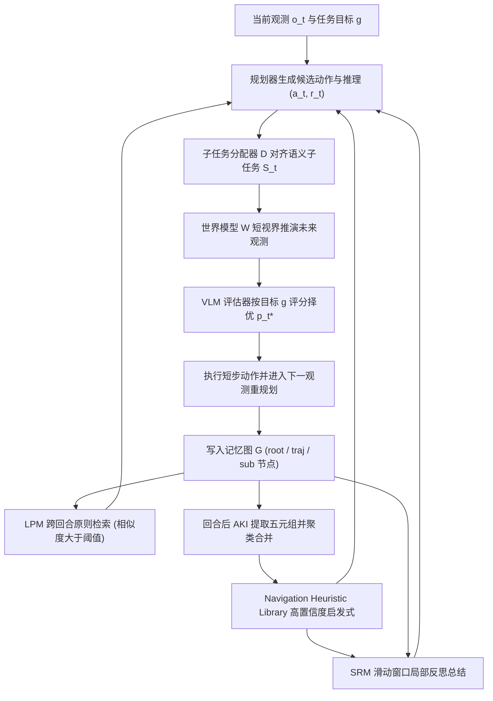

# Robo-Cortex: A Self-Evolving Embodied Agent via Dual-Grain Cognitive Memory and Autonomous Knowledge Induction

## 一句话定义

Robo-Cortex 是一种自演化具身导航智能体框架，通过短视界“想象-验证”世界模型规划、回合内/跨回合双粒度认知记忆（SRM/LPM）以及自主知识归纳（AKI），将历史交互经验持续提炼为可跨环境迁移的自然语言导航启发式策略。

## 英文缩写速查

| 缩写 | 英文全称 | 简要说明 |
|---|---|---|
| AKI | Autonomous Knowledge Induction | 自主知识归纳机制，从记忆图谱中跨回合提取并合并结构化导航启发式 |
| SRM | Short-term Reflective Memory | 短期反思记忆，基于最近子任务滑动窗口做回合内局部进度与失败分析 |
| LPM | Long-term Principle Memory | 长期原则记忆，从历史成败回合中抽象指导原则与警示原则供测试检索 |
| IGNav | Image-Goal Navigation | 图像目标导航任务，给定目标图像引导智能体到达对应位置 |
| AR | Active Recognition | 主动识别任务，智能体通过主动探索获取视角信息以识别目标类别 |
| AEQA | Active Embodied Question Answering | 主动具身问答任务，智能体需在场景中探索并回答与环境相关的自然语言问题 |
| SPL | Success weighted by Path Length | 路径长度加权成功率，综合衡量任务完成率与导航路径效率 |

## 为什么重要

在部分可观测的陌生室内环境中，传统具身导航策略常受困于“经验失忆（experiential amnesia）”：即便引入情景记忆或推理模块，系统也往往只保存特定场景的轨迹片段或局部几何信息，难以把既往成败转化为可迁移的通用决策策略。Robo-Cortex 将“反思与策略抽象”前置到智能体闭环中，使经验不仅用于回放，而是通过自然语言启发式实现跨场景复用与推理期在线演化。

## 核心信息

| 字段 | 内容或状态 |
|---|---|
| 作者 | Nga Teng Chan, Yi Zhang, Yechi Liu, Renwen Cui, Fanhu Zeng, Zeyuan Ding, Xiancong Ren, Zhang Zhang, Qifeng Chen, Jian Liu, Yong Dai, Xiaozhu Ju |
| 机构 | 香港科技大学（HKUST）、中国科学院自动化研究所（CASIA）、北京人形机器人创新中心（X-Humanoid）、北京航空航天大学（BUAA） |
| 发表时间 | 2026-05-18（arXiv:2605.18729v1 [cs.RO]） |
| 论文链接 | [arXiv:2605.18729](https://arxiv.org/abs/2605.18729) / [HTML 全文](https://arxiv.org/html/2605.18729) |
| 项目与代码 | 论文列出项目页 `https://robocortex66.github.io`，未附 GitHub 代码链接（截至 2026-11-27 项目页抓取返回 `status=0`） |
| 清单分类 | `harness.memory`（来源条目 `survey_ax_2605_18729`） |
| 开源状态 | 未确认开源代码（截至 2026-11-27 无可验证的官方代码仓库或可运行入口） |

## 核心原理

Robo-Cortex 在运行时与回合后构成“交互—反思—概念化—适应”闭环，由以下三个耦合模块组成：

### 1. Imagine-then-Verify 短视界闭环规划
为抑制长程开环推演在部分可观测环境中的误差累积，规划器在时间步 $t$ 基于当前观测 $o_t$ 生成 $N$ 个候选方案 $\mathcal{P}_t = \{p_t^{(1)}, \dots, p_t^{(N)}\}$，其中每个候选 $p_t^{(i)} = (a_t^{(i)}, r_t^{(i)})$ 同时包含低层离散动作序列与高层语义推理。
- **子任务对齐：** 子任务分配器 $\mathcal{D}(\cdot)$ 将高层语义与离散动作粒度对齐为语义子任务单元 $\mathcal{S}_t^{(i)} = \mathcal{D}(a_t^{(i)}, r_t^{(i)})$。
- **世界模型推演与打分：** 世界模型 $\mathcal{W}(\cdot)$（基于 `Wan2.1-I2V-A14B-480P-Diffusers`）在短视界 $h$ 内预测未来视觉序列 $\hat{o}_{t+1:t+h}^{(i)} = \mathcal{W}(o_t, \mathcal{S}_t^{(i)})$，再由 VLM 评估器（`Qwen2.5-VL-72B-Instruct-AWQ`）依据任务目标 $g$ 选出最优候选 $p_t^* = \arg\max_{p_t^{(i)} \in \mathcal{P}_t} \mathrm{Score}(\hat{o}_{t+1:t+h}^{(i)}, g)$。每次仅执行短步决策并立即重规划。

### 2. 双粒度认知记忆（Dual-Grain Cognitive Memory）
所有交互轨迹被写入统一记忆图 $\mathcal{G}=(\mathcal{V},\mathcal{E})$，节点集合划分为回合根节点 $\mathcal{V}^{\text{root}}$、决策步节点 $\mathcal{V}^{\text{traj}}$ 与语义子任务节点 $\mathcal{V}^{\text{sub}}$，边集合同时维护层级父子边与连续子任务时序边。
- **短期反思记忆（SRM）：** 在单个回合内对最近 $w$ 个子任务滑动窗口 $W_t = \{v_{t-w+1}^{\text{sub}}, \dots, v_t^{\text{sub}}\}$ 运行分析器 $s_t^{\text{SRM}} = f_{\text{srm}}(W_t)$，总结当前局部进展、重复无效动作或偏航模式，并将反思线索拼接到下一步规划上下文中。
- **长期原则记忆（LPM）：** 回合结束后，针对各子任务沿时序边前向遍历长度 $k$ 的下游轨迹 $\tau_i = \{v_i^{\text{sub}}, \dots, v_{i+k}^{\text{sub}}\}$，提炼成功回合的“指导原则（guiding principle）”与失败回合的“警示原则（cautionary principle）”。测试时在目标条件状态嵌入空间中执行最近邻检索，仅保留相似度高于阈值 $\delta_{\text{lpm}}$ 的匹配原则。
- **记忆整合（Consolidation）：** 按目标聚合存储回合，优先保留成功回合（且偏好轨迹更短的高效模板）；当尚无成功回合时保留多样化失败轨迹，以覆盖互补失效模式。

### 3. 自主知识归纳（AKI）
LPM 依赖特定经验匹配，而 AKI 负责跨回合归纳与场景无关的通用启发式规则：
- **规则提取：** 回合结束后，知识智能体从记忆图加载轨迹，利用 VLM 启发式提取器抽取出五元组 $h = (\rho, d, a, c, y)$，分别表示模式标识 $\rho$、问题描述 $d$、推荐策略 $a$、置信度 $c \in [0,1]$ 及成败标记 $y \in \{\text{success}, \text{failure}\}$。
- **聚类合并与回流：** 先按模式标识 $\rho$ 分组并辅以描述/策略的语义相似度聚类，对每个簇 $\mathcal{C}$ 由合并模型生成泛化条目 $\tilde{h}_{\mathcal{C}} = (\rho, \tilde{d}, \tilde{a}, \tilde{c})$ 写入 Navigation Heuristic Library。高置信度启发式随后被注入在线 SRM 分析与规划器，为后续回合提供故障先验与行动偏好。

## 流程总览

## 源码运行时序图

**不适用**（核查结果：截至 2026-11-27，arXiv 原文仅给出项目页 `https://robocortex66.github.io`，未列出 GitHub 源码仓库链接，且项目页抓取状态异常，未确认可运行官方源码实现）。

## 实验与评测

作者在 Habitat-sim 中评估三项任务（均遵循 World-In-World 协议，离散动作步长为前进 `0.20 m`、左右转 `22.5°`）：**IGNav**（HM3D 验证集）、**AR**（MP3D）与 **AEQA**（HM3D 验证集）。骨干模型固定为 `Qwen2.5-VL-72B-Instruct-AWQ`（多 vLLM 服务共享权重）与 `Wan2.1-I2V-A14B-480P-Diffusers`。

### 1. 主实验对比（Table 1）
作者区分固定记忆/启发式的静态版 **Robo-Cortex** 与推理期在线更新启发式的 **Robo-Cortex++**：

| 方法 | IGNav SR ↑ | IGNav SPL ↑ | IGNav Mean Traj ↓ | AR SR ↑ | AR Mean Traj ↓ | AEQA Score ↑ | AEQA Mean Traj ↓ | AEQA SPL ↑ |
|---|---|---|---|---|---|---|---|---|
| MapGPT | 17.36 | 15.11 | 56.48 | 10.14 | 9.19 | 25.50 | 18.58 | 22.40 |
| WMNav | 26.39 | 23.36 | 50.60 | 12.96 | 8.89 | 19.50 | 19.98 | 23.60 |
| World-In-World | 38.57 | 27.50 | 47.10 | 20.68 | 7.09 | 27.19 | 20.53 | 20.56 |
| **Robo-Cortex（静态）** | **41.26** | **31.66** | 49.90 | **22.39** | **6.97** | **29.78** | **17.34** | 21.40 |
| **Robo-Cortex++（在线更新）** | **45.07** | **35.06** | 47.50 | **23.88** | 7.57 | **30.59** | **16.61** | **25.57** |

- 静态版 `Robo-Cortex` 在 IGNav 上较最强对比基线 `World-In-World` 提升 `+2.69%` SR 与 `+4.16%` SPL；开启推理期在线演化后，`Robo-Cortex++` 在三项任务上进一步全面提升。

### 2. 记忆累积消融（Seen Split，Table 2）
在不包含 SRM/LPM/AKI 的 `Basic Pipeline` 上逐步引入记忆模块（第 1–3 轮）：
- **仅 SRM（Round 1）：** IGNav SR 由 `36.11` 升至 `40.18`（SPL `28.16 → 30.25`），AEQA Score 由 `25.55` 升至 `30.83`，验证回合内反思可即时减少无效循环。
- **LPM 跨轮效应（Round 2 → 3）：** 单加 LPM 在第 2 轮增益温和（IGNav SR `37.50`），到第 3 轮升至 `43.06`（SPL `34.94`）。
- **LPM + SRM（Round 3）：** 取得最高综合表现：IGNav SR `44.29` / SPL `34.74`，AR SR `24.03` / Mean Traj `6.18`，AEQA Score `31.71` / SPL `27.51`。

### 3. 启发式迁移消融（Unseen Split，不启用 LPM，Table 3）
- **Basic Pipeline：** IGNav SR `34.72` / SPL `24.03`；AR SR `19.42`；AEQA Score `32.42` / SPL `26.80`。
- **人工启发式（w/ manual heur.）：** IGNav 提升至 `38.89` SR / `30.96` SPL，但 AR（`18.71`）与 AEQA（`31.59`）略降。
- **跨划分迁移启发式（w/ transferred heur.，固定）：** 在 IGNav 上跃升至 `48.61` SR / `39.33` SPL（相对 Basic Pipeline 提升 `+15.30%` SPL），AR 达 `23.02` SR。
- **迁移后继续在线更新（w/ transferred heur. + update）：** IGNav 为 `41.67` SR / `34.84` SPL，低于固定迁移版 `48.61` / `39.33`。论文指出，在有限的未见测试样本上激进在线改写可能覆盖掉已迁移的高质量战略先验。
- **5 轮更新动态（IGNav Fig. 4）：** 迁移先验起步最高（Round 1 `41.67` SR / `34.84` SPL），第 5 轮平台化于 `46.48` SR；从零更新从 `36.62` 稳步升至 `51.39` SR；目标划分内持续演化在第 3 轮后加速跃升，第 5 轮达到 `55.56` SR / `46.29` SPL。

### 4. 真机初步实验（§4.4）
- 在客厅与超市两个真实室内 IGNav 场景中，`Basic Pipeline` 完成 `4/10` 个目标；常见失败为机器人丢失关键视觉线索对齐后仍继续开环前冲。启用 SRM 与仿真提取的启发式后，系统能够识别失配并返回最近已知目标一致区域恢复任务（Fig. 5）。

## 与其他工作对比

| 对比维度 | [MapGPT](../methods/robot-agent-harness.md) | [WMNav](paper-sa-2503-02247-wmnav-integrating-vision-language-models-into-wo.md) | [World-In-World](paper-sa-2510-18135-world-in-world-world-models-in-a-closed-loop-wor.md) | Robo-Cortex（本文） |
|---|---|---|---|---|
| 核心机制 | 在线拓扑地图提示与自适应路径规划 | VLM 结合世界模型的目标导向预测 | 闭环世界模型视觉推演与评估选优 | 短视界想象验证 + 双粒度记忆 + AKI 启发式演化 |
| 经验复用形态 | 单回合地图上下文 | 回合内预测与探索图 | 单回合世界模型闭环决策 | 跨回合抽象原则（LPM）与自然语言启发式库（AKI） |
| 推理期自我演化 | 无跨回合策略更新 | 无跨回合策略更新 | 无跨回合策略更新 | 支持 `Robo-Cortex++` 在线启发式更新 |
| IGNav（SR / SPL） | 17.36 / 15.11 | 26.39 / 23.36 | 38.57 / 27.50 | **41.26 / 31.66**（`++` 为 **45.07 / 35.06**） |

## 结论

**一句话总判：Robo-Cortex 证明了把世界模型闭环规划与“回合内局部反思（SRM）+ 跨回合原则抽象（LPM）+ 通用启发式归纳（AKI）”结合，能显著缓解具身导航的经验失忆并带来跨场景效率增益，但在线启发式改写与高算力推演开销需要审慎权衡。**

1. **短视界闭环与双粒度记忆互补** — 仅靠回合内 SRM 即可在第一轮带来显著止损（IGNav SR `36.11% → 40.18%`），而 LPM 的价值随多轮经验积累才在 Round 3 充分显现（联合达到 `44.29%`）。
2. **迁移启发式优于手写规则，但切忌小样本盲目覆盖** — 从 seen split 归纳的固定启发式在未见场景直接取得 `+15.30%` SPL 提升，而在小规模 unseen split 上叠加激进在线更新反而使 IGNav SR 从 `48.61%` 回落至 `41.67%`。
3. **工程落地需权衡算力与验证规模** — 论文推理栈同时依赖 72B VLM（vLLM 服务）与 14B 视频生成世界模型（Wan2.1-I2V），在嵌入式真机端部署时延迟与算力约束是首要瓶颈；且真机验证目前仍属 10 目标规模的初步探索。

## 工程实践

- **多服务共享权重部署：** 论文在实现中将规划、SRM/LPM 分析与 AKI 提取部署为独立的 vLLM 服务实例，同时共享 `Qwen2.5-VL-72B-Instruct-AWQ` 权重以平衡显存占用与模块解耦。
- **启发式更新策略开关：** 工程部署到陌生小样本环境时，建议默认加载经过充分积累的只读启发式库（对应 `w/ transferred heur.`），仅当目标环境累计足够回合数（如论文 Fig. 4 中第 3 轮之后）再开启在线聚类合并，避免噪声样本稀释高置信度先验。
- **动作粒度与高频重规划：** 仿真离散步长设为主动前进 `0.20 m`、转向 `22.5°`，配合子任务分配器确保每次世界模型推演仅覆盖短视界 $h$，减少单步误判对物理碰撞的影响。

## 局限与风险

1. **未确认开源实现与复现门槛：** 截至 2026-11-27 未获取到官方 GitHub 代码、Prompt 模板及启发式聚类超参数（如窗口 $w$、前向步数 $k$、检索阈值 $\delta_{\text{lpm}}$ 具体数值未在主文披露，正文标注见补充材料）。
2. **基座模型耦合与单点验证：** 框架虽定位为模型无关，但全文仅在 `Qwen2.5-VL-72B-Instruct-AWQ` + `Wan2.1-I2V-A14B-480P-Diffusers` 组合上评测，未对更轻量 VLM 或不同世界模型做敏感性消融。
3. **在线更新的灾难性覆盖风险：** Unseen split 消融已暴露出在线更新在部分任务上不如固定迁移先验的问题，若缺乏更稳健的置信度衰减与回滚门控，长期在线运行可能引入错误启发式漂移。
4. **真机验证规模有限：** 物理实验仅覆盖两个室内场景的 10 个目标及定性 SRM 恢复案例，尚不足以验证强动态干扰或长程跨房间部署稳定性。

## 关联页面

- [Agentic Robots 综述](paper-towards-agentic-robots-survey.md)
- [全量项目节点清单](../overview/awesome-agentic-robots-node-index.md)
- [VLA 方法背景](../methods/vla.md)
- [机器人智能体执行框架](../methods/robot-agent-harness.md)：对照规划、执行接口与记忆/反馈机制
- [生成式世界模型](../methods/generative-world-models.md)：视频生成世界模型在闭环想象规划中的角色
- [智能体规划与反馈机制](../methods/agent-planning-feedback.md)：对照 SRM/AKI 反思与启发式迭代思路
- [视觉语言导航任务](../tasks/vision-language-navigation.md)：IGNav 等具身导航任务的评测协议与指标
- [自主探索任务](../tasks/autonomous-exploration.md)：AR 与 AEQA 主动感知与信息获取场景
- [WMNav](paper-sa-2503-02247-wmnav-integrating-vision-language-models-into-wo.md)：主要对比基线之一
- [World-In-World](paper-sa-2510-18135-world-in-world-world-models-in-a-closed-loop-wor.md)：闭环世界模型基准协议与直接对比基线

## 推荐继续阅读

- [Robo-Cortex arXiv 论文原文（HTML 版）](https://arxiv.org/html/2605.18729)
- [Robo-Cortex 项目主页（原文登记地址）](https://robocortex66.github.io)

## 参考来源

- [Robo-Cortex 论文原文核对归档](../../sources/papers/paper-agentic-2605-18729.md)
- [官方 Awesome 快照归档](../../sources/repos/awesome-agentic-robots-survey-index.md)
- [arXiv:2605.18729 摘要页](https://arxiv.org/abs/2605.18729)
