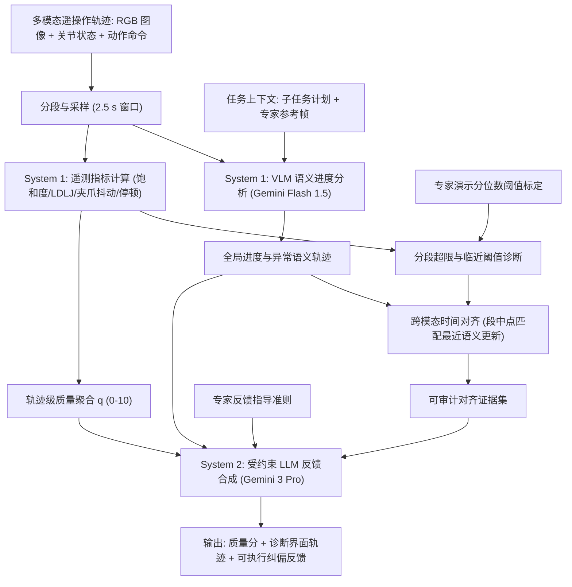

# Closing the Loop in Teleoperation: Episode-Level Data Quality Assessment and Feedback for High-Quality Demonstration Collection

## 一句话定义

**DQAF（Data Quality Assessment and Feedback）** 是一个面向机器人遥操作数据采集的**闭环质量评估与即时反馈框架**：它在每条演示轨迹结束后，将基于视觉语言模型（VLM）的计划条件化语义进度分析与基于关节/动作日志的遥测质量指标在时间段上对齐，输出可排序的轨迹质量分、可审计问题证据及指出“错在哪里、何时发生、下次怎么改”的自然语言操作建议。

## 英文缩写速查

| 缩写 | 英文全称 | 简要说明 |
|---|---|---|
| DQAF | Data Quality Assessment and Feedback | 本文提出的遥操作轨迹质量评估与即时反馈框架 |
| VLM | Vision-Language Model | 视觉语言模型；文中用于结合参考帧与子任务计划推断语义进度与异常 |
| LLM | Large Language Model | 大语言模型；文中用于将对齐后的语义-遥测证据合成为自然语言指导 |
| VLA | Vision-Language-Action | 视觉-语言-动作策略；对高质量真机遥操作演示高度依赖 |
| LDLJ | Log DimensionLess Jerk | 对数无量纲加加速度，用于衡量关节运动平滑度，数值越大代表越抖动 |
| XR | Extended Reality | 扩展现实；本文通过 Meta Quest 与 Unitree XR 栈采集双臂手势遥操作数据 |

## 为什么重要

1. **解决“表面成功但低质不可用”的数据陷阱：** 新手遥操作员在面对高维自由度、视角受限与深度线索不足时，往往能完成任务目标，却伴随剧烈抖动、反复回退修正、长时间停顿或贴近关节运动学极限。这类“假阳性成功”轨迹在传统二值成败反馈下会被保留，直到后续训练或离线清洗才暴露问题，导致策略退化与高额返工。
2. **从“事后被动筛选”转向“采集期闭环纠偏”：** 现有自动化清洗工作（如 SCIZOR、CUPID、DataMIL 与 Hugging Face `score_lerobot_episodes`）主要在数据集收集完毕后剔除低价值样本；DQAF 将质量判别前移到采集现场的每条 episode 之间，让操作员在下一条试次前获得具体纠偏建议，从源头抬升数据质量。
3. **打通高阶语义与底层控制的联合审计：** 单看视频难以察觉关节接近饱和或微小控制抖动，单看遥测曲线又缺少“发生在哪一步子任务、为何回退”的语义上下文。DQAF 通过分段跨模态时间对齐，同时满足可排序筛选（$q(\tau)$）与可追溯诊断（时间窗口 + 指标阈值 + 语义理由）。

## 核心信息

| 字段 | 内容 |
|---|---|
| **作者** | Gokul Narayanan*、Yash Shahapurkar*、Melih Erdogan、Brian Zhu、Eugen Solowjow（* Equal contribution） |
| **机构** | 西门子（Siemens Corporation） |
| **发表时间** | 2026-05-25（arXiv:2605.26349v1 [cs.RO]） |
| **论文链接** | [arXiv:2605.26349](https://arxiv.org/abs/2605.26349) / [arXiv HTML v1](https://arxiv.org/html/2605.26349) |
| **项目与代码** | 未确认官方独立项目页与 DQAF 开源仓库（底层复用 [Unitree xr_teleoperate](https://github.com/unitreerobotics/xr_teleoperate) 与 [Forge](https://github.com/arpitg1304/forge) 遥测指标思路） |
| **清单分类** | `harness.monitoring_and_recovery`（条目 `survey_ax_2605_26349`） |
| **开源状态** | **未确认开源代码**（截至 2026-11-27，arXiv 原文未附带 DQAF 源码仓或独立项目页链接） |

## 核心原理

DQAF 针对同步多模态遥操作轨迹 $\tau = \{(I_t, s_t, a_t)\}_{t=1}^T$（RGB 观测 $I_t$、本体状态 $s_t$、遥操作指令 $a_t$），在先验假设 **A1**（每项任务提供一组来自专家示范的带字幕参考关键帧 $x^{\mathrm{ref}} = \{(I_t^\star, c_t^\star)\}_{t=1}^R$）下，输出三元结果 $\mathcal{O}(\tau) = (q(\tau), \mathcal{E}(\tau), \mathcal{F}(\tau))$，由四个顺序与并行结合的阶段组成（原文 §IV）：

### 1. 计划条件化、上下文感知的语义进度分析（§IV-B）

给定任务描述 $d$ 及其有序子任务计划 $\Pi = \{\pi_1, \dots, \pi_L\}$（人工设定或由任务描述自动生成），在离散更新时刻 $\mathcal{U} = \{t_1, \dots, t_M\}$（实验中每隔 $2.5\,\text{s}$）向 VLM 输入结构化上下文：

$$\mathcal{X}_t = (x^{\mathrm{anchor}}, x_t^{\mathrm{clip}}, \Pi, x^{\mathrm{ref}})$$

其中 $x^{\mathrm{anchor}} = I_0$ 为轨迹初始锚点帧，$x_t^{\mathrm{clip}}$ 为当前时刻附近短片段（例如最近 5 帧 $\{I_{t-4}, \dots, I_t\}$）。VLM 受约束输出 $y_t = (i_t, c_t, r_t, z_t)$，分别表示当前活跃子任务索引 $i_t \in \{1,\dots,L\}$、该子任务完成度 $c_t \in [0,100]$、文字推理依据 $r_t$，以及异常标记 $z_t \in \{0,1\}$（用于捕获持续进度倒退、子任务间反复回溯或场景与 $\pi_{i_t}$ 不一致）。由此换算全局归一化任务进度：

$$p_t = \frac{100}{L}\left((i_t - 1) + \frac{c_t}{100}\right) \in [0, 100]$$

形成语义轨迹 $\mathcal{H}(\tau) = \{(t, p_t, i_t, r_t, z_t)\}_{t \in \mathcal{U}}$。

### 2. 遥测质量分析与轨迹评分聚合（§IV-C）

系统并行提取四类复用自 Forge 与示范质量评估文献的遥测指标：

1. **动作幅度饱和率（Action Range Saturation, $s_{\mathrm{overall}}$）：** 统计非退化动作维度 $\mathcal{V}$ 落入最小/最大边界容差 $\delta_i$ 内的时间步比例，值越大说明操作越频繁贴近控制极限、控制裕度越低。
2. **运动平滑度（LDLJ）：** 基于关节位置轨迹 $\mathbf{x}(t)$ 计算对数无量纲加加速度 $\mathrm{LDLJ}(\tau) = \log\!\left(\frac{T_\tau^3}{v_{\max,\tau}^2}\int_0^{T_\tau}\|\dddot{\mathbf{x}}(t)\|_2^2\,dt\right)$，数值越大表示越卡顿抖动。
3. **夹爪抖动频率（Gripper Chatter, $\rho_{\mathrm{chat}}$）：** 对夹爪指令二值化 $b_t \in \{0,1\}$ 后统计单位时长内的开关切换次数 $\frac{1}{T_\tau}\sum_{t=1}^{T-1}|b_{t+1}-b_t|$，反映抓取犹豫或不稳。
4. **停顿静止比例（Stalling / Static Fraction, $f_{\mathrm{static}}$）：** 统计动作范数低于轨迹自适应阈值 $\theta_{\mathrm{static}}$ 的时间步占比，用于识别长时间停滞。

各指标经归一化子分函数 $\phi_k(m_k(\tau)) \in [0,1]$ 映射后，按非负权重 $w_k$ 聚合成 $[0,10]$ 区间的单轨迹质量分 $q(\tau) = 10 \cdot \frac{\sum_{k=1}^K w_k \phi_k(m_k(\tau))}{\sum_{k=1}^K w_k}$，用于下游数据集排序与过滤。

### 3. 分段阈值诊断与跨模态证据对齐（§IV-D–E）

将轨迹划分为 $J$ 个时间段 $\tau_j = [t_j^{\mathrm{start}}, t_j^{\mathrm{end}}]$（实验按 $2.5\,\text{s}$ 切分）。对每段与每项指标 $m_k$，依据**初始阶段专家演示分位数标定**的任务专属阈值 $\theta_k$，计算超限指示 $V_{j,k}^E = \mathbf{1}\{m_k(\tau_j) > \theta_k\}$ 与未超限但接近阈值的风险指示 $V_{j,k}^N$。随后通过段中点匹配最近语义更新时刻 $i^\star(j) = \arg\min_i \left|t_i - \frac{t_j^{\mathrm{start}}+t_j^{\mathrm{end}}}{2}\right|$，组装带时间戳、指标观测值、阈值状态与所属子任务的对齐证据集 $\mathcal{E}(\tau) = \{e_j\}_{j=1}^N$。

### 4. 受约束自然语言反馈合成（§IV-F）

将 $\mathcal{Y}(\tau) = (\mathcal{H}(\tau), \mathcal{E}(\tau), q(\tau), \mathcal{I}_{\mathrm{exp}})$（其中 $\mathcal{I}_{\mathrm{exp}}$ 为专家编写的反馈原则提示）输入受约束 LLM，生成结构化反馈列表 $\mathcal{F}(\tau) = \{f_\ell\}_{\ell=1}^{N_{\mathrm{fb}}}$。提示约束每条反馈按“任务完成缺口 → 语义异常/回溯 → 遥测超限与临近风险 → 修正动作”排序，且显式包含三要素：**（i）哪里失败、（ii）发生在哪个时间/子任务、（iii）下一次采集如何改进**。

## 流程总览

## 源码运行时序图

**不适用**（核查结果：截至 2026-11-27，arXiv 原文及关联检索均未公布 DQAF 框架本身的开源代码仓库或可运行入口；论文仅说明硬件采集基于开源 [Unitree xr_teleoperate](https://github.com/unitreerobotics/xr_teleoperate) 栈，遥测指标定义复用开源工具 [Forge](https://github.com/arpitg1304/forge)，无法针对 DQAF 服务端/分析管线建立经源码核实的运行时序图）。

## 实验与评测

作者在 **Unitree G1 人形机器人**（顶部 RGB 相机 + Meta Quest 手势遥操作）上设计了两项真机双臂任务：**Task 1（Pick and Place with Box Manipulation）**——左臂定位盒体、右臂抓取圆柱体入盒并双臂退回安全位；**Task 2（Item Handover and Drop-off）**——右臂抓取递送、左臂接取后投入垃圾箱。语义分析采用 Gemini Flash 1.5（每 $2.5\,\text{s}$ 采样 1 次），反馈生成采用 Gemini 3 Pro。

### 1. 诊断有效性验证（§V-C, §VI-A）

- **数据集与检出率：** 在 Task 1 单独采集的 100 条轨迹（人工专家复核：72 条成功、28 条失败）上运行 DQAF，系统共标记 26 条失败，其中 24 条真阳性（TP）、2 条假阳性（FP）、4 条假阴性（FN），失败检测召回率为 **85.7%（24/28）**。
- **端到端延迟分析：** 在平均约 $50\,\text{s}$ 的轨迹（切分为 20 个 $2.5\,\text{s}$ 片段）上，20 次 VLM 语义调用均值 $2.0\,\text{s}$/次、反馈生成均值 $3.0\,\text{s}$，纯事后串行运行总延迟为 **$43\,\text{s}$**（遥测分析 $2.2\,\text{s}$ 并行执行，不计入总挂钟时间）；作为对比，人工专家回看视频与遥测日志平均耗时 **$15\,\text{s}$**/条。当把语义推理前移至遥操作执行过程中流式触发时，约 60% 的语义帧在轨迹结束前即已处理完毕，可将结束后等待反馈的延迟压低至平均 **$20\,\text{s}$**。

### 2. 新手操作员先导研究（§V-D, §VI-B, Table I）

招募 3 名新手操作员进行每组 30 次试次的先导实验（任务总错误数 $\le 3$ 计为成功，数值报告为均值 $\pm$ 标准误 SEM）：

| 任务 | 操作员与条件 | 完成耗时 (s) | DQAF 质量分 (0–10) | 主要错误数 | 任务成功率 |
|---|---|---|---|---|---|
| Task 1（摆盒入柱） | Op1（有即时反馈） | $41.6 \pm 2.8$ | $8.8 \pm 0.5$ | $1.0 \pm 0.2$ | **93.33%** |
| Task 1（摆盒入柱） | Op3（有即时反馈） | $49.2 \pm 1.3$ | $8.8 \pm 0.4$ | $1.25 \pm 0.02$ | **80%** |
| Task 2（双臂交接投递） | Op1（无反馈） | $45.4 \pm 2.2$ | $8.2 \pm 0.3$ | $2.0 \pm 0.3$ | 66.66% |
| Task 2（双臂交接投递） | Op2（无反馈） | $71.8 \pm 6.7$ | $5.6 \pm 0.6$ | $2.9 \pm 0.4$ | 53.33% |
| Task 2（双臂交接投递） | Op3（有即时反馈） | $51.0 \pm 2.9$ | **$9.4 \pm 0.2$** | **$1.4 \pm 0.2$** | **86.66%** |

定性案例（Fig. 3, §VI-C）显示，对于交接虽完成但双臂过度伸展贴近关节极限、或投掷后左臂无目的悬停再归位的“表面成功”轨迹，DQAF 能定位具体时间段并给出诸如“从物体最边缘抓取以给接收臂留出抓握空间”的可执行建议。

## 与其他工作对比

| 对比维度 | 界面/视角增强工作（如 VR/自主视角调节） | 事后数据筛选工作（SCIZOR / CUPID / DataMIL / Forge `score_lerobot_episodes`） | 试后打分与回放工具 | **DQAF（本文）** |
|---|---|---|---|---|
| **介入阶段** | 采集期前端（硬件与视觉呈现） | 采集全部完成后的离线筛选 | 每条试次结束后 | **每条试次结束后即时闭环** |
| **核心输出** | 更好的深度/视角提示 | 轨迹保留/剔除权重或启发式分数 | 数值评分与回放界面 | **评分 $q(\tau)$ + 时间对齐证据 $\mathcal{E}(\tau)$ + 纠偏自然语言反馈 $\mathcal{F}(\tau)$** |
| **信号融合** | 依赖操作员自身感知 | 侧重策略影响力、自监督进度或单一遥测规则 | 偏重单一评分或回放 | **计划条件化 VLM 语义进度 + 四项遥测阈值分段对齐** |
| **对新手操作员作用** | 降低单次操作认知负荷 | 丢弃废数据，但不教操作员如何改 | 需自行对照回放摸索原因 | **明确指出错在何步、何时及下次怎么改，加速收敛** |

## 结论

**一句话总判：DQAF 验证了“语义进度追踪 + 分段遥测阈值对齐 + 受约束自然语言纠偏”可在遥操作每条轨迹结束后以约 20 秒的流式尾延迟提供可审计反馈，是把事后数据质检前移至采集现场的有效工程原型，但目前仍属小样本先导验证阶段且尚未开源。**

1. **优先阻断“假阳性成功”入库：** 在遥操作质检管线中，除结果成功标记外，必须将关节限位饱和度、LDLJ 抖动与子任务回溯纳入分段门控，否则标称成功的演示仍会污染策略训练集。
2. **用流式语义计算换取现场可用性：** 约 $50\,\text{s}$ 轨迹若等结束再串联调用 VLM 需 $43\,\text{s}$ 才出反馈，难以留住操作员注意力；采集期同步抽帧推理可把结束等待压至 $\sim 20\,\text{s}$。
3. **跨模态各自补盲：** 实验表明，人眼/专家对局部遮挡和细粒度视觉进度偏移更敏感，而自动化框架更擅长系统性关联多路遥测异常与时间片段，两者适合作为人机协同质检界面。
4. **落地前仍需补齐两项验证：** 本论文仅包含 3 名受试者的先导用户研究，且未直接评测“有反馈采集的数据”相比“无反馈采集的数据”在下游 VLA/IL 策略训练成功率上的增益，工程接入时需自行补做下游策略对照评测。

## 工程实践

- **参考示范与阈值标定：** 新建任务上线前，先采集少量高质量专家轨迹，标注带字幕关键帧 $x^{\mathrm{ref}}$ 并拆分有序子任务 $\Pi$，同时按专家轨迹的分位数标定各段遥测阈值 $\theta_k$，避免跨任务硬编码通用阈值引发误报。
- **双模型分级选型：** 在保证接口解耦的前提下，高并发多帧语义跟踪（每 $2.5\,\text{s}$ 触发一次）选用低延迟轻量 VLM（文中用 Gemini Flash 1.5），而终端汇总生成仅执行一次且输入为结构化文本摘要，可用推理能力更强的模型（文中用 Gemini 3 Pro）。
- **流式并发流水线：** 在 `unitreerobotics/xr_teleoperate` 等录制栈的采集中途即异步推送滑动 5 帧窗口给 VLM，并在本地并跑 Forge 风格的遥测统计（$s_{\mathrm{overall}}$、LDLJ、$\rho_{\mathrm{chat}}$、$f_{\mathrm{static}}$），避免采集结束后长时间阻塞等待。
- **可审计存储契约：** 随每条演示保存标量分 $q(\tau)$（供后续按阈值排序过滤）及时间对齐证据 JSON（记录触发子任务、指标实测值与阈值），便于后续与 [机器人学习数据管线](../methods/robot-learning-data-pipelines.md) 对接复核。

## 局限与风险

1. **遮挡与细粒度语义盲区：** 验证集 4 条漏报（FN）主要来自局部视觉遮挡以及单靠 RGB 图像难以分辨的细微进度偏差；遇到复杂灵巧手或近距离自遮挡任务时需增加多视角相机或力觉模态。
2. **阈值对专家先验的强依赖：** 当前遥测阈值 $\theta_k$ 与参考帧 $x^{\mathrm{ref}}$ 依赖专家示范手工建立，面对多模态合法解（不同合理路径速度分布差异大）或新任务迁移时扩展成本较高。
3. **仅支持回合后反馈（Post-episode）：** 系统尚不能在执行中途实时语音/视觉告警以抢救即将失败的轨迹，对单条耗时很长的长程任务而言纠错仍滞后一拍。
4. **先导规模与下游闭环缺失：** 用户研究仅覆盖 3 名新手与 2 项任务，缺乏统计显著性检验；同时未给出不同质量分 $q(\tau)$ 采集结果直接训练模仿学习或 VLA 策略的对比实验，尚不能定量换算反馈对最终策略成功率的贡献。
5. **未开源复现限制：** 论文未公开 DQAF 的提示词模板、子分归一化参数 $\phi_k$、权重 $w_k$ 具体数值与前端看板源码，复现需自行基于 [Forge](https://github.com/arpitg1304/forge) 等工具重实现对齐与反馈合成模块。

## 关联页面

- [Agentic Robots 综述](paper-towards-agentic-robots-survey.md)：理解智能体化机器人 Harness 与监控恢复体系全景
- [全量项目节点清单](../overview/awesome-agentic-robots-node-index.md)：查看同源清单其他已登记研究节点
- [VLA 方法背景](../methods/vla.md)：理解视觉-语言-动作策略为何对高质量遥操作演示敏感
- [机器人学习数据管线](../methods/robot-learning-data-pipelines.md)：对比离线清洗、格式规范与在线质检契约
- [智能体规划与反馈执行](../methods/agent-planning-feedback.md)：对照多模态执行循环与基于可核查证据的反馈机制
- [机器人智能体 Harness](../methods/robot-agent-harness.md)：了解运行时监控、异常诊断与恢复编排框架
- [模仿学习](../methods/imitation-learning.md)：了解轨迹执行质量（抖动、停顿、犹豫）对策略学习的影响
- [遥操作](../tasks/teleoperation.md)：了解操作员与机器人之间的交互接口、延迟与数据采集挑战
- [双臂协调操作](../tasks/bimanual-manipulation.md)：了解本文评测所用摆盒入柱与双臂交接任务的核心协同约束
- [机器人操作任务](../tasks/manipulation.md)：了解真机操作任务的通用评估维度

## 推荐继续阅读

- [arXiv:2605.26349 HTML 全文](https://arxiv.org/html/2605.26349)：核对全部公式 (1)–(18)、Table I 与 Fig. 1–4 原始细节
- [Forge: Robotics Data Toolkit (GitHub)](https://github.com/arpitg1304/forge)：本文直接复用的机器人数据集遥测质量指标（LDLJ、饱和度、夹爪抖动、停顿）开源工具库
- [Unitree xr_teleoperate (GitHub)](https://github.com/unitreerobotics/xr_teleoperate)：本文真机实验搭建 Meta Quest + Unitree G1 遥操作采集管线所用的开源栈

## 参考来源

- [arXiv:2605.26349 原文核读归档](../../sources/papers/paper-agentic-2605-26349.md)
- [官方 Awesome 快照归档](../../sources/repos/awesome-agentic-robots-survey-index.md)
- [arXiv:2605.26349 论文入口](https://arxiv.org/abs/2605.26349)
- [arXiv:2605.26349 HTML 全文](https://arxiv.org/html/2605.26349)
