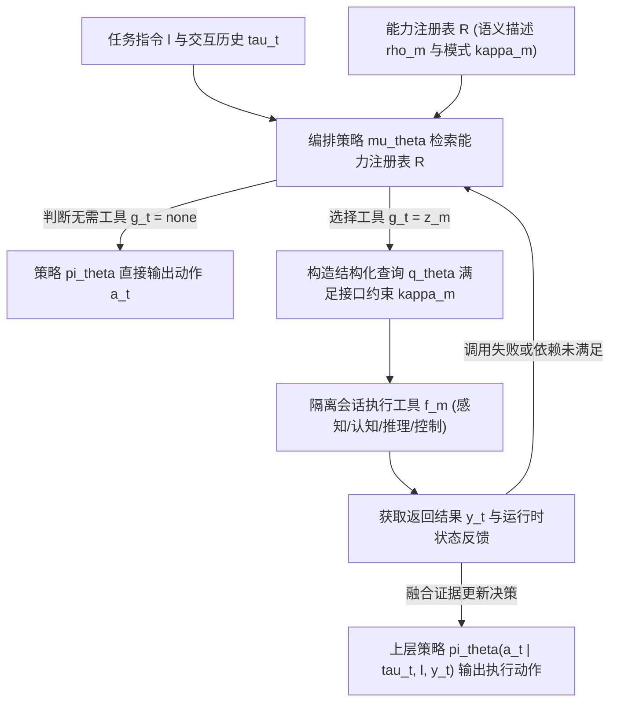

# Enabling Extensible Embodied Capabilities with Tools

## 一句话定义

该论文针对单一参数化具身策略存在能力耦合、隔离与梯度优化冲突的问题，提出**能力外置化（Capability Externalization）**框架，包含标准化**具身工具协议（ETP）**、112 项经过验证的具身工具库以及评估具身智能体“何时、选谁、如何调用及编排工具”的 **EmbodiedToolBench** 基准。

## 英文缩写速查

| 缩写 | 英文全称 | 简要说明 |
|---|---|---|
| ETP | Embodied Tool Protocol | 论文提出的具身工具协议，规范工具作为能力单元的注册、发现、调用与隔离执行 |
| VLA | Vision-Language-Action | 视觉-语言-动作模型，代表将感知、推理与控制耦合在单一参数集内的主流端到端范式 |
| MLLM | Multimodal Large Language Model | 多模态大语言模型，文中作为上层工具编排与决策策略的核心载体 |
| CSR | Correct Selection Rate | 正确选择率，Task 2 工具选择任务中从 4 个候选工具里选中唯一标准答案的比例 |
| ISR | Invocation Success Rate | 调用成功率（原文 Stage 1 指标），衡量生成参数满足目标工具模式约束 `Valid(x_hat, z*)` 的比例 |
| AMR | Action Match Rate | 动作匹配率（原文 Stage 2 指标），衡量理解工具返回后预测动作与参考动作一致的比例 |
| TUSR | Tool Usage Success Rate | 工具使用总成功率，要求 Stage 1 参数构造与 Stage 2 输出利用联合成功的严格指标 |
| OCR | Order Consistency Rate | 顺序一致性率，Task 4 工具链组合任务中满足数据与状态依赖约束偏序对的比例 |

## 为什么重要

1. **打破单体具身模型的三大结构性瓶颈：** 论文在统一数学框架下指出，单体参数化策略 $\pi_\theta$ 将异构能力混编在同一参数空间，引发不透明耦合（Opaque coupling，无法选择性调用与故障归因）、能力孤立（Capability isolation，无法跨系统迁移复用）与优化纠缠（Entangled optimization，多任务梯度相互干扰）。
2. **填补具身工具调用“标准化协议 + 全栈基准”空白：** 既有工作多将少量感知或 ROS 功能临时暴露给 LLM，缺少统一的契约注册与隔离机制，也缺少量化评估“工具可用性 vs. 模型用工具能力”的基准；ETP 与 EmbodiedToolBench 首次把这两端打通。
3. **定量划定能力外置化的收益边界：** 在 EmbodiedBench（4 个仿真套件）和 3 项桌面真机操作上，论文揭示了清晰规律——外置工具在感知（闭源/开源均约 +0.26）与认知（+0.28/+0.34）上收益极大，并能使 8B 开源模型超越无工具闭源基线；但在精细操作和低层物理控制上提升有限（EB-Manipulation 仅 +0.07），指明了未来混合架构与工具使用能力训练的关键瓶颈。

## 核心信息

| 字段 | 内容 |
|---|---|
| 论文标题 | *Enabling Extensible Embodied Capabilities with Tools* |
| 作者 | Xueyang Zhou, Zijia Wang, Qianjiang Li, Yibo Hu, Guiyao Tie, Li Wan, Yidan Liu, Pan Zhou*, Lichao Sun, Yongchao Chen* |
| 机构 | 华中科技大学（HUST）、河北工业大学、天津大学（TJU）、利哈伊大学（Lehigh University）、清华大学人工智能学院（Tsinghua） |
| 发表时间 | 2026-05-26（arXiv:2605.26637v1 [cs.RO]） |
| 论文链接 | [arXiv:2605.26637](https://arxiv.org/abs/2605.26637) / [HTML 全文](https://arxiv.org/html/2605.26637) |
| 项目与代码 | [项目主页 Manip Tool Hub](https://racingemperor.github.io/manip-tool-hub/)；论文声明仓库 `https://github.com/Zxy-MLlab/EmbodiedTool` |
| 清单分类 | `environment.benchmarking, harness.orchestration` |
| 来源条目 | `survey_ax_2605_26637` |
| 开源状态 | **未确认开源代码** — 截至 2026-11-27，项目主页可正常访问（展示工具目录与指标快照），但论文附带的 GitHub 仓库地址返回不存在（`exists: false`） |

## 核心原理

### 1. 能力外置化与双层优化公式

论文将具身任务形式化为历史 $\tau_t := (o_0, a_0, \dots, o_t)$ 与指令 $l$ 下的序列决策过程。区别于直接学习单体策略 $\pi_\theta(a_t \mid \tau_t, l)$，作者定义独立优化的工具集合 $\mathcal{Z} := \{z_m(\cdot; \phi_m)\}_{m=1}^M$，使总体能力覆盖 $\mathcal{C}_{\mathcal{Z}} := \bigcup_{m=1}^M \mathcal{C}(z_m)$ 从策略参数 $\theta$ 中解耦出来。推理时每步执行三阶段转移（式 3）：

$$g_t \sim \mu_\theta(\cdot \mid \tau_t, l),\quad y_t := \mathcal{T}_{g_t}\!\left(q_\theta(\tau_t, l, g_t)\right),\quad a_t \sim \pi_\theta(\cdot \mid \tau_t, l, y_t)$$

其中 $g_t \in \bar{\mathcal{Z}} := \mathcal{Z} \cup \{\perp\}$（$\perp$ 表示不调用工具），$q_\theta$ 生成结构化查询，$y_t$ 为工具返回值。训练目标分解为双层优化（式 4–5）：下层在各能力专有数据集 $\mathcal{D}_m$ 上独立最小化工具损失 $\mathcal{J}_{\text{tool}}(\phi_m) := \mathcal{L}_m(\phi_m; \mathcal{D}_m)$，避免梯度冲突；上层优化编排策略 $\theta^*$ 以最大化全任务期望折扣回报 $\mathcal{J}_{\text{orch}}(\theta)$。

### 2. 具身工具协议（ETP）三支柱

1. **工具即标准化能力单元：** 每个工具 $z_m$ 由输入输出空间 $(X_m, Y_m)$、能力子集 $\mathcal{C}(z_m)$ 与可执行映射 $f_m(\cdot;\phi_m): X_m \to Y_m$ 刻画。底层实现可为深度学习模型、经典几何/控制算法、符号验证器或混合程序，调用方只感知契约而不感知实现。
2. **基于注册表的发现与调用：** ETP 维护能力注册表 $\mathcal{R} = \{(z_m, \rho_m, \kappa_m)\}_{m=1}^M$，其中 $\rho_m$ 描述功能语义与前置适用条件，$\kappa_m$ 规定 $(X_m, Y_m)$ 的类型与值域模式约束。策略依据上下文检索 $\rho_m$ 并按 $\kappa_m$ 构造参数，实现新工具即插即用、无需重训策略。
3. **隔离执行与运行时反馈：** 每次工具调用在独立隔离会话中运行，捕获结构化输出与异常反馈，支持并发与远程服务端推理，并将失败信号回传给智能体用于重规划或降级恢复。

### 3. 112 项全栈具身工具库与四维构建流水线

依据感知-认知-推理-执行闭环（Appendix D & F.1），论文经文献深搜、人工筛选（优先轻量、易部署、跨环境鲁棒）、跨 2–3 个额外基准交叉验证及 API 封装，构建了 **112 个工具**（覆盖 24 个细分子类），并提供“按需（On-demand） / 连续（Continuous） / 事件或后台（Event / Background）”三种触发模式（Table 5 代表条目 T01–T22）：

- **感知与定位（Perception & Grounding，36 个）：** 涵盖开放词汇检测与分割（YOLO-World、FastSAM、Cutie）、6-DoF/3D 位姿与跟踪（GigaPose、CenterPoint）、稠密几何与深度（DUSt3R、ZoeDepth、Dense Object Nets）及建图定位（Open-Fusion、Hydra、OctoMap）。
- **认知与状态建模（Cognition & State Modeling，25 个）：** 涵盖可查询 3D 场景图与时空记忆（`query_3d_scene_graph`、STM、Action Genome）以及意图与形式化约束接地（Language2LTL、LINGO-Space）。
- **推理与规划（Reasoning & Planning，27 个）：** 涵盖规划-验证-诊断闭环（`VIRF_Main_Loop`）、导航栈（Nav2）、无碰撞运动规划（MoveIt 2、OMPL）与主动感知（ActPerMoMa）。
- **执行与控制（Execution & Control，24 个）：** 涵盖 6-DoF 抓取生成（AnyGrasp、Contact-GraspNet）、轻量点跟踪视觉伺服（TAPIR）、动作后验完成度校验（R3M）及运动学/轨迹生成（Pinocchio、Ruckig）。

### 4. EmbodiedToolBench 四阶段渐进评测设计

在 EB-ALFRED、EB-Habitat、EB-Navigation 与 EB-Manipulation 四个环境上共构造 **400 条评测样本**（每项任务 100 条，覆盖 112 个工具，Appendix E & F.2）：

- **Task 1：工具需求识别（Tool-Need Recognition）：** 正负样本 1:1 平衡，刻意加入含 `"detect"`、`"grasp"` 等强工具诱导词但无需外部工具的困难负样本，评估二分类 Acc / Precision / Recall / F1。
- **Task 2：工具选择（Tool Selection）：** 为每条查询配置 4 选 1 候选集（1 个真值 + 3 个干扰项）。干扰项先用 `text-embedding-ada-002` 计算余弦相似度挑选语义近邻，再经前置条件检查剔除同样能完成任务的重复工具，保证答案唯一性（包含至少 2 个同类干扰与至多 1 个跨类干扰），难度按易/中/难（35%/33%/32%）均衡分布，指标为 CSR。
- **Task 3：工具执行（Tool Execution）：** 拆解为 Stage 1（依据环境观测与参数约束生成合法参数，测 ISR）与 Stage 2（读取 JSON/文本/数值等异构返回并预测下一步参考动作，测 AMR），两阶段联合成功率为 TUSR。其中 87% 样本为中等或困难级别，参数需从当前观测实时读取。
- **Task 4：工具链组合（Tool-Chain Composition）：** 评估在多达 112 个候选工具中选择最小必要工具集 $S^\star$ 并按数据依赖与状态依赖 $\Omega^\star$ 排序的能力；为防止模型死记常见顺序，刻意纳入约 20% 合乎逻辑但反直觉的非典型依赖样本（如先局部感知再全局规划），指标为集合 Acc / Precision / Recall / F1 及排序一致性 OCR。

## 流程总览

## 源码运行时序图

**不适用**（截至 2026-11-27 核查：论文正文给出的代码仓库 `https://github.com/Zxy-MLlab/EmbodiedTool` 返回不存在，项目主页 `https://racingemperor.github.io/manip-tool-hub/` 仅展示工具目录、能力分类与评测快照，未提供可运行官方源码实现；仅附录 I.4 披露了部分运行时组件命名，如 `tool_manip_planner.py` 及 `color_grounding` / `grounding_repair` / `path_feasibility` / `motion_repair` 策略文本）。

## 实验与评测

实验在 8 个多模态大模型上开展（Table 7）：闭源模型包括 `gpt-4o`、 `gpt-5-chat`（GPT-5）、`claude-3-7-sonnet-20250219`（Claude-3.7）、`claude-sonnet-4-6`（Claude-4.6）；开源模型包括 `Qwen3-VL-32B-Instruct`、 `Qwen3-VL-8B-Instruct`、`Qwen2.5-VL-32B-Instruct` 与 MoE 模型 `Qwen3.5-35B-A3B-Instruct`（总参数 35B / 激活 3B）。单次全量评估约消耗 $3,000 API 费用，本地工具推理部署于 8×NVIDIA A800 服务器。

### 1. 仿真基准对比（EmbodiedBench，Table 1 & Table 8）

| 基准环境 | 无工具 vs. 工具增强平均增益 | 典型模型表现变化（w/o → w/ tool） | 关键发现 |
|---|---|---|---|
| **EB-ALFRED** | **+0.31**（+31%） | Claude-4.6: 0.81 → **0.92**；Qwen3-8B: 0.20 → **0.72**；Qwen3-32B: 0.37 → **0.77** | 开源小模型接入工具后（0.72）超越无工具 GPT-4o（0.48）；Long 子任务几乎无增（+0.01） |
| **EB-Habitat** | **+0.14** | Claude-4.6: 0.67 → **0.77**；GPT-5: 0.57 → **0.75**；Qwen2.5-32B: 0.34 → **0.49** | Spatial 子任务提升显著（+0.32），Long 子任务无提升（+0.00） |
| **EB-Navigation** | **+0.36**（+36%） | GPT-5: 0.57 → **0.85**；Claude-4.6: 0.62 → **0.85**；Qwen3-32B: 0.40 → **0.84** | Visual（+0.40）与 Long-horizon（+0.54）获益极大；Qwen2.5-32B（0.81）超无工具 GPT-5（0.57） |
| **EB-Manipulation** | **+0.07** | Claude-3.7: 0.38 → **0.42**；GPT-4o: 0.31 → **0.37**；Qwen3-32B: 0.20 → **0.25** | 精细控制与空间接地任务提升微弱（Spatial 仅 +0.02），少数模型个别子任务出现轻微回落 |

- **三次独立重复统计验证（Table 8，Base 子集）：** 闭源模型（GPT-4o、GPT-5）四基准均值由 56.66±2.50 / 59.01±1.02 提升至 74.26±0.87 / 75.62±0.96（平均增益 +17.10）；开源模型（Qwen3-32B、Qwen3-8B）均值由 47.50±2.22 / 34.03±3.40 提升至 70.58±1.67 / 69.56±1.50（平均增益 +29.30，EB-ALFRED 上高达 +60.67），方差显著小于增益幅度。

### 2. 真机机械臂实验（Table 2，Appendix G.2）

硬件平台采用 6-DoF 总线舵机机械臂、平行夹爪、Gemini Plus RGB-D 相机（0.25–2.5 m）、STM32 底层控制器及板载 Jetson 计算单元，在 3 项桌面任务（各 10 次试验）上测试：
- **无工具基线：** 全部 8 个模型在 3 项任务上均取得 **0/10**。
- **接入工具后（零额外训练）：** Desktop Cleaning 中 GPT-4o 达 **8/10**；Balance Scale 中 Claude-4.6 达 **9/10**；Building Blocks 中 Claude-3.7 与 Claude-4.6 均达 **8/10**；轻量开源模型 Qwen3-8B 亦可取得 6/10、4/10、5/10。

### 3. EmbodiedToolBench 工具使用能力评测（Table 3）

| 模型 | 需求识别 Acc / Rec / F1 | 工具选择 CSR | 执行 ISR / AMR / TUSR | 工具链组合 Acc / Prec / Rec / OCR |
|---|---|---|---|---|
| **GPT-4o** | 0.65 / 0.85 / 0.75 | 0.63 | 0.96 / 0.70 / 0.68 | **0.71** / **0.93** / 0.97 / 0.93 |
| **GPT-5** | 0.66 / 0.84 / 0.75 | 0.62 | 0.94 / **0.74** / **0.70** | 0.43 / 0.81 / **0.99** / **0.98** |
| **Claude-3.7** | **0.69** / 0.82 / **0.77** | **0.74** | 0.95 / 0.71 / 0.68 | 0.47 / 0.83 / **0.99** / **0.98** |
| **Claude-4.6** | **0.69** / 0.84 / **0.77** | **0.74** | 0.96 / 0.71 / 0.68 | 0.50 / 0.83 / **0.99** / 0.97 |
| **Qwen3-32B** | 0.63 / 0.45 / 0.60 | 0.67 | 0.95 / 0.49 / 0.47 | 0.44 / 0.83 / 0.96 / 0.92 |
| **Qwen3-8B** | 0.48 / 0.31 / 0.42 | 0.49 | 0.96 / 0.04 / 0.04 | 0.46 / 0.84 / 0.92 / 0.87 |
| **Qwen2.5-32B** | 0.63 / 0.63 / 0.68 | 0.68 | 0.95 / 0.67 / 0.64 | 0.36 / 0.83 / 0.94 / 0.88 |
| **Qwen3.5-35B** | 0.55 / 0.34 / 0.48 | 0.45 | 0.95 / 0.58 / 0.56 | 0.59 / 0.91 / 0.91 / 0.85 |

- **主要瓶颈与错误分布（§4.3–§4.5, Fig. 4–5, Table 4）：**
  1. **会传参但不会用结果：** 所有模型参数构造格式率（ISR）均高达 0.94–0.96，但开源小模型极难消费工具返回（Qwen3-8B 的 AMR 与 TUSR 仅 0.04）。
  2. **过度组合与漏调并存：** 闭源强模型在工具链任务中召回率高达 0.97–0.99，但精确率仅 0.81–0.83（包含冗余工具）；开源模型在需求识别中频繁漏调（Qwen3-8B 召回仅 0.31）。
  3. **任务类型主导的五类错误：** 动作密集型环境（Navigation / Manipulation）以漏调工具为主（占错误案例的 36% / 45%），且 Manipulation 中 Qwen3-8B 的工具诱导偏差（Tool-induced Bias）高达 56.5%；感知密集型环境（ALFRED / Habitat）则以忽略工具输出为主（47% / 43%）；Habitat 中开源模型接口误用与选错工具比例达 17.0%–20.6%。
  4. **推理时延开销（Table 4）：** EB-ALFRED 与 EB-Habitat 单任务平均耗时增加约 10–30 秒（如 Claude-3.7 在 EB-ALFRED 从 38.88s 增至 63.36s）；EB-Manipulation 多款开源模型增幅超 30 秒（如 Qwen3-32B 从 50.40s 增至 99.65s）。

## 与其他工作对比

| 维度 / 方案 | 单体 VLA / 分层政策（如 $\pi_0$、Octo、OpenVLA） | 早期 ROS/MCP 具身接口（如 ROS-LLM、ROSA、RoboNeuron） | EmbodiedTool（本文） |
|---|---|---|---|
| **能力组织方式** | 感知、规划与控制耦合在共享参数 $\theta$ 内 | 将局部 ROS 话题/服务包装为特定系统可调用工具 | 基于 ETP 注册表将 4 大类 112 项异构能力标准化外置 |
| **接口与执行隔离** | 内部隐式特征传递，缺乏统一契约 | 紧耦合特定中间件（ROS/ROS 2）或提示格式 | 协议层规范输入输出模式 $\kappa_m$ 与隔离会话并发执行 |
| **评测焦点** | 端到端任务成功率（如 EmbodiedBench 总分） | 侧重单点系统演示与任务完成案例 | 同步评测下游任务增益（Table 1–2）及四维用工具能力（EmbodiedToolBench） |
| **精细控制表现** | 依赖大规模动作轨迹微调，高频连续控制占优 | 依赖底层原生控制器，泛化受限于固定技能集 | 感知/认知增益显著，但 7D 精细操作（EB-Manipulation）仅 +0.07，受限于接口离散化与延迟 |

## 结论

**一句话总判：能力外置化能够以零微调方式显著抬升多模态具身智能体在感知、认知与长程导航/家务规划任务上的表现，但当前瓶颈已从“缺少工具”转向“模型何时调用、如何精确组合及有效消化工具返回值”，且离散工具接口难以替代高频连续物理控制。**

1. **优先外置高语义/几何解析类能力：** 在工程中可将开放词汇检测、3D 场景图记忆、深度估计与 LTL 安全校验优先抽离为 ETP 风格工具，能在不重训策略的前提下带来 +0.26 至 +0.34 的感知认知提升。
2. **慎用离散工具直连低层物理控制：** 在接触密集或精细操作场景（如 EB-Manipulation），不要直接把 2D 检测像素或工具原始输出替代 3D 运动学规划，应结合连续底层控制器或专用安全护栏（如 `path_feasibility`、`motion_repair`）。
3. **重点监控“忽略输出”与“过度调用”两类失败：** 部署轻量级开源模型作为编排器时，需针对性防范漏调工具（低召回）与忽视工具返回（低 AMR）；使用闭源大模型时，则需限制单步工具数量上限以抑制冗余调用和时延膨胀。
4. **把“工具使用能力”作为后续微调的核心目标：** 仅靠在系统里堆砌 100+ 工具无法自动获得最优表现，仍需围绕工具需求识别、困难负样本区分与异构结果消费进行策略训练或后训练对齐。

## 工程实践

- **多步工具护栏设计（参考 Appendix I.4）：** 在操作类任务中，论文运行时限制每步最多调用 3 个工具，并在工具调用失败或冲突时引入确定性修复与护栏回退（`grounding_repair`、`path_feasibility`、`motion_repair`），同时显式禁止模型将工具返回的 2D 像素坐标或边界框直接当作机械臂 3D 目标坐标。
- **工具准入与交叉验证标准（Appendix D.2）：** 向工具库新增模块时，不应仅凭原论文单基准指标收录，而需遵循“轻量、易部署、跨 2–3 个额外基准鲁棒”三项准则，并生成包含适用条件与禁用边界的结构化工具卡。
- **时延预算权衡：** 工具推理（尤其涉及 3D 重建或远程服务调用的操作工具）容易令单任务耗时增加 10–50 秒，高实时性真机链路需按“按需触发 + 后台连续流（如 STM/TAPIR）”混合调度，避免每步阻塞式调用重型视觉工具。

## 局限与风险

1. **精细物理控制与动态交互受限：** 离散化的工具调用与文本/JSON 返回难以承载高频、接触丰富的物理交互细节，导致 EB-Manipulation 增益微弱（+0.07），且远端调用网络延迟会干扰闭环稳定性。
2. **模型工具能力与诱导偏差风险：** 实验显示部分开源模型存在高达 56.5% 的工具诱导偏差（被工具存在或误导性输出带偏正常动作），而强模型在多工具串联时普遍出现冗余调用。
3. **开源代码可复现性待确认：** 论文提到的官方 GitHub 仓库目前尚无法访问（`exists: false`），112 个工具的服务端封装脚本、EmbodiedToolBench 数据集与统一调度器源码暂无法通过本地代码级核对验证。

## 关联页面

- [具身大模型评测基准选型闭环](../queries/embodied-eval-benchmark-selection-loop.md)：对照评测基准设计与指标选型闭环。
- [Agentic Robots 综述](paper-towards-agentic-robots-survey.md)
- [全量项目节点清单](../overview/awesome-agentic-robots-node-index.md)
- [VLA 方法背景](../methods/vla.md)
- [机器人智能体执行框架](../methods/robot-agent-harness.md)：对照规划、执行接口与反馈机制。
- [智能体工具使用接口](../methods/agent-tool-use-interface.md)：具身工具注册、Schema 约束与参数化调用设计参考。
- [具身智能体基准评测](../methods/embodied-agent-benchmarking.md)：EmbodiedBench 与多维度工具能力评测方法对照。
- [智能体规划与反馈闭环](../methods/agent-planning-feedback.md)：运行时错误检测、断言恢复与重规划机制。
- [智能体技能封装](../methods/agent-skill-packaging.md)：工具卡契约与模块化能力封装范式。
- [机器人操作任务](../tasks/manipulation.md)：对照工具外置化在精细操作场景的能力边界。

## 推荐继续阅读

- [Enabling Extensible Embodied Capabilities with Tools (arXiv HTML 全文)](https://arxiv.org/html/2605.26637)
- [Enabling Extensible Embodied Capabilities with Tools (arXiv 摘要页)](https://arxiv.org/abs/2605.26637)
- [Manip Tool Hub 官方项目主页](https://racingemperor.github.io/manip-tool-hub/)

## 参考来源

- [论文原文核对笔记：Enabling Extensible Embodied Capabilities with Tools](../../sources/papers/paper-agentic-2605-26637.md)
- [官方 Awesome 快照归档](../../sources/repos/awesome-agentic-robots-survey-index.md)
- [论文 arXiv 摘要页](https://arxiv.org/abs/2605.26637)
- [Manip Tool Hub 项目主页](https://racingemperor.github.io/manip-tool-hub/)
