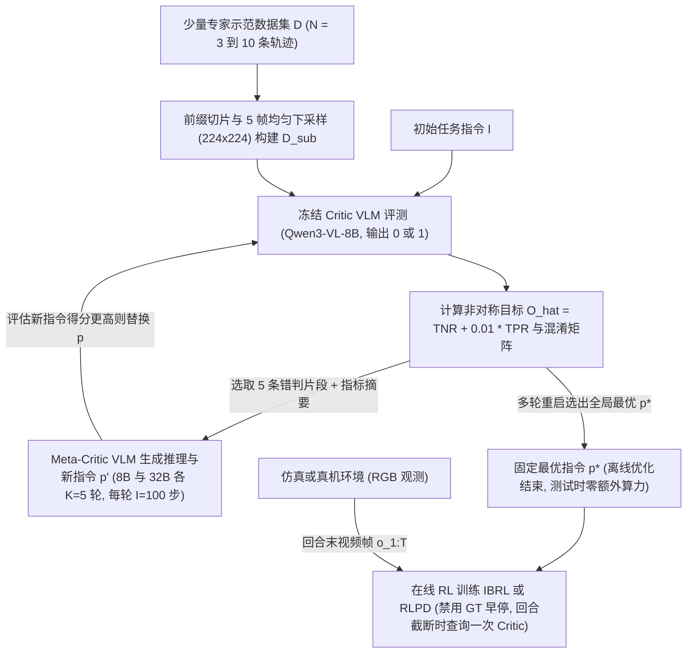
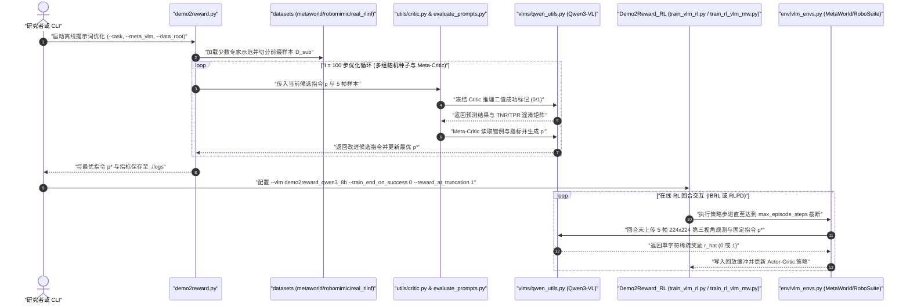

# From Demonstrations to Rewards: Test-Time Prompt Optimization for VLM Reward Models

## 一句话定义

Demo2Reward 是一种面向视觉-语言奖励模型的测试时提示词优化方法：在策略训练开始前，利用少量带成功标注的专家示范轨迹（3–10 条）和 Meta-Critic VLM，迭代重写冻结 Critic VLM 的二值成功判定指令以优先消除假阳性（False Positives），从而在不微调模型且不增加在线强化学习推理开销的前提下抑制奖励黑客（Reward Hacking）。

## 英文缩写速查

| 缩写 | 英文全称 | 简要说明 |
|------|----------|----------|
| VLM | Vision-Language Model | 视觉-语言模型，本文作为冻结的 Critic 奖励模型（Qwen3-VL-8B）及指令改写器 Meta-Critic |
| VLM-SD | VLM Success Detector | 零样本 VLM 二值成功检测器基线，直接依据初始任务指令输出 `0` 或 `1` |
| APE | Automatic Prompt Engineering | 自动提示词工程，本文由 Meta-Critic VLM 根据误差反馈自动迭代优化奖励判定指令 |
| IBRL | Imitation Bootstrapped Reinforcement Learning | 模仿引导强化学习，利用专家示范预训练行为克隆策略并结合在线 Q 学习，为本文主实验策略骨干 |
| RLPD | Reinforcement Learning from Prior Data | 基于先验数据的强化学习，在线更新时以 50% 比例对离线示范回放缓冲过采样，用于验证跨算法鲁棒性 |
| TNR / TPR | True Negative Rate / True Positive Rate | 真阴性率与真阳性率，Demo2Reward 目标函数 $\text{TNR}+\lambda\text{TPR}$ 中权重重点保护真阴性以遏制假阳性 |

## 为什么重要

1. **解决零样本 VLM 奖励模型的假阳性诱导黑客问题**：在机器人操作强化学习中，手工编写基于状态或颜色像素启发式的奖励工程成本高且脆弱。直接把预训练 VLM 用作零样本二值成功检测器（`VLM-SD`）时，模型常在抓取等中间阶段误判任务完成（如 PickPlace-Can 或 Assemble-Nut 中仅抓起物体就输出 `1`），导致策略专挑假阳性状态刷取高合成奖励而真实成功率为零。
2. **复用现成冷启动示范且测试时零额外算力**：具身强化学习（如 IBRL、RLPD）通常在训练前已采集少量遥操作示范用于行为克隆冷启动。Demo2Reward 直接把这 3–10 条示范复用为离线提示词优化的监督信号；策略学习阶段仍只调用原来的冻结 8B VLM、查询一次固定提示词，在线吞吐量与显存占用完全不变。
3. **打通仿真到真机无手工奖励的闭环**：在不需要外部状态真值（如物体精确 6D 位姿或电子开关）的物理机器人场景下，Demo2Reward 能仅凭 10 条遥操作视频对齐视觉成功标准，使基于视觉观测的真机 RL 训练在不使用手工位姿阈值奖励的情况下达到接近真值奖励的成功率。

## 核心信息

| 字段 | 内容 |
|------|------|
| 作者 | Christian Gumbsch, Leonardo Barcellona, Lennard Schünemann, Platon Karageorgis, Andrii Zadaianchuk, Zehao Wang, Sergey Zakharov, Fabien Despinoy, Rahaf Aljundi, Efstratios Gavves |
| 机构 | University of Amsterdam；Catholic University of Leuven（KU Leuven）；Toyota Research Institute（TRI）；Toyota Motor Europe |
| 发表时间 | arXiv:2606.00083v1（2026-05-22 提交）；RLC 2026 |
| 论文链接 | [arXiv:2606.00083](https://arxiv.org/abs/2606.00083) / [PDF 原文](https://arxiv.org/pdf/2606.00083) / [OpenReview](https://openreview.net/forum?id=wjuZ5Qy141) |
| 项目与代码 | [cgumbsch/Demo2Reward](https://github.com/cgumbsch/Demo2Reward)（提示词优化主仓）；[cgumbsch/Demo2Reward_RL](https://github.com/cgumbsch/Demo2Reward_RL)（基于 IBRL 的 RL 实验姊妹仓） |
| 清单分类 | `model.training` |
| 来源条目 | `survey_ax_2606_00083` |
| 开源状态 | 核心代码已开源（提示词优化仓与 RL 实验仓均已公开，未附带 LICENSE 文件；仿真数据与 BC 预训练权重通过 Google Drive 分发，真机数据集未随仓附带） |

## 核心原理

Demo2Reward 将机器人操作任务形式化为部分可观测马尔可夫决策过程 $\mathcal{M} = (S, O, A, T, R, \ell)$，其中环境真实二值成功奖励 $r_t \in \{0, 1\}$ 在在线训练期间不可访问，智能体依赖冻结 Critic 模型 $\hat{r}_t = m_{\text{critic}}(o_{1:t}, p)$ 提供的合成稀疏奖励。

### 1. 前缀子序列数据增广（$\mathcal{D}_{\text{sub}}$）

由于专家示范数量极少（$3 \le N \le 20$，实验在 MetaWorld / RoboMimic 取 $N=3$，真机取 $N=10$），直接只在整条轨迹末尾评估难以暴露中间过程假阳性。对于每条长度为 $T$ 且带人工逐帧或状态成功标签的示范 $\tau^i = ((o_1, a_1, r_1), \dots, (o_T, a_T, r_T))$，算法构造 $T$ 个前缀子片段 $(o_{1:1}, r_1), (o_{1:2}, r_2), \dots, (o_{1:T}, r_T)$，汇总形成含 $N \times T$ 个视频片段的评测集 $\mathcal{D}_{\text{sub}} = \mathcal{D}^+ \cup \mathcal{D}^-$。为控制推理耗时，送入 Critic 的片段统一均匀下采样为 5 帧、分辨率为 $224\times 224$，并限制模型禁用采样且只输出单字符 `0` 或 `1`。

### 2. 非对称防黑客目标函数

设指令 $p$ 在负样本子集 $\mathcal{D}^-$ 与正样本子集 $\mathcal{D}^+$ 上的真阴性率与真阳性率分别为：

$$\text{TNR}(p) = \frac{1}{|\mathcal{D}^-|}\sum_{(o_{1:t}, r_t)\in\mathcal{D}^-} \mathbb{1}\{m_{\text{critic}}(o_{1:t}, p) = 0\}, \qquad \text{TPR}(p) = \frac{1}{|\mathcal{D}^+|}\sum_{(o_{1:t}, r_t)\in\mathcal{D}^+} \mathbb{1}\{m_{\text{critic}}(o_{1:t}, p) = 1\}$$

考虑到假阳性诱发的奖励黑客对策略优化的破坏远大于偶发漏报（假阴性），Demo2Reward 优化如下加权目标：

$$\hat{\mathcal{O}}(p) = \text{TNR}(p) + \lambda\,\text{TPR}(p), \qquad \lambda = 0.01$$

该目标满分 为 $1.01$（对应 100% TNR 与 100% TPR），确保只有当真阴性率优先被推向 100% 时，提升真阳性率的候选指令才会胜出。

### 3. 双 VLM 迭代改写与退化规避

- **Meta-Critic 误差驱动改写**：在每次迭代步中，Meta-Critic $m_{\text{meta}}$ 接收当前最优指令 $p$、一条随机采样的完整参考示范、当前混淆矩阵指标（TPR/TNR/FPR/FNR）以及最多 5 条 Critic 判错的 5 帧片段。Meta-Critic 使用高探索度解码（`temperature=1.3`, `top-p=0.97`, `top-k=50`），先生成 3–5 句错因分析 `Reasoning`，再输出遵循视觉核查清单、明确忽略项与失败判定规则的 `Final Instruction: p'`。若 $\hat{\mathcal{O}}(p') > \hat{\mathcal{O}}(p)$，则接受更新 $p \leftarrow p'$。
- **多起点、双尺度重启防退化**：过小的 $\lambda$ 容易使优化陷入“对任何画面都输出 0”的平凡局部最优（此时 $\text{TNR}=1.0$、$\text{TPR}=0$）。为此，系统分别以 `Qwen3-VL-8B-Instruct` 和 `Qwen3-VL-32B-Instruct` 作为 $m_{\text{meta}}$ 各独立运行 $K=5$ 次（共 10 轮、每轮 $I=100$ 步），从中挑选 $\hat{\mathcal{O}}(p)$ 最高的指令 $p^*$ 固定用于后续策略训练。
- **感知对齐效应**：论文发现优化出的有效指令不仅细化空间关系和视觉外观（如注明灰色圆环、绿色对齐圆点、夹爪必须脱离物体且静止），有时还会呈现 VLM 自身特有的视觉表征偏好（例如在 Stick-Pull 中将蓝棍表述为红棍），这类与模型内部感知偏差对齐的语言描述往往比纯人工直觉描述具有更低的误报率。

## 流程总览

## 源码运行时序图

论文的离线提示词优化主流程与下游 RL 训练分别开源于 [cgumbsch/Demo2Reward](https://github.com/cgumbsch/Demo2Reward) 与姊妹仓 [cgumbsch/Demo2Reward_RL](https://github.com/cgumbsch/Demo2Reward_RL)。离线阶段通过 `demo2reward.py` 调用 `datasets/`、`utils/` 与 `vlms/` 完成多轮指令搜索并写入日志，随后将选出的最优指令接入 `Demo2Reward_RL` 的 `train_vlm_rl.py` 或 `mw_main/train_rl_vlm_mw.py` 进行稀疏回合末奖励强化学习。

关键复现入口拆分为两步：先在 `Demo2Reward` 仓库执行 `python demo2reward.py --task metaworld_assembly --data_root ./data` 生成并筛选最优指令；再于 `Demo2Reward_RL` 仓库使用 `python train_vlm_rl.py`（RoboMimic）或 `python mw_main/train_rl_vlm_mw.py`（MetaWorld）配合 `--train_end_on_success 0 --reward_at_truncation 1` 复现稀疏端到端策略训练。

## 实验与评测

所有仿真与真机评测均关闭基于环境真值成功的提前终止（`--train_end_on_success 0`），仅在回合截断步查询一次奖励模型，以杜绝通过回合长度泄露成功标签。

### 1. 演示前缀集上的假阳性消除（Sec. 4.2, Tables 1–2）

| 任务（PickPlace-Can，$\mathcal{D}_{\text{sub}}$） | TPR ($r_t=1$ 判为 1) | FNR ($r_t=1$ 判为 0) | FPR ($r_t=0$ 判为 1) | TNR ($r_t=0$ 判为 0) |
|---|---|---|---|---|
| 优化前零样本指令（Table 1） | 100% | 0% | 26.1% | 73.9% |
| Demo2Reward 优化后指令（Table 2） | 68.8% | 31.2% | **0%** | **100%** |

论文 Sec. 4.2 指出，所有任务经 Demo2Reward 优化后的指令在各自演示数据集上均达到了 **100% TNR（0% FPR）**，以适度牺牲部分正例召回率为代价彻底堵住假阳性诱发的奖励黑客通道。

### 2. 仿真基准策略学习（Sec. 4.3–4.4, Fig. 4–5）

- **RoboMimic（IBRL, 5 seeds, Fig. 4）**：在 `PickPlace-Can`（750k 步，max 200 步）与 `NutAssembly-Square`（1.5M 步，max 300 步）中，Policy 使用 96×96 图像而 VLM 使用第三视角 224×224 图像（$|\mathcal{D}|=3$）。零样本 `VLM-SD` 在 `PickPlace-Can` 上极难学到有效成功率，而 `Demo2Reward` 在两个任务上均显著优于 `VLM-SD` 并逐步逼近 `GT Rewards` 上界。
- **MetaWorld（IBRL, 10 seeds, Fig. 5）**：在 `Assemble-Nut`、`Box-Close`、`Coffee-Push`、`Stick-Pull` 四项任务（20k 步，max 100 步，$|\mathcal{D}|=3$）上，即使使用稀疏回合末 `GT Rewards`，IBRL 峰值成功率也仅约 **60%–80%**（峰值后略有回落）。对比 `VLM-SD`（Qwen3-VL-8B）、`RoboReward`（Qwen3-VL-8B 微调版）、`GVL`（Qwen3-VL-32B 上下文进度估计）与 `RoboCLIP`（S3D 嵌入相似度校准版）：`RoboReward` 与 `RoboCLIP` 基本失效，`VLM-SD` 与 `GVL` 仅在部分任务取得较低成功率；`Demo2Reward` 在全部四项任务中均胜过所有 VLM 基线，**最高带来 +40% 成功率提升**，并在 `Coffee-Push` 上接近 GT 奖励表现。

### 3. 算法迁移与提示词鲁棒性（Sec. 4.5, Fig. 6, 5 seeds）

- **跨 RL 骨干**：将同一组优化指令由 IBRL 迁移至 `RLPD`（在 `Box-Close` 与 `Coffee-Push` 上评测），`Demo2Reward` 仍稳定持平或显著超越零样本 `VLM-SD`。
- **提示词随机性**：对不同随机初始化分别优化出的多条指令（`p1`, `p2`, `p3`），尽管表述细节存在差异，接入 IBRL 后最终收敛的下游任务成功率水平高度一致。

### 4. 真机机器人迁移（Sec. 4.6 & Suppl. B.2, Fig. 7, 3 seeds）

- **硬件与任务**：使用 **Franka Research 3** 机械臂、**ZED 2i** 立体相机（ROS2）、**GELLO** 遥操作与 **RLInf** 框架（ResNet 编码器 + RLPD，Chrony NTP 跨机时钟同步），完成 **Lid-On-Pot** 盖锅盖任务（30 步截断，$124\times 124$ 策略视觉 + 末端相对位姿，VLM 输入 $224\times 224$，采集 20 条遥操作示范并取 10 条做 Demo2Reward 优化）。
- **真机结果**：训练约 100 个回合后，`Demo2Reward` 取得比普通 `VLM-SD` **高出 +20% 的任务成功率**，且在训练全程完全不接触末端位姿真值成功判定（`[0.541, -0.027, 0.101]` 阈值）的情况下达到与 GT 奖励相当的真机表现。

### 5. 关键消融实验（Suppl. C.3–C.4, Fig. 9–10, 5 seeds）

- **`VLM-SD` 架构消融（Box-Close & Coffee-Push）**：默认设置（`Qwen3-VL-8B` + 5 帧均匀采样 + 仅输出单字符 `0/1`）在下游成功率上明显优于输入完整视频（Full Video）、仅看末帧（Final Frame）、输出文字推理（Descr.）、单样本上下文学习（ICL）以及更大参数的 `Qwen3-VL-32B`，同时将推理墙钟吞吐量提升约 **10 倍**。
- **`RoboReward` 消融**：对比 `[0,1]` 归一化、原始 `1–5` 离散打分及二值化阈值（`{4,5}→1`）三种后处理方案，在 MetaWorld IBRL 上均无法有效训出策略，验证瓶颈更可能来自真机微调数据与仿真环境之间的分布域差，而非量纲映射。

## 与其他工作对比

| 维度 | 零样本提示（VLM-SD） | 少样本上下文进度（GVL） | 大规模微调奖励模型（RoboReward） | 传统逆强化学习（IRL） | Demo2Reward（本文） |
|---|---|---|---|---|---|
| 额外模型微调 | 无 | 无 | 需要大规模机器人视频微调 | 需反复拟合奖励与策略内循环 | **无（仅离线优化自然语言提示词）** |
| 所需示范量 | 0 | 少量（1–3 条） | 零样本推理（依赖预训练库） | 通常需数十至数百条轨迹 | **3–10 条（复用 RL 冷启动示范）** |
| 在线推理开销 | 单次短序列推理 | 长上下文逐帧打分，需 32B 模型 | 需完整视频前向推理 | 低（小网络） | **与 VLM-SD 相同（8B、5 帧、单 token）** |
| 抗假阳性黑客能力 | 弱，易在中间步误报 | 中等，随机打乱帧依赖长上下文 | 跨分布（如真机转仿真）易失效 | 依赖大量样本避免过拟合 | **强（$\lambda=0.01$ 显式压低 FPR 至 0%）** |

## 结论

**一句话总判：Demo2Reward 证明“在策略训练前用 3–10 条现成示范离线优化冻结 VLM 的判断指令，并以 $\text{TNR}+0.01\,\text{TPR}$ 优先清零假阳性”，是零开销替代手工奖励、有效遏制 VLM 奖励黑客的实用工程路径。**

1. **宁可漏报、绝不误报**：在稀疏奖励 RL 中，高假阳性率会迅速诱导策略卡在假成功状态（Reward Hacking）；将优化目标倾斜到 $\text{TNR}$（$\lambda=0.01$）把示范集假阳性压到 0%，即便牺牲部分真阳性召回率也能大幅改善下游策略收敛。
2. **短上下文 + 单字符输出胜过长链推理**：在 8B 规模 VLM 上，5 帧均匀采样且禁止输出文本解释的 Critic 不仅把推理吞吐提高约 10 倍，而且比带推理过程（Descr.）、全视频或 32B 模型带来更高的策略训练成功率。
3. **测试时零额外计算是落地关键**：把 100 步 × 多轮重启的搜索代价全部前移到训练前的离线准备期，保证在线 RL 阶段不引入额外延迟，使其能直接接入真机 Franka + RLPD 闭环。
4. **实验严谨度取决于防止真值泄漏**：评测 VLM 奖励必须关闭 GT 成功早停并将奖励判定固定在回合截断步，否则轨迹长度本身就会把环境成功信号泄漏给策略。

## 工程实践

- **硬件与环境依赖**：提示词优化仓基于 Python 3.10、`torch==2.4.0` 与 `flash-attn==2.7.3`；RL 仓基于 Python 3.9（conda）、MuJoCo 2.1 与 C++ `pybind11` 编译的 `common_utils/rela` 回放缓冲。
- **典型工作流**：
  1. 采集或抽取 3–10 条带成功标注的示范轨迹（MetaWorld/RoboMimic HDF5 或真机 PKL），注意 VLM 评测视角统一采用第三人称固定机位（224×224）而非腕部相机，以简化空间关系判断。
  2. 运行 `demo2reward.py` 并同时使用 8B 和 32B 两个 Meta-Critic 各跑 5 次随机初始化（$I=100$ 步），取 $\hat{\mathcal{O}}(p)$ 最高者以防退化为全零输出。
  3. 训练阶段在 `Demo2Reward_RL` 中通过 `--train_end_on_success 0 --reward_at_truncation 1` 将每回合 VLM 查询压缩为 1 次。
- **真机同步要点**：若接入 Franka + ZED 2i + GELLO + RLInf 流水线，需使用 Chrony（NTP）与 ROS2 时间同步策略对齐视觉帧与机器人末端位姿状态，避免异步延迟污染稀疏奖励归因。

## 局限与风险

1. **固定视角与小样本过拟合风险**：仅依赖 3–10 条同视角示范优化出的指令容易对相机角度、光照或背景物体外观过拟合；甚至会利用 VLM 的特定视觉错觉（如把特定光照下的蓝棍描述成红棍），一旦部署视角或场景变化便可能失效。
2. **仅限于二值稀疏回合末奖励**：目前仅支持在回合末尾输出 `{0, 1}` 稀疏奖励，尚无法直接提供稠密阶段进度奖励（Process Reward）或偏好对比信号（RLHF），导致即便在有真值稀疏奖励下 IBRL 峰值也存在 60%–80% 瓶颈与后期波动。
3. **仍需人工初始指令作为搜索起点**：方法依赖人工提供初始任务描述 $\ell$，尚未实现仅从无文本示范视频自动提炼任务目标后再迭代优化的全无监督流程。
4. **开源数据与真机依赖边界**：截至核对日（2026-11-27），两仓库均未附带开源许可证文件；真机硬件数据集及 RLInf 部署栈需自行配置。

## 关联页面

- [Agentic Robots 综述](paper-towards-agentic-robots-survey.md)
- [全量项目节点清单](../overview/awesome-agentic-robots-node-index.md)
- [VLA 方法背景](../methods/vla.md)
- [机器人策略学习流程](../methods/robot-policy-learning.md)：对照相关方法与适用场景。
- [强化学习基础](../methods/reinforcement-learning.md)：稀疏奖励、Q 学习与奖励塑形基础。
- [模仿学习](../methods/imitation-learning.md) 与 [行为克隆](../methods/behavior-cloning.md)：IBRL / RLPD 冷启动示范数据的常规用途。
- [逆强化学习](../methods/inverse-reinforcement-learning.md)：与“从示范中重头拟合奖励函数”的传统范式形成对比。
- [机器人操作任务](../tasks/manipulation.md)：MetaWorld、RoboMimic 与真机操作基准上下文。

## 推荐继续阅读

- [Demo2Reward 论文主页（arXiv:2606.00083）](https://arxiv.org/abs/2606.00083)
- [Demo2Reward 提示词优化官方代码仓库](https://github.com/cgumbsch/Demo2Reward)
- [Demo2Reward_RL 下游强化学习实验仓库](https://github.com/cgumbsch/Demo2Reward_RL)
- [OpenReview 讨论页（RLC 2026）](https://openreview.net/forum?id=wjuZ5Qy141)

## 参考来源

- [论文全文精读归档](../../sources/papers/paper-agentic-2606-00083.md)
- [官方代码仓库结构与入口归档](../../sources/repos/paper-agentic-2606-00083.md)
- [官方 Awesome 快照归档](../../sources/repos/awesome-agentic-robots-survey-index.md)
- [arXiv:2606.00083v1 原文 PDF](https://arxiv.org/pdf/2606.00083)
