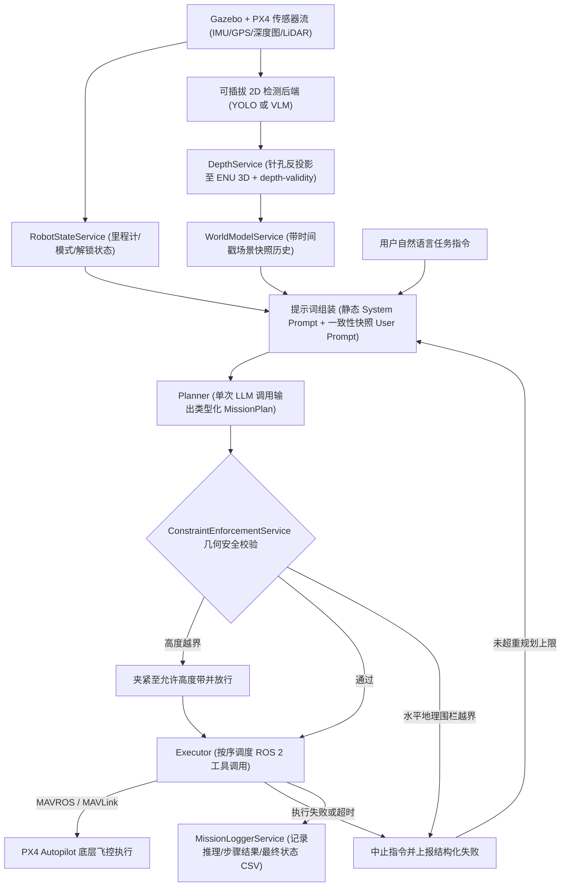
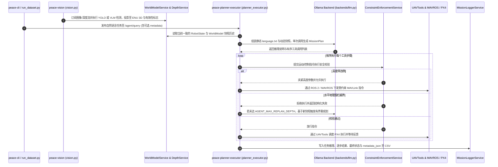

# PEACE: A Planner-Executor Agent with Constraint Enforcement for UAVs

## 一句话定义

PEACE 是面向 PX4 无人机的单次规划–执行（Planner–Executor）智能体框架：由 LLM 一次性生成结构化任务计划，通过 ROS 2 / MAVLink 工具接口顺序执行，并在飞控前端叠加独立几何约束校验与有界重规划。

## 英文缩写速查

| 缩写 | 英文全称 | 简要说明 |
|---|---|---|
| PEACE | Planner–Executor Agent with Constraint Enforcement | 本文提出的带约束强制无人机规划–执行智能体框架 |
| UAV | Unmanned Aerial Vehicle | 无人机平台，本文中为基于 PX4 的四旋翼系统 |
| VLN | Vision–Language–Navigation | 视觉–语言导航，常将感知与导航决策耦合在学习策略中 |
| VLA | Vision–Language–Action | 视觉–语言–动作模型，直接从像素与文本映射底层动作 |
| ENU | East–North–Up | 局部东–北–天三维坐标系，本文用于 3D 目标定位表达 |
| SITL | Software-In-The-Loop | 软件在环仿真，本文采用 Gazebo Harmonic + PX4 SITL |

## 为什么重要

将基础模型接入无人机（UAV）自主飞行时，现有方案通常陷入两难：一是采用 ReAct 式紧耦合感知–推理–动作循环，每调用一次工具就重新请求一次 LLM，不仅显著推高控制链路延迟，还可能因模型幻觉或参数格式错误直接引发现场物理碰撞风险；二是将自然语言与视觉观测训练为端到端视觉–语言–动作（VLA）或视觉–语言–导航（VLN）策略，虽然闭环响应快，但决策过程黑箱、难以施加显式安全规则审计，且高度依赖机器人特定数据集与微调。

PEACE 在“表达能力—可验证性”前沿选择了一个面向安全关键 UAV 部署的折中点：**无需特定任务微调**，直接利用现成（off-the-shelf）LLM 进行**单次（single-pass）任务规划**，将动作空间固定为可检查的类型化工具调用序列，并把安全边界（高度限制与水平地理围栏）移出模型权重，交给与 LLM 独立运行的几何校验服务在飞控前拦截把关。

## 核心信息

| 字段 | 内容与状态 |
|---|---|
| 作者 | Erdem Uysal, Timo Kehrer, Sebastiano Panichella |
| 机构 | Institute of Computer Science, University of Bern（瑞士伯尔尼大学）；AI4I - The Italian Institute of Artificial Intelligence（意大利人工智能研究所） |
| 发表时间 | 2026-05-26（arXiv:2606.00104v1，已被 ICRA 2026 Workshop on Semantics for Reliable Robot Autonomy 接收） |
| 论文链接 | [arXiv:2606.00104](https://arxiv.org/abs/2606.00104) · [arXiv HTML 全文](https://arxiv.org/html/2606.00104) |
| 项目与代码 | [GitHub: erdemuysalx/PEACE](https://github.com/erdemuysalx/PEACE) · [HuggingFace: erdemuysalx/uav-mission-prompts](https://huggingface.co/datasets/erdemuysalx/uav-mission-prompts) |
| 清单分类 | `harness.monitoring_and_recovery` |
| 来源条目 | `survey_ax_2606_00104` |
| 开源状态 | **已开源**（公开完整 Python / ROS 2 智能体包、Docker SITL 环境、系统提示词、批处理评测脚本与 108 条任务指令集；仓库未声明开源许可证） |

## 核心原理

PEACE 的整体系统由四个概念模块构成，围绕“**规划与控制解耦、感知可插拔、上下文快照一致、安全外部强制**”四条原则协作：

1. **Planner–Executor 单次规划与有界重规划（§III-B）**
   - **输入**：自然语言任务指令、时间戳对齐的机器人状态快照与世界模型快照。
   - **输出**：单次 LLM 调用生成一个类型化 `MissionPlan`，包含推理说明字符串（`reasoning`）与有序工具调用序列（如 `takeoff(5)` 后接 `forward(3)`）。
   - **调度与恢复**：执行器（Executor）按顺序通过 ROS 2 调用固定工具集并经 MAVROS/MAVLink 下发至 PX4，正常推进期间**不再请求 LLM**；仅当某一步工具调用执行失败或被约束层中止时，才将失败结构化反馈给规划器触发有界重规划（bounded replanning，仓库默认 `AGENT_MAX_REPLAN_DEPTH=2`）。

2. **可插拔感知后端与 3D 针孔投影接地（§III-C）**
   - 感知模块通过统一检测接口支持两类可互换 2D 后端：轻量目标检测器（YOLO / ultralytics）或视觉–语言模型（VLM，生成结构化检测结果）。
   - 深度投影服务（`DepthService`）结合同步深度图像与相机内参，采用针孔相机（pinhole camera）模型将 2D 边界框反投影为局部 ENU 坐标系下的 3D 目标位置。
   - 模块同时向规划器暴露显式的 **深度有效性标志（`depth-validity` flag）**，使规划器能够区分可信 3D 定位与缺失/不确定观测，避免基于虚假距离盲目规划。

3. **世界模型与机器人状态聚合（§III-D）**
   - `WorldModelService` 将连续检测流聚合成有界长度的带时间戳场景快照历史；`RobotStateService` 并行聚合里程计（odometry）、飞行模式（flight mode）与解锁状态（arming state）。
   - 每次规划（包括重规划）均从两项线程安全服务读取时间一致的快照，确保提示词接地于规划发生时刻的真实环境。

4. **双消息生命周期分离的提示词构造（§III-E）**
   - **System Prompt（静态不变）**：承载固定工具集定义、任务规则与输出 Schema（对应仓库 `peace/system_prompts/language.txt`）。
   - **User Prompt（查询时动态组装）**：仅携带易变状态——自然语言任务描述、当前机器人状态及短历史、当前世界模型及短历史；重规划时基于最新快照重建 User Prompt，防止沿用任务起点时的陈旧状态。

5. **独立几何约束强制层（§III-F）**
   - `ConstraintEnforcementService` 在每条运动指令到达飞控前执行纯几何校验，与 LLM 推理完全解耦：
     - **高度带限制**：配置最小/最大允许高度（`.env.example` 默认 `1.0 m` 至 `50.0 m`），超出范围的高度目标会被**夹紧（clamp）**到安全区间内。
     - **水平地理围栏（Geofence）**：以起飞点为中心设定最大水平半径（默认 `500.0 m`），越界指令将被**直接中止**，并把结构化失败原因回传给重规划器。
   - 同时 `MissionLoggerService` 记录推理过程、逐步执行结果、最终状态与任务元数据，支持离线可审计复盘。

## 流程总览

## 源码运行时序图

在官方仓库 `erdemuysalx/PEACE` 中，运行时通过两个后台 ROS 2 节点入口（`peace-vision` 对应 `peace/nodes/vision.py`，`peace-planner-executor` 对应 `peace/nodes/planner_executor.py`）协同完成感知聚合、单次规划、约束拦截与飞控调度，交互式命令入口 `peace-cli`（`peace/nodes/cli.py`）与批处理脚本 `evaluation/run_dataset.py` 均通过向 `/agent/query` 发布任务触发该执行链路。

## 实验与评测

作者在 Docker 封装的 **PX4 SITL（`gz_x500`）+ Gazebo Harmonic + ROS 2 Jazzy + MAVROS** 仿真环境中对 PEACE 进行了初步实验评估（§IV）。作者明确指出，实验目的**并非提供定量指标榜单对比**，而是基于结构化指令集定性刻画系统行为并暴露制约当前设计的核心失败模式。

- **指令集规模与构成（[uav-mission-prompts](https://huggingface.co/datasets/erdemuysalx/uav-mission-prompts)）**：共 **108 条**自由格式自然语言指令，覆盖以下 9 组能力与安全子集（论文正文称 8 个任务类别并附安全违例类别，各子集数量之和为 108）：
  - 起飞与降落（takeoff and landing）：**12** 条
  - 相对运动（relative motion）：**12** 条
  - 高度与姿态控制（altitude and attitude control）：**12** 条
  - 航点导航（waypoint navigation）：**13** 条（如 `Fly to position x=3, y=4, z=3`）
  - 几何路径跟踪（geometric path following）：**13** 条
  - 目标搜索与定位（object search and localization）：**12** 条
  - 开放词汇导航（open-vocabulary navigation）：**13** 条
  - 复合多步任务（composite multi-step missions）：**13** 条
  - 安全违例测试（safety violation）：**8** 条
- **仿真资产约束**：目标指代类指令受 Gazebo 仿真场景可用资产限制，目标词汇限定在 `{person, car, bench, traffic light, fire hydrant}` 5 类对象内。
- **四类行为模式观察（§IV-B）**：
  1. **度量类任务最可靠**：航点、相对运动与高度控制任务中的数值参数可直接一对一映射到工具参数。
  2. **几何路径可静态分解**：只要指令明确给出形状与边长，规划器可在规划期将其拆解为有序航点序列（与开环执行设计一致）。
  3. **感知条件任务高度敏感**：目标搜索与开放词汇导航的完成度直接受限于 2D 检测器召回率以及世界模型暴露的 `depth-validity` 标志质量。
  4. **复合任务存在级联失效**：多步任务中前置步骤若发生未被及时捕捉的隐性失败，会向后级联导致整个任务失败。
- **三类典型失败模式（§IV-C）**：
  1. **规划器错误（Planner-level errors）**：LLM 输出违反类型化 Schema 或系统提示词任务规则的计划；校验阶段可拦截并终止或触发有界重规划。
  2. **感知不确定性（Perception-level uncertainty）**：目标类别未被检测到或深度投影标记为不确定；虽然规划器会主动规避不确定观测，但连续多帧不确定快照会使搜索与导航退化为空转或无效计划。
  3. **安全校验中止（Safety-validation aborts）**：因触发高度极限或水平地理围栏被约束层主动拦截；属于预期安全保护，但会向上传导为任务失败。

## 与其他工作对比

论文（§II 与 §V）将基础模型机器人控制划分为三大家族，并与代表性工作对比如下：

| 路线家族 | 代表工作 | 规划/控制方式 | 可解释性与显式安全约束 | 数据与训练依赖 | 主要取舍 |
|---|---|---|---|---|---|
| VLN 视觉–语言导航 | OpenUAV、NavAgent、SINGER、NaVILA、CLOI-NAV、ReMEmbR | 学习耦合感知–动作的导航策略或路径点接口 | 较弱，策略黑箱且难插入外部硬约束 | 需任务/环境数据训练或微调 | 场景响应性强，但受限于特定本体与训练分布 |
| 端到端 VLA | RT-1、RT-2、PaLM-E、CognitiveDrone、RaceVLA | 像素与语言直接映射控制率动作 | 极弱，动作空间隐含在网络权重中 | 强依赖大规模机器人专有数据与微调 | 高频闭环反应快，但审计与安全认证困难 |
| 代码生成/ReAct 规划器 | TypeFly（MiniSpec DSL）、FlockGPT、Co-NavGPT、UAV-CodeAgents | 生成自由脚本/DSL 或每步重调 LLM（ReAct） | 脚本需每次重验；ReAct 在控制链路引入高延迟 | 无需领域微调（零样本/上下文学习） | 灵活性高，但动态生成代码扩展了运行时动作面或受制于推理延迟 |
| **PEACE（本文）** | — | **单次 LLM 生成固定 Schema 的 `MissionPlan` + 顺序工具执行 + 有界重规划** | **强：固定可审计工具集 + 飞控前独立几何约束校验 + 完整 CSV 日志** | **无需领域数据微调** | 用有限的开环静态规划假设换取低 LLM 调用次数、可解释性与外部安全保证 |

## 结论

**一句话总判：PEACE 证明了在无人机安全关键场景中，用“单次结构化工具规划 + 独立几何约束层 + 有界重规划”替代 ReAct 循环和端到端 VLA，可以在不微调模型的前提下换来清晰的可审计性与飞控前安全护栏，但开环调度与感知断链仍是其进入动态实飞前的主要短板。**

1. **用工具调用次数与审计性换取闭环高频**：单次规划仅需一次 LLM 推理（正常路径零重推理），并把全部规划推理与执行结果落盘为 CSV，适合对合规审计与低推理开销敏感的半静态 UAV 任务。
2. **安全边界必须独立于语言模型之外**：即便提示词声明了规则，LLM 仍可能生成越界航点；`ConstraintEnforcementService` 将高度夹紧与水平地理围栏剥离为纯几何硬校验，是从架构上满足物理安全基准的必要设计。
3. **当前 108 条实验仅属行为诊断而非基准胜率证明**：论文未报告跨方法的定量任务成功率对比，选型时不能将本工作视为量化领先基线，而应视作可复用的 ROS 2 / PX4 Agent 工程参考架构。
4. **工具层幂等性与闭环反应通道是下一步关键**：作者在工程复盘中明确指出，必须将 offboard 切换与解锁前置条件封装进工具内部保持幂等，并未来通过任务轨迹蒸馏轻量 VLA 补齐动态避障/追随能力。

## 工程实践

- **环境栈与容器部署**：官方仓库提供基于 Docker Compose 的一键 SITL 容器，集成 **ROS 2 Jazzy + Gazebo Harmonic + MAVROS + NoVNC**（浏览器 `http://localhost:6080` 可视化），本地或云端接入 Ollama 服务即可运行。
- **关键默认配置（`.env.example`）**：
  - 推理后端：`LANGUAGE_MODEL=llama3.2`、`VISION_MODEL=llava:13b`；检测后端可通过 `USE_YOLO=true` 切换 `yolov8n.pt`（或自定义 `.pt` 权重）与 VLM 后端。
  - 安全门限：`ACTION_ENABLE_CONTROL=false`（默认禁用实际 MAVROS 控制以防误触发，需显式开启）、`AGENT_MIN_ALTITUDE=1.0`、`AGENT_MAX_ALTITUDE=50.0`、`AGENT_HORIZONTAL_LIMIT=500.0`。
  - 恢复策略：`AGENT_MAX_REPLAN_DEPTH=2`、`AGENT_ENABLE_MEMORY=false`。
- **代码复用建议**：若需将该执行框架（Harness）迁移至其他移动机器人平台，可保持 `WorldModelService`、`RobotStateService` 与 `ConstraintEnforcementService` 的线程安全聚合与前向校验模式，仅替换 `peace/platforms/uav_tools.py` 中的底层平台工具绑定；同时建议按论文 §V 建议为每个动作工具补全前置状态自恢复（幂等化）。

## 局限与风险

1. **连续不确定感知导致退化计划**：世界模型是场景向规划器反馈的唯一通道，当目标持续缺失或 `depth-validity` 连续无效时，系统缺乏工具失败粒度以下的探索恢复机制，容易退化为无效计划。
2. **工具层缺乏强幂等性与状态机耦合风险**：实验暴露出 PX4 offboard 控制模式切换与 arming 解锁状态机之间存在依赖，若前序工具未完整恢复前置条件，顺序调度容易触发状态机拒止。
3. **开环规划面对动态场景脆弱**：`MissionPlan` 在规划期一次性确定航点与动作序列，若任务执行过程中目标发生显著移动或突发障碍物进入路径，只能等到工具报错后才进入重规划，无法实现毫秒级局部避障。
4. **仿真到真机（Sim2Real）尚未验证**：当前实验全部在 Gazebo Harmonic + PX4 SITL 中针对 5 类静态/受限仿真资产开展，真实无人机上的深度噪声、GPS 漂移、风扰与机载算力预算尚未经过实飞验证；仓库亦未标注开源许可证，商业或二次分发前需核实授权条款。

## 关联页面

- [Agentic Robots 综述](paper-towards-agentic-robots-survey.md)
- [全量项目节点清单](../overview/awesome-agentic-robots-node-index.md)
- [VLA 方法背景](../methods/vla.md)
- [机器人智能体执行框架](../methods/robot-agent-harness.md)：对照技能契约、外部调度校验与有界恢复机制。
- [智能体规划与反馈执行](../methods/agent-planning-feedback.md)：对照单次规划与失败触发重规划的设计边界。
- [智能体工具调用接口](../methods/agent-tool-use-interface.md)：对照类型化工具 Schema 与飞控桥接接口设计。
- [视觉–语言导航（VLN）](../tasks/vision-language-navigation.md)：对照 VLN 端到端策略与高层规划–执行解耦路线的差异。
- [机器人软件集成](../methods/robot-software-integration.md)：参考 ROS 2 / MAVROS 与底层飞控中间件集成模式。
- [目标检测](../methods/object-detection.md)：参考可插拔 2D 检测器与三维感知输入接口。

## 推荐继续阅读

- [arXiv:2606.00104 原文 HTML（PEACE）](https://arxiv.org/html/2606.00104)
- [GitHub 官方仓库：erdemuysalx/PEACE](https://github.com/erdemuysalx/PEACE)
- [HuggingFace 任务指令数据集：erdemuysalx/uav-mission-prompts](https://huggingface.co/datasets/erdemuysalx/uav-mission-prompts)

## 参考来源

- [论文精读归档：PEACE: A Planner-Executor Agent with Constraint Enforcement for UAVs](../../sources/papers/paper-agentic-2606-00104.md)
- [官方源码静态核对：erdemuysalx/PEACE](../../sources/repos/paper-agentic-2606-00104.md)
- [官方 Awesome 快照归档](../../sources/repos/awesome-agentic-robots-survey-index.md)
- [arXiv:2606.00104 摘要与元数据](https://arxiv.org/abs/2606.00104)
