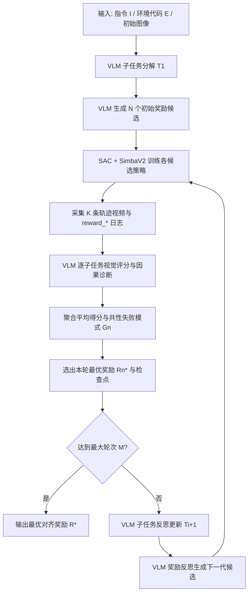

# RDA：Reward Design Agent for Reinforcement Learning

## 一句话定义

RDA（Reward Design Agent）是一个由视觉语言模型（VLM）驱动的闭环强化学习奖励设计智能体，通过先将指令拆解为有序子任务，再结合策略回放视频与子任务奖励日志诊断行为偏差并联合修改子任务定义与奖励代码，从而避免策略通过投机捷径完成目标却违背人类意图。

## 英文缩写速查

| 缩写 | 英文全称 | 简要说明 |
|---|---|---|
| RDA | Reward Design Agent | 本文提出的 VLM 闭环奖励设计智能体框架 |
| RDP | Reward Design Problem | 面向给定指令与学习算法的最优奖励函数搜索问题形式化 |
| VLM | Vision-Language Model | 视觉语言模型，用于任务分解、轨迹视觉诊断与奖励反思 |
| SAC | Soft Actor-Critic | 最大熵离线强化学习算法，本文所有实验的底层策略训练器 |
| MS | ManiSkill (ManiSkill3) | GPU 并行化桌面操作仿真基准，本文测试了 12 个短程任务 |
| HB | HumanoidBench | 基于 MuJoCo 的人形机器人全身操作基准，本文测试了 4 个长程任务 |

## 为什么重要

在物理仿真器中手工编写并调节强化学习（RL）奖励函数极其耗时，且在多目标竞争（如保持平衡同时前推重物）时极易发生奖励误设（reward mis-specification），诱发投机行为（例如人形机器人把包裹直接踢飞或用躯干顶推，而非按要求双手扶稳推向终点）。以 Eureka 为代表的传统大语言模型（LLM）代码演化方法虽然能自动生成可执行奖励，但其反思循环仅依赖均值、最值等标量统计量，无法从数值上区分"双手平稳推行"与"暴力抛掷"这两种截然不同的轨迹。RDA 引入视觉轨迹诊断与子任务级信用分配，直接打通了"发现行为偏移"到"定位并修复奖励代码缺陷"的闭环。

## 核心信息

| 字段 | 内容 |
|---|---|
| 作者 | Hojoon Lee、Ajay Subramanian、Ben Abbatematteo、Vijay Veerabadran、Pedro Matias、Karl Ridgeway、Nitin Kamra |
| 机构 | Meta、KAIST、NYU（录用于 RLC 2026） |
| 发表时间 | 2026-06-01（arXiv v1 提交；Accepted to RLC'26） |
| 论文链接 | [arXiv:2606.01672](https://arxiv.org/abs/2606.01672) / [arXiv HTML](https://arxiv.org/html/2606.01672) |
| 项目与代码 | [官方项目页](https://nitinkamra1992.github.io/reward-design-agent)（含演示视频与各任务生成奖励代码片段 `rewards/rda/*.txt`；未见公开框架仓库） |
| 清单分类 | model.training（来源条目：`survey_ax_2606_01672`） |
| 开源状态 | 部分开源（项目页公开演示视频与各任务最佳生成奖励函数片段，截至 2026-11-27 未确认公开可运行的 RDA 演化框架源码仓库） |

## 核心原理

### 1. 指令条件奖励设计形式化（RDP）

在 Singh et al. (2009) 的基础上，作者将指令条件下的奖励设计定义为五元组 $P = \langle \mathcal{I}, \mathcal{E}, \mathcal{R}, \mathcal{L}, \mathcal{S} \rangle$，其中 $\mathcal{I}$ 为自然语言指令空间，$\mathcal{E} = \langle \mathcal{O}, \mathcal{A}, \mathcal{T} \rangle$ 为仿真环境，$\mathcal{L}: \mathcal{E} \times \mathcal{R} \to \Pi$ 为固定 RL 训练器，$\mathcal{S}: \Pi \times \mathcal{I} \to \mathbb{R}$ 为指令对齐评估函数。优化目标为寻找使训练策略最符合指令的奖励代码：

$$R^\star \in \arg\max_{R \in \mathcal{R}} S(L(E, R), I)$$

### 2. 初始化阶段：子任务分解与结构化奖励生成

1. **输入准备**：读取自然语言指令 $I$、环境代码 $E$（含观测属性与成功判定函数 `evaluate()` / `get_success()`）以及环境初始渲染图像。
2. **子任务分解（Subtask Generation）**：VLM 将 $(I, E, \text{image})$ 分解为 $J$ 个有序、可测量的阶段性子任务 $T^1 = [t_1^1, \dots, t_J^1]$（简单任务约 5 步，长程复杂任务约 10 步），避免"识别目标"等纯感知步骤。
3. **初始奖励生成（Reward Generation）**：基于 $(I, E, T^1)$ 生成 $N$ 个可执行 Python 奖励候选 $\{R_1^1, \dots, R_N^1\}$。每个候选必须对子任务对应分量利用 `exp` 或 `tanh` 归一化至 $[0,1]$，再与显式权重相乘求和并叠加终止成功奖金，同时将各分项写入 `self.reward_info`（键前缀为 `reward_`）。所有候选在进入训练前先经过语法编译校验。

### 3. 演化搜索阶段：视觉诊断与双层反思（共 $M$ 轮）

在每一轮迭代 $i \in \{1, \dots, M\}$ 中，系统执行以下闭环：

1. **策略训练与轨迹回放**：使用统一训练器（SAC + SimbaV2）针对每个候选 $R_n^i$ 训练策略 $\pi_n^i = \mathcal{L}(E, R_n^i)$（支持从上一轮最佳权重热启动），并采集 $K$ 条评估轨迹 $\{\tau_{n,k}^i\}_{k=1}^K$，同时保存渲染视频帧与每步的 `reward_*` 分项数值日志。
2. **视觉轨迹分析（Visual Analysis）**：VLM 逐一审阅每条轨迹 $\tau_{n,k}^i$（每查询抽取 20 帧）及对应奖励日志，按子任务顺序 $t_j^i$ 给出三档完成度评分 $s_{n,k,j}^i \in \{0.0, 0.5, 1.0\}$（失败 / 部分达成 / 成功）及诊断理由 $\rho_{n,k,j}^i$。分析提示词明确要求同时引用视觉行为异常（如匍匐爬行、躯干顶推、空中悬停）与具体时间步的奖励数值（如饱和或信号被掩盖）。
3. **跨轨迹汇总与候选选优**：计算各候选的平均视觉子任务得分 $\bar{s}_n^i = \mathbb{E}_{k,j}[s_{n,k,j}^i]$，并将 $K$ 条轨迹的理由聚合成每个子任务的共性失败模式摘要 $p_{n,j}^i$，形成报告 $G_n^i = (\bar{s}_n^i, \{p_{n,j}^i\}_{j=1}^J)$。选取最优候选 $n_i^\star = \arg\max_n \bar{s}_n^i$ 并保存检查点。
4. **子任务反思（Subtask Reflection）**：根据 $G_{n_i^\star}^i$，VLM 定位最导致非预期行为的单个子任务并细化其语义约束（保持总子任务数 $J$ 不变），形成 $T^{i+1}$。例如在 Humanoid Package 任务中，针对"用躯干顶推"问题将子任务 3 修订为"双手平贴箱体背面并保持连续双侧手部接触作为推箱接口"。
5. **奖励反思（Reward Reflection）**：联合 $(I, E, T^{i+1}, R_{n_i^\star}^i, G_{n_i^\star}^i)$ 生成下一代 $N$ 个奖励候选 $\{R_n^{i+1}\}_{n=1}^N$，常见修正包括：引入门控因子（如用 `bilateral_contact = min(left_contact, right_contact)` 门控前推速度和进度奖励）、调整指数衰减尺度（如在 PlugCharger 中将过陡的 `exp(-200*dist)` 放宽为 `exp(-20*dist)` 以恢复远距离梯度），或用位置邻近度门控姿态对齐项以防策略"在空中对齐而不前插"。

## 流程总览

## 源码运行时序图

**不适用**（核查结果：截至 2026-11-27，arXiv 原文与官方项目页仅公开了演示视频及 16 个环境各自的最佳生成奖励函数文本片段 `rewards/rda/*.txt`，未发布 RDA 任务分解、VLM 轨迹诊断与演化搜索的可运行框架源码仓库；原文参考文献提到的 `https://github.com/krafton-ai/Prompt2Policy` 属于并发相关工作 Chung et al., 2026，并非本文官方实现）。

## 实验与评测

所有实验均在 NVIDIA A100 GPU 上执行，VLM 智能体主干采用 GPT-5（`2025-08-07`，中等推理强度），底层策略均采用 SAC + SimbaV2 架构，每任务跑 3 个随机种子、$M=5$ 轮演化。为规避生成器与评测器同源偏差，行为对齐率采用独立模型 GPT-4.1（`2025-04-14`，每段视频抽取 50 帧、重复评分 4 次，5 分制归一化至 $[0,1]$，每任务共 60 次评价）。

### 1. 主基准对比（§5.2）

| 基准套件 | 方法 | 对齐率 (Alignment Rate) | 成功率 (Success Rate) | 关键发现 |
|---|---|---|---|---|
| ManiSkill3（12 项桌面操作，50M 步） | Human Sparse | 0.28 | 0.17 | 稀疏奖励在长步长精度任务下基本失效 |
| ManiSkill3（12 项桌面操作，50M 步） | Human Dense | 0.68 | 0.74 | 基准自带手工稠密奖励，明显弱于自动设计 |
| ManiSkill3（12 项桌面操作，50M 步） | Eureka (GPT-5) | 0.87 | 0.87 | 短程任务中数值反馈尚可，但未解出 `PlugCharger` |
| ManiSkill3（12 项桌面操作，50M 步） | **RDA (GPT-5)** | **0.95** | **0.90** | 唯一稳定攻克高精插拔任务 `PlugCharger` 的方法 |
| HumanoidBench（4 项全身操作，10M 步） | Human Dense | 0.25 | 0.08 | 复杂高自由度任务中手工奖励极难奏效 |
| HumanoidBench（4 项全身操作，10M 步） | Eureka (GPT-5) | 0.47 | 略高于 RDA | 频繁通过抛掷/踢飞包裹等投机行为达标 |
| HumanoidBench（4 项全身操作，10M 步） | **RDA (GPT-5)** | **0.70** | **0.42** | 对齐率相对 Eureka 提升 49%，有效遏制投机 |

### 2. 演进过程与消融实验（§5.3–§5.4）

- **Humanoid Package 迭代演进（Fig. 6）**：第 1–2 轮后任务成功率即达 1.0，但初始对齐率仅 0.30（躯干顶推）；经过连续视觉诊断与双侧手部接触门控修订，第 4–5 轮对齐率稳步提升至 **0.68**，显著高于同一任务的 Eureka（**0.28**）与人工奖励（**0.08**）。
- **模块消融（PlugCharger + Package 3 种子均值，Fig. 7a）**：
  - Eureka 基线：对齐率 **0.31**，成功率 **0.50**；
  - `+Ckpt`（跨轮最优权重热启动）：对齐率 **0.35**，成功率 **0.55**；
  - `+Traj Analysis`（加入视觉轨迹诊断，无子任务分解）：对齐率跃升至 **0.82**，成功率 **0.83**（证明视觉诊断是消除行为偏移的决定性机制）；
  - 完整 RDA（叠加子任务分解）：对齐率 **0.84**，成功率 **1.0**（子任务结构通过精细信用分配将 `PlugCharger` 成功率从 0.83 推升至 1.0）。
- **候选池规模缩放（Fig. 7b）**：每轮候选数 $N$ 从 1 增至 2 再增至 8 时，对齐率由 **0.46 → 0.58 → 0.84**，成功率由 **0.20 → 0.51 → 1.0**。

## 与其他工作对比

| 对比维度 | 手工奖励设计 | 数据/偏好驱动奖励学习 | Eureka (Ma et al., 2023) | RDA（本文） |
|---|---|---|---|---|
| 奖励载体 | 人工硬编码环境状态函数 | 神经网络奖励模型 / VLM 打分器 | LLM 生成可执行 Python 源码 | VLM 生成可执行 Python 源码 |
| 仿真吞吐代价 | 极低（纯状态计算） | 高（GPU 并行查询大模型慢） | 极低（纯状态计算） | 极低（训练期不调 VLM，仅演化期分析视频） |
| 反思反馈信号 | 人工肉眼试错与重调 | 离线重新标注或再采集偏好对 | 仅限各分项均值/最值统计量 | 轨迹渲染视频帧 + 逐子任务 `reward_*` 数值日志 |
| 长程意图对齐能力 | 依赖专家经验，多目标易失衡 | 受限于数据集覆盖与稀疏反馈 | 易被相同数值掩盖非预期捷径 | 通过子任务诊断与门控修订显著抑制投机行为 |

## 结论

**一句话总判：在自动化奖励设计中，将 VLM 视觉轨迹诊断引入代码演化闭环是解决长程控制"高成功率但低指令对齐"的关键机制，而显式子任务分解则主要通过细粒度信用分配提升复杂插入任务的最终成功率。**

1. **视觉诊断决定行为对齐上限**：模块消融表明，仅靠跨轮权重热启动提升微弱（对齐率 0.31 → 0.35），而引入视觉轨迹分析即可将对齐率大幅推高至 0.82，证明仅凭标量统计量无法修复物理行为级奖励漏洞。
2. **门控机制比单纯调权更有效**：在连续控制中，后段进度奖励常掩盖前置姿态要求（如手部接触）；通过诊断出具体违规阶段并用前置子任务分项乘性门控后续进度奖励（如 `bilateral_contact`），能直接封堵奖励投机路径。
3. **候选多样性换取性能代价显著**：候选数量 $N$ 从 1 增至 8 可使成功率从 0.20 升至 1.0，但每轮每个候选均需完整执行一次 RL 训练，算力成本随 $N$ 线性放大，实际工程需权衡搜索预算。
4. **评估器与生成器应解耦**：论文在演化时使用 GPT-5、评测时切换 GPT-4.1 并固定 50 帧盲评提示词，是降低自评偏差、可复用于其他智能体奖励评估流程的规范做法。

## 工程实践

1. **规范化奖励代码输出契约**：在提示词中强制要求模型（1）仅调用环境源码内已定义属性（如 `self.agent.tcp.pose`、`self.evaluate()`）；（2）所有分项经 `exp` / `tanh` 压限至 $[0,1]$ 后再显式加权；（3）统一写入 `self.reward_info["reward_*"]`，使后续 VLM 能够将图像帧变化精确关联到具体代码分项。
2. **并行环境与训练算力配置**：对于 GPU 并行仿真器（如 ManiSkill3，2000 并行环境，50M 步），单任务 5 轮×4 候选仅需约 20–40 A100 GPU 小时；但对于 CPU 受限的 MuJoCo 长程任务（HumanoidBench，16 环境，10M 步），5 轮×8 候选需 240–360 A100 GPU 小时。工程部署时可先在低 $N$（如 $N=2$ 已较 $N=1$ 显著改善）验证子任务分解与环境 API 绑定正确性。
3. **跨轮热启动控制**：在保留上一轮最佳策略检查点进行热启动时，需配合准确的视觉诊断避免策略陷入局部投机动作的惯性。

## 局限与风险

1. **演化循环算力开销高**：每个新生成的奖励候选都必须从头或热启动完成整轮 RL 训练，在非 GPU 并行的全身仿真上单任务消耗高达 240–360 GPU 小时；作者建议未来引入训练前的内部自我审查机制过滤明显缺陷奖励。
2. **VLM 视觉推理与上下文瓶颈**：由于 VLM 视觉上下文窗口限制，RDA 对单条轨迹仅采样 20 帧分析，且对齐率评估只能做单视频打分而非成对对比，对瞬时高速碰撞或微小几何偏差的识别仍存在误差与高推理成本。
3. **跨子任务奖励冲突**：当早期子任务与后期子任务在动作策略上存在互斥时（例如 `Humanoid Basketball` 中强烈的接球稳持奖励抑制了将球投向篮筐的探索），单纯的静态加权容易阻碍后段探索，需结合显式子任务状态条件化策略缓解。
4. **缺乏真机 Sim2Real 验证**：全文 16 项评测均在仿真环境中完成（特权状态可直读），真机部署下的观测噪声、物理失配及安全约束尚未在本文中验证。

## 关联页面

- [Agentic Robots 综述](paper-towards-agentic-robots-survey.md)
- [全量项目节点清单](../overview/awesome-agentic-robots-node-index.md)
- [Eureka：LLM 自动化奖励设计](paper-eureka-llm-reward-design.md)
- [VLA 方法背景](../methods/vla.md)
- [强化学习](../methods/reinforcement-learning.md)
- [Soft Actor-Critic (SAC)](../methods/sac.md)
- [FlashSAC（含 SimbaV2 骨干参考）](../methods/flashsac.md)
- [操作任务（Manipulation）](../tasks/manipulation.md)
- [全身移动操作（Loco-Manipulation）](../tasks/loco-manipulation.md)

## 推荐继续阅读

- [RDA 官方项目主页与生成奖励片段展示](https://nitinkamra1992.github.io/reward-design-agent)
- [arXiv:2606.01672v1 全文（HTML 版）](https://arxiv.org/html/2606.01672)

## 参考来源

- [论文全文精读归档（arXiv:2606.01672v1）](../../sources/papers/paper-agentic-2606-01672.md)
- [Awesome Agentic Robots 官方文献索引快照](../../sources/repos/awesome-agentic-robots-survey-index.md)
- [论文原文入口（arXiv:2606.01672）](https://arxiv.org/abs/2606.01672)
- [官方项目主页](https://nitinkamra1992.github.io/reward-design-agent)
