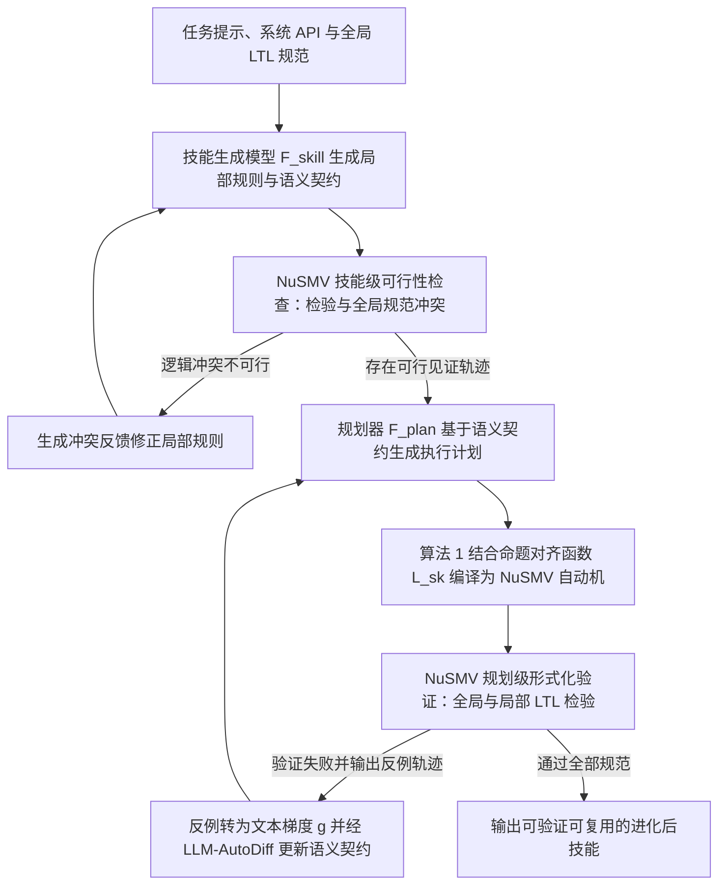

# VASO: Formally Verifiable Self-Evolving Skills for Physical AI Agents

## 一句话定义

**VASO**（Verification-Guided Automated Skill Optimization）是一个面向物理 AI 智能体的**可形式化验证技能自进化框架**：它将可复用机器人技能封装为“命题对齐标注函数 + 文本规划模板”耦合的语义契约，利用符号模型检测器（NuSMV）先过滤逻辑矛盾的技能规则、再对技能诱导的规划做时序逻辑检查，并将反例轨迹转化为文本梯度，在不更新大模型权重的情况下迭代进化技能本身。

## 英文缩写速查

| 缩写 | 英文全称 | 简要说明 |
|---|---|---|
| VASO | Verification-Guided Automated Skill Optimization | 本文提出的基于形式化验证反馈的自动化技能优化框架 |
| LTL | Linear Temporal Logic | 线性时序逻辑，用于形式化表达全局安全约束 $\mathcal{G}$ 与局部技能规则 $\psi_{sk}$ |
| AP | Atomic Proposition | 原子命题集合 $\mathcal{AP}=\{a_1,\dots,a_n\}$，连接低层机器人状态与高层符号验证 |
| NED | North-East-Down | 北-东-地坐标系，PX4 四旋翼无人机以 1 FPS 发布的低层速度轨迹参考系 |
| RLVF | Reinforcement Learning with Verification Feedback | 基于形式化验证反馈微调大语言模型权重的强化学习对比基线 |
| SS / TC | Safety Score / Task Completion | 安全性得分（规划满足全部规范的比例）与仿真任务完成率 |

## 为什么重要

1. **填补“可创建”与“可信赖”之间的验证鸿沟：** 现有基于大模型自进化技能的方法（如 Voyager、AutoManual、Eureka、AutoSkill）依赖执行反馈、单元测试或环境奖励等“轨迹级证据（trace-level evidence）”，只能说明技能在已采样回合中跑通，无法防止其在未测试条件或边缘场景下违反时序安全契约。在本文的 Jackal 与 PX4 基准上，即使最强的执行反馈基线仍有超过二十分之一的规划违反形式化规范。
2. **让反例直接优化“可复用技能”而非仅拦截单次规划：** 传统验证式规划（如 VerifyLLM 等）多在规划生成后充当一次性通过/拒绝过滤器，而 LAD-VF 或 RLVF 则把纠错吸收进扁平提示词或隐藏的模型权重中。VASO 把可检查、可解释的语义契约作为显式优化对象，使一条验证反例能够持续改善该技能在未来未见任务提示下的诱导行为。
3. **免微调且样本高效的轻量化收敛：** 在冻结基础模型参数的前提下，VASO 仅用少于 100 个优化样本、单技能低于 20 分钟（约微调方案 RLVF 1/4 的训练时间），即可在两类真实机器人平台上达到 97.2% 的形式化规范合规率。

## 核心信息

| 字段 | 内容 |
|---|---|
| **作者** | Yunhao Yang、Neel P. Bhatt、Kevin Wang、Samuel Tetteh、Zhangyang Wang、Ufuk Topcu（* Equal Contribution） |
| **机构** | 德州大学奥斯汀分校（The University of Texas at Austin）、艾奥瓦州立大学（Iowa State University） |
| **发表时间** | 2026-06-03（arXiv:2606.05395v1 [cs.RO]） |
| **论文链接** | [arXiv:2606.05395](https://arxiv.org/abs/2606.05395) / [arXiv HTML v1](https://arxiv.org/html/2606.05395) |
| **项目与代码** | [项目页（匿名提交版）](https://languagegroundedriskdetection.github.io/ProjectPage/vaso-webpage/) |
| **清单分类** | `harness.skills`（条目 `survey_ax_2606_05395`） |
| **开源状态** | **宣称将开源或未列链接**（截至 2026-11-27，项目页明确声明代码将在接收后公开：“We will make the code public after acceptance due to the anonymity policy”，当前无公开 GitHub 仓库） |

## 核心原理

VASO 围绕“可验证语义契约表示”与“双层闭环优化”构建（原文 §3–§4、Appendix A）：

### 1. 可验证技能的形式化表示（§3）

给定原子命题集合 $\mathcal{AP}=\{a_1,\dots,a_n\}$、低层可执行系统指令集 $\mathcal{S}$（如 ROS 控制 API 或无人机速度轨迹原语）、全局安全规范 $\mathcal{G}=\{\varphi_1,\dots,\varphi_m\}$ 与任务提示 $\tau$，技能生成模型 $\mathcal{F}_{\text{skill}}$（实验采用 `GPT-5-nano`）产出结构化技能三元组 $sk = (\mathcal{G}, \psi_{sk}, \mathcal{C}_{sk})$：

- **全局规范 $\mathcal{G}$：** 以 LTL 公式给出、在所有优化轮次中保持不变的硬性安全约束（例如 Jackal 的 `G(people_observed -> X stop)`、PX4 的 `G(max_altitude < 10)`）。
- **局部规则 $\psi_{sk}$：** 描述当前技能预期目标或活性要求的 LTL 公式（例如 Jackal 避障或恢复前进条件）。
- **语义契约 $\mathcal{C}_{sk} = (L_{sk}, \mathcal{C}_{sk}^p)$：** 连接形式化验证器与语言模型规划器的双面接口：
  - **命题对齐标注函数 $L_{sk}: \sigma_t \to 2^{\mathcal{AP}}$：** 将系统执行状态、观测与控制指令映射为各时刻成立的原子命题真值（在实现中由 $\mathcal{F}_{\text{skill}}$ 自动生成与命题同名的 Python 包装函数及数值计算函数，例如通过 `yolo_listener("people")` 返回布尔值，或通过速度范数与垂直积分计算无人机高度与线速度）。
  - **文本规划模板 $\mathcal{C}_{sk}^p$：** 面向规划器 $\mathcal{F}_{\text{plan}}$（实验采用 `GPT-4o-mini`）的 Python 结构化行为先验，引导其生成实际可执行的规划 $\pi = \mathcal{F}_{\text{plan}}(\mathcal{C}_{sk}, \tau)$。

### 2. 第一级验证：技能级可行性与局部规则修正（§4.1）

在采样任何规划前，VASO 先检查局部规则是否与全局规范自洽。系统构造覆盖所有命题转移的通用转移系统 $\mathcal{M} = (S, S_0, T, L)$（其中 $S = 2^{\mathcal{AP}}, S_0 = S, T = S \times S$），令组合规范 $\Phi_{sk} = (\bigwedge_{\varphi \in \mathcal{G}} \varphi) \wedge \psi_{sk}$，并借助 NuSMV 模型检测器检验：

$$\mathcal{M} \models \neg \Phi_{sk}$$

若该性质成立，说明在所有可能轨迹中均不存在满足 $\Phi_{sk}$ 的执行（即 $\psi_{sk}$ 与 $\mathcal{G}$ 逻辑冲突），技能被判定为不可行并直接返回冲突反馈给 $\mathcal{F}_{\text{skill}}$ 重写局部规则；否则模型检测器给出见证轨迹 $\sigma \models \Phi_{sk}$，技能进入下一阶段的规划级优化。

### 3. 第二级验证：规划级自动机编译与文本梯度进化（§4.2, Alg. 1）

对于可行技能，VASO 执行前向规划-验证与反向文本梯度更新的闭环交替：

1. **前向编译与模型检测（$\mathcal{C}_{sk}^{(k)} \to \pi^{(k)} \to \mathcal{A}_{\pi^{(k)}}$）：**
   规划器 $\mathcal{F}_{\text{plan}}$ 依据当前语义契约生成可执行计划 $\pi$；算法 1（Plan-to-Automaton）提取指令序列 $\sigma_0, \dots, \sigma_H$，利用 $L_{sk}$ 生成命题标签 $L(s_t) = L_{sk}(\sigma_t)$ 并编译为 NuSMV 状态机 $\mathcal{A}_\pi = (S, S_0, T, L)$，验证 $\mathcal{A}_\pi \models \mathcal{G} \wedge \psi_{sk}$。
2. **反例转文本梯度与契约更新（$\mathcal{A}_{\pi^{(k)}} \to g^{(k)} \to \mathcal{C}_{sk}^{(k+1)}$）：**
   定义损失 $\mathcal{L}$ 为违反规范的比例。当 NuSMV 返回 `fail(φ)` 及反例轨迹时，VASO 将其解析为自然语言文本梯度 $g$（例如 `"violate specification: G(person observed -> X stop)"`），将其作为离散近似 $\frac{\partial \mathcal{L}}{\partial \mathcal{C}_{sk}}$ 传回 LLM-AutoDiff 风格的优化循环：

$$\mathcal{C}_{sk}^{(k+1)} = \mathcal{F}_{\text{skill}}\big(\mathcal{C}_{sk}^{(k)}, g, \tau\big)$$

整个优化仅在语义契约文本/代码提示层面迭代，无需反向传播、权重微调或人类实时介入。

## 流程总览

## 源码运行时序图

**不适用**（截至 2026-11-27，匿名项目页 `https://languagegroundedriskdetection.github.io/ProjectPage/vaso-webpage/` 明确声明「We will make the code public after acceptance due to the anonymity policy」，arXiv 论文与项目页均未公开代码仓库地址，无可检查的官方可运行源码入口）。

## 实验与评测

论文在两类真实物理平台——**Clearpath Jackal 地面移动机器人**（速度与 YOLO 目标检测 API，5 条全局/局部规范）与 **PX4 四旋翼无人机**（1 FPS 的 NED 速度轨迹 `[vn, ve, vd]`，6 条全局/局部规范）上开展评测，共覆盖 **11 条 LTL 规范**、**20 个生成技能**与 **400 份生成规划**，底层采用 `GPT-5-nano`（$\mathcal{F}_{\text{skill}}$）与 `GPT-4o-mini`（$\mathcal{F}_{\text{plan}}$）。

### 1. 主实验与基线对比（§5 Table 1）

| 方法类别 | 方法 | 安全性得分 SS (%) | 仿真任务完成率 TC (%) |
|---|---|---:|---:|
| Zero-shot | LLM+P [11] | 79.5 | 88.3 |
| Zero-shot | ReAct [32] | 73.3 | 86.5 |
| Zero-shot | LLM-Planner [4] | 90.3 | 89.3 |
| Learning-based | DSPy [23] | 86.8 | 87.0 |
| Learning-based | RoboInstruct [28] | 82.5 | 67.0 |
| Learning-based | RLVF [25] | 94.3 | 82.5 |
| **本文方法 (VASO)** | **handcraft prop align（手工命题对齐）** | **97.2** | 85.3 |
| **本文方法 (VASO)** | **automatic prop align（自动命题对齐）** | **96.8** | 86.5 |

*注：在优化效率上，VASO 仅使用少于 100 个优化样本、每技能耗时低于 20 分钟，训练时间约为参数微调方案 RLVF 的四分之一。*

### 2. 分项检验、跨提示复用与消融结果（§5, App. B.1, App. D）

1. **技能级可行性修正：** 初始由 $\mathcal{F}_{\text{skill}}$ 直接生成的技能仅 **89%** 满足全部契约；引入 1 轮形式化可行性反馈后，技能可行率提升至 **97%**。
2. **7 步迭代与扁平提示优化对比（Fig. 5）：** 对 100 份初始技能规划与优化 7 步后的 100 份规划对比显示，VASO 在 7 步内安全率超过 **90%**（跨 11 条规范整体达到约 **95%**，任务可行性保持 **97%**）；而直接优化自然语言指令、缺少结构化技能抽象的扁平提示优化基线 LAD-VF [24]（在附录 D 消融中对应 LLM-AutoDiff [22]）在 10 步后仍停留在约 **85%** 平台期。
3. **未见任务提示复用（Held-Out Skill Reuse，App. B.1）：** 选取 4 个代表性技能（Jackal 的 `drive`、`find-object`、`bypass-object` 与 PX4 的 `fly-in-square-shape-traj`），每技能各设 5 个域内训练提示与 5 个未见域外提示（每提示采样 5 份规划，共 $4 \times (5+5) \times 5 = 200$ 份规划）。冻结优化后技能直接迁移至未见提示，仍获得 **92–100%** 安全性得分与 **80–96%** 任务完成率。
4. **自动命题对齐 vs. 手工对齐（Table 1, App. C）：** 由大模型自动生成的 $L_{sk}$ 相比专家手写版本，最终安全性得分差距小于 1%（96.8% vs. 97.2%），同时将任务完成率维持在 86.5%。

## 与其他工作对比

| 维度 | Voyager / AutoManual / AutoSkill | VerifyLLM / 常规验证式规划 | LAD-VF / RLVF | VASO（本文） |
|---|---|---|---|---|
| 反馈信号来源 | 执行报错、环境奖励或 LLM 自反思（轨迹级） | 符号模型检测（布尔通过/拒绝） | 形式化验证反例（文本提示或奖励微调） | **NuSMV 技能级+规划级双重反例** |
| 优化目标载体 | 技能代码库或操作手册 | 单次任务规划（拒绝后重采样） | 扁平规划提示词或 LLM 权重 | **显式语义契约（标注函数 $L_{sk}$ + 规划模板 $\mathcal{C}_{sk}^p$）** |
| 权重更新需求 | 无（黑盒调用） | 无 | LAD-VF 无 / RLVF 需微调权重 | **冻结大模型权重** |
| 跨未见提示可复用性 | 具备技能库复用，但缺形式化保证 | 面向单次规划，难以沉淀至技能 | 依赖提示/权重迁移，缺乏模块化契约 | **冻结技能可直接复用（92–100% SS）** |

## 结论

**一句话总判：VASO 证明了“双面语义契约 + NuSMV 形式化反例驱动文本梯度”可以在不微调大模型参数的前提下实现高安全合规的机器人技能自进化，但其形式化保证强度仍取决于命题对齐函数的忠实度。**

1. **将技能优化从“跑通即正确”升级为“反例驱动契约进化”：** 对存在硬安全时序约束（如避人急停、空域高度与加速度包络）的机器人技能，应以反例驱动文本梯度替代单纯的执行成功/失败自反思。
2. **分离全局硬约束与局部技能目标并做前置冲突筛查：** 工程落地时先用全转移系统检验 $\mathcal{M} \models \neg \Phi_{sk}$，能在规划采样前拦截局部规则与全局安全不变量矛盾的坏技能，减少无效试错。
3. **命题对齐函数必须覆盖完整物理状态维度：** 虽然自动生成的 $L_{sk}$ 平均表现接近手工编写，但涉及三维速度合成、高度积分等连续物理量时，应对关键安全命题辅以人工复核或单元测试校验。
4. **当前更适合顺序执行的单技能与多步组合：** 在部署并发技能或交错动作前，需额外建立跨技能资源竞争与联合状态转移模型。

## 工程实践

1. **命题对齐包装规范（Appendix A & C）：**
   - 观测命题（如 `people_observed()`、`obstacle_observed()`）应封装为返回布尔值的查询函数，底层只允许通过对齐后的包装函数调用原始感知/控制 API（如 `yolo_listener`、`velocity_publisher`）。
   - 数值状态命题若无法由单一 API 直接读取，可通过显式全局变量（如 `CURRENT_SPEED`）或轨迹积分函数（如 PX4 的 `_altitude_trace`）维护并在模板末尾加入运行时断言。
2. **常见失效模式自动修复示例（Appendix C）：**
   - **Jackal 活性死锁：** 初始模板在检测到行人或障碍后直接 `break` 退出循环导致机器人永久停在 `stop()` 状态，违反局部活性规约 `F(!people_observed & !obstacle_observed) -> F(!stop)`；经 10 轮反例迭代后重构为 `while True` 下的 `if/elif/else` 分支恢复前进。
   - **PX4 边缘越界：** 初始参数 `ver_speed, vert_duration_s = 1, 10` 在达到 10 m 边界前因离散指令周期产生轻微超调而触发 `G(max_altitude < 10)` 违规；经 1 轮反例反馈即收敛为 `ver_speed, vert_duration_s = 0.5, 10`。

## 局限与风险

1. **命题对齐错误可导致“虚假安全证明”（§4.2, §7, App. C）：** 形式化验证结论以 $L_{sk}$ 准确抽象低层动力学为前提。附录 C 给出了明确反例：若自动生成的 `_norm3` 漏掉 PX4 垂直速度分量 `v[2]`，则指令 `(0.8, 0.6, -0.5)` 会被错误计算为合速度 $1.0$ 并通过验证，而实际三维速度模长为 $1.12 > 1$。作者建议后续结合模型置信度校准做概率化接地校验。
2. **仅验证顺序、非并发技能执行（§7）：** 当前假设技能按顺序独立运行，无法验证多个并发或交错执行的技能之间、以及多智能体共享环境约束下的交互安全性。
3. **源码尚未公开与依赖闭源模型接口：** 截至 2026-11-27，匿名项目页仅声明将在接收后开源，主实验依赖 `GPT-5-nano` 与 `GPT-4o-mini` 及 NuSMV 外部工具链，本地端到端复现仍待官方代码发布后验证。

## 关联页面

- [Agentic Robots 综述](paper-towards-agentic-robots-survey.md)
- [全量项目节点清单](../overview/awesome-agentic-robots-node-index.md)
- [VLA 方法背景](../methods/vla.md)
- [机器人智能体执行框架](../methods/robot-agent-harness.md)：对照规划、工具调用与反馈的系统边界
- [智能体技能封装](../methods/agent-skill-packaging.md)：对比技能元数据、按需加载脚本与 VASO 形式化语义契约
- [智能体规划与反馈执行](../methods/agent-planning-feedback.md)：对比基于环境观察的重规划与基于模型检测反例的技能进化
- [验证闭环](../methods/coding-agent-verification-loops.md)：从软件/智能体验证闭环视角理解 NuSMV 反例驱动的文本梯度更新
- [机器人导航工作流](../methods/robot-navigation-workflow.md)：对照地面移动机器人导航中的避障与速度约束实践
- [安全强化学习](../methods/safe-rl.md)：对照基于约束强化学习与形式化时序验证的安全保障范式

## 推荐继续阅读

- [VASO 论文全文（arXiv HTML）](https://arxiv.org/html/2606.05395)
- [VASO 匿名项目主页](https://languagegroundedriskdetection.github.io/ProjectPage/vaso-webpage/)
- [LLM-AutoDiff：Auto-Differentiate Any LLM Workflow（arXiv:2501.16673）](https://arxiv.org/abs/2501.16673)

## 参考来源

- [VASO 原文通读与核对归档](../../sources/papers/paper-agentic-2606-05395.md)
- [官方 Awesome 快照归档](../../sources/repos/awesome-agentic-robots-survey-index.md)
- [论文官方入口（arXiv:2606.05395）](https://arxiv.org/abs/2606.05395)
- [VASO 项目主页](https://languagegroundedriskdetection.github.io/ProjectPage/vaso-webpage/)
