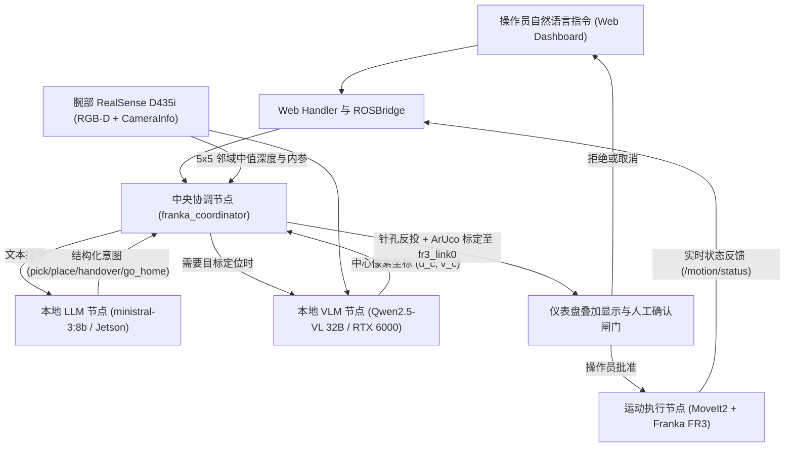
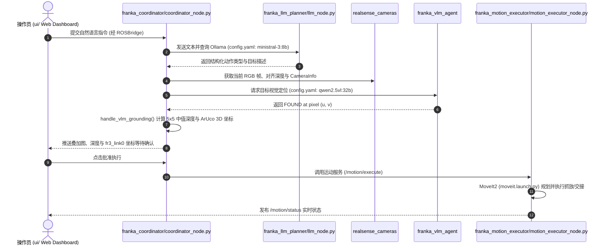

# A Conversational Framework for Human-Robot Collaborative Manipulation with Distributed Generative AI models

## 一句话定义

该框架是一个面向人机协作操作的**分布式 ROS 2 对话式系统**：它将本地大语言模型（LLM）意图解析、视觉语言模型（VLM）开放词汇目标定位、三维坐标转换与 MoveIt2 运动执行解耦为独立 ROS 2 节点，并在 Web 仪表盘强制执行**人类操作员确认闸门**后才驱动 Franka FR3 机械臂运动。

## 英文缩写速查

| 缩写 | 英文全称 | 简要说明 |
|---|---|---|
| ROS 2 | Robot Operating System 2 | 本系统的分布式通信底座，负责将语言、视觉、协调与控制解耦为独立节点 |
| LLM | Large Language Model | 本框架中用于将自由自然语言解析为结构化操作意图与参数的语言模型（默认 `ministral-3:8b`） |
| VLM | Vision-Language Model | 本框架中用于零样本开放词汇场景理解与图像中心像素定位的视觉语言模型（默认 `Qwen2.5-VL 32B`） |
| HRI | Human-Robot Interaction | 人机交互，本文关注协作操作场景下的意图可检视性与人工安全确认闭环 |
| RGB-D | Red-Green-Blue-Depth | 彩色与对齐深度图像流（由腕部 Intel RealSense D435i 提供），用于 2D 像素到 3D 目标转换 |
| VLA | Vision-Language-Action | 端到端视觉语言动作策略，文中用于对比本文模块化显式协调架构 |

## 为什么重要

在真实人机协作桌面操作中，自由自然语言常存在指代不清、物体遮挡或外观相似等歧义，而生成式模型固有的幻觉问题一旦直接触发物理执行就会带来安全隐患。同时，高质量 VLM 的显存与内存开销远高于轻量级语言规划器，将其全部堆叠在控制端工控机会引发严重资源争用。该工作不追求黑盒端到端策略，而是示范了一套**隐私可本地化、算力可跨设备分布、中间表征完全透明且带显式人类安全闸门**的工程参考架构（已被 RO-MAN 2026 接收）。

## 核心信息

| 项目 | 详情 |
|---|---|
| 作者 | Arash Ghasemzadeh Kakroudi, Roel Pieters |
| 机构 | 坦佩雷大学（Automation Technology and Mechanical Engineering, Tampere University） |
| 发表时间 | 2026-06-04 提交 arXiv（已被 IEEE RO-MAN 2026 接收，终版标题 *A Distributed Conversational Framework for Human-Robot Collaborative Manipulation Using Local LLMs and VLMs*） |
| 论文链接 | [arXiv:2606.06061](https://arxiv.org/abs/2606.06061) · [arXiv HTML 全文](https://arxiv.org/html/2606.06061) |
| 项目与代码 | [cogrob-tuni/franka-llm](https://github.com/cogrob-tuni/franka-llm)（Apache-2.0，见 README） |
| 清单分类 | `model.perception`（来源条目：`survey_ax_2606_06061`） |
| 开源状态 | **已开源**（包含 6 个 ROS 2 功能包源码、Web 仪表盘、`config.yaml`、启停脚本与 180 次试验 CSV 数据） |

## 核心原理

系统以 ROS 2 Jazzy 为通信总线，将交互式操作拆分为四个协同层级，全部 AI 推理均通过本地 Ollama 服务执行：

1. **自然语言结构化路由（`franka_llm_planner`）：**
   - 默认在边缘端 Jetson AGX Orin 64 GB 上运行 `ministral-3:8b`。
   - LLM 不直接输出关节控制量，而是将用户指令分类为结构化动作请求（`pick`、`place`、`handover`、`go_home`），并抽取目标物体、方位关系（如相对于参考物体的 `left` / `right` / `top` / `bottom`）或对话回复。纯对话请求直接应答，涉及物理目标的指令交由协调节点路由给视觉模块。
   - 对于 `place` 指令中的相对方位描述，协调节点会在参考物体位置基础上叠加可配置的 `8 cm` 偏移量。

2. **零样本 VLM 开放词汇定位（`franka_vlm_agent`）：**
   - 默认在 RTX 6000 工作站上运行未经过任务微调的 `Qwen2.5-VL 32B`，接收腕部 Intel RealSense D435i 的 RGB 图像与文本描述，返回中心像素坐标 `(u_c, v_c)`。
   - 位置定位任务提示 VLM 按 `FOUND at pixel (u, v)` 格式输出，协调节点通过正则表达式级联同时兼容像素坐标与归一化坐标（`u, v <= 1.0` 时按图像分辨率重缩放）。

3. **深度融合与机器人坐标系标定（`franka_coordinator`）：**
   - 在对齐深度图中以 `(u_c, v_c)` 为中心取 `5×5` 邻域，计算非零有效深度的**中值**作为稳健深度估计 `z`，结合 `sensor_msgs/CameraInfo` 在线内参 `(f_x, f_y, p_x, p_y)` 按针孔相机模型恢复相机光学坐标系三维点 `p_c = [x_c, y_c, z_c]^T`：
     `x_c = (u_c - p_x) * z / f_x`，`y_c = (v_c - p_y) * z / f_y`，`z_c = z`。
   - 通过离线 ArUco 标定得到的旋转平移 `(R_{a←c}, t_{a←c})`、FR3 轴向映射与符号修正 `Φ` 及固定偏置 `d`，变换到机械臂基坐标系 `fr3_link0`：`p_{aruco} = R_{a←c} p_c + t_{a←c}`，`p_{robot} = Φ(p_{aruco}) + d`。

4. **人类确认安全闸门与运动执行（Web Dashboard + `franka_motion_executor`）：**
   - 协调节点通过 Web Handler 与 ROSBridge 将解析后的动作类型、像素叠加图、深度 `z`、置信度及 `fr3_link0` 目标坐标实时推送至 Web 仪表盘。
   - **只有操作员点击显式确认后**，运动执行节点才通过 MoveIt2 规划无碰撞轨迹并驱动 Franka FR3 执行（`config.yaml` 统一管理安全高度 `0.60 m`、抓取高度 `0.14 m`、交接高度 `0.30 m` 等常量）。

## 流程总览

## 源码运行时序图

仓库包含完整的 ROS 2 Jazzy 工作空间与集中启动脚本：用户通过 `./start_system.sh` 拉起全部节点与 `ui/` 仪表盘，系统参数由根目录 `config.yaml` 统一注入，核心调度逻辑位于 `src/franka_coordinator/coordinator_node.py` 的 `handle_vlm_grounding()` 与各节点 ROS 2 话题/服务。

## 实验与评测

作者在 **Franka Emika FR3（7-DoF）+ Intel RealSense D435i** 真实工作台上设计了可重复性基准（`robot_llm_vlm_experiments.csv`）：涵盖 **Pick、Place、Handover** 三类任务，每类任务在 **Single（单物体）、Multiple（多物体干扰）、Overlapped（遮挡/重叠彩色骰子）** 三种场景歧义下各重复 **5 次**（每组配置 45 次，4 组配置总计 **180 次真实运行**）。延迟按 Ollama `total_duration` 统计（`T_e2e = T_LLM + T_VLM`），内存分别统计磁盘量化权重（`ollama list`）与服务期运行时驻留内存（`ollama ps`）。

| LLM（部署设备） | VLM（部署设备） | Pick (S/M/O) | Place (S/M/O) | Handover (S/M/O) | LLM 延迟 (s) | VLM 延迟 (s) | LLM / VLM 磁盘体积 (GB) | LLM / VLM 运行时 RAM (GB) |
|---|---|---|---|---|---|---|---|---|
| `ministral-3:8b` (Jetson AGX Orin 64GB) | `Qwen2.5-VL 32B` (RTX 6000) | **5/5/5** | **5/5/5** | **5/5/5** | **5.47** | **9.57** | 6.0 / 21.0 | 43.00 / 127.69 |
| `LLaMA 3.1 8B` (RTX 6000) | `Qwen2.5-VL 32B` (RTX 6000) | 5/5/4 | 5/5/5 | 4/4/4 | 5.97 | 42.83 | 4.9 / 21.0 | 28.58 / 127.69 |
| `Qwen2.5 7B` (RTX 6000) | `Llama 3.2-Vision 90B` (RTX 6000) | 1/0/3 | 2/1/2 | 3/2/0 | 5.95 | 40.69 | 4.7 / 54.0 | 7.65 / 116.98 |
| `DeepSeek-R1 7B` | `LLaVA 7B` | 0/0/0 | 0/0/0 | 0/0/0 | -- | -- | 4.7 / 4.7 | 18.33 / 9.85 |

**关键评测结论：**
- **分布式分离显著降低资源争用：** 同样使用 `Qwen2.5-VL 32B`（运行时 RAM 达 `127.69 GB`），将 LLM 放到 Jetson 边缘节点时 VLM 延迟为 `9.57 s`；而同机共享工作站资源导致 VLM 延迟恶化至 `42.83 s`（约 4.48 倍），且 Handover 成功率由 15/15 降至 12/15。
- **更大参数量不自动提升定位精度：** `Llama 3.2-Vision 90B`（54 GB 文件）搭配 `Qwen2.5 7B` 仅完成 14/45 次，定位输出不稳定；轻量级 `DeepSeek-R1 7B + LLaVA 7B` 则完全无法完成任务（0/45）。
- **人工确认的必要性：** 定性失败案例（论文 Fig. 4b）表明，在物体重叠场景下，即便是表现最好的默认配置也可能出现**高置信度误定位**，证明执行前暴露像素/深度叠加并强制人工审批不可或缺。

## 与其他工作对比

- **对比传统闭集视觉检测（如 YOLO 系列）：** `src/franka_vision_detection` 原有的固定类别检测器推理快但无法泛化至未见自然语言描述与空间方位指令；本系统采用零样本 VLM，无需重标注即可处理开放词汇与相对关系，代价是单次视觉推理耗时约 `9.57 s`。
- **对比端到端 VLA / 层次化可导引策略（如 Steerable Policies、MARVL）：** 端到端 [VLA 方法](../methods/vla.md) 将感知与低层控制耦合在单一策略网络中，难以在执行前向操作员暴露结构化中间坐标；本框架更接近 TiPToP 式的模块化请求路由思想，在系统集成层显式拆分「做什么（LLM）」「在哪里（VLM + 深度）」「怎么做（MoveIt2）」，以牺牲高频连续反应速度为代价换取可检视性、可插拔性与操作安全。

## 结论

**一句话总判：在面向协作机器人的本地大模型系统工程中，通过 ROS 2 解耦算力部署（轻量 LLM 上边缘、重型 VLM 留工作站）与执行前人工确认闸门，是比单纯堆叠更大端到端模型更稳健的实用路线。**

1. **算力分层配比决定响应延迟：** VLM 运行时内存（`127.69 GB`）是系统瓶颈，将 `8B` 级 LLM 拆出至独立 Jetson 节点可避免工作站争用，使 VLM 延迟从 `42.83 s` 降至 `9.57 s`。
2. **零样本 VLM 仍需强结构化后处理与安全门：** 正则级联解析像素/归一化坐标、`5×5` 深度中值滤波抗噪，配合人工确认界面，可有效拦截重叠场景的高置信度误检。
3. **跨节点与跨模型可替换性依赖统一契约：** 通过 `config.yaml` 与固定 ROS 2 话题/动作结构，可在不改控制代码的前提下横向评测 4 组完全不同的 LLM–VLM 组合。
4. **适用于低频指令级协作，不适合高速动态闭环：** 端到端单次推理约 `15 s`，定位为语义驱动的半自主协作与人机安全交接系统。

## 工程实践

1. **配置与启动：** 通过 `colcon build --symlink-install` 编译工作空间，在 `config.yaml` 中设定 Ollama `base_url`、模型标签与 FR3 高度参数后运行 `./start_system.sh`，访问 `http://localhost:8000` 即可打开 Web 仪表盘。
2. **MoveIt2 控制器初始化排障：** 官方 README 指出，网络直连 Franka FR3（`172.16.0.2`）时常因硬件响应较慢导致 MoveIt2 未自动加载控制器；需在运行 `ros2 launch franka_llm_planner moveit.launch.py` 后等待 15–20 s，手动执行 `ros2 control load_controller` 加载并激活 `joint_state_broadcaster`、`franka_robot_state_broadcaster` 与 `fr3_arm_controller`。
3. **标定与调试：** 通过 `debug_images/` 中保存的标注图核对 VLM 像素框与深度投影结果，并定期核验 ArUco 标定文件以防末端相机松动导致三维偏置漂移。

## 局限与风险

1. **无跨轮对话状态与复杂逻辑限制：** 当前每条用户指令独立处理，不支持依赖上下文的追问（如「再抓一次，但换成红色的那个」）；同时在条件比较（如「仅当点数大于旁边骰子时抓取」）、极度口语化或单句多动作指令上易解析失败。
2. **零样本泛化边界：** 评测集中于桌面彩色骰子抓放与交接；面向复杂工业装配工具或实验室器皿时，未经领域微调的通用 VLM/LLM 精度会受限。
3. **评测规模与实时性边界：** 基准每单元格仅 5 次试验（总计 180 次），未在大量复杂非刚体或动态障碍场景下验证；约 15 秒级的 LLM+VLM 串联延迟决定了它仅适用于指令级任务而非实时力控/动态接取。

## 关联页面

- [Agentic Robots 综述](paper-towards-agentic-robots-survey.md)
- [全量项目节点清单](../overview/awesome-agentic-robots-node-index.md)
- [VLA 方法背景](../methods/vla.md)
- [智能体操作策略](../methods/agentic-manipulation-policies.md)
- [机器人软件集成](../methods/robot-software-integration.md)
- [机器人视觉感知](../methods/robot-visual-perception.md)
- [Manipulation](../tasks/manipulation.md)：对照相关方法与适用场景

## 推荐继续阅读

- [arXiv:2606.06061 论文全文页面](https://arxiv.org/html/2606.06061)
- [GitHub 官方仓库 cogrob-tuni/franka-llm](https://github.com/cogrob-tuni/franka-llm)

## 参考来源

- [arXiv:2606.06061 原文核对归档](../../sources/papers/paper-agentic-2606-06061.md)
- [官方 Awesome 快照归档](../../sources/repos/awesome-agentic-robots-survey-index.md)
- [franka-llm 官方源码归档](../../sources/repos/paper-agentic-2606-06061.md)
- [论文官方摘要页](https://arxiv.org/abs/2606.06061)
