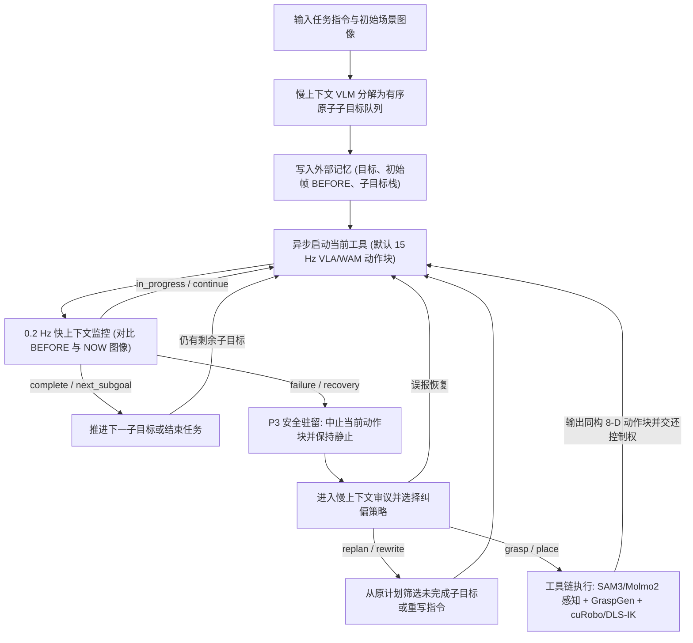
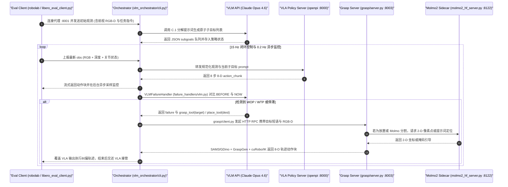

# VoLo: A Physical Orchestrator for Open-Vocabulary Long-Horizon Manipulation

## 一句话定义

**VoLo（VoLoAgent + RoboVoLo）** 是 NVIDIA 与密歇根大学提出的一套**物理编排（Physical Orchestration）**框架与评测基准：它由单个视觉语言模型（VLM）充当闭环编排器，将 15 Hz 运行的视觉-语言-动作模型（VLA/WAM）与开放词汇视觉感知、6-DoF 抓取/放置原语一并视为**可中断工具**，在持续演化的物理世界中执行规划、0.2 Hz 异步监控、安全驻留与跨工具恢复，并配套提供包含 126 项长时程任务的 `RoboVoLo` 高保真仿真基准。

## 英文缩写速查

| 缩写 | 英文全称 | 简要说明 |
|---|---|---|
| VLA | Vision-Language-Action | 端到端视觉-语言-动作策略模型，如 $\pi_{0.5}$、$\pi_0$-FAST、MolmoBot、MolmoAct2 |
| WAM | World Action Model | 联合预测未来视频与机器人动作的世界动作模型，如 DreamZero |
| VLM | Vision-Language Model | 承担子目标分解、过程监控与恢复决策的视觉语言大模型 |
| TAMP | Task and Motion Planning | 任务与运动规划，如基线系统 TiPToP |
| DLS IK | Damped Least-Squares Inverse Kinematics | 阻尼最小二乘逆运动学，本文用于 `grasp`/`place` 末端轨迹到 Franka 关节空间求解 |
| WOP / WTP | Wrong-Object Pick / Wrong-Target Placement | 论文定义的两类物理执行故障：抓错物体与放错目标位置 |
| PSR | Predicate Satisfaction Rate | 谓词满足率，用于衡量 LIBERO 等复合任务的目标子条件完成比例 |

## 为什么重要

1. **提出“物理编排”范式，打破“VLM 规划 + VLA 固定执行”的硬编码分层：** 与思考时世界静止的虚拟智能体不同，物理机器人在推理期间场景持续变化。现有分层系统通常把 VLA 当作不可干预的黑盒底层执行器，而 VoLoAgent 将 VLA/WAM 降格为与其他工具平权的可中断工具，在检测到偏差时可立即停驻、重写提示词或切换至几何抓取原语。
2. **揭示策略与几何原语的双向互补：** 纯 VLA（如 $\pi_{0.5}$）擅长接触丰富的灵巧操作但易忽视否定、计数、常识等开放词汇约束；纯感知+原语（如 `grasp`/`place`）能精准对齐语言目标，但在复杂接触阶段容易耗尽步数。二者协同后，即使抓取原语未能完成最终拾取，也会把夹爪移到目标近旁并留出清晰视野，供重新接管的 VLA 顺利完成后续操作。
3. **补齐高保真、隔离测试记忆与长时程恢复的开放词汇基准：** 论文附录 H 实证指出，部分 MuJoCo 基准上的微调 VLA 检查点存在“去掉语言输入后性能几乎不变”的场景过拟合现象，且平直着色渲染导致 GroundingDINO/SAM3/Molmo2 失效；基于 RoboLab（Isaac Sim PathTracer + DROID 构型）构建的 126 任务 `RoboVoLo` 基准使真实感感知工具与语言条件化策略得以在可配对复现的环境下协同评测。

## 核心信息

| 字段 | 内容 |
|---|---|
| **作者** | Siyi Chen*、Hugo Hadfield、Alex Zook、Mikaela Angelina Uy、Chan Hee Song、Erwin Coumans、Xuning Yang、Faisal Ladhak、Qing Qu、Stan Birchfield、Jonathan Tremblay†、Valts Blukis†（* NVIDIA 实习工作；† Project Leads） |
| **机构** | 英伟达（NVIDIA）、密歇根大学（University of Michigan） |
| **发表时间** | 2026-06-05（arXiv:2606.07723v1 [cs.RO]；项目主页标注 CoRL 2026） |
| **论文链接** | [arXiv:2606.07723](https://arxiv.org/abs/2606.07723) / [arXiv HTML](https://arxiv.org/html/2606.07723) |
| **项目与代码** | [项目主页](https://chicychen.github.io/VoLo/) / [编排器代码（NVlabs/VoLoAgent）](https://github.com/NVlabs/VoLoAgent) / [基准任务包（NVlabs/RoboVoLo）](https://github.com/NVlabs/RoboVoLo) |
| **清单分类** | `harness.orchestration`（条目 `survey_ax_2606_07723`） |
| **开源状态** | **已开源**（`NVlabs/VoLoAgent` 采用 Apache-2.0 协议开源；`NVlabs/RoboVoLo` 任务与自有资产为 Apache-2.0，34 类外部 SimReady 资产需另行同意 NVIDIA 协议通过脚本下载） |

## 核心原理

### 1. 物理编排的三大设计原则（§4.1–§4.2）

物理编排的核心要求是**监测—中止—重定向（monitor–halt–redirect）**。VoLoAgent 通过单一 VLM（默认 Claude Opus 4.6）的 JSON 结构化决策循环，依托三项工程原则实现闭环：

1. **P1 异步工具执行（Asynchronous Tools）：** 底层 VLA/WAM 与动作原语在客户端以 **15 Hz**（每次输出 8 步关节位置 + 二值夹爪动作块）独立运行，不等待 VLM 推理返回。
2. **P2 快慢双记忆上下文（Fast and Slow Memory）：**
   - **快上下文（监控层，0.2 Hz）：** 仅喂入当前前视相机 `NOW` 图像、起始 `BEFORE` 图像、总指令、当前子目标与近期决策，在尽量贴近运动时间尺度的频率下输出 `{continue, next_subgoal, recovery}`（代码 `VLMFailureHandler` 对应输出状态 `in_progress`/`complete`/`failure` 与动作 `continue`/`next`/`replan`/`grasp_tool`/`place_tool`）。
   - **慢上下文（审议层，按需触发）：** 保存完整任务目标、初始场景图、原子子目标队列与工具目录，仅在回合初始分解（Appendix C.1 `DECOMPOSE_SHARED_PROMPT`）和异常恢复时调取。
3. **P3 安全感知驻留（Safety-aware Idling）：** 当监控触发 `recovery` 时，立即中止并清空当前在飞工具的动作块，令机械臂静止保持安全状态，再进入审议上下文选择：`continue`（误报恢复继续执行）、`replan`（从原分解列表中筛出尚未完成的目标子集，禁止随意改写以防语义漂移，Appendix C.3）、`rewrite`（修改 VLA 子目标指令）或切换至 `grasp` / `place` 原语。

### 2. 三类互补工具与动作原语流水线（§4.2, Appendix B.2）

- **`vla(prompt, obs) -> action_chunk`：** 转发观测与子目标指令至 VLA/WAM 服务器，适合需要连续视觉运动控制与接触丰富交互的阶段，但易在开放词汇指代与多目标场景中漂移。
- **`grasp(target) -> action_chunk`：** 开放词汇检测/分割（默认 SAM3，可选 GroundingDINO + SAM2 或 Molmo2 + SAM2）→ 基于前视相机深度图裁剪目标点云 → **GraspGen**（Contact-GraspNet 候选生成与可选朝下过滤）→ **cuRobo** 碰撞感知接近规划（可选 `linear` 直线插值）与多起点 DLS IK 求解 → 生成与 VLA 完全同构的 8-D 动作块。
- **`place(destination) -> action_chunk`：** 由 **Molmo2-point**（或主 VLM 直接输出像素坐标 `{"x", "y"}`）定位 2-D 放置点 → 深度图反投影得到 3-D 世界坐标 → IK 求解并按 `stack` 参数决定保持抓取朝向或自上而下释放。中间感知结果全部封装在工具内部，不回传 VLM 反复多轮提示，从而压缩决策延迟。

DLS 多起点 IK 在每次迭代中按目标位姿误差 $e \in \mathbb{R}^6$ 与零空间关节回中项更新关节增量：

$$\Delta q = J^\top (J J^\top + \lambda^2 I)^{-1} e + (I - J^+ J)\,\alpha\,(q_{\text{mid}} - q)$$

其中阻尼系数 $\lambda = 5 \times 10^{-3}$，零空间增益 $\alpha = 0.5$，步长截断为 $\|\Delta q\|_2 \le 0.2\,\text{rad}$，在 Franka 关节限位内最多迭代 500 步，收敛判据为位置误差 $< 5 \times 10^{-4}\,\text{m}$、旋转误差 $< 5 \times 10^{-3}\,\text{rad}$ 且 FK 复核旋转误差 $< 2^\circ$；多起点梯依次尝试当前关节、第 7 轴 $\pm\pi$ 翻转、标准复位姿态及最多 3 次 $q_{\text{mid}} \pm 1.5\,\text{rad}$ 随机采样。

### 3. 四进程解耦代理与 RoboVoLo 基准（§3, Appendix B.1 & D–E）

工程上 `VoLoAgent` 作为独立代理位于仿真/真机评测客户端与策略服务之间，通过 `Frontend` / `Backend` 抽象层与标准化 `openpi` msgpack-numpy Schema 隔离不同 Conda 环境依赖（原生支持 OpenPI WebSocket、GR00T ZMQ、OpenVLA REST 与用于 H100/L40 跨集群调用 14B DreamZero 的原子文件 IPC）。

配套的 `RoboVoLo` 基准基于 **RoboLab + NVIDIA Isaac Sim / Isaac Lab（PhysX + PathTracer）** 构建，采用 DROID 硬件规范（7-DoF Franka FR3 + Robotiq 2F-85 + 外置 ZED 2i / 腕部 ZED mini / 前视 ZED 2i，224×224 图像），新增 **501 个带碰撞与物理属性的物体**（247 个 Lightwheel SimReady 日用品 + 118 个元素周期表方块 + 120 个几何艺术构件 + 16 个数学数字/符号方块），设计了 **4 大套件、15 个子类共 126 项长时程任务**：

- **Common Sense（32 任务）：** `Infer`、`Kit`、`Recover`、`Sort`（每类 8 题），考察语境推断与常识归位；
- **Memory（30 任务）：** `Order`、`Recall`、`Swap`（每类 10 题），考察跨子目标的状态记忆与叠放顺序反转/复原；
- **Complex References（32 任务）：** `Spatial`、`Counting`、`Negation`、`Size+Sort`（每类 8 题），考察空间方位、序数计数、否定排除（如 `except`）与尺寸比较；
- **World Knowledge（32 任务）：** `Art`、`Chem`、`Math`、`Recycle`（每类 8 题），考察外部拼图、化学分子式、算术与垃圾分类知识。

## 流程总览

## 源码运行时序图

官方仓库 [`NVlabs/VoLoAgent`](https://github.com/NVlabs/VoLoAgent) 采用“评测客户端 ↔ 编排代理 (`vlm_orchestrator/cli.py`) ↔ VLA 策略服务 / GraspGen 工具服务端 (`vlm_orchestrator/grasp/server.py`)”的四进程隔离架构。以下时序图依据仓库 `README.md` 与 `vlm_orchestrator/` 模块入口静态核查绘制，展示默认 `subgoal + vlm monitor + replan_tools` 模式下一次故障检测与抓取原语恢复的执行路径：

## 实验与评测

### 1. 主基准对比（§5.2, Table 1）

在 `RoboVoLo` 四大套件（126 任务 × 3 固定种子）与 `Robolab-Vague`（120 任务）上的成功率（%，越高越好）如下：

| 方法类别 | 方法 | Common Sense | Memory | Complex References | World Knowledge | Robolab-Vague |
|---|---|---|---|---|---|---|
| 单动作模型 | $\pi_{0.5}$ | 11.11 | 13.10 | 16.67 | 9.38 | 16.94 |
| 单动作模型 | $\pi_0$-FAST | 3.33 | 8.33 | 7.29 | 0.00 | 10.00 |
| 单动作模型 | MolmoBot | 6.67 | 22.62 | 5.21 | 4.17 | 11.52 |
| 单动作模型 | MolmoAct2 | 3.33 | 9.52 | 2.08 | 1.04 | 5.28 |
| 单动作模型（WAM） | DreamZero | 13.33 | 15.85 | 4.17 | 3.12 | 18.61 |
| Code-as-Policy + VLM | CaP-X (single / ensemble) | 15.56 / 15.56 | 15.48 / 15.48 | 7.29 / 7.29 | 2.08 / 2.08 | 14.44 / 11.39 |
| TAMP + VLM | TiPToP | 3.33 | 1.19 | 20.83 | 22.92 | 18.89 |
| **VoLoAgent 消融** | VoLoAgent (No VLA) | 32.22 | 13.10 | 9.38 | 16.67 | 17.78 |
| **VoLoAgent 消融** | VoLoAgent (Only VLA) | 44.44 | 34.52 | 40.62 | 20.83 | 30.00 |
| **本文完整系统** | **VoLoAgent (Full)** | **54.44** | **36.90** | **51.04** | **25.00** | **31.94** |

- 相比各自套件内最佳基线，VoLoAgent (Full) 在 Common Sense、Complex References、Memory 与 Robolab-Vague 上分别提升 **+38.9%**、**+30.2%**、**+14.3%** 与 **+13.1%**；在 World Knowledge 上符号规划基线 TiPToP（22.92%）接近 Full（25.00%，+2.1%）。配对符号翻转置换检验（Appendix F.1）显示 Full 相对所有基线及 `No VLA` 均有统计显著优势（$p < 10^{-4}$），在全 5 套件合并上相对 `Only VLA` 的 $p = 0.0599$，在 `RoboVoLo` 4 套件上相对 `Only VLA` 达到 $p = 0.0466$。

### 2. 组件消融（§5.4, Table 2 & Appendix I Table 7）

在 `RoboVoLo` 126 任务全集跨套件均值（%）上逐一替换单个组件：

| 消融维度 | 配置 | 跨套件总体成功率（%） | 关键结论 |
|---|---|---|---|
| **系统结构** | $\pi_{0.5}$ (Pure VLA) / No VLA / Only VLA / **Full** | 12.57 / 17.76 / 34.97 / **41.80** | 编排闭环 + 异构工具互补缺一不可 |
| **感知与视角** | GDino+SAM2/Molmo2 / SAM3/VLM-point / Exterior camera | 38.52 / 36.07 / 36.94 | 换用替代感知器或外置相机均保持 36%+ 稳健增益 |
| **编排 VLM** | Claude Sonnet 4.6 / GPT-5.5 / GPT-5-mini / Gemini-2.5-Flash / Qwen3-VL-8B | 36.34 / 35.52 / 34.70 / 31.97 / 19.95 | 前沿 VLM 带来 +19%～+29% 增益，小模型 Qwen3-VL-8B 降至 +7% |
| **底层 VLA** | $\pi_0$-FAST / MolmoBot-DROID / DreamZero-DROID / MolmoAct2-DROID | 26.23 / 24.86 / 21.86 / 12.57 | 相比各自纯策略均有 2–6 倍成功率放大 |

### 3. 故障与 VLM 审计及真机验证（§5.3 & §5.5, Table 3, Table 5, Table 8）

- **世界层故障恢复（Fig. 5）：** 在 90 次 Common Sense 试验中，VoLoAgent 无故障回合数为 $\pi_{0.5}$ 的 **5 倍**（20 vs. 4），出现故障后的恢复率达 **54%（38/70）**，而 $\pi_{0.5}$ 仅 **13%（11/86）**。
- **VLM 层错误审计（Fig. 6, Table 8）：** 在 90 个 LH-CS 回合审计中，**完成度监控错误（Completion monitor）** 占所有 VLM 错判的 **67% 以上**（Claude Opus 4.6 总计 102 次错误中占 84 次，Qwen3-VL-8B 总计 456 次中占 359 次）；而规划错误（4–9 次）与工具调用失配（0–12 次）极少。
- **Franka FR3 真机验证（Table 3 & Table 5）：** 在与仿真同构的物理 DROID 单元上选取 14 个任务 × 3 次配对试验（共 168 次 rollout），**零样本直接迁移**：$\pi_{0.5}$ 成功率 **14.3%**（6/42，95% Wilson CI `[6.7, 27.8]`），VoLoAgent (No VLA) **45.2%**（19/42），VoLoAgent (Only VLA) **40.5%**（17/42），VoLoAgent (Full) **42.9%**（18/42，95% CI `[29.1, 57.8]`），实现相对纯 VLA 约 **3 倍**提升。

## 与其他工作对比

- **对比端到端 VLA/WAM（$\pi_{0.5}$、$\pi_0$-FAST、DreamZero、MolmoBot、MolmoAct2）：** 单体模型依赖固定块执行，缺少多对象长程状态跟踪、复杂指代消歧与失误自检能力；VoLoAgent 将其封装为可中断工具后，在所有基座策略上均取得 2–6 倍提升。
- **对比传统分层 VLM+VLA 与 Critic 框架（Hi Robot、FailSafe、ReplanVLM 等）：** 多数工作将 VLM 规划器与 VLA 执行器硬编码绑定，或仅做指令重写/重启；VoLoAgent 允许单一编排器在 rollout 中途直接切入 `grasp`/`place` 几何原语并在完成后交回 VLA，解决了纯视觉运动策略在开放词汇接地上的盲区。
- **对比 Code-as-Policy 与 TAMP（CaP-X、TiPToP）：** 代码生成和符号规划器在知识推理（如 `Chem` 中 TiPToP 达 50.00%）和结构化场景具有优势，但缺少面向非结构化接触交互的灵活策略退路；VoLoAgent 在 `Common Sense`、`Memory`、`Complex References` 上大幅领先 CaP-X 与 TiPToP，仅在 `Swap`（3.33%）与 `Art`（8.33%）等精细空间重建/双容器交换类任务上仍有明显短板。
- **对比 LIBERO / RoboCerebra / VLABench（Appendix H）：** 论文指出 LIBERO 等窄分布微调的 $\pi_{0.5}$ 检查点在空指令下仍有 30.0% PSR（对比显式指令 35.0%），对语言变化几乎不敏感，且非写实渲染会破坏真实图像训练的开放词汇检测器；`RoboVoLo` 通过 DROID 宽分布 VLA 与 Isaac Sim PathTracer 避开了此类仿真伪影。

## 结论

**一句话总判：VoLoAgent 证明了开放词汇长时程操作的关键增益并非替换单个动作网络，而是通过“异步快慢双上下文 + 可中断工具代理”把 VLA 的灵巧操作与开放词汇感知、几何规划在物理时间线上闭环耦合；当前核心短板集中在 VLM 对子目标完成度的视觉误判与云端推理延迟。**

1. **编排架构优先于单点工具替换：** 仅加入文本监控/重规划的 `Only VLA` 已将跨套件成功率从 12.57% 拉升至 34.97%，补入视觉+抓取/放置原语后进一步提升至 41.80%，而替换 SAM3 或 GDino+SAM2 仅带来 ~3% 波动（38.52% vs. 41.80%）。
2. **完成度监控是下一步主要优化靶点：** 在四种前沿与开源 VLM 上，完成度监控错误（过早判定完成或漏判完成）占比均超过 67%，论文据此提出将监控器蒸馏为本地专用轻量判别器以同时降低错误率与 1–5 s 云端延迟。
3. **跨环境迁移前提是语言条件化与写实渲染：** 仅当底层 VLA 真正响应指令重写（如 DROID 预训练模型）且渲染质量接近真实相机（如 Isaac Sim PathTracer）时，物理编排与开放词汇视觉工具链才能共同生效。
4. **真机与仿真存在接触动力学差异：** 真机 14 任务中 `No VLA`（45.2%）与 `Full`（42.9%）互有胜负且置信区间高度重叠，作者观察到部分刚性抓取原语在真实摩擦接触下表现反而优于仿真，说明仍需更大规模真机样本进一步区分消融差异。

## 工程实践

1. **多环境端口隔离部署（`NVlabs/VoLoAgent`）：** 官方建议为 VLA（`openpi`，默认端口 `8000`）、编排代理（`vlm-orch`，默认端口 `8001`）、抓取/感知服务（`graspgen`，端口 `8003`；Molmo2 侧车在 `molmo-env` 端口 `8122`）和仿真评测客户端（`robolab`，连接 `--remote-port 8001`）分配独立 Conda 环境与容器，避免 `transformers==4.57.1`（Molmo2）与 GraspGen/OpenPI 依赖冲突。
2. **关键 CLI 开关组合：**
   - 默认完整闭环：`vlm-orchestrator --vla-port 8000 --port 8001 --mode subgoal --failure-monitor vlm --recovery-mode replan_tools`（或 `replan_grasp`）。
   - 若禁用物理碰撞检查或关闭 `stack` 朝向自适应，可调整 `--motion-planner {curobo,linear}` 与 `--enable-stack-mode`；接入外置非 RoboLab 客户端（LIBERO / VLABench / RoboCasa）时必须开启 `--enable-depth`，否则抓取工具会报错退化。
   - 使用顶部前视相机（`--use-front-camera`）时，系统会自动向 VLM 提示词附加左右与前后镜像翻转说明（Appendix C.4），强制模型使用颜色/类别等视觉特征而非左右方向词描述目标。
3. **算力预算参考：** 单次 `VoLoAgent (Full)` 仿真试验约消耗 1 张 L40（Isaac Sim + Grasp Server）+ 1 张 H100 或第二张 L40（$\pi_{0.5}$；14B DreamZero 需 2 张 H100），完整 126 任务 × 3 试验扫测每套系统约需 18 GPU-hours。

## 局限与风险

1. **监控延迟与误判上限：** 云端 VLM 单次调用需 1–5 秒，难以在快速失稳瞬间介入；且 0.2 Hz 频率与视觉遮挡导致完成度监控错误居高不下。
2. **高难度任务类型仍有明显瓶颈：** 在 `Swap`（3.33%）、`Art`（8.33%）与 `Math`（12.50%）子类上成功率依然很低，涉及多步容器内容交换、精密图形拼接和复杂空间排列时，单臂顺序子目标与当前原语精度不足。
3. **具身形式与安全驻留假设受限：** 当前 `grasp`/`place` 原语与安全驻留（简单停驻机械臂）仅面向固定底座单臂平行夹爪桌面场景，扩展至双臂协同、灵巧手或移动/双足平衡人形机器人时需重写运动学原语与动态平衡驻留策略。
4. **外部资产授权约束：** `NVlabs/RoboVoLo` 中 34 类必需 SimReady 6.0 资产不随 Git 仓库分发，使用者须显式运行 `download_simready_assets.py --agree-external-terms` 并遵守 NVIDIA Omniverse / Software License Agreement 条款。

## 关联页面

- [Agentic Robots 综述](paper-towards-agentic-robots-survey.md)
- [全量项目节点清单](../overview/awesome-agentic-robots-node-index.md)
- [VLA 方法背景](../methods/vla.md)
- [机器人智能体执行框架](../methods/robot-agent-harness.md)：对照规划、执行接口与反馈机制。
- [Agent Tool-Use Interface](../methods/agent-tool-use-interface.md)：将 VLA、感知模型与运动原语统一抽象为可调度工具接口。
- [Agent Planning & Feedback](../methods/agent-planning-feedback.md)：快慢双上下文下的子目标规划、进度监控与重规划机制。
- [Agentic Manipulation Policies](../methods/agentic-manipulation-policies.md)：长时程开放词汇操作中的策略编排与恢复模式。
- [Embodied Agent Benchmarking](../methods/embodied-agent-benchmarking.md)：长时程能力分套件评测与双轴失败诊断方法。
- [Grasp Pose Estimation](../methods/grasp-pose-estimation.md)：6-DoF 抓取候选生成（GraspGen）在闭环恢复中的应用。
- [$\pi_0$ 系列策略](../methods/pi0-policy.md)：文中主要基座 VLA（$\pi_{0.5}$ / $\pi_0$-FAST）的背景与动作分块机制。
- [机器人操作任务（Manipulation）](../tasks/manipulation.md)

## 推荐继续阅读

- [VoLo 项目主页（包含真机与仿真对比演示视频）](https://chicychen.github.io/VoLo/)
- [VoLoAgent 官方代码仓库（NVlabs/VoLoAgent）](https://github.com/NVlabs/VoLoAgent)
- [RoboVoLo 126 任务基准仓库（NVlabs/RoboVoLo）](https://github.com/NVlabs/RoboVoLo)
- [arXiv:2606.07723 原文 HTML 全文](https://arxiv.org/html/2606.07723)

## 参考来源

- [论文全文核对档案](../../sources/papers/paper-agentic-2606-07723.md)
- [官方开源代码与基准仓库档案](../../sources/repos/paper-agentic-2606-07723.md)
- [官方 Awesome 快照归档](../../sources/repos/awesome-agentic-robots-survey-index.md)
- [论文官方入口 arXiv:2606.07723](https://arxiv.org/abs/2606.07723)
- [项目官方主页](https://chicychen.github.io/VoLo/)
