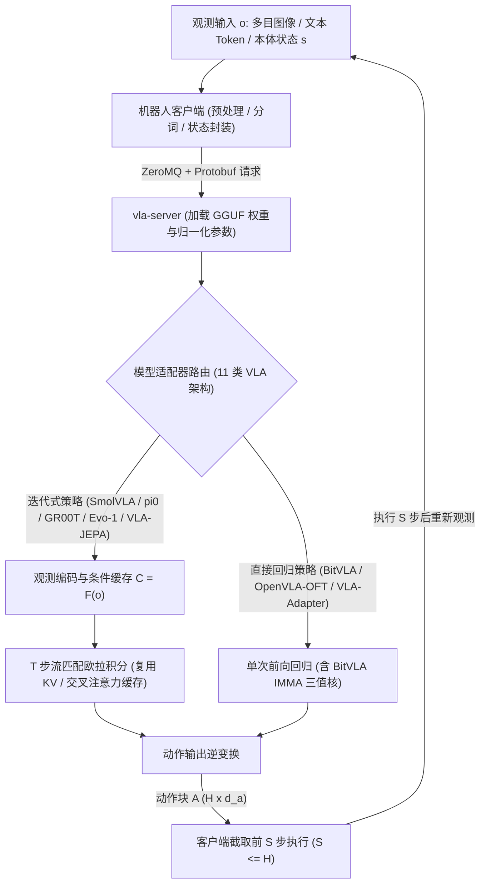
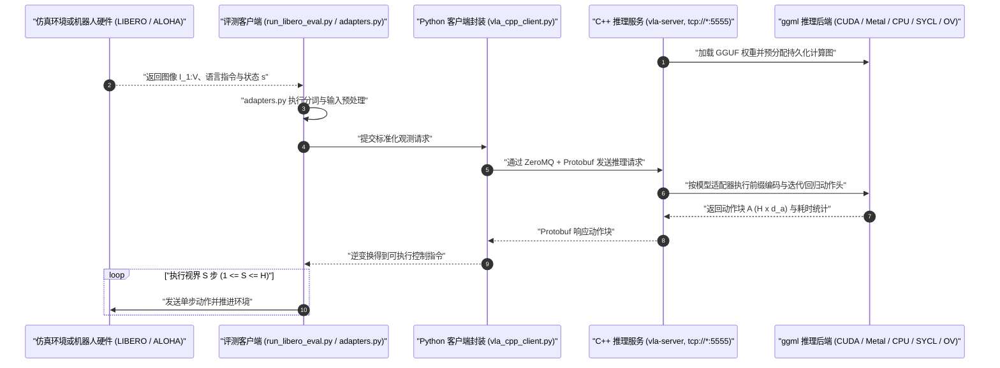

# vla.cpp: A Unified Inference Runtime for Vision-Language-Action Models

## 一句话定义

**vla.cpp** 是基于 `llama.cpp`（`ggml`）构建的统一 C++ 视觉-语言-动作（VLA）模型推理运行时，在推理阶段彻底移除 PyTorch 依赖，以单一 GGUF 格式封装权重并让 11 种主流 VLA 架构共享加载、张量执行与 ZeroMQ 服务层。

## 英文缩写速查

| 缩写 | 英文全称 | 简要说明 |
|---|---|---|
| VLA | Vision-Language-Action | 接收图像、语言指令与本体状态并输出机器人动作块的策略模型 |
| GGUF | GGML Universal File | `llama.cpp` 生态的自包含二进制权重格式，本文同时封装架构元信息与归一化参数 |
| IMMA | Integer Matrix Multiply-Accumulate | NVIDIA Tensor Core 整型矩阵乘累加指令，用于加速 BitVLA 三值推理 |
| RMS | Root Mean Square | 本文用相对均方根误差 $e_{\mathrm{rel}}$ 与最大绝对误差 $e_\infty$ 做定点输入数值校验 |
| RSS | Resident Set Size | 进程常驻内存大小，用于在 Jetson 与桌面平台评测运行时内存占用 |
| OOM | Out of Memory | 设备可用内存耗尽导致模型无法加载或推理中断 |

## 为什么重要

1. **剥离训练栈绑定：** 多数 VLA 策略依赖各自独立的 PyTorch 训练仓库、特定版本依赖与预处理脚本，直接搬到资源受限的机载计算单元成本极高。`vla.cpp` 将模型执行下沉到纯 C++ 运行时，只保留客户端侧的轻量传感器与分词包装。
2. **跨架构与跨硬件共用基础设施：** 迭代式策略（流匹配/扩散头）与直接回归式策略（离散/连续并行预测头）在注意力掩码、位置编码与条件注入上差异显著；通过“共享后端 + 轻量模型适配器”分层，同一套服务与评测协议即可覆盖 11 个模型和 CPU/CUDA/Metal/SYCL/OpenVINO（开源仓库并支持 ROCm/Hexagon）。
3. **揭示精度与控制视界的真实瓶颈：** 论文不仅测吞吐，还证明了微小的离散索引舍入（SmolVLA 位置嵌入边界跳变）会直接翻转夹爪指令，以及执行视界 $S$ 设到全块开环（$S=H$）会导致成功率断崖下降，为 VLA 工程上线提供了系统化的数值与控制验收方法。

## 核心信息

| 项目 | 详情 |
|---|---|
| **作者** | Khanh D. Nguyen, Hung T. Ho, Chinh T. Nguyen, Thanh Q. Duong, Linh D. Le, Duy M. H. Nguyen, Vien A. Ngo, An T. Le |
| **机构** | VinRobotics；VinUniversity；TU Darmstadt；IMPRS-IS；University of Stuttgart；DFKI |
| **发表时间** | 2026-09-21（arXiv v2，v1 提交于 2026-06-06） |
| **论文链接** | [arXiv:2606.08094](https://arxiv.org/abs/2606.08094)（[HTML 全文](https://arxiv.org/html/2606.08094)） |
| **项目与代码** | [GitHub: VinRobotics/vla.cpp](https://github.com/VinRobotics/vla.cpp)（Apache-2.0，含 C++ 运行时、服务端与评测脚本） |
| **清单分类** | `harness.infrastructure`（条目 `survey_ax_2606_08094`） |
| **开源状态** | **已开源**（C++ 引擎源码、Python FFI、ZeroMQ+Protobuf 服务端、eval 客户端及 Hugging Face `vrfai` GGUF 权重均已发布） |

## 核心原理

### 1. 三层解耦与统一策略接口

运行时将系统划分为 **机器人客户端（Client）— 推理服务端与模型适配器（Server + Model Adapters）— 张量后端（ggml Backends）**：

- **输入与输出契约：** 观测 $o = (I_{1:V}, \ell, s)$ 包含 $V$ 路相机图像、分词后的语言指令 $\ell$ 和机器人本体状态 $s$；策略输出长度为 $H$（预测视界）、维度为 $d_a$ 的动作块 $A \in \mathbb{R}^{H \times d_a}$，客户端从中截取前 $S$ 步（执行视界，$1 \le S \le H$）执行后再请求下一轮推理。
- **两类动作生成路径：**
  - **迭代式策略（$T \ge 1$ 步求解器）：** 先提取与动作无关的观测条件 $C = F_\theta(o)$，再对初始噪声 $X^0 \in \mathbb{R}^{H \times d_a}$ 做流匹配欧拉积分（如 SmolVLA 与 $\pi_0$ 为 $1 \to 0$，GR00T-N1.7 为 $0 \to 1$，Evo-1 使用均匀噪声）：
    $$X^{k+1} = X^k + (\tau_{k+1} - \tau_k) v_\theta(X^k, \tau_k, C, s), \quad k = 0, \dots, T-1$$
  - **直接回归策略：** BitVLA、OpenVLA-OFT 与 VLA-Adapter 直接前向回归 $A = R_\theta(o)$。
- **GGUF 封装规范：** 单一（或附带独立视觉文件的）GGUF 存储张量权重、模型架构超参以及归一化/反归一化统计量；预处理与逆变换在适配器与客户端之间明确划分职责，避免漏算或重复变换。

### 2. 观测特征复用与图持久化

迭代头在 $T$ 步去噪/积分过程中，观测前缀（图像与指令 token）保持不变，仅动作后缀变化：

- $\pi_0$ 在每层缓存前缀的 Key/Value，与动作后缀做联合注意力；SmolVLA 交替执行联合注意力与交叉注意力；GR00T 系列则在独立动作 Transformer 中缓存主干投影。
- 交叉注意力头预先缓存 $K_C = Z W_K$ 与 $V_C = Z W_V$：
  $$\operatorname{Attn}(Q, K_C, V_C; M) = \operatorname{softmax}\!\left(\frac{Q K_C^\top}{\sqrt{d_k}} + M\right) V_C$$
- 若单次观测条件编码耗时为 $P$、每步动作专家耗时为 $E$，则总模型延迟近似为 $L_{\mathrm{model}}(T) \approx P + T E$（相对每步重算前缀的理想加速比为 $\frac{T(P+E)}{P+TE}$）。对固定输入形状，计算图与内存缓冲区跨请求持久化，配合图捕获/编译减少 GPU 调度开销。

### 3. BitVLA 三值 Tensor Core 核（IMMA）

针对三值量化模型 BitVLA（$q_{nj} \in \{-1, 0, 1\}$），`vla.cpp` 将每 4 个 2-bit 权重打包进 1 字节，并在 CUDA 路径下对每行激活 $x_m$ 动态量化为有符号 INT8：

$$\alpha_m = \frac{\max(\|x_m\|_\infty, 10^{-5})}{127}, \qquad a_{mj} = \operatorname{clip}_{[-128, 127]}\!\left(\operatorname{round}\frac{x_{mj}}{\alpha_m}\right), \qquad y_{mn} = \alpha_m \beta_{g(n)} \sum_j a_{mj} q_{nj}$$

解码后的权重块在共享内存中展开并复用激活块，利用 **IMMA** Tensor Core 指令完成 INT32 乘累加后再缩放回 BF16，取代了原有 CUDA 核 `dp4a` 点积路径。

### 4. 固定输入数值校验

通过 `prediction-check` 工具在固定权重、图像、token、状态、初始噪声、掩码与调度表下对比运行时输出 $A$ 与参考输出 $\widehat{A}$，计算逐元素最大绝对误差 $e_\infty = \max_i |A_i - \widehat{A}_i|$ 与相对 RMS 误差 $e_{\mathrm{rel}} = \|A - \widehat{A}\|_2 / \|\widehat{A}\|_2$，并下钻中间张量定位数值分歧。

## 流程总览

## 源码运行时序图

官方仓库已开源完整 C++ 构建链路（`CMakeLists.txt` 拉取 `llama.cpp` 固定版本 `b11223`，编译产出 `vla-cli`、`vla-server`、`vla-bench`、`libvla`）及 `eval/` 下的服务端/客户端脚本（`eval/run_libero_server.sh`、`eval/run_libero_client.sh`、`eval/client/vla_cpp_client.py`、`eval/client/run_libero_eval.py`、`eval/client/adapters.py`）。以下时序图展示 `vla-server` 与评测/真机客户端协同执行一次动作块请求的运行时路径：

单机无服务快速验证亦可直接调用 `./build/vla-cli -hf vrfai/smolvla-libero-gguf --image assets/front.jpg --text "pick up the black bowl" --pretty` 完成单次前向预测。

## 实验与评测

### 1. 跨模型与跨套件任务成功率（LIBERO / SimplerEnv）

论文在 LIBERO-Object（10 任务、每模型 100 episodes）评测了全部 11 个模型（Table I）：

| 模型 | 输入分辨率 / $S$ | `vla.cpp` 成功率 [95% CI] | 参考成功率 | RTX 3060 P90 / Vision (ms) | Metal M4 P90 (ms) | OpenVINO P90 (ms) |
|---|---|---|---|---|---|---|
| **BitVLA** | 224 / 8 | **100%** [96.3, 100] | 99.6% | **62.0 / 12.0** | – | – |
| **VLA-JEPA** | 224 / 7 | **100%** [96.3, 100] | 99.6% | 64.2 / 22.3 | 258.2 | 151.2 |
| **GR00T-N1.7** | 256 / 16 | **99%** [94.6, 99.8] | 99.0% | 93.8 / 21.7 | 385.0 | 299.8 |
| **OpenVLA-OFT** | 224 / 8 | **97%** [91.5, 99.0] | 98.4% | – | 1719.9 | 482.7 |
| **SmolVLA** | 512 / 1 | **96%** [90.2, 98.4] | 96.0% | 98.9 / 47.7 | 330.6 | 391.6 |
| **Evo-1** | 448 / 8 | **96%** [90.2, 98.4] | 97.7% | 180.0 / 56.6 | 775.7 | 585.7 |
| **$\pi_{0.5}$** | 224 / 10 | **96%** [90.2, 98.4] | 98.2% | 254.1 / 45.9 | 1198.2 | 568.1 |
| **VLA-Adapter** | 224 / 8 | **96%** [90.2, 98.4] | 99.2% | 82.1 / 44.1 | 332.4 | 239.3 |
| **GR00T-N1.5** | 224 / 16 | **95%** [88.8, 97.8] | 95.0% | 95.2 / 23.2 | 423.2 | 249.1 |
| **GR00T-N1.6** | 224 / 16 | **88%** [80.2, 93.0] | 99.0% | 91.3 / 23.8 | 389.9 | 167.3 |
| **$\pi_0$** | 224 / 50 | **82%** [73.3, 88.3] | 79.0% | 203.6 / 40.2 | 1123.5 | 779.6 |

- **全套件验证（Table II，200 episodes/套件）：** BitVLA 在 Spatial / Object / Goal / Long 上分别取得 94.5% / 100% / 92.5% / 83.5%；GR00T-N1.7 取得 96.0% / 98.0% / 97.5% / 89.0%。在 SimplerEnv WidowX（252 px）上，GR00T-N1.6 在 “put carrot on plate” 达 80%，在 “put spoon on towel” 达 70%。

### 2. 边缘设备内存、三值加速与多平台性能

- **8 GB Jetson Orin Nano 部署（Table III，200 episodes）：** 7 个模型中 5 个成功运行（GR00T-N1.6 与 N1.7 发生 OOM；GR00T-N1.5 与 $\pi_0$ 需将仿真器放至远端主机）。**BitVLA（$S=8$）达成 200/200 满分**，每执行步摊销客户端耗时 355.65 ms，进程峰值 RSS 2199 MiB（系统峰值内存 6504 MiB，相对基线增加 4533 MiB）。
- **三值打包与 IMMA 加速（§IV-D）：** 2-bit 权重打包使 BitVLA 文件从 5.6 GiB 降至 1.34 GiB、加载期瞬态主机分配从 11.1 GiB 降至 1.15 GiB；用 IMMA 替换 `dp4a` 后，客户端每步耗时在 RTX 3060 上从 172.8 ms 降至 37.85 ms（**$4.57\times$**），在 AGX Orin 上从 406.6 ms 降至 101.11 ms（**$4.02\times$**），LIBERO-Object 成功率维持 100%。
- **RTX 3090 服务端延迟（Table IV，200 次均值）：** 相比 PyTorch Eager 实现 $1.02$–$6.21\times$ 加速；相比 Eager 与 `torch.compile` 中更快的配置，SmolVLA 快 $1.18\times$（55.8 vs 65.9 ms）、GR00T-N1.5 快 $1.26\times$（75.4 vs 94.7 ms）、BitVLA 快 $1.84\times$（51.5 vs 94.6 ms），其余 4 个模型（$\pi_0$、Evo-1、GR00T-N1.6/N1.7）与编译模式持平（$1.00$–$1.02\times$）。
- **GGUF 常规量化与求解步数剖析（Table V & VI）：** 对 GR00T-N1.7 做 Q4_0+V（连同视觉塔量化）可将文件从 6292.4 MB 压缩至 4556.0 MB，定长输入提速 $1.144\times$，成功率 195/200（BF16 为 196/200），而纯 Q4_0 为 190/200。在 RTX 3060 上扫描 GR00T-N1.7 求解步数 $T \in \{1, 2, 4, 8, 16\}$，视觉阶段稳定在 18.49–18.86 ms，主干+动作头线性增长为 $13.9 + 5.8T$ ms；Roofline 分析指出前缀算术强度为 256–530 FLOPs/byte（算力受限），而动作专家约 50 FLOPs/byte（访存带宽受限）。

### 3. 数值敏感性与物理真机控制实验

- **SmolVLA 位置索引精度案例（§IV-F）：** SmolVLA 视觉编码器将图像块坐标映射为离散索引以查表位置嵌入；不同浮点精度导致边界值跨索引跳变，使位置嵌入 $e_{\mathrm{rel}}$ 高达 0.32、去归一化动作最大偏差达 1.97（集中在夹爪通道，足以反转开合指令）。对齐半精度计算后，位置嵌入 $e_{\mathrm{rel}}$ 降至 0.003、动作差降至 $<10^{-2}$，LIBERO-Object 任务 0 成功率由 **2/10 升至 9/10**。
- **UR10e 与 ALOHA 真机（Table VII & VIII）：** UR10e 运行 SmolVLA（$S=25$，20 Hz）跨 CUDA/Metal/两款 CPU 后端往返延迟跨度 $33\times$（111.4–3652.9 ms），实际控制频率从 17.7 Hz 降至 5.0 Hz，成功率在 12/20–15/20 之间（所有 27 次失败均发生在释放阶段）。ALOHA 在 AGX Orin 上运行 GR00T-N1.6（$H=8, S=7$，约 470 ms/chunk）两个桌面任务分别达 18/20 与 17/20。
- **执行视界 $S$ 扫描（Fig. 5，Orin Nano + SmolVLA，$H=50$）：** $S=16$ 时成功率最高（**98%，49/50**），而 $S=50$（整块执行完才重新观测）骤降至 **38%（19/50）**。

## 与其他工作对比

| 系统 / 方案 | 覆盖策略范围 | 硬件与后端生态 | 核心技术路线 | 对比结论（依据原文 §II 与 §IV-C） |
|---|---|---|---|---|
| **vla.cpp（本文）** | 11 种主流 VLA（迭代+回归） | CPU、CUDA、Metal、SYCL、OpenVINO（仓内含 ROCm/Hexagon） | 共享 `ggml`/GGUF 运行时 + 架构特定适配器 + IMMA 三值核 | 单一 C++ 架构无需 PyTorch 即可跨平台部署，边缘与多后端通用性强 |
| **PyTorch Eager / `torch.compile`** | 全策略训练原生支持 | GPU 为主，依赖完整 Python 生态 | 图编译与算子融合 | 在 RTX 3090 上编译后多数模型与 `vla.cpp` 接近，但 SmolVLA/GR00T-N1.5/BitVLA 仍慢 $1.18$–$1.84\times$ 且内存/依赖更重 |
| **NVIDIA TensorRT** | 需逐模型导出与引擎构建 | 专有 NVIDIA GPU / Jetson | 硬件特定深度内核调优 | 在 RTX PRO Blackwell 1000 上运行 GR00T-N1.7 比 `vla.cpp` 快 **$1.85\times$**（70.5 vs 130.2 ms），但缺乏跨厂商移植性 |
| **ActQuant / LiteVLA(-Edge)** | 聚焦特定量化模型（如 OpenVLA-OFT、$\pi_{0.5}$） | C/C++ 或 `llama.cpp` 边缘部署 | 动作引导低比特量化 / 边缘裁剪 | 与本文互补，`vla.cpp` 更强调 11 类异构 VLA 注意力与控制接口的统一抽象 |

## 结论

**一句话总判：`vla.cpp` 用“共享 `ggml`/GGUF 基础设施 + 保留架构特定适配器”证明了无需 PyTorch 即可在异构硬件上统一运行主流 VLA 策略，而真机落地的关键不仅在于算力加速，还在于对齐离散预处理数值边界与控制执行视界 $S$。**

1. **边缘与低内存部署优先选择原生低比特模型 + 专用张量核：** BitVLA 经 2-bit 打包与 IMMA 核优化后可在 8 GB Orin Nano 上无损跑通 200/200 LIBERO-Object，耗时仅为 `dp4a` 基线的 1/4。
2. **迁移运行时必须做固定输入数值校验：** 不能仅靠端到端任务成功率验收；SmolVLA 案例表明微小的位置索引舍入差异就能反转夹爪命令，需用 `prediction-check` 核对 $e_\infty$ 与 $e_{\mathrm{rel}}$。
3. **迭代式 VLA 存在明显的“算力前缀 + 带宽动作头”分裂：** 主干前缀算力受限且可跨步复用，而动作专家访存带宽受限、在部分模型中仍占近半耗时，选型与调优需同时报告求解步数 $T$ 与执行视界 $S$。
4. **同步分块控制避免盲目拉满执行视界：** 增大 $S$ 虽可摊薄单步推理延迟，但在 LIBERO-Object 上令 $S=H=50$ 会让开环漂移显著恶化（成功率由 98% 跌至 38%）。
5. **纯 NVIDIA 极限性能场景仍可配合 TensorRT：** 若目标硬件锁定 NVIDIA 且追求极致单机低延迟，TensorRT 在 GR00T-N1.7 上仍比当前 `vla.cpp` 快 $1.85\times$。

## 工程实践

- **模型选型与硬件约束：** 若使用 8 GB Jetson Orin Nano 等边缘板卡，优先选择 BitVLA（峰值进程 RSS ~2.2 GiB）、SmolVLA 或 Evo-1；GR00T-N1.6/N1.7 在 8 GB 内存下会直接 OOM，GR00T-N1.5 与 $\pi_0$ 需将仿真/外设进程分离部署。
- **构建与服务启动：** 桌面与边缘设备使用 `cmake -B build -DCMAKE_BUILD_TYPE=Release && cmake --build build -j$(nproc)` 编译；生产或真机控制通过 `./build/vla-server <model>.gguf` 暴露 ZeroMQ 端口（`tcp://*:5555`），避免与前端控制进程混用 Python 全局解释器。
- **跨后端精度配置：** 在 Apple Metal 等后端上若观测到固定输入偏差偏大，可参考论文做法将视觉与语言塔保持 FP32（论文中将固定输入偏差由 $2.0 \times 10^{-3}$ 降至 $8.3 \times 10^{-5}$，代价为增加 33 ms 与 672 MiB）。
- **控制参数标定：** 实测同时记录往返延迟 $L_{\mathrm{rt}}$ 与有效执行频率 $f_{\mathrm{exec}} \approx \frac{S}{L_{\mathrm{rt}} + S \Delta t}$，将执行视界 $S$ 控制在预测视界 $H$ 的合理子集（如 $H=50$ 时取 $S \le 16$，或 ALOHA $H=8$ 时取 $S=7$），兼顾吞吐与闭环反馈。

## 局限与风险

- **GR00T-N1.6 成功率差异未闭环：** 在 LIBERO-Object 上 `vla.cpp` 版 GR00T-N1.6 成功率为 88%，明显低于同论文 PyTorch 复现参考的 99%，具体根因在原文中仍标注为未解决（unresolved）。
- **硬件与后端覆盖不均：** 三值 IMMA 张量核加速路径目前仅支持 NVIDIA CUDA；CPU 后端（如笔记本 i9/Ryzen）单次请求耗时达 2.1–9.0 秒，难以胜任高频动态控制。
- **大模型边缘 OOM 与真机实验样本局限：** 参数量较大的模型仍超出 8 GB 边缘设备容量；文中 UR10e 与 ALOHA 真机实验样本量较小（每条件 10–20 episodes）且集中于准静态桌面抓放场景，动态高速交互尚未验证。
- **同步阻塞假设：** 当前评估主要针对“执行 $S$ 步后阻塞等待下一块预测”的同步控制循环，未内置与动作执行并行重叠推理的异步调度策略。

## 关联页面

- [Agentic Robots 综述](paper-towards-agentic-robots-survey.md)
- [全量项目节点清单](../overview/awesome-agentic-robots-node-index.md)
- [VLA 方法背景](../methods/vla.md)
- [机器人智能体执行框架](../methods/robot-agent-harness.md)：对照规划、执行接口与反馈机制。
- [AI 模型服务与推理架构](../methods/ai-model-serving-inference.md)：对照高并发与低延迟模型服务化设计。
- [AI 模型压缩与量化](../methods/ai-model-compression.md)：对照低比特权重打包、Q4_0/Q8_0 与三值推理加速。
- [动作分块（Action Chunking）](../methods/action-chunking.md)：理解预测视界 $H$ 与执行视界 $S$ 对闭环控制的影响。
- [机器人操作（Manipulation）](../tasks/manipulation.md)：LIBERO、SimplerEnv 及 UR10e/ALOHA 桌面操作基准背景。

## 推荐继续阅读

- [vla.cpp 官方 GitHub 仓库与文档](https://github.com/VinRobotics/vla.cpp) — 含多后端编译指南、模型 GGUF 转换说明及各设备 Benchmark 实测数据。
- [llama.cpp 项目主页](https://github.com/ggml-org/llama.cpp) — 底层 `ggml` 张量引擎与 GGUF 格式的原始工程生态。

## 参考来源

- [vla.cpp 论文原文核对归档](../../sources/papers/paper-agentic-2606-08094.md)
- [官方 Awesome 快照归档](../../sources/repos/awesome-agentic-robots-survey-index.md)
- [vla.cpp 官方仓库核查归档](../../sources/repos/paper-agentic-2606-08094.md)
- [arXiv:2606.08094 论文主页](https://arxiv.org/abs/2606.08094) 与 [HTML 全文](https://arxiv.org/html/2606.08094)
- [VinRobotics/vla.cpp 官方源码仓库](https://github.com/VinRobotics/vla.cpp)
