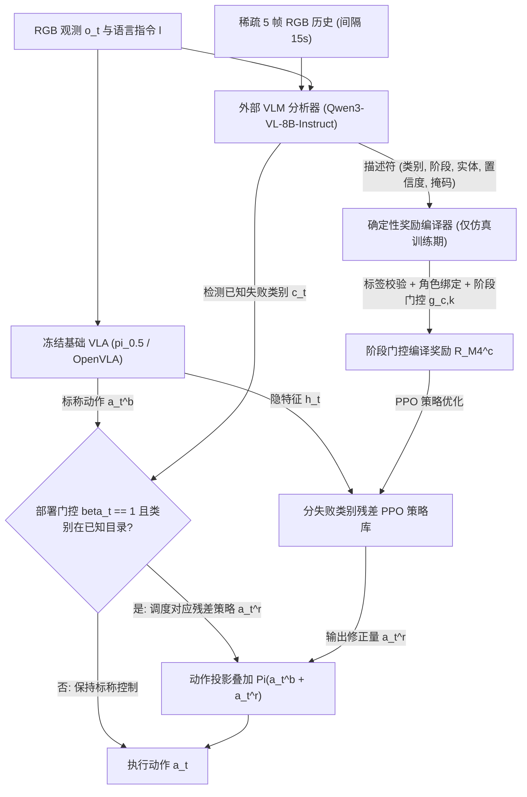

# ReCoVLA: VLM-Guided Reward Compilation for Failure Recovery in Vision-Language-Action Policies

## 一句话定义

**ReCoVLA** 是一种面向视觉-语言-动作（VLA）策略的失败条件残差恢复框架：在保持预训练 VLA 主干完全冻结的前提下，利用外部视觉语言模型（VLM）诊断非标称状态并输出结构化恢复描述符，再由确定性编译器组装阶段门控奖励来在仿真中训练混合残差 PPO 专家策略，并实现零样本真机部署。

## 英文缩写速查

| 缩写 | 英文全称 | 简要说明 |
|---|---|---|
| VLA | Vision-Language-Action | 视觉-语言-动作策略模型，本文中作为冻结的基础控制器（如 $\pi_{0.5}$、OpenVLA） |
| VLM | Vision-Language Model | 视觉语言模型，本文中采用 `Qwen3-VL-8B-Instruct` 作为语义失败检测与描述器 |
| RL | Reinforcement Learning | 强化学习，用于在仿真中针对特定失败状态优化低层残差修正策略 |
| PPO | Proximal Policy Optimization | 近端策略优化算法，用于基于 VLA 隐特征训练残差策略网络 |
| GAE | Generalized Advantage Estimation | 广义优势估计，本文中 PPO 训练取 $\lambda=0.95$、$\gamma=0.99$ |
| OOD | Out-of-Distribution | 分布外测试场景，本文中用于验证物体外观或几何替换下的恢复鲁棒性 |
| Q-score | Goal-Fulfillment Quality Score | 归一化目标完成质量分（$[0,1]$），为中间恢复进度提供部分得分 |

## 为什么重要

1. **解决模仿学习 VLA 在非标称状态下的脆性：** 尽管流匹配（flow matching）等大规模 VLA 拥有很强的语言条件操作先验，但在动作累积误差导致物体掉落、放错容器、夹爪持物未释放或铰接部件未闭合等分布外失败状态时，往往无法自发完成针对性恢复。
2. **避免微调遗忘与无似然 RL 优化难题：** 直接采集恢复演示微调基座 VLA 成本高且易引发灾难性遗忘；而直接对流匹配 VLA 做策略梯度 RL 又受限于动作似然不可得，且统一任务级奖励在多阶段恢复中过稀疏或因多项并发诱发 reward hacking。
3. **以语义奖励编译解耦高层诊断与低层控制：** VLM 不直接输出机器人动作或自由标量奖励，而是充当“语义奖励选择器”，由确定性编译器完成实体绑定与阶段门控；冻结 VLA 隐特征上的残差策略可跨 $\pi_{0.5}$ 与 OpenVLA 等不同主干复用。

## 核心信息

| 字段 | 内容 |
|---|---|
| 作者 | Haodi Hu, Chung-Ta Huang, Jing Liu, Ye Wang, Kei Suzuki, Matthew Brand, Toshiaki Koike-Akino |
| 机构 | University of Southern California (USC)、Harvard University、Mitsubishi Electric Research Laboratories (MERL) |
| 发表时间 | 2026-06-08（arXiv:2606.09630v1） |
| 论文链接 | [arXiv 摘要页](https://arxiv.org/abs/2606.09630) / [arXiv HTML 全文](https://arxiv.org/html/2606.09630) |
| 项目与代码 | 截至 2026-11-27，原文未公布 ReCoVLA 官方仓库或独立项目主页（Appendix A.1 提及的 `mli0603/openpi-comet` 为对比基线仓库） |
| 清单分类 | `model.training`, `harness.monitoring_and_recovery` |
| 来源条目 | `survey_ax_2606_09630` |
| 开源状态 | 未确认开源代码（原文提供算法流程、奖励公式、训练超参数与实验细节，未附官方可执行源码链接） |

## 核心原理

ReCoVLA 围绕“失败目录构建 → 确定性阶段门控奖励编译 → 分失败类别残差策略库训练 → 真机稀疏监测调度”四环节展开：

1. **冻结基座与隐空间残差控制（Section 3.1）：**
   给定观察 $o_t$ 与语言指令 $\ell$，冻结基础 VLA 输出标称动作与内部隐特征：$(a_t^b, h_t) = F_{\mathrm{VLA}}(o_t, \ell)$。残差策略仅观测 $h_t$ 并采样修正量 $a_t^r \sim \pi_\theta^r(\cdot \mid h_t)$，最终执行投影叠加动作：
   $$a_t = \Pi_{\mathcal{A}}(a_t^b + \beta_t a_t^r)$$
   其中 $\beta_t \in \{0,1\}$ 为部署期恢复激活开关，用于在标称段保留基础策略能力。

2. **仿真失败目录构建（Section 3.2）：**
   在 OmniGibson 仿真中运行无恢复基线 M1，收集完整失败轨迹 $\tau_i^{\mathrm{M1}}=\{(o_t,s_t,a_t^b)\}_{t=0}^{T_i}$。外部 VLM 分析器 $D_\phi$（`Qwen3-VL-8B-Instruct`）结合指令 $\ell_i$ 与分析提示 $q$ 生成五元组恢复描述符：
   $$\xi_i = D_\phi(\tau_i^{\mathrm{M1}}, \ell_i, q) = (c_i, z_i, E_i, \rho_i, m_i)$$
   分别表示失败类别 $c_i \in \mathcal{C}$、恢复阶段 $z_i \in \mathcal{Z}$、活跃实体集 $E_i \subseteq \mathcal{E}$、置信度 $\rho_i \in [0,1]$ 与二值奖励组件掩码 $m_i \in \{0,1\}^K$。仅置信度满足 $\rho_i \ge \tau_{\mathrm{cat}}$ 的类别进入可恢复失败目录 $\mathcal{C}_{\mathrm{train}}$。

3. **确定性奖励编译器与阶段门控（Section 3.3 & Algorithm 1）：**
   预定义 $K$ 项基于仿真对象状态的势能原语库 $\mathcal{R}=\{\varphi_k\}_{k=1}^K$，涵盖距离进展 $\varphi_{\mathrm{dist}}(a,b)$、抓取状态 $\varphi_{\mathrm{grasp}}(\mathrm{gripper},\mathrm{obj})$、放置进展 $\varphi_{\mathrm{place}}(\mathrm{obj},\mathrm{target})$ 与铰接闭合 $\varphi_{\mathrm{close}}(\mathrm{obj})$，以势能差 $\Delta\varphi_k(s_t, s_{t+1}; E) = \varphi_k(s_{t+1}; E) - \varphi_k(s_t; E)$ 衡量局部进展。
   确定性编译器先对 $(c, z)$ 做词表规范化并检验 $c \in \mathcal{C}_{\mathrm{train}}$、$\rho \ge \tau$ 与 $m_c \in \{0,1\}^K$；随后在仿真对象映射 $\mathcal{O}$ 中解析实体 $E_c$ 并分配语义角色（如 `end-effector`、`object`、`target`、`source`、`articulated part`），按各奖励原语签名 $\sigma_k$ 绑定必需角色（任一实体未解析或缺失必需角色则保守拒绝编译，不合成兜底奖励）；最后按 $(c, z)$ 挂载固定二值阶段门控 $g_{c,k}(s_t; \bar{E}_{c,k}) \in \{0,1\}$（如抓取前关闭放置奖励、接触前关闭闭合奖励）：
   $$R_{\mathrm{M4}}^c(s_t, a_t, s_{t+1}) = \sum_{k=1}^K m_c^{(k)} g_{c,k}(s_t; E_c) \Delta\varphi_k(s_t, s_{t+1}; E_c) - \Omega_t(a^r)$$
   其中正则项 $\Omega_t(a^r) = \lambda_1 \|a_t^r\|_2^2 + \lambda_2 \|a_t^r - a_{t-1}^r\|_2^2$，训练中还额外施加动作变化惩罚与符号翻转惩罚，促使残差仅做温和局部修正以利零样本 sim-to-real 迁移。

4. **残差专家库训练与真机调度（Section 3.3 & 4.1）：**
   针对每个可恢复失败类别 $c \in \mathcal{C}_{\mathrm{train}}$，在复现该失败初始场景状态的仿真环境中用 PPO 训练独立残差策略并冻结存档。真机部署时默认执行冻结 VLA，同时 VLM 监测间隔 $\Delta=15\mathrm{s}$ 的 5 帧稀疏 RGB 历史 $H_t = \{I_{t-4\Delta}, \dots, I_t\}$；仅当 $\beta_t = \mathbf{1}[\rho_t \ge \tau_{\mathrm{deploy}} \wedge c_t \in \mathcal{C}_{\mathrm{train}}] = 1$ 时调用对应残差专家，未知类别则继续由基础 VLA 执行。

## 流程总览

## 源码运行时序图

**不适用**（截至 2026-11-27，arXiv:2606.09630 原文与摘要页未提供可运行的 ReCoVLA 官方源码仓库链接；Appendix A.1 中引用的 `https://github.com/mli0603/openpi-comet` 为 Behavior-1K Challenge 对比基线 OpenPI Comet 的代码仓库，并非 ReCoVLA 本身的官方实现，故不作源码时序拆解）。

## 实验与评测

### 1. Fetch 平台仿真与真机主实验（Table 4，每方法每任务 20 次试验）

实验覆盖三类互补恢复场景：长时程 **Sorting vegetables**（蔬菜分类放入红盘/黄碗）、短时程 **Picking up trash cans**（易拉罐投入垃圾桶）与富接触 **Organizing toolbox**（拾取地面线缆与相机盒放入工具箱并合盖）。对比变体包括：M1（微调 $\pi_{0.5}$ 无恢复）、M2（任务级全激活残差）、M3（VLM 失败掩码无阶段门控）、M4（完整阶段门控编译 ReCoVLA）、M5（微调 OpenVLA 无恢复）与 M6（OpenVLA + ReCoVLA）。各项指标为 `成功率 / Q-score`：

| 评测环境 | 任务 | M1 ($\pi_{0.5}$) | M2 (任务级) | M3 (无门控) | M4 (ReCoVLA) | M5 (OpenVLA) | M6 (OpenVLA+ReCoVLA) |
|---|---|---:|---:|---:|---:|---:|---:|
| 仿真 | 三任务均值 | 0.37 / 0.56 | 0.40 / 0.55 | 0.48 / 0.63 | **0.67 / 0.83** | 0.23 / 0.33 | 0.45 / 0.55 |
| 真机（零样本） | 三任务均值 | 0.27 / 0.40 | 0.27 / 0.40 | 0.40 / 0.51 | **0.62 / 0.75** | 0.15 / 0.25 | 0.35 / 0.42 |
| 仿真 | Sorting vegetables | 0.30 / 0.48 | 0.20 / 0.28 | 0.45 / 0.55 | **0.65 / 0.82** | 0.20 / 0.30 | 0.45 / 0.52 |
| 仿真 | Picking up trash cans | 0.55 / 0.67 | 0.70 / 0.79 | 0.60 / 0.71 | **0.75 / 0.88** | 0.40 / 0.45 | 0.60 / 0.68 |
| 仿真 | Organizing toolbox | 0.25 / 0.54 | 0.30 / 0.59 | 0.40 / 0.64 | **0.60 / 0.78** | 0.10 / 0.23 | 0.30 / 0.45 |
| 真机（零样本） | Sorting vegetables | 0.25 / 0.36 | 0.10 / 0.20 | 0.45 / 0.50 | **0.60 / 0.72** | 0.10 / 0.20 | 0.40 / 0.48 |
| 真机（零样本） | Picking up trash cans | 0.45 / 0.54 | 0.55 / 0.63 | 0.45 / 0.53 | **0.75 / 0.83** | 0.35 / 0.40 | 0.50 / 0.56 |
| 真机（零样本） | Organizing toolbox | 0.10 / 0.30 | 0.15 / 0.38 | 0.30 / 0.49 | **0.50 / 0.69** | 0.00 / 0.15 | 0.15 / 0.23 |

关键消融发现：
- **阶段门控是关键增益来源：** 仿真均值上，仅使用失败掩码而不加阶段门控的 M3 为 `0.48 / 0.63`（48.3%），完整版 M4 进一步提升至 `0.67 / 0.83`（66.7%），高出 M3 18.4 个百分点；而在长时程蔬菜分拣任务上，全任务并发奖励 M2（仿真 0.20 / 真机 0.10）反而低于无恢复基线 M1（0.30 / 0.25），印证多目标冲突会损害恢复。
- **跨 VLA 主干有效性：** 将相同阶段门控设计迁移到 OpenVLA 后，M6 相对 M5 在仿真平均成功率由 23.3% 升至 45.0%，真机平均由 0.15 / 0.25 升至 0.35 / 0.42。

### 2. 真机分布外（OOD）物体替换压力测试（Figure 5 / Table 4）

在保持任务结构但改变物体外观或几何形状的真机测试中，M4 将平均成功率从 M1 的 10.0%（Q-score 0.22）提升至 53.3%（Q-score 0.65）：
- `Sorting vegetables (pumpkin -> tomato)`：M1 `0.00 / 0.10` vs. M4 `0.50 / 0.65`
- `Picking up trash cans (soda can -> tall soda can)`：M1 `0.30 / 0.50` vs. M4 `0.70 / 0.76`
- `Organizing toolbox (cable -> tape)`：M1 `0.00 / 0.05` vs. M4 `0.40 / 0.55`

### 3. VLM 失败检测真机混淆矩阵（Appendix A.3 / Figure 7）

在限定当前任务组内预测 10 类可恢复失败模式时，真机共记录 117 次检测，整体聚合准确率为 `84.6%`，宏平均准确率为 `85.0%`（类间标准差 `6.0` 个百分点）：
- 蔬菜分拣（5 类，40 次）：聚合 `87.5%`，宏平均 `87.4%`；
- 易拉罐回收（2 类，38 次）：聚合 `86.8%`，宏平均 `86.7%`；
- 工具箱整理（3 类，39 次）：聚合 `79.5%`，宏平均 `80.0%`。误差多集中在视觉相似状态间（如不同蔬菜放错容器或桌面/地面掉落混淆）。

## 与其他工作对比

1. **对比 RLinf 与 RACER（仿真三任务，Appendix A.1 Table 2，每方法每任务 20 次试验）：**
   - **RLinf**（统一 VLA+RL 框架）：三任务平均仅 `0.12 / 0.19`（蔬菜分拣 `0.00 / 0.12`、易拉罐 `0.35 / 0.40`、工具箱 `0.00 / 0.05`），对稀疏与分阶段恢复目标更为敏感；
   - **RACER**（丰富语言引导恢复策略）：三任务平均 `0.43 / 0.60`（蔬菜分拣 `0.35 / 0.49`、易拉罐 `0.65 / 0.74`、工具箱 `0.30 / 0.56`）；
   - **ReCoVLA (M4)**：平均达 `0.67 / 0.83`，在全部三项任务上均高于上述两组基线。
2. **对比 OpenPI Comet（Behavior-1K Challenge / Galaxea R1 Pro，Appendix A.1 Table 1，每任务 20 次试验）：**
   在异构双臂移动人形平台 R1 Pro 的 3 个 Behavior-1K 任务上，ReCoVLA 将平均成绩从 OpenPI Comet 的 `0.22 / 0.40` 提升至 `0.37 / 0.60`（`Sorting vegetables on the table`: `0.20 / 0.51` vs. `0.05 / 0.26`；`Bringing in wood`: `0.65 / 0.79` vs. `0.50 / 0.62`；`Preparing a lunch box`: `0.25 / 0.49` vs. `0.10 / 0.33`）。
3. **与 $\pi_{0.6}$ 等经验回流 VLA 的机制差异：** $\pi_{0.6}$ 通过离线 RL 与价值函数训练回避似然计算并依赖人工介入，而 ReCoVLA 冻结基础 VLA 权重，借助仿真重建与 VLM 阶段门控奖励编译完成自动化残差策略训练。

## 结论

**一句话总判：ReCoVLA 证明了将外部 VLM 定位为“结构化失败诊断与阶段门控奖励编译器”而非直接动作/标量奖励生成器，可在冻结 $\pi_{0.5}$ 或 OpenVLA 主干的同时显著提升仿真与真机零样本失败恢复率。**

1. **避免无门控全任务并发奖励：** 多阶段操作恢复中同时开启所有子任务奖励（M2）易诱发过早优化放置而忽略重抓取；工程实现上应坚持按“抓取→放置”“接触→闭合”前置条件设置显式阶段门控。
2. **用确定性规则校验兜底 VLM 输出：** 奖励编译器对实体解析和语义角色绑定做严格校验并在不匹配时保守拒批，能有效隔离 VLM 幻觉导致的错误奖励信号。
3. **残差尺度与平滑正则对零样本迁移至关重要：** 通过将残差裁剪并缩小至基础动作的一定比例（默认 `0.25`、移动底盘 `0.03`、躯干 `0.01`）并叠加动作变化与符号翻转惩罚，可防止仿真过拟合冲击真机稳定性。
4. **基座兼容且开销隔离：** 残差策略仅读取冻结 VLA 隐特征 $h_t$，在标称成功段无需改动原策略权重，适合作为已有 VLA 系统的外挂式恢复增强层。

## 工程实践

根据论文 Table 5 与 Appendix A.2–A.4 披露的工程实现细节：
- **基础 VLA 微调：** 每项任务采集 40 条专家演示（20 条仿真 + 20 条真机），从 `pi05_base` 检查点（action horizon 32）微调 20,000 步（batch size 4，cosine decay，峰值学习率 $2.5\times 10^{-5}$，warmup 上限 1,000 步），随后完全冻结编码器、语言模型与动作专家。
- **残差 PPO 配置：** Actor/Critic 采用 `(4096, 1024, 128)` 三层 Tanh MLP，每类失败训练 `300,000` 步（单环境，episode 上限 1,000 步，$n_{\mathrm{steps}}=100$，学习率 $3\times 10^{-4}$，clip range `0.2`）；启动阶段保持夹爪张开 8 个环境步，动作变化惩罚系数 `0.005`，符号翻转惩罚系数 `0.01`。
- **真机监测与终止规则：** VLM 以 $\Delta=15\mathrm{s}$ 间隔截取 5 帧历史图像并行监控；真机试验若在 3 分钟窗口内 Q-score 无提升、发生环境/非目标物体碰撞或超过人工演示平均时长 2 倍，则判定终止。

## 局限与风险

1. **依赖离线仿真复现与专家库扩展：** 每个可恢复失败类别都必须先在仿真中构建对应的初始失败状态分布并离线训练 PPO 残差策略，当前系统尚不支持在真机单次试验中在线合成或训练新恢复策略。
2. **评测规模与泛化边界：** 主实验仅在 Fetch 平台的 3 项桌面操作任务上各做 20 次试验（外加 Behavior-1K 的 3 项仿真任务），尚未覆盖更广泛灵巧操作或强动态接触失败分布。
3. **Sim-to-Real 与 VLM 误检残留风险：** 零样本部署仍会受到仿真-现实动力学与接触差异、视觉感知误差以及 VLM 细粒度误分类（如工具箱三类失败间混淆率相对更高，聚合准确率 79.5%）的影响，选错残差专家可能导致次优修正。

## 关联页面

- [Agentic Robots 综述](paper-towards-agentic-robots-survey.md)
- [全量项目节点清单](../overview/awesome-agentic-robots-node-index.md)
- [VLA 方法背景](../methods/vla.md)
- [机器人智能体执行框架](../methods/robot-agent-harness.md)：对照规划、执行接口与反馈机制。
- [残差策略学习](../methods/residual-policy-learning.md)：冻结基策略叠加低维/轻量残差修正的经典范式。
- [PPO 算法](../methods/ppo.md)：本文用于训练分失败类别残差策略库的核心策略优化器。
- [Pi0 系列策略](../methods/pi0-policy.md)与 [π0.5 开放世界 VLA](paper-pi05-open-world-vla.md)：本文 M1–M4 的主要冻结流匹配 VLA 主干。
- [OpenVLA 开源视觉-语言-动作模型](paper-openvla.md)：本文 M5–M6 用于验证跨主干通用性的第二基座模型。
- [BEHAVIOR-1K 仿真基准](behavior-1k.md)：Appendix A.1 扩展验证所用的千项日常活动仿真平台。
- [Sim2Real 迁移工作流](../methods/sim2real-transfer-workflow.md)与 [机器人操作任务](../tasks/manipulation.md)。

## 推荐继续阅读

- [arXiv:2606.09630 原文 HTML（含完整公式、Algorithm 1 与 Appendix 图表）](https://arxiv.org/html/2606.09630)
- [arXiv:2606.09630 摘要页](https://arxiv.org/abs/2606.09630)

## 参考来源

- [ReCoVLA 论文核对归档（arXiv:2606.09630）](../../sources/papers/paper-agentic-2606-09630.md)
- [官方 Awesome 快照归档](../../sources/repos/awesome-agentic-robots-survey-index.md)
- [arXiv:2606.09630 HTML 全文](https://arxiv.org/html/2606.09630)
- [arXiv:2606.09630 摘要页](https://arxiv.org/abs/2606.09630)
