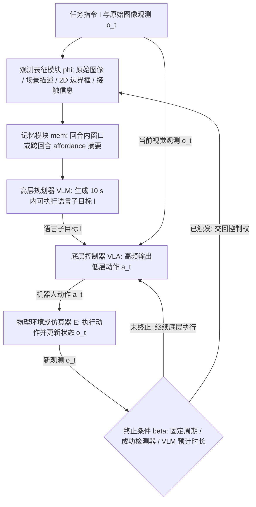

# What Matters in Orchestrating Robot Policies: A Systematic Study of Hierarchical VLA Agents

## 一句话定义

**一篇针对分层视觉-语言-动作（Hi-VLA）智能体的受控实证研究，将高层 VLM 规划器、底层 VLA 控制器及二者间的观测表征、切换终止与记忆接口统一为 Options 控制框架，量化拆解了双层机器人策略编排中真正决定任务成功率的系统设计要素。**

## 英文缩写速查

| 缩写 | 英文全称 | 简要说明 |
|---|---|---|
| Hi-VLA | Hierarchical Vision-Language-Action | 分层视觉-语言-动作系统：高层 VLM 生成语言子目标，底层 VLA 执行连续动作 |
| VLM | Vision-Language Model | 视觉-语言模型，在本研究中承担低频高层规划、场景描述与成功检测 |
| VLA | Vision-Language-Action | 视觉-语言-动作模型，在本研究中承担高频底层语言条件控制 |
| GROD | Gemini Robotics On-Device | Google DeepMind 端侧机器人 VLA 模型族（含 1B 与 3B 版本） |
| ALOHA | A Low-cost Open-source Hardware System for Bimanual Teleoperation | 本研究主力评测所使用的双臂桌面操作平台（含 MuJoCo ALOHA 仿真与真机） |
| LIBERO | Lifelong Robot Learning Benchmark | 本研究跨栈验证中用于长时域语义推理任务改造的机器人操作基准 |

## 为什么重要

- **填补分层编排的设计空白：** 单体扁平（Flat）VLA 受限于短轨迹训练数据与动作微调导致的推理遗忘，难以完成长时域组合与间接语义推理任务；现有分层系统（如 RT-H、Hi Robot、$\pi_{0.5}$、Gemini Robotics 1.5、HAMSTER、Helix 等）在模型选择、切换频率、场景输入和记忆结构上各不相同，缺乏单变量受控评估。
- **揭示反直觉的算力分配原则：** 论文证明在高层规划中「推理能力（thinking）」远比单纯扩大 VLM 参数规模更关键；相反，底层 VLA 的参数规模与**指令可操纵性（steerability）**才是执行瓶颈，盲目用同域仿真数据微调小 VLA 反而会严重破坏其子目标遵循能力。
- **给出高杠杆接口设计依据：** 即使底层动作策略能力继续提升（如脚本化近似完美短时域执行器），缺失有效的观测表征、记忆与终止切换机制仍会使长时域成功率从约 95% 跌至接近 0%，说明系统编排层长期具有独立工程价值。

## 核心信息

| 字段 | 内容或状态 |
|---|---|
| 作者 | Jiaheng Hu（Google DeepMind 实习期间完成）、Mohit Shridhar、Caden Lu、Dhruv Shah、Hao-Tien Lewis Chiang、Jie Tan、Annie Xie |
| 机构 | 谷歌 DeepMind（Google DeepMind） |
| 发表时间 | arXiv:2606.10267v2 [cs.RO]（v1 提交于 2026-06-09；v2 修订于 2026-09-06） |
| 论文链接 | [arXiv:2606.10267](https://arxiv.org/abs/2606.10267) / [HTML 全文](https://arxiv.org/html/2606.10267) |
| 项目与代码 | [官方项目页](http://jiahenghu.github.io/hi-vla)；截至 2026-11-27 未公布官方代码仓库 |
| 清单分类 | `harness.layered_systems`（来源条目：`survey_ax_2606_10267`） |
| 开源状态 | **未确认开源代码**（项目页与论文仅公开结果与视频；跨栈实验使用了外部已开源的 Qwen3-VL、$\pi_{0.5}$ 与 LIBERO 组件） |

## 核心原理

### 1. 基于 Options 框架的统一 Hi-VLA 控制循环（§3, Eq. 1, Alg. 1）

作者将不同 Hi-VLA 架构抽象为半马尔可夫 Options 框架下的双频异步控制回路：
- **底层子策略（Intra-option Policy）** $\pi_{\text{VLA}}(a \mid o_t, l)$：以原始当前观测 $o_t \in O$ 和语言子目标 $l \in L$ 为输入，高频输出机器人底层动作 $a \in A$。
- **高层选项选择策略（Option Selection Policy）** $\pi_{\text{VLM}}(l \mid \boldsymbol{o}, I)$：以总任务指令 $I$ 和经过处理的观测历史 $\boldsymbol{o}$ 为输入，低频生成可在 10 秒内执行的第二人称主动语态子目标 $l$。
- **观测表征模块** $o'_t \leftarrow \phi(o_t)$：将原始相机图像转换为更易被 VLM 利用的文本或空间标注表示。
- **记忆模块** $\boldsymbol{o} \leftarrow \text{mem}([o'_i]_{i \le t})$：组织回合内历史或跨回合交互经验。

整体分层视觉运动策略写成对子目标 $l$ 的边际分布：

$$\pi_{\text{HiVLA}}(a \mid [o_i]_{i \le t}, I) = \int_l \pi_{\text{VLA}}(a \mid o_t, l)\,\pi_{\text{VLM}}(l \mid \boldsymbol{o}, I)\,dl,\quad \text{where }\boldsymbol{o} = \text{mem}([\phi(o_i)]_{i \le t}).$$

在运行时（Alg. 1），外层 VLM 生成子目标 $l$ 后，内层 VLA 持续执行闭环控制，直到**终止条件** $\beta(o_t, t)$ 成立时才交回控制权给 VLM 重新规划下一条子目标 $l'$。

### 2. 五大受控设计轴（§4.2–§4.6）

论文在标准基准配置（Gemini 2.5 Flash thinking + GROD-3B 真机版 + 8 s / $T=400$ 固定周期切换 + 含接触信息场景描述 + 窗口长度为 3 的原始历史）基础上每次仅改变一个组件：

1. **高层 VLM 策略（§4.2）：** 对比 Gemini 2.5 Flash-Lite、Flash、Pro 及是否开启内部推理（thinking）。开启 thinking 后模型内部执行多轮生成、批判与修正，在长时域和推理任务上带来大幅收益；在开启 thinking 的前提下，Lite / Flash / Pro 的成功率随参数扩增并无单调提升。
2. **底层 VLA 策略（§4.3）：** 对比 GROD-1B、GROD-3B 与经同域仿真演示微调后的 GROD-1B (FT with sim)。更大规模的 GROD-3B 具备更强的语言理解与泛化能力；而经过窄分布仿真微调的 GROD-1B 发生语言指令遵循退化，面对 VLM 生成的多样化或微调表述子目标时失灵。
3. **终止条件 $\beta(o_t, t)$（§4.4）：** 对比固定周期（Fixed Frequency）、成功检测器（Success Detector，由 VLM 结合图像序列与特权状态判断 `yes`/`no`/`uncertain`）与 VLM 预估时长（VLM Termination）。因为底层 VLA 执行耗时具有随机性，预先预测时长最不稳定；成功检测器在长时域与推理任务上最有效，且对 10% 独立随机检测噪声具备较强鲁棒性，但高假阳性（FP）会因提前跳过未完成子目标而急剧拉低成功率。
4. **观测表征 $\phi(o_t)$（§4.5）：** 对比纯图像、图像 + VLM 朴素文字描述、图像 + 2D 边界框描述（归一化坐标 `[0, 1000]` 标注物体与左右夹爪）以及图像 + 特权接触信息描述。随着任务复杂度升高，VLM 往往忽略原始图像中的细粒度空间关系，仅加朴素描述甚至产生负面干扰，而加入边界框或接触关系后可显著恢复空间感知精度。
5. **记忆机制 $\text{mem}(\cdot)$（§4.6）：** 对比回合内不同历史窗口长度（1 / 3 / 5 / Full）、单步或当前回合摘要，以及跨回合经验总结（同一任务先运行 10 个回合，再由 VLM 将每步子目标及成败结果总结为底层 VLA 的语言 affordance 要点）。结果显示桌面全可观测场景下回合内长窗口或即时反思几乎无效，而跨回合总结能让 VLM 学会避开底层 VLA 执行不佳的表述、显著抬升三类任务成功率。

## 流程总览

## 源码运行时序图

**不适用**（截至 2026-11-27，论文原文与官方项目页 `http://jiahenghu.github.io/hi-vla` 均未公开 GitHub 代码仓库或可运行源码入口，仅发布论文全文与项目演示视频）。

## 实验与评测

所有主消融实验均在 **MuJoCo ALOHA** 双臂桌面操作基准上进行（短时域、长时域、推理三类任务各 5 个子任务，每任务 200 次独立试验，每次试验预算 2 分钟，误差棒为二项分布有限样本标准误）。

### 1. 组合系统在仿真与真机上的整体表现（Table 1）

| 系统配置 | 短时域（%） | 长时域（%） | 推理（%） | 真机 ALOHA（正确放置水果数） |
|---|---|---|---|---|
| **Best Hierarchy**（最优组合） | **78.22 ± 0.91** | **67.08 ± 1.38** | **80.89 ± 1.17** | **12 / 15** |
| Naive Hierarchy（无记忆、无 thinking、纯图像、固定周期） | 69.57 ± 1.15 | 40.56 ± 1.37 | 66.49 ± 1.31 | 9 / 15 |
| Flat VLA（GROD-3B 直接接收总指令） | 69.63 ± 1.07 | 25.30 ± 1.22 | 50.90 ± 1.20 | 3 / 15 |

> **真机说明：** 在 ALOHA 真实机器人水果配色放置任务（5 轮试验、每轮 3 个水果，无特权仿真信息）中，Best Hierarchy 使用基于图像生成的 2D 边界框描述与纯视觉成功检测器，不仅成功率最高（12/15），还能在底层 VLA 误放红葡萄（Step 6）后识别错误并重新纠正（Step 8），而 Naive Hierarchy 无法从该误放中恢复。

### 2. 五大组件单变量消融核心数据（Appendix J, Tables 3–8）

- **高层 VLM 选型（Table 3）：**
  - `Gemini 2.5 Flash-Lite`：短 `70.48 ± 1.05` / 长 `48.73 ± 1.52` / 推理 `58.51 ± 1.19`；开启 `(thinking)` 后跃升至 `74.44 ± 0.89` / `58.21 ± 1.52` / `75.20 ± 1.25`（长时域 +9.48 pp，推理 +16.69 pp）。
  - `Gemini 2.5 Flash`：无 thinking 为 `72.63 ± 0.94` / `47.02 ± 1.45` / `71.79 ± 1.22`；开启 `(thinking)` 为 `75.81 ± 0.93` / `52.36 ± 1.54` / `72.62 ± 1.17`。
  - `Gemini 2.5 Pro (thinking)`：`70.10 ± 1.01` / `53.06 ± 1.42` / `74.39 ± 1.21`（相对 Flash-Lite thinking 无显著优势）。
- **底层 VLA 选型（Table 4）：**
  - `GROD-1B`：短 `63.40 ± 1.16` / 长 `41.30 ± 1.49` / 推理 `66.90 ± 1.25`。
  - `GROD-1B (FT with sim)`：短 `54.60 ± 1.09` / 长 **`7.50 ± 0.80`** / 推理 `43.00 ± 1.05`（同域仿真微调严重损害指令可操纵性）。
  - `GROD-3B`：短 `75.81 ± 0.93` / 长 `52.36 ± 1.54` / 推理 `72.62 ± 1.17`。
- **终止条件（Table 5）：**
  - `Success Detector`：短 `74.65 ± 0.92` / 长 **`57.39 ± 1.52`** / 推理 **`80.89 ± 1.17`**。
  - `Fixed Horizon (T=400, 8 s)`：短 `75.81 ± 0.93` / 长 `52.36 ± 1.54` / 推理 `72.62 ± 1.17`。
  - `VLM-based Horizon`：短 `72.16 ± 0.95` / 长 `43.50 ± 1.14` / 推理 `72.27 ± 1.14`。
- **观测表征（Table 6）：**
  - `Image`（纯图像）：短 `67.56 ± 0.98` / 长 `38.84 ± 1.50` / 推理 `69.21 ± 1.23`。
  - `Image + description`：短 `67.93 ± 1.01` / 长 `35.70 ± 1.43` / 推理 `62.77 ± 1.31`。
  - `Image + description + bboxes`：短 `73.94 ± 0.95` / 长 `47.90 ± 1.67` / 推理 `68.51 ± 1.26`。
  - `Image + description + contact info`：短 `75.81 ± 0.93` / 长 `52.36 ± 1.54` / 推理 `72.62 ± 1.17`。
- **记忆长度与经验总结（Table 7–8）：**
  - 回合内历史窗口 `1 / 3 / 5 / Full` 差异微小（长时域分别在 `57.76%`–`59.89%` 区间波动）。
  - 经验总结方面，`No summary`（`75.81` / `52.36` / `72.62`）与单步摘要（`74.61` / `52.57` / `72.82`）、当前回合摘要（`71.66` / `50.12` / `75.72`）整体持平或略降；而 **`Summary of previous episodes`（跨回合摘要）** 提升至 `79.45 ± 0.81` / `60.00 ± 1.50` / `80.30 ± 1.23`。

### 3. 跨技术栈验证与未来 VLA 代理实验（§4.8 Table 2, Appendix B）

- **跨栈验证（Qwen3-VL + $\pi_{0.5}$ + LIBERO-Object 3 个双步推理任务，每任务 150 次试验）：**
  - 分层对比：Best hierarchy `83.8 ± 3.0%` vs Naive hierarchy `70.0 ± 3.7%` vs Flat VLA `43.3 ± 4.0%`。
  - VLM 规模：Qwen3-VL 4B `76.0 ± 3.5%`、8B `70.7 ± 3.7%`、32B `73.3 ± 3.6%`（扩参 8 倍未带来单调收益）。
  - VLA 可操纵性：基础 $\pi_{0.5}$ `73.3 ± 3.6%` vs 单指令窄微调 `Narrow-FT π0.5` **`32.0 ± 3.8%`**。
- **未来强 VLA 代理实验（Appendix B）：** 用基于 spaCy 解析器 + 仿真特权信息的脚本化控制器模拟近乎完美执行正确短指令的未来 VLA。在长时域任务上，完整分层系统成功率约 **95%**，而移除观测描述、移除记忆或采用朴素编排会使成功率跌至接近 **0%**。

## 与其他工作对比

| 对比维度 / 工作 | 定位与核心差异 |
|---|---|
| 与扁平 VLA（[RT 系列](../methods/robotics-transformer-rt-series.md)、[VLA 综述](../methods/vla.md)） | 扁平 VLA 由单一模型直接映射指令到动作，受限于短轨迹数据与微调灾难性遗忘；本文表明即使不重训底层 VLA，仅通过原则化高层编排即可在长时域任务上将成功率从 25.30% 提升至 67.08%。 |
| 与已有分层系统（[π₀ / π₀.₅ / π₀.₇](../methods/pi07-policy.md)、Gemini Robotics 1.5、Hi Robot、HAMSTER、Helix） | 先前工作各自绑定了特定 VLM/VLA、切换机制与输入形式（如 PaliGemma + 固定或隐式切换，或 Gemini + 成功检测）；本文未提出单一新骨干模型，而是首次在 Options 统一循环下做单变量受控消融，并交叉验证了 $\pi_{0.5}$ 与 Qwen3-VL 等外部栈。 |
| 与传统层次强化学习（[Hierarchical RL](../methods/hierarchical-reinforcement-learning.md)） | 沿用了经典 Options 框架的时间抽象与终止函数 $\beta(o, t)$ 思想，但将高层选项与低层子策略接口替换为自然语言子目标，并在基础模型尺度下检验了跨回合语言反思替代参数更新的作用。 |

## 结论

**一句话总判：在分层 VLA 系统中，决定成败的不是把高层 VLM 堆得多大，而是「会思考的轻量规划器 + 保持语言可操纵性的强底层 VLA + 空间显式观测 + 靠谱的切换与跨回合经验接口」之间的协同匹配。**

1. **高层规划优先开推理（thinking），不必盲目追大参数** — 开启思维链推理在推理与长时域任务上带来最高 +16.69 pp 提升，而同等推理模式下小模型（如 Flash-Lite、Qwen3-VL 4B）即可追平甚至略优大模型。
2. **底层 VLA 宁可保留多指令泛化性，也不要窄数据微调** — GROD-1B 仿真微调和 $\pi_{0.5}$ 单指令窄微调分别使长时域/跨栈成功率暴跌至 7.50% 和 32.0%，部署前必须检验 VLA 对高层 VLM 改写指令的鲁棒性。
3. **用 2D 边界框或接触状态显式增强 VLM 观测** — 纯文字描述反而可能干扰规划（长时域降 3.14 pp），而显式边界框坐标即可在无特权状态时把长时域成功率从 38.84% 拉升到 47.90%。
4. **终止条件优先选视觉成功检测器，或用 4–8 s 固定窗口折中** — 尽量避免让 VLM 凭空预测子目标时长；若使用成功检测器，需防范连续假阴性（FN）卡死与高假阳性（FP）跳步。
5. **跨回合提炼 VLA 能力边界比堆回合内历史更有效** — 在全可观测桌面任务里，把历史探索总结成跨回合语言 affordance 摘要可稳定提升三类任务表现（长时域 52.36%→60.00%）。

## 工程实践

| 设计维度 | 推荐工程选型与实施边界 |
|---|---|
| 高层 VLM 选型 | 优先选择延迟/成本可控且支持推理模式的轻量多模态模型（如 Flash-Lite thinking 或 Qwen3-VL 4B），将推理预算留给内部思维步骤而非盲目换超大参数模型。 |
| 底层 VLA 选型与微调 | 选用指令遵循覆盖面广的基座 VLA；若需针对新场景做后训练，须混入多样化语言重述与保留通用指令数据，防止过拟合单一模板导致无法响应 VLM 子目标。 |
| 观测管线 | 在无物理接触传感或特权状态时，先让 VLM 对关键物体与左右夹爪输出归一化 2D 边界框（`[y_min, x_min, y_max, x_max]`），再结合图像生成紧凑场景描述，避免无结构自由文本描述。 |
| 切换控制器 | 优先部署视觉成功检测器（可结合 `yes/no/uncertain` 三态输出与连续帧校验缓解单帧误差）；若受限于推理算力，采用 **4–8 秒** 固定切换周期作为强工程基线。 |
| 记忆与反思 | 无需将冗长原始回合历史全部塞入上下文（窗口 1–3 步即可）；建议离线或跨回合收集 5–10 条试运行轨迹，让 VLM 总结出底层 VLA 易成功/易失败的语言子目标模式并注入系统提示词。 |

## 局限与风险

- **静态环境与非延迟敏感假设（§5）：** 本研究所有仿真与真机实验均在静态桌面环境中完成，未测试动态移动物体或对端到端控制延迟高度敏感的高速交互场景。
- **成功检测器的时序相关误差风险（Appendix C）：** 仿真噪声实验采用了帧间独立随机腐蚀，而真实世界中的视觉遮挡或光照变化会导致连续多帧假阴性（FN）高度相关，进而造成子目标长期无法切换并触发超时。
- **跨回合知识的非参数化利用限制（§4.6, §5）：** 当前跨回合经验仅通过上下文摘要注入提示词，尚未结合强化学习或监督微调对高层 VLM 进行在线后训练，以更系统地对齐其与底层 VLA 的能力边界。
- **官方实现未开源：** 论文未公开 ALOHA 分层编排框架代码及评测脚本，外部复现需依据论文附录提示词（Appendix E–I）自行搭建 VLM–VLA 调度回路。

## 关联页面

- [Agentic Robots 综述](paper-towards-agentic-robots-survey.md)
- [全量项目节点清单](../overview/awesome-agentic-robots-node-index.md)
- [VLA 方法背景](../methods/vla.md)
- [机器人智能体执行框架](../methods/robot-agent-harness.md)：对照规划、工具调用与反馈的系统边界。
- [Agent 规划与反馈](../methods/agent-planning-feedback.md)：对照高层任务分解、闭环重规划与错误恢复机制。
- [Agentic 操作策略](../methods/agentic-manipulation-policies.md)：分层 VLA 与多阶段自主操作策略的交叉脉络。
- [分层强化学习（HRL）与 Options 框架](../methods/hierarchical-reinforcement-learning.md)：本研究形式化统一循环的理论来源。
- [π₀ 通用流式策略](../methods/pi0-policy.md) 与 [π₀.₇ 可操纵具身基础模型](../methods/pi07-policy.md)：底层 VLA 可操纵性与跨栈实验相关策略族。
- [具身智能体评测基准](../methods/embodied-agent-benchmarking.md)：长时域与推理型操作评测方法背景。
- [机器人操作任务](../tasks/manipulation.md) 与 [双臂协同操作](../tasks/bimanual-manipulation.md)：ALOHA 双臂桌面操作任务定义与挑战。

## 推荐继续阅读

- [官方项目页与真机演示视频（jiahenghu.github.io/hi-vla）](http://jiahenghu.github.io/hi-vla)
- [arXiv 原文 PDF 与 HTML（arXiv:2606.10267）](https://arxiv.org/abs/2606.10267)
- [Between MDPs and Semi-MDPs: A Framework for Temporal Abstraction in Reinforcement Learning（Options 框架奠基论文）](https://www.sciencedirect.com/science/article/pii/S0004370299000521)

## 参考来源

- [paper-agentic-2606-10267.md](../../sources/papers/paper-agentic-2606-10267.md) — 原文通读核对笔记与项目页开源核查
- [awesome-agentic-robots-survey-index.md](../../sources/repos/awesome-agentic-robots-survey-index.md) — Awesome Agentic Robots 索引条目 `survey_ax_2606_10267`
- [arXiv:2606.10267v2 HTML 原文](https://arxiv.org/html/2606.10267)
- [官方项目页（http://jiahenghu.github.io/hi-vla）](http://jiahenghu.github.io/hi-vla)
