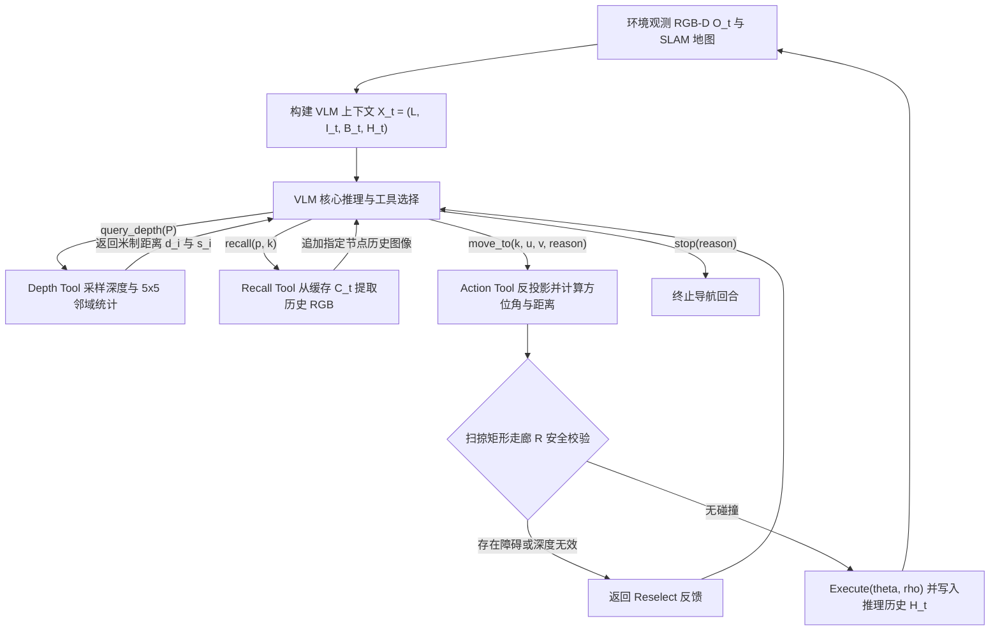

# AgenticNav: Zero-Shot Vision-and-Language Navigation as a Tool-Calling Harness

## 一句话定义

AgenticNav 是一种面向连续环境零样本视觉语言导航（VLN-CE）的轻量级代理接口（Harness），将动作选择、像素级深度查询和历史记忆回溯暴露为大视觉语言模型（VLM）的可调用工具，使模型无需依赖额外训练的航点预测器或堆叠冗长历史帧即可完成连续空间导航。

## 英文缩写速查

| 缩写 | 英文全称 | 简要说明 |
|---|---|---|
| VLN-CE | Vision-and-Language Navigation in Continuous Environments | 连续环境视觉语言导航，无预设拓扑图、需在连续 3D 空间输出可执行运动 |
| VLM | Vision-Language Model | 视觉语言大模型，本文中作为高层推理与工具调用核心 |
| BEV | Bird's-Eye View | 鸟瞰图，本文用于压缩展示历史轨迹、可通行区域与可回溯节点编号 |
| SR | Success Rate | 导航成功率，衡量智能体在终点距离阈值内停靠的回合比例 |
| SPL | Success weighted by Path Length | 路径长度加权成功率，同时衡量任务完成率与路径效率 |
| nDTW | Normalized Dynamic Time Warping | 归一化动态时间规整指标，衡量实际轨迹与参考路径的几何贴合度 |

## 为什么重要

现有零样本 VLN-CE 方案（如 Open-Nav、SmartWay、EvoNav）通常依赖额外训练的航点预测器（Waypoint Predictor）作为中间接口，但这带来了三项结构性瓶颈：

1. **动作空间受限于候选航点**：航点预测器仅在局部全景视野中提出少量离散候选点，指令指向的走廊转角、门框或远距地标若未被提案即无法直达，且航点模型在真机新场景中易因域偏移失效。
2. **深度信息利用率低**：现有系统要么把深度仅喂给航点预测器而不暴露给 VLM，要么直接把稠密深度图输入 VLM，而 VLM 难以直接从整幅深度图精确读取特定像素的米制距离以判断停靠与通行间隙。
3. **上下文膨胀与零样本假设破坏**：长期堆叠历史文本或历史图像会淹没当前关键视觉信息；而检索跨回合历史经验（如 EvoNav）会弱化严格单回合零样本前提。

AgenticNav 证明了在零样本 VLN-CE 中，**动作、感知与记忆的接口设计（Harness）与 VLM 主干本身同等关键**——将接口瓶颈转化为精确的工具调用协议后，VLM 主干的推理升级能够近线性地转化为更优的导航表现。

## 核心信息

| 字段 | 内容或状态 |
|---|---|
| 作者 | Yijian Li, Changze Li, Han Zheng, Jiyuan Cai, Tong Qin, Ming Yang |
| 机构 | 上海交通大学（Shanghai Jiao Tong University）、引望智能技术（Yinwang Intelligent Technology Co., Ltd.） |
| 发表时间 | 2026-06-09 提交 arXiv v1；2026-10-02 修订 v3 |
| 论文链接 | [arXiv:2606.10577](https://arxiv.org/abs/2606.10577) / [arXiv HTML](https://arxiv.org/html/2606.10577) |
| 项目与代码 | 截至 2026-11-27，arXiv v3 全文与公开索引未附带独立项目主页或源码仓库链接 |
| 清单分类 | `model.perception` |
| 来源条目 | `survey_ax_2606_10577` |
| 开源状态 | 未确认开源代码（仅公开论文正文与实验数据） |

## 核心原理

### 1. 智能体工具调用接口（Agentic Tool-Calling Interface）

在决策步 $t$，系统从环境获取按朝向索引的多视角 RGB-D 观测 $O_t = \{(I_t^k, D_t^k)\}_{k=0}^{N-1}$，但对齐深度图 $D_t^k$ 仅保留在工具层供几何计算，**不直接喂给 VLM**。VLM 接收的上下文由四部分构成：

$$X_t = (L, \mathcal{I}_t, B_t, H_t)$$

其中 $L$ 为自然语言导航指令，$\mathcal{I}_t = \{I_t^k\}_{k=0}^{N-1}$ 为当前多视角 RGB 图像，$B_t$ 为紧凑 BEV 地图图像，$H_t$ 为近期推理与动作文本记录。Harness 向 VLM 暴露四个可调用工具：

$$\mathcal{T} = \{\texttt{query\_depth}, \texttt{recall}, \texttt{move\_to}, \texttt{stop}\}$$

其中 `query_depth` 和 `recall` 属于**非终结取证工具**，其返回结果附加到当前决策步的下一轮 VLM 对话中；`move_to`（通过安全检查时）与 `stop` 则终结当前决策步并推进环境状态或结束回合。

### 2. 按需像素深度工具（Depth Tool）

为避免 VLM 直接解析稠密深度图带来的量化误差，VLM 可通过 `query_depth` 批量查询候选像素集合 $\mathcal{P} = \{p_i = (k_i, u_i, v_i)\}_{i=1}^n$，其中 $k_i$ 为视角索引，$(u_i, v_i) \in [0, 1]^2$ 为归一化图像坐标（$u_i$ 从左到右，$v_i$ 从上到下）。工具在对齐深度图上采样并返回：

$$\mathcal{D}(p_i) = (d_i, s_i^{5 \times 5})$$

其中 $d_i$ 为该像素的米制深度值，$s_i^{5 \times 5}$ 为以该像素为中心的 $5 \times 5$ 邻域深度统计量（最小值、均值、中位数），用于辅助 VLM 判断目标是否处于稳定表面抑或深度跳变边缘（如门框、家具边界），从而比较通道可达性与停靠距离。

### 3. 无航点像素动作工具与几何安全校验（Action Tool）

VLM 调用 `move_to(k, u, v, reason)` 在 RGB 视角 $k$ 中直接指定目标归一化像素 $(u, v)$ 及选择理由 `reason`。工具层完成几何映射与碰撞校验：

1. **三维反投影**：由对应像素 $(x, y)$ 与深度 $d = D_t^k(x, y)$，经相机内参 $K$ 和相机到机体坐标系的变换 $T_k$ 反投影为三维点 $p_t = T_k(d K^{-1}[x, y, 1]^\top)$。
2. **极坐标运动裁剪**：取地平面（$xz$ 平面，$y$ 为竖直轴）分量，计算相对方位角 $\theta = \mathrm{bearing}(p_{t, xz})$ 与执行距离 $\rho = \min(\rho_{\max}, \max(0, \|p_{t, xz}\| - m))$，其中 $m$ 为停靠安全余量，$\rho_{\max}$ 为单步最大移动距离。超出量程或深度无效的像素会被直接拒绝。
3. **扫掠矩形障碍校验**：筛选机体高度区间 $[y_{\min}, y_{\max}]$ 内的三维观测点投影为地平面障碍物点集 $\mathcal{O}_t$。设前向单位向量 $b_\theta = (-\sin\theta, \cos\theta)$、侧向单位向量 $\ell_\theta = (\cos\theta, \sin\theta)$ 及机器人半径 $r_a$，构造扫掠矩形走廊：

$$\mathcal{R}(\theta, \rho) = \{s b_\theta + h \ell_\theta \mid 0 < s < \rho + r_a,\; |h| < r_a\}$$

当 $\mathcal{O}_t \cap \mathcal{R}(\theta, \rho) = \varnothing$ 时校验通过，下发 `Execute(\theta, \rho)`；否则向 VLM 返回 `Reselect` 反馈，要求重选安全目标像素。若任务已完成，VLM 调用 `stop(reason)` 终止回合。

### 4. 回合内智能体记忆与选择性视觉回溯（Agentic Memory & Recall Tool）

AgenticNav 仅维护单回合记忆 $M_t = (H_t, B_t, C_t)$，严格满足零样本单回合设定：

- **有界推理文本历史 $H_t$**：采用长度为 6 的滑动窗口 $H_t = \{(r_j, a_j)\}_{j=\max(0, t-6)}^{t-1}$，记录每一步的 `reason` 文本与执行动作 $a_j$，在保留决策因果链的同时防止上下文无限增长。
- **紧凑 BEV 地图 $B_t$**：整合底层 SLAM 模块提供的障碍物、可通行区域与轨迹节点索引，使 VLM 能够定位自身与历史节点编号。
- **选择性视觉回溯工具 `recall(p, k)`**：历史多视角 RGB 图像保存在有界缓存 $C_t$ 中，仅当 VLM 认为某历史节点 $p$ 的视角 $k$ 包含当前决策所需的细节（如曾路过的房间标志或交叉口）时，才按需取回 $R_t(p, k) = C_t[p, k]$ 并追加至当前轮次提示词；进入下一决策步时，上下文会重新从 $(L, \mathcal{I}_t, B_t, H_t)$ 重建，避免历史图像长期堆叠干扰判断。

## 流程总览

## 源码运行时序图

**不适用**（核查结果：截至 2026-11-27，arXiv v3 全文与公开索引未确认官方项目主页或可运行源码实现，无从核验具体代码入口与模块调用顺序）。

## 实验与评测

### 1. R2R-CE 仿真基准对比（Habitat，`val_unseen` 100 episodes，Table I）

在相同 100 条 R2R-CE `val_unseen` 回合与相同 VLM 骨干复现对比条件下（`*` 为作者同设定复现结果；`‡` 为检索跨回合经验的非严格单回合零样本方法）：

| 方法 | 范式 / VLM 骨干 | SR (%) ↑ | SPL (%) ↑ | OSR (%) ↑ | nDTW ↑ | NE (m) ↓ |
|---|---|---|---|---|---|---|
| LightNav-0* | 有监督导航 | 67 | 62.71 | 72 | 66.80 | 4.03 |
| AwareVLN* | 有监督导航 | 63 | 56.34 | 79 | 65.11 | 4.37 |
| BEVBert | 有监督导航 | 60 | 53.41 | 64 | 61.40 | 5.13 |
| SmartWay* | GPT-5.5（零样本） | 44 | 35.04 | 60 | 58.64 | 5.16 |
| **AgenticNav（本文）** | GPT-5.5（零样本） | **55** | **48.41** | **65** | **63.41** | 5.19 |
| Open-Nav* | Gemini-2.5-Pro（零样本） | 27 | 23.22 | 32 | 54.51 | 6.46 |
| EvoNav‡ | Gemini-2.5-Pro（跨回合记忆） | 43 | 37.77 | 51 | 62.38 | 5.04 |
| SmartWay* | Gemini-2.5-Pro（零样本） | 52 | 41.70 | 62 | 62.10 | 5.28 |
| **AgenticNav（本文）** | Gemini-2.5-Pro（零样本） | **58** | **42.91** | **76** | **63.49** | **5.00** |
| Open-Nav* | Gemini-3.7-Flash（零样本） | 31 | 24.93 | 40 | 52.02 | 6.41 |
| LaViRA* | Gemini-3.7-Flash（零样本） | 38 | 31.71 | 49 | 55.69 | 5.52 |
| SmartWay* | Gemini-3.7-Flash（零样本） | 54 | 47.95 | 60 | 65.93 | 4.68 |
| **AgenticNav（本文）** | Gemini-3.7-Flash（零样本） | **76** | **66.50** | **78** | **69.38** | **3.48** |

### 2. VLM 骨干消融与缩放特性（Table II）

| VLM 骨干 | SR (%) ↑ | SPL (%) ↑ | OSR (%) ↑ | nDTW ↑ | NE (m) ↓ |
|---|---|---|---|---|---|
| Gemini-3.7-Flash | **76** | **66.50** | **78** | **69.38** | **3.48** |
| Gemini-2.5-Pro | 58 | 42.91 | 76 | 63.49 | 5.00 |
| GPT-5.5 | 55 | 48.41 | 65 | 63.41 | 5.19 |
| DeepSeek-V4-Flash Vision-Exp | 49 | 36.48 | 64 | 61.18 | 5.67 |
| Qwen3.8-27B | 48 | 33.57 | 72 | 61.58 | 5.65 |

从 Gemini-2.5-Pro 升级至 Gemini-3.7-Flash 时，AgenticNav 的 SR / SPL 分别提升 **+18.00 / +23.59** 个百分点，而同条件下的 SmartWay（+2.00 / +6.25）与 Open-Nav（+4.00 / +1.71）增益有限，表明去掉航点预测器约束后，更强的 VLM 推理能力能够更充分地转化为导航性能。

### 3. 记忆管理与工具组件消融（Gemini-3.7-Flash，Table III & Table IV）

- **记忆与上下文消融（Table III）**：
  - 完整 AgenticNav：76% SR / 66.50% SPL。
  - 去除推理文本历史 $H_t$：降至 63% SR（-13）/ 48.49% SPL。
  - 用结构化任务进度文本（已完成子句、当前子目标与停止条件）替代推理文本：64% SR / 52.56% SPL（作者指出显式进度状态容易将早期误判持续向后传播）。
  - 去除 BEV 地图 $B_t$：降至 70% SR / 59.46% SPL。
  - 堆叠所有历史图像代替选择性回溯：降至 66% SR（-10）/ 54.05% SPL（-12.45）。
- **工具组件消融（Table IV）**：
  - 用航点预测器替换 Action Tool：66% SR / 57.73% SPL / 3.91m NE。
  - 去除 Depth Tool：60% SR / 47.14% SPL / 5.03m NE。
  - 用稠密深度图直接输入替代 Depth Tool：69% SR / 55.79% SPL / 4.42m NE。
  - 去除 Recall Tool：64% SR / 47.47% SPL / 5.10m NE。

### 4. 真机跨平台实验（35 条场景轨迹，GPT-5.5，Table V）

在 Unitree Go2W 四足机器人（局部规划器 SCAN-Planner）与全向四轮机器人（局部规划器 TEB）上部署测试（均配置 4 台 Intel RealSense D435 RGB-D 相机 + LiDAR + FAST-LIO 定位），覆盖实验室、办公室及室外广场（含路牌识别、夜间低光照与 >200 m 室内外长程导航）：

| 方法 | 实验室 SR / NE | 办公室 SR / NE | 室外广场 SR / NE | 总体 SR (%) ↑ / NE (m) ↓ |
|---|---|---|---|---|
| SmartWay-GPT-5.5（原地旋转 12 视角） | 44.4% / 2.60m | 17.6% / 2.62m | 11.1% / 6.98m | 22.9% / 3.74m |
| AgenticNav-GPT-5.5（1 视角） | 55.6% / 2.41m | 35.3% / 2.18m | 22.2% / 5.75m | 37.1% / 3.16m |
| **AgenticNav-GPT-5.5（4 视角）** | **66.7% / 1.96m** | **47.1% / 1.85m** | **55.6% / 4.29m** | **54.3% / 2.51m** |

在失败归因统计（Fig. 8）中，相比 SmartWay，AgenticNav 将停靠相关失败降低一半以上，真机记忆相关失败降低近半，并彻底消除了航点预测器失效引起的失败。

## 与其他工作对比

| 维度 | 传统零样本 VLN-CE（Open-Nav / SmartWay / LaViRA） | 跨回合经验记忆方案（EvoNav） | 有监督 VLN-CE（BEVBert / LightNav-0） | AgenticNav（本文） |
|---|---|---|---|---|
| 动作接口 | 依赖训练好的航点预测器选点 | 依赖航点预测器选点 | 端到端或拓扑航点预测策略 | 直接在 RGB 上像素选点并反投影运动 |
| 深度使用方式 | 仅输入航点网络或整图输入 | 仅用于航点预测器 | 多模态编码器融合 | `query_depth` 按需精确查距与邻域统计 |
| 记忆机制 | 持续追加历史文本或图像 | 跨回合检索历史经验 | 训练期隐状态或显式网格记忆 | 有界 6 步推理文本 + BEV 索引 + `recall` 按需调图 |
| 零样本与跨平台特性 | 易受航点预测器域偏移限制 | 依赖先验回合积累 | 依赖特定领域轨迹监督训练 | 严格单回合零样本，已验证四足与轮式平台 |

## 结论

**一句话总判：AgenticNav 证明了在连续环境零样本导航中，用工具调用替代航点预测器和全量历史堆叠，能够同时解决动作空间受限、深度信息丢失与上下文过载三大问题，并让导航性能随 VLM 主干升级持续提升。**

1. **优先用像素级反投影 + 几何安全校验替代航点预测器**：Action Tool 完全消除了航点预测器的域偏移失败，在室外广场等大视角跨度场景下优势尤为明显（4 视角真机广场 SR 达 55.6% vs SmartWay 11.1%）。
2. **用按需数值工具而非整张深度图向 VLM 暴露几何精度**：`query_depth` 比直接输入稠密深度图高出 7 个百分点 SR（76% vs 69%），且能把停靠失败率砍半以上。
3. **采用“短窗理由 + BEV 索引 + 按需图像回溯”组织长程记忆**：保留最近 6 步自然语言理由比硬编码子目标进度更抗错误传播，且比堆积全部历史图像高出 10 个百分点 SR。
4. **Harness 决定基础模型能力能否释放**：从 Gemini-2.5-Pro 到 Gemini-3.7-Flash，AgenticNav 的 SR 跃升 18 个百分点，说明解除接口束缚后，模型推理增益才能有效传导至物理执行。

## 工程实践

- **多视角部署增益**：真机对比显示，即便仅用单视角 RGB-D，AgenticNav（37.1% SR）已高于旋转采集 12 视角的 SmartWay（22.9% SR）；扩展到 4 视角后（54.3% SR）能提供足够的大角度语义像素目标，显著改善室外宽阔区域的大幅转向与长距离目标可达性。
- **局部规划器解耦**：Harness 只输出地平面极坐标目标 $(\theta, \rho)$，下游可直接对接不同底盘的局部避障控制器——论文在全向四轮机器人上对接 TEB，在 Unitree Go2W 四足机器人上对接 SCAN-Planner，定位均采用 LiDAR + FAST-LIO。
- **工具返回结构设计**：`query_depth` 同时返回单点深度与 $5 \times 5$ 邻域的 min/mean/median，可帮助 VLM 主动避开前景物体边缘与深度空洞像素；`move_to` 强制填写 `reason` 字段既充当思考链约束，又直接构成滑动记忆 $H_t$ 的主体。

## 局限与风险

1. **性能上限仍受限于 VLM 核心推理质量**：消除航点、深度与记忆接口瓶颈后，残余误差主要来自 VLM 对指令语义、复杂门道空间关系与停靠时机的误判（§V）。
2. **依赖底层感知与定位精度**：`move_to` 几何反投影与矩形安全校验依赖准确的相机内外参标定及实时 RGB-D 对齐深度；BEV 节点索引与真机长程行驶则依赖 LiDAR / FAST-LIO 等 SLAM 模块稳定性，强反光、玻璃或深度缺失区域可能触发频繁 `Reselect`。
3. **多轮工具调用增加单步推理延迟与成本**：单步决策内若多次调用 `query_depth` 或 `recall`，会引发多次 VLM 往返交互，在高速连续运动场景下需要配合局部规划器异步或准静止决策节拍使用。
4. **代码与复现边界**：截至 2026-11-27 尚未确认官方开源代码或完整提示词模板，关键超参数（如停靠余量 $m$、最大步长 $\rho_{\max}$、机身高度滤波区间 $[y_{\min}, y_{\max}]$）未在正文中给出具体数值。

## 关联页面

- [Agentic Robots 综述](paper-towards-agentic-robots-survey.md)
- [全量项目节点清单](../overview/awesome-agentic-robots-node-index.md)
- [VLA 方法背景](../methods/vla.md)
- [智能体工具调用接口](../methods/agent-tool-use-interface.md)：理解将感知、记忆与动作封装为工具调用的通用交互范式
- [机器人智能体框架（Robot Agent Harness）](../methods/robot-agent-harness.md)：了解大模型决策核心与底层控制执行之间的工程抽象层设计
- [机器人导航工作流](../methods/robot-navigation-workflow.md)：对比经典 SLAM/局部规划栈与大模型导航接口的结合方式
- [视觉语言导航](../tasks/vision-language-navigation.md)：了解语言条件导航任务定义、VLM 与 VLN-CE 评测体系
- [零样本目标导航](../tasks/zero-shot-object-navigation.md)：对比零样本语义导航与指令跟随连续导航的记忆与探索机制

## 推荐继续阅读

- [AgenticNav arXiv 原文主页（arXiv:2606.10577）](https://arxiv.org/abs/2606.10577)
- [AgenticNav HTML 完整版论文](https://arxiv.org/html/2606.10577)

## 参考来源

- [AgenticNav 论文原文精读归档](../../sources/papers/paper-agentic-2606-10577.md)
- [官方 Awesome 快照归档](../../sources/repos/awesome-agentic-robots-survey-index.md)
- [arXiv:2606.10577 原文页面](https://arxiv.org/abs/2606.10577)
- [arXiv HTML 全文](https://arxiv.org/html/2606.10577)
