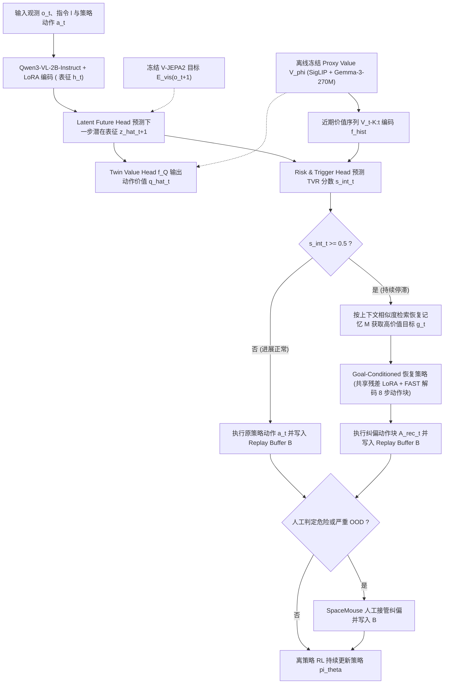
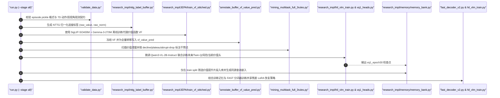

# UniIntervene: Agentic Intervention for Efficient Real-World Reinforcement Learning

## 一句话定义

UniIntervene 是南洋理工大学（NTU）与北京邮电大学（BUPT）提出的真实世界人机回环强化学习（HiL-RL）智能体式干预模型：它通过预测当前动作引发的潜在未来状态并评估其价值趋势，自动识别持续无进展探索（stagnation），并从过往干预记忆中检索高价值恢复目标、由目标条件策略输出纠偏动作块，从而接管大部分原本需要人类操作员执行的在线纠偏干预。

## 英文缩写速查

| 缩写 | 英文全称 | 简要说明 |
|---|---|---|
| HiL-RL | Human-in-the-Loop Reinforcement Learning | 人机回环强化学习，在真机在线交互中引入人类纠偏与接管引导策略更新 |
| TVR | Temporal Value-Risk | 时序价值风险，聚合滑动窗口内价值进展缺口并按剩余进度加权的触发指标 |
| NTTG | Normalized Time-to-Go | 归一化剩余进度标注，将成功轨迹单调映射至 $[0, 1]$ 用于离线训练代理价值函数 |
| CQL | Conservative Q-Learning | 保守 Q 学习正则项，在代理价值训练中抑制分布外或失败状态上的价值高估 |
| FAST | Frequency-space Action Sequence Tokenization | 基于正交 DCT 与 BPE 的动作序列离散分词器，用于恢复动作块自回归生成 |
| SR / IR | Success Rate / Intervention Rate | 评测指标：任务最终成功率（越高越好）与训练期人工干预步数占比（越低越好） |

## 为什么重要

1. **直击真实世界 HiL-RL 的主导人工成本——“安全但无进展”的停滞探索**：传统 HiL-RL（如 HIL-SERL、HG-DAgger、ConRFT）重点研究如何高效利用人工纠偏数据，而安全强化学习与重置恢复方法（如 Recovery RL、Failure-Aware RL）主要围绕危险边界或显式失败做防御性接管。但在接触、插接和柔性操作中，策略往往并未触发危险或跌落，只是在低价值区域反复打转（stagnation），依然迫使人类高频接管。
2. **用“价值时序趋势”替代“单帧低值”或“离散失败分类”**：接触与重抓过程中短暂出现低估价值是正常现象，且 RAM 插接等任务中“差一点没插稳”的视觉外观差异极小。UniIntervene 通过未来状态潜在预测与滑动窗口价值进展缺口检测，能稳定区分瞬时波动与持续停滞。
3. **把“何时接管”与“接管去哪儿”解耦为可学习的恢复闭环**：仅检测到停滞并不足以确定纠偏方向；UniIntervene 用离线过滤后的高价值记忆片段提供明确恢复目标 $g_t$，将开放式纠偏转为有明确目标的目标条件动作块生成。

## 核心信息

| 字段 | 内容 |
|---|---|
| 作者 | Haoyuan Deng, Yitong Gao, Yudong Lin, Haichao Liu, Zhenyu Wu, Ziwei Wang |
| 机构 | 南洋理工大学（Nanyang Technological University）、北京邮电大学（Beijing University of Posts and Telecommunications） |
| 发表时间 | arXiv:2606.12372v1（2026-06-10 提交；HTML 内页日期 2026-08-24）；CoRL 2026 Accepted |
| 论文链接 | [arXiv:2606.12372](https://arxiv.org/abs/2606.12372)（HTML 全文：[arXiv HTML](https://arxiv.org/html/2606.12372)） |
| 项目与代码 | [项目主页](https://denghaoyuan123.github.io/UniIntervene-project/) · [GitHub（Denghaoyuan123/UniIntervene）](https://github.com/Denghaoyuan123/UniIntervene) |
| 清单分类 | `harness.memory, harness.monitoring_and_recovery` |
| 来源条目 | `survey_ax_2606_12372` |
| 开源状态 | **部分开源**（MIT License；已开源离线训练管线，含 NTTG 标注、代理价值函数、三规则干预挖掘、VQ1、恢复记忆构建与 VQ2 FAST 策略训练及 Fold Towel 示例配置；UR7e 真机部署、HIL-SERL 在线集成、轨迹数据与权重未开源） |

## 核心原理

UniIntervene 在基础策略 $\pi_\theta(a_t \mid o_t, \ell)$ 之上引入内生干预模块 $\mathcal{I}_\psi: (o_t, \ell, a_t) \mapsto (\hat{q}_t, s_t^{\mathrm{int}}, A_t^{\mathrm{rec}})$。在真实世界交互总目标 $\max_{\pi_\theta} \mathbb{E}[\sum_{t=0}^T \gamma^t r(o_t, a_t, \ell) - \lambda_{\mathrm{int}} y_t]$ 下，当内置干预分数 $s_t^{\mathrm{int}} < \tau_{\mathrm{int}}$ 时执行原策略动作 $a_t$，反之由恢复动作块 $A_t^{\mathrm{rec}}$ 接管执行并将恢复转移写入回放缓冲区 $\mathcal{B}$，仅在罕见或危险工况下保留人类操作员兜底。

### 1. 离线代理价值函数与 NTTG 进度监督
为给在线价值估计、风险触发与记忆筛选提供统一且不随在线策略剧烈漂移的基准信号，系统首先离线预训练并冻结代理价值函数 $V_\phi(o, \ell)$：
- **进度标注（NTTG）：** 对长度为 $T$ 的成功轨迹赋予归一化剩余进度标签 $v_t = t / (T - 1) \in [0, 1]$，失败轨迹全段赋予 $v_t = 0$ 与大负原始回报。
- **双头拼接架构：** 冻结 SigLIP-SO400M 视觉编码器提取 1152 维视觉特征，经两层 MLP 投影至 640 维后接入 Gemma-3-270M 语言模型融合指令 $\ell$，再由双头网络输出保守价值估计 $V_\phi(o, \ell) = \min(V_{\phi,1}, V_{\phi,2})$。先在通用图文数据上对齐投影层，再冻结视觉塔微调投影层与价值头。
- **联合损失：**
  $$\mathcal{L}_{\text{proxy}} = \lambda_{\text{TD}}\mathcal{L}_{\text{TD}} + \lambda_{\text{label}}\mathcal{L}_{\text{label}} + \lambda_{\text{prog}}\mathcal{L}_{\text{mono}} + \lambda_{\text{CQL}}\mathcal{L}_{\text{CQL}}$$
  其中 $(\lambda_{\text{TD}}, \lambda_{\text{label}}, \lambda_{\text{prog}}, \lambda_{\text{CQL}}) = (1.0, 0.3, 1.0, 0.05)$、$\gamma=0.99$：$\mathcal{L}_{\text{TD}}$ 为带 stop-gradient 的单步 Bellman Smooth-$L_1$ 损失，$\mathcal{L}_{\text{label}}$ 与 $\mathcal{L}_{\text{mono}}$ 仅在成功轨迹 $\mathcal{D}^+$ 上约束进度回归与相邻步单调不降，$\mathcal{L}_{\text{CQL}}$ 以失败轨迹采样作为负例集合抑制分布外高估。

### 2. 未来条件动作价值估计（VQ1）
在稀疏奖励操作中，单步观测往往难以分辨候选动作是否推动了任务进展。UniIntervene 通过前向潜在预测引入基于模型的动作后果评估：
- **共享视觉-语言表征：** 主干为 `Qwen3-VL-2B-Instruct`（配置 rank=16、$\alpha=32$、dropout=0.05 的注意力 LoRA），在输入 $(o_t, \ell, a_t)$ 的提示末尾追加特殊查询 token `<VQ_QUERY>`，提取其末层隐状态 $h_t = f_{\mathrm{vlm}}(o_t, \ell, a_t)$。
- **潜在后果预测头：** 两层 MLP（4 倍隐层扩展）从 $h_t$ 预测下一步池化潜在向量 $\hat{z}_{t+1} = f_{\mathrm{fut}}(h_t)$，以 $L_2$ 归一化后的 MSE 损失对齐冻结 V-JEPA2 编码器（`vjepa2-vitl-fpc64-256`，1024 维 × 256 tokens 池化）提取的真实下一帧表征 $E_{\mathrm{vis}}(o_{t+1})$。
- **Twin-Q 与辅助当前价值头：** 双头 $f_Q$ 由 $\hat{z}_{t+1}$ 预测 $\hat{q}_t = \min(\hat{q}_{1,t}, \hat{q}_{2,t})$，以 Smooth-$L_1$ 拟合目标 $q_t^\star \equiv V_\phi(o_{t+1}, \ell)$；同时从 $h_t$ 分出辅助当前价值头回归当前步代理价值以稳定早期训练尺度。

### 3. 时序价值风险（TVR）干预触发器
为避免在接触调整与重抓阶段因短暂低价值产生误触发，触发器考察最近 $K=8$ 步窗口内的价值动态变化：
- **时序价值风险定义：** 记单步价值增量为 $\Delta V_i = V_i - V_{i-1}$，设定预期进展率 $\epsilon = 0.005$ 与趋势折扣 $\gamma_r = 0.9$，则第 $t$ 步的时序价值风险为
  $$R_t = (1 - V_t) \sum_{i=0}^{K-1} \gamma_r^i \big[\epsilon - \Delta V_{t-i}\big]$$
  当近期持续未能达到期望进步率时风险累积放大，而在接近任务完成（$V_t \to 1$）时通过 $(1 - V_t)$ 自然衰减。
- **三规则离线挖掘与风险/触发头：** 离线沿集内 min-max 归一化后的代理价值曲线扫描长度 8 的滑窗，按**持续下降（decline）**、**平台停滞（plateau）**与**骤降未恢复（abrupt-drop）**三类规则标注干预点；在线侧由历史编码器 $f_{\mathrm{hist}}$ 将近期价值与差分序列编为 32 维特征，联合 $\hat{z}_{t+1}$ 经风险头回归 $\hat{R}_t$，再结合梯度截断（detached）的价值标量送入触发头得到干预分数 $s_t^{\mathrm{int}} = \sigma(\hat{R}_t)$（触发阈值 $\tau_{\mathrm{int}} = 0.5$），触发头采用二元 Focal Loss（$\alpha=0.75, \gamma=2.0$）应对正样本极度稀疏的类别不平衡。

### 4. 记忆引导的目标条件恢复（VQ2）
确定“需要干预”后，恢复仍面临目标歧义问题。UniIntervene 将其拆分为“记忆检索目标 + 目标条件控制”：
- **高质量恢复记忆构建：** 从既有训练轨迹提取固定跨度的“价值提升片段”（前四任务 `span=8`、`delta >= 0.40`、按 10 进度桶各取 12 条共 120 项；Fold Towel 因长程柔顺特性在论文表 5 使用 `span=16`、`delta >= 0.50`、20×12=240 项），确保终态代理价值高于阈值，每项记录失败/干预态与高价值目标态 $(o_j^{\mathrm{fail}}, s_j^{\mathrm{fail}}, \ell_j, o_j^g, s_j^g)$。
- **同源检索与 FAST 动作块解码：** 在共享嵌入空间 $\phi(\cdot)$ 中按余弦相似度匹配当前上下文，取 Top-1 记忆项的目标 $g_t = (o_{j^\star}^g, s_{j^\star}^g)$。恢复策略 $\pi_{\mathrm{rec}}$ 通过共享残差 LoRA（rank=16, $\alpha=32$）复用同一主干特征，并使用 `physical-intelligence/fast` 将未来 $H=8$ 步、7 维末端执行器控制量编码为离散频域 token，通过逐 token 交叉熵行为克隆学习从当前态向检索目标 $g_t$ 迁移：
  $$\mathcal{L}_{\mathrm{rec}} = -\sum_{i=0}^{H} \log \pi_{\mathrm{rec}}\big(a_{t+i}^{\mathrm{rec}} \mid o_t, g_t, \ell, a_{t:t+i-1}^{\mathrm{rec}}\big)$$

## 流程总览

## 源码运行时序图

以下时序图基于官方仓库 `Denghaoyuan123/UniIntervene` 的已核实模块（`run.py`、`validate_data.py` 与 `research_impl/` 下各阶段脚本）；该仓库实现完整的七阶段离线数据标注、VQ1/VQ2 训练与记忆库构建流程，而真机 UR7e 控制与 HIL-SERL 在线闭环则位于仓库外部。

## 实验与评测

论文在 **UR7e 机械臂**（平行夹爪、腕部与第三人称固定 $224\times 224$ RGB 双相机、3D-connexion SpaceMouse 人工干预接口）上对 **5 项真机操作任务**进行了系统评测（每任务 20 个后训练评估回合统计最终成功率 SR，3 次独立训练运行统计干预率 IR；数据源自原文 Tables 1–2、Tables 5–6 及 Appendices C.4、H）：

### 1. 真机主实验对比（Table 1）

| 方法 | Pick Eggplant SR↑ / IR↓ | Tube Insertion SR↑ / IR↓ | RAM Insertion SR↑ / IR↓ | Wipe Whiteboard SR↑ / IR↓ | Fold Towel SR↑ / IR↓ | 平均 SR↑ / IR↓ |
|---|---|---|---|---|---|---|
| **$\pi_{0.5}$ (SFT)** | 95% / – | 30% / – | 10% / – | 65% / – | 70% / – | 54% / – |
| **HiL-SERL** | 90% / 28.7% | 60% / 30.2% | 85% / 32.3% | 85% / 30.5% | 85% / 49.8% | 81% / 34.3% |
| **HiL-SERL + FA-RL** | 85% / 20.4% | 60% / 22.1% | 75% / 27.9% | 80% / 21.9% | 85% / 30.9% | 77% / 24.6% |
| **HiL-SERL + UniIntervene** | **95%** / **10.0%** | **70%** / **15.8%** | **95%** / **12.1%** | **90%** / **10.9%** | **90%** / **24.1%** | **88%** / **14.6%** |

- 相比 `HiL-SERL`，UniIntervene 将平均成功率提升 **8.6%**（81% → 88%），同时将平均人工干预率降低 **57%**（34.3% → 14.6%）。
- 在视觉变化细微的接触密集任务 **RAM Insertion** 上，依赖显式失败预测的 `FA-RL` 验证集干预 F1 仅 **0.33**（Fold Towel 为 **0.25**），导致其成功率（75%）反而低于 `HiL-SERL`（85%）；UniIntervene 则以价值趋势监测达到 **95%** 成功率与仅 **12.1%** 干预率。

### 2. 消融实验（Table 2，Pick Eggplant 与 RAM Insertion）

| 变体 | $Q$-Loss ↓ | Int. F1 ↑ | SR (%) ↑ | IR (%) ↓ |
|---|---|---|---|---|
| w/o Future Pred. | 0.005 | 0.878 | 90 | 15.8 |
| w/o Value Pred. | – | 0.845 | 85 | 18.7 |
| w/o TVR | 0.004 | 0.832 | 85 | 16.9 |
| w/o Memory Goal | 0.004 | 0.882 | 85 | 16.1 |
| **UniIntervene（完整版）** | **0.004** | **0.882** | **95** | **11.1** |

- **触发精度由价值估计与 TVR 决定：** 去掉价值预测使干预 F1 降至 0.845、IR 升至 18.7%；去掉 TVR（改为仅依赖瞬时值判断）使干预 F1 跌至最低的 0.832、IR 升至 16.9%。
- **恢复质量依赖未来预测与记忆目标：** 去掉未来预测或记忆目标时，离线触发 F1 几乎不变（0.878 与 0.882），但在线成功率分别由 95% 降至 90% 和 85%，说明离线触发 F1 不能单独反映闭环恢复质量。

### 3. 代理价值分离度与记忆检索审计（Appendix C.4 & Tables 5–6）
- **代理价值质量：** 验证集上成功与失败轨迹的均值显著分离（Insertion split: **0.53** vs **0.09**；Pick Eggplant: **0.53** vs **0.24**），Twin-V 双头分歧在所有划分均低于 $3\times 10^{-3}$。
- **恢复记忆规模与检索质量：** 五个任务从 3,574（Fold Towel）至 40,742（RAM Insertion）个候选片段中各筛选保留 120–240 个均衡目标；在训练轨迹检索审计中（Table 6），Top-1 平均余弦相似度在所有任务均高于 **0.95**（Insertion 0.992、Pick Eggplant 0.992、Wipe Whiteboard 0.993、Fold Towel 0.957），检索目标相对查询态的归一化价值平均提升 **0.339–0.563**。
- **典型轨迹行为（Sec. 4.3 & Appendix I）：** 在 RAM Insertion（42 步）与 Fold Towel（95 步）案例中，TVR 均在持续停滞后的价值极小值处（分别为第 13 步与第 8 步）触发，随后单次目标条件恢复即可使价值单调回升至完成。

## 与其他工作对比

| 方法 / 路线 | 触发依据 | 恢复机制 | 在线训练作用 | 典型局限 |
|---|---|---|---|---|
| **$\pi_{0.5}$ (SFT)** | 无在线干预 | 无 | 仅作为离线模仿学习基座（20 条演示/任务） | 接触密集插接泛化急剧退化（Tube 30%、RAM 10%） |
| **HiL-SERL** | 人类操作员主观观察 | 人类通过 SpaceMouse 接管纠偏 | 离策略 RL + 人工纠偏写入缓冲区 | 面对长期低进展探索需频繁人工介入（平均 IR 34.3%，Fold Towel 达 49.8%） |
| **HiL-SERL + FA-RL** | ResNet-18 离散失败分类器 + 值窗 | EfficientNet-B0 回归 8 步恢复块（40 步恢复视野） | 结合失败预测与恢复奖赏（0.2）减少部分接管 | 面对 RAM 插接等视觉变化微弱的“非显式失败停滞”敏感度不足（F1 0.33） |
| **Reset-Free / Safety Critic 类方法** | 状态可达性 / 安全约束越界 | 重置技能或回退安全区 | 保障训练连续性或避免物理损坏 | 关注“是否安全/可重置”而非“是否推进任务进度”，对合法但停滞状态盲区大 |
| **HiL-SERL + UniIntervene** | 未来潜在预测 + 窗口价值进展缺口（TVR） | 经验记忆 Top-1 目标检索 + FAST 离散动作块策略 | 内生替代大部分人工干预，仅保留罕见/危险人工兜底 | 依赖离线代理价值校准及恢复记忆对失败模式的覆盖度 |

## 结论

**一句话总判：UniIntervene 证明真实世界 HiL-RL 中最昂贵的人工负担来自“安全却长期停滞”的低进展探索，将“未来潜在价值预测 + 时序进展缺口风险 + 经验记忆目标检索与动作块恢复”闭环化后，可在提升真机成功率的同时削减一半以上人工接管。**

1. **以“时序趋势”而非“单帧阈值”作为干预扳机**：机械臂在接触建立与重抓期间必然经过瞬时低值状态，基于 $K=8$ 窗口累积进展缺口（TVR）并在接近完成时衰减风险，能准确把触发点锚定在持续停滞谷底。
2. **离线触发指标无法替代在线恢复效果**：消融表明仅移除记忆目标几乎不改变干预触发 F1（仍为 0.882），但真实成功率会直降 10 个百分点（95% → 85%），说明“指明恢复去向”与“准确检测停滞”同等关键。
3. **代理价值校准是整个管线的共同基座**：NTTG 进度监督、单调性铰链与 0.05 权重的 CQL 保守正则共同保证了成功/失败轨迹的稳定分离；若换用不同任务或数据分布，必须先校验代理价值与记忆阈值。
4. **工程落地需注意代码发布边界**：官方仓库完整开源了七阶段离线训练管线，但真机控制环路与 HIL-SERL 在线连接需由使用者自行对接。

## 工程实践

- **任务依赖的超参数与阈值校准：** 仓库 `README.md` 指出记忆构建阈值（`delta_threshold`、`target_vf_min`、`span`）高度依赖代理价值函数标定与任务尺度（例如论文表 5 中 Fold Towel 采用 `span=16, delta=0.50`，而官方仓库 `configs/fold_towel.json` 示例配置采用 `span=32, delta=0.40, 20×12` 分桶）。新任务构建记忆前应核查 `selected_stats.min_vf_delta`、`selected_stats.min_target_vf` 及各进度分桶数量，避免因阈值过严导致记忆库为空。
- **严格的数据划分防泄漏：** 官方实现强制在确定性 episode-level 训练集上构建恢复记忆，禁止验证集或测试集轨迹入库；同时必须使用同一个 `vq1_epoch30` 检查点为记忆键与查询生成嵌入，确保检索空间一致。
- **组件冒烟验证与资源开销：** 正式全量训练 VQ1/VQ2（Qwen3-VL-2B-Instruct，bf16，30 epochs，建议开启梯度检查点）前，建议先运行 `validate_data.py` 校验 pickle 契约与 7 维动作（第 7 维为夹爪），并用 `tools/smoke_fast_overfit.py` 验证 `physical-intelligence/fast` 分词器编解码往返（仓库附带报告记录 16 chunks / 300 步过拟合后重建 MAE 可达 0.00404）。

## 局限与风险

1. **对代理价值函数校准质量的强耦合**：若离线轨迹数量不足、NTTG 标签失真或环境外观迁移导致 $V_\phi$ 失准，TVR 可能在正常过渡期过早打断策略，或在真实卡死后漏触发。
2. **记忆库覆盖边界限制恢复泛化**：目标条件恢复策略仍依赖从过往成功纠偏片段中检索 $g_t$；若真机遇到记忆库从未覆盖过的新型卡阻或异常几何构型，检索目标匹配失真将降低恢复可靠性。
3. **跨本体与长程移动操作尚待验证**：论文真机验证聚焦于单台桌面级 UR7e 机械臂上的五项任务，推广到双臂、移动操作或跨本体迁移时，需重构更大的多任务价值评估与恢复记忆结构。
4. **无法完全取消人类监督**：UniIntervene 仅承担常规停滞纠偏，对潜在碰撞、超力矩损坏或严重分布外危险场景，仍需保留 SpaceMouse 等人工紧急接管机制作为最后防线。

## 关联页面

- [Agentic Robots 综述](paper-towards-agentic-robots-survey.md)
- [全量项目节点清单](../overview/awesome-agentic-robots-node-index.md)
- [VLA 方法背景](../methods/vla.md)
- [强化学习](../methods/reinforcement-learning.md)
- [安全强化学习（Safe RL）](../methods/safe-rl.md)
- [基于价值的强化学习](../methods/value-based-reinforcement-learning.md)
- [动作分块（Action Chunking）](../methods/action-chunking.md)
- [行为克隆（Behavior Cloning）](../methods/behavior-cloning.md)
- [智能体规划与反馈机制](../methods/agent-planning-feedback.md)
- [机器人操作任务](../tasks/manipulation.md)
- [遥操作任务](../tasks/teleoperation.md)

## 推荐继续阅读

- [UniIntervene 官方项目主页](https://denghaoyuan123.github.io/UniIntervene-project/)
- [UniIntervene 官方开源代码仓库（Denghaoyuan123/UniIntervene）](https://github.com/Denghaoyuan123/UniIntervene)
- [UniIntervene 论文原文（arXiv:2606.12372）](https://arxiv.org/abs/2606.12372)

## 参考来源

- [UniIntervene 论文全文核对档案](../../sources/papers/paper-agentic-2606-12372.md)
- [UniIntervene 官方仓库核对档案](../../sources/repos/paper-agentic-2606-12372.md)
- [官方 Awesome 快照归档](../../sources/repos/awesome-agentic-robots-survey-index.md)
- [arXiv 原文（2606.12372v1）](https://arxiv.org/abs/2606.12372)
- [UniIntervene 项目主页](https://denghaoyuan123.github.io/UniIntervene-project/)
- [UniIntervene 官方 GitHub 仓库](https://github.com/Denghaoyuan123/UniIntervene)
