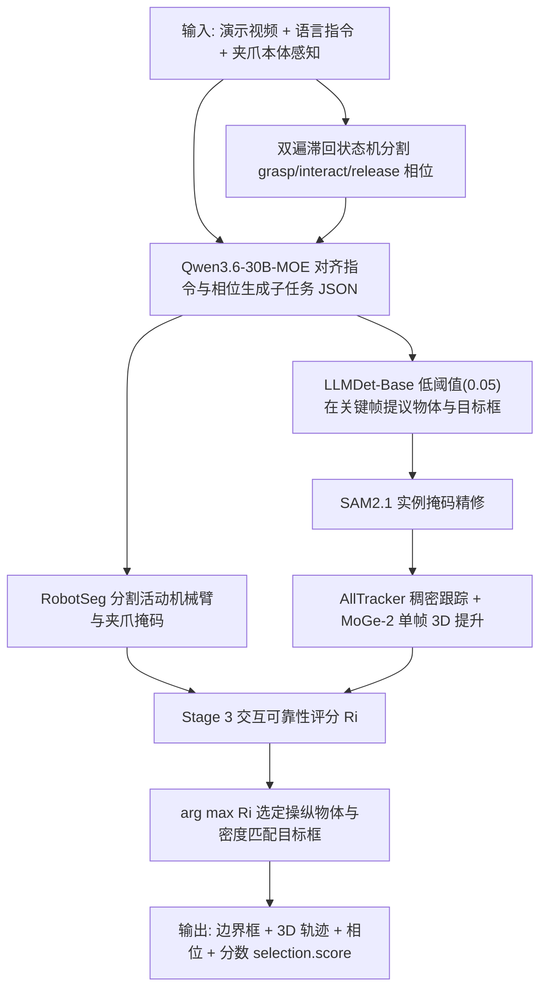
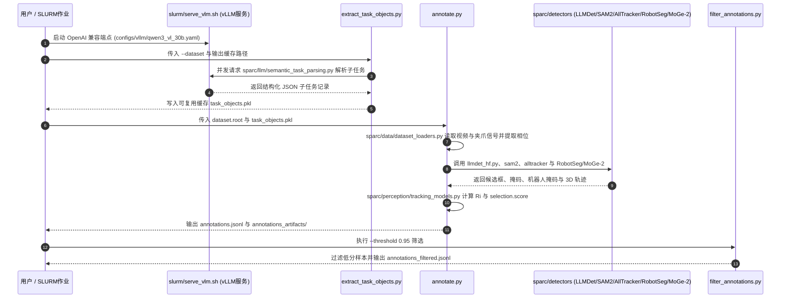

# SPARC: Reliable Spatial Annotations from Robot Demonstrations at Scale

## 一句话定义

**SPARC**（Spatial Annotations from Robot Demonstrations with Reliability Calibration）是一种面向机器人演示视频的自动时空标注与质量校准框架，通过融合夹爪相位感知运动、3D 夹爪近邻与机器人掩码惩罚等物理交互证据，为每个操纵对象生成边界框、3D 轨迹、操作相位标签及可用于精度—覆盖率权衡的连续可靠性分数。

## 英文缩写速查

| 缩写 | 英文全称 | 简要说明 |
|---|---|---|
| SPARC | Spatial Annotations from Robot Demonstrations with Reliability Calibration | 本文提出的交互感知自动空间标注与可靠性评分框架 |
| IA-Bench | Interaction-Aware Bench | 本文构建的 1,748 条跨本体交互目标定位评测基准 |
| VLA | Vision-Language-Action | 视觉—语言—动作多模态机器人控制策略模型 |
| VLM | Vision-Language Model | 视觉—语言多模态基础模型，用于指令解析与下游空间推理微调 |
| AURC | Area Under the Risk-Coverage Curve | 风险—覆盖率曲线下面积，越低表示高置信度筛选错误率越低 |
| Cov@90 | Coverage at 90% Precision | 在保持保留样本准确率不低于 90% 时所能保留的数据比例 |

## 为什么重要

在视觉—语言—动作（VLA）推理与具身视觉—语言模型（VLM）训练中，物体初始/目标位置框、空位指向点及 3D 运动轨迹是关键的空间监督信号。然而，人工逐帧审核成本高昂，仿真环境存在真实域迁移差距，而现有自动标注管线通常直接串联开放词表检测器与跟踪器，并以**检测器置信度**作为筛选依据。

检测器置信度只反映外观类别的识别确定性，而非"物体是否正在被机器人实际操纵"。在桌面杂乱、多相似干扰物或部分遮挡场景下，检测器往往高置信度锁错干扰物或机械臂自身部件，并在后续跟踪中放大错误，使数据清洗陷入"保留大量错标"或"丢弃大量有效样本"的两难。SPARC 将自动标注重新表述为**选择性预测（selective prediction）**问题，利用演示本身自带的时间相位与运动学交互结构产出可排序的可靠性分数，从而在不依赖人工复核的前提下，同时提升定位准确率与高纯度数据保留率。

## 核心信息

| 字段 | 内容 |
|---|---|
| 作者 | Nils Blank, Paul Mattes, Maximilian Xiling Li, Jakub Suliga, Thomas Roth, Moritz Reuss, Pankhuri Vanjani, Rudolf Lioutikov |
| 机构 | 卡尔斯鲁厄理工学院（KIT）、英伟达（NVIDIA）、德国机器人研究所（Robotics Institute Germany, RIG） |
| 发表时间 | CoRL 2026（arXiv:2606.13497，v1 于 2026-06-11 提交，v2 于 2026-10-14 修订） |
| 论文链接 | [arXiv:2606.13497](https://arxiv.org/abs/2606.13497) · [HTML 全文](https://arxiv.org/html/2606.13497) |
| 项目与代码 | [项目页](http://intuitive-robots.github.io/sparc-labeling) · [GitHub 源码](https://github.com/intuitive-robots/sparc) · [HF 合集](https://huggingface.co/collections/irl-kit/sparc) |
| 清单分类 | `data.annotation`（来源条目：`survey_ax_2606_13497`） |
| 开源状态 | **已开源**（标注流水线代码 `intuitive-robots/sparc`、`SPARC-Qwen3.5-4B` 模型、`SPARC-VQA`、`IA-Bench` 及 DROID 标注均已公开；BridgeData/AgiBotWorld/OXE 标注显示 Coming soon） |

## 核心原理

给定长时程机器人演示 $\tau = \{(x_t, q_t)\}_{t=1}^T$（RGB 视频帧 $x_t$ 与本体感知状态 $q_t$）及自然语言指令 $\ell$，SPARC 通过三个解耦阶段为每个物体级子任务输出结构化空间标注与可靠性分数 $R_i$。

### 1. Stage 1：夹爪相位检测与子任务分解

- **双遍滞回夹爪相位提取：** 对每条轨迹的归一化夹爪开合信号 $a_t \in [0, 1]$（越小表示越闭合）设置非对称进入/退出阈值 $\tau_{\mathrm{enter}} = \tau_c - \delta$ 与 $\tau_{\mathrm{exit}} = \tau_c + \delta$（$\tau_c = 0.6, \delta = 0.05$），抑制遥操作抖动与瞬时打滑造成的碎片化切分。第一遍状态机提取候选闭合区间 $[s_k, e_k]$（时长 $d_k$），计算自适应最短有效时长 $d_{\min} = \max(0.5 B / K, 0.4\,\mathrm{median}(\{d_k\}))$；第二遍将短于 $d_{\min}$ 的闭合标记为 `grasp_failure`，有效闭合构成 `grasp -> interact -> release` 周期并向前偏置 $r_{\text{off}}=0.3$ 以覆盖接触过渡。双臂数据按左右臂独立提取后时间合并；无夹爪闭合事件（如推物体）时回退为单段粗粒度交互窗口。
- **语言引导子任务对齐：** 将指令 $\ell$ 与有序相位列表输入 `Qwen3.6-30B-MOE`，解析出结构化子任务记录 $\mathcal{S} = \{(u_j, \ell_j, q_j^{\mathrm{init}}, q_j^{\mathrm{target}}, \mathcal{P}_j)\}$，包含操纵对象名称、起始/目标位置短语、动作类型、可选工具信息与相位自然语言描述。

### 2. Stage 2：低阈值候选提议、掩码精修与 3D 跟踪

- **高召回候选提议：** 在子任务首个抓取阶段中点关键帧 $t^\star$（避开夹爪完全贴合遮挡），以极低阈值（$0.05$）运行 `LLMDet-Base`，作为区域提议器为每个子任务生成 5–25 个候选框并保留词元平均定位置信度 $D_i$；同时在早期与晚期帧结合目标位置短语提议目标候选框。
- **实例分割与机器人分割：** 用 `SAM2.1 Hiera-Small` 将候选框精修为实例掩码 $m_i$，构建候选集 $c_i = (b_i, m_i, \ell_i, D_i)$；并行运行 `RobotSeg` 在 $t^\star$ 分割机械臂与夹爪掩码（双臂场景限制为当前活动臂）。
- **稠密跟踪与单目 3D 提升：** 在原始分辨率下以 6 fps 运行 `AllTracker` 获取稠密 2D 像素轨迹 $\mathbf{u}_{i,p}^t$ 及可见性 $v_{i,p}^t$，并用 `MoGe-2` 预测逐帧稠密几何点图 $\Phi_t: \Omega \to \mathbb{R}^3$，将掩码内轨迹点提升为 3D 轨迹 $\Gamma_i = \{(\mathbf{x}_p^t, \mathbf{u}_p^t, v_p^t)\}$。

### 3. Stage 3：多线索交互可靠性评分与目标匹配

Stage 3 为每个候选 $i$ 计算四类互补信号，并合成为标量可靠性分数：

1. **相位感知运动信噪比 $A_i$（Selector，选择核心）：** 计算交互期帧间可见点中位位移速度 $\mu_i^{\mathrm{int}}$ 与非交互期速度 $\mu_i^{\mathrm{non}}$（px/s），定义软信噪比：
   $$A_i = \frac{(\mu_i^{\mathrm{int}})^\alpha}{(\mu_i^{\mathrm{non}} + \varepsilon)^\beta}, \quad \alpha = 0.6,\; \beta = 0.2,\; \varepsilon = 1.0\text{ px/s}$$
   从而偏爱仅在抓持交互期间稳定运动的对象，抑制背景漂移或全程晃动候选。
2. **3D 夹爪近邻比例 $P_i$（Conditional，条件增强）：** 以每帧可见夹爪点中最靠近图像中心的点作为稳定的末端中心代理 $g_t$，构建自适应半径 $r_t$（尺度因子 $k_r = 8$）的 3D 球体 $B(g_t, r_t)$，计算可见候选点落入球内的平均比例 $P_i = \frac{1}{|\mathcal{T}_i|}\sum_{t\in\mathcal{T}_i} \frac{1}{|Q_{i,t}|}\sum_{\mathbf{x}\in Q_{i,t}}\mathbf{1}[\mathbf{x}\in B(g_t, r_t)]$。$A_i$ 与 $P_i$ 在同一视频片段内做 min-max 归一化得到 $\widehat{A}_i, \widehat{P}_i$。
3. **经深度差衰减的机器人重叠惩罚 $\Pi_i$（Rejector，负向抑制）：** 计算候选在关键帧处落入 `RobotSeg` 掩码的重叠比例 $O_i \in [0, 1]$，从起始阈值 $\tau_{\mathrm{ov}}=0.3$ 起施加连续二次惩罚（缩放 $\lambda=1.45$，完全重叠 $\tau_{\mathrm{sp}}=0.98$ 处附加尖峰 $\lambda_{\mathrm{sp}}=0.20$），并利用夹爪尖端与候选区域间的 3D 深度分离度（衰减区间 $[z_\ell, z_h] = [0.05, 0.25]\text{ m}$，衰减系数 $\gamma=0.85$）减弱惩罚，防止硬过滤误杀与夹爪接触的真实物体。
4. **融合与目标匹配：** 综合可靠性分数为：
   $$R_i = w_A \widehat{A}_i + w_D(\widehat{P}_i)\,D_i + w_P \widehat{P}_i - \Pi_i, \quad w_A=0.5,\; w_P=0.3,\; w_D(\widehat{P}_i)=0.75 - 0.15\widehat{P}_i$$
   其中 $D_i$ 担任跨演示的**尺度锚点（Anchor）**，当 3D 近邻证据充分时自适应降低对外观置信度的依赖。最终选定 $i^\star = \arg\max_i R_i$ 作为操纵物体；目标位置框则依据选定物体迁移轨迹末端点在候选目标框中的面积归一化落点密度 $\widetilde{S}_{i^\star j} = S_{i^\star j}^{\mathrm{ungated}} / \sqrt{A_j / A_{\max}}$ 选出。

## 流程总览

## 源码运行时序图

`intuitive-robots/sparc` 将三阶段管线拆分为 `extract_task_objects.py`（连接 `slurm/serve_vlm.sh` 启动的 VLM 服务预生成 `task_objects.pkl` 缓存）、`annotate.py`（调度检测/分割/跟踪/几何评分写入 `annotations.jsonl` 与 HDF5 分片）及 `filter_annotations.py`（按 `selection.score` 阈值筛选导出 `annotations_filtered.jsonl`）三个可独立复用的 CLI 入口。

## 实验与评测

### 1. IA-Bench 交互标注质量与选择性预测评测

论文构建了 **IA-Bench**（1,748 条人工标注交互起始/目标框，涵盖 AgiBotWorld 451、DROID 405、BridgeData 454 与仅作零样本测试的 OXE 438，覆盖 12 种单双臂本体；验证集 473 条，测试集 1,275 条，SPARC 产出 1,256 条有效样本），以 $\mathrm{IoU} > 0.4$（或 $\ge 80\%$ 包含率且 $\mathrm{IoU} > 0.1$）为正确判据：

| 方法 / 消融变体 | Acc. ↑ | Cov@90 ↑ | AURC ↓ | E-AURC ↓ | 备注（IA-Bench 测试集 $n=1,256$） |
|---|---|---|---|---|---|
| Det. confidence (`OWLv2`) | 0.622 | 0.002 | 0.297 | 0.002 | 高置信度仍错锁，无法筛出高纯度子集 |
| Motion magnitude | 0.463 | 0.000 | 0.657 | 0.476 | 原始运动幅度易选中机械臂本身 |
| FSD – Traj. length | 0.386 | 0.331 | 0.279 | 0.032 | 激进弃权（OXE 弃权率 53%）导致覆盖率塌陷 |
| Det. confidence (`LLMDet`) | 0.581 | 0.266 | 0.219 | 0.115 | 基础检测置信度基线 |
| + Mean movement | 0.697 | 0.514 | 0.117 | 0.066 | 引入运动显著降低风险 |
| + Robot filter | 0.727 | 0.549 | 0.101 | 0.059 | 抑制机械臂误选 |
| + Phase aware movement | 0.778 | 0.735 | 0.064 | 0.037 | 软信噪比大幅提升排序覆盖率 |
| `Gemini Robotics ER 1.6`（外部参考） | 0.717 | – | – | – | 无选择性置信分数 |
| **SPARC (Final)** | **0.802** | **0.776** | **0.056** | **0.035** | **AUROC 0.856**；95% 精度下保留 **58%** 样本（基线 20%） |

- **线索互补性与泛化：** 在检测置信度边际最低（low-margin）的三分之一难例上，SPARC 将准确率从 **35.8%** 提升至 **73.5%**。固定权重规则无需重新标定即可在零样本 OXE（$N=424$）达到 **0.835** Acc / **0.863** Cov@90，优于同源验证集拟合的逻辑回归组合器（0.809 Acc）。按任务类型划分，搬运类 Relocate（0.861）、Tool/Shape（0.896）和 Fluid（0.857）表现突出，而依赖静态接触的 Press/Switch 仅 **0.385**。替换夹爪近邻为手部关键点并补偿头戴相机旋转后，可迁移至 733 段人类第一视角视频 EgoLive（Acc 从 0.492 升至 **0.754**，Cov@90 从 0.150 升至 **0.575**）。

### 2. 下游具身 VLM 空间推理微调（SPARC-VQA）

从 28 万条机器人轨迹中以 95% 精度目标过滤后，SPARC 产出 **16.7 万条**高质量轨迹（检测基线仅 **3.0 万条**），据此构建约 **51.1 万条**模板化 VQA（目标定位、空位指向、轨迹预测）并与 `LLaVA-OneVision-2`、`RoboPoint`、FSD 混合（总计 1,159,047 条）微调 `Qwen3.5-4B`：

- **指向与定位平均分：** SPARC（4B）达到 **69.6**（IA-Bench **79.1**、Where2Place **71.0**、RefSpatial **54.5**、RoboSpatial Context **61.0**、RoboRefIt **86.4**、VA-Bench-P **65.7**），显著高于同基础混合的人工标注 `EO-1.5M`（Avg **62.6**）、检测质量过滤数据（**50.5**）、`RoboBrain 2.0 (7B)`（53.8）与 `MiMo-Embodied (7B)`（60.5）。
- **轨迹预测 RMSE（越低越好）：** 平均 **0.192**（RoboInter-Gripper 0.125、RoboInter-Traj 0.319、ShareRobot-T 0.232、VA-Bench-V 0.091），优于检测基线混合（0.218）。
- **开放问答对比：** 在 RoboSpatial-VQA（62.4 vs. EO-1.5M 69.45）和 EO-Bench（35.3 vs. 42.0）上落后于 `EO-1.5M`，原因在于实验刻意采用固定问答模板以控制变量，而 `EO-1.5M` 使用了人工润色与 LLM 改写的多样化指令。
- **数据扩展规律：** 在 50K 至 838K 规模扩展实验中，按检测置信度排序扩展会因混入噪声导致下游性能持续退化；而 SPARC 在 IA-Bench 上从 50K（0.716）稳步提升至 838K（0.785）。

### 3. 真机桌面视觉歧义策略评测

在 Franka-Panda + Robotiq 夹爪桌面平台上，采集 250 条含多种黄色/橙色相似干扰物的 10 项操作任务（Table 19），对比同架构 `Qwen3.5-0.8B` + `DiT-B` 流匹配动作头（100 次真机测试，每任务 10 次）：

| 策略变体 | 正确定位物体次数 (/100) | 任务成功率 (/100) [95% Wilson CI] | 与 SPARC 的 Fisher 检验 |
|---|---|---|---|
| Baseline（纯动作预测） | 21 | 9 [4.8, 16.2] | $p = .00015$ |
| Detection Reasoning（检测标注轨迹推理） | 21 | 12 [7.0, 19.8] | $p = .0017$ |
| **SPARC Reasoning（SPARC 轨迹推理）** | **64** | **31 [22.8, 40.6]** | – |

在完全相同的策略骨架与训练步数下，SPARC 提供的 5 点轨迹思维链使真机正确目标定位次数提升至 3 倍以上（64 vs. 21），任务成功率达到无推理基线的 3 倍以上（31% vs. 9%）。

## 与其他工作对比

| 维度 | 人工精标管线（如 EO-1.5M / RoboInter） | 检测+长度启发式管线（如 ECoT / FSD / LaRA-VLA） | SPARC（本工作） |
|---|---|---|---|
| 核心筛选信号 | 人工质检或规则后验 | 检测器置信度 + 轨迹长度/幅度阈值 | 物理交互证据（相位运动 + 3D 夹爪近邻 + 深度衰减重叠惩罚 + 检测锚点） |
| 质量—规模可控性 | 质量高但人力成本随规模线性膨胀（约 34 s/条） | 检测分未校准，高阈值下保留率骤降（FSD 在 OXE 弃权 53%） | 单阈值调节连续 $R_i$，4×GH200 上 24× 人工提速，95% 精度保留 58% 样本 |
| 夹爪/机械臂误选处理 | 依赖人工剔除 | 易将高对比度机械臂当作运动目标 | 显式 `RobotSeg` 二次软惩罚 + 3D 深度分离度豁免接触物体 |
| 输出标注粒度 | Box / VQA / Contact | Box / CoT 或稀疏轨迹 | 子任务相位 + 起始/目标框 + 实例掩码 + 3D 轨迹 + 可靠性分数 |

## 结论

**一句话总判：SPARC 证明了在机器人演示自动空间标注中，"物理交互一致性"比"视觉检测置信度"更适合作为质量筛选与目标消歧依据，无需人工审核即可大规模产出优于部分人工精标混合数据的具身空间监督信号。**

1. **交互线索分工明确：** 相位感知运动 $A_i$ 负责在候选间选出真正被操纵的对象，检测器置信度 $D_i$ 负责跨样本尺度校准与排序，$RobotSeg$ 软惩罚负责剔除机械臂自身干扰，3D 夹爪近邻与深度差在歧义与重遮挡场景下提供关键判据。
2. **软惩罚显著优于硬阈值：** 将机器人掩码重叠从硬截断（$\ge 0.3$ 丢弃）改为深度差衰减的连续二次惩罚后，IA-Bench 准确率由 0.727 提升至 0.802，避免误删紧贴夹爪的真实物体。
3. **固定启发式组合胜过轻量拟合：** 带有条件权重 $w_D(\widehat{P}_i)$ 的物理启发式评分在跨数据集零样本迁移（OXE 0.835 Acc）上优于同源验证集训练的逻辑回归（0.809 Acc）。
4. **工程落地边界清晰：** 对搬运、倾倒/擦拭及工具操作效果显著（>0.85 Acc），但对于无明显视觉位移的静态接触操作（如按按钮 0.385 Acc）需引入触觉或力矩传感器事件替代视觉相位。

## 工程实践

- **两步式集群调度：** 先部署独立 `sparc-vlm` 环境运行 `slurm/serve_vlm.sh` 与 `extract_task_objects.py` 生成 `task_objects.pkl` 缓存，再用主环境 `annotate.py`（异步 GPU 推理队列 + 多 CPU worker）执行感知与评分，单张 GH200 约 5 秒/条，4 张 GH200（16 worker）30 分钟可处理 1,275 条轨迹。
- **显存与分辨率取舍：** 仓库文档明确建议保留视频原始分辨率（降分辨率会明显损害小物体标注质量），并通过 `annotator.tracking_max_frames=200`、`annotator.robotseg_max_frames=32` 与 `annotator.pointcloud_batch_size=8` 控制显存占用；默认关闭点云落盘（`save_pointclouds=false`）以节省存储，同时保留 `MoGe-2` 3D 评分信号。
- **筛选阈值使用注意：** `filter_annotations.py --threshold 0.95` 中的 `0.95` 是 `selection.score` 的推荐排序起始阈值，而非校准后的 95% 概率；双臂标注只要任一臂低于阈值即整条丢弃。

## 局限与风险

- **上游感知模型天花板：** 当 `LLMDet` 误检物体局部零件、`AllTracker` 在同色/相似物体间发生 ID 切换，或 `MoGe-2` 对透明材质产生深度失真时，后续评分仍会受限。
- **依赖夹爪开合与近似静止相机：** 缺少夹爪闭合信号时管线退化为单段交互窗口（准确率由 0.800 降至 0.741）；按按钮等视觉静态接触任务缺少位移信号（0.385 Acc）。此外，流程默认相机基本静止，强未知相机运动场景（除已知头戴位姿可做单应补偿外）尚未解决。
- **模板化 VQA 对开放式问答的迁移：** 当前直接产出的 `SPARC-VQA` 采用固定问答模板，在开放式具身问答（如 RoboSpatial-VQA、EO-Bench）上仍需结合 LLM 句式改写以匹配多样化语言分布。

## 关联页面

- [Agentic Robots 综述](paper-towards-agentic-robots-survey.md)
- [全量项目节点清单](../overview/awesome-agentic-robots-node-index.md)
- [VLA 方法背景](../methods/vla.md)
- [机器人学习数据管线](../methods/robot-learning-data-pipelines.md)
- [自动化标注流水线](../methods/auto-labeling-pipelines.md)
- [目标检测基础方法](../methods/object-detection.md)
- [机器人操作任务](../tasks/manipulation.md)
- [双臂协同操作任务](../tasks/bimanual-manipulation.md)

## 推荐继续阅读

- [SPARC 项目主页与交互演示](http://intuitive-robots.github.io/sparc-labeling)
- [SPARC 官方 GitHub 仓库（intuitive-robots/sparc）](https://github.com/intuitive-robots/sparc)
- [Hugging Face SPARC 模型与数据集集合（irl-kit/sparc）](https://huggingface.co/collections/irl-kit/sparc)

## 参考来源

- [SPARC 论文原文核对归档](../../sources/papers/paper-agentic-2606-13497.md)
- [intuitive-robots/sparc 源码归档](../../sources/repos/paper-agentic-2606-13497.md)
- [官方 Awesome 快照归档](../../sources/repos/awesome-agentic-robots-survey-index.md)
- [arXiv:2606.13497](https://arxiv.org/abs/2606.13497)
- [SPARC 官方代码库](https://github.com/intuitive-robots/sparc)
