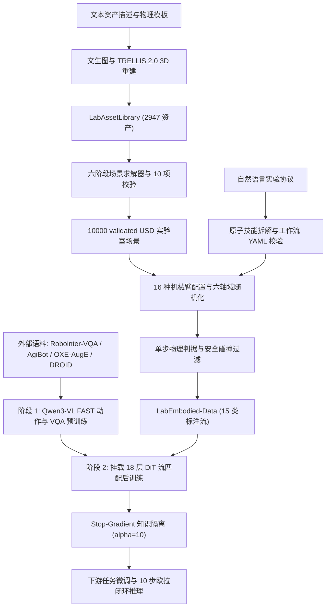
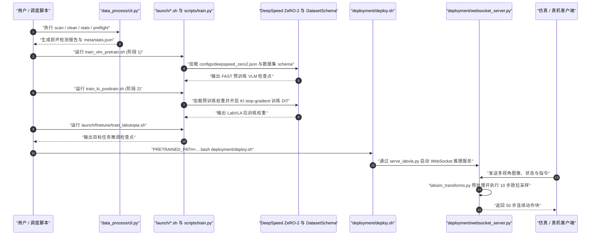

# LabVLA: Grounding Vision-Language-Action Models in Scientific Laboratories

## 一句话定义

LabVLA 面向科学实验室操作场景，通过自建仿真工作流引擎 **RoboGenesis** 合成带结构化流程标注的跨本体数据 **LabEmbodied-Data**，并以「FAST 离散动作预训练 + 知识隔离（KI）流匹配后训练」两阶段配方训练一个约 5B 参数的视觉-语言-动作策略。

## 英文缩写速查

| 缩写 | 英文全称 | 简要说明 |
|---|---|---|
| VLA | Vision-Language-Action | 将视觉观测、自然语言指令与机器人动作联合建模的策略范式 |
| DiT | Diffusion Transformer | 本文用于以流匹配生成 50 步连续动作块的 18 层动作专家网络 |
| FAST | Frequency-space Action Sequence Tokenization | 第一阶段用于将连续动作压缩为离散 token 对齐 VLM 前缀的编码器 |
| KI | Knowledge Insulation | 后训练阶段在 VLM 与动作专家间施加梯度截断以保护语言/视觉锚定的机制 |
| ID / OOD | In-Distribution / Out-of-Distribution | 分别指遵循训练分布与存在物体位姿、外观或场景扰动的评测设定 |
| FLCE | Fused Linear Cross-Entropy | 基于 Liger-Kernel 的融合线性交叉熵算子，避免物化完整词汇表 logits 张量 |

## 为什么重要

1. **填补科学实验室的具身数据缺口**：Open X-Embodiment、DROID、BridgeData V2 等公开机器人语料几乎不包含移液器、离心机、加热板、透明液体容器及固定实验协议（protocol）长程序列，通用桌面策略难以直接落地实验台。
2. **用可编程仿真引擎替代高危真机采集**：真机采集实验操作需昂贵仪器、领域监管与严格安全规范；RoboGenesis 将环境构建、原子技能编排、六轴域随机化与成功过滤解耦，为实验室操作提供可扩展的多本体监督。
3. **验证预训练动作语义与梯度隔离的有效性**：针对通用 VLM 直接接流匹配头不稳定的问题，LabVLA 系统化采用「先 FAST 动作 token 预训练、后带 stop-gradient 的 DiT 流匹配后训练」路线，并公开了完整的分布式训练与显存优化工程细节。

## 核心信息

| 字段 | 内容 |
|---|---|
| 作者 | Baochang Ren, Xinjie Liu, Xi Chen, Yanshuo Liu, Chenxi Li, Daqi Gao, Zeqin Su, Jintao Xing, Zirui Xue, Rui Li, Xiangyu Zhao, Shuofei Qiao†, Minting Pan, Wangmeng Zuo, Lei Bai, Dongzhan Zhou†, Ningyu Zhang†, Huajun Chen |
| 机构 | Zhejiang University（浙江大学）、Shanghai AI Laboratory（上海人工智能实验室）、Harbin Institute of Technology（哈尔滨工业大学） |
| 发表时间 | 2026-06-11 提交 v1，2026-06-15 修订 v2（arXiv 预印本，Work in progress） |
| 论文链接 | [arXiv:2606.13578](https://arxiv.org/abs/2606.13578) · [arXiv HTML v2](https://arxiv.org/html/2606.13578) |
| 项目与代码 | [官方项目页](https://zjunlp.github.io/LabVLA/) · [GitHub 仓库（MIT）](https://github.com/zjunlp/LabVLA) · [Hugging Face 模型](https://huggingface.co/zjunlp/LabVLA) |
| 清单分类 | `harness.monitoring_and_recovery`（来源条目 `survey_ax_2606_13578`） |
| 开源状态 | 部分开源：策略训练、微调、数据清洗与 WebSocket 部署代码及 HF 权重已发布；RoboGenesis 引擎与 LabEmbodied-Data 尚待发布（*coming soon*） |

## 核心原理

LabVLA 由数据端的 **RoboGenesis / LabEmbodied-Data** 与策略端的 **两阶段跨本体 VLA 训练配方** 两部分构成。

### 1. RoboGenesis 可编程数据引擎

1. **环境与资产构建**：使用结构化商品摄影提示词调用文生图 API，经 TRELLIS 2.0 重建 3D 网格、可选 MeshAnythingV2 减面并附带碰撞体与 URDF 物理参数，形成 **2,947** 个带物理标注的 **LabAssetLibrary**（项目页细分为 16 大类、288 细分类）；液体容器使用带颜色与填充率代理网格并在倒液成功时完成体积转移。配合 **1,000+** 材质贴图库与六阶段贪心几何求解器（强制 10 项布局与碰撞校验，0–100 质量评分），批量生成 **10,000** 个可执行 USD 实验室场景。
2. **智能体工作流生成与域随机化**：将机械臂配置（覆盖 Franka Panda、FR3、UR 系列、Piper、Rizon4、Festo、ARX X5/R5、Split ALOHA、Lift2、FR3 Duo 及移动底盘变体等 16 种平台）与协议模板解耦。通过原子技能库（`pick`、`place`、`pour`、`stir`、`shake`、`move`、`press`、`pressZ`、`open`、`close` 及导航技能）将自然语言指令分解为有序 YAML 工作流，经离线可达性与冲突校验（>20 步复合工作流采集成功率 >75%）后，再施加场景、杂物、相机、同类资产、光照 HDRI、空间位姿六轴域随机化及指令改写。
3. **LabEmbodied-Data 结构化导出**：单步物理成功检查器结合接触安全监控器剔除违禁碰撞失败回合，仅导出成功轨迹，并附带 **15 类结构化标注流**（机器人状态、相机内外参、步骤起止帧、子指令对齐、物体状态码、空间关系、语义、成功判据解释、碰撞事件、时序分段、子目标、质量评分、干预标志与元数据）。

### 2. LabVLA 策略架构与两阶段训练

- **网络结构与跨本体批格式**：视觉语言主干采用 **Qwen3-VL-4B-Instruct**（$d_{\mathrm{vlm}}=2560$），将最多 $V$ 路 $224\times 224$ RGB 观测 $I_t^{1:V}$ 与语言指令 $\ell$ 编码为前缀隐状态 $H_\phi = f_\phi(I_t^{1:V}, \ell) \in \mathbb{R}^{L_h \times d_{\mathrm{vlm}}}$；独立的 **18 层 DiT 动作专家**（宽度 1024、8 头、每头 128 维）通过线性投影 $\Pi(H_\phi)$ 交叉注意条件化，预测 $K=50$ 步连续动作块 $A_t^r \in \mathbb{R}^{K \times d_r}$。所有本体的状态与动作统一填充至 $d_{\max}=32$，通过掩码 $M^{\mathrm{act}} \in \{0,1\}^{K \times d_{\max}}$ 仅对有效动作维与有效帧计算损失（防止 8-DoF 单臂在 32 维均值下梯度被隐式缩小 $4\times$）。
- **阶段 1：FAST 离散动作 VLM 预训练**：不实例化 DiT，将归一化并裁剪至 $[-1,1]$ 的连续状态按 256 个均匀分箱序列化为文本前置到指令中构成 $c_t$，连续动作经 FAST 编码为离散 token $z_{1:L_z}$，序列 $X_{\mathrm{pre}} = [v_t; c_t; y_t; z_{1:L_z}]$ 在 Robointer-VQA、AgiBot World Beta、OXE-AugE（LeRobot 子集约 572k 轨迹）与 DROID 上以掩码交叉熵联合训练：
  $$\mathcal{L}_{\mathrm{VLM}} = \mathcal{L}_{\mathrm{FAST}} + \sum_j \lambda_j \mathcal{L}_{\mathrm{CE}}^{(j)}$$
- **阶段 2：流匹配后训练与知识隔离（KI）**：联合 OXE-AugE 与 LabEmbodied-Data 接入 DiT，在时间采样 $\tilde{\tau}\sim\mathrm{Beta}(1.0,1.5)$、$\tau=0.999\tilde{\tau}$ 下构建插值轨迹 $X_\tau = \tau \widetilde{A}_t^r + (1-\tau)\epsilon$ 与目标速度场 $U_\tau = \widetilde{A}_t^r - \epsilon$，用活跃维度均值 MSE 计算 $\mathcal{L}_{\mathrm{FM}}$。引入学习状态 token $s_t = e_q(q_t^r)$ 并对 VLM 前缀切片施加 stop-gradient：$\widetilde{H}_{\phi,p}^{\mathrm{KI}} = \mathrm{sg}(\mathrm{slice}_p(f_\phi(X_{\mathrm{KI}})))$，联合目标为 $\mathcal{L}_{\mathrm{KI}} = \alpha \mathcal{L}_{\mathrm{FM}} + \mathcal{L}_{\mathrm{FAST}} + \sum_j \lambda_j \mathcal{L}_{\mathrm{CE}}^{(j)}$（$\alpha=10$），保证速度空间梯度不破坏 VLM 的语言与仪器视觉表征。
- **下游微调与快速推理**：后训练预测绝对动作，LabUtopia 下游微调切换为 delta 动作目标（代码支持按维度配置 `delta_mask`）；推理时仅前向计算一次 $H_\phi$，经 $N=10$ 步欧拉积分即可输出 50 步连续动作块并按当前机器人自由度切片。

## 流程总览

## 源码运行时序图

官方仓库 `zjunlp/LabVLA` 的运行链路分为**数据清洗校验**（`python -m data_process`）、**三阶段分布式训练**（`launch/` 脚本经 Accelerate + DeepSpeed ZeRO-2 调用 `scripts/train.py`）与**WebSocket 推理部署**（`deployment/deploy.sh` 启动 `serve_labvla.py` 与 `websocket_server.py`）。以下时序图依据仓库 `README.md` 及快照 `files_sample` 的真实脚本与模块入口绘制（静态核对，未本地运行）：

## 实验与评测

论文在 **LabUtopia 仿真基准**、**外部策略数据迁移测试** 与 **Franka 真机台面实验** 三套体系中评测，关键实测数值如下（均引自原文 Table 2–4 及 Appendix B）：

### 1. LabUtopia 六任务评测（Table 2，每任务每设定 120 回合，成功率 %）

| 方法 | 参数规模 | 分布设定 | Pick Up | Press Button | Open Door | Pour Liquid | Heat Beaker | Transport Beaker | 平均成功率 |
|---|---|---|---|---|---|---|---|---|---|
| SmolVLA | <1B | ID / OOD | 15.8 / 11.7 | 97.5 / 99.2 | 16.7 / 18.3 | 0.8 / 1.67 | 96.7 / 98.3 | 85.8 / 89.2 | 52.2 / 53.1 |
| X-VLA | <1B | ID / OOD | 27.5 / 27.5 | 98.3 / 99.2 | 65.0 / 59.2 | 45.0 / 25.0 | 25.8 / 39.2 | 83.3 / 67.5 | 57.5 / 52.9 |
| GR00T N1.5 | 3B | ID / OOD | 40.8 / 33.3 | 99.2 / 92.5 | 6.7 / 8.3 | 0 / 0 | 99.2 / 99.2 | 69.2 / 66.7 | 52.5 / 50.0 |
| $\pi_0$ | 3B | ID / OOD | 21.7 / 19.2 | 92.5 / 89.1 | 51.6 / 53.3 | 37.5 / 38.3 | 90.0 / 90.8 | 86.7 / 88.3 | 63.3 / 63.2 |
| $\pi_{0.5}$ | 3B | ID / OOD | 38.3 / 30.0 | 60.0 / 68.3 | 55.8 / 59.2 | 29.2 / 29.2 | 40.8 / 40.0 | 90.0 / 85.8 | 52.4 / 52.1 |
| $\pi_0$-FAST | 3B | ID / OOD | 16.7 / 14.2 | 37.5 / 45.0 | 17.5 / 15.8 | 5.8 / 7.5 | 3.3 / 11.7 | 20.8 / 24.2 | 16.9 / 19.7 |
| InternVLA-A1 | 3B | ID / OOD | 25.8 / 19.2 | 93.3 / 95.8 | 38.3 / 63.3 | 2.50 / 0.83 | 82.5 / 84.2 | 67.5 / 57.5 | 51.7 / 53.5 |
| Wall-oss-flow | 4B | ID / OOD | 11.7 / 7.50 | 54.2 / 61.7 | 0.83 / 0 | 0 / 0 | 0 / 0 | 29.2 / 26.7 | 16.0 / 16.0 |
| **LabVLA（本文）** | **5B** | **ID / OOD** | **49.2 / 48.3** | **100 / 98.3** | **65.0 / 65.8** | **43.3 / 34.2** | **83.3 / 87.5** | **85.8 / 85.8** | **71.1 / 70.0** |

### 2. LabEmbodied-Data 对外部策略的可迁移性（Table 3，去除近饱和的 Press Button）

将小规模基线 X-VLA（<1B）在 LabEmbodied-Data 上微调后，五任务平均成功率从 **49.3% → 64.3%**（ID，**+15.0 pp**）与 **43.7% → 63.0%**（OOD，**+19.3 pp**）；其中接触密集型任务收益最大，如 Heat Beaker ID 由 25.8% 升至 68.3%，Pour Liquid OOD 由 25.0% 升至 65.0%。

### 3. 真机 Franka 实验与热启动消融（Table 4，Appendix B）

- **真机评测（4 任务 × 50 演示 × $5\times 5\text{ cm}$ 区域，每条件 50 回合）**：在 Shake Liquid（3 步）、Pour Liquid（3 步）、Magnetic Stir（3 步）与 Funnel Plug/Unplug（4 步）上，LabVLA 平均成功率在 In-domain Clean/Cluttered 为 **86.5% / 80.0%**，Out-of-domain Clean/Cluttered 为 **80.0% / 74.0%**；其中 OOD Clean 领先 DreamZero（78.0%）与 $\pi_{0.5}$（77.0%），Cluttered 设定下略低于 DreamZero（81.0% / 75.5%），两者整体处于同一梯队并均优于 $\pi_{0.5}$（71.5% OOD Cluttered）。
- **后训练底座数据规模影响（Appendix B）**：相同微调配方下，扩大后训练阶段数据多样性与真实抓握接触覆盖后，TransportBeaker 120 回合成功率从 **60%** 提升至 **86%**。

## 与其他工作对比

1. **对比通用合成仿真与数据引擎（Table 1）**：RoboTwin 2.0（5 平台）、RoboCasa 365（1 平台）、ManiSkill 3（23 平台）、RLBench（5 平台）与 RoboGen（6 平台）均未同时打通自动 3D 资产生成、智能体场景/任务编排、原子技能长程组合与实验室协议级 15 类结构化标注；RoboGenesis 在 16 个机器人平台上补齐了从资产到长程协议导出的完整链路。
2. **对比主流 VLA 基线（Table 2 & §6.1）**：不同于在家庭桌面语料上直接训练的 $\pi_0$、$\pi_{0.5}$、SmolVLA、GR00T N1.5 与 InternVLA-A1（部分基线在单个简单任务达 98% 以上但在 Pour Liquid 上接近 0%），LabVLA 依靠实验室协议分布与知识隔离训练，在保持 ID→OOD 仅 1.1 pp 降幅的同时取得更均衡的多任务表现；但在精密倾倒（Pour Liquid）上仍低于 50%。

## 结论

**一句话总判：LabVLA 证明了「协议级结构化仿真数据 + 知识隔离两阶段流匹配训练」可将通用 VLM 稳定迁移至多步骤实验室操作，但目前仍停留在固定协议执行层，距离精密仪器与闭环科学决策尚有距离。**

1. **数据分布与热启动底座优先于微调架构调参**：LabEmbodied-Data 可将外部模型 X-VLA 的五任务均值提升 15.0–19.3 pp，且后训练底座数据质量提升直接把 TransportBeaker 成功率从 60% 拉升至 86%。
2. **知识隔离与动作维度掩码是跨本体训练的必需工程护栏**：stop-gradient 防止流匹配损失冲刷 VLM 语义锚定，而按有效动作维而非 32 维填充张量求均值避免了单臂 $4\times$ 隐式梯度衰减。
3. **显存与 I/O 优化决定大 batch 吞吐上限**：在 80 GB A100 上实现单卡 batch 64 依赖仅对 LM 做梯度检查点、Liger FLCE（省约 10 GB）、1D 因果掩码（避免 SDPA 4D 掩码带来的约 30% 减速）及共享 PyAV LRU 缓存限流（降 55% worker RSS）。
4. **倒液等连续物理反馈任务仍是核心短板**：所有评测策略在仿真 Pour Liquid 上均未突破 50%，缺乏液位与力触觉反馈是主要瓶颈。

## 工程实践

1. **训练与系统配置（Appendix A & C）**：三阶段均采用 $224\times 224$ 输入、$K=50$ 动作步长、$d_{\max}=32$ 填充上限、AdamW 优化器、FlashAttention-2 与 DeepSpeed ZeRO-2。预训练用 24×A100（global BS=1536，100k 步，VLM LR $5\times 10^{-5}$）；KI 后训练用 16×A100（global BS=1024，80k 步，VLM LR $10^{-5}$，DiT LR $10^{-4}$）；微调阶段用 4×A100（global BS=192，80k 步，LR $5\times 10^{-5}$）。
2. **仓库数据预处理门禁**：启动训练前需通过 `python -m data_process` 依次运行 `scan` → `clean` → `stats` → `preflight`，并严格通过 `DatasetSchema` 指定单臂/双臂的 `delta_mask`（如臂关节增量、夹爪绝对位置）与归一化统计量。
3. **Host 内存防泄漏**：多数据流并发解码 MP4 时，需配合全局共享 PyAV LRU 缓存（上限 256）、`MALLOC_ARENA_MAX=2` 与周期性 `malloc_trim(0)`，否则 glibc 线程 arena 碎片化会导致 DataLoader worker 常驻内存攀升至约 42 GB。

## 局限与风险

1. **仅达「技术员（Level 2）」能力层级**：在作者提出的四级实验室能力金字塔（L1 学徒 → L2 技术员 → L3 专家 → L4 科学家）中，LabVLA 仅能执行固定多步协议，尚不具备移液器/离心机/热循环仪等精密仪器操作与安全计量（L3）及根据实验观测动态修改方案（L4）的能力。
2. **数据引擎与语料尚未公开**：当前 GitHub 仅开放策略训练、微调与推理部署代码，RoboGenesis 场景/工作流引擎及 LabEmbodied-Data 仍在整理中，外部团队尚无法直接复现合成数据流水线。
3. **缺少真实化学安全与故障自解释闭环**：真机验证仅在单台 Franka 平台完成 4 项常规台面流体/搅拌操作，未涉及真实危化试剂、硬件漂移、交叉污染控制以及与人类实验员的故障自报协同。

## 关联页面

- [Agentic Robots 综述](paper-towards-agentic-robots-survey.md)
- [全量项目节点清单](../overview/awesome-agentic-robots-node-index.md)
- [VLA 方法背景](../methods/vla.md)
- [机器人智能体执行框架](../methods/robot-agent-harness.md)：对照规划、执行接口与反馈机制。
- [pi0 策略](../methods/pi0-policy.md)：对照 FAST 离散动作与流匹配双阶段动作专家设计。
- [动作块预测（Action Chunking）](../methods/action-chunking.md)：50 步连续动作块输出与时序平滑机制。
- [机器人仿真场景生成](../methods/robot-simulation-scene-generation.md)：对照 RoboGenesis 资产重建与自动布景流程。
- [机器人学习数据流水线](../methods/robot-learning-data-pipelines.md)：多源异构语料混合、清洗与结构化标注范式。
- [机器人操作任务（Manipulation）](../tasks/manipulation.md)：实验台面精细抓取、倒液与仪器交互挑战。

## 推荐继续阅读

- [LabVLA 官方项目主页](https://zjunlp.github.io/LabVLA/) — 查看 RoboGenesis 资产类别统计、六轴域随机化交互演示及真机执行视频。
- [LabVLA 官方 GitHub 仓库](https://github.com/zjunlp/LabVLA) — 查阅 `data_process` 清洗校验器、三阶段训练启动脚本与 WebSocket 部署代码。
- [LabVLA Hugging Face 模型页](https://huggingface.co/zjunlp/LabVLA) — 获取开源预训练权重与推理说明。

## 参考来源

- [LabVLA 论文全文核对归档（arXiv:2606.13578v2）](../../sources/papers/paper-agentic-2606-13578.md)
- [zjunlp/LabVLA 官方代码仓库核对归档](../../sources/repos/paper-agentic-2606-13578.md)
- [官方 Awesome 快照归档](../../sources/repos/awesome-agentic-robots-survey-index.md)
- [论文原始入口（arXiv:2606.13578）](https://arxiv.org/abs/2606.13578)
