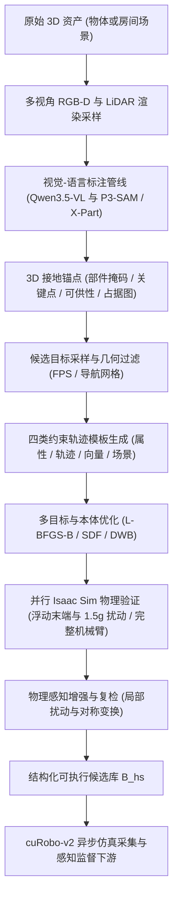

# AnnotateAnything: Automatic Annotation of 3D Assets for Robot Manipulation

## 一句话定义

**AnnotateAnything** 是一种面向机器人操作的通用 3D 资产自动标注框架，通过视觉-语言先验接地与大规模并行物理仿真验证，将缺乏交互知识的原始物体与房间级 3D 资产自动转化为包含多粒度语义描述、3D 视觉锚点及可执行多解动作候选库的操控就绪（manipulation-ready）资产。

## 英文缩写速查

| 缩写 | 英文全称 | 简要说明 |
|---|---|---|
| VLM | Vision-Language Model | 视觉-语言模型，本文采用 Qwen3.5-VL 推理物体语义、功能可供性与场景布局 |
| FPS | Farthest Point Sampling | 最远点采样，用于点云下采样与表面/导航网格候选锚点均匀采样 |
| SDF | Signed Distance Field | 有符号距离场，本文以 5 mm 分辨率构建物体 SDF 用于灵巧手接触与避碰优化 |
| IK | Inverse Kinematics | 逆运动学，用于下游完整本体在仿真采集阶段的目标集（goal-set）求解与回退检索 |
| DWB | Dynamic Window-based Local Planner | 动态窗口法局部轨迹优化器，用于在 A* 粗路径基础上满足底盘动力学与可达性约束 |
| BEV | Bird's-Eye View | 鸟瞰图，用于表达房间级多高度占据栅格、可通行区域与交互就绪底盘位姿 |

## 为什么重要

1. **打通“几何资产”到“可操作资产”的瓶颈：** 现有 3D 资产库（如 Objaverse、ShapeNet、PartNet-Mobility 等）虽然几何与外观丰富，但普遍缺少“哪里能抓、哪个部件可动、沿什么轴插入或悬挂”等交互知识；手工标注成本高且多样性受限，RL 探索则依赖繁琐奖励设计且易产生违背人类先验的动作。
2. **用一到多候选库替代单一启发式标签：** 针对同一资产与锚点保留多种接触模式、接近方向与轨迹族，使下游策略与数据采集系统能在域随机化或本体切换时自动检索可执行备选解。
3. **跨资产族与跨本体的统一接口：** 在同一套视觉-语言-物理框架下覆盖刚体、铰接体、柔性衣物与房间级导航场景，输出可直接驱动二指夹爪、灵巧手、双臂及移动操作机器人（含人形机器人）的原子技能参数。

## 核心信息

| 字段 | 内容 |
|---|---|
| 作者 | Haoran Lu, Mutian Shen, Shuyang Yu, Yu Xiao, Songling Liu, Jianshu Zhang, Shang Wu, Yue Chen, Guo Ye, Jiayi Wang, Zhaoran Wang, Han Liu |
| 机构 | Northwestern University、中国科学院自动化研究所（CASIA）、中国科学院大学（UCAS）、北京大学（PKU） |
| 发表时间 | 2026-06-16 提交 arXiv v1，2026-08-30 修订 v2（NeurIPS 2026 匿名投稿展示） |
| 论文链接 | [arXiv:2606.17446](https://arxiv.org/abs/2606.17446) / [arXiv HTML v2](https://arxiv.org/html/2606.17446) |
| 项目与代码 | [项目页](https://tourmaline-caramel-169490.netlify.app)（标注 Code Coming Soon） |
| 清单分类 | `data.annotation`（来源条目：`survey_ax_2606_17446`） |
| 开源状态 | 宣称将开源或未列链接（匿名补充材料含代码与演示资产，公开代码与基准计划后续发布） |

## 核心原理

AnnotateAnything 将自动标注拆分为两条互补流水线，再通过可执行的原子技能接口接入下游仿真数据采集与感知训练：

### 1. 层级视觉-语言标注管线（Hierarchical Visual-Language Pipeline）

- **物体级语义与 3D 接地：**
  - 围绕物体轴对齐包围盒渲染 8 视角归一化 RGB 与 RGB-D 图像。通过 `Qwen3.5-VL` 生成三层描述（短语标签、功能句、部件级操作段落），并对高亮分割部件逐一生成结构化 JSON。
  - 将 8 视角深度图反投影融合为点云 $\mathcal{P}_{cam}$，用网格参考点检查覆盖度 $\mathrm{Cov}(\mathcal{P}_{cam}, \mathcal{P}_{mesh})$ 与体素重叠 $\mathrm{IoU}_{roi}$，不足时补充视角；随后经 FPS 下采样至 80,000 点 $\mathcal{P}_{80k}$，利用基于 P3-SAM 与 X-Part 的 182M 参数 Hunyuan3D 原生 3D 部件分割模型（约 30 s/物体）提取部件掩码，再由 VLM 锚定关键点与可供性区域。
- **房间级结构与跨层级对齐：**
  - 按墙体多边形分解房间，贪心挑选最大化新覆盖实例数的相机/LiDAR 位姿，发射多高度水平射线构建多层占据栅格 $\mathcal{G}_j$（以 log-odds 聚合空闲与占据概率），拼接全局地图并调用 VLM 过滤可移动家具以保留永久墙体与门框结构。
  - 对房间内物体实例独立进行物体级标注后通过全局位姿变换回世界坐标系，并以共享实例 ID 对齐语言描述与几何锚点；解析失败或无法绑定有效分割 ID 的输出会被直接拒绝（3,240 次查询中过滤 94 个可检测失败项，占比 2.9%）。

### 2. 物理动作标注管线（Physics-based Action Pipeline）

- **统一候选库 Schema：**
  将视觉锚点集合 $\mathcal{H}(\mathcal{A}) = \mathcal{P}(\mathcal{A}) \cup \mathcal{K}(\mathcal{A}) \cup \mathcal{R}^{\mathrm{aff}}(\mathcal{A}) \cup \mathcal{R}^{\mathrm{scene}}(\mathcal{A})$ 映射到功能可供性 $\phi(h)$ 与兼容技能集 $\mathcal{S}(h)$，并为每对 $(h, s)$ 维护多候选库：
  $$\mathcal{B}_{h,s} = \left\{a_{h,s}^{(i)} = \left(s, o(h), h, \phi(h), x^{(i)}, \theta^{(i)}, \tau^{(i)}, v^{(i)}, d^{(i)}\right)\right\}_{i=1}^{N_{h,s}}$$
  其中记录交互目标 $x^{(i)}$、技能参数 $\theta^{(i)}$、路点轨迹 $\tau^{(i)}$、验证元数据 $v^{(i)}$ 与多样性描述 $d^{(i)}$。
- **候选生成与四类轨迹模板：**
  根据语言/视觉接地筛选技能兼容区域 $\mathcal{C}_s(\mathcal{A})$ 并经 FPS/关键点/导航网格采样过滤，随后按约束来源实例化模板轨迹 $\tau_0^{(i)}$：
  1. **物体属性条件（Object-property）：** 平行夹爪抓取（pre-grasp / grasp / close / retreat）、灵巧手与衣物关键点对称折叠/甩平（fling）模板；
  2. **物体轨迹条件（Object-trajectory）：** 从 USD 关节提取旋转/平移轴，生成沿关节行程 70% 目标位姿 $\Delta q^\star$ 追踪运动部件的开合/推拉路点；
  3. **物体向量条件（Object-vector）：** 配对主动端与被动端框架，对齐插入方向或挂钩重力受力方向；
  4. **场景轨迹条件（Scene-trajectory）：** 经射线-AABB 求交构造物体外法向交互就绪底盘位姿 $q=(x,y,\psi)$，以 A* 生成粗路径。
- **多目标优化、并行物理验证与增强：**
  - **优化：** 对灵巧手在 5 mm 分辨率 SDF 上以 L-BFGS-B（最多 140 次迭代）优化手腕位姿与手指关节的多阶段目标（间隙、目标点投影、法向对齐、力闭合对向、防自碰/防穿模与先验正则）；对衣物按关键点尺度自适应调整幅度；对导航路径以 DWB 结合底座动力学与末端工作空间可达性局部优化。
  - **验证：** 在 Headless Isaac Sim 中批量并行验证。物体中心技能先用浮动末端执行器过滤，并对抓取采样 $K=8$ 组 $1.5g_0$ 随机方向重力扰动（平行爪提升 $\ge 0.95\text{ m}$ 判通过，灵巧手抬升 $0.3\text{ m}$ 掉落 $\le 2\text{ cm}$ 判通过）；强本体依赖的衣物折叠与绕障技能直接用完整机械臂验证。
  - **增强：** 在同一功能区域内施加局部有界扰动，并结合对称群 $\mathcal{G}_{\mathrm{sym}}(o)$ 做一致性刚体变换（如绕瓶身旋转抓取，而不将杯柄抓取旋转到杯身），增强后必须复过几何与物理检查。

### 3. 大规模数据采集与感知复用

- 基于生成的候选库构建异步并行仿真采集系统：在位姿、光照、材质与布局域随机化下，利用 `cuRobo-v2` 求解目标集 IK 与避障运动规划；若首位候选因场景碰撞不可行，则顺位回退尝试候选库中后续候选，并剔除反复失败的候选条目。
- 同一视觉-语言-动作标注可直接导出为 3D 部件分割、可供性、关键点监督，以及运行时轨迹级机器人推理 VQA 和 3D VLM 指令微调数据。

## 流程总览

## 源码运行时序图

**不适用**（经核查项目页 [tourmaline-caramel-169490.netlify.app](https://tourmaline-caramel-169490.netlify.app) 及论文 Appendix J.5，项目页当前标注 `Code Coming Soon`，代码与演示资产仅随匿名投稿补充材料提交并计划后续公开发布，截至 2026-11-27 尚未公开独立可克隆的官方代码仓库；解析脚本提取的 `benelot/pybullet-gym` 为论文相关工作引用的第三方仿真环境，非本论文官方实现）。

## 实验与评测

### 1. 规模覆盖与转换漏斗（§5.2, Appendix H.2）

- **全量资产池：** 共处理来自 9 个来源族（Objaverse 5,000、ShapeNet 4,500、OmniObject3D 3,038、PartNet-Mobility 800、PhysX-Mobility 1,294、GarmentLab 1,500、ClothesNet 667、AgentWorld 114、GRScenes 92）的 **17,005** 个有效资产，涵盖 18 个原子技能，产出 **100M** 条物理验证动作实例（含验证后的局部扰动与对称增强变体）。
- **审计评测集（1,160 资产 / 3,698 有效资产-技能对）：** 平均每对生成 2,315 个原始候选 → 1,384 通过几何检查（59.8%）→ 842 通过 IK/轨迹检查（36.4%）→ 615 通过物理验证（26.6%）→ 538 保留进候选库（23.2%）。独立采样多样性统计显示，Grasp / DexGrasp / Articulation 每资产中位候选簇分别为 176 / 153 / 21 个。

### 2. 视觉-语言标注质量（360 人工参考集，Table 2）

| 方法 | 语义得分 | 3D 接地 | 覆盖度 | 可行动性 | 综合人类评分 | Part | Affordance | Keypoint |
|---|---|---|---|---|---|---|---|---|
| Direct VLM | 84.2 ± 1.1 | 61.5 ± 1.9 | 68.7 ± 1.7 | 64.1 ± 1.8 | 69.6 ± 1.4 | 72.8 | 68.5 | 70.2 |
| Aff.-only + heur. | 76.8 ± 1.5 | 70.2 ± 1.8 | 73.1 ± 1.6 | 67.5 ± 1.7 | 71.9 ± 1.4 | 70.5 | 79.3 | 68.8 |
| w/o 3D refine | 87.5 ± 0.9 | 73.4 ± 1.6 | 77.8 ± 1.4 | 75.2 ± 1.5 | 78.5 ± 1.2 | 82.6 | 78.1 | 80.8 |
| **Ours (完整框架)** | **93.1 ± 0.6** | **89.4 ± 0.8** | **90.2 ± 0.7** | **91.0 ± 0.8** | **90.9 ± 0.6** | **91.5** | **89.0** | **90.3** |

- 相比最强消融 `w/o 3D refine`，综合人类评分提升 **+12.4** 分（95% 置信区间 `[9.8, 15.0]`）；接口级校验在部件区域（IoU ≥ 0.5）达 87.4%（944/1,080）、可供性区域达 84.8%（687/810）、关键点 PCK@0.05 达 90.3%。

### 3. 物理动作标注与仿真采集消融（Table 3, Appendix H.4/H.8）

| 配置 / 技能族 | Pass / Ready (%) | Exec. (%) | Ann./min | Ann. Human | Data Succ. (%) | Traj./h | Att./Succ. | Traj. Human |
|---|---|---|---|---|---|---|---|---|
| No annotation / random | – | – | – | – | 24.0 | 55 | 4.17 | 51.8 ± 2.1 |
| Geometry-only | 28.1 / 58.5 | 58.4 | 150 | 61.5 ± 1.8 | 48.2 | 90 | 2.07 | 60.8 ± 1.7 |
| VL-only | 31.7 / 65.0 | 67.5 | 130 | 70.2 ± 1.5 | 61.8 | 115 | 1.62 | 69.4 ± 1.5 |
| w/o phys. validation | 27.0 / 74.0 | 63.2 | 350 | 65.4 ± 1.6 | 57.6 | 110 | 1.74 | 65.5 ± 1.6 |
| **Ours full (宏平均)** | **40.6 / 87.4** | **91.9** | **198** | **85.6 ± 1.0** | **86.0** | **165** | **1.17** | **85.5 ± 1.0** |

- **浮动手到完整人形机器人审计（DexGrasp，520 对）：** 浮动手验证通过 2,278/5,200 候选（43.8%），就绪 461/520 对（88.7%）；部署至完整 G1–Dex3-1 上时，首位候选执行成功率为 87.2%（402/461），启用候选库回退机制后提升至 **93.9%**（433/461）。

### 4. 下游监督复用与真机零样本迁移（§4.2, §5.5, Table 5）

- **感知监督替换（固定下游管线仅替换输入监督）：** PartNeXt 上 SAMPart3D 为 43.9 vs 参考监督 46.70 mIoU；LASO 上为 40.7/54.1 vs 43.6/57.2 mIoU/F1；KeypointNet（Airplane/Chair）上 Skeleton Merger 为 74.5/73.6 vs 77.7/76.8 DAS，表明可用且与人工参考差距温和。
- **真机零样本迁移（纯仿真数据微调 $\pi_{0.5}$，每配置 1,000 条仿真轨迹，Franka 夹爪 + XHand）：**
  - Grasp：**93.0%**（186/200）
  - DexGrasp：**77.0%**（154/200）
  - Insertion：**70.0%**（28/40）
  - Open Drawer：**82.5%**（33/40）
  - Close Lid：**88.3%**（53/60）
  - Long-horizon Pick-and-Place（5 物体序列）：**61.0%**（61/100）

## 与其他工作对比

1. **同协议 DexGrasp 对比（vs. BODex）：** 在相同的 Dex3-1 灵巧手、520 个审计资产-技能对、每对 10 候选、浮动手验证器及 G1 完整机械臂执行协议下，AnnotateAnything 的 Pass / Ready / Exec. 为 **43.8% / 88.7% / 93.9%**，优于 BODex 的 **40.1% / 84.8% / 90.2%**。
2. **框架适配外部基线对比（Table 4，将各方法输出转换至统一候选接口与验证协议）：**
   - **Grasp 范围：** `ManiTwin-adapted` 为 Pass/Ready 55.8/82.6%、Exec. 87.4%、Data Succ. 74.0%（95 Ann./min）；AnnotateAnything 匹配行达 **60.3/96.4%、98.1%、90.5%**（800 Ann./min）。
   - **Grasp + Articulation：** `RoboGen-adapted` 为 22.5/45.2%、54.8%、39.5%；匹配行达 **51.0/93.0%、95.7%、89.6%**。
   - **Grasp + Articulation + Nav.：** `MolmoBot-adapted` 为 29.4/58.0%、64.1%、53.5%；匹配行达 **53.5/93.4%、95.9%、89.7%**。
   - **Grasp + Articulation + Insertion：** `GenManip-adapted` 为 27.8/55.4%、61.5%、50.2%；匹配行达 **45.0/90.0%、93.5%、87.8%**。
   - *注：* 论文明确说明 InternData-A1、RoboTwin 2.0、GenieSim 3.0 等定位为预训练数据集或端到端任务生成平台，未提供逐资产统一标注接口；上述适配器对比反映统一接口转换后的估算结果。

## 结论

**一句话总判：AnnotateAnything 通过“VLM 语义-3D 锚点接地 + 大规模并行物理验证与候选库回退”范式，系统性解决了 raw 3D 资产缺乏跨技能、跨本体可执行交互标注的规模化瓶颈。**

1. **采用“候选库（Candidate Bank）”而非单一最优标签：** 对高自由度、多解或域随机化场景，保留经物理验证的多姿态/多接触候选并在执行期按 IK 代价回退，可将 G1 灵巧抓取完整执行率从 87.2% 提升至 93.9%。
2. **语义先验与物理验证缺一不可：** 仅靠几何采样在可操作性与人类合理性上偏弱（Exec. 58.4%），仅靠 VLM 锚点缺乏物理可执行保证（Exec. 67.5%），两者串联并经随机重力扰动过滤后执行率跃升至 91.9%。
3. **优先作为通用数据引擎上游，而非替代任务规划器：** 其最大工程价值在于把异构静态资产库批量转化为原子技能可消费资产，但下游微调仍需结合域随机化与目标本体运动规划（如 `cuRobo-v2`）。
4. **关注公开代码与资产许可边界：** 当前代码与全量派生包仍处于投稿后待发布状态，且受 ShapeNet、PartNet-Mobility、GarmentLab 等上游许可限制，实际复用需通过官方源映射自行获取原始网格。

## 工程实践

- **硬件与吞吐参考（Appendix J.2）：** 视觉-语言标注阶段运行在 NVIDIA RTX A6000（48 GB 显存），单物体 3D 部件分割约耗时 30 秒；物理验证与并行仿真采集运行在 Headless Isaac Sim + NVIDIA RTX 4090（24 GB 显存）集群上，由 CPU 工作节点负责资产加载与异步调度。
- **失败早期终止与分层验证：** 物理验证遇到穿模、掉物、失联、任务停滞或关节越界即早停，显著降低高成本柔性/灵巧手候选的筛选开销；常规刚体先用浮动末端解耦手臂构型，再在采集期由完整本体做 goal-set IK 过滤。
- **资产预处理门槛：** 导入力学引擎前必须剔除坏损网格、单位/坐标系异常、无效碰撞体及错误关节限位资产；此外论文未执行跨数据源几何去重，混用 Objaverse 与 ShapeNet 时需注意潜在近似重复资产。

## 局限与风险

1. **上游 VLM 与分割粒度瓶颈：** 当目标部件被严重遮挡、材质高反光或原生 3D 分割粒度过粗（如将高脚酒杯整体分为单一部件而未分离杯口/杯柄/底座）时，视觉先验质量会下降；结构化校验仅能捕获 2.9% 的格式与 ID 绑定错误，无法消除所有语义误判。
2. **柔性体与复杂场景较弱：** 相比刚体（Ready 96.4% for Grasp），柔性/衣物（Deformable Ready 78.9%、Exec. 84.1%）与小尺寸精密接触场景的成功率仍明显偏低，且容易在仿真中出现缠绕或过拉伸。
3. **仿真通过不等于真机可靠：** 碰撞网格近似、静/动摩擦系数设定（如平行爪验证设为 2.0）与实际接触动力学存在差距；且本文真机实验未设置同等物理基线对照，仅证明零样本 sim2real 可行性而非超越其他真机方案。
4. **开源与许可合规风险：** 截至 2026-11-27 官方代码仓库尚未开放；多源资产衍生标注的再分发受原数据集非商用或禁止再分发条款约束。

## 关联页面

- [Agentic Robots 综述](paper-towards-agentic-robots-survey.md)
- [全量项目节点清单](../overview/awesome-agentic-robots-node-index.md)
- [VLA 方法背景](../methods/vla.md)
- [自动标注管线](../methods/auto-labeling-pipelines.md)
- [机器人学习数据管线](../methods/robot-learning-data-pipelines.md)
- [机器人仿真场景生成](../methods/robot-simulation-scene-generation.md)
- [抓取位姿估计](../methods/grasp-pose-estimation.md)
- [机器人操作](../tasks/manipulation.md)
- [双臂操作](../tasks/bimanual-manipulation.md)
- [移动操作](../tasks/loco-manipulation.md)

## 推荐继续阅读

- [AnnotateAnything arXiv HTML v2 全文](https://arxiv.org/html/2606.17446)
- [AnnotateAnything 官方匿名项目页](https://tourmaline-caramel-169490.netlify.app)
- [arXiv:2606.17446 摘要页](https://arxiv.org/abs/2606.17446)

## 参考来源

- [AnnotateAnything 论文原文核对归档](../../sources/papers/paper-agentic-2606-17446.md)
- [官方 Awesome 快照归档](../../sources/repos/awesome-agentic-robots-survey-index.md)
- [arXiv:2606.17446](https://arxiv.org/abs/2606.17446)
- [AnnotateAnything 项目页](https://tourmaline-caramel-169490.netlify.app)
