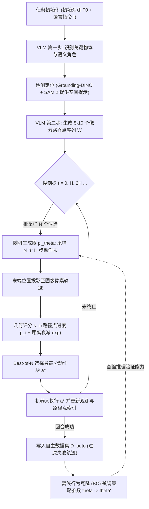
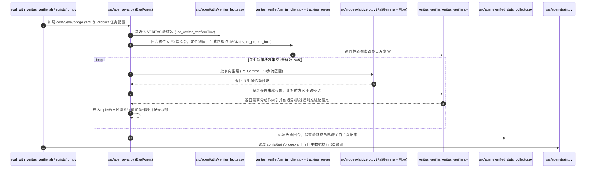

# Visual Verification Enables Inference-time Steering and Autonomous Policy Improvement

## 一句话定义

**VERITAS**（Visual Verification for Inference-time Steering and Autonomous Policy Improvement）是一个面向通用机器人策略的“生成器-验证器”框架：在推理阶段将预训练生成式策略作为随机动作块生成器、配以无梯度视觉验证器执行 Best-of-$N$ 动作优选，并将验证通过的成功轨迹回流为离线行为克隆（BC）数据，在无需人工介入的前提下同时实现即插即用的测试时性能提升与自主策略持续进化。

## 英文缩写速查

| 缩写 | 英文全称 | 简要说明 |
|---|---|---|
| VERITAS | Visual Verification for Inference-time Steering and Autonomous Policy Improvement | 本文提出的视觉验证推理引导与自主策略改进框架 |
| VLA | Vision-Language-Action | 视觉-语言-动作模型，本文以 $\pi_0$ 与 $\pi_{0.5}$ 作为动作块生成器底座 |
| VLM | Vision-Language Model | 视觉-语言模型，本文在回合初调用 Gemini 2.5 生成像素路径点或相对物体约束 |
| EEF | End-Effector | 机械臂末端执行器，VERITAS 将候选动作块的预测 EEF 位置投影至图像平面打分 |
| BC | Behavior Cloning | 行为克隆，用于 Phase 2 将验证通过的自主成功轨迹蒸馏回原策略权重 |
| POMDP | Partially Observable Markov Decision Process | 部分可观测马尔可夫决策过程，本文用于形式化语言引导的桌面操作问题 |

## 为什么重要

1. **以推理计算换取机器人策略表现（Test-Time Scaling）：** 机器人遥操作真机数据采集成本随人力线性增长，而预训练生成式 VLA 策略本身蕴含多模态动作先验。VERITAS 证明无需更新模型权重或训练额外具身推理模型，仅在推理时采样 $N$ 组短时域动作块并用视觉验证器筛选，即可在仿真与真机上直接提升任务成功率。
2. **用自主数据飞轮缓解模仿学习分布偏移（Covariate Shift）：** 传统 DAgger / HG-DAgger 需要人类专家在线纠正并标注状态。VERITAS 将视觉验证器作为自动化“过滤专家”，只保留验证成功的机器人自采轨迹 $\mathcal{D}_{\text{auto}}$；由于数据完全来自策略自身的运动学可达先验，天然处于 on-policy 分布内，微调数据效率在多项真机任务上可比肩甚至局部超越人类遥操作数据。
3. **一次性 VLM 规划 + 毫秒级在线几何验证：** 相比每步或逐帧高频调用大模型或依赖世界模型前向滚动的方案，VERITAS 主验证器仅在回合开始查询一次 VLM 生成静态像素轨迹，运行期简化为 $<1\text{ ms}$ 的图像空间几何一致性打分，可在单卡 RTX 5090 上以 $N=5$ 维持 15 Hz 闭环控制。

## 核心信息

| 字段 | 内容或状态 |
|---|---|
| 作者 | Mingtong Zhang, Dhruv Shah |
| 机构 | 普林斯顿大学（Princeton University） |
| 发表时间 | arXiv v1 提交于 2026-06-16；项目页与官方代码库标注为 RSS 2026 |
| 论文链接 | [arXiv:2606.18247 (HTML v1)](https://arxiv.org/html/2606.18247) / [arXiv 摘要页](https://arxiv.org/abs/2606.18247) |
| 项目与代码 | [官方项目主页 (veritas-improvement.github.io)](https://veritas-improvement.github.io) / [官方 GitHub 仓库 (princeton-prism/veritas)](https://github.com/princeton-prism/veritas) |
| 清单分类 | `model.adaptation` |
| 来源条目 | `survey_ax_2606_18247` |
| 开源状态 | 已开源（MIT 许可证；发布基于 `open-pi-zero` 的 $\pi_0$ 实现、SimplerEnv WidowX 评测管线、三种视觉验证器、成功轨迹采集器及离线微调脚本；需外部下载 PaliGemma、Grounded-SAM-2、Bridge 权重并配置 `GEMINI_API_KEY`） |

## 核心原理

### 1. 问题建模与随机生成器（§3, §4.1）

将语言引导的桌面操作建模为 POMDP $(\mathcal{S}, \mathcal{O}, \mathcal{A}, \mathcal{T}, \mathcal{R}, \gamma)$。在决策步 $t$，给定当前观测 $o_t$ 与自然语言指令 $l$，采用流匹配（flow-matching）或扩散训练的通用策略 $\pi_\theta$（论文以 $\pi_0$ 为核心实例，含 PaliGemma 主干与 10 步流匹配动作专家）建模多模态动作块分布 $p(\bm{a}_{t:t+H} \mid o_t, l)$。部署时不再贪心/确定性解码，而是并行采样 $N$ 个长度为 $H$ 的候选动作块：

$$\bm{a}_{t:t+H}^{(i)} \sim \pi_\theta(\cdot \mid o_t, l), \quad i \in \{1, \dots, N\}$$

作者指出，在**动作块（action chunk）**而非单步动作尺度上进行采样，既能把验证成本摊销到 $H$ 步，也能让验证器看到足够的时间上下文以判断子任务意图与物理合理性。

### 2. 无梯度视觉验证器与三种实现变体（§4.2, §5.1, §8.1）

定义即插即用、无需反向传播的标量评分函数 $V(o_t, \bm{a}_{t:t+H}, l) \in \mathbb{R}$。论文设计并消融了三种视觉验证器：

1. **VERITAS 主验证器（静态绝对像素轨迹，Algorithm 2）：**
   - **回合初两步 VLM 轨迹生成：** 仅在 $t=0$ 观测 $F_0$（$o_0$）与指令 $\mathcal{I}$ 下调用 Gemini 2.5：第一步识别任务相关物体与语义角色（`source`、`target`），并用检测模型（代码使用 Grounded-SAM-2）定位图像框与中心作为空间线索；第二步据此输出 $K \in [5, 10]$ 个绝对像素路径点 $\mathcal{W} = \{w_1, \dots, w_K\}$（起止点不可跳过），每点包含坐标 `uv: [u, v]`、容忍半径 `tol_px`、最短驻留帧数 `min_hold`、可否跳过 `skippable` 与权重 `weight`。
   - **在线几何评分：** 将每个候选动作块预测的末端执行器（EEF）轨迹投影到图像平面 $\{e_t\}$，计算到当前激活路径点的像素欧氏距离 $d_t = \|e_t - \mathcal{W}[i].uv\|$。当 $d_t < \text{tol}_i$ 且持续 $\ge \text{min\_hold}$ 帧（代码同时实现迟滞驻留、transit-skip 与 stalled-skip）时推进索引 $i \leftarrow i+1$，进度 $p_t = i / |\mathcal{W}|$，最终归一化分数为：
     $$s_t = \alpha p_t + (1 - \alpha)\exp(-d_t / \tau)$$
     （当 $i \ge |\mathcal{W}|$ 时取 $s_t = 1.0$；论文第 5.1 节亦简述以负欧氏距离衡量候选投影轨迹与最近路径段的一致性）。
2. **VLM-Constraints 验证器（相对物体引用 + 动态追踪，Algorithm 3）：** 回合初 VLM 仅输出追踪物体集合 $\mathcal{O}$ 与相对引用路径点（如 `role:source`、`role:target`、`object:<name>`、`midpoint(refA,refB)`），运行期每帧通过目标追踪器更新像素坐标 $g_i$ 并按物体尺度归一化距离 $d_t = \|e_t - g_i\| / \text{scale}(g_i)$，从而适应物体移动与部分遮挡。
3. **Heuristic 验证器（7 阶段有限状态机，Algorithms 4 & 5）：** 由 VLM Router 确定任务类型与追踪目标后，基于 EEF–物体距离、相对运动与夹爪开合等平滑几何特征，驱动 `APPROACH -> ALIGN -> ENGAGE -> MANIPULATE -> RELEASE -> SETTLE -> DONE` 状态机并计算进度分，停滞时可选触发 VLM 故障诊断。

### 3. Best-of-$N$ 推理时引导与离线自改进飞轮（§4.3–§4.4, Algorithm 1）

- **Phase 1（在线推理引导）：** 每隔 $H$ 步并行采样 $N$ 个候选，计算 $v_i = V(o_t, \bm{a}_{t:t+H}^{(i)}, l)$，选择 $i^\star = \arg\max_i v_i$ 并执行 $\bm{a}_{t:t+H}^\star$。VLM 不在控制闭环中运行，RTX 5090 上 $N=5$ 时以 15 Hz 实时运行，几何评分耗时 $<1\text{ ms}$。
- **Phase 2（离线自主改进）：** 收集验证器引导下最终成功完成任务的轨迹 $\mathcal{D}_{\text{auto}} = \bigcup_k \{(o_t, \bm{a}_{t:t+H}^\star, l)\}_{t \in \mathcal{I}_{\text{success}}}$，通过标准监督行为克隆（BC）微调基础策略参数：
  $$\theta' \leftarrow \arg\min_\theta \mathbb{E}_{\mathcal{D}_{\text{auto}}}\!\left[-\log \pi_\theta(\bm{a}_{t:t+H}^\star \mid o_t, l)\right]$$
  将原本耗费测试时采样算力的引导能力蒸馏进策略权重 $\pi_{\theta'}$，形成部署经验反哺策略的闭环飞轮。

## 流程总览

## 源码运行时序图

以下时序图依据官方仓库 [princeton-prism/veritas](https://github.com/princeton-prism/veritas) 中的一键评测脚本 `eval_with_veritas_verifier.sh`、代理入口 `src/agent/eval.py`（`EvalAgent`）、验证器工厂 `src/agent/utils/verifier_factory.py`、主验证器 `src/agent/veritas_verifier/veritas_verifier.py`、`src/model/vla/pizero.py`、采集器 `src/agent/verified_data_collector.py` 与训练入口 `src/agent/train.py` 编写：

关键复现入口：在配置 `GEMINI_API_KEY` 与模型权重后，运行 `bash eval_with_veritas_verifier.sh` 即可对 4 项 SimplerEnv WidowX 任务各跑 240 回合并输出 `.mp4` 轨迹视频；单个最小化基线验证可直接实例化 `src/agent/eval.py` 中的 `EvalAgent` 并传入 `config/eval/bridge.yaml`。

## 实验与评测

### 1. 推理时引导增益（§6.2, Fig. 4 & Fig. 6）

实验覆盖 **3 种基础策略**（仿真 $\pi_0$-Bridge；真机 DROID 平台 $\pi_0$-DROID、$\pi_{0.5}$-DROID）与总计 **1,160 个评估回合**：

- **SimplerEnv 仿真（4 项 WidowX 任务，每任务 24 变体 × 10 次试验 = 240 回合）：** 任务包括 `widowx_put_eggplant_in_basket`、`widowx_stack_cube`（Stack Blocks）、`widowx_carrot_on_plate` 与 `widowx_spoon_on_towel`。在不更新任何策略权重的情况下，VERITAS 推理时引导使平均成功率相对原始策略提升 **+12.6%**，其中难度最高的 `Stack Blocks` 增幅最大；且论文对比的三种验证器（VERITAS、VLM+Constraints、Heuristic）在仿真均值上均优于基于离线 RL 价值函数的 **V-GPS**。
- **真机 FR3-DROID 平台（2 种策略 × 2 项任务 × 50 次试验）：** 涵盖 `Pick up the mouse and place it into the green bowl`、`Insert the marker into the mug`、`Put the carrot on the plate` 与 `Put the tape into the wooden box`。VERITAS 推理时引导平均带来 **+35%** 成功率提升，全任务一致超越 **V-GPS-DROID**，而仅依赖简单动作原语的 **PIVOT** 基线在真机任务中未能取得有效成功。

### 2. 离线自主策略改进与人类数据效率对比（§6.3–§6.4, Fig. 5 & Fig. 7）

| 实验场景与设置 | 数据来源与规模 | 关键评测结果 |
|---|---|---|
| **SimplerEnv 仿真微调（$\pi_0$-Bridge，960 回合）** | 收集 **656** 条验证器引导成功轨迹 | 平均成功率相对原始 $\pi_0$-Bridge 提升 **+9.7%**；最难任务 `Stack Blocks` 由 **31.3%** 升至 **59.2%**（**+27.9%**） |
| **真机 `Pick up mouse`（20 次评估/点）** | 对比 20/30/50/100 条自主 vs. 人类示范 | 20–50 条区间自主数据持续高于人类数据；**50 条**处自主达 **0.65** vs. 人类 **0.60** |
| **真机 `Carrot on plate`（20 次评估/点）** | 对比 20/30/50/100 条自主 vs. 人类示范 | §6.4 正文报告 **50 条**处自主达 **0.70** vs. 人类 **0.65**；**100 条**时两者成功率收敛一致 |
| **真机 `Insert marker`（20 次评估/点）** | 对比 20/30/50/100 条自主 vs. 人类示范 | 在 20–100 条全部数据预算下，自主数据与人类遥操作差距均在 **5 个百分点**以内 |

### 3. 超参数敏感性与单步扰动对比（§6.5, Appendix §9, Fig. 8–10）

- **候选样本数 $N$：** 成功率随 $N$ 增大而上升，但在 **$N > 8$ 后趋于饱和**，而推理计算量随 $N$ 线性增长，因此实验中默认采用 $N = 5$。
- **开环动作执行步数 $H$：** 在 $\pi_0$-DROID 真机上扫描至多 10 步开环执行未见显著性能退化，真机默认 $H = 8$ 步（仿真 $\pi_0$-Bridge 为 $H = 4$ 步）。
- **对比 RoboMonkey（Appendix §9, 50 回合/任务，3 随机种子）：** RoboMonkey 在单步动作上施加高斯局部扰动并用离线数据拟合的验证器打分，容易强化策略原有局部偏差且无法比较高层语义路径；VERITAS 需在动作块尺度运行才能发挥多轨迹优选优势（在强制退化为单步扰动的实验设置下表现出现分化）。

## 与其他工作对比

| 对比维度 | DAgger / HG-DAgger | V-GPS（离线 RL 价值引导） | RoboMonkey | PIVOT | **VERITAS（本文）** |
|---|---|---|---|---|---|
| 监督 / 引导信号来源 | 人类专家在线重标注与接管 | 在目标数据集上训练语言条件价值函数 | 在离线数据分布上训练单步动作验证器 | VLM 迭代视觉提示 + 朴素动作原语 | 预训练策略先验 + 回合初 VLM 像素路径点（无梯度） |
| 验证时间尺度 | 单步 / 片段人工纠偏 | 单步或动作块价值评估 | 单步局部高斯微扰 | 离散视觉迭代动作原语 | **短时域动作块（$H=4\sim 8$ 步）** |
| 推理时额外依赖 | 需要人类在场 | 需针对特定数据分布训练价值网络 | 需训练验证器且受限局部动作邻域 | 缺乏强动作先验，真机难成功 | 仅回合初调用 1 次 VLM，在线计算 $<1\text{ ms}$ |
| 持久化策略改进 | 通过人工纠偏集重训 | 原生仅作推理期引导 | 原生聚焦推理期采样缩放 | 无持久化策略权重改进 | 回收成功轨迹做 BC 微调，蒸馏验证推理进入权重 |

## 结论

**一句话总判：VERITAS 证明在通用流匹配 VLA 策略之上叠加“回合初 VLM 像素轨迹 + 动作块级 Best-of-$N$ 几何验证”，无需训练专用推理模型即可即时抬升真机与仿真成功率，并能将成功轨迹闭环蒸馏为与人类遥操作效率相当的自主自改进数据集。**

1. **优先在动作块（Chunk）而非单步层级做测试时筛选** — 当策略不确定或面对困难任务（如 `Stack Blocks`）时，动作块采样能产生语义可分的多模态候选，从而显著放大验证器收益（反之在基线已高成功率的简单任务上增益有限）。
2. **用“回合初静态路径点 + 在线几何投影”替代逐帧 VLM 查询** — 将 Gemini 2.5 调用移出 15 Hz 控制循环，既保有 VLM 的空间常识规划，又将单步验证开销压低至 `< 1 ms`，兼顾真机实时性与推理算力成本。
3. **部署经验可直接作为低偏移微调语料** — 只保留验证通过的成功轨迹做监督 BC 微调（如 $\text{LR}=5\times 10^{-5}$），即可在 20–100 条规模下把高昂的多样本采样优势固化进模型权重，降低后续部署对大 $N$ 的依赖。
4. **真机部署需显式配置低遮挡校验视角** — 除策略自身使用的腕部相机和第三视角外，论文在 DROID 平台上额外架设标定正视相机以提供稳定、少遮挡的像素空间校验平面。

## 工程实践

- **环境与权重准备（基于 `princeton-prism/veritas` 静态核对）：**
  1. 递归克隆仓库（`git clone --recursive` 以拉取 `Grounded-SAM-2` 子模块），使用 `uv sync` 安装依赖（默认针对 CUDA 13，其他 CUDA 版本需在 `pyproject.toml` 调整 PyTorch 版本）。
  2. 下载 PaliGemma（`google/paligemma-3b-pt-224`）、Grounded-SAM-2（运行 `Grounded-SAM-2/checkpoints/download_ckpts.sh`）以及 `allenzren/open-pi-zero` 提供的 Bridge 检查点（`bridge_uniform_step19296_2024-12-26_22-31_42.pt`）。
- **微调参考超参数（Tables 1 & 2, §5.3）：**
  - **$\pi_0$-Bridge（仿真）：** 学习率 $5\times 10^{-5}$，全局 batch size 1024（单卡 16），weight decay 0，max grad norm 1.0，开环步数 $H=4$。
  - **$\pi_0$-DROID（真机）：** 学习率 $5\times 10^{-5}$，batch size 256，warmup 1000 步，LR decay 1,000,000 步，总训练 20,000 步，开环步数 $H=8$。
- **工程权衡：** 采样数建议取 $N \in [5, 8]$（$N > 8$ 收益饱和但延迟与显存随 $N$ 线性增加）；若场景中目标物体频繁大幅移动或被遮挡，可从静态 `veritas_verifier` 切换至基于在线目标追踪的 `vlm_constraints_verifier`。

## 局限与风险

1. **静态视觉路径点对高动态场景脆弱：** 主验证器在 $t=0$ 一次性生成的绝对像素轨迹假定工作空间准静态；若环境在执行途中发生剧烈变化、外力扰动或物体大幅位移，静态像素路径点将失配（需退回成本更高的动态追踪变体）。
2. **天花板受限于基础策略的探索先验：** Best-of-$N$ 只能在策略 $\pi_\theta$ 本身能采样出的候选中择优；若某项任务或技能完全落在预训练策略先验支撑集之外，验证器无法凭空构造正确动作。
3. **推理延迟与算力线性扩展：** 虽然验证耗时 $< 1\text{ ms}$，但生成器需并行采样 $N$ 组流匹配动作块，计算负载随 $N$ 线性放大，对超低延迟控制场景仍有约束。
4. **验证器错判与相机标定依赖：** 离线自改进假设验证器筛选出的 $\mathcal{D}_{\text{auto}}$ 为真实成功轨迹，且真机方案依赖额外标定的正视相机保证末端投影精度；若相机外参漂移或视觉轨迹误判失败轨迹为成功，将引入自训练噪声。

## 关联页面

- [Agentic Robots 综述](paper-towards-agentic-robots-survey.md)
- [全量项目节点清单](../overview/awesome-agentic-robots-node-index.md)
- [VLA 方法背景](../methods/vla.md)
- [机器人智能体执行框架](../methods/robot-agent-harness.md)：对照规划、执行接口与反馈机制。
- [π₀ 通用机器人策略](../methods/pi0-policy.md)：本文在仿真与真机实验中采用的核心流匹配 VLA 生成器底座。
- [动作块预测（Action Chunking）](../methods/action-chunking.md)：本文在短时域动作块而非单步动作尺度执行采样的基础机制。
- [行为克隆（Behavior Cloning）](../methods/behavior-cloning.md)：VERITAS 第二阶段将验证轨迹蒸馏回策略权重的训练目标。
- [模仿学习（Imitation Learning）](../methods/imitation-learning.md)：对照传统静态离线模仿学习与分布偏移问题。
- [DAgger 交互式模仿学习](../methods/dagger.md)：对照以人类在线纠偏缓解分布偏移的经典范式。
- [智能体规划与反馈执行](../methods/agent-planning-feedback.md)：对照推理期验证信号与闭环动作选择机制。
- [机器人操作任务](../tasks/manipulation.md)：SimplerEnv WidowX 与 DROID 桌面操作评测语境。

## 推荐继续阅读

- [VERITAS 官方项目主页](https://veritas-improvement.github.io)
- [VERITAS 官方 GitHub 仓库 (princeton-prism/veritas)](https://github.com/princeton-prism/veritas)
- [arXiv:2606.18247 HTML 全文](https://arxiv.org/html/2606.18247)

## 参考来源

- [论文原文核查归档](../../sources/papers/paper-agentic-2606-18247.md)
- [官方代码库静态核查归档](../../sources/repos/paper-agentic-2606-18247.md)
- [官方 Awesome 快照归档](../../sources/repos/awesome-agentic-robots-survey-index.md)
- [arXiv:2606.18247 原文](https://arxiv.org/abs/2606.18247)
- [官方项目主页 (veritas-improvement.github.io)](https://veritas-improvement.github.io)
- [官方 GitHub 仓库 (princeton-prism/veritas)](https://github.com/princeton-prism/veritas)
