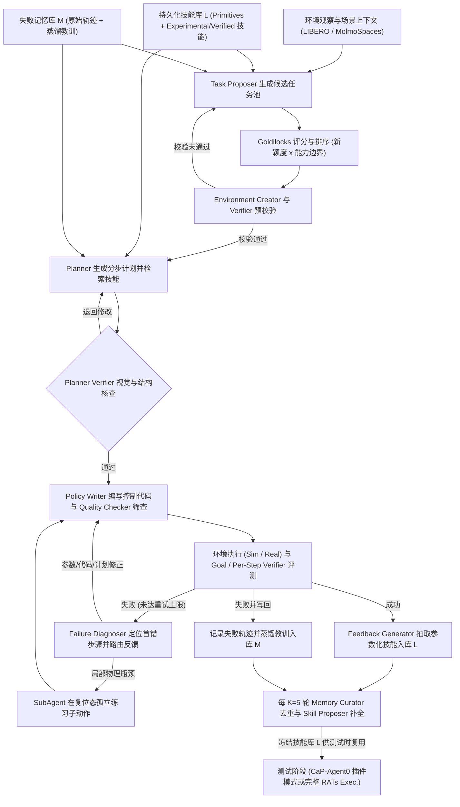
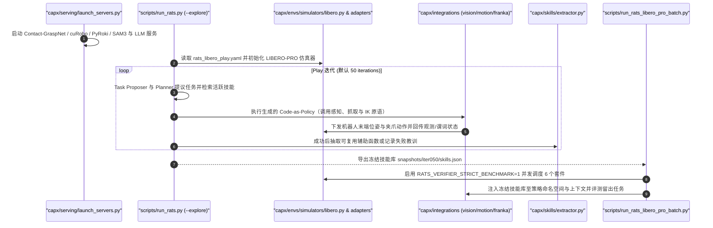

# Playful Agentic Robot Learning

## 一句话定义

**Playful Agentic Robot Learning** 研究具身代码智能体如何在收到外部下游任务之前，通过无外部奖励的“自主玩耍（Self-Directed Play）”持续积累可复用控制代码技能；其核心系统 **RATs（Robotics Agent Teams）** 由任务提议、执行验证与记忆管理三大协作智能体团队构成，将交互经验蒸馏为持久化 Python 技能库并实现免微调的跨任务、跨环境迁移。

## 英文缩写速查

| 缩写 | 英文全称 | 简要说明 |
|---|---|---|
| RATs | Robotics Agent Teams | 本文提出的面向玩耍期持续技能获取的多智能体 Code-as-Policy 系统 |
| CaP | Code-as-Policy | 代码即策略范式，由语言/多模态模型生成调用感知与控制原语的 Python 程序 |
| BDDL | Behavior Description Definition Language | LIBERO 仿真环境中用于形式化定义场景对象、初始区域与目标谓词的描述语言 |
| OBB | Oriented Bounding Box | 定向包围盒，本文中多个习得感知/抓取技能依据三维点云 OBB 中心与尺度规划位姿 |
| VLM | Vision-Language Model | 视觉语言模型，在 RATs 中承担规划验证、逐步视觉核查与失败诊断等角色 |
| VLA | Vision-Language-Action | 端到端视觉-语言-动作策略模型，文中对比基线包含 OpenVLA、$\pi_0$ 与 $\pi_{0.5}$ |

## 为什么重要

1. **将机器人代码智能体从“被动响应指令”推进到“主动玩耍预学习”：** 现有 Code-as-Policy 系统（如 CaP-X 中的 `CaP-Agent0`）多在收到具体外部任务后才生成并调试程序，技能积累只是解题副产品；RATs 在无外部指令阶段提前投入计算进行物理交互探索，把经验固化为可检出的代码工具。
2. **用密集的步骤级反馈破解稀疏任务奖励难题：** 仅凭任务级成败无法定位是规划违背物理前提、代码 API 误用还是底层抓取偏心；RATs 通过规划校验、代码静态筛查、逐步视觉验证、失败诊断与 SubAgent 孤立试错，把失败转化为可执行的局部参数修正或结构化记忆教训。
3. **验证“玩耍期 Token 投入”比“测试时盲目加轮次”更具性价比：** 在等 Token 算力对照实验中，将玩耍期约 30M tokens 均摊为测试时更多重试轮次（10 轮增至 15 轮）仅将 `CaP-Agent0` 从 23.2% 提至 26.0%，而把预算用于玩耍期技能蒸馏再插件化接入 10 轮 `CaP-Agent0` 可达 32.3%，且技能可直接跨越单/双臂仿真器与真机平台。

## 核心信息

| 字段 | 内容 |
|---|---|
| 作者 | Junyi Zhang, Jiaxin Ge, Hanjun Yoo, Letian Fu, Zihan Yang, Yaowei Liu, Raj Saravanan, Shaofeng Yin, Justin Yu, Dantong Niu, Zirui Wang, Roei Herzig, Ken Goldberg, Yutong Bai, David M. Chan, Ion Stoica, Angjoo Kanazawa, Jiahui Lei, Haiwen Feng, Trevor Darrell |
| 机构 | 加州大学伯克利分校（UC Berkeley）、Impossible Research |
| 发表时间 | 2026-06-17（arXiv:2606.19419v1）；CoRL 2026 Spotlight |
| 论文链接 | [arXiv:2606.19419](https://arxiv.org/abs/2606.19419) / [arXiv HTML](https://arxiv.org/html/2606.19419) / [PDF](https://playful-rats.github.io/assets/papers/rats-paper.pdf) |
| 项目与代码 | [项目页](https://playful-rats.github.io/) / [GitHub: Playful-RATs/RATs](https://github.com/Playful-RATs/RATs)（Apache-2.0 协议） |
| 清单分类 | `environment.task_generation, harness.skills` |
| 来源条目 | `survey_ax_2606_19419` |
| 开源状态 | 已开源（含 LIBERO-PRO 玩耍与批量评测脚本、`capx-baseline/` 子模块、MolmoSpaces 桥接与 RoboSuite/Franka 跨环境迁移说明） |

## 核心原理

RATs 将无外部任务指令 $l$ 的玩耍过程形式化为在训练环境 $\mathcal{E}_{\text{play}}$ 上持续迭代更新技能库 $\mathcal{L} = \mathcal{L}_0 \cup \mathcal{L}_{\text{learned}}$ 与失败记忆 $\mathcal{M}$ 的双阶段框架（Algorithm 1），其中 $\mathcal{L}_0$ 为底层感知（`point_prompt_molmo`、`segment_sam3_*`、`vlm_verify`）、抓取规划（`plan_grasp_from_point_clouds`、`select_top_down_grasp`）与运动/夹爪控制原语（`solve_ik`、`goto_pose`、`open_gripper`、`close_gripper` 等）：

1. **Task Proposer Team — 基于 Goldilocks 原则的好奇心任务提议（§3.2, Appendix A.1）：**
   - **候选生成与可达性过滤：** Task Proposer 根据当前场景上下文（LIBERO 为物体/夹具目录，MolmoSpaces 为视觉接地且过滤不可达目标后的物体清单）、技能库紧凑摘要（函数名、描述、可靠性层级与统计，不含源码以节省上下文）及最近 10 轮尝试历史，生成候选探索任务池 $\mathcal{T}_t$。
   - **Goldilocks 评分排序：** 为兼顾新颖性与可学性，使用下式选择目标 $\tau_t$：
     $$s(\tau) = \mathcal{N}(\tau)\cdot\mathcal{F}(\tau) + w_B B_{\mathrm{retry}}(\tau) - w_P P_{\mathrm{fail}}(\tau)$$
     其中 **物体-技能新颖度** $\mathcal{N}(\tau) = \frac{1}{|O(\tau)\times S(\tau)|}\sum_{(o,s)}\frac{1}{\sqrt{N(o,s)+1}}$ 鼓励探索少有尝试的 $(o,s)$ 组合；**能力边界（Competence Frontier）** $\mathcal{F}(\tau) = 4\bar{r}(\tau)\bigl(1-\bar{r}(\tau)\bigr)$ 基于所需技能经验成功率的 Wilson 下界均值 $\bar{r}(\tau)$（避免单次偶然成功被高估），在 $\bar{r}\approx 0.5$ 处取得峰值；同时对匹配近期失败的模式施加重试奖励或惩罚。
   - **环境构建与预校验：** LIBERO 中由 Environment Creator 生成 BDDL 规范并做 1 次有界修复；Environment Verifier 在两个重置随机种子上执行确定性检查（实例渲染、目标谓词求值、无初始穿模）及视觉接地检验，未通过则直接退回提议阶段。

2. **Execution Team — “编写-执行-验证-诊断”闭环（§3.3, Appendix A.2）：**
   - **双阶段规划校验：** Planner 读取任务、初始观测图像、可靠性排序后的技能库（优先展示 `verified`、隐藏 `deprecated`）与经验教训，输出分步计划及预测瓶颈；Planner Verifier 在生成代码前核查四类结构/视觉冲突（视觉误判、前置步骤缺失、步骤顺序颠倒、超出 `object_scope`）。
   - **代码生成与静态质量门：** Policy Writer 结合选中技能和历史重试反馈编写有界循环 Python 策略，Quality Checker 在送入物理仿真前拦截语法错误、未注册 API、`while True` 死循环与不合规结果格式。
   - **多粒度验证、诊断与 SubAgent 孤立练习：** 执行后由 Goal Verifier（优先基于模拟器状态谓词，辅以视觉判定；程序崩溃一律判失败）和 Per-Step Verifier（结合步骤代码切片、关键运行值与前后视觉片段）定位首个失败步骤。Failure Diagnoser 将错误路由为参数级微调（`argument_level`）、重写级修复（`rewrite_needed`）、计划重组，或在单个子动作（如特殊抓取或铰接拉门）连续失败时派生 **SubAgent**：在相同复位状态下并行尝试多种物理策略并输出经视觉验证的局部脚本（需后续端到端成功才可晋升入持久化技能库，防止过拟合污染）。

3. **Memory-Management Team — 三层技能生命周期与周期性策展（§3.4, Appendix A.3）：**
   - **成功抽取与失败提炼：** 回合成功后由 Feedback Generator 最多抽取 2 个完全参数化（禁止硬编码物体名）、带完整类型与数组形状标注的通用函数，经静态依赖与去重检查后以 `experimental` 层级入库；回合失败则写入 $\mathcal{M}$ 并蒸馏为 `WHEN ... | WRONG ... | DO ...` 格式的紧凑教训。
   - **三层可靠性演化：** 技能初始为 `experimental`；累计使用 $\ge 3$ 次且经验成功率 $\ge 0.5$ 晋升为 `verified`（检索优先）；累计使用 $\ge 10$ 次且成功率 $\le 0.2$ 降级为 `deprecated`（默认隐藏）。
   - **周期性维护与前瞻技能提议：** 每 $K=5$ 轮，Memory Curator 对失败教训执行 `MERGE / DELETE / REWRITE / NOOP` 以消除模糊或冗余规则，同时由 Skill Proposer 针对高频物理瓶颈主动草拟纯 Python+NumPy 候选辅助函数进入 `experimental` 接受后续实战检验。

4. **Test-Time Evaluation — 冻结技能库的两类复用方式（§3.5, Appendix A.4）：**
   - 测试阶段关闭 Task Proposer 与 Memory Curator 并冻结 $\mathcal{L}$，支持 **即插即用模式（Plug-and-Play）**——将检索到的技能签名、文档与代码注入标准单智能体 `CaP-Agent0` 命名空间与上下文；以及 **完整 RATs 执行模式（RATs Exec.）**——保留 Planner、多级 Verifier、Failure Diagnoser 与有界重试机制协同调用冻结技能库。

## 流程总览

## 源码运行时序图

以下时序图基于官方仓库 `Playful-RATs/RATs` 的 `README.md` 运行指南与 `capx-baseline/` 已核实文件结构（`scripts/run_rats.py`、`scripts/run_rats_libero_pro_batch.py`、`capx/serving/launch_servers.py`、`capx/envs/`、`capx/integrations/` 与 `capx/skills/extractor.py`），展示“先玩耍蒸馏技能快照、再加载冻结技能库执行批量评测”的完整链路。

复现核心入口分为两步：先激活 `uv` 环境并配置 `~/.libero/config.yaml` 与 `MUJOCO_GL=egl`，通过 `python scripts/run_rats.py --config env_configs/libero/rats_libero_play.yaml --explore --iterations 50 --output-dir outputs/play_libero` 完成玩耍采集，再运行 `RATS_VERIFIER_STRICT_BENCHMARK=1 python scripts/run_rats_libero_pro_batch.py --seed-skill-library outputs/play_libero/snapshots/iter050/skills.json` 在冻结技能库条件下评测 60 个留出任务。

## 实验与评测

### 1. 域内评测：LIBERO-PRO 与 MolmoSpaces（Tables 1–2, §4.2, Appendix D）

- **LIBERO-PRO（Table 1，6 个扰动套件 × 10 任务 × 10 初始状态 = 600 次试验，50 轮 Play）：**

| 方法 | Object Pos | Object Task | Goal Pos | Goal Task | Spatial Pos | Spatial Task | 平均成功率 (%) |
|---|---|---|---|---|---|---|---|
| OpenVLA | 0.0 | 0.0 | 0.0 | 0.0 | 0.0 | 0.0 | 0.0 |
| $\pi_0$ | 0.0 | 0.0 | 0.0 | 0.0 | 0.0 | 0.0 | 0.0 |
| $\pi_{0.5}$ | 17.0 | 1.0 | 38.0 | 0.0 | 20.0 | 1.0 | 12.8 |
| CaP-Agent0 (No Play, $\mathcal{L}_0$) | 27.0 | 31.0 | 29.0 | 16.0 | 13.0 | 23.0 | 23.2 |
| **RATs (Ours)** | **61.0** | **63.0** | **43.0** | **36.0** | **29.0** | **31.0** | **43.8**（**+20.6 pp**） |

- **MolmoSpaces（Table 2，4 类任务 × 10 任务 × 10 试验 = 400 次试验，覆盖 37 栋房屋场景）：**

| 方法 | Open (%) | Close (%) | Pick (%) | Pick-and-Place (%) | 平均成功率 (%) |
|---|---|---|---|---|---|
| CaP-Agent0 | 14.0 | 36.0 | 23.0 | 11.0 | 21.0 |
| **RATs (Ours)** | **20.0** | **73.0** | **37.0** | **22.0** | **38.0**（**+17.0 pp**） |

- **技能调用审计（Appendix C.1–C.2, Table 9）：** MolmoSpaces 50 轮玩耍后技能库由第 10 轮的 6 个增至 27 个（LIBERO 玩耍后共 47 个，Appendix E.4），失败记忆累计 70 条原始记录与 121 条教训。在 400 次评测中 391 次实际调用了学得技能（14/27 个被触发，总计 5,169 次调用，平均 12.9 次/试验）。

### 2. 跨环境与 Sim2Real 迁移（Tables 3 & 8, §4.3, §4.5, Appendix B.1）

将**仅在仿真玩耍阶段学得的冻结技能库**直接注入免训练基线 `CaP-Agent0`（零额外玩耍、零权重微调）：

- **LIBERO-PRO 技能 $\to$ RoboSuite（未见仿真器，每任务 50 次）与真机 Franka（每任务 40 次，Table 3）：**
  - RoboSuite 7 任务平均成功率由 **40.3%**（141/350）提升至 **49.1%**（172/350，**+8.9 pp**）：`Cube lifting` 68.0% $\to$ 84.0%（+16.0 pp）、`Cube restacking` 34.0% $\to$ 46.0%（+12.0 pp）、`Cube stacking` 46.0% $\to$ 60.0%（+14.0 pp）、`Spill wiping` 100.0% $\to$ 100.0%、`Nut assembly` 0.0% $\to$ 0.0%；值得注意的是，源自单臂 LIBERO-PRO 的技能在跨本体双臂协作任务 `Two-arm lifting` 上由 10.0% 跃升至 **34.0%**（**+24.0 pp**，Policy Writer 隐式复用了部件定位、3D 中心估计与侧向夹持几何模式），但 `Two-arm handover` 从 24.0% 微降至 20.0%（-4.0 pp）。
  - 真机桌面任务平均由 **30.0%**（24/80）升至 **38.8%**（31/80，**+8.8 pp**）：`Pick up red cube` 35.0% $\to$ 42.5%（+7.5 pp），`Place cube in bowl` 25.0% $\to$ 35.0%（+10.0 pp）。
- **MolmoSpaces 技能 $\to$ 真机重排与铰接操作（Table 8，每任务 30 次）：** `Swap Cubes` 由 0/30（0.0%）升至 7/30（23.3%），`Close Drawer` 由 2/30（6.7%）升至 8/30（26.7%），平均由 **3.3%** 升至 **25.0%**（**+21.7 pp**）。

### 3. 消融与等算力开销分析（Tables 4, 12, 13, 14）

- **玩耍策略与执行架构分解（Table 4，LIBERO-PRO，RATs Exec. 组每任务 5 次试验）：**
  - `CaP-Agent0` 底座下：No Play 23.2% $\to$ Random Play 24.7% $\to$ **Curious Play 32.3%**，表明随机玩耍增益微弱，Goldilocks 好奇心提议是技能库有效性的关键。
  - `RATs Exec.` 底座下：No Play 36.3% $\to$ Random Play 38.3% $\to$ **Curious Play 44.3%**，验证结构化执行团队与玩耍技能库具有显著互补性（MolmoSpaces 消融 Table 12 呈一致趋势：CaP-Agent0 21.0% $\to$ 25.8%，RATs Exec. 32.8% $\to$ 38.0%）。
- **Token 成本与等算力对比（Tables 13–14，`gpt-5.5`）：** 10 轮 `libero_spatial` 玩耍消耗 5,121,182 tokens，主要集中在 Failure Diagnoser（40.5%，2.07M）、Policy Writer（28.8%，1.47M）与 Failure Memory Distillation（19.4%，0.99M），而 Task Proposer 仅占 1.9%。50 轮玩耍总计约 30M tokens（均摊至 60 个测试任务相当于将 10 轮约 1.6M/任务的 `CaP-Agent0` 预算扩增至 15 轮）；在等算力下，`CaP-Agent0`（15 轮重试）仅达 **26.0%**，显著低于 10 轮 `CaP-Agent0` + RATs 玩耍技能库的 **32.3%**。

## 与其他工作对比

| 方法 / 路线 | 学习时机与驱动信号 | 知识载体与复用方式 | 是否需要梯度微调 | 典型优势与短板 |
|---|---|---|---|---|
| **OpenVLA / $\pi_0$ / $\pi_{0.5}$** | 离线大规模示教监督微调 | 神经网络权重 | 需要 | 高频端到端控制，但在 LIBERO-PRO 位置/任务扰动下严重记忆过拟合（平均 0.0%–12.8%） |
| **[CaP-X (`CaP-Agent0`)](paper-agentic-2603-22435.md)** | 收到外部任务指令后推理时探索 | 固定底层原语 $\mathcal{L}_0$ + 少数通用几何工具 + VDM 多轮反馈 | 否 | 泛化优于端到端 VLA（LIBERO-PRO 23.2%），但无主动玩耍期技能积累 |
| **Voyager 等开放域代码智能体** | 虚拟游戏环境中课程式自动探索 | 可执行 JavaScript 技能库 | 否 | 启发了语言课程与技能库思想，但缺少物理仿真接地、子动作孤立练习与步骤级视觉诊断 |
| **LMP / MimicPlay 等物理玩耍方法** | 人类遥操作/无标签玩耍轨迹 | 隐空间计划表征或分层神经策略 | 需要 | 可学习连续运动先验，但表征不可读、难以跨模拟器零样本代码组合 |
| **RATs（本文）** | 下游任务到来前自主玩耍（Goldilocks 好奇心） | 分级 Python 技能库 $\mathcal{L}$ + 紧凑失败教训 $\mathcal{M}$ | 否 | 可解释、可即插即用跨环境迁移（+8.9 至 +21.7 pp），但依赖 VLM 校验与高 Token 开销 |

## 结论

**一句话总判：RATs 证明了在机器人 Code-as-Policy 系统中把计算预算前置到无外部指令的“好奇心玩耍 + 密集步骤级诊断 + 分级技能蒸馏”阶段，比在测试阶段盲目增加重试轮次更有效，且产出的代码技能库无需微调即可跨任务、跨本体与跨真机迁移。**

1. **玩耍必须有“能力边界 + 新颖度”引导与密集诊断**：无方向的 Random Play 在相同 50 轮预算下几乎不涨分（23.2% $\to$ 24.7%），只有结合 Goldilocks 评分与失败诊断才能持续抽出可复用的感知、抓取与铰接抽象。
2. **技能库需要“准入验证 + 可靠性升降级”防污染**：仅在端到端任务成功或 SubAgent 验证后入库，并用 `experimental / verified / deprecated` 三层生命周期与周期性策展（$K=5$）清理噪声，避免劣质函数拖累后续规划。
3. **测试时检索质量决定正/负迁移边界**：在跨环境或无关任务上检索到不适配技能仍会导致退化（如 `Two-arm handover` 下降 4.0 pp、MolmoSpaces `Pick` 在 CaP-Agent0 下由 23.0% 降至 14.0%），工程部署应结合任务族过滤与可靠性阈值门控。
4. **受限于底层原语的物理上限**：当任务需要高精度接触力控制或紧配合插孔（如 RoboSuite `Nut assembly` 仍为 0.0%）时，仅靠上层 Python 技能组合无法突破底层运动/力控原语的物理瓶颈。

## 工程实践

- **玩耍与评测分离部署（见 `Playful-RATs/RATs`）：** 依赖 Python 3.10、`uv`、CUDA GPU 与 EGL 离屏渲染（`MUJOCO_GL=egl`），底层视觉/抓取/IK 模块（SAM3、Molmo、Contact-GraspNet、cuRobo、PyRoki）通过 `capx/serving/launch_servers.py` 以无状态服务端运行；建议先跑 `scripts/run_rats.py --explore --iterations 50` 生成 `skills.json` 快照，再通过 `RATS_VERIFIER_STRICT_BENCHMARK=1` 运行冻结库批量评测。
- **严谨的原语契约防错（Appendix F.2）：** 原文 Policy Writer 与 Skill Proposer 的 Prompt 暴露出关键工程踩坑点——`plan_grasp_from_point_clouds` 严格要求输入 `(K, 3)` 世界系点云、`plan_grasp` 返回相机系位姿需乘以外参 `pose_mat` 转换、禁止在 NumPy 数组上直接做布尔真值判断，且必须禁止生成的技能在 `get_observation()` 未提供相机矩阵时强行投影。
- **预算与重试控制：** 玩耍期大约每 10 轮消耗 5.1M tokens，主要来自重试上限内的 Failure Diagnoser（40.5%）与 Policy Writer（28.8%）；实际工程中应控制单轮最大重试次数（论文设为 5 次）、启用质量静态门控（Quality Checker）提前拦截语法/API 错误，并对重复失败及时触发局部 SubAgent 而不是整段重写。

## 局限与风险

1. **高推理成本与 VLM 验证依赖：** 50 轮玩耍约需 30M tokens，且多级视觉验证与诊断带来显著延迟与 API 成本，难以直接满足高频实时闭环控制场景。
2. **模拟环境多样性和物理真实度约束：** 玩耍阶段能学到的技能范围受限于仿真器资产、物体类型与物理接触动力学（如布料抓取在 MolmoSpaces 桥接配置下直接被禁用），真机规模目前仍属初步验证（每任务 30–40 次试验）。
3. **错误技能检索引发负迁移：** 跨任务或跨仿真器时，若上下文注入了几何假设不匹配的学得技能，可能误导策略生成导致成功率下降。
4. **底层原语表达力天花板：** 系统依赖 `Contact-GraspNet`、`PyRoki` 等预设感知-控制 API，对于精细插配（如 `Nut assembly`）或高维灵巧手连续力控任务仍无能为力。

## 关联页面

- [Agentic Robots 综述](paper-towards-agentic-robots-survey.md)
- [全量项目节点清单](../overview/awesome-agentic-robots-node-index.md)
- [VLA 方法背景](../methods/vla.md)
- [机器人策略学习流程](../methods/robot-policy-learning.md)
- [CaP-X 统一代码智能体框架](paper-agentic-2603-22435.md)
- [LIBERO-PRO 鲁棒评测基准](paper-agentic-2510-03827.md)
- [智能体规划与反馈机制](../methods/agent-planning-feedback.md)
- [智能体技能封装与复用](../methods/agent-skill-packaging.md)
- [智能体式操作策略](../methods/agentic-manipulation-policies.md)
- [代码智能体自检与验证闭环](../methods/coding-agent-verification-loops.md)
- [从玩耍中学习（LMP）](../methods/learning-from-play-lmp.md)
- [机器人智能体脚手架（Harness）](../methods/robot-agent-harness.md)
- [机器人操作任务](../tasks/manipulation.md)
- [双臂协同操作任务](../tasks/bimanual-manipulation.md)
- [自主探索任务](../tasks/autonomous-exploration.md)

## 推荐继续阅读

- [Playful Agentic Robot Learning 官方项目主页](https://playful-rats.github.io/)
- [RATs 官方开源仓库（Playful-RATs/RATs）](https://github.com/Playful-RATs/RATs)
- [Playful Agentic Robot Learning 论文原文（arXiv:2606.19419）](https://arxiv.org/abs/2606.19419)

## 参考来源

- [Playful Agentic Robot Learning 论文全文核对档案](../../sources/papers/paper-agentic-2606-19419.md)
- [Playful-RATs/RATs 官方开源仓库核对档案](../../sources/repos/paper-agentic-2606-19419.md)
- [官方 Awesome 快照归档](../../sources/repos/awesome-agentic-robots-survey-index.md)
- [arXiv 原文（2606.19419v1）](https://arxiv.org/abs/2606.19419)
- [官方项目主页](https://playful-rats.github.io/)
- [官方 GitHub 仓库](https://github.com/Playful-RATs/RATs)
