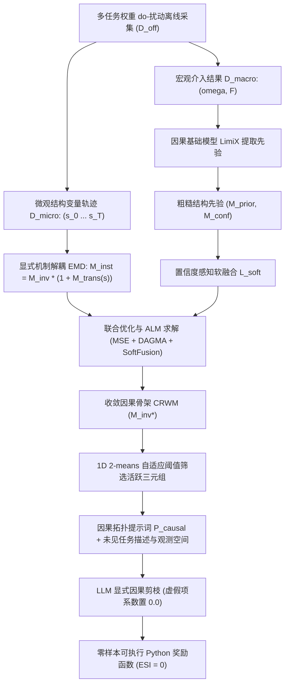

# Causal Reward World Models: Zero-shot Reward Design for Automated Skill Generation

## 一句话定义

**CRWM（Causal Reward World Models）** 是一种面向强化学习自动奖励设计（ARD）的白盒因果世界模型框架：它从多任务离线交互数据中蒸馏出候选奖励分量与任务目标物理变量之间的有向无环因果骨架，作为任务无关先验约束大语言模型（LLM）单次执行因果剪枝，从而在零环境进化迭代（$\text{ESI}=0$）下生成可直接训练的机器人技能奖励函数。

## 英文缩写速查

| 缩写 | 英文全称 | 简要说明 |
|---|---|---|
| CRWM | Causal Reward World Model | 因果奖励世界模型，即蒸馏得到的任务无关因果骨架 $M_{inv}^*$ |
| ARD | Automated Reward Design | 自动奖励设计，利用语言模型自动合成强化学习奖励代码 |
| EMD | Explicit Mechanism Decoupling | 显式机制解耦，分离稳定因果骨架 $M_{inv}$ 与状态相关瞬态交互 $M_{trans}$ |
| SCM | Structural Causal Model | 结构因果模型，以有向拓扑和结构方程形式化变量间因果关系 |
| DAGMA | Directed Acyclic Graphs via M-matrices for Acyclicity | 基于 M 矩阵对数行列式的可微无环图约束方法 |
| ALM | Augmented Lagrangian Method | 增广拉格朗日法，用于求解带无环等式约束的联合优化问题 |
| ESI | Evolutionary Search Iterations | 进化搜索迭代次数，衡量部署期依赖环境反馈的奖励修正轮数 |

## 为什么重要

在机器人技能获取中，传统基于 LLM 的自动奖励设计（如 Eureka、URDP）主要依赖语义相关性提出候选奖励项，并通过「生成—RL 训练—环境评估—反馈变异」的进化循环筛选有效组合。该相关性驱动范式存在两类系统性痛点：
1. **高昂的在线试错成本：** 在高维连续控制（如灵巧手操作）中，每轮进化迭代（ESI）都需并行训练并评估大量策略（论文实验中单轮需 8 张 NVIDIA A800 GPU 运行约 1 小时），且须按任务逐一重复优化。
2. **因果混淆引发训练失效：** LLM 容易引入「语义看似合理但与真实任务成功仅呈虚假相关」的奖励分量，从而触发**优化崩溃（Optimization Collapse）**（如 `ShadowHandLiftUnderarm` 中的瞬时举升速度 `velocity` 带来高频梯度噪声）或**规范博弈（Specification Gaming）**（如 `ShadowHandScissors` 中智能体通过微张剪刀刷 `scissors_open` 分数却不完成剪开目标）。CRWM 通过离线一次性提取物理可复用的因果拓扑，将部署期搜索降为零轮（$\text{ESI}=0$），打通了「一次预训练、跨任务与跨本体零样本推理」的通路。

## 核心信息

| 字段 | 内容 |
|---|---|
| 作者 | Yang Yang, Yuchuang Tong, Zhengtao Zhang, Xu Ding, Ning Yang, Yifan Zhang, Haipeng Li, Kehu Yang, Miao Xin（通信作者） |
| 机构 | 中国科学院自动化研究所（CASIA）；合肥工业大学（HFUT）与安徽大学；中国矿业大学（北京）（致谢 CASBOT 提供机器人平台） |
| 发表时间 | 2026-06-22（arXiv:2606.23280v1） |
| 论文链接 | [arXiv:2606.23280](https://arxiv.org/abs/2606.23280) / [arXiv HTML 全文](https://arxiv.org/html/2606.23280) |
| 项目与代码 | [项目页](https://yy12136.github.io/CRWM)（项目页标注 `Code (coming soon)` 与 `HuggingFace (coming soon)`） |
| 清单分类 | `model.training`（来源条目 `survey_ax_2606_23280`） |
| 开源状态 | 宣称将开源或未列链接（截至 2026-11-27，论文标注审稿后公布代码，未确认公开 GitHub 仓库） |

## 核心原理

CRWM 将自动奖励设计形式化为 MDP $\mathcal{M}=\langle\mathcal{S},\mathcal{A},\mathcal{T}\rangle$ 下的黑盒适应度最大化问题 $r^*=\arg\max_{r\in\mathcal{R}}\mathcal{F}(\pi_{\mathcal{M}}(r))$，并在 $d$ 个归一化的共享物理结构变量 $\mathcal{V}=\{v^1,\dots,v^d\}$ 上构建结构因果模型（SCM）。整个框架分为三个协同阶段：

1. **阶段一：分层介入数据采集与因果基础模型先验提取（IV-A）**
   - **任务无关变量空间对齐：** 从多任务中抽取 $k\in[3,8]$ 个物理奖励分量，通过任务名归一化映射至全局原子奖励分量池（Global Atomic Reward Component Pool，覆盖空间关系、接触、抓取、稳定性、速度、朝向与任务进度等），各任务状态向量零填充对齐到统一的 $s_t\in\mathbb{R}^d$。
   - **双层 $do$-介入采样：** 对奖励分量权重 $\bm{\omega}^{(n)}\in\mathbb{R}^k$ 均匀采样 $N=30$ 组配置并执行 RL 训练，一次采集同时产生宏观数据集 $\mathcal{D}_{macro}=\{(\bm{\omega}^{(n)}, F^{(n)})\}_{n=1}^N$（权重配置与最终适应度分数）和微观轨迹数据集 $\mathcal{D}_{micro}=\{(s_0^{(n)},\dots,s_T^{(n)})\}_{n=1}^N$（丢弃原始观测 $o_t$，仅保留物理结构变量轨迹）。
   - **粗糙先验提取：** 利用预训练因果基础模型 **LimiX** 对 $\mathcal{D}_{macro}$ 估计原始因果效应矩阵 $M_{raw}\in\mathbb{R}^{d\times d}$，构造粗糙拓扑先验 $M_{prior}$ 与归一化置信度矩阵：
     $$M_{conf}^{i,j}=\frac{|M_{raw}^{i,j}|}{\max_{1\le p,q\le d}|M_{raw}^{p,q}|+\epsilon}$$

2. **阶段二：基于联合优化模块的 CRWM 蒸馏（IV-B）**
   由于 $\mathcal{D}_{macro}$ 缺乏物理过程细节，$M_{prior}$ 常含结构幻觉（如误留 `ball_velocity`）或遗漏接触相关边（如 `impact_penalty`）；同时单一静态图无法刻画短暂碰撞等状态相关瞬态交互。为此提出联合优化目标：
   $$\min_{M_{inv},\theta}\mathcal{L}=\mathbb{E}_{(s_{t-1},s_t)\sim\mathcal{D}_{micro}}\big[\mathcal{L}_{MSE}(s_t,M_{inst}(s_{t-1})s_{t-1})\big]+\lambda h(M_{inv})+\mathcal{L}_{soft}$$
   - **显式机制解耦（EMD）：** 将瞬时转移拓扑分解为稳定因果骨架 $M_{inv}\in\mathbb{R}^{d\times d}$ 与 MLP 参数化的瞬态调制器 $M_{trans}(s_{t-1};\theta)$：
     $$M_{inst}(s_{t-1})=M_{inv}\odot\big(\mathbf{1}_{d\times d}+M_{trans}(s_{t-1};\theta)\big)$$
     Hadamard 门控确保 $M_{trans}$ 仅能在 $M_{inv}$ 锚定的候选边上随状态调节强度，既吸收短时接触/碰撞波动，又防止瞬态信号污染持久骨架。论文在附录 S-B 中给出局部线性假设下的超额风险下界，证明当瞬态调制方差非零时静态图存在非零逼近误差。
   - **置信度感知软融合（Confidence-Aware Soft Fusion）：** 定义 $\mathcal{L}_{soft}=\gamma\|M_{conf}\odot(M_{inv}-M_{prior})\|_F^2$（默认 $\gamma=1.0$），对高置信度先验边施加更强约束，同时允许 $\mathcal{D}_{micro}$ 的多任务联合批采样通过「跨任务投票」削弱仅由单个任务语义偏置产生的虚假边。
   - **DAGMA 无环约束与 ALM 求解：** 对 $M_{inv}$ 施加 $h(M_{inv})=-\log\det(\alpha I-M_{inv}\odot M_{inv})+d\log\alpha$（$\alpha=1$，$\lambda$ 初始 $0.1$ 并由 ALM 外循环自适应更新），收敛后提取 $M_{inv}^*$ 作为最终 CRWM。

3. **阶段三：因果自动奖励设计 Causal-ARD（IV-C）**
   - **图到提示词的确定性序列化：** 对 $\{|M_{inv}^{*,i,j}|\}$ 执行一维 2-means 聚类，以噪声簇与信号簇质心均值 $\tau=(\mu_{noise}+\mu_{signal})/2$ 为阈值筛选活跃因果边，序列化为 `(source, target, causal effect)` 三元组嵌入系统提示词 $\mathcal{P}_{causal}$。
   - **显式因果剪枝与单次代码生成：** 面向未见任务时，LLM 接收任务文本描述、目标环境原始观测空间与 $\mathcal{P}_{causal}$，遵循「仅保留可经有效因果路径到达 `score` 节点的分量、对其余虚假相关项置系数 `0.0`、将抽象池变量映射为当前环境观测变量（忽略本机不存在的自由度分量）」规则，在单次前向推理中输出可执行 Python 奖励代码（$\text{ESI}=0$）。

## 流程总览

## 源码运行时序图

**不适用**（截至 2026-11-27，论文原文与项目页 `https://yy12136.github.io/CRWM` 均标注 `Code (coming soon)` / `Codes will be available after review`，未确认公开可运行的官方源码实现。）

## 实验与评测

所有 LLM 方法在主实验中统一使用 `deepseek-v3-2-251201`（每轮并行生成 16 个候选奖励函数），因果基础模型统一使用 LimiX。

1. **Dexterity 未见灵巧手任务零样本评测（Isaac Gym，20 任务按 14 训练 / 6 未见测试划分）：**
   - 6 个未见任务为 `ShadowHandKettle`、`ShadowHandCatchAbreast`、`ShadowHandCatchOver2Underarm`、`ShadowHandDoorCloseOutward`、`ShadowHandPen`、`ShadowHandLiftUnderarm`。
   - **主结果：** CRWM 在 $\text{ESI}=0$ 下取得 **0.85** 的平均成功率（SR），其中 `CatchOver2Underarm` 达到 **0.92**、`Kettle` 达到 **0.88**、`LiftUnderarm` 达到 **0.87**、`CatchAbreast` 达到 **0.65**；纯语义零样本基线 `ZS-LLM` 在 `LiftUnderarm` 与 `Kettle` 等任务上 SR 接近零；迭代基线 Eureka 需 **4 轮 ESI**、URDP 需 **1–4 轮 ESI**（每轮约耗时 1 小时 / 8×A800 GPU）。

2. **关键消融实验（6 个未见 Dexterity 任务，V-E 与 Table S-II）：**

| 变体 | 平均 SR（6 任务） | 关键说明 / 单项表现 |
|---|---|---|
| 完整 CRWM | **0.85** | Kettle 0.88 / CatchAbreast 0.65 / CatchOver2Underarm 0.92 |
| `CRWM w.o. Prior` | 0.36 | 去掉 LimiX 粗糙先验，最大单任务降幅超 0.7 |
| `CRWM w.o. EMD` | 0.35 | 退化为单一静态图，最大单任务降幅超 0.8 |
| `CRWM w.o. Soft-Fusion` | 0.38 | 改用硬掩码强制先验，最大单任务降幅约 0.75 |
| `Causal-ARD w. LLM-Prior` | 0.09 | 用 LLM 语义猜测拓扑替代 CRWM，最大降幅超 0.9 |
| `CRWM w.o. DAG`（Table S-II） | — | Kettle 降至 0.81 / CatchAbreast 0.61 / CatchOver2Underarm 0.82 |

   此外，超参敏感性表明默认 $N=30$ 优于 $N=20, 10$，$\gamma=1.0$ 优于 $\gamma=0.1$ 与 $5.0$；将 LLM 替换为 Qwen-2.5（`qwen-max-0919`）与 Llama3（`llama-v3-70b-instruct`），或将 LimiX 替换为 AVICI，均能复现相近的任务成功率（App. S-F）。

3. **跨本体与跨环境泛化（ManiSkill2，V-F）：**
   - 使用全部 20 个 Dexterity 双灵巧手任务蒸馏得到的 CRWM，在无目标环境交互数据与微调的情况下直接零样本迁移（$\text{ESI}=0$）至单臂操作任务：
     - `PickCube-v0`：SR **0.64**
     - `OpenCabinetDrawer-v1`（正文表述为 OpenCabinetDoor，图注与附录 S-A 为 `OpenCabinetDrawer`）：SR **0.89**
     - `TurnFaucet-v0`：SR **0.80**
   - 相比之下，Eureka 需高达 **6 轮 ESI** 才能达到相近水平且稳定性更差。

4. **真机离线轨迹奖励对齐评测（CASBOT W1 移动双臂平台，V-G，Table I）：**
   - 在 `PickCube`、`LiftUnderarm`、`Scissors` 三个任务上分别采集 25 条人类遥操作成功轨迹与 25 条失败轨迹（每任务 625 对比较），以成对可区分准确率（AUC）衡量奖励信号与真实成功的对齐度：

| 方法 | PickCube (AUC) | LiftUnderarm (AUC) | Scissors (AUC) | 平均 AUC |
|---|---|---|---|---|
| ZS-LLM | 62.5% | 47.9% | 51.3% | ≈ 53.9% |
| CRWM | **99.6%** | **95.3%** | **94.5%** | **≈ 96.5%** |

5. **失效模式统计（20 个 Dexterity 任务，VI，Table II）：**
   - Eureka 生成的奖励中 **21.2%** 发生优化崩溃、**10.4%** 发生规范博弈；URDP 中分别为 **12.6%** 与 **4.7%**；加入因果剪枝后的奖励曲线与任务物理进度保持一致。

## 与其他工作对比

| 维度 | ZS-LLM | Eureka | URDP | CRWM（本工作） |
|---|---|---|---|---|
| 推理与搜索机制 | 单次语义生成 | 进化试错循环（环境反馈变异） | LLM 结构微调 + 贝叶斯权重优化 | 离线因果骨架蒸馏 + 单次因果剪枝 |
| 部署期进化轮数（ESI） | 0 | 4–6 | 1–4 | **0** |
| 因果去混杂能力 | 无 | 隐式试错过滤 | 不确定性后验校正（无机制解耦） | 显式机制解耦（EMD）+ 软融合 + 剪枝 |
| 失效模式抑制 | 易出现崩溃与博弈 | 21.2% 崩溃 / 10.4% 博弈 | 12.6% 崩溃 / 4.7% 博弈 | 显著抑制虚假奖励分量 |
| 离线预训练代价 | 无 | 无 | 无 | 一次性多任务 $do$-采样与蒸馏（4200 次 RL） |

与本库内相关方法相比：传统的[逆强化学习（IRL）](../methods/inverse-reinforcement-learning.md)需要专家演示轨迹反推奖励，而 CRWM 不依赖专家示范，通过奖励权重的系统性 $do$-扰动与多任务[强化学习](../methods/reinforcement-learning.md)轨迹提取共享因果拓扑；与侧重状态转移预测的[生成式世界模型](../methods/generative-world-models.md)不同，CRWM 专门面向奖励设计建模「物理奖励分量 $\to$ 任务成功度 `score`」的因果依赖结构。

## 结论

**一句话总判：CRWM 将自动奖励设计的计算成本从「部署期逐任务在线试错」前置为「一次性离线多任务因果骨架蒸馏」，在实测基准上以零进化迭代实现与多轮搜索基线相当甚至更优的奖励质量。**

1. **核心收益在于可迁移因果剪枝：** 通过在因果提示词中强制将不连通至 `score` 的分量系数置零，直接阻断了优化崩溃与规范博弈的主要来源（平均 SR 从 `ZS-LLM` / `LLM-Prior` 的极低水平提升至 0.85）。
2. **EMD 与 Soft Fusion 缺一不可：** 仅靠离线轨迹（无先验）、单一静态图（无 EMD）或硬掩码先验（无软融合）都会导致平均 SR 骤降至 0.35–0.38，说明瞬态动力学隔离与先验可修正性是连续控制因果发现的关键。
3. **跨本体迁移依赖抽象原子分量池：** 只要目标任务的关键物理量能由预训练建立的原子分量池组合表达，CRWM 即可跨机器人构型（从双灵巧手到单臂抓夹）和物理引擎零样本生效。
4. **工程落地需权衡前期算力账单：** 若目标领域只需解决极少数一次性任务，直接使用 URDP/Eureka 在线搜索更省算力；若需在同一动力学家族下持续扩充大量新技能，CRWM 的一次性预训练投资（4200 次 RL 运行）才具备显著的边际摊销价值。

## 工程实践

- **关键超参数配置（App. B-C，Table III）：**
  - 宏观权重采样数 $N = 30$（每组奖励规格采样 30 个权重配置；降至 20 或 10 会明显削弱因果发现精度）。
  - DAGMA 无环参数 $\alpha = 1$，惩罚权重 $\lambda$ 初始设为 $0.1$ 并由 ALM 外循环自动更新（求解细节可参考[惩罚/障碍法与增广拉格朗日法](../methods/penalty-barrier-augmented-lagrangian.md)）。
  - Soft Fusion 权重 $\gamma = 1.0$（实验验证 0.1 约束过弱、5.0 过度信任含噪先验）。
- **离线预训练资源参考（Table IV）：** 14 个预训练任务、约 140 个奖励规格共执行 4200 次 RL 训练（每次 3000 次迭代），在 8×NVIDIA A800 GPU 上每批并行 80 次训练、耗时约 1 小时，共约 50 批次。
- **跨任务/跨本体接入流程：** 新增任务前需核对所需物理变量是否已在 Global Atomic Reward Component Pool 中；若存在可映射变量，利用任务名归一化对齐状态维度 $s_t \in \mathbb{R}^d$（缺失分量零填充），并在系统提示词（App. B-A）中约束 LLM 将池内变量名映射为环境实际观测名、剔除缺失自由度对应的分量。

## 局限与风险

- **高昂的前置离线预训练成本（App. C）：** 虽然部署期 $\text{ESI}=0$，但建图阶段需要大规模多任务 RL 策略训练采集 $\mathcal{D}_{macro}$ 与 $\mathcal{D}_{micro}$，向更复杂长程环境扩展时算力成本突出。
- **受限于全局原子奖励分量池的表达边界（App. C）：** CRWM 通过重组既有原子变量实现零样本泛化；若新任务涉及池外物理原语（如流体动力学参数、柔性可变形物体约束），则无法直接推理，必须扩充变量池并补充介入数据。
- **真机实验范围有限（V-G 与 App. C）：** CASBOT W1 上的真机验证采用**离线人类遥操作轨迹对齐评估（AUC）**而非闭环真实 RL 训练或在线策略部署；同时因缺乏双灵巧手真机硬件，核心的双手灵巧操作基准尚未完成 Sim2Real 闭环验证。
- **代码尚未公开：** 截至 2026-11-27 官方仓库与 HuggingFace 资源仍处于 `coming soon` 状态，工程细节（如原子分量池完整列表与 LimiX 交互脚本）仍待开源后核验。

## 关联页面

- [Agentic Robots 综述](paper-towards-agentic-robots-survey.md)
- [全量项目节点清单](../overview/awesome-agentic-robots-node-index.md)
- [VLA 方法背景](../methods/vla.md)
- [生成式世界模型](../methods/generative-world-models.md)：了解环境动力学预测与世界模型表示
- [强化学习（RL）](../methods/reinforcement-learning.md)：了解奖励优化与策略学习基础
- [逆强化学习（IRL）](../methods/inverse-reinforcement-learning.md)：对比从演示反推奖励与因果奖励设计
- [惩罚/障碍法与增广拉格朗日法](../methods/penalty-barrier-augmented-lagrangian.md)：了解 DAGMA 无环约束下的 ALM 求解
- [双手协调操作（Bimanual Manipulation）](../tasks/bimanual-manipulation.md)：了解 ShadowHand 双灵巧手操作任务背景
- [机器人操作（Manipulation）](../tasks/manipulation.md)：了解 ManiSkill2 等操作基准任务

## 推荐继续阅读

- [CRWM 项目主页](https://yy12136.github.io/CRWM)：查看演示视频、框架概览及后续开源更新入口
- [arXiv:2606.23280 原文页面](https://arxiv.org/abs/2606.23280)：查阅完整数学推导与补充材料实验图表

## 参考来源

- [论文原文精读归档](../../sources/papers/paper-agentic-2606-23280.md)
- [官方 Awesome 快照归档](../../sources/repos/awesome-agentic-robots-survey-index.md)
- [arXiv:2606.23280 HTML 全文](https://arxiv.org/html/2606.23280)
- [CRWM 官方项目页](https://yy12136.github.io/CRWM)
