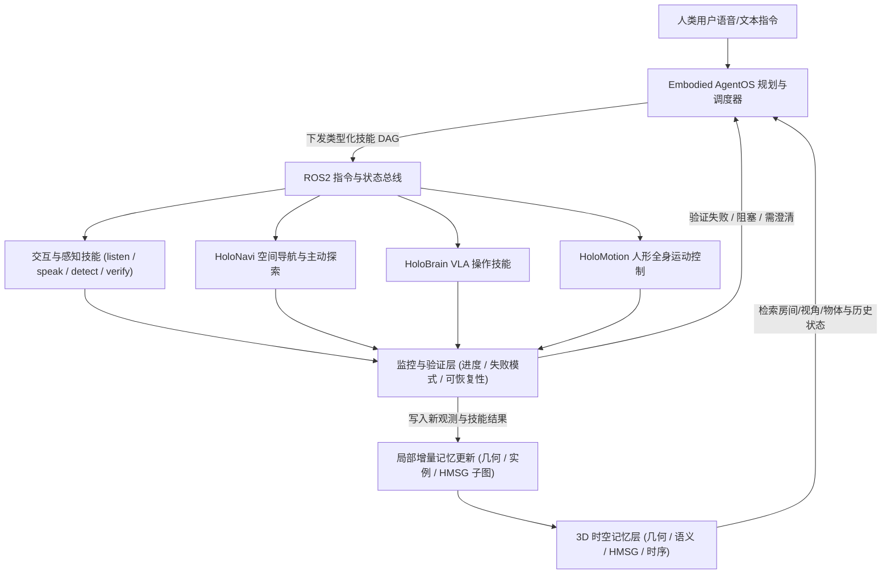
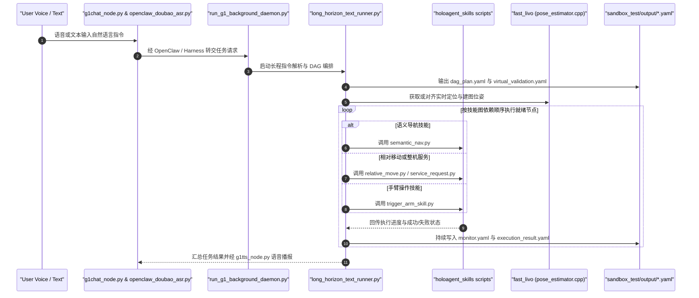

# HoloAgent-0: A Unified Embodied Agent Framework with 3D Spatial Memory

## 一句话定义

HoloAgent-0 是由地平线（Horizon Robotics）与地瓜机器人（D-Robotics）提出的统一具身智能体框架，以 **Embodied AgentOS** 为闭环运行时，通过 **ROS2 指令/状态总线** 将持久 **3D 时空记忆层** 与**类型化具身技能层**（导航、操作、全身运动控制、语音与跨本体协同）耦合起来，支撑真机长程任务规划、在线验证与失败恢复。

## 英文缩写速查

| 缩写 | 英文全称 | 简要说明 |
|---|---|---|
| HMSG | Hierarchical Multimodal Scene Graph | 四层（楼层-房间-视角-物体）多模态三维场景图，用于粗到细空间检索 |
| VLA | Vision-Language-Action | 视觉-语言-动作策略模型，用于操作等物理行为后端（如 HoloBrain） |
| VLN | Vision-and-Language Navigation | 视觉语言导航，连接语言指令与三维物理空间路径规划 |
| SLAM | Simultaneous Localization and Mapping | 同步定位与建图，构成几何记忆层的坐标与稠密几何底座 |
| ROS2 | Robot Operating System 2 | 机器人中间件，提供 HoloAgent-0 的指令下发与状态回传通信总线 |
| SR / SPL | Success Rate / Success weighted by Path Length | 目标导航成功率与路径长度加权成功率，衡量完成度与路径效率 |

## 为什么重要

1. **直面数字智能体到物理机器人的“具身鸿沟”**：传统 LLM 智能体依赖确定性、无副作用的软件 API，而物理执行连续、依赖本体、充满不确定性且受安全约束。HoloAgent-0 将问题抽象为系统级执行接口问题，用“可组合、可观测、可验证”的技能图运行时桥接大模型推理与底层机器人控制器。
2. **统一长程任务所需的空间记忆与时序记忆**：不同于只看当前相机帧或依赖对话上下文的做法，HoloAgent-0 将多模态 3D 场景图（HMSG）、开放词汇语义实例、度量几何定位与任务计划/恢复轨迹统一纳入同一记忆层，并支持运行期增量局部更新。
3. **不替代底层策略，而是编排异构具身模型**：通过统一的类型化技能契约，将导航（HoloNavi / FSR-VLN）、操作 VLA（HoloBrain）与人形全身运控（HoloMotion）解耦在标准 ROS2 接口之后，实现单机长程移动操作及跨本体协同。

## 核心信息

| 字段 | 内容 |
|---|---|
| 作者 | Xiaolin Zhou, Liu Liu, Tingyang Xiao, Wei Feng, Fa Fu, Xinrui Meng, Xinjie Wang, Jialiang Han, Boyang Yu, Yun Du, Wei Sui, Zhizhong Su |
| 机构 | Horizon Robotics, D-Robotics Robotics |
| 发表时间 | 2026-06-22（arXiv:2606.23565v1） |
| 论文链接 | [arXiv:2606.23565](https://arxiv.org/abs/2606.23565) · [arXiv HTML 全文](https://arxiv.org/html/2606.23565) |
| 项目与代码 | [官方项目页](https://horizonrobotics.github.io/robot_lab/holoagent) · [HorizonRobotics/HoloAgent](https://github.com/HorizonRobotics/HoloAgent) · [fsrvln_datasets](https://huggingface.co/datasets/HorizonRobotics/fsrvln_datasets) |
| 清单分类 | `harness.memory` |
| 来源条目 | `survey_ax_2606_23565` |
| 开源状态 | 已开源（部分模块演进中：HoloAgent-0 AgentOS、技能框架、G1 语音、FAST-LIVO2 及 FSR-VLN 已开放；HoloAgent-1 规划项待更新） |

## 核心原理

HoloAgent-0 遵循 **Closed-loop first（闭环优先）、Memory-centric（记忆中心）、Typed skill interface（类型化技能接口）、Observable by default（默认可观测）** 四项原则，由三大耦合层与监控验证回路构成。

### 1. Embodied AgentOS：闭环任务运行时

AgentOS 通过四层功能模块经由 ROS2 指令/状态总线闭环协作：
- **AgentOS 层**：解析语音或文本指令，检索空间与时序记忆，将任务拆解为带前置条件、执行顺序与恢复依赖的技能 DAG（Skill Graph）；调度器分派就绪技能并依据运行期反馈触发澄清或重规划。
- **Skill 层**：屏蔽底层模型/控制器架构差异，向外消费结构化参数并持续上报执行状态。
- **Memory 层**：为规划、定位与跨本体协同提供共享的 3D 空间与时序上下文，并在执行后回写状态变更。
- **Monitoring & Verification 层**：在部署期核验技能后置条件并输出文本/语音反馈，在开发期通过 ROS2 bags、结构化日志、RViz 与 Rerun 实现全链路诊断。

### 2. 类型化技能层（Skill Layer）

物理技能并非单纯返回成功与否的黑盒调用。每个技能调用均定义**命令名、类型化参数（如 `move_to(room=kitchen)`、`pick(object=mug)`）、前置条件、目标引用与预期效果**；执行后端持续发布包含 **progress、success、failure mode、confidence、latency、recoverability** 的状态事件，使“目标丢失、抓空、路径受阻、位姿不可达、碰撞风险”成为显式重规划依据。主要技能族包括：
- **交互与感知技能**：语音接口封装 ASR/对话状态/TTS（`listen`、`speak`）；开放词汇感知提供 `detect`、`localize`、`verify`。
- **HoloNavi（空间导航与主动探索）**：融合 FSR-VLN 的快慢推理机制——先由 LLM 解析目标楼层/房间/物体并在 HMSG 中用层级 CLIP 特征快速剪枝检索，再将候选视角图像送入 VLM 做在线慢速视觉验证与局部视角微调；当记忆陈旧或场景图检索置信度不足时，按预期信息增益、语义相关性、可通行性与安全约束评分选择前沿视点执行主动探索并增量建图。
- **HoloBrain（操作后端）**：接入 VLA 操作模型执行 `pick`、`place`、`open`、`handover`、`push`、`fold` 等技能，与 HoloNavi 串联完成长程移动操作。
- **HoloMotion（人形全身运动控制）**：提供运动跟踪（挥手、鞠躬、握手、跳舞）与速度跟踪（行走、转向、停止、恢复）两种模式，既可承载 HoloNavi 的移动指令，也可在操作阶段调整躯干姿态并在接触失败后恢复平衡。
- **跨本体协同**：多个异构机器人向同一 3D 记忆写入带时空与本体标记的观测，AgentOS 根据能力、位置、可用性与安全状态分配子任务并在单机受阻时转移任务责任。

### 3. 3D 时空记忆层与局部增量更新（Memory Layer）

- **几何记忆（Geometry Memory）**：通过统一几何接口屏蔽传感器差异，提供：
  - **LiDAR 后端**：紧耦合融合 LiDAR、IMU 与相机观测（基于 FAST-LIVO），生成高精度参考地图与定位。
  - **纯视觉后端（GeoFlow-SLAM++）**：面向 $N \ge 3$ 个标定 RGB 相机，利用 3D 基础模型 $\Phi_{\theta}$ 预测稠密深度并反投影至机体坐标系，无需物理 RGB-D 传感器即可生成局部几何；跟踪阶段采用多视角两阶段光流策略，局部建图联合优化视觉重投影、点面与 IMU 约束，重定位阶段聚合全相机 BoW 特征并做跨视角 3D-2D 联合 BA。
- **开放词汇 3D 语义记忆**：对 SAM2 分割出的每个 2D 掩码计算三类 SigLIP 特征——全关键帧 $\mathbf{d}_0$、掩码区域 $\mathbf{d}_1$、最小外接框 $\mathbf{d}_2$，并按逐维权重融合：
  $$\mathbf{d} = \sum_{i=0}^{2} \mathbf{w}_{i} \odot \mathbf{d}_{i}$$
  其中 $\odot$ 为 Hadamard 积，兼顾全局语境、分割掩码主体与局部细节。新观测通过将已有 3D 实例 $\mathcal{V}_{t-1}$ 投影至当前相机视角得到投影掩码 $\{\tilde{m}_j\}$，计算与当前掩码 $\{m_k\}$ 的 $\mathrm{IoU}(m_k, \tilde{m}_j)$ 完成持久实例融合或新实例初始化。
- **层次多模态场景图（HMSG）**：按 `Floor → Room → View → Object` 四层组织空间包含与拓扑可见关系，由 View 层将几何位姿与视觉证据桥接起来，支撑由粗到细的检索与 VLM 校验。
- **时序记忆与增量更新**：时序记忆保存目标/技能图状态、执行与恢复轨迹及段落经验摘要。面对观测冲突、移动物体的技能结果或用户显式纠正时，记忆层先重定位再局部刷新冲突点云/体素与语义实例，最后仅重算受影响物体及其父房间与可见视角所在的 HMSG 子图，避免全图重建。

## 流程总览

## 源码运行时序图

以下时序图基于官方仓库 `HorizonRobotics/HoloAgent`（`main` 分支）中已开放的 AgentOS 沙盒/守护执行器、技能注册触发脚本与 Unitree G1 语音交互模块文件结构及入口核对整理（静态代码核对，未本地运行）：

- 核心核对文件：`agentic_robot/agentOS/run_dameon/run_g1_background_daemon.py`、`agentic_robot/agentOS/sandbox_test/long_horizon_text_runner.py`、`agentic_robot/chatbot/g1/g1chat_node.py`、`agentic_robot/chatbot/g1/openclaw_doubao_asr.py`、`agentic_robot/agentOS/holoagent_skills/skills/sem-nav-skill/scripts/semantic_nav.py`、`agentic_robot/agentOS/holoagent_skills/skills/arm-skill/scripts/trigger_arm_skill.py`、`agentic_robot/agentOS/holoagent_skills/skills/rel-move-skill/scripts/relative_move.py`、`agentic_robot/agentOS/holoagent_skills/skills/robot-service/scripts/service_request.py`。

运行时以 `run_g1_background_daemon.py` 与 `long_horizon_text_runner.py` 作为核心任务编排与沙盒验证入口，将自然语言指令固化为 `dag_plan.yaml` 并经 `virtual_validation.yaml` 预校验后，分派至 `holoagent_skills/skills/*/scripts/` 下的独立技能脚本执行并把过程状态落盘至 `monitor.yaml` 与 `execution_result.yaml`。

## 实验与评测

论文将评估拆分为**可重复定量基准测试**（长程导航、3D 语义建图）与**真机全栈定性验证**，真机部署覆盖 Unitree G1 人形机器人、R1 人形机器人及轮式双臂移动操作平台。

### 1. 长程零样本目标导航（仿真 HM3D-ObjNav，沿用 MSGNav 协议）

| 方法 | SR (%) ↑ | SPL (%) ↑ |
|---|---:|---:|
| SG-Nav | 49.6 | 25.5 |
| VLFM | 62.6 | 31.0 |
| DORAEMON | 66.5 | 20.6 |
| WMNav | 72.2 | 33.3 |
| MSGNav | 74.1 | 33.4 |
| FSR-VLN (fast-matching) | 72.1 | 36.9 |
| FSR-VLN (slow-reasoning) | 80.8 | 41.0 |
| **HoloAgent-Nav (w AgentOS loop)** | **82.6** | **42.8** |

### 2. 真机长程导航评测（物理公寓场景，沿用 FSR-VLN 协议）

| 方法 | Top-1@1.0m | Top-1@2.0m | Top-1@3.0m | Top-5@1.0m | Top-5@2.0m | Top-5@3.0m |
|---|---:|---:|---:|---:|---:|---:|
| OK-Robot | 60.92 | 60.92 | 60.92 | 63.22 | 63.22 | 63.22 |
| MobilityVLA | 34.48 | 59.77 | 75.86 | – | – | – |
| HOV-SG | 51.72 | 57.47 | 58.62 | 77.00 | 81.61 | 82.76 |
| FSR-VLN | 91.95 | 91.95 | 94.25 | 94.25 | 96.55 | 96.55 |
| **HoloAgent-Nav** | **97.70** | **97.70** | **97.70** | **98.90** | **98.90** | **98.90** |

### 3. 开放词汇 3D 语义建图（ScanNet & Replica）

| 方法 | 在线 (Online) | ScanNet mIoU ↑ | ScanNet mAcc ↑ | ScanNet f-mIoU ↑ | ScanNet f-Acc ↑ | Replica mIoU ↑ | Replica mAcc ↑ | Replica f-mIoU ↑ | Replica f-Acc ↑ |
|---|---|---:|---:|---:|---:|---:|---:|---:|---:|
| Open-Gaussian | ✗ | 08.64 | 17.86 | 23.71 | 26.44 | 06.82 | 16.66 | 15.41 | 18.08 |
| Lang-Splat | ✗ | 07.22 | 21.01 | 27.59 | 32.21 | 10.00 | 22.93 | 39.69 | 44.16 |
| HOV-SG | ✗ | 20.76 | 41.50 | 38.34 | 45.50 | 23.79 | 39.59 | 48.86 | 55.15 |
| Grasp-Splats | ✓ | 06.69 | 14.89 | 16.62 | 19.57 | 10.42 | 23.79 | 42.67 | 52.39 |
| Concept-Fusion | ✓ | 08.50 | 31.81 | 30.05 | 36.64 | 04.75 | 19.29 | 25.30 | 28.99 |
| Concept-Graph | ✓ | 16.29 | 34.07 | 33.29 | 41.60 | 16.46 | 31.51 | 35.69 | 42.44 |
| Open-Fusion | ✓ | 18.02 | 44.31 | 43.82 | 51.09 | 16.37 | 35.15 | 51.65 | 60.37 |
| Omni-Map | ✓ | 25.42 | 50.93 | 50.86 | 57.05 | 29.06 | 44.54 | 64.42 | 72.22 |
| **HoloAgent-Memory** | **✓** | **31.58** | 45.54 | 47.43 | **61.58** | **29.93** | 43.60 | 57.00 | 65.39 |

### 4. 真机全栈定性闭环验证（§5.4）

论文展示了四类真机闭环演示（Fig. 2）及扩展应用：短程全身运动指令控制（Prompt Motion Control）、主动探索寻找咖啡机（Active Object Search）、一台机器人导航与另一台机器人跳舞的跨本体协同（Cross-Robot Coordination），以及将折叠衣物拆解为导航、拾放、全身运动与灵巧操作的长程移动操作（Long-Horizon Mobile Manipulation）。

## 与其他工作对比

- **对比独立导航与场景图方法（FSR-VLN、MSGNav、WMNav、HOV-SG、OK-Robot、MobilityVLA）**：单纯的视觉语言导航后端缺少任务级执行监控与状态回写，在仿真 HM3D-ObjNav 上加入 AgentOS 闭环后，HoloAgent-Nav 较同一系列的 FSR-VLN (slow-reasoning) 将 SR 从 80.8% 提升至 82.6%、SPL 从 41.0% 提升至 42.8%，在所测基线中取得最高成功率与路径效率；真机 Top-1@1.0m 达到 97.70%，且 1m/2m/3m 阈值下得分一致，表明成功样本已停在严格阈值内，剩余失败主要由恢复机制而非粗粒度定位误差引起。
- **对比 3D 语义建图方法（Omni-Map、Open-Fusion、HOV-SG 等）**：HoloAgent-Memory 在保持在线建图的前提下，在 ScanNet 与 Replica 的类别级 mIoU 上分别达到 31.58 与 29.93（高于所测离线与在线对比基线）；但在 Replica 的频率加权指标（f-mIoU 57.00 vs. Omni-Map 64.42；f-Acc 65.39 vs. Omni-Map 72.22）上仍有差距，说明大面积区域与多视角特征聚合仍需优化。
- **对比具身操作系统与端到端 VLA（ROS-LLM、EMOS、RoboOS、AEROS、$\pi_{0.5}$）**：端到端 VLA（如 $\pi_{0.5}$）主要聚焦局部双层推理与连续动作生成，缺乏持久 3D 记忆与长程故障恢复；既有机器人中间件/智能体框架则较少同时打通多模态 3D 场景图检索、局部增量记忆更新与人形/移动操作异构技能编排。

## 结论

**一句话总判：HoloAgent-0 通过“AgentOS 闭环调度 + 3D 时空与HMSG记忆 + ROS2 类型化技能契约”把异构导航、操作和全身控制模型整合为可监控、可局部更新且可恢复的真机具身智能体系统。**

1. **优先将“失败语义”显式结构化**：把技能返回值从布尔成败扩展为包含置信度、失败模式、延迟与可恢复性的状态流，是支撑 LLM 运行时重规划而不盲目重试的关键。
2. **用“粗检 + 慢验 + 主动探索”应对记忆陈旧**：HMSG 的层级 CLIP 快筛负责剪枝，VLM 视角验证负责纠偏，前沿探索与局部子图增量刷新则闭环解决动态环境导致的记忆失真。
3. **传感器抽象决定跨平台迁移成本**：通过统一几何记忆接口同时兼容 LiDAR-IMU-相机（FAST-LIVO）与纯多目视觉（GeoFlow-SLAM++），可在不改上层 AgentOS 逻辑的前提下切换本体硬件。
4. **当前开源与评测仍具阶段性**：代码库已落地 AgentOS、技能脚手架、G1 语音与 FAST-LIVO2/FSR-VLN，但 HoloBrain/HoloMotion 一体化及全栈端到端量化基准仍在持续建设中。

## 工程实践

1. **按分层顺序调试仓库**：部署 `HorizonRobotics/HoloAgent` 时，先依据 `docs/user_guide/Intruduction.md` 与 `agentic_robot/build.sh` 完成 ROS2 与 FAST-LIVO2（`core/src/fast_livo/build_fastlivo2.sh`）底层建图定位验证，再运行 `agentic_robot/agentOS/sandbox_test/long_horizon_text_runner.py` 校验 `dag_plan.yaml` 与 `virtual_validation.yaml` 规划链路。
2. **利用技能 CRUD 脚手架规范扩展能力**：新增机器人能力时使用 `agentic_robot/agentOS/holoagent_skills/scripts/create_skill.py` 与 `validate_skills.py`，严格声明前置条件、参数模式与失败上报字段，确保与 AgentOS Harness（OpenClaw）对齐。
3. **关注多模态传感器与算力依赖**：若采用 GeoFlow-SLAM++ 纯视觉几何记忆，需保证至少 3 路已完成外参标定的同步 RGB 相机（$N \ge 3$）；真机语音交互模块（`chatbot/g1/`）默认对接火山引擎豆包 ASR/TTS/LLM，实际部署需配置对应 API 凭证与音频设备索引。

## 局限与风险

- **缺乏全栈端到端定量基准**：论文明确指出，当前定量指标仅覆盖语义建图与导航闭环；针对操作（HoloBrain）、全身运动控制（HoloMotion）及跨本体协同的联合表现目前仅提供真机定性轨迹展示，尚无统一可重复的端到端 benchmark。
- **动态大尺度场景中的频率加权语义精度差距**：在 Replica 数据集上，HoloAgent-Memory 的 `f-mIoU`（57.00）与 `f-Acc`（65.39）低于同为在线方法的 Omni-Map（64.42 / 72.22），大面积实体与跨视角特征融合仍有改进空间。
- **部分核心技能与纯视觉自主闭环仍在演进中**：仓库 README 的 Release Status 显示，通用灵巧操作 `HoloBrain`、全身移动操作 `HoloMotion`、主动探索 Agent-Loop 与纯视觉自主导航避障列在后续 `HoloAgent-1` 更新计划中；且真机失败案例仍暴露出对复杂阻塞与极端姿态恢复能力的更高要求。

## 关联页面

- [Agentic Robots 综述](paper-towards-agentic-robots-survey.md)
- [全量项目节点清单](../overview/awesome-agentic-robots-node-index.md)
- [VLA 方法背景](../methods/vla.md)
- [机器人智能体执行框架](../methods/robot-agent-harness.md)：对照规划、工具调用与反馈的系统边界
- [HoloAgent（HMI 开源项目页）](./holoagent.md)：同一官方仓库的工程主表入口与 HTTP-ROS2 桥接补充
- [HoloMotion](./holomotion.md)：论文技能层引用的全身运动控制后端实体
- [FAST-LIVO](./paper-fast-livo.md) / [GeoFlow-SLAM](./cn-os-geoflowslam.md)：几何记忆层所依托的 LiDAR 与多目视觉 SLAM 基础方法
- [智能体规划与反馈机制](../methods/agent-planning-feedback.md)
- [智能体技能封装](../methods/agent-skill-packaging.md)
- [智能体工具调用接口](../methods/agent-tool-use-interface.md)
- [视觉语言导航](../tasks/vision-language-navigation.md)
- [零样本目标导航](../tasks/zero-shot-object-navigation.md)

## 推荐继续阅读

- [HoloAgent-0 官方项目页](https://horizonrobotics.github.io/robot_lab/holoagent)
- [HorizonRobotics/HoloAgent GitHub 仓库](https://github.com/HorizonRobotics/HoloAgent)
- [arXiv:2606.23565 原文主页](https://arxiv.org/abs/2606.23565)
- [FSR-VLN 数据集（Hugging Face）](https://huggingface.co/datasets/HorizonRobotics/fsrvln_datasets)
- [FSR-VLN 技术报告（arXiv:2509.13733）](https://arxiv.org/abs/2509.13733)
- [HoloBrain-0 技术报告（arXiv:2602.12062）](https://arxiv.org/abs/2602.12062)
- [HoloMotion-1 技术报告（arXiv:2605.15336）](https://arxiv.org/abs/2605.15336)

## 参考来源

- [HoloAgent-0 原文核对归档](../../sources/papers/paper-agentic-2606-23565.md)
- [HorizonRobotics/HoloAgent 官方仓库核对归档](../../sources/repos/paper-agentic-2606-23565.md)
- [官方 Awesome 快照归档](../../sources/repos/awesome-agentic-robots-survey-index.md)
- [arXiv:2606.23565 HTML 全文](https://arxiv.org/html/2606.23565)
- [HoloAgent-0 官方项目页](https://horizonrobotics.github.io/robot_lab/holoagent)
- [HorizonRobotics/HoloAgent GitHub 仓库](https://github.com/HorizonRobotics/HoloAgent)
