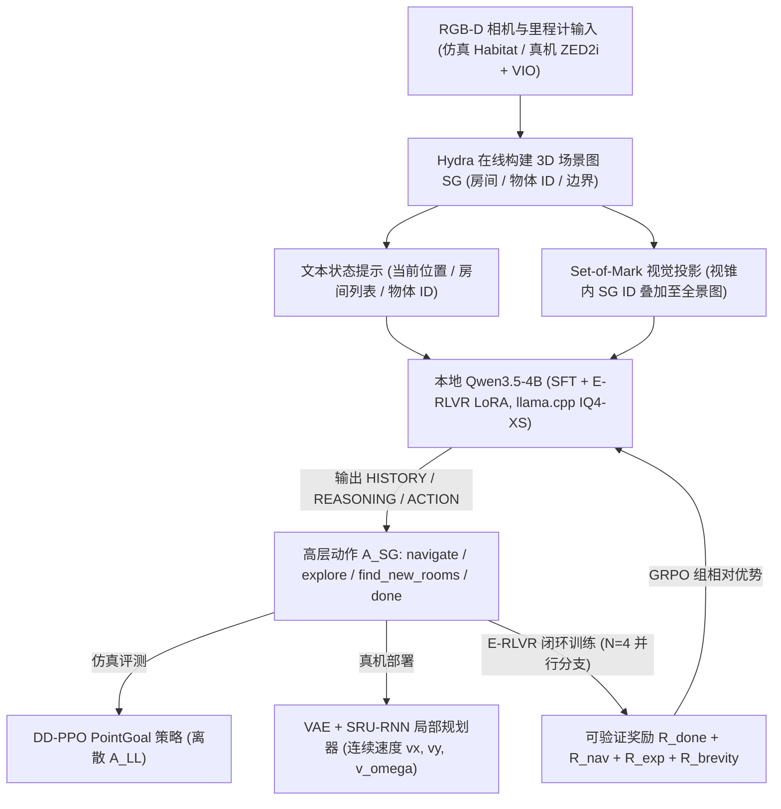

# LocalNav: Distilling Frontier VLMs and Embodied RL for On-Device Object Goal Navigation

## 一句话定义

**一套面向边缘部署的开放词汇物体目标导航（ObjectNav）框架**：将实时构建的 3D 场景图（SG）与 Set-of-Mark 视觉投影封装为稀疏高层决策接口，先用前沿云端模型成功轨迹对本地 4B 视觉语言模型（Qwen3.5-4B）做轻量有监督微调（SFT），再经带输出长度惩罚的闭环强化学习（E-RLVR / GRPO）与 `llama.cpp` IQ4-XS 量化，使嵌入式 Jetson Orin AGX 在脱离云端连接的前提下兼具接近云端模型的导航成功率与端侧低延迟。

## 英文缩写速查

| 缩写 | 英文全称 | 简要说明 |
|---|---|---|
| ObjectNav | Object Goal Navigation | 物体目标导航任务；本文聚焦开放词汇（Open-Vocabulary）指令设定 |
| SG | Scene Graph | 场景图；由 Hydra 实时构建，显式记录房间、物体 ID 与未知探索边界 |
| E-RLVR | Embodied Reinforcement Learning from Verifiable Rewards | 具身可验证奖励强化学习；在 Habitat 闭环中用 GRPO 联合优化导航与简洁性 |
| GRPO | Group Relative Policy Optimization | 组相对策略优化；单步采样多条并行仿真分支并按组内相对优势更新 LoRA |
| TG | Token Generation | 自回归词元生成（解码阶段）；在 Jetson Orin AGX 上占端到端推理耗时约 92.5% |
| SPL | Success weighted by Path Length | 路径长度加权成功率；同时衡量导航是否成功以及路径是否紧凑 |

## 为什么重要

- **打破「低层 VLA 算力过重 vs. 高层大模型依赖云端」的两难**：端到端 VLA 需要 5–10 Hz 持续推理，在嵌入式 GPU 上功耗与时延难以承受；而现有基于 3D 场景图的高层推理方法虽仅在稀疏决策点调用 VLM，却依赖 GPT-4o / Gemini 等云端 API（实测 475 次 Gemini 3.1 Pro 查询均值 10.86 s），在无网或高延迟场景不可用。
- **极小样本跨模型蒸馏且揭示「教师-学生不对齐」现象**：在 HM3D OVON `train` 集仅采集约 500 条前沿教师成功轨迹即可把 Qwen3.5-4B 的成功率从 25.97% 提至 35.23%；且试验表明零样本性能最高的教师（Gemini 3.1 Pro，41.61% SR）蒸馏出的学生（30.63% SR）反而低于 Claude Sonnet 4.6 蒸馏出的学生（35.23% SR）。
- **直击边缘 VLM 的真实瓶颈——自回归解码长度**：Jetson Orin AGX 剖析显示，213.89 s 回合推理耗时中有约 92.5% 耗在自回归 TG（18.04 tok/s）而非 Prefill（1271.4 tok/s）；简单靠提示词（`caveman` / `short-CoT`）或截断 SFT 压缩长度都会显著掉点，唯有将长度惩罚融入闭环 E-RLVR 并配合 IQ4-XS 量化，才能在 42.32 s/回合内守住导航精度。

## 核心信息

| 字段 | 内容 |
|---|---|
| **作者** | Nicolas Baumann, Liam Boyle, Pu Deng, Edoardo Ghignone, Boyang Sun, Marc Pollefeys, Luca Benini, Michele Magno |
| **机构** | 苏黎世联邦理工（ETH Zürich：Center for Project-Based Learning / Integrated Systems Laboratory / Computer Vision and Geometry） |
| **发表时间** | 2026-06-26 提交 v1，2026-10-31 修订 v2（arXiv:2606.27871v2 [cs.RO]） |
| **论文链接** | [arXiv:2606.27871](https://arxiv.org/abs/2606.27871) / [arXiv HTML v2](https://arxiv.org/html/2606.27871) |
| **项目与代码** | 未确认官方源码仓库；论文脚注声明在 Hugging Face 公开 SFT 蒸馏数据集（Gemini 3.1 Pro、GPT-5.4、Claude Sonnet 4.6、Combined）；外部依赖：`llama.cpp`、`caveman` |
| **清单分类** | `model.planning`（来源条目：`survey_ax_2606_27871`） |
| **开源状态** | **部分开源 / 未确认官方源码**（截至 2026-11-27，论文声明公开 Hugging Face SFT 蒸馏轨迹数据集，但 arXiv 原文及元数据未列独立项目页或官方训练/部署代码仓库链接） |

## 核心原理

LocalNav 将开放词汇导航拆分为「**在线 3D 场景图构建 + 稀疏 VLM 高层决策 + 专用 PointGoal 底层执行**」三层解耦系统，并通过「**特权轨迹 SFT 蒸馏 → 长度正则化 E-RLVR → 带宽感知量化**」三阶段训练与优化流程压低端侧延迟（§III、Appendix -A 至 -E）：

### 1. 显式场景图接口与三层动作空间

- **双模态 SG 表示（§III-A）**：基于 Hydra 在线从 RGB-D 与里程计构建 3D 场景图（仿真采用 Habitat 语义标签，真机采用 ZED2i + VIO + Mask2Former）。在每次决策点，系统一方面用文本描述当前房间位置、1.0 m 内邻近物体、已探索/未分配房间及物体 ID；另一方面采用 Set-of-Mark 风格将视野视锥内的 SG 物体 ID 直接投影到 RGB 或 360° 拼接全景图上，实现符号 ID 与像素区域的视觉接地。
- **结构化输出与动作空间（Appendix -B）**：VLM 按 `<HISTORY>`、`<REASONING>`、`<ACTION>` 格式输出高层离散命令 $\mathcal{A}_{\text{SG}} = \{\texttt{navigate(object\_id)}, \texttt{explore(room\_id)}, \texttt{find\_new\_rooms()}, \texttt{done()}\}$。
  - **仿真执行（$\mathcal{A}_{\text{LL}}$）**：将目标 3D 坐标交给基于深度图的 DD-PPO PointGoal 策略，输出 Habitat 离散底层动作 $\{\texttt{forward}, \texttt{turn\_left}, \texttt{turn\_right}, \texttt{look\_up}, \texttt{look\_down}\}$。
  - **真机执行**：采用基于 VAE 潜空间与 SRU-RNN 记忆模块的 PointGoal 控制器，由 ZED2i 深度图直接预测连续速度指令 $\{v_x, v_y, v_\omega\}$，实现动态避障与局部路径跟踪。
  - **特权轨迹采集空间（$\mathcal{A}_{\text{priv}}$）**：在 SFT 教师采样阶段，用 Habitat 最短路径按 $0.5\text{ m}$ 间隔沿航点传送替代底层 DD-PPO，使教师示范纯粹反映视觉-语义决策能力而不受底层控制误差干扰。

### 2. 小样本教师轨迹蒸馏（§III-C）

在 HM3D OVON `train` 集收集 Gemini 3.1 Pro、GPT-5.4 与 Claude Sonnet 4.6 的成功轨迹，分别整理出 481 至 532 对「全景图像-SG 状态-教师输出」数据。为避免过拟合仿真视觉特征并控制参数量，学生模型 **Qwen3.5-4B** 冻结视觉编码器，仅通过 rank-16 LoRA（$\alpha=16$，学习率 $2\times 10^{-5}$，最多 500 步）在任务级文本输出上对齐教师推理模式。

### 3. 长度正则化 E-RLVR 闭环强化学习（§III-D、Appendix -E）

为了在不牺牲导航准确率的前提下压低自回归输出长度，LocalNav 在 Habitat 闭环环境中引入基于 LoRA-GRPO 的 E-RLVR：每步针对当前观测与 SG 状态并行采样 $N=4$ 个动作分支，分叉 4 个独立仿真器与 SG 副本向前推进；选择总回报最高的分支更新主环境状态，并利用组内回报差异计算相对优势更新 LoRA（$r=16, \alpha=32, \beta=0.04$）。多目标累积回报定义为：

$$R = \sum_{i \in \{\text{done},\text{nav},\text{exp},\text{brevity}\}} \lambda_i R_i, \quad \lambda_{\text{done}}=2.0,\ \lambda_{\text{nav}}=1.0,\ \lambda_{\text{exp}}=1.0,\ \lambda_{\text{brevity}}=0.25$$

其中各分量归一化在 $[-1, 1]$：$R_{\text{done}} \in \{1, -1, 0\}$ 奖惩终止判定；$R_{\text{nav}}$ 在目标已进入 SG 时奖励归一化目标距离进展 $\overline{\Delta d}$；$R_{\text{exp}}$ 在目标未入图时奖励发现目标（$\lambda_{\text{found}}$）或新增节点数 $\overline{\Delta n}$；$R_{\text{brevity}}$ 在输出长度 $L \le L_t$ 时取 $+1$、在 $L \ge L_{\max}$ 时取 $-1$，中间区间线性衰减 $f(L) = 1 - 2\frac{L - L_{\text{target}}}{L_{\max} - L_{\text{target}}}$。由于所有回报在同一滚出轨迹上耦合计算，模型只有在「缩短回复且仍推进任务」时才能获得正向优势，从而自发内化高信息密度推理而非盲目截断思维链。

### 4. 端侧量化部署（§IV-D）

因解码阶段受限于嵌入式 GPU 显存带宽，作者在 `llama.cpp` 后端上系统扫描各量化格式相对于 BF16 的输出 logit KL 散度（KLD）与实测提示词 TG 吞吐量，最终选取处于 Pareto 前沿的 **IQ4-XS** 格式部署到 Jetson Orin AGX。

## 流程总览

## 源码运行时序图

**不适用**（截至 2026-11-27，arXiv:2606.27871v2 原文与检索元数据未提供可运行的官方代码仓库或脚本入口；论文仅声明在 Hugging Face 公开 SFT 蒸馏数据集，文中提到的 `JuliusBrussee/caveman` 与 `ggml-org/llama.cpp` 分别属于外部提示词技能与通用推理引擎依赖。）

## 实验与评测

全量消融与基准测试均在 **HM3D OVON `val_unseen`**（3,000 个评估回合）上使用低层 $\mathcal{A}_{\text{LL}}$ 动作空间与标准 `0.25 m` `VIEW_POINTS` 成功判定阈值完成（§IV-A 至 §IV-E、Appendix -D）：

### 1. 教师对比、SFT 蒸馏、提示压缩与 E-RLVR 消融（Table I）

| 模型 / 变体 | SFT 来源 | RL | 提示风格 | SR (%) ↑ | SPL (%) ↑ | 平均查询数 ↓ | 重复访问 ↓ | 平均输出 Token ↓ |
|---|---|---|---|---:|---:|---:|---:|---:|
| GPT-5.4（零样本） | ✗ | ✗ | normal | 38.03 | 19.12 | 7.61 | 0.02 | 285.62 |
| Claude Sonnet 4.6（零样本） | ✗ | ✗ | normal | 39.7 | 19.72 | 6.464 | 0.008 | 606.40 |
| Gemini 3.1 Pro（零样本） | ✗ | ✗ | normal | **41.61** | **22.77** | **5.15** | **0.0** | 206.08* |
| Qwen3.5-4B（零样本基线） | ✗ | ✗ | normal | 25.97 | 12.4 | 12.15 | 0.76 | 509.53 |
| Qwen3.5-4B + SFT-Gemini | Gemini | ✗ | normal | 30.63 | 15.06 | 9.06 | 0.41 | 245.24 |
| Qwen3.5-4B + SFT-GPT | GPT | ✗ | normal | 28.63 | 14.25 | 7.26 | 0.17 | 275.56 |
| Qwen3.5-4B + SFT-Claude | Claude | ✗ | normal | 35.23 | 17.77 | 7.41 | 0.12 | 486.71 |
| Qwen3.5-4B + 混合 SFT | {GPT/C/G} | ✗ | normal | 30.37 | 15.16 | 7.36 | 0.15 | 443.13 |
| SFT-Claude + `caveman` 提示 | Claude | ✗ | caveman | 34.98 | 17.59 | 7.13 | 0.13 | 410.27 |
| SFT-Claude + `short-CoT` 提示 | Claude | ✗ | short-CoT | 34.2 | 16.75 | 8.41 | 0.3 | 261.38 |
| SFT-`C-caveman` 蒸馏 | C-caveman | ✗ | caveman | 32.71 | 15.82 | 6.65 | 0.05 | 246.10 |
| SFT-`C-short-CoT` 蒸馏 | C-short-CoT | ✗ | short-CoT | 31.01 | 15.89 | 7.29 | 0.23 | 167.77 |
| **SFT-Claude + E-RLVR（无 $R_{\text{brev}}$）** | Claude | ✓ w/o $R_{\text{brev}}$ | normal | **37.36** | **18.01** | 8.76 | 0.31 | 424.20 |
| **SFT-Claude + E-RLVR（含 $R_{\text{brev}}$）** | Claude | ✓ w/ $R_{\text{brev}}$ | normal | 35.53 | 16.43 | **5.95** | **0.04** | **165.41** |

*注：Gemini 3.1 Pro 的 206.08* token 未计入其内部隐藏推理 token（Appendix -A 示例中含推理共 1,497 token）。*

### 2. Jetson Orin AGX 推理耗时剖析与量化加速（Table II & Table III）

- **阶段耗时剖析（Table II，100 回合均值，SFT-Claude BF16）**：单次调用平均 Prefill 2,746.5 token（吞吐 1,271.4 tok/s，单回合 16.01 s）；TG 平均 486.71 token（吞吐 18.04 tok/s，单回合 197.88 s）；解码阶段占总推理耗时（213.89 s）约 **92.5%**。
- **联合优化效果（Table III，Jetson Orin AGX 实测）**：

| 模型配置 | 量化精度 | SR (%) ↑ | TG 吞吐 (tok/s) ↑ | 平均输出 (tok) ↓ | 平均查询数 ↓ | 单回合总推理耗时 (s) ↓ |
|---|---|---:|---:|---:|---:|---:|
| SFT-Claude | BF16 | 35.23 | 18.04 | 486.71 | 7.41 | 213.89 |
| SFT-Claude + E-RLVR（含 $R_{\text{brev}}$） | BF16 | **35.53** | 18.04 | **165.41** | 5.94 | 65.67（-69.29%） |
| **SFT-Claude + E-RLVR（含 $R_{\text{brev}}$）** | **IQ4-XS** | 34.51 | **40.31** | 202.89 | **5.91** | **42.32（累计 -80.21%）** |

### 3. 真实环境验证（§IV-F）

- **手持模块多目标连续导航**：在真实公寓从浴室出发依次寻找「sofa」「piano」「bathtub」「person sitting at a table」，验证持续复用的 SG 记忆可免除邻近目标（bathtub）的重复探索，并能结合图像视觉确认复合语义（人坐在桌旁）。
- **Unitree A2-W 四足机器人自主导航**：完成「a chair with a person sitting on it」开放词汇属性导航，自主执行房间探索（$\mathcal{A}_{\text{explore}}^{R_0}$）、全景环视扫描、锚定特定椅子（$\mathcal{A}_{\text{navigate}}^{\text{chair}_0}$）与到点视觉验证终止。

## 与其他工作对比

在 HM3D OVON `val_unseen` 基准上与已有方法对比（Table IV；需注意 LocalNav 使用 `RGB + D + Sem` 构建场景图，而其余多数对比方法仅用 `RGB` 或 `RGB + D`）：

| 方法 | 传感器模态 | SR (%) | SPL (%) | 架构特点 |
|---|---|---:|---:|---|
| BC / DAgger / RL | RGB | 5.4 / 10.2 / 18.6 | 1.9 / 4.7 / 7.5 | 端到端闭集/基础策略基线 |
| DAgRL+OD | RGB+D | 37.1 | 19.9 | 结合物体检测的 RL+DAgger 基线 |
| VLFM | RGB+D | 35.2 | 19.6 | 视觉-语言前沿价值图零样本导航 |
| TANGO | RGB+D | 35.5 | 19.5 | 免训练开放世界具身智能体 |
| MTU3D | RGB+D | 40.8 | 12.1 | 无需语义传感器的 3D 场景理解导航（无 Sem 组最高） |
| Uni-NaVid | RGB | 39.5 | 19.8 | 视频 VLA 端到端低层动作预测（需百万级轨迹数据） |
| FOM-Nav | RGB+D | 38.1 | 25.7 | 前沿-物体混合地图导航 |
| OpenFrontier | RGB+D | 39.0 | 20.1 | 视觉语言接地前沿探索 |
| **LocalNav（Gemini 3.1 Pro）** | RGB+D+Sem | **41.6** | **22.8** | 云端前沿模型驱动的 SG 高层推理 |
| **LocalNav（Qwen3.5-4B-Claude E-RLVR）** | RGB+D+Sem | **37.3** | **18.0** | 4B 端侧本地模型（仅落后云端模型 4.25 个百分点 SR） |

## 结论

**一句话总判：LocalNav 通过「在线 3D 场景图接口 + 约 500 条前沿教师轨迹 SFT + 长度正则化 E-RLVR（GRPO）+ IQ4-XS 量化」，首次系统量化并打通了 4B 级 VLM 在 Jetson Orin AGX 上本地运行开放词汇 ObjectNav 的精度与延迟双目标。**

1. **端侧 VLM 优化必须瞄准解码长度而非仅压缩 Prefill**：在嵌入式 GPU 上，自回归 TG 占总推理耗时约 92.5%（18.04 tok/s vs. Prefill 1271.4 tok/s），同时压缩输出 token 数（$486.71 \to 165.41$）与提升带宽受限下的解码吞吐（$18.04 \to 40.31\text{ tok/s}$）才能获得 80.21% 的累计降延。
2. **闭环强化学习的长度正则显著优于静态短链蒸馏与表面精简**：`caveman` 与 `short-CoT` 在推理或 SFT 阶段强行缩短文本会导致更多重复回访或掉点 2.5–4.2 个百分点，而 E-RLVR 将 $R_{\text{brevity}}$ 与环境成败在同一条轨迹回报中耦合，使模型只在保留有效推理的前提下删减冗余表达。
3. **教师选型应以「学生可学性」而非教师自身零样本分数为准**：Gemini 3.1 Pro 零样本精度最高，但含较多隐式推理过程；输出结构更显式完整的 Claude Sonnet 4.6 反而是更好的 4B 学生蒸馏教师（SR 35.23% vs. 30.63%）。
4. **阅读与复现评测分数时须计入语义传感器前提**：HM3D OVON 上 37.36% / 41.61% SR 依赖仿真语义标签（真机依赖 Mask2Former）构建 Hydra SG，直接与纯 RGB / RGB-D 基线横向比较时需单列输入模态差异。

## 工程实践

- **硬件模组选型（§III-E）**：自研 LocalNav Module 集成 Nvidia Jetson Orin AGX、ZED2i 双目深度相机、3S LiPo 电池与 120 W 12 V Murata UWE-Q12 DC/DC 电源模块，总算力需与 Hydra（体素 0.05 m、最大深度 5.0 m、MP-CAT40 标签）、Mask2Former 及 SRU 局部规划器共享，因此单次 VLM 推理预算控制在 ~200 输出 token 以预留并发算力余量。
- **关键训练与推理配置（Appendix -E，Table VI）**：
  - **SFT-LoRA**：Qwen3.5-4B 冻结视觉层（`Tune vision layers = False`），`r=16, alpha=16`，学习率 $2\times 10^{-5}$，最大 500 步；采用 481–532 条 $\mathcal{A}_{\text{priv}}$ 成功轨迹。
  - **E-RLVR（GRPO）**：`r=16, alpha=32`，每步采样 $N=4$，KL 惩罚 $\beta=0.04$，学习率 $2\times 10^{-5}$，采样温度 $1.0$，最大 750 步；评测解码温度 0.7、`top_p=0.8`、`top_k=20`。
  - **量化后端**：使用 `llama.cpp` 对微调权重做全格式 KLD 与 TG 吞吐 Pareto 扫描，选用 **IQ4-XS**。

## 局限与风险

- **静态场景图难以绑定瞬态组合属性（§VI）**：Hydra 构建的 SG 在两次 VLM 调用之间仅更新物体与房间几何，无法原生表达动态或组合语义（例如区分普通「椅子」与「有人坐着的椅子」）；依赖稀疏 VLM 推理抽查可能漏掉途经线索，论文指出未来需结合时空场景图框架。
- **开源边界与复现依赖**：截至 2026-11-27，论文仅声明在 Hugging Face 公开 SFT 蒸馏数据集，尚未确认官方训练、E-RLVR 闭环并行仿真框架及真机部署源码仓库；本地复现需自行基于 Hydra、Habitat-Sim、`llama.cpp` 与 SRU 规划器搭接接口。
- **语义分割与真机评测规模受限**：仿真实验采用 Habitat 语义真值建图；真机部分仅包含 1 组 4 步手持公寓任务与 1 组 Unitree A2-W 属性导航演示，复杂长时程真实场景下的 Mask2Former 误检与漂移鲁棒性尚缺大样本统计验证。

## 关联页面

- [Agentic Robots 综述](paper-towards-agentic-robots-survey.md)
- [全量项目节点清单](../overview/awesome-agentic-robots-node-index.md)
- [VLA 方法背景](../methods/vla.md)
- [强化学习](../methods/reinforcement-learning.md)：了解奖励驱动的策略学习
- [GRPO](../methods/grpo.md)：E-RLVR 闭环训练所采用的组相对策略优化算法
- [PPO](../methods/ppo.md)：仿真底层 PointGoal 导航器采用的 DD-PPO 策略基础
- [AI 模型压缩](../methods/ai-model-compression.md)：针对边缘内存带宽受限的权重量化思路
- [AI 模型服务与推理](../methods/ai-model-serving-inference.md)：Prefill 与自回归 Token Generation 延迟剖析
- [机器人导航工作流](../methods/robot-navigation-workflow.md)：高层语义规划与底层局部避障分层设计
- [零样本物体目标导航](../tasks/zero-shot-object-navigation.md)：ObjectNav 任务设定与 HM3D 评测语境
- [视觉语言导航](../tasks/vision-language-navigation.md)：语言指令引导的具身导航主线任务

## 推荐继续阅读

- [arXiv:2606.27871 原文 HTML（LocalNav 全文与附录超参数）](https://arxiv.org/html/2606.27871)
- [Hydra: A Real-Time Spatial Perception System for 3D Scene Graph Construction and Optimization](https://arxiv.org/abs/2201.13360)
- [HM3D-OVON: A Dataset and Benchmark for Open-Vocabulary Object Goal Navigation](https://arxiv.org/abs/2409.14296)

## 参考来源

- [LocalNav 论文原文核对归档](../../sources/papers/paper-agentic-2606-27871.md)
- [官方 Awesome 快照归档](../../sources/repos/awesome-agentic-robots-survey-index.md)
- [arXiv:2606.27871v2 官方论文页面](https://arxiv.org/abs/2606.27871)
