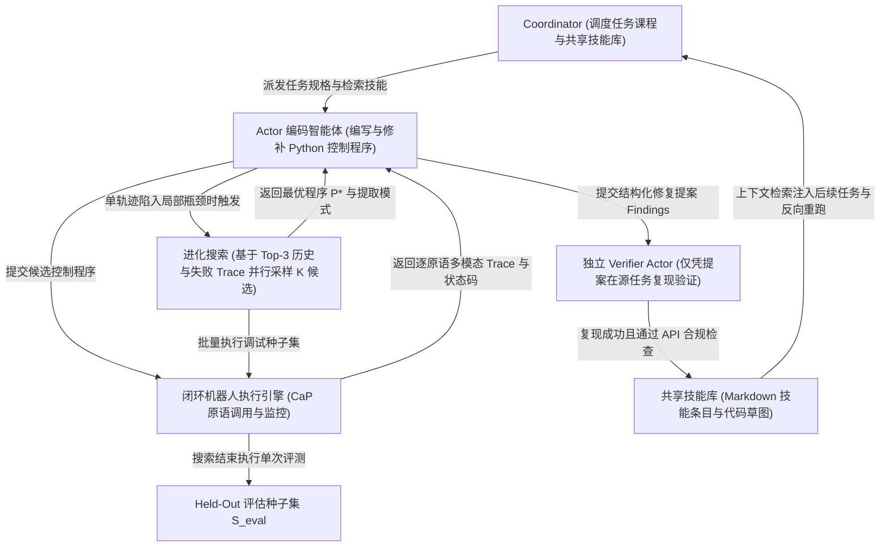
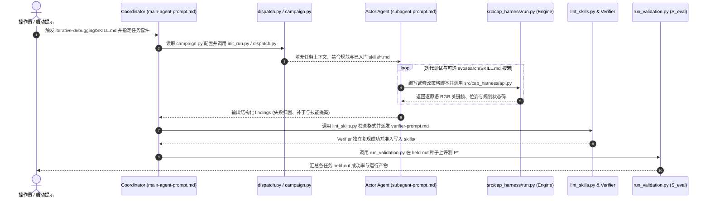

# ASPIRE: Agentic /Skills Discovery for Robotics

## 一句话定义

**ASPIRE**（*Agentic Skill Programming through Iterative Robot Exploration*）是一个不依赖模型权重梯度更新的机器人持续学习系统，让编码智能体在统一 Code-as-Policy 框架下依托逐原语多模态执行反馈迭代修复控制程序、通过进化搜索探索多样策略，并将独立复现验证后的修复经验持续沉淀为可跨任务、跨具身迁移的文本/代码技能库。

## 英文缩写速查

| 缩写 | 英文全称 | 简要说明 |
|---|---|---|
| ASPIRE | Agentic Skill Programming through Iterative Robot Exploration | 本文提出的通过迭代机器人探索实现自主技能发现的持续学习系统 |
| CaP | Code-as-Policy | 代码即策略范式，将感知、规划与控制原语组合为可执行 Python 控制程序 |
| VLA | Vision-Language-Action | 端到端视觉-语言-动作策略，文中以 OpenVLA、$\pi_0$、$\pi_{0.5}$ 作为对照基线 |
| MCP | Model Context Protocol | 模型上下文协议，真机 System 2 架构中连接编码智能体与 CaP 运行时的工具协议 |
| LLM | Large Language Model | 大语言模型，驱动 Coordinator、Actor 与 Verifier 诊断及修补控制代码 |
| IK | Inverse Kinematics | 逆运动学，真机控制后端通过 Mink 求解末端位姿对应的关节目标 |

## 为什么重要

1. **打破传统具身编码智能体“缺细节、不记忆”的双重瓶颈**：早期代码即策略系统仅向智能体暴露整段 rollout 的成败信号或冗长视频，导致模型难以定位失败究竟源于感知误检、规划碰撞还是抓取滑动；同时，每次任务修通后的经验随会话结束被丢弃，系统解第 100 个任务时并未比解第 1 个任务更有经验。
2. **以“技能库复利”取代纯权重微调的持续学习路径**：ASPIRE 将“训练”重新定义为技能精炼，将“模型资产”外置为可解释、可组合的模块化修复技能仓库，使短时程任务中发现的局部恢复经验能够零样本迁移到未见长时程任务（LIBERO-Pro Long 达 30.5% vs 基线 3.8%–5.0%）。
3. **跨具身与真机在线学习的可行性验证**：尽管不同机械臂拥有迥异的动力学与控制 API，仿真中提炼出的故障规避与几何对齐启发式仍能作为上下文指导大幅削减真机调试 token 消耗（高达约 10 倍），且通过 MCP 工具接口可直接支持真机在线探索并学会双臂操作魔方。

## 核心信息

| 字段 | 内容 |
|---|---|
| 论文标题 | *ASPIRE: Agentic /Skills Discovery for Robotics* |
| 作者 | Runyu Lu\*、Yubo Wu\*、Ethan Kou\*、Haotian Lin\*、Letian Fu (Max Fu)、Wenli Xiao、Ajay Mandlekar、Yinzhen Xu、Guanya Shi、Ken Goldberg、Ang Chen、Mosharaf Chowdhury、Jan Kautz、Yuke Zhu†、Linxi "Jim" Fan†、Guanzhi Wang† |
| 机构 | NVIDIA（NVIDIA GEAR）、CMU、UC Berkeley、University of Michigan（UMich）、UIUC |
| 发表时间 | arXiv:2607.00272v2（2026-10-20 修订；v1 提交于 2026-06-30） |
| 论文链接 | [arXiv:2607.00272](https://arxiv.org/abs/2607.00272) / [HTML 全文](https://arxiv.org/html/2607.00272) |
| 项目与代码 | [NVIDIA 项目主页](https://research.nvidia.com/labs/gear/aspire/) / [NVlabs/ASPIRE](https://github.com/NVlabs/ASPIRE)（Apache-2.0，v1.0） |
| 清单分类 | `environment.benchmarking`, `harness.skills`（来源条目 `survey_ax_2607_00272`） |
| 开源状态 | **已开源**（开放仿真迭代调试与进化搜索 Agent Skills、CaP 编程规范、配置文件、引导脚本及 YAM 真机 System 2 运行手册与示例；依赖外部 LLM API 及受限权重 SAM3） |

## 核心原理

ASPIRE 采用 **Coordinator–Actor** 解耦架构，在不交换冗长原始聊天记录的前提下完成跨任务知识复利，核心由三大支柱与课程回溯机制构成：

1. **闭环机器人执行引擎（Robot Execution Engine，§2.1）**：
   - 统一封装跨仿真器（LIBERO-Pro、Robosuite、BEHAVIOR-1K）的感知（如 SAM3、GraspNet）、几何计算与运动规划（如 cuRobo、PyRoki）原语 API。
   - **逐原语多模态轨迹（Per-Primitive Multimodal Trace）**：每次调用原语时自动记录 API 名称、输入参数、返回值、状态码（如 `PLANNING_ERROR`）以及调用紧邻前后的 RGB 关键帧、视觉检测/轨迹叠加图（overlays）和候选抓取位姿。
   - 智能体无需消化整段冗长视频，可按需精准定位出错原语并校验修复前后的因果证据（例如识别出 `navigate_to_pose` 目标点落入桌面 20 cm 碰撞缓冲区而改用多角度接近策略）。
2. **双阶段验证准入的可扩展技能库（Skill Library，§2.2）**：
   - 技能不局限于固定分类，从真实调试修复中开放归纳（包括定位消歧、感知提示工程、抓取约束、导航恢复、双臂运动原语、场景推理及调试工作流）。每条技能浓缩为**失败特征、触发条件（when-to-apply guard）、修复策略与可选代码草图**。
   - **提案–验证–晋升闭环**：Actor 汇报结构化 `findings` 后，由独立的 **Verifier Actor** 在**仅给定技能提案文本**的条件下在源任务调试集上尝试复现修复；经脚本预检（`lint_skills.py`）与 API 合规审核通过后，Coordinator 才正式将技能合入共享库。
3. **程序级进化搜索（Evolutionary Search，§2.3, Algorithm 1）**：
   - 单轨迹迭代调试容易陷入局部修补死胡同。当某任务性能未达阈值 $\theta$ 时，进化搜索在每轮 $i \in \{1,\dots,T\}$ 基于当前技能库 $\mathcal{L}$ 与历史归档 $\mathcal{H}$ 中表现前 3 的程序及残余失败轨迹，并行采样并生成 $K$ 个差异化候选程序 $\{P_i^k\}_{k=1}^K$。
   - 各候选程序在调试种子集 $S_{\text{dbg}}$ 上闭环执行与调试，优胜程序 $P^\star$ 最终**仅在未见过的 held-out 评估种子集 $S_{\text{eval}}$ 上评测一次**，避免测试集过拟合。
4. **课程调度与反向技能迁移（Curriculum & Backward Transfer，§2.4）**：
   - Coordinator 根据技能库缺口动态安排任务顺序；待整个套件跑完、技能库趋于完备后，对早期得分偏低的任务执行一轮单独重跑，将后期学到的高阶技能反哺早期任务。
5. **真机 System 2 MCP 运行时（Appendix D）**：
   - 面向物理双臂平台（YAM），编码智能体作为 System 2 通过 Streamable HTTP 协议的 **MCP Bridge** 调用受白名单约束的观测与控制工具（如 `observe`、`cap_localize_object`、`cap_move_to_pose`、`cap_move_synchronized`、`cap_set_gripper`），内部由 Mink 求解 IK、cuRobo 生成轨迹并串行化下发至机械臂驱动，实现“观察–推理–动作–验证”在线自改进闭环。

## 流程总览

## 源码运行时序图

官方仓库 `NVlabs/ASPIRE` 以 `.claude/skills/iterative-debugging/SKILL.md` 与 `.claude/skills/evosearch/SKILL.md` 为编码智能体核心编排入口，底层通过 `.claude/skills/iterative-debugging/scripts/` 中的 `campaign.py`、`dispatch.py`、`run_validation.py` 与 `lint_skills.py` 调度 CaP 执行框架 `src/cap_harness/` 完成闭环调试、验证与晋升（以下为静态源码结构核对所得工作流）。

## 实验与评测

论文在三大仿真基准家族（全部严格区分学习种子集与 held-out 评估种子集）及双臂 YAM 真机上进行了系统评测（§3.1–3.9，Tables 1–26）：

### 1. 主基准测试对比（Claude Opus 4.6，Tables 5–7）

| 基准家族 | 评测协议 | OpenVLA | $\pi_0$ | $\pi_{0.5}$ | CaP-Agent0 | 人类专家 | ASPIRE (Opus 4.6) |
|---|---|---|---|---|---|---|---|
| **LIBERO-Pro Object** (Pos / Task) | 10 任务 × 50 held-out 种子 | 0.0% / 0.0% | 0.0% / 0.0% | 17.0% / 1.0% | 22.0% / 18.0% | — | **98.0% / 95.0%** |
| **LIBERO-Pro Goal** (Pos / Task) | 10 任务 × 50 held-out 种子 | 0.0% / 0.0% | 0.0% / 0.0% | 38.0% / 0.0% | 26.0% / 17.0% | — | **81.0% / 45.0%** |
| **LIBERO-Pro Spatial** (Pos / Task) | 10 任务 × 50 held-out 种子 | 0.0% / 0.0% | 0.0% / 0.0% | 20.0% / 1.0% | 12.0% / 14.0% | — | **51.0% / 60.0%** |
| **LIBERO-Pro 3 套件均值** | 60 子集宏平均 | 0.0% | 0.0% | 13.0% | 18.0% | — | **72.0%** |
| **Robosuite** (7 任务均值) | 每任务 100 held-out 试验 | — | — | — | 68.0% | — | **81.0%** |
| **Robosuite `two_arm_handover`** | 100 held-out 双臂交接 | — | — | — | 20% | — | **92%** |
| **BEHAVIOR-1K `soda-can`** (Nav / Task) | 25 held-out 种子增量块执行 | — | — | — | 84% / 72% | 80% / 72% | **92% / 88%** |
| **BEHAVIOR-1K `radio`** (Nav / Task) | 25 held-out 种子增量块执行 | — | — | — | 80% / 56% | 88% / 36% | **100% / 88%** |

*注：ASPIRE 在少量调试种子上学习后每任务仅输出一份程序并在 held-out 种子评测；CaP-Agent0 则在每个评估种子上重新生成程序并依赖测试时推理与重试。*

### 2. 零样本跨任务迁移与技能库规模缩放（LIBERO-90 → LIBERO-Pro Long，Table 8）

| 方法 / 技能库规模 | Position 扰动 | Task 扰动 | 总体均值 |
|---|---|---|---|
| OpenVLA / $\pi_0$ | 0.0% / 0.0% | 0.0% / 0.0% | 0.0% / 0.0% |
| $\pi_{0.5}$ / CaP-Agent0 | 8.0% / 5.2% | 1.0% / 2.4% | 5.0% / 3.8% |
| ASPIRE ($N=0$，空库零样本) | 0.0% | 9.4% | 4.7% |
| ASPIRE ($N=25$ / $N=50$) | 5.6% / 13.8% | 21.8% / 29.2% | 13.7% / 21.5% |
| **ASPIRE ($N=90$，全量库零样本)** | **22.6%** | **38.3%** | **30.5%** |

### 3. 跨具身真机迁移（Franka 仿真技能 → 双臂 YAM，GPT-5.5，Table 1）

| 真机任务 | 总 Token 消耗 (无技能 → 有技能) | 输出 Token (无技能 → 有技能) | Held-Out 真机成功率 (无技能 → 有技能) |
|---|---|---|---|
| Put bowl on plate | 8.65M → **5.11M** | 0.05M → **0.04M** | 20/20 → **20/20** |
| Lift soda can | 61.94M → **6.58M**（降约 9.4×） | 0.18M → **0.03M** | 13/20 (65%) → **19/20 (95%)** |
| Open/push drawer | 334.92M → **81.67M** | 1.33M → **0.36M** | 0/20 (0%) → **11/20 (55%)** |

### 4. 真机在线学习与关键消融（§3.7–3.8, Tables 2, 17–21）

- **真机在线学习（魔方求解，GPT-6 Astra + YAM，§3.7）：** 连续 3 回合中，第 1 回合 50 min 54 s 未解（完成 3 次转面），第 2、3 回合分别在 39 min（5 次转面）与 77 min 10 s（25 次转面）解出；单次转面平均耗时从 16 min 58 s 降至 7 min 48 s 再降至 **3 min 05 s**，单次转面摊销 token 从 11.27M 降至 **2.01M**（API 成本从 $16.85 降至 **$2.89**）。
- **核心模块消融（LIBERO-Pro，Opus 4.6）：** 仅靠零样本样本提示（无执行引擎与进化搜索）宏平均仅 **14%**（Pos 20% / Task 9%）；加入逐原语执行引擎跃升至 **62%**（Pos 62% / Task 61%）；再叠加进化搜索达到 **72%**（Pos 77% / Task 67%）。
- **反向技能迁移（LIBERO-Pro Long，Opus 5，Table 2）：** 对 5 个早期低分任务使用完备技能库重跑后，20 任务整体成功率从 **74.6%**（746/1000）提升至 **82.2%**（822/1000），其中两个抽屉任务从 0% 跃升至 52% 与 72%。
- **12 模型缩放与成本前沿（LIBERO-Pro Goal Pos，空库无进化搜索，Table 18）：** GPT-6 Luna 仅 14.8%（$0.83/任务）；开源权重 Kimi K3 达 78.4%（$58.19），Qwen 3.8 Max 达 56.0%（$39.82）；Claude Sonnet 5.5 位于成本/成功率 Pareto 前沿，以 **$12.11/任务** 取得 **98.8%**，Claude Opus 5.5 达 **99.2%**（$18.29/任务）。加入完整技能库与进化搜索后，Claude Opus 5.5 在 LIBERO-Pro 80 任务均接近满分（Object 98.2%/100.0%、Goal 98.0%/99.4%、Spatial 99.4%/99.2%、Long 97.0%/98.8%，平均约 **99%**），Robosuite 7 任务 **100%**，BEHAVIOR-1K **100%**（Tables 3–4, 13–17）。

## 与其他工作对比

| 对比维度 | 端到端 VLA（OpenVLA / $\pi_0$ / $\pi_{0.5}$） | CaP-Agent0 | Voyager | ASPIRE（本文） |
|---|---|---|---|---|
| 策略表示与训练方式 | 神经网络权重微调 | 静态提示词 + 每测试样本现写程序 | 外置 JS 函数技能库（Minecraft） | **外置可检索修复技能库 + 单程序泛化** |
| 执行反馈粒度 | 稀疏/无在线程序级调试 | 粗粒度视觉差分与任务重试 | 环境聊天反馈 + 解释器报错 + Critic | **逐原语多模态 Trace（关键帧+叠加图+状态码）** |
| 探索策略 | 数据驱动采样 | 单轨迹测试时重试 | 自动课程驱动多轮试错 | **程序级进化搜索 + 课程与反向迁移** |
| 跨具身/真机能力 | 依赖对应本体遥操作数据微调 | 受限于预定义固定技能库 | 未在物理机械臂验证 | **仿真技能跨具身降耗迁移 + MCP 在线学魔方** |

## 结论

**一句话总判：ASPIRE 证明了“逐原语多模态执行诊断 + 独立复现准入的技能库 + 程序级进化搜索”能够在不更新大模型权重的前提下，将机器人编码智能体的调试经验转化为随任务数递增的跨任务与跨具身泛化能力。**

1. **细粒度原语级 Trace 是调试效能的第一杠杆**：消融表明执行引擎将 LIBERO-Pro 宏平均从 14% 推升至 62%（+48 pp），设计机器人代理框架时必须暴露调用级中间状态与关键帧，而非仅返回最终成败或整段视频。
2. **技能准入必须经历“盲测独立复现”**：由独立 Verifier Actor 仅凭技能提案在源任务复现成功再入库，能有效剔除任务偶发过拟合或隐藏上下文依赖，保证跨任务检索的可靠性。
3. **进化搜索负责攻克长尾结构性瓶颈**：尽管强基础模型（如 Claude Opus 5.5 / Sonnet 5.5）仅靠迭代调试即可解决大部分常规任务，但诸如“微波炉放杯”或“低矮抽屉/障碍推盘”等策略突变任务仍需多候选并行进化来跳出局部极值。
4. **选型可兼顾成本与前沿模型红利**：强模型不仅成功率更高且单位任务迭代总成本往往更低（如 Sonnet 5.5 在 $12/任务即可逼近 99%），适合作为系统核心大脑；但开源小模型尚难独立支撑复杂调试环。

## 工程实践

- **环境配置与启动顺序**：按照仓库 `docs/host-setup.md` 安装 CUDA、`uv` 及受限权重 SAM3 的 Hugging Face Token，并通过 `scripts/bootstrap_*.sh` 初始化 LIBERO、BEHAVIOR、cuRobo 与 GraspNet 后端，对照 `configs/profiles/` 匹配显卡档位。
- **调试与评测种子严格隔离**：复现或迁移至新套件时，应通过 `configs/validation/*.yaml` 与 `scripts/run_validation.py` 强制切分调试种子集与 held-out 评估种子集，防止智能体针对评测布局作弊或过拟合。
- **安全沙箱隔离（强制要求）**：ASPIRE 执行 LLM 生成的 Python 代码且拥有完整 `import` 权限，官方明确提示其 trial 进程与 `watchdog.py` 不构成安全沙箱。工程部署时必须运行在无敏感挂载、网络受限的隔离容器或独立主机中，并物理隔离仿真智能体与真机硬件权限。
- **真机 System 2 接入规范**：物理平台部署应通过 `AGENTS.md` 与 `docs/system2.md` 规范，借助带 JSON Schema 校验和串行作业锁的 MCP Bridge 对接底层控制栈，并强制核查观测时间戳新鲜度（staleness flags），不可仅凭运动指令返回成功替代物理结果视觉核验。

## 局限与风险

1. **真机全自主闭环尚未闭环**：物理实验（如魔方求解）仍依赖人类操作员提供任务启发指引、手动打乱或复位场景以及安全监护，距离无人值守真机终身学习尚有距离。
2. **高度依赖冻结的强前沿大模型**：在 LIBERO-Pro Goal 位置扰动下，较弱模型（如 GPT-6 Luna 14.8%、Qwen 3.8 Max 56.0%、Opus 4.6 55.6%）难以稳定完成多步归因修复，高成功率主要依托 Claude Opus 5.5 / Sonnet 5.5 或 GPT-6 Astra 等专有前沿模型。
3. **受限于预定义原语 API 边界**：系统不能自主发明底层传感器驱动或全新连续控制器；当任务需要超出既定 API 表达力的精细力控或硬件能力时，智能体只能低效近似或依赖人工扩展接口。
4. **技能库缺少长期遗忘与冲突管理**：技能仅在入库时由 Verifier 检验一次，随着库规模扩大，部分技能可能随环境变化变得陈旧、冗余甚至在零样本迁移中产生误导，尚缺重验证、剪枝与任务感知排序机制。
5. **算力与 Token 成本高昂**：大量闭环 rollout 与进化搜索对推理调用与仿真时长开销显著（如 60 任务阶段 Opus 4.6 配合进化搜索合计消耗约 $4,137、2.6 万次以上 LLM 调用），大规模扩展仍需更高样本效率的检索与搜索机制。

## 关联页面

- [Agentic Robots 综述](paper-towards-agentic-robots-survey.md)
- [全量项目节点清单](../overview/awesome-agentic-robots-node-index.md)
- [VLA 方法背景](../methods/vla.md)
- [智能体机器人操作策略](../methods/agentic-manipulation-policies.md)：对照操作场景中的规划、执行与反馈接口
- [ASPIRE 方法页](../methods/aspire.md)：系统三组件、技能复利与同系列工作 ENPIRE 对比
- [Agent Skill Packaging · 智能体技能封装](../methods/agent-skill-packaging.md)：对比可按需加载的标准化技能打包机制
- [Coding Agent 验证闭环](../methods/coding-agent-verification-loops.md)：对照软件工程与具身控制中的独立验证门禁设计
- [Robot Agent Harness · 机器人智能体执行框架](../methods/robot-agent-harness.md)：对照任务提议、技能契约与执行边界控制
- [机器人操作（Manipulation）](../tasks/manipulation.md)：对照 LIBERO-Pro 与 BEHAVIOR-1K 操作基准
- [双臂协同操作（Bimanual Manipulation）](../tasks/bimanual-manipulation.md)：对照 Robosuite 双臂交接与 YAM 双臂真机任务

## 推荐继续阅读

- [ASPIRE 官方项目主页（NVIDIA Research GEAR Lab）](https://research.nvidia.com/labs/gear/aspire/)
- [ASPIRE 官方代码仓库与运行手册（GitHub: NVlabs/ASPIRE）](https://github.com/NVlabs/ASPIRE)
- [arXiv:2607.00272v2 论文 HTML 全文](https://arxiv.org/html/2607.00272)

## 参考来源

- [ASPIRE 论文全文核对归档](../../sources/papers/paper-agentic-2607-00272.md)
- [官方 Awesome 快照归档](../../sources/repos/awesome-agentic-robots-survey-index.md)
- [NVlabs/ASPIRE 官方仓库归档](../../sources/repos/paper-agentic-2607-00272.md)
- [arXiv:2607.00272 原始论文页面](https://arxiv.org/abs/2607.00272)
- [NVlabs/ASPIRE GitHub 仓库](https://github.com/NVlabs/ASPIRE)
