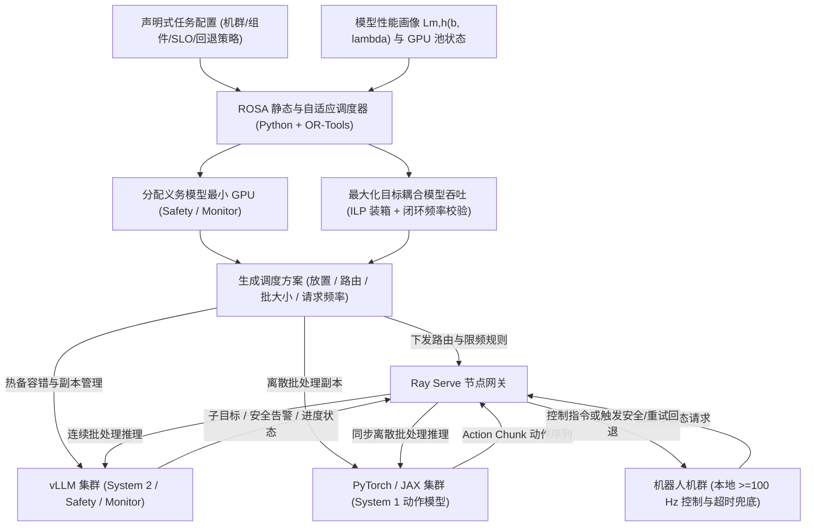

# ROSA: A Robotics Foundation Model Serving System for Robot Factories

## 一句话定义

ROSA（Robotics Oriented Serving Architecture）是由英伟达研究院与斯坦福大学提出的面向机器人工厂的多机共享 GPU 池机器人基础模型（RFM）推理服务系统，通过机器人感知的声明式任务抽象与工厂吞吐驱动的调度器，在满足多组件延迟服务等级目标（SLO）的前提下最大化全厂机器人动作产出。

## 英文缩写速查

| 缩写 | 英文全称 | 简要说明 |
|---|---|---|
| ROSA | Robotics Oriented Serving Architecture | 本文提出的面向机器人工厂的基础模型共享服务系统架构 |
| RFM | Robotics Foundation Model | 涵盖 VLA、世界动作模型及配套推理监控模型的机器人基础模型 |
| VLA | Vision-Language-Action | 融合视觉感知、语言指令与动作解码的端到端控制模型 |
| WAM | World Action Model | 联合预测未来环境状态与机器人动作的世界动作模型 |
| SLO | Service-Level Objective | 模型推理请求的延迟上限（如 P99）与调用频率等服务等级目标 |
| ILP | Integer Linear Programming | 整数线性规划，本文用于求解 GPU 服务器与机器人流的装箱配置 |
| SoC | System-on-Chip | 机器人端片上系统，用于高频局部控制与超时安全兜底 |
| VLM | Vision-Language Model | 视觉-语言模型，在 ROSA 中承担 System 2 规划、安全检查与进度监控 |

## 为什么重要

随着通用机器人逐步进入工厂产线执行装配、分拣、打包与巡检任务，机器人工厂需要持续并发运行多个机器人基础模型，而现有推理系统普遍建立在两项制约规模化部署的预设之上：

1. **单机边缘独占预设（一机一卡或机载 SoC）：** 机载 SoC 受功耗与散热约束（如 Jetson Thor 与同代 B100 相比显存带宽低 29 倍、FP8 算力低 3.5 倍），且本地推理显著缩短移动机器人续航（Figure 02 双机载 RTX GPU 功耗占比接近整机一半）；即使外接独占边缘服务器，在同步推理模式下等待物理动作执行时 GPU 长期空转，且单台机器人无法触发跨机批处理（inter-robot batching）。
2. **单动作模型延迟最小化预设：** 工厂可靠生产不仅依赖快速反应的 System 1 动作模型，还需要长程规划（System 2）、安全审查（Safety VLM）和任务进度监控（Monitor VLM）。一味压低单个请求的延迟会过度消耗硬件，却无法直接转化为整厂在 SLO 约束下的有效总产量。

ROSA 将多机器人推理从“边缘单卡优化”重构为“数据中心共享 GPU 池调度问题”，为大规模多任务机群提供了系统层面的软件抽象与资源分配范式。

## 核心信息

| 字段 | 内容或状态 |
|---|---|
| 作者 | Wenqi Jiang, Jason Clemons, Rowland O’Flaherty, Hugo Hadfield, Alperen Degirmenci, Shuran Song, Yashraj Narang, Christos Kozyrakis |
| 机构 | NVIDIA Research, Stanford University |
| 发表时间 | 2026-07-01（arXiv:2607.01088v1 [cs.RO]） |
| 论文链接 | [arXiv:2607.01088](https://arxiv.org/abs/2607.01088) / [arXiv HTML 全文](https://arxiv.org/html/2607.01088) |
| 项目与代码 | 论文原文及关联条目未提供独立项目页或开源仓库链接 |
| 清单分类 | `harness.infrastructure`（来源条目 `survey_ax_2607_01088`） |
| 开源状态 | 未确认开源代码 |

## 核心原理

ROSA 围绕**共享服务器集群架构**、**声明式编程抽象**与**工厂目标驱动调度器**三大支柱设计，并与机器人本地控制回路分工协作：

### 1. 共享 GPU 池与端云职责划分

- **集中式推理集群：** 多台机器人通过稳定工厂网络（如 WiFi 7 往返延迟低于 5 ms，比数十至数百毫秒的 System 1 推理及数秒级 System 2 推理低一到两个数量级）向共享 GPU 池发送观测请求，从而复用服务器级高带宽算力、提升多机批处理利用率并降低机载功耗。
- **机器人端保留职责：** 本地轻量算力（CPU/微控制器或轻量 SoC）仍承担两类不可卸载任务：
  1. **高频局部执行控制：** 将服务端返回的动作块（action chunk）结合实时本体感知与力反馈，以 $\ge 100\text{ Hz}$ 频率解算为关节力矩等底层指令（例如在 CPU 上运行轻量跟踪策略 SONIC）。
  2. **本地安全与 SLO 超时接管：** 当安全模型发出告警或网络抖动/过载导致推理超出 P99 SLO 时，本地运行时立即触发预设安全回退动作（急停、重发或规划返回默认安全姿态）。

### 2. 机器人感知的声明式编程抽象

ROSA 通过统一配置文件声明集群规格（服务器数、GPU 型号）、机群构成及每类任务的四项属性：

- **异构模型组合与依赖：** 可按需组合 `system1`（动作模型）、`system2`（长程规划，支持配置 `system2_to_system1_call_ratio` 比例 $H$）、`safety`（安全判定）与 `monitor`（进度判定）。其中 `system2` 与 `system1` 形成串行依赖链，`safety` 与 `monitor` 作为独立周期任务并行触发。
- **差异化性能约束：** 为不同模型与任务声明各自的 `action_period_ms`（$t_{act}$）、周期频率 `freq_hz`（$\bar{\lambda}_{r,m}$）及 P99 延迟期限 `slo_ms`（$D_{r,m}$）。
- **异常回退与升级策略：** 支持组件级 `fallback`（如 `stop_and_resend`、`use_last_plan`、`stop_and_replan`）、连续违例阈值（`max_consecutive_safety_replan`、`max_consecutive_slo_violation`）与任务级重试次数（`max_task_retries`），超限后执行 `stop_and_call_human` 升级至人工接管。

### 3. 工厂目标驱动调度器（同构、异构与容错）

调度器接收任务配置、GPU 集群资源与各模型在硬件 $h$ 上不同批大小 $b$ 与聚合请求率 $\lambda$ 下的实测延迟分布 $L_{m,h}(b,\lambda)$（在各批大小最大吞吐的 10%–100% 间采样 10 档），输出四项决策：**模型放置（placement）**、**请求路由（routing）**、**批处理配置（batching）**与**单机请求频率（request rate）**。为避免跨模型共置干扰，每张 GPU 仅托管单一模型组件；System 1 搜索离散批大小 $b$，自回归 VLM 采用连续批处理（continuous batching）。

- **模型二分与工厂优化目标：**
  - **目标耦合模型** $\mathcal{G}=\{\mathrm{S1},\mathrm{S2}\}$ 直接决定机器人动作频率 $f$；
  - **义务模型** $\mathcal{O}=\{\mathrm{safe},\mathrm{mon}\}$ 按固定频率运行，超额加速无益于产量，因此优先以最小可行 GPU 数 $S_{\mathrm{obl}}$ 满足其 SLO。
  - 对于异构机群（按任务类别 $c\in\{1,\dots,C\}$ 分组，含 $K_c$ 台机器人、价值权重 $v_c$ 与最低总吞吐下限 $F_c^{\min}$），调度器在满足全部约束下最大化加权动作吞吐：
    $$\max_{\mathbf{f}}\sum_{c=1}^{C}v_{c}K_{c}f_{c}\quad\text{s.t.}\quad K_{c}f_{c}\geq F_{c}^{\min},\ \forall c$$
- **同构任务调度（二分搜索 + ILP）：** 在剩余 GPU $S_{\mathrm{goal}} = S - S_{\mathrm{obl}}$ 上对共享频率 $f$ 进行二分搜索。给定候选 $f$，先由性能画像筛选满足显存与 P99 SLO 的单卡配置集合 $\mathcal{P}(f)$，再用整数线性规划（OR-Tools）求解满足 $\sum_p y_p \le |S_{\mathrm{goal}}|$ 与 $\sum_p y_p a_{p,m} = |R|$ 的最小成本部署方案，最后校验同步闭环频率可行性：
  $$f \le f_{\mathrm{loop}} = \frac{1}{t_{act} + \ell_{\mathrm{S1}} + \ell_{\mathrm{S2}}/H}$$
- **异构任务调度（自适应前沿搜索 + 两阶段装箱压缩）：** 为避免多维网格搜索指数爆炸，采用贪心自适应前沿搜索，每轮沿潜在加权收益最大的维度折半试探并利用单调性剪枝不可行域；可行性检查采用「单类任务隔离 ILP 装箱 + 跨类贪心合并压缩」两阶段原语，把低负载服务器向高余量同模型服务器合并（合并后仍须满足各类 SLO）。
- **在线准入与热备容错：** 新机器人加入优先尝试“保留当前模型放置”的轻量准入（仅调路由与频率），无法满足时再触发全局重调度；节点容错采用**预加载权重的热备 GPU（hot-standby）**，发生故障时网关直接切换路由而不触发双活重调度，避免干扰正常作业机器人。

### 4. 系统实现

系统以 **Ray Serve** 作为分布式编排层，每个节点运行请求网关并管理模型副本生命周期；自回归 VLM（System 2 / Safety / Monitor）由 **vLLM** 承载，System 1 动作模型按模型族分别接入 **PyTorch**（启用 `torch.compile`、CUDA Graphs、FlashAttention 与 FP16）或 **JAX**（FP16），调度求解器由 Python 结合 **OR-Tools** 实现。

## 流程总览

## 源码运行时序图

**不适用**（截至 2026-11-27 核查 arXiv:2607.01088v1 原文及关联检索材料，未提供独立项目页或官方开源代码仓库入口，无法确认可运行源码实现；源码内部模块调用细节有待官方代码发布后补充）。

## 实验与评测

作者在 **8×NVIDIA H200** 服务器与 **Franka Panda** 机械臂上分别进行了大规模合成负载（回放真实采集观测）与端到端真机功能验证。System 1 主用 **GR00T N1.6**（PyTorch FP16，对比 **$\pi_{0.5}$** JAX FP16），System 2 与 Monitor 采用 **Qwen2.5-VL-7B**，Safety 采用 **Qwen2.5-VL-3B**；动作执行周期 $t_{act}=200\text{ ms}$，所有延迟约束均以 P99 衡量。

### 1. 评测任务配置（Table 1 & Table 2）

| 负载 ID | 任务类型 | 包含组件 | 关键频率 / P99 SLO 约束 |
|---|---|---|---|
| P1 | Pick-and-place action-only | S1 | S1: 200 ms |
| P2 | Pick-and-place simple | S1, Monitor | S1: 200 ms；Monitor: 0.5 Hz / 2000 ms |
| P3 | Pick-and-place hard | S1, Safety, Monitor | S1: 200 ms；Safety: 2 Hz / 500 ms；Monitor: 0.5 Hz / 2000 ms |
| P4 | Assemble kit | S1, S2, Safety, Monitor | S1: 200 ms；S2: 1/10 S1 / 2000 ms；Safety: 2 Hz / 500 ms；Monitor: 0.5 Hz / 2000 ms |
| Mix2 | 异构混合（2 类） | P2, P4 | 各类各占总机数 $K/2$ |
| Mix4 | 异构混合（4 类） | P1, P2, P3, P4 | 各类各占总机数 $K/4$ |

### 2. 端到端工厂吞吐与对比结果（8×H200）

- **对比独占基线（1 GPU/机器人、1 GPU/模型/机器人）：** 在 8 卡约束下，独占基线最多仅能服务 8 台（单卡单机）或 2 台（P4 四组件一卡一模型，达标吞吐 **7.4 actions/s**）；ROSA 在 P4 上可服务 32 台机器人并取得 **89.4 SLO-qualified actions/s**，较可运行的最佳独占基线提升 **12.06×**（1 GPU/机器人基线在 P4 上无 SLO 达标工作点）。
- **对比共享静态基线（均分 2:2:2:2 与按模型尺寸加权 1:3:1:3，均不限频且 S1 batch=1）：**
  - 单任务 8 台低负载时，P4 上均分基线因未限频略高（29.5 vs ROSA 保守限频的 23.9 actions/s）；当机数增至 32 台时，P2 上 ROSA 提升 **1.23×**（**106.9 vs 87.1** actions/s），而 P3 与 P4 上两类共享基线的 SLO 达标率跌至 **0%**，ROSA 仍分别维持 **106.9** 与 **89.4** actions/s（P4 达标率 **99.9%**）。
  - 异构混合负载下，ROSA 峰值 SLO 达标吞吐在 Mix2 上提升 **2.21×**、在 Mix4 上提升 **2.30×**，全基准汇总相对共享基线最高提升 **2.44×**。

### 3. 调度决策消融与真机验证（P4 为主）

- **延迟与达标率：** 32 台机器人时，均分与加权基线 S1 SLO 达标率均为 0%（中位延迟分别为 534.5 ms 与 520.8 ms），ROSA 保持 **99.96%** 达标率（中位延迟 **83.8 ms**）；64 台高负载下仍保持 **97.23%** 达标率。
- **请求速率控制：** 64 台机器人下关闭限频虽产生 145.5 原始动作/秒，但因严重排队导致 S1 达标率跌至 17.0%（仅 **24.8** 达标动作/秒）；开启 ROSA 限频后取得 **78.8** 达标动作/秒（97.2% 达标率，**3.18×** 提升）。即使给共享基线补齐限频策略，均分与加权基线仍分别需要高达 **5.5×** 与 **8.6×** 的 GPU 数量才能匹配 8 卡 ROSA 的产出。
- **跨模型 GPU 配比（Table 3）：** 在 8 卡 P4 上，ROSA 动态分配 S1:S2:Safety:Monitor 为 `5:1:1:1`（8/16/32 台）与 `4:1:2:1`（64 台），在统一限频与批处理前提下较最佳静态划分在 16 台与 32 台上分别快 **1.26×** 与 **2.20×**；加权划分（`1:3:1:3`）在 64 台时因 Safety 算力不足直接不可行。
- **System 1 离散批处理：** GR00T N1.6 与 $\pi_{0.5}$ 在 batch=16 下比 batch=1 原始吞吐高约 3–4×；在 16 台机器人、50 ms 动作周期（无延迟 SLO 约束）的高压下，选择 batch=16 带来 **2.46×** 端到端提速，而低负载或长周期下 batch=1 仍更优。
- **真机验证：** 在 Franka Panda 机械臂上跑通类 P3 工具收纳任务，验证了 Action、Monitor VLM 与行人靠近触发 Safety VLM 的完整端到端链路。

## 与其他工作对比

| 维度 | 传统单机边缘 / 独占推理（如常规 VLA-Perf 评估范式） | 静态分区共享服务基线 | ROSA（本文） |
|---|---|---|---|
| 部署形态 | 机载 SoC 或 1 GPU/机器人、1 GPU/模型 | 共享服务器集群但静态固定卡数配比 | 共享 GPU 池 + 机器人端高频局部控制与超时兜底 |
| 负载范围 | 单一 System 1 动作模型为主 | 支持多模型但缺乏依赖与频率协同 | 原生编排 System 1 / System 2 / Safety / Monitor 多模型流水线 |
| 优化目标 | 单次推理延迟最小化 | 无显式工厂目标与客户端限频 | SLO 约束下的全厂加权动作吞吐最大化 |
| 批处理与限频 | 无跨机批处理，动作完成即发请求 | S1 固定 batch=1，高并发下排队雪崩 | 性能画像驱动的离散/连续批处理 + 闭环频率控制 |
| 容错与扩展 | 硬件故障直接导致对应机器人停机 | 缺乏准入控制与热备迁移 | 置放保留式准入、全局重调度与热备 GPU 瞬时切换 |

## 结论

**一句话总判：在面向机器人工厂的共享 GPU 池推理中，决定有效产出的关键不是孤立压低单个 System 1 请求延迟，而是通过请求限频、按闭环瓶颈倾斜的跨模型算力配比与受控批处理防止排队雪崩，从而最大化 SLO 达标的全厂动作吞吐。**

1. **客户端限频是防止共享集群退化的首要开关** — 高并发下不加节制地发出请求会把队列推至超时（64 台 P4 负载达标率跌至 17.0%），调度器计算的可行动作频率能在轻度牺牲峰值空载率的同时换取 3.18× 的有效达标吞吐。
2. **多模型算力应按吞吐瓶颈与义务边界倾斜分配** — 将 Safety 与 Monitor 视为固定频率的义务模型并按最小可行 GPU 满足，把剩余卡集中供给目标耦合的 System 1（如 P4 中 5:1:1:1），远优于按参数量加权或均分策略（静态策略需 5.5×–8.6× 更多 GPU 才能追平）。
3. **System 1 批处理存在明确负载拐点** — 离散批处理（batch=16）仅在请求压力足以摊薄额外排队与推理延迟时成立（高并发可达 2.46× 加速）；低负载或严苛动作周期下 batch=1 仍是更优解，必须依赖实测性能画像决策。
4. **端云协同而非完全取代机载算力** — 将大模型卸载到数据中心 GPU 可兼顾高带宽算力与移动机器人续航，但 $\ge 100\text{ Hz}$ 底层关节控制与 SLO 超时/安全急停仍必须保留在机器人本地。

## 工程实践

- **落地前置条件：** 需要预先针对目标 GPU 型号与模型（如 GR00T N1.6、$\pi_{0.5}$、Qwen-VL 系列）测量不同批大小 $b$ 与请求率 $\lambda$ 下的延迟分位数画像 $L_{m,h}(b,\lambda)$，并配置稳定的厂区有线或低抖动无线网络（参考文中 WiFi 7 < 5 ms 指标）。
- **调度参数设定要点：** 在配置声明式任务描述符时，应明确区分与产量挂钩的 `system1`/`system2` 比例 $H$ 及只须达标的 `safety`/`monitor` 频率，并为异构任务设置合理下限 $F_c^{\min}$ 以防高权重任务饿死低权重产线。
- **与现有执行框架结合：** 可直接将 ROSA 的服务网关与 [机器人智能体执行框架](../methods/robot-agent-harness.md) 衔接，把上层任务失败重试与人类接管策略显式写入声明式 YAML 配置。

## 局限与风险

1. **同步执行与稳态负载假设：** 当前调度器假定机器人采用同步闭环执行（推理与物理动作交替，不重叠异步推理）且各任务机群规模在调度窗口内相对稳定；若未来引入高动态自适应 System 2 触发或不规则监控，静态 ILP 调度需升级为在线动态调度机制（§3.6）。
2. **单卡单模型隔离限制：** 为避免共置干扰导致 SLO 违例，ROSA 当前假定每张 GPU 仅托管单一模型，若机群规模较小而模型种类过多，可能出现单卡算力利用率不足的问题。
3. **大规模并发依赖合成回放：** 受限于可用真机数量，32–64 台机器人规模的吞吐与消融结果基于真机观测回放的合成工作负载，真实工厂中的非稳态无线网络丢包、传感器异构故障及跨机物理交互干扰仍需更长周期实测验证。
4. **未公开可运行源码：** 截至目前未检索到官方开源仓库，工程复现需自行基于 Ray Serve、vLLM 与 OR-Tools 搭建原型。

## 关联页面

- [Agentic Robots 综述](paper-towards-agentic-robots-survey.md)
- [全量项目节点清单](../overview/awesome-agentic-robots-node-index.md)
- [VLA 方法背景](../methods/vla.md)
- [机器人智能体执行框架](../methods/robot-agent-harness.md)：对照规划、执行接口与反馈机制。
- [AI 模型服务与推理基础设施](../methods/ai-model-serving-inference.md)：大模型批处理、SLO 调度与推理引擎底座。
- [机器人控制架构](../methods/robot-control-architecture.md)：云端规划/动作生成与本地高频伺服控制的层级分工。
- [机器人操作任务](../tasks/manipulation.md)：文中单机与混合负载评测的核心抓放与装配任务背景。

## 推荐继续阅读

- [arXiv:2607.01088 论文全文（HTML）](https://arxiv.org/html/2607.01088)
- [VLA-Perf: Demystifying VLA Inference Performance (arXiv:2602.18397)](https://arxiv.org/abs/2602.18397)（同一批作者对单机与卸载式 VLA 推理性能瓶颈的系统分析）

## 参考来源

- [论文精读笔记归档](../../sources/papers/paper-agentic-2607-01088.md)
- [官方 Awesome 快照归档](../../sources/repos/awesome-agentic-robots-survey-index.md)
- [论文官方入口 arXiv:2607.01088](https://arxiv.org/abs/2607.01088)
