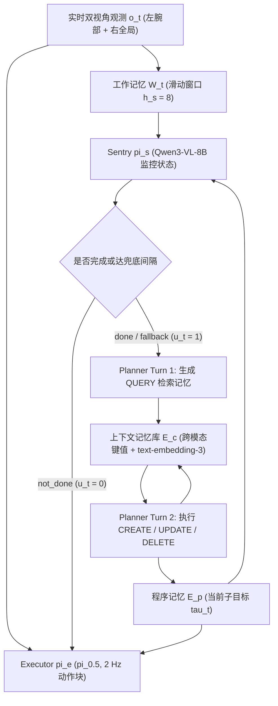
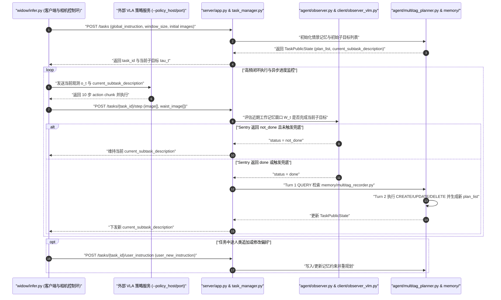

# HiMe: Hierarchical Embodied Memory for Long-Horizon Vision-Language-Action Control

## 一句话定义

HiMe 是一种面向长时程视觉-语言-动作（VLA）控制的分层具身记忆框架，通过“瞬时记忆执行器（Executor）—工作记忆哨兵（Sentry）—情景记忆规划器（Planner）”三层异步解耦，配合基于跨模态语义模式与 `Add / Update / Delete` 主动操作的情景记忆系统，在不阻塞高频低层控制的前提下维持动态长时程一致性与用户偏好对齐。

## 英文缩写速查

| 缩写 | 英文全称 | 简要说明 |
|---|---|---|
| VLA | Vision-Language-Action | 视觉-语言-动作策略模型，直接将观测与语言子目标映射为机器人控制动作 |
| LVLM | Large Vision-Language Model | 大型视觉-语言模型，在 HiMe 中分别用于轻量监控（Sentry）与高层慢思考规划（Planner） |
| CRUD | Create, Read (Query), Update, Delete | HiMe 为 Planner 情景记忆设计的结构化 XML 增删改查协议，用于维持记忆可塑性 |
| FIFO | First-In, First-Out | 先进先出队列基线，固定记忆容量上限并在溢出时逐出最早条目 |
| API Calls | Planner API Invocations per Subtask | 每个子目标平均触发 Planner 推理的次数，用于衡量推理开销与计算效率 |
| Memory Hit Rate | Memory Retrieval Hit Rate | 需要历史信息的子目标执行中，记忆库成功命中所需关键事实的比例 |

## 为什么重要

1. **缓解长时程 VLA 中的“频率-能力悖论”（Frequency-Competence Paradox）：** 主流 VLA 通常依赖马尔可夫假设 $p(a_t \mid o_t, l)$，难以处理依赖不可见历史状态的非马尔可夫长时程任务；若直接将高能力 VLM 放入高频控制环会导致不可接受的推理延迟，而压缩为小模型又会损失泛化与复杂推理能力。HiMe 用轻量 Sentry 门控慢思考 Planner，使推理成本按子目标尺度摊销。
2. **用“跨模态语义模式 + 主动管理”替代被动 FIFO 记忆缓冲：** 单纯以视觉关键帧组成 FIFO 队列（如 Flat Memory / MemER 范式）会在长程交互中被噪声帧淹没，且无法显式编码“这是 Alice 的杯子”等不可见用户偏好或更新过时物体位置。HiMe 将文本语义、用户约束与视觉图像锚定为对象中心键值记录，并通过 `Update` / `Delete` 解决知识冲突与冗余。
3. **验证动态人机交互中的记忆自我纠偏能力：** 在环境物体被中途增改或人类追加新偏好时，Planner 可通过两轮检索与更新协议主动将旧记录标记为历史状态并写入新事实，无需对高层模块重新训练。

## 核心信息

| 字段 | 内容 |
|---|---|
| 作者 | Li Ji, Siyin Wang, Pengfang Qian, Xiaopeng Yu, Yihai Tian, Zhaoye Fei, Jingjing Gong, Xipeng Qiu |
| 机构 | 复旦大学（Fudan University）、上海创智学院（Shanghai Innovation Institute）、华东师范大学（East China Normal University） |
| 发表时间 | arXiv:2607.03449v1（2026-07-03 提交） |
| 论文链接 | [arXiv:2607.03449](https://arxiv.org/abs/2607.03449)（HTML 全文：[arXiv HTML](https://arxiv.org/html/2607.03449)） |
| 项目与代码 | [GitHub: HappyWaterXP/HiMe](https://github.com/HappyWaterXP/HiMe) · [项目主页](https://happywaterxp.github.io/HiMe/) |
| 清单分类 | `harness.memory` |
| 来源条目 | `survey_ax_2607_03449` |
| 开源状态 | **已开源**（仓库公开 FastAPI 任务服务端、Sentry/Planner 调度、多标签记忆模块、提示词与 WidowX-250 参考推理客户端；注：60 条真机示教数据集与微调后 $\pi_{0.5}$ 低层策略权重未单独发布） |

## 核心原理

HiMe 针对部分可观测序贯决策问题（长时程 $T \gg 1$，历史交互 $h_t = (o_0, a_0, \dots, o_t)$），将完整策略 $\pi(a_t \mid o_{0:t}, l)$ 按时间分辨率拆解为三个功能层与三类记忆容器：

### 1. 三层具身记忆空间（§3.2）

- **瞬时记忆（Transient Memory, $\mathcal{T}_t$）：** 由 Executor 持有，仅包含当前瞬时观测 $o_t$，满足高频反应式感运动控制的最小充分状态。
- **工作记忆（Working Memory, $\mathcal{W}_t$）：** 由 Sentry 维护的近期原始观测滑动窗口 $\mathcal{W}_t = \{o_{t-h_s}, \dots, o_t\}$（论文实现设为 $h_s = 8$），用于识别子目标状态跃迁与局部动态变化，避免单帧噪声误判。
- **情景记忆（Episodic Memory, $\mathcal{E}_t = (\mathcal{E}_t^c, \mathcal{E}_t^p)$）：** 由 Planner 管理的持久化长期存储：
  - **上下文记忆（Contextual Memory, $\mathcal{E}_t^c$）：** 跨模态键值存储 $\mathcal{M}_t$，每条记录包含 `id`、2–5 个结构化检索标签 `tags`（涵盖物体 `OBJECT`、位置 `LOCATION` 与用户偏好 `USER_PREFERENCE` 三类）、文本事实 `text` 及关联观测图像索引 `image_path`；后端借助向量数据库与 OpenAI `text-embedding-3` 计算余弦相似度检索。
  - **程序记忆（Procedural Memory, $\mathcal{E}_t^p$）：** 有序语言子目标列表 $\{\tau_i\}_{i=1}^N$，每行携带 `[done]`、`[current]` 或 `[pending]` 状态标签以同步执行闭环。

### 2. 三层策略解耦与门控交接（§3.3）

1. **基础执行器（Base-level Executor, $\pi_e$）：** 在给定当前激活语言子目标 $\tau_t \in \mathcal{E}_t^p$ 的局部马尔可夫假设下生成动作：
   $$a_t \sim \pi_e(a_t \mid o_t, \tau_t)$$
   $\pi_e$ 保持无状态（stateless）以保证高频响应。论文基于 DROID 预训练的 $\pi_{0.5}$ 检查点微调得到 $\pi_e$，以 2 Hz 预测长度 10 的动作块（10 Hz 控制环中开环执行前 5 步）。
2. **敏捷哨兵（Agile Sentry, $\pi_s$）：** 作为计算成本摊销门控函数 $u_t \in \{0, 1\}$，在工作记忆 $\mathcal{W}_t$ 上按监控间隔 $n_m$（§3.4 实现细节记为 $n_m = 5$，§4.1 实机评测记为每执行 10 步 $\pi_e$ 查询一次）判定当前子目标是否完成或发生环境偏离：
   $$u_t = \begin{cases} \mathbf{I}\!\left[\pi_s(\mathcal{W}_t, \tau_t) > \delta\right], & \text{if } t \equiv 0 \; (\mathrm{mod}\; n_m), \\ 0, & \text{otherwise}. \end{cases}$$
   当 $u_t = 0$ 时跳过高层推理并保持 $\mathcal{E}_{t+1} \leftarrow \mathcal{E}_t$；当 $u_t = 1$（`done`）时触发交接事件唤醒 Planner。针对 Sentry 偏保守导致召回偏低的问题，系统还设有固定间隔 Planner 兜底触发机制以打破潜在死循环。
3. **推理规划器（Reasoning Planner, $\pi_p$）：** 在收到 Sentry 唤醒或兜底触发后执行两阶段（Two-Turn XML）更新：
   - **Turn 1（Context Retrieval / 仅 `QUERY`）：** 根据指令 $l$ 与工作记忆 $\mathcal{W}_t$ 编码查询向量 $q_t = f_{\text{enc}}(l, \mathcal{W}_t)$，从 $\mathcal{E}_t^c$ 检索最相关条目 $\mathcal{M}_{\text{ret}} = \mathrm{TopK}(\mathcal{E}_t^c, q_t)$，此时 `<plan_list>` 保持为空。
   - **Turn 2（Memory Update & Re-planning / `CRUD` + 规划）：** 联合 $(l, \mathcal{W}_t, \mathcal{M}_{\text{ret}}, \mathcal{E}_t^p)$ 更新情景记忆并重排子目标：
     $$(\mathcal{E}_{t+1}^c, \mathcal{E}_{t+1}^p) \leftarrow \pi_p(l, \mathcal{W}_t, \mathcal{M}_{\text{ret}}, \mathcal{E}_t^p)$$
     其中对 $\mathcal{E}^c$ 的主动管理通过显式 XML 原语实现：`CREATE`（新增观测事实或用户偏好）、`UPDATE`（修正既有条目，或在物体状态变更时将旧记录标为历史并新建记录）与 `DELETE`（审慎清除重复或错误记录）；同时输出更新后的 `<plan_list>`，选出下一激活子目标 $\tau_{t+1}$（采用 `inspect` 或 `pick up <object> <source> and place it to <target>` 等规范原语）下发给 Executor 与 Sentry。

## 流程总览

## 源码运行时序图

`HappyWaterXP/HiMe` 仓库提供了可独立启动的任务服务端与真机参考客户端：服务端入口为 [`server/app.py`](https://github.com/HappyWaterXP/HiMe/blob/main/server/app.py)（基于 FastAPI / Uvicorn 管理 `POST /tasks`、`POST /tasks/{task_id}/step` 与 `POST /tasks/{task_id}/user_instruction`），参考客户端入口为 [`widow/infer.py`](https://github.com/HappyWaterXP/HiMe/blob/main/widow/infer.py)（在 WidowX 控制环中轮询外部底层策略端口并与任务服务端同步子目标）。以下时序基于 `README.md`、`files_sample` 与服务端 API 契约核对整理（静态核对，未本地运行）：

## 实验与评测

论文在 **WidowX-250 / WidowX-250s** 真机平台（双视角：前向 Intel RealSense D435 第三人称相机 + 腕部相机，输入统一调整为 $224 \times 224$ 并按 10 Hz 子采样转为 LeRobot 格式；底层 $\pi_{0.5}$ 在 50 条常规 + 10 条边界共 60 条遥操作示教上以 AdamW 训练 30k 步）上设计了三项长时程桌面操作任务，每项任务每种方法评测 **20 次试验**（Tables 3–5）：

- **Object Search（6 子目标，约 1450 步）：** 主动查看不透明箱内物品（箱底铺设黑色高对比垫层），中途人类往箱内放入新玩具触发记忆更新，最后结合用户偏好取回目标物体。
- **Counting（7 子目标，约 1200 步）：** 阅读桌面食谱、按人类要求的份数多次累积抓取食材，并在过程中结合新加入的用户忌口/偏好约束调整执行。
- **Rearrangement（6 子目标，约 1035 步）：** 先将散落玩具收进储物箱同时记忆初始空间布局，经过一段时间后结合预先给定的用户摆放偏好将物品恢复到指定位置。

### 1. 主实验与分层效率对比（Table 1–2, Fig. 4）

- **跨任务平均任务进度（Task Progress, Fig. 4 & §4.3–4.4）：** `Transient Memory`（固定周期无记忆）仅 **14%**；加入哨兵门控的 `Transient Memory w/ Sentry` 提升至 **26%**（减少频繁错误切换子目标，但在 `Counting` 上因缺乏持久状态记忆仍仅 **23%**）；`Flat Memory`（近 8 帧 + FIFO 关键帧队列，对应 MemER 思路）为 **65%**；`HiMe w/o Sentry` 为 **68%**；完整 **HiMe** 达到 **90%**，接近 `Human High-level` 人类专家上界。

| 任务 | 方法 | Sentry | 主动记忆管理 | 记忆容量 | API Call ($\downarrow$) | Memory Hit ($\uparrow$) | Avg. Progress ($\uparrow$) |
|---|---|---|---|---|---|---|---|
| Object Search | **HiMe (Ours)** | 是 | 是 | 不限 | **1.8** | **94%** | **92%** |
| Object Search | Flat Memory | 否 | 否 | recent 8 | 5.4 | 68% | 64% |
| Counting | **HiMe (Ours)** | 是 | 是 | 不限 | **2.6** | **98%** | **92%** |
| Counting | Flat Memory | 否 | 否 | recent 8 | 4.8 | 61% | 58% |
| Rearrangement | **HiMe (Ours)** | 是 | 是 | 不限 | **1.4** | **92%** | **87%** |
| Rearrangement | Flat Memory | 否 | 否 | recent 8 | 6.2 | 76% | 73% |

HiMe 在三项任务上将每子目标平均 Planner API 调用次数从 4.8–6.2 次降至 1.4–2.6 次（约 **3 倍**降幅），同时将记忆命中率提升至 92%–98%。

### 2. 消融实验、记忆容量控制与系统延迟（§5, Appendix §9）

1. **记忆模态消融（§5.1, Fig. 5）：**
   - 在强调空间与细粒度识别的 `Object Search` 上，纯图像记忆（`Only image`, **86%**）显著高于纯文本记忆（`Only text`, **74%**），说明纯文本压缩会丢失空间重定位所需的视觉证据；
   - 在强调语义与数量逻辑的 `Counting` 上，纯文本记忆（`Only text`, **91%**）反超纯图像记忆（`Only image`, **78%**）；
   - 跨模态交错记忆结合两者优势，取得最高的 **90%** 三任务平均进度。
2. **动态管理机制与受控容量消融（§5.2, Table 9）：**
   - 三任务平均进度：`FIFO`（容量 8）**68%** < `No Management`（仅 Add/Retrieve，不更新删除）**86%** < 完整 `HiMe` **90%**；
   - 在 `Rearrangement` 上做同容量（固定 8 条）受控对比（Table 9）：`FIFO (Limited)` 为 **64.0%**，`Limited Active Management`（保留 Add/Update/Delete）提升至 **80.0%**（无容量限制的 `Unlimited Active Management` 为 **87.0%**），验证增益并非单纯来自无限容量。
3. **哨兵滑窗长度与决策特征（§5.4, Fig. 7）：** 工作记忆窗口 $N$ 从 1 帧增至 8 帧，子目标完成（`Done`）判定的精确率从约 **76%** 升至约 **82%**、召回率从约 **22%** 升至约 **35%**；高精确率配合低召回率体现了 Sentry 宁可继续执行也不轻易误停的“保守”特性，因此依赖固定间隔 Planner 兜底机制处理漏报。
4. **长时程多轮可扩展性（Table 10, §9.3）：** 在多轮扩展版 `Object Search` 中，随轮次与子目标数增加，记忆条数增长且进度下降：1 轮（4 子目标，平均 5.5 条记忆）**92.5%** → 2 轮（8 子目标，9.9 条）**76.3%** → 3 轮（12 子目标，14.0 条）**66.7%**。
5. **端到端 Planner 调用延迟与开源后端替换（Table 11, §9.2）：**
   - GPT-4o（远程 API）：P50 **38.59 s** / P90 **49.30 s** / P99 **57.28 s**（平均输出 517.9 tokens）；
   - Qwen3-VL-30B（本地 2×H100 80GB vLLM）：P50 **6.83 s** / P90 **7.93 s** / P99 **8.65 s**（平均 532.8 tokens）；
   - Qwen3-VL-8B（本地 1×H100 80GB vLLM）：P50 **6.10 s** / P90 **7.08 s** / P99 **11.34 s**（平均 399.0 tokens）。
   - 在 `Rearrangement` 上将 Planner 替换为开源 `Qwen3-VL-30B` 后（Fig. 9），主实验、模态消融与管理消融的相对趋势均保持一致。

## 与其他工作对比

| 对比维度 | HiMe（本文） | Transient Memory（类 [Hi-Robot](../entities/paper-hi-robot.md) 无记忆基线） | Flat Memory（类 [MemER](../entities/paper-memer.md) 关键帧 FIFO） | HiMe w/o Sentry |
|---|---|---|---|---|
| 高层触发方式 | Sentry 异步进度检测 + 兜底 | 固定步长周期触发 | 固定步长周期触发 | 固定步长周期触发 |
| 上下文记忆组织 | 跨模态键值（标签+文本+图像索引） | 无持久化记忆（仅当前观测） | 近 8 帧 + FIFO 关键帧队列 | 跨模态键值（无 Sentry 聚帧） |
| 记忆演化方式 | 显式 `CREATE / UPDATE / DELETE` | 不适用 | 仅追加与 FIFO 淘汰 | 显式 `CREATE / UPDATE / DELETE` |
| 实测平均进度（3 任务） | **90%** | 14%（加 Sentry 后 26%） | 65% | 68% |
| 典型瓶颈 | 多轮超长程（12 子目标）退化至 66.7%；Sentry 召回约 35% | 易受瞬时噪声干扰频繁切换子目标；无法跨视野记忆 | 窗口易被冗余帧挤占；API 调用频次高（4.8–6.2 次/子目标） | 仅靠窄窗口难准确核验子目标完成，易出现幻觉与冗余重规划 |

## 结论

**一句话总判：HiMe 通过“高频无状态 VLA + 滑窗哨兵门控 + 跨模态可编辑情景记忆”的三层解耦，在无需重训大模型的前提下显著改善了长时程非马尔可夫桌面操作的完成度与规划推理效率，但仍受限于多轮超长程记忆一致性衰减与简单抓放原语边界。**

1. **用进度门控替代固定频率调用 Planner：** 仅将高频 VLM 从控制环移除、改为由轻量 Sentry（8 帧滑动窗口）判定交接，即可同时消除子目标频繁抖动并将 Planner API 调用减少约 3 倍。
2. **记忆表示必须保留跨模态锚点：** 空间定位与物体外观依赖图像证据，计数逻辑与人类偏好依赖文本摘要，工程上应将结构化标签、文本事实与关键帧索引共同入库。
3. **动态环境必须具备 `Update` 与 `Delete` 语义：** 在受控相同容量（8 条）下，具备主动更新与淘汰的记忆（80.0%）仍大幅领先纯 FIFO 淘汰（64.0%），且更新状态变更时保留“标旧建新”的历史追溯能减少查询歧义。
4. **部署必须为 Sentry 的漏检设计兜底：** 鉴于 8 帧 Sentry 精确率高（~82%）但召回率较低（~35%），实机系统需保留固定时间/步数阈值的 Planner 兜底机制，并用本地 vLLM 替代远程 API 以将单次重规划延迟从 ~38.6 s 压低至 ~6.8 s。

## 工程实践

- **多视角图像拼接输入契约：** 论文与提示词设计中，发送给 Sentry 和 Planner 的复合图像固定将**左半幅设为腕部相机（近距辨识物体、文字与抓取状态）**、**右半幅设为第三人称全局相机（空间布局与容器定位）**，复现或迁移到新机器人平台时需保持该布局提示一致性。
- **低层执行器与服务端解耦：** 仓库通过 `server/app.py` 暴露标准 HTTP 接口，客户端 [`widow/infer.py`](https://github.com/HappyWaterXP/HiMe/blob/main/widow/infer.py) 以 `--policy_host` / `--policy_port` 连接独立的低层策略（如基于 OpenPI / LeRobot 微调的 [$\pi_{0.5}$](../entities/paper-pi05-open-world-vla.md)）；在缺乏本地多卡 H100 时，可将 Planner 与 Sentry 均指向兼容 OpenAI API 的推理后端并通过 `env.sh` 切换 `PLANNER_PROMPT_NAME` 与 `OBSERVER_PROMPT_NAME`。
- **箱体与重置视觉可观测性设计：** 在 `Object Search` 实机设置中，作者在箱底铺设黑色对比背景并明确定义手臂归位姿态（home pose）判据，工程复现中需确保 Sentry 仅从视觉即可可靠区分“已检查内部”与“未到达”状态。

## 局限与风险

1. **缺少标准化仿真基准对照：** 实验全部在自建 WidowX-250 真机桌面场景完成，虽真实反映了物理动态，但缺乏 LIBERO / ManiSkill 等公开仿真基准的可控横向对比与一键复现门槛（论文 Limitations 明确指出）。
2. **操作原语与灵巧度覆盖有限：** 当前任务主要依赖 `inspect`、`pick & place` 与 `reset` 等相对基础的抓放原语，尚未验证高动态、双臂协同或精细力控灵巧操作下的表现。
3. **超长时程记忆扩展性退化：** 尽管框架在 6–7 个子目标任务中达到 87%–92%，但在 3 轮 12 子目标扩展实验中进度滑落至 66.7%，说明当环境频繁变化、记录数增加时，检索精度与旧事实修正仍易出错。
4. **数据与低层权重未完全公开：** GitHub 仓库未提供 60 条真机示教数据、微调后的 $\pi_{0.5}$ 权重及明确的开源协议文件（`LICENSE`），直接复现完整真机系统需自行采集示范数据并微调底层策略。

## 关联页面

- [Agentic Robots 综述](paper-towards-agentic-robots-survey.md)
- [全量项目节点清单](../overview/awesome-agentic-robots-node-index.md)
- [VLA 方法背景](../methods/vla.md)
- [机器人智能体执行框架](../methods/robot-agent-harness.md)：对照规划、执行接口与反馈机制。
- [智能体规划与执行反馈](../methods/agent-planning-feedback.md)：子目标校验、状态转移与重规划闭环设计。
- [Action Chunking（动作分块）](../methods/action-chunking.md)：HiMe 底层 Executor $\pi_e$ 预测 10 步动作块并开环执行 5 步的局部控制机制。
- [机器人操作任务（Manipulation）](../tasks/manipulation.md)：桌面抓取、放置与多阶段物体整理任务背景。
- [Hi-Robot 论文实体](paper-hi-robot.md)：无记忆分层 VLA 典型对比基线（对应本文 Transient Memory 思路）。
- [MemER 论文实体](paper-memer.md)：基于经验检索与关键帧队列的机器人记忆对比工作（对应本文 Flat Memory 思路）。
- [π0.5 论文实体](paper-pi05-open-world-vla.md)：HiMe 低层 Executor $\pi_e$ 的预训练基座模型。

## 推荐继续阅读

- [HiMe 原论文 arXiv HTML 全文（2607.03449v1）](https://arxiv.org/html/2607.03449)
- [HiMe 官方 GitHub 仓库与接口文档（HappyWaterXP/HiMe）](https://github.com/HappyWaterXP/HiMe)

## 参考来源

- [HiMe 论文原文核对归档](../../sources/papers/paper-agentic-2607-03449.md)
- [HiMe 官方代码仓库核查归档](../../sources/repos/paper-agentic-2607-03449.md)
- [Awesome-Agentic-Robots 官方索引归档](../../sources/repos/awesome-agentic-robots-survey-index.md)
- [arXiv:2607.03449 官方摘要与原文入口](https://arxiv.org/abs/2607.03449)
- [GitHub: HappyWaterXP/HiMe](https://github.com/HappyWaterXP/HiMe)
