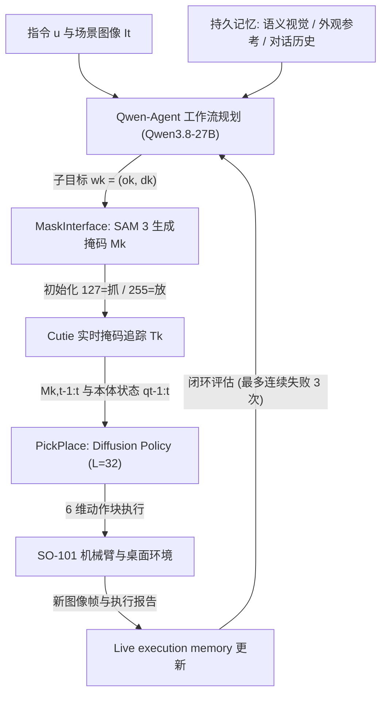

# ACE: Agentic Control for Embodied Manipulation via Zero-shot Workflow Reasoning

> 注：该论文在 arXiv v1 摘要入口标题为 *ACE: Agentic Control for Embodied Manipulation via Zero-shot Workflow Reasoning*，v2 HTML 正文标题修订为 *ACE: Semantic Task Composition for Tabletop Manipulation via Tracked Pick-and-Place Masks*，文内仍将框架名称展开为 **A**gentic **C**ontrol for **E**mbodied manipulation（ACE）。

## 一句话定义

ACE 是一种面向桌面操作任务的智能体编排框架（agentic manipulation harness），通过统一编码“抓（pick）与放（place）”区域的追踪灰度掩码接口和四层状态记忆，将语言智能体的语义约束推理与仅在通用抓放数据上训练的可复用视觉-动作策略连接起来，实现任务级零样本组合。

## 英文缩写速查

| 缩写 | 英文全称 | 简要说明 |
|---|---|---|
| ACE | Agentic Control for Embodied Manipulation | 本文提出的智能体操作编排框架 |
| VA | Vision-Action (Policy) | 接收追踪掩码与本体状态输出动作块的底层控制策略 |
| DP | Diffusion Policy | 本文用于通用抓取-放置原语执行的扩散动作策略 |
| SR | Success Rate | 完整多步任务的端到端成功比例 |
| GA | Grounding Accuracy | 最终定位到的必选抓取/放置目标占总目标数的比例 |
| FGS | Fine-Grained Score | 算式拼装任务的细粒度阶段得分（满分 20 分） |
| VLA | Vision-Language-Action | 端到端视觉-语言-动作策略基线（如 $\pi_{0.5}$） |

## 为什么重要

- **弥合语义约束推理与接触密集控制之间的鸿沟：** 端到端模仿学习（ACT、$\pi_{0.5}$、独立 DP）在约 1 小时全任务演示下难以同时学会算术/逻辑约束求解与多步物理执行；ACE 将高层“选谁、放哪里”的语义决策交给语言智能体，底层策略只专注通用转移控制。
- **单掩码统一编码对象与目的地角色：** 仅靠抓取掩码无法表达同一物体在不同步骤中的不同放置角色，ACE 用单张 8-bit 灰度图同时编码抓取目标（127）和放置区域（255），并发现去除 RGB 后仅输入掩码可将单方块抓取成功率从 `30.0%` 提升至 `90.0%`。
- **解决操作改变外观线索后的完成判定歧义：** 物理抓取和旋转可能遮挡方块表面的数字或符号印刷；ACE 将持久对象/对话记忆与快时间尺度追踪状态分离，为执行后评估提供跨步骤线索。

## 核心信息

| 字段 | 内容 |
|---|---|
| 作者 | Iok Tong Lei*、QianZhi Li*、Ying Jie Yap、Yujie Zhang、Rui Zhong、Haichao Gui†、Xiaolong Liu†、Zhidong Deng† |
| 机构 | 清华大学、北京航空航天大学、独立研究者、无锡灵巧手机器人科技有限公司 |
| 发表时间 | arXiv:2607.04162（v1: 2026-07-05；v2: 2026-09-30） |
| 论文链接 | [arXiv:2607.04162](https://arxiv.org/abs/2607.04162) · [v2 HTML 全文](https://arxiv.org/html/2607.04162) |
| 项目与代码 | 截至 2026-11-27 未确认官方项目页或 ACE 专属代码仓库（原文仅列外部依赖组件） |
| 清单分类 | `harness.monitoring_and_recovery`（`survey_ax_2607_04162`） |
| 开源状态 | 未确认开源代码（未在原文与摘要中发布自研代码或开源承诺） |

## 核心原理

ACE 的核心目标是**任务级零样本组合（task-level zero-shot composition）**：底层视觉-动作策略 $\pi_{\mathrm{VA}}$ 仅在约 1 小时的通用掩码条件抓放演示 $\mathcal{D}_{\text{prim}}$ 上训练，不接触评测任务 $\mathcal{T}_{\text{eval}}$ 的完整演示轨迹；推理时由语言智能体完成约束求解、角色绑定、步骤分解与闭环恢复。

1. **语义工作流规划与技能接口：**
   给定自然语言指令 $u$ 与当前场景/记忆上下文 $c$，基于 Qwen-Agent 与 Qwen3.8-27B 的语言智能体生成工作流：
   $$W = \mathcal{P}(u, c) = (w_1, w_2, \dots, w_K), \quad w_k = (o_k, d_k)$$
   其中 $o_k$ 为满足任务约束的目标物体，$d_k$ 为其指定的目的地角色（如算式拼装中将第一操作数、运算符、第二操作数依次绑定至纸区 A、B、C）。智能体通过两个可调用工具接口与物理环境交互：`MaskInterface` 负责对当前子目标进行视觉定位与追踪，`PickPlace` 负责执行物理转移。

2. **掩码介导的视觉-动作接口（Mask-Mediated Interface）：**
   针对当前激活步骤 $w_k$，`MaskInterface` 利用 SAM 3 依据当前图像 $I_t$ 与记忆状态 $m_t$ 生成一张统一 8-bit 灰度掩码 $M_k = \mathcal{G}(w_k, I_t, m_t) \in \{0, 127, 255\}^{H \times W}$：
   $$M_k(x, y) = \begin{cases} 127, & \text{pick target} \\ 255, & \text{place target} \\ 0, & \text{otherwise} \end{cases}$$
   随后用 Cutie 初始化追踪器 $T_k = \mathcal{T}_{\text{init}}(I_t, M_k)$，并在执行期逐帧更新 $(T_k, M_{k,t+1}) = \mathcal{T}_{\text{update}}(T_k, I_{t+1})$。非零标签仅在当前转移步内有效，语义身份由上游 $(o_k, d_k)$ 保持，从而使同一策略能够泛化到不同颜色、图案与语义角色的目标。

3. **可复用抓放控制（Diffusion Policy）：**
   `PickPlace` 调用基于 LeRobot 实现的 Diffusion Policy，以连续两帧追踪掩码与本体状态为条件预测动作块：
   $$\hat{a}_{t:t+L-1} = \pi_{\mathrm{VA}}(q_{t-1:t}, M_{k,t-1:t})$$
   其中 $q_t$ 为 6 维机器人本体状态，策略输入将灰度掩码复制为 3 通道（$3 \times 480 \times 640$），预测时域为 64 步，每次调用以滚动时域（receding-horizon）方式执行 $L = 32$ 步动作，并在单次尝试后返回执行报告。

4. **双时间尺度状态管理与四层记忆：**
   由于高层规划、视频追踪与底层控制在时间尺度上不同步，ACE 通过共享场景状态管理器分离实时执行状态与持久上下文：
   - **Live execution memory：** 维护当前工作流步骤索引、活跃掩码、Cutie 追踪状态与实时进度。
   - **Task-scoped semantic-visual memory：** 记录物体名称、别名、角色及视觉关联（通过 `record_task_object_knowledge` 工具写入）。
   - **Appearance reference memory：** 缓存已知物体的图像特征或局部裁剪，供后续重新定位参考。
   - **Conversational context memory：** 保存有界大小的智能体调用历史（初始指令、推理与工具调用轨迹）。

5. **闭环验证与重试策略：**
   每个子目标按 `Ground -> Execute -> Assess` 循环推进：智能体结合当前观测图像、执行报告与持久记忆判断当前转移是否达标；达标则推进至 $w_{k+1}$，否则触发重新定位（re-grounding）并重试。当智能体对**同一激活子目标**连续 3 次判定未完成时，试验终止。

## 流程总览

## 源码运行时序图

**不适用**（截至 2026-11-27，arXiv:2607.04162v2 原文及公开渠道均未提供 ACE 官方源码仓库、可运行脚本或模型权重，系统实现基于 Qwen-Agent、Qwen3.8-27B、SAM 3、Cutie 与 LeRobot Diffusion Policy 等外部组件组装，因此不编写未经文件核实的源码运行时序图）。

## 实验与评测

所有物理实验均在 SO-101 机械臂平台上完成，每项设定执行 20 次自主随机试验（随机化桌面布局与同义改写指令）。语言智能体运行在配 4 张 NVIDIA RTX 3090 的云端服务器，视觉掩码与 Diffusion Policy 运行在本地单张 RTX 3090。

### 评测任务与指标

- **Semantic Formula Assembly：** 根据指令目标值 $y$ 选择数字块 $o_a, o_b$ 与运算符块 $o_\circ$ 满足 $\operatorname{value}(o_a) \circ \operatorname{value}(o_b) = y$，并按顺序放入纸区 A、B、C。指标除 **SR** 与 **GA** 外，还采用满分 20 分的 **FGS**（3 个步骤各占 6 分：选对物体 2 分 + 抓取成功 2 分 + 放置准确 2 分；最终算式数学正确占 2 分）。
- **Constraint Retrieval：** 根据逻辑或数值条件 $\phi_u(o)$ 筛选目标集合 $\mathcal{O}_u$ 并搬运至指定区域（如将数值 $<4$ 放左侧、$>4$ 放右侧）。

### 主实验结果（Table I，每项 20 次真机试验）

| 方法 | 演示数据 | 算式拼装 avg. FGS (Max 20) | 算式拼装 SR (%) | 算式拼装 GA (%) | 约束检索 SR (%) | 约束检索 GA (%) |
|---|---|---|---|---|---|---|
| ACT (Imitation) | 约 1 小时全任务演示 | 3.2 | 0.0 | — | 0.0 | — |
| $\pi_{0.5}$ (End-to-End VLA) | 约 1 小时全任务演示 | 3.0 | 0.0 | — | 0.0 | — |
| ACE (w/o persistent memory) | 约 1 小时通用抓放演示 | 16.8 | 55.0 | 96.7 | 70.0 | 90.0 |
| **ACE (Full Framework)** | 约 1 小时通用抓放演示 | **18.0** | **70.0** | **100.0** | **80.0** | **97.5** |

### 消融与控制器对比（Table II，每项 20 次真机试验）

- **单方块抓取视觉输入消融（Table II-a）：** 在完全相同的训练与测试集上，**Mask Only** 版 DP 成功率为 `90.0%`（18/20），而 **Mask + RGB** 版 DP 仅为 `30.0%`（6/20），说明剥离原始 RGB 纹理干扰可让底层策略在分布外颜色与印刷图案上获得高出 60 个百分点的抓取鲁棒性。同期在 300 条单方块抓取演示上 LoRA 微调的 $\pi_{0.5}$ 在已见方块上取得 `60.0%`、混合已见/未见方块上取得 `40.0%`。
- **端到端独立 DP 对照（Table II-b）：** 用完整任务演示训练的 Standalone DP 在算式拼装上 avg. FGS 为 `3.4`、SR 为 `0.0%`，约束检索 SR 为 `0.0%`，证明单纯换用 DP 无法在不分解工作流的情况下学会多步约束推理。
- **持久记忆消融：** 移除持久对象与对话记忆后（保留当前步索引与 Cutie 追踪状态），算式拼装 SR 从 `70.0%` 降至 `55.0%`（-15%），约束检索 SR 从 `80.0%` 降至 `70.0%`（-10%）；定性观察表明，当机械臂抓取导致方块旋转并遮挡数字印刷时，无记忆智能体难以确认先前选择的方块是否已妥善放置。

## 与其他工作对比

- **对比端到端策略与 VLA（ACT、Standalone DP、$\pi_{0.5}$）：** 在约 1 小时的有限演示预算下，单靠端到端策略需同时拟合视觉语义推理与多步空间泛化，在需要满足联合约束（如数字和为特定值）的任务上均录得 `0.0%` 完整成功率；ACE 将语义决策与执行接口解耦，仅用通用抓放原语即完成零样本任务组合。
- **对比 MOO 与 VoxPoser：** MOO 通过不同像素值编码物体位置并输入技能指令，但面向已知技能模板与固定模板槽位；VoxPoser 将语言落为 3D 价值图用于基于模型的运动规划；ACE 则用单张 2D 追踪灰度掩码同时编码当前抓/放目标区域，直接条件化学习得到的 Diffusion Policy，兼顾接触执行与语义角色绑定。
- **对比 DexGraspVLA：** DexGraspVLA 同样采用 VLM 规划 + SAM/Cutie 掩码 + 扩散控制器，但其扩散控制器负责灵巧抓取而放置采用脚本运动；ACE 将“抓取目标（127）”与“放置目标（255）”统一编码进同一张追踪掩码，使单一学习策略端到端完成完整 pick-and-place 转移。

## 结论

**一句话总判：在演示数据受限的多步语义操作任务中，通过“高语义智能体 + 纯追踪掩码中间接口 + 持久记忆”的解耦设计，远比直接端到端堆叠演示更有效，但当前仅验证了单个抓放原语与方块场景。**

1. **剥离 RGB 提升原语复用与外观泛化** — 将 VA 策略视觉输入限制为双值追踪掩码（127/255），不仅屏蔽了未见方块颜色与图案导致的分布外退化（抓取率由 `30.0%` 升至 `90.0%`），还让同一策略无需重新训练即可服务不同语义角色。
2. **持久记忆对物理交互后的状态核验不可或缺** — 操作本身会改变可见线索（如方块旋转遮挡文字），把快变追踪状态与慢变对象/对话上下文分开管理，带来算式拼装 +15%、约束检索 +10% 的真机成功率增益。
3. **验证与重试边界仍是瓶颈** — 算式拼装的定位准确率已达 `100.0%`，但最终任务成功率为 `70.0%`（FGS 18.0/20），说明后续提升空间主要集中在物理抓取/放置精度和遮挡后的高精度验证，而非高层位置识别。

## 工程实践

- **掩码编码与策略训练关键超参：** 灰度掩码复制为 $3 \times 480 \times 640$ 后配合 6 维本体状态输入 DP；视觉主干采用 ImageNet 预训练 ResNet-18 + 32 spatial-softmax keypoints；U-Net 去噪器通道 `[512, 1024, 2048]`、卷积核 5、8 groups、128 维步数嵌入；DDPM 训练 100 步、`squaredcos_cap_v2` 调度、预测噪声；batch size 16、200,000 updates、Adam（$lr=10^{-4}$、weight decay $10^{-6}$、500 步 warmup 余弦衰减），禁用数据集图像增强且视觉输入做均值-方差归一化。
- **双端部署与调用约定：** 语言智能体（Qwen-Agent + Qwen3.8-27B）可部署于云端多卡 GPU，底层 SAM 3、Cutie 与 DP 部署在本地单卡以保证推理与控制频率；必须为每次子目标设定连续失败上限（本文为 3 次），防止机械臂在遮挡或死锁状态下无限重试。
- **官方代码复用边界：** 因 ACE 自身仓库尚未公开，复现需基于 LeRobot Diffusion Policy、SAM 3、Cutie 与 Qwen-Agent 自行搭建掩码编码与双技能调度胶水层。

## 局限与风险

- **技能与物体单一性：** 实验仅覆盖桌面立方体操作任务及单一 pick-and-place 原语，尚未在复杂非刚体、多自由度精细装配、双臂协同或非抓放动作（如推、插、铰接操作）中验证。
- **消融粒度不足：** `w/o persistent memory` 消融同时移除了持久对象记忆、外观参考与对话历史，无法定量区分文本事实记忆与外观裁剪特征各自的独立贡献。
- **量化诊断指标缺失：** 论文未单独统计子目标完成判定的验证准确率、单步重试成功率以及云端推理造成的端到端延迟开销；且截至 2026-11-27 未开源实现，细节对齐存在工程复现成本。

## 关联页面

- [Agentic Robots 综述](paper-towards-agentic-robots-survey.md)
- [全量项目节点清单](../overview/awesome-agentic-robots-node-index.md)
- [VLA 方法背景](../methods/vla.md)
- [智能体机器人操作策略](../methods/agentic-manipulation-policies.md)：对照智能体、机器人接口与执行反馈。
- [机器人智能体编排框架（Robot Agent Harness）](../methods/robot-agent-harness.md)：对照双时间尺度调度与监控恢复边界。
- [扩散策略（Diffusion Policy）](../methods/diffusion-policy.md)：ACE 底层可复用抓放控制器机制。
- [动作分块（Action Chunking）](../methods/action-chunking.md)：对比 ACT 与滚动时域动作块执行（$L=32$）。
- [智能体规划与执行反馈](../methods/agent-planning-feedback.md)：执行后重定位与重试闭环设计。
- [智能体工具调用接口](../methods/agent-tool-use-interface.md)：`MaskInterface` 与 `PickPlace` 工具抽象方式。
- [桌面操作任务（Manipulation）](../tasks/manipulation.md)：评测场景与评价口径背景。

## 推荐继续阅读

- [arXiv:2607.04162v2 论文全文（HTML）](https://arxiv.org/html/2607.04162)
- [LeRobot 开源机器人学习框架](https://github.com/huggingface/lerobot)
- [Qwen-Agent 框架文档与仓库](https://github.com/QwenLM/Qwen-Agent)

## 参考来源

- [ACE 论文精读归档](../../sources/papers/paper-agentic-2607-04162.md)
- [官方 Awesome 快照归档](../../sources/repos/awesome-agentic-robots-survey-index.md)
- [arXiv:2607.04162 摘要页](https://arxiv.org/abs/2607.04162)
- [arXiv:2607.04162v2 HTML 原文](https://arxiv.org/html/2607.04162)
