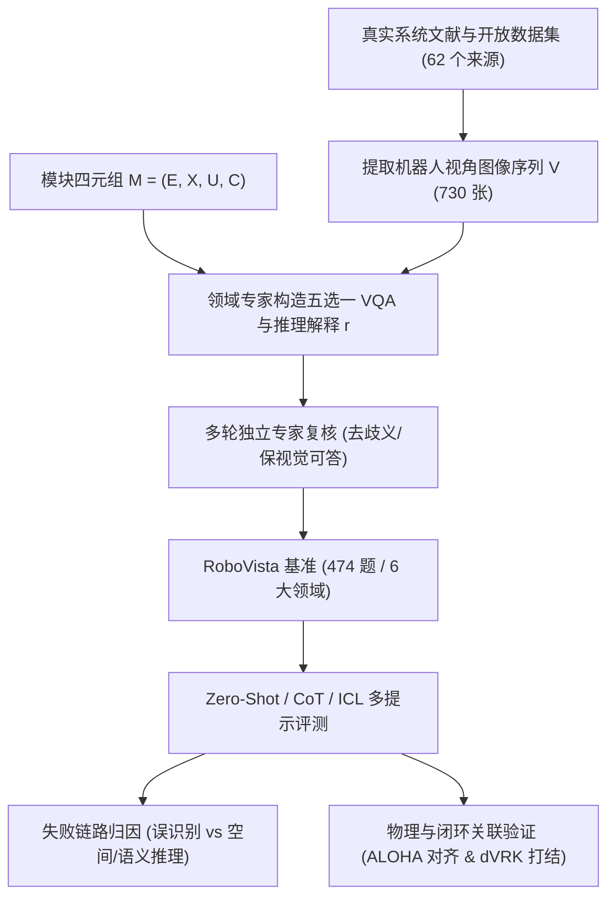

# RoboVista: Evaluating Vision Language Models for Diverse Robot Applications

## 一句话定义

RoboVista 是由 UC Berkeley、Princeton University 与 Google DeepMind 提出的跨领域机器人视觉语言模型（VLM）评测基准，通过模块化机器人问答框架 **RQA**（Robot Question Answering）将真实多领域机器人系统中的关键决策节点转化为 474 道含专家推理解释的五选一视觉问答，并实证了该基准得分与物理机器人任务执行表现的强相关性。

## 英文缩写速查

| 缩写 | 英文全称 | 简要说明 |
|---|---|---|
| VLM | Vision-Language Model | 视觉语言模型，结合视觉编码与语言推理以支撑机器人场景理解与决策 |
| RQA | Robot Question Answering | 本文提出的模块化评估框架，将机器人系统模块四元组映射为机器人中心 VQA |
| VQA | Visual Question Answering | 视觉问答，根据图像/序列观测与自然语言问题选择或生成答案 |
| CoT | Chain-of-Thought | 思维链提示，在输出最终选项前显式生成中间推理步骤 |
| ICL | In-Context Learning | 上下文学习，在提示词中附带同域示例问答以引导模型作答 |
| dVRK | da Vinci Research Kit | 达芬奇外科手术研究平台，用于本文闭环手术打结共享自主评测 |

## 为什么重要

- **补齐非桌面、低数据量真实领域的评测缺口：** 农业、工业制造与微创手术等领域长期缺乏像桌面遥操作那样的大规模端到端轨迹语料，实际部署普遍依赖模块化解析流水线；传统基于大规模模仿学习数据集自动生成的基准往往过度集中于桌面抓放。
- **把“系统级决策点”拆解为可诊断的模块测试：** 与只测端到端动作回归不同，RQA 将系统划分为感知、高层决策、运动/动作可行性与失败恢复四层，能定位 VLM 究竟卡在物体识别、空间几何推理还是语义/任务理解。
- **揭示反直觉的提示工程效应：** 实验表明在具身机器人视觉问答中，常用的 CoT 会系统性拉低底层场景理解准确率，而 1-shot ICL 不仅降准还显著推高校准误差（过自信幻觉）。
- **连接离线 VQA 分数与真机/闭环物理执行：** 通过 ALOHA 双臂对齐和 dVRK 手术打结实验，论文证明离线基准精度并非纸面指标，而是与真机空间对齐误差及长时程阶段推进存在显著单调相关。

## 核心信息

| 字段 | 内容 |
|---|---|
| 作者 | Shuangyu Xie, Kaiyuan Chen, Ziyang Chen, Simeon Adebola, Yixuan Huang, Zehan Ma, Tianshuang Qiu, Wentao Yuan, Dhruv Shah, Pannag R. Sanketi, Ken Goldberg |
| 机构 | UC Berkeley、Princeton University、Google DeepMind |
| 发表时间 | `arXiv:2607.04610v1`（2026-07-06 提交；arXiv 备注 Accepted to RSS 2026） |
| 论文链接 | [arXiv:2607.04610](https://arxiv.org/abs/2607.04610) / [HTML 全文](https://arxiv.org/html/2607.04610) |
| 项目与代码 | [项目页](https://berkeleyautomation.github.io/robovista/)（仅公开标题页；未发现本基准专属 GitHub 仓库） |
| 清单分类 | `model.perception` |
| 来源条目 | `survey_ax_2607_04610` |
| 开源状态 | 未确认开源代码（截至 2026-11-27，论文正文与项目页未列出 RoboVista 数据集或评测脚本代码仓库；正文中唯一 GitHub 链接为参考文献 [26] 的手术清创源数据仓库 `open-h-embodiment/data-collection`） |

## 核心原理

### 1. RQA 四层模块抽象与系统四元组

RQA 参照经典模块化机器人软件架构（§III-A, Fig. 2），将任意机器人任务流水线解耦为四个功能层：
1. **感知（Perception）：** 从以机器人为中心的视觉观测中估计物体几何、空间关系、接触与交互状态；
2. **高层决策（High-level Decision Making）：** 在任务约束下选择子目标、排布动作序列并决定下一步行为；
3. **运动与动作感知（Motion and Action Awareness）：** 判断候选动作在可达性、避障与闭环视觉反馈意义下的物理可行性；
4. **失败恢复与鲁棒性（Failure Recovery）：** 识别执行异常并据此推断纠错动作。

形式上，任一功能模块被抽象为四元组（式 1）：

$$\mathcal{M} = (\mathcal{E}, \mathcal{X}, \mathcal{U}, \mathcal{C})$$

其中 $\mathcal{E}$ 为**本体配置**（kinematics、驱动极限、传感器模态），$\mathcal{X}$ 为**状态空间**（关节构型、物体位姿与语义属性），$\mathcal{U}$ 为**任务输出空间**（离散决策或操作空间运动参数），$\mathcal{C}$ 为**可行性约束**（碰撞规避、关节限位等几何/运动学安全边界）。

### 2. Robot-VQA 数据结构与视角约束

为确保问题严格扎根于机器人具身体验（§III-B, 定义 1–3），每个实例定义为五元组：

$$\mathcal{Q} = (\mathcal{V}, q, a^{\star}, \mathcal{A}, r) \in \mathbb{V} \times \mathbb{Q} \times \mathbb{A} \times 2^{\mathbb{A}} \times \mathbb{R}$$

其中视觉输入必须满足机器人视角约束 $\mathcal{V} \in \mathbb{V}_{\text{rv}} \cup \mathbb{V}_{\text{ob}}$：要么机器人本体在画面中可见（$\mathrm{RobVis}(\mathcal{V})$），要么图像采集自机器人机载视角（$\mathrm{Onboard}(\mathcal{V})$）。候选集 $|\mathcal{A}| = 5$（A–E），$a^{\star} \in \mathcal{A}$ 为模块真实输出对应的唯一正确答案，$r$ 为领域专家撰写的自然语言推理解释。

### 3. 从模块到 Robot-VQA 的映射与三阶段构建

RQA 执行结构化映射（式 2）：$(\mathcal{E}, \mathcal{X}, \mathcal{U}, \mathcal{C}) \longrightarrow (\mathcal{V}, q, a^{\star}, \mathcal{A}, r)$。隐状态 $\mathcal{X}$ 经由图像或短时序图像序列 $\mathcal{V}$ 隐式承载；问题文本 $q$ 补充非视觉可见的本体配置 $\mathcal{E}$ 或任务约束 $\mathcal{C}$；干扰项构造要求具有算法可解释性与物理合理性。

RoboVista 数据集通过三阶段专家流程构建（§IV）：
- **数据采集：** 从工业、农业、家庭、手术、自动驾驶五类实机文献及 DROID、Open X-Embodiment、AgiBot 三个开放数据集中提取代表性切片，共计 **62** 个发表来源、**730** 张图像；
- **问题构建：** 由 **7 名**机器人领域专家（4 名博士后与 3 名硕士研究生）手工编写五选一题目及推理解释（平均题干 25.1 词、平均解释 41.9 词）；
- **质量复核：** 每道题至少由另 1 名具备机器人背景的审校员独立核验视觉依据充分性、答案唯一性与语言无歧义性。

最终基准共含 **474** 道题（正文摘要与 §IV 统计涵盖 **39** 种任务类型；附录 A Table V 统计表记为 **33** 个独特任务），其中单图题 355 道（74.9%）、双图 66 道（13.9%）、3 图及以上 53 道（11.2%），选项 A–E 分布为 24% / 25% / 22% / 18% / 11%。按能力二分，感知类 318 题、规划类 156 题（Fig. 4）；按 Table V 细分，场景理解占 66.9%（317）、高层决策 16.7%（79）、底层运动感知 14.3%（68）、恢复/重规划 1.9%（9）、物理交互 0.2%（1）。

## 流程总览

## 源码运行时序图

**不适用**（核查结果：截至 2026-11-27，论文 `arXiv:2607.04610` 正文与项目页 `https://berkeleyautomation.github.io/robovista/` 均未提供 RoboVista 基准数据或评测推理脚本的官方 GitHub 仓库。论文正文中唯一出现的 GitHub 地址 `https://github.com/open-h-embodiment/data-collection` 系参考文献 [26] 手术清创源数据集仓库，候选比对仓库 `open-h/open-h-embodiment` 对应另一项独立研究 `arXiv:2604.21017`，均非本论文可运行官方源码）。

## 实验与评测

论文在 8× NVIDIA A100（80GB）上使用 SGLang 部署开源模型，并调用官方 API 评测闭源模型（附录 B Table VI 记录：图像最长边限 720 px、JPEG quality 85、greedy decoding temperature 0.0、top-p 1.0、最大输出 10,240 tokens、最大上下文 32,768；正文 §V 另有 temperature 0.7、max completion 4096、context 10240 的描述）。

### 1. Zero-Shot 跨领域准确率（Table I, %）

| 模型 | 总体 (All) | 农业 (Agri.) | 驾驶 (Driving) | 家庭 (Home) | 工业 (Industry) | 手术 (Surgery) | 开放数据集 (Open) |
|---|---|---|---|---|---|---|---|
| Random 基线 | 20.0 | 20.0 | 20.0 | 20.0 | 20.0 | 20.0 | 20.0 |
| Qwen 3-8B (Text-Only) | 25.1 | 27.4 | 30.0 | 30.8 | 22.2 | 26.1 | 24.0 |
| **Gemini 2.5 Pro**（闭源） | **56.5** | 48.4 | 50.0 | **63.2** | **48.4** | **76.1** | **58.3** |
| GPT-4o（闭源） | 49.6 | **50.0** | 50.0 | 59.2 | 32.5 | 67.4 | 53.5 |
| GPT-5（闭源） | 48.1 | 38.7 | 55.0 | 46.1 | 35.7 | 63.0 | **58.3** |
| **Qwen 3-235B-A22B**（开源） | **51.3** | 46.8 | **60.0** | 53.9 | 37.3 | 69.6 | 56.9 |
| Qwen 3 VL-32B（开源） | 49.2 | 48.4 | 55.0 | 48.7 | 35.7 | 65.2 | 55.6 |
| Qwen 3 VL-8B（开源） | 46.8 | 38.7 | 45.0 | 56.6 | 32.5 | 58.7 | 54.2 |
| Qwen 2.5 VL-72B（开源） | 44.3 | 43.5 | 35.0 | 40.8 | 31.7 | 69.6 | 50.7 |
| RoboBrain 2.5-8B-NV（机器人专用） | 47.0 | 27.4 | 40.0 | 56.6 | 38.9 | 65.2 | 52.8 |
| RoboBrain 2.5-8B（机器人专用） | 45.8 | 37.1 | 55.0 | 51.3 | 36.5 | 56.5 | 50.0 |
| Robo2VLM-ER（机器人专用） | 42.6 | 35.5 | 40.0 | 43.4 | 32.5 | 54.3 | 50.7 |

核心发现：
- 纯文本基线仅 25.1%，验证题目难以仅靠语言先验猜中；
- 所有模型距离理想水平仍有较大差距，整体最高为 Gemini 2.5 Pro 的 **56.5%**；
- 家庭与手术领域整体准确率显著更高，而**农业与工业最困难**（存在密集遮挡、细粒度植物形态变化、反光与可变形物体几何推理；即便是空间专精模型 RoboBrain 2.5-8B-NV 在农业域也跌至 27.4%）。

### 2. CoT 提示与 ICL 消融发现（Table II & Table III）

- **CoT 提示的不对称效应（Table II）：** 显式逐步推理在多数模型上**明显损害感知/场景理解准确率**（Qwen 2.5 VL-3B 总体 -10.3%、感知 -11.9%；Qwen 2.5 VL-7B 总体 -7.2%、感知 -11.3%；Robo2VLM-ER 感知 -8.8%；RoboBrain 2.5-8B-NV 感知 -7.2%），但在部分模型的多步规划题上带来正增益（Qwen 3 VL-32B 规划 **+8.3%**、Qwen 2.5 VL-72B 规划 **+5.1%**、Qwen 3 VL-4B 规划 **+4.5%**）。论文指出，强制生成长语言推理链容易导致模型过度关注语言语义而干扰细粒度视觉锚定。
- **ICL 诱发退化与过自信幻觉（Table III）：** 即便从同域同任务中检索 1-shot 示例并附带标准格式作答，全部 8 个被测模型准确率均出现下滑（-1.7% 至 -6.5%，如 RoboBrain-MT 从 47.5% 降至 41.0%、Qwen 3 VL-8B 从 47.3% 降至 42.3%），同时校准误差（Calibration Error, CE）全部恶化（+3.1% 至 +9.7%，如 RoboBrain-MT 由 38.7% 升至 48.4%），说明长上下文中的空间关系示例反而分散视觉注意力并放大幻觉。

### 3. 失败原因拆解（§V-D）

基于 Qwen3-VL-32B-Thinking 初筛并人工校验推理链：
- **Qwen 2.5-VL-7B：** 主要错误源于视觉感知而非逻辑推理，其中**物体/位置误识别（misidentification）**占比最高，达 143 例（**30.2%**），其次为空间推理误差与任务语义误读。
- **扩展至 Qwen 3-235B-A22B：** 正确率从 36.5% 升至 48.5%，误识别率由 30.2% 降至 20.3%，但空间几何与任务语义类错误依然突出，仅靠参数扩展难以根治。

### 4. 物理与闭环机器人关联实验（§VI, Table IV, Appendix D–E）

1. **ALOHA 双臂夹爪空间对齐（5 种背景几何先验 × 5 组随机构型，间距 10–40 cm）：**
   - 拼接顶视主相机与左右腕部相机画面，要求输出绝对距离估计与轴对齐符号指令。
   - RoboVista 总分与最终夹爪对齐位置误差呈强负相关（Pearson $r = -0.78$，Spearman $\rho = -0.93$），与距离估计误差亦呈负相关（Pearson $r = -0.70$，Spearman $\rho = -0.75$）。
2. **dVRK 手术打结共享自主（16 阶段顺序 VQA，最多允许 3 次人工接管，Table IV）：**
   - 无人工干预下，所有模型均在第 2 题（在缝合针上标注最佳抓取像素坐标）处受阻（Progress w/o Intervention 均为 **2/16**），反映高层推理正确但空间定点/执行精度不足；
   - 允许最多 3 次接管后，完成阶段数与 RoboVista-Surgery 分数一致：Qwen-2.5 32B（手术域 58.7%）完成 **9/16**，ChatGPT-5.0（63.0%）完成 **9/16**，Gemini 2.5 Pro（76.1%）完成 **15/16**。

## 与其他工作对比

| 基准 / 工作 | 数据来源与构型覆盖 | 核心设计范式 | 与 RoboVista 的主要差异 |
|---|---|---|---|
| **Robo2VLM / RoboBrain** | 主要依托 Open X-Embodiment 等大规模遥操作轨迹自动衍生标注 | 大规模后训练与桌面操作 VQA | 聚焦大规模数据丰裕的桌面场景，难以覆盖缺乏海量轨迹的农业、工业、手术等模块化系统 |
| **ERQA / ManipBench / RoboMind** | 具身多模态推理或规范化多本体操作数据 | 端到端或统一多本体动作/推理评测 | 强调通用具身推理或低层操作对齐，未围绕 $\mathcal{M}=(\mathcal{E},\mathcal{X},\mathcal{U},\mathcal{C})$ 对解析式系统决策节点做等权跨域拆分 |
| **RoboVista (本文)** | 62 个文献/数据集来源（含 5 类真机垂直领域 + DROID / OXE / AgiBot） | RQA 模块化专家手工标注（474 题精编诊断集） | 牺牲题目数量换取高推理密度、多领域等权覆盖与强物理相关性；需依赖专家人工构建，扩展成本高 |

## 结论

**一句话总判：RoboVista 通过模块化问题抽象（RQA）把跨领域机器人系统决策点转化为高质量诊断式 VQA，证明当前 VLM 在非桌面真实场景中的感知锚定与空间推理仍存在显著瓶颈，且该离线分数能有效预测物理机器人任务的执行可靠性。**

1. **视觉感知锚定优先于长文本推理：** 在具身场景理解任务上应慎用无约束的长篇 CoT 与多图空间 1-shot ICL，优先强化细粒度目标识别与空间几何表征，避免“想太多”造成的视觉退化与过自信幻觉。
2. **将评测重心前移至低资源垂直领域：** 除开放桌面数据集外，模型评测应纳入农业、工业可变形物体装配与医疗手术等高遮挡、强约束场景，防止桌面场景刷榜掩盖真实泛化短板。
3. **利用阶段式 VQA 检验系统级可用性：** 闭环手术实验表明即便单步定点失败（Q2）也会打断长时程任务，工程落地时应结合空间坐标解析校验与人工接管（shared autonomy）边界，而不能仅凭平均选择题分数直接全自主部署。
4. **参数规模与专精微调各有边界：** 从 7B 到 235B 能显著降低物体误识别率，但空间相对定位与物理交互约束推理无法仅靠扩大参数自动解决，需引入几何/三维先验。

## 工程实践

- **系统诊断分层接入：** 在模块化机器人软件栈（例如 [Agentic Robots 分层思路](paper-towards-agentic-robots-survey.md)）中接入 VLM 时，建议区分**感知判别调用**（直接输出结构化选项或坐标，关闭冗长 CoT）与**高层任务规划调用**（允许适度推理链梳理前置条件与先后顺序）。
- **视觉预处理与输出约束：** 参考本文评测管线，多视角输入（如 ALOHA 主视 + 双腕视拼接或序列帧）应统一控制图像分辨率上限与压缩参数，并对空间定点与控制输出采用严格 JSON / 正则多级抽取与坐标系显式声明。
- **共享自主与安全兜底：** 在医疗或高风险工业场景中，针对关键空间定位步骤（如 dVRK 抓针点选择）应设置可视化十字准星复核与人类接管阈值，防止单步感知偏差在长时程序列中被逐级放大。

## 局限与风险

- **专家构建成本高、规模有限：** 474 题均依赖博士后及高年级硕士人工拆解与多轮校验，短期难以低成本自动化扩展至数万题量级；文中也指出“恢复/重规划/鲁棒性”仅占 1.9%（9 题）、“物理交互”仅占 0.2%（1 题），长尾模块覆盖仍偏少。
- **原始代码与数据公开待确认：** 截至核对日尚未定位到官方公开题目数据包与评测仓库，外部复现只能依据论文附录提示词与采样来源自行重构。
- **离散化选择与闭环连续控制的鸿沟：** 五选一离散选项便于客观评分，但在 dVRK Q2 与 ALOHA 连续位移指令测试中已暴露“选对方向却点不准像素或估算距离偏大”的离散—连续落差。
- **dVRK 实验基于仿真模拟环境：** 论文 §VI-B 明确说明 dVRK 手术打结实验运行在受控的仿真/模拟环境（emulated environment）中，尚未等价于真实临床在体组织验证。

## 关联页面

- [机器人视觉感知栈选型闭环](../queries/robot-perception-stack-selection-loop.md)：对照视觉感知与开放词汇定位选型闭环。
- [具身大模型评测基准选型闭环](../queries/embodied-eval-benchmark-selection-loop.md)：对照评测基准设计与指标选型闭环。
- [Agentic Robots 综述](paper-towards-agentic-robots-survey.md)
- [全量项目节点清单](../overview/awesome-agentic-robots-node-index.md)
- [VLA 方法背景](../methods/vla.md)
- [具身智能体评测方法](../methods/embodied-agent-benchmarking.md)
- [AI 基准评测方法](../methods/ai-benchmark-evaluation.md)
- [机器人视觉感知](../methods/robot-visual-perception.md)
- [智能体规划与反馈机制](../methods/agent-planning-feedback.md)
- [双臂操作任务](../tasks/bimanual-manipulation.md)
- [Open X-Embodiment 实体](paper-open-x-embodiment.md)
- [DROID 数据集实体](paper-rcl-ref-aa9c28fbf4242ea03696-droid-a-large-scale-in-the-wild-robot-manipulati.md)
- [AgiBot World Colosseo 实体](paper-sa-2503-06669-agibot-world-colosseo-a-large-scale-manipulation.md)

## 推荐继续阅读

- [RoboVista 论文原文（arXiv:2607.04610 HTML）](https://arxiv.org/html/2607.04610)
- [RoboVista 官方项目主页](https://berkeleyautomation.github.io/robovista/)
- [RoboBrain 2.5 论文（arXiv:2601.14352）](https://arxiv.org/abs/2601.14352)

## 参考来源

- [RoboVista 原文核对归档](../../sources/papers/paper-agentic-2607-04610.md)
- [官方 Awesome 快照归档](../../sources/repos/awesome-agentic-robots-survey-index.md)
- [arXiv:2607.04610 官方页面](https://arxiv.org/abs/2607.04610)
- [RoboVista 项目主页](https://berkeleyautomation.github.io/robovista/)
