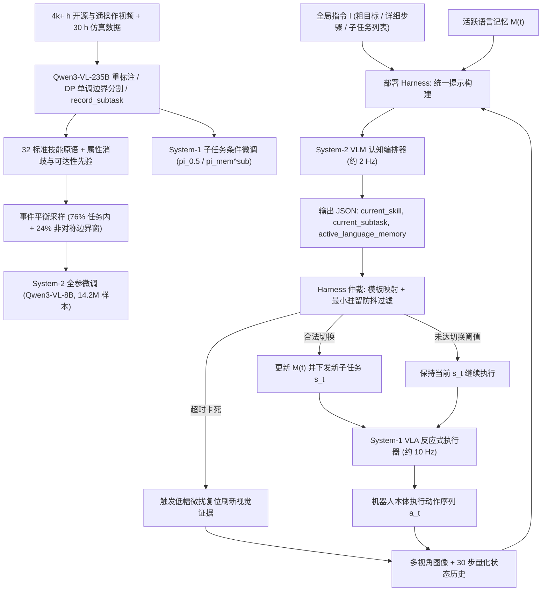
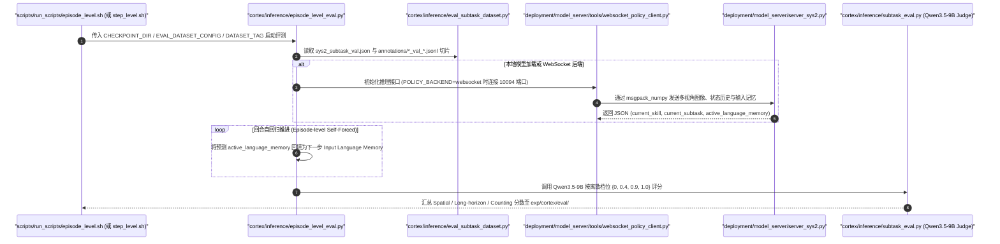

# Cortex: A Bidirectionally Aligned Embodied Agent Framework for Long-horizon Manipulation

## 一句话定义

Cortex（亦称 InternVLA-M1.5）是一种面向长程机器人操作的双向对齐双系统具身智能体框架：它以 32 个标准原子技能原语和增量式语言记忆为契约接口，将高层 VLM 认知编排器（System-2）与低层反应式 VLA 执行器（System-1）对齐到可执行、可追踪的子任务流上，并通过事件平衡训练与异步 Harness 仲裁实现闭环长程控制与真机错误恢复。

## 英文缩写速查

| 缩写 | 英文全称 | 简要说明 |
|---|---|---|
| VLA | Vision-Language-Action | 视觉-语言-动作模型，在 Cortex 中承担高频反应式底层执行（System-1，如 $\pi_{0.5}$ 与 $\pi_{\mathrm{mem}}^{\mathrm{sub}}$） |
| VLM | Vision-Language Model | 视觉-语言模型，在 Cortex 中作为低频认知编排器（System-2，基于 Qwen3-VL-8B-Instruct 微调） |
| DP | Dynamic Programming | 动态规划，本文中用于融合状态-动作与视觉特征求解单调子任务切分边界 $b^*_{1:K-1}$ |
| TAMP | Task and Motion Planning | 任务与运动规划，经典分层规划范式，在部分可观测开放环境中难以直接应用 |
| DDP | Distributed Data Parallel | 分布式数据并行，用于微调仿真与真机 System-1 执行器 |
| SR | Success Rate | 任务成功率，LIBERO-Long、RoboTwin 2.0、RMBench 与真机多阶段操作的核心闭环指标 |

## 为什么重要

1. **打破单体 VLA 的马尔可夫短视瓶颈**：$\pi_0$、$\pi_{0.5}$ 等单体端到端 VLA 仅依赖当前观测或数秒局部缓冲进行反应式控制，在“洗烧杯”“多步化学搅拌”等包含重复抓取、开关盖与插入/拔出阶段的 14 步长程任务中无法分辨阶段进度，极易提前结束、重复往复动作或颠倒工序（真机基线 $\pi_{0.5}$ 与 $\pi_{\mathrm{mem}}$ 成功率均为 0%）。
2. **弥合传统双系统的语义-运动学鸿沟**：此前将通用 VLM（如 GPT-5、Gemini）或语言规划器直接接在执行器前端时，规划器像“脱离本体的旁观者”，常生成缺乏物理接地或超出机械臂可达性的自由文本指令，导致开源与通用代理在 LIBERO-Long 等任务上产生运动学幻觉。Cortex 通过**可执行性（Executability）**与**可追踪性（Tractability）**约束实现双向对齐。
3. **验证通用规划器与任务微调执行器的零样本组合能力**：在真机 ARX ACONE 双臂平台上，微调 ~10 小时子任务数据得到的短程执行器 $\pi_{\mathrm{mem}}^{\mathrm{sub}}$ 只需接入通用训练的 Cortex System-2，即可零样本完成未见过的多阶段化学操作（65% SR，接近人工指挥的 75% SR）。

## 核心信息

| 字段 | 内容 |
|---|---|
| 作者 | Jiaqi Peng, Xiqian Yu, Delin Feng, Yuqiang Yang, Wenzhe Cai, Jing Xiong, Ganlin Yang, Jinliang Zheng, Jiafei Cao, Xueyuan Wei, Jiangmiao Pang, Yuan Shen, Tai Wang |
| 机构 | 清华大学（Tsinghua）、上海人工智能实验室（Shanghai AI Lab）、北京大学（PKU）、中国科学技术大学（USTC） |
| 发表时间 | arXiv:2607.05377v1（2026-07-06 提交） |
| 论文链接 | [arXiv:2607.05377](https://arxiv.org/abs/2607.05377) / [arXiv HTML 全文](https://arxiv.org/html/2607.05377) |
| 项目与代码 | [项目主页](https://steinate.github.io/cortex.github.io/) · [GitHub（Sage-PhysicalAI/Cortex）](https://github.com/Sage-PhysicalAI/Cortex) · [HuggingFace 模型](https://huggingface.co/Steinate/Cortex) · [HuggingFace 数据集](https://huggingface.co/datasets/Steinate/Cortex) |
| 清单分类 | `harness.orchestration`（来源条目：`survey_ax_2607_05377`） |
| 开源状态 | **部分开源**（已开源 System-2 Step/Episode 评测代码、WebSocket 部署服务端、三阶段子任务自动标注流水线、`dump_bin_bigbin` 示例及 Hugging Face 模型/4k+ 小时数据集；LIBERO/RoboTwin 闭环 System-1/2 评测代码与 System-2 训练脚本在 README TODO 中尚未发布） |

## 核心原理

### 1. 双向对齐的子任务与记忆接口（§3.1, Appendix A.3）
给定全局指令 $I$、多视角观测与历史记忆，System-2 并不输出自由文本或连续潜变量，而是输出严格结构化的 JSON 契约：
$$z_t = \{\texttt{"current\_skill"},\; \texttt{"current\_subtask"},\; \texttt{"active\_language\_memory"}\}$$
- **可执行性（32 个标准原子技能原语）**：所有动作指令被规范化为固定 32 维原子技能词表（`Pick`, `PickAndPlace`, `Place`, `Remove`, `Press`, `Push`, `Pull`, `Navigate`, `Fold`, `Wipe`, `Close`, `Open`, `Pour`, `Cut`, `Rotate`, `Handover`, `Sweep`, `Stack`, `Unstack`, `Screw`, `Unscrew`, `Scan`, `Aim`, `Clamp`, `Rinse`, `Spread`, `Release`, `Retreat`, `AdjustPosture`, `Tie`, `Strike`, `Stir`）及对应参数模板（如 `[Unscrew] [object]`、`[Stack] [object1] on [object2]`）。当任务全部完成时，返回 `current_skill: null` 与 `current_subtask: "task_completed"`。
- **可追踪性（Tractability）**：在子任务描述中显式引入物体属性（如颜色材质 `"blue toy car"`）、基于相对位姿的同质物体消歧（如 `"the right white stapler"`）、交互计数以及面向双臂本体可达性的中间路由（如必要时主动插入 `Handover` 交接子任务）。
- **增量式语义语言记忆**：在第 $k$ 个子任务阶段 $t$，系统维护压缩的里程碑记忆而非冗余视觉缓存或冗长思维链：
  $$M^{(t)} = M^{(0)} \oplus \bigoplus_{i=1}^{k-1} \Phi(s_i)$$
  其中 $M^{(0)}$ 为初始空状态，$\Phi(s_i)$ 将已完成子任务 $s_i$ 摘要为状态变更记录（如“机器人已抓起烧杯并放到平台，随后拿起水瓶”）。

### 2. 可扩展元数据标注与程序化仿真生成（§3.2, Appendix A.1, A.4）
- **4,000+ 小时开源与遥操作视频标注**：整合 AgibotWorld、Galaxea、BEHAVIOR-1K、RoboCerebra 及自采真机遥操作数据（平均每条轨迹 > 7 个子任务）。开源视频由 `Qwen3-VL-235B` 按统一技能模板重标注并合并静止帧；真机遥操作轨迹则采用**免逐帧人工标注的单调动态规划边界推断**：
  1. 提取多模态帧特征 $x_t = [\sqrt{\lambda_s}\,\phi_s(o_t, a_t),\; \sqrt{\lambda_v}\,\phi_v(I_t)]$（融合状态-动作局部差分与视觉外观变化）。
  2. 对有序子任务序列 $(s_1, \dots, s_K)$ 估计高斯原型 $\mathcal{N}(\mu_k, \Sigma_k)$，构造马氏距离帧兼容代价 $c_k(t) = (x_t-\mu_k)^\top \Sigma_k^{-1}(x_t-\mu_k) + \log|\Sigma_k|$、相对时长先验惩罚 $P_k(i,j) = \lambda_d\left(\frac{j-i}{T} - \rho_k\right)^2$ 与低运动量边界惩罚 $M(j) = \lambda_m m_j$。
  3. 在候选边界集合 $\mathcal{B}_k$ 上用动态规划递推并回溯求解严格单调边界 $0=b_0 < b_1 < \dots < b_K=T$，同时产出可供 System-1 条件化训练的子任务片段和供 System-2 训练的转换点标签。
- **30+ 小时程序化仿真数据生成**：在 RoboTwin 2.0 与 RMBench 专家脚本 `play_once()` 中嵌入 Python 上下文管理器 `with self.record_subtask("..."):`，随专家控制流进入/退出精确记录 `start_frame` 与 `end_frame`，并直接读取仿真资产材质、位姿与本体描述注入可追踪先验。

### 3. 事件平衡采样与文本化状态历史（§3.3, Appendix A.2, A.4）
- **事件平衡采样（Event-balanced Sampling）**：均匀采样会被漫长的稳态执行帧淹没，使模型在边界切换时犹豫或误跳。Cortex 围绕边界 $t_k$ 定义三类阶段：
  1. **边界转换阶段** $t \in [t_k - \epsilon_1,\, t_k + \epsilon_2]$：由于完成的视觉线索常滞后于切分时刻，采用非对称边界窗 $\epsilon_2 > \epsilon_1$（总窗长约 1 秒；按数据节奏自适应配置，如 RoboCerebra 取 $\epsilon=0.5\text{ s}$，Galaxea 扩展至 $\epsilon=1.5\text{ s}$），训练模型识别完成证据并触发记忆更新与子任务切换。
  2. **任务内执行阶段** $t \in (t_{k-1}+\epsilon_2,\, t_k-\epsilon_1)$：训练“语义耐心（semantic patience）”，保持当前子任务和记忆不变。
  3. **尾部结束阶段** $t \in [t_K-\epsilon_1,\, t_K]$：输出终止信号。
  通过高密度边界重采样，将训练集配比平衡至约 **76% 任务内样本 + 24% 边界转换样本**，并按 **42.5% 详细过程指令 / 20.0% 显式子任务列表 / 37.5% 粗粒度目标** 混合构造统一指令接口（Omni-Format Instruction Interface）。
- **文本化因果状态历史（State History as Text）**：针对“按按钮次数”等稀疏图像难以分辨的高频阶段任务，抽取最近 $H=30$ 帧（步长 1）的 `observation.state`（截断至最多 $D_{\max}=32$ 维），经 $\bar{s}_{i,d} = \tanh(s_{i,d})$ 与 256-bin 整数离散化 $b_{i,d} = \mathrm{clip}(\lfloor 128(\bar{s}_{i,d}+1)\rfloor, 0, 255)$（缺失填 `-1`），连同逐步 $L_1$ 变化量、变化维数及首尾差值作为纯文本注入 VLM，无需额外数值编码器。
- **双系统训练**：System-2 在 **32× NVIDIA A800 (80GB)** 上以 DeepSpeed ZeRO-3 全参数解冻微调 `Qwen3-VL-8B-Instruct`（约 14.2M 样本，bfloat16，AdamW，峰值学习率 $3\times 10^{-6}$，global batch size 512，最大长度 8192）；System-1（仿真用 3.62B 参数 $\pi_{0.5}$，真机用 $\pi_{\mathrm{mem}}^{\mathrm{sub}}$）在对应子任务指令下全参数微调。

### 4. 异步闭环推理与 Harness Engineering（§3.4, Appendix A.4, A.5.3）
- **异步双频控制**：真机上 System-1 以约 **10 Hz** 连续输出动作块，System-2 以约 **2 Hz** 异步读取多视角帧、因果状态文本与上一轮提交记忆。
- **部署 Harness 仲裁层**：
  1. **多模式提示适配**：将粗目标、详细描述或子任务列表映射为统一的模式感知提示。
  2. **标准命令映射与防抖保持**：通过精确模板匹配与关键词保守回退将 VLM 文本对齐到 System-1 可执行指令；依据匹配置信度、最大步进与最小驻留时间过滤异常高频切换，若不满足则保持上一条已提交指令，防止底层动作被抖动打断。
  3. **超时驱动运动微扰复位（Timeout-driven Kinematic Reset）**：当 System-1 已到达边界附近但因视角遮挡或状态延迟导致 System-2 迟迟未确认切换时，Harness 在超时后触发低幅缓慢复位微扰以刷新视觉证据，帮助 System-2 在线打破感知死锁并完成重试或推进。

## 流程总览

## 源码运行时序图

以下时序图基于官方仓库 [Sage-PhysicalAI/Cortex](https://github.com/Sage-PhysicalAI/Cortex) 已核实的 `scripts/run_scripts/`、`cortex/inference/`、`deployment/model_server/` 与 `cortex/annotation/` 目录及文件入口整理（涵盖已开源的 System-2 离线/WebSocket 评测部署路径与三阶段标注流水线；LIBERO/RoboTwin 闭环 System-1/2 脚本与 System-2 训练代码尚未在仓库发布）。

## 实验与评测

### 1. 开放环 System-2 规划评测（§4.1, Table 1, Table 5, Appendix A.3）
在 AgibotWorld、Galaxea 与 BEHAVIOR-1K 抽取的 15 个任务、三大维度（空间接地、长程逻辑一致性、物体计数；Step-level 每维约 1,000 样本，Episode-level 共 150 条自回归轨迹）上，采用 `Qwen-3.5-9B` 作为裁判打分（单轴最高 5 分，总分最高 10 分）：

| 评测模式 | 方法 | 平均总分 | Spatial 总分 | Long-horizon 总分 | Counting 总分 |
|---|---|---:|---:|---:|---:|
| Step-level (Teacher-Forced) | Qwen3-VL-8B-Instruct | 6.739 | 6.424 | 6.775 | 7.018 |
| Step-level (Teacher-Forced) | GPT-5 | 6.268 | 6.422 | 6.163 | 6.220 |
| Step-level (Teacher-Forced) | Gemini-3.1-Pro | 6.925 | 6.697 | 6.920 | 7.159 |
| Step-level (Teacher-Forced) | Cortex (baseline / w/o harness / skills) | 7.051 / 7.213 / 7.392 | 6.505 / 6.927 / 7.035 | 6.973 / 7.064 / 7.265 | 7.676 / 7.648 / 7.875 |
| Step-level (Teacher-Forced) | **Cortex (full harness)** | **8.318** | **8.053** | **8.160** | **8.741** |
| Episode-level (Self-Forced) | Qwen3-VL-8B-Instruct | 6.292 | 6.468 | 6.021 | 6.388 |
| Episode-level (Self-Forced) | GPT-5 | 7.231 | 7.321 | 6.996 | 7.376 |
| Episode-level (Self-Forced) | Gemini-3.1-Pro | 6.860 | 6.929 | 6.644 | 7.006 |
| Episode-level (Self-Forced) | Cortex (baseline / w/o harness / skills) | 6.978 / 7.155 / 7.314 | 6.518 / 6.805 / 6.985 | 6.600 / 6.925 / 6.866 | 7.815 / 7.736 / 8.091 |
| Episode-level (Self-Forced) | **Cortex (full harness)** | **7.810** | **7.587** | **7.380** | **8.464** |

- **事件平衡采样消融（Table 5，Galaxea leave-episode-0-out）**：相比任务内主导基线（3.10M 样本，Intra:Bound = 3.77:1，Subtask 3.40 / Memory 4.17 / Avg. Total 7.58），Event-balanced 仅用 **2.72M** 样本（Intra:Bound = 2.23:1）即取得 **3.85 / 4.33 / 8.18**，证明冗余稳态帧会稀释边界决策监督。

### 2. 闭环仿真基准（§4.2, Table 2, Table 8, Table 9）
- **LIBERO-Long 零样本对比（Table 2，所有 Agentic 方法共享微调 $\pi_{0.5}$ 执行器）**：Cortex 达 **95.5%**，超越端到端基线 $\pi_{0.5}$（92.4%，+3.1%）、MemoryVLA（93.4%）与 OpenVLA-OFT（94.5%），并大幅领先同执行器下的 Gemini-3.1-Pro（91.0%）、GPT-5.4（72.0%）、Qwen3-VL-8B（68.0%）与 RoboBrain（57.0%）。
- **RoboTwin 2.0（Table 8，50 clean + 500 randomized demonstrations）**：Cortex 总体成功率 **86.80%**（短程 **86.00%**、长程 **88.00%**），优于 $\pi_{0.5}$ 总体 82.74%（短程 82.60%、长程 82.95%）、X-VLA（72.80%）、$\pi_0$（65.92%）、DP3（55.24%）、OpenVLA-OFT（38.30%）、RDT-1B（34.50%）与 ACT（29.70%）。其中 `place_object_basket` 从 80% 升至 85%，`dump_bin_bigbin` 通过动态插入 `handover` 从 92% 升至 98%。
- **RMBench 记忆依赖操作（Table 9，7 任务各 50 演示训练、100 次 rollout）**：Cortex 7 任务均分达 **61.9%**（Mem-0 为 41.7%、$\pi_{0.5}$ 为 12.6%）。分任务表现：Rearrange Blocks **100%**（Mem-0 89%）、Put Back Block **100%**（Mem-0 90%）、Swap Blocks **99%**（Mem-0 67%）、Swap T **63%**（Mem-0 14%）、Battery Try **37%**（Mem-0 28%）、Observe and Pick Up **14%**（Mem-0 4%）、Press Button **20%**（包括 Mem-0 在内的全部基线均为 **0%**）。

### 3. ARX ACONE 真机零样本长程实验（§4.3, Table 3, Appendix A.5）
在真实 ARX ACONE 双臂平台上使用约 10 小时自动切分子任务数据微调 $\pi_{\mathrm{mem}}^{\mathrm{sub}}$，与通用 System-2 VLM 零样本组合，在 14 步长程任务上各测 20 次试验：

| 范式 | 方法 | 化学液体搅拌 Prog. / SR (%) | 烧杯清洗 Prog. / SR (%) |
|---|---|---:|---:|
| End-to-end | $\pi_{0.5}$ | 2.5/14 / 0% | 3.7/14 / 0% |
| End-to-end | $\pi_{\mathrm{mem}}$ | 4.1/14 / 0% | 6.5/14 / 0% |
| Agentic | **Cortex** | **11.0/14 / 65%** | **10.5/14 / 55%** |
| Upper Bound | Human + $\pi_{\mathrm{mem}}^{\mathrm{sub}}$ | 12.2/14 / 75% | 11.6/14 / 70% |

此外，定性实验（Appendix A.5.4–A.5.8）验证了：（1）烤箱加热中等待炉门完全落稳再抓取餐盘的物理边界判断；（2）垃圾分拣中粗/细提示模式的精度-自主性权衡；（3）人工提前拧开瓶盖后 System-2 自动将 `"I opened the cap of the bottle"` 写入记忆并跳过开盖；（4）搅拌任务抓握试管塞受阻时连续三次重试直至视觉确认成功后才切换子任务。

## 与其他工作对比

- **对比单体反应式 VLA（$\pi_0$、$\pi_{0.5}$、OpenVLA-OFT）**：单体 VLA 缺少显式进度校验与跨阶段语义状态，在相似视觉子阶段之间反复震荡（如化学任务反复尝试拔/插漏斗），Cortex 通过子任务路由将长程策略降维为局部短程条件控制。
- **对比短窗/检索记忆 VLA（$\pi_{\mathrm{mem}}$、MemoryVLA、Mem-0）**：任务级 $\pi_{\mathrm{mem}}$ 仍需从全局指令与数秒图像窗口反推当前子阶段，容易将开瓶盖前后的持瓶动作混淆导致“未开盖先倒水”；Mem-0 在计数敏感的 RMBench `Press Button` 任务上成功率为 0%，而 Cortex 凭借离散状态历史文本与记忆更新取得 20% 非零突破。
- **对比通用 VLM 闭环代理（GPT-5.4、Gemini-3.1-Pro、Qwen3-VL-8B）**：通用 VLM 缺乏受约束原子技能集与边界时间对齐训练，容易下发不可执行子任务或在过渡帧过早跳步；在共享同一 $\pi_{0.5}$ 执行器的 LIBERO-Long 上，Cortex（95.5%）高于 Gemini-3.1-Pro（91.0%）与 GPT-5.4（72.0%）。

## 结论

**一句话总判：Cortex 证明了长程具身操作的核心瓶颈在于高低层之间的语义-运动学契约与边界时序对齐，通过约束原子技能接口、事件平衡边界采样与抗抖动 Harness 仲裁，可以在不重新从零训练通用策略的前提下将短程 VLA 稳定扩展至 14 步级真实长程任务。**

1. **接口规范先于模型规模**：8B 参数的 Cortex System-2 借助 32 维原子技能约束与紧凑记忆接口，在开放环规划（8.318 vs 6.925/6.268）和 LIBERO-Long 闭环（95.5% vs 91.0%/72.0%）上均超过体量更大的闭源通用 VLM。
2. **数据密度应向子任务边界倾斜**：Galaxea 消融表明将稳态与边界采样比由 3.77:1 压至 2.23:1 后，在总样本减少 12%（2.72M vs 3.10M）的情况下总分反升 0.60，边界转换才是决策学习的信息瓶颈。
3. **文本化本体状态能弥补视觉采样盲区**：对于高频微动作或重复计数任务，将最近 30 帧状态 $\tanh$-256 离散化为文本并附带 $L_1$ 差分摘要，比单纯加密视觉帧更轻量且无需改动 VLM 视觉编码器。
4. **真机异步部署必须配套防抖与超时逃逸**：没有最小驻留过滤与超时微扰复位时，2 Hz 规划器与 10 Hz 执行器的感知-动作失步会直接锁死物理进度。

## 工程实践

- **三阶段低成本数据标注流程（已开源）**：可用 `scripts/run_scripts/run_vlm_annotation.sh` 调用兼容 OpenAI 接口的 VLM 生成种子标签，通过 `run_manual_annotation_server.sh`（本地 `127.0.0.1:8765`）人工修正少数轨迹，再由 `run_dynamic_matching.sh` 基于 `observation.state`、`action` 与三视角视频通过动态规划自动传播至其余轨迹（附带 `assets/dump_bin_bigbin` 10 条 LeRobot 格式样例可供直接演练）。
- **System-2 微调与执行器配置**：微调 8B System-2 需 32× A800 (80GB) + DeepSpeed ZeRO-3 与 `bfloat16`；若仅部署推理，官方已在 Hugging Face 发布 `Steinate/Cortex` 权重，可通过 `deployment/model_server/server_sys2.py` 与 `websocket_policy_server.py` 以 WebSocket 服务形式接入下游控制器。
- **异步控制参数调优**：参考原文实验配置，System-2 频率宜设在 ~2 Hz、System-1 在 ~10 Hz；Harness 需依据任务节奏调整边界非对称时间窗 $\epsilon$（高速任务约 0.5 s，慢速任务约 1.5 s）、最小驻留时间以及超时微扰幅度，避免视觉遮挡导致卡死。

## 局限与风险

1. **纯文本记忆丢失空间与像素细节**：$M^{(t)}$ 仅保存语言摘要，缺少 3D 坐标或视觉特征绑定，在跨房间移动操作或大量同质物体的复杂场景中容易削弱物体实例对应能力（作者计划后续结合视觉记忆检索与像素级 grounding）。
2. **高频微状态融合仍有限制**：标准视觉编码器帧率有限，即使引入 30 步量化文本状态历史，在高速、强接触或剧烈形变场景中将高频本体信号与视觉端到端对齐仍是难点。
3. **部分组件与训练代码尚未开源**：截至 2026-11-27，仓库尚未放出 LIBERO/RoboTwin 闭环 System-1/2 联调脚本与 System-2 训练代码；且真机迁移仍需约 10 小时目标机械臂子任务数据微调 $\pi_{\mathrm{mem}}^{\mathrm{sub}}$ 后方能实现高层规划的零样本组合。
4. **对 Harness 命令映射与超参较敏感**：当 VLM 偶发输出非标准表达时依赖模板与关键词保守匹配回退，极端新动作词表外任务仍需重新扩充 32 维原子技能集。

## 关联页面

- [Agentic Robots 综述](paper-towards-agentic-robots-survey.md)
- [全量项目节点清单](../overview/awesome-agentic-robots-node-index.md)
- [VLA 方法背景](../methods/vla.md)
- [智能体机器人操作策略](../methods/agentic-manipulation-policies.md)：对照智能体、机器人接口与执行反馈
- [机器人智能体 Harness 工程](../methods/robot-agent-harness.md)：对照部署期仲裁层、命令映射与超时恢复机制
- [智能体规划与反馈机制](../methods/agent-planning-feedback.md)：对照闭环状态校验与子任务重规划
- [自动标注流水线](../methods/auto-labeling-pipelines.md)：对照三阶段 VLM 种子标注与动态规划轨迹切分
- [$\pi_0$ 通用操作策略](../methods/pi0-policy.md)：对照 Cortex 底层 System-1 执行器基座（$\pi_0 / \pi_{0.5}$ 路线）
- [机器人操作任务](../tasks/manipulation.md)
- [双臂协同操作](../tasks/bimanual-manipulation.md)

## 推荐继续阅读

- [Cortex 官方项目主页与演示视频](https://steinate.github.io/cortex.github.io/)
- [Cortex 官方 GitHub 仓库（Sage-PhysicalAI/Cortex）](https://github.com/Sage-PhysicalAI/Cortex)
- [Cortex 模型权重与 4k+ 小时子任务标注数据集（Hugging Face）](https://huggingface.co/datasets/Steinate/Cortex)
- [arXiv 原文：Cortex (2607.05377v1)](https://arxiv.org/abs/2607.05377)

## 参考来源

- [Cortex 论文全文核对档案](../../sources/papers/paper-agentic-2607-05377.md)
- [Cortex 官方仓库核对档案](../../sources/repos/paper-agentic-2607-05377.md)
- [官方 Awesome 快照归档](../../sources/repos/awesome-agentic-robots-survey-index.md)
- [arXiv:2607.05377v1 原文](https://arxiv.org/abs/2607.05377)
- [Cortex 项目主页](https://steinate.github.io/cortex.github.io/)
- [Sage-PhysicalAI/Cortex GitHub 仓库](https://github.com/Sage-PhysicalAI/Cortex)
