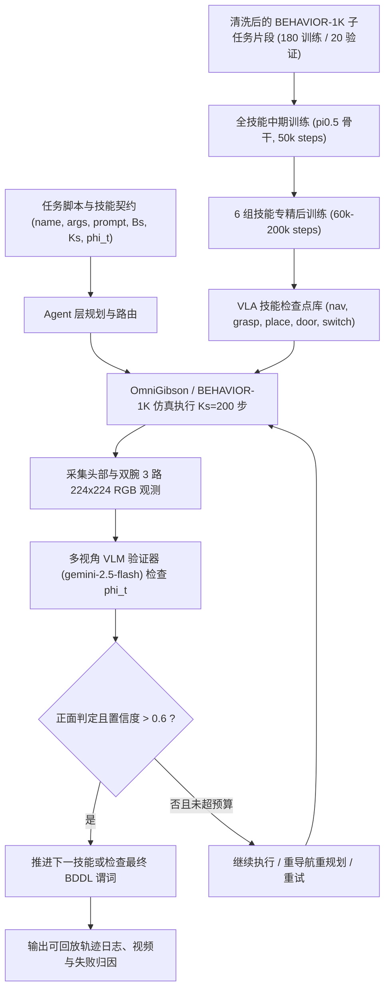

# Diagnosing Semantic Handoff Failures in Agent-Orchestrated Vision-Language-Action Skill Composition

## 一句话定义

本文由 Simple AI（简易人工智能）团队提出，通过带类型化技能契约与多视角 VLM 验证器的语义执行框架（Semantic Execution Harness），将长时程家居任务中的“单技能有效但链式组合卡死”现象诊断并归因于技能边界上的**语义交接失败（Semantic Handoff Failures）**。

## 英文缩写速查

| 缩写 | 英文全称 | 简要说明 |
|---|---|---|
| VLA | Vision-Language-Action | 视觉-语言-动作策略模型，本文中为基于 $\pi_{0.5}$ 微调的技能检查点 |
| VLM | Vision-Language Model | 视觉-语言模型，本文中以 `gemini-2.5-flash` 担任多视角在线状态验证器 |
| BDDL | BEHAVIOR Domain Definition Language | BEHAVIOR-1K 用于判定任务级最终成败的符号目标谓词语言 |
| OOD | Out-of-Distribution | 分布外状态；链式执行终态相对精选技能边界快照构成分布偏移 |
| SR | Success Rate | 单技能或任务的成功率指标 |

## 为什么重要

在智能体编排 [VLA](../methods/vla.md) 的长时程架构中，研究者常默认只要单个技能策略训练到足够高的准确率，就能通过高层规划器串接完成做爆米花、收鞋架等复杂家居任务。本文在 BEHAVIOR-1K 上直接用同一组 $\pi_{0.5}$ 检查点证明：**隔离快照上的高成功率（66.7%–100.0%）并不能迁移到链式真实执行**。

其关键症结在于“技能接口隐式且欠约束”：前序技能满足自身局部后置条件 $\phi_t$ 后，可能把机器人底盘、夹爪或相机视角留在后序技能训练分布之外的位置（例如导航只做到“远处看见罐头”，而非“处于臂展可抓位置”；或开门后目标物体滑出视野）。这一发现将原本近乎为零的端到端任务成功率转化为可定位的工程改进清单：比起单纯堆叠精选边界样本，VLA 技能库更迫切需要链式边界恢复数据、实例级视觉定位监督以及显式的下一技能就绪度校验。

## 核心信息

| 字段 | 内容或状态 |
|---|---|
| 作者 | Ke Rui\*，Yushen Zuo\*，Jiawei Wang，Haoran Jia，Jinming Ma，Weitao Zhou，Minglei Li（\* 同等贡献） |
| 机构 | 简易人工智能（Simple AI / SimpleAI） |
| 发表时间 | 2026-07-07（arXiv v1），2026-07-15（arXiv v2） |
| 论文链接 | [arXiv:2607.06256](https://arxiv.org/abs/2607.06256) · [HTML 全文](https://arxiv.org/html/2607.06256) |
| 项目与代码 | 未确认独立项目页与官方源码仓库链接 |
| 清单分类 | `harness.monitoring_and_recovery` |
| 来源条目 | `survey_ax_2607_06256` |
| 开源状态 | 未确认开源代码（arXiv v2 正文与元数据均未公开代码仓库或模型权重） |

## 核心原理

### 1. 语义交接问题与技能边界分布偏移

设第 $t$ 步技能 $s_t$ 拥有局部后置条件 $\phi_t$。常规验证器仅判断当前观测是否满足 $\phi_t$，但长时程组合要求 $s_t$ 的终止状态必须落在下一技能 $s_{t+1}$ 的有效启动区域内。与经典模仿学习单策略长序列的复合误差（compounding error）不同，这里的偏移发生在**两个已训练策略的交接边界**：前序策略即便“合法完成”，其真实终态相对于后序策略微调时所依赖的精选演示边界快照依然是 OOD 状态。

为此，作者在未来工作（Sec. V-C 与 Table IX）提出显式联合校验 $\phi_t \wedge \rho(s_t, s_{t+1})$，其中下一技能就绪谓词 $\rho(s_t, s_{t+1}) = R_{\text{name}(s_{t+1})}(\text{args}(s_{t+1}), o_t)$ 由有限模板库按 $s_{t+1}$ 类型与参数实例化（例如 `pick_up_from(x,y)` 前要求 $\mathrm{visible}(x) \wedge \mathrm{graspReachable}(x)$，`place_in(x,c)` 前要求 $\mathrm{held}(x) \wedge \mathrm{containerReachable}(c) \wedge \mathrm{openingPlausible}(c)$）。在当前实测系统中，该机制通过将臂展可达（arm-reach）要求写入 `move_to` 的自然语言后置条件进行近似。

### 2. 双层解耦执行框架与语义技能契约

系统将职责严格划分为**智能体层（Agent Layer）**与**具身执行层（Embodiment Layer）**：
- **语义技能契约**：每次技能派发表示为 $s_t = (\text{name}, \text{args}, \text{prompt}, B_s, K_s, \phi_t)$，涵盖 9 种基础技能（`move_to`、`pick_up_from`、`place_on`、`place_on_next_to`、`place_in`、`press`、`turn_on_switch`、`open_door`、`close_door`；轨迹日志中 `move_to` 与 `pick_up_from` 原名记作 `navigate_to` 与 `grasp`）。其中 $B_s$ 为单技能最大步数预算（用于弥补 VLA 缺少可靠停止信号及技能时长差异大的问题），$K_s$ 为验证周期，$\phi_t$ 为后置条件描述。
- **$\pi_{0.5}$ VLA 技能库训练**：以 PaliGemma 2B 视觉语言骨干配合 300M 参数流匹配（flow-matching）动作专家，输入头戴第一视角及左右腕部共三路 $224 \times 224$ RGB 图像与本体状态，输出多步动作块。数据来自按子任务边界清洗的 BEHAVIOR-1K 遥操作演示（每任务 180 条训练 / 20 条验证），先经过 **50k 步全技能混合中期训练（mid-training）**，再以峰值学习率 $2.5 \times 10^{-5}$、cosine 衰减、全局 batch size 256 分组后训练为 6 个专用检查点（`nav./orient.`、`switch/press`、`door open/close`、`grasping`、`surface placement`、`containment placement`）。

### 3. 步级 Plan-Act-Verify-Replan 闭环

具身层在 BEHAVIOR-1K / OmniGibson 中每执行 $K_s = 200$ 步动作块后暂停采样，将头部与双腕三视角图像连同当前 $\phi_t$ 提交给 `gemini-2.5-flash` 多视角 VLM 验证器：
1. 仅当验证器返回正面判定且置信度高于 **0.6** 时才推进到下一技能（不确定的判定永不提前终止技能，作为容错保护）。
2. 若未通过，则在单技能预算 $B_s$（通常 800 步，`place_on_next_to` 为 1200 步，`open_door` 为 1500 步）和全局回合预算（人工演示长度的 2 倍）内继续执行或由智能体触发重规划（实践中通常通过重导航恢复交接位姿后再重试操作技能）。
3. 每次 rollout 均生成完整可回放证据链（技能调度记录、VLM 判定与理由、恢复提示、视频及最终 BDDL 任务谓词结果）。

## 流程总览

## 源码运行时序图

**不适用**（截至 2026-11-27 核查：`arXiv:2607.06256v2` 全文、摘要及补查记录均未公开官方 GitHub 代码仓库、运行脚本入口或模型权重链接，当前无官方可运行源码可供分析）。

## 实验与评测

所有实验均在 BEHAVIOR-1K（2025 挑战赛公开 `test_instances.csv`）的 10 个支持任务上完成，同一批 $\pi_{0.5}$ 检查点同时用于**隔离单技能基准**与**端到端组合执行**。

### 1. 隔离单技能表现 vs. 端到端任务进度

从验证集恢复演示边界快照进行单技能评测（多视角 VLM 判定并经人工复核，Table I），以及在 10 个任务各 3 个实例（共 30 条轨迹）上人工对照 teacher-hint 参考序列核查的端到端进度分数（Table II）：

| 评测维度 | 核心指标与实测数值 |
|---|---|
| 单技能快照成功率（Table I） | `place_on` 6/6 (100.0%)，`open_door` 7/7 (100.0%)，`pick_up_from` 28/29 (96.5%)，`turn_on_switch` 7/8 (87.5%)，`place_in` 11/13 (84.6%)，`move_to` 27/35 (77.1%)，`close_door` 4/6 (66.7%)；`press` 与 `turn_on_switch` 共用权重未单测 |
| 端到端平均计划进度（Table II，$n=3$） | 30 条轨迹平均完成参考技能序列 **19.5%** |
| 分任务进度详情（Table II） | `Turn on radio` $50.0 \pm 43.3\%$、`Make microwave popcorn` $45.8 \pm 7.2\%$、`Move boxes to storage` $30.0 \pm 0.0\%$、`Pick up trash` $22.2 \pm 4.8\%$、`Put shoes on rack` $11.9 \pm 4.1\%$、`Bring in wood` $10.3 \pm 4.4\%$、`Cook hot dogs` $10.3 \pm 4.4\%$、`Set mousetraps` $8.3 \pm 0.0\%$、`Freeze pies` $6.4 \pm 2.2\%$、`Hide Easter eggs` $0.0 \pm 0.0\%$ |
| 代表性单轮全量诊断（Table VIII） | 10 个任务共 232 次技能尝试（100 成功 / 132 失败）、137,823 仿真帧、196 次 VLM 调用，BDDL 任务最终通过 **1/10**（仅 `Turn on radio` 成功） |

### 2. 链式失败归因（Table III，130 次 VLA 侧失败）

从 132 次失败尝试中剔除 2 次验证器侧异常后，130 次 VLA 侧失败均属于“单技能本可胜任但在链式边界失效”的迁移问题：
- **Control execution（58 次）**：`grasp` 31 次（接近目标但未闭合或未抓稳）、`actuation` 15 次（触及把手/开关但未驱动）、`placement` 12 次（到达表面/容器附近但放置错位）；对应改进为富含接触与提交帧（commit-frame）的数据。
- **Target grounding / scene search（37 次）**：导航或开门后目标移出视野或选中错误物体实例；对应改进为实例级 grounding 监督。
- **Next-skill readiness / navigation-to-ready（35 次）**：导航过早停在臂展外，导致无法交接给下一抓取/开关技能；对应改进为链式初始状态微调。

### 3. 消融实验与人工盲审（Table VI & VII）

| 对照项 | Reached-area 标准 | Arm-reach 标准 | 诊断意义 |
|---|---|---|---|
| 任务通过数（$q=1$） | 0 / 10 | **1 / 10** | 强制臂展交接恢复了 `Turn on radio` 任务 |
| 平均任务分 $\bar{q}$ | 0.01 | **0.10** | 暴露原策略“伪完成导航”导致后续动作白耗预算 |
| `move_to` 尝试次数 | 74 | 99（+25） | 拒绝不达标交接后触发更频繁的重导航恢复 |
| Next-skill readiness 失败 | 23 | 35（+12） | 显式检出被遮掩的就绪度缺口 |
| 控制 / 提交失败 | 61 | 58 | 控制提交仍是主导瓶颈 |

盲审验证器可靠性（Table VII）：两位作者在盲测条件下对非 `unclear` 样本达成 **90%** 共识；在达成共识的 21 条验证器判负样本中，**20 条确认为真实失败**，对应失败判定可靠度 **0.95**、过严率（误杀真实成功）**0.05**。

## 与其他工作对比

| 相关方向与代表工作 | 各自侧重点 | 本文差异与定位 |
|---|---|---|
| 符号任务与运动规划（PDDLStream、Code as Policies） | 依赖显式符号接口、几何求解或预先编写的控制原语 | 不依赖手写技能控制器，而是将端到端学习的 $\pi_{0.5}$ VLA 作为智能体可调用工具，补齐运行期类型化契约与失败归因 |
| LLM 具身规划闭环（SayCan、Inner Monologue、ReAct） | 关注高层任务分解、可供性打分与语言反馈重规划 | 聚焦多步 VLA 策略交接边界的物理/视觉就绪度问题，通过步级多视角 VLM 检查与置信度门控阻止过早推进 |
| 代理式机器人系统（MAESTRO、TIGeR、H-WM、RoboClaw、ManiAgent） | 通过外部几何工具、世界模型或多智能体协同追求更高任务成功率 | 明确不主张刷新榜单指标，而是将代理框架作为**诊断工具**，量化拆解从孤立技能到长时程组合的失效分布 |
| 通用 VLA 骨干（$\pi_0$、OpenVLA、Octo） | 研究统一视觉-语言-动作表征与流匹配/自回归动作生成 | 直接消费 $\pi_{0.5}$ 分组微调检查点作为被测执行器，揭示“只扩增精选快照训练分布无法消除链式边界分布偏移” |

## 结论

**一句话总判：在长时程代理编排 VLA 系统中，高隔离技能准确率不能保证组合鲁棒性，必须通过面向下一技能就绪度的边界验证与链式分布数据来打通技能交接断点。**

1. **用契约替代“裸提示词串联”**：为每个 VLA 技能绑定显式参数、步数预算 $B_s$、校验周期 $K_s$ 与交接感知后置条件 $\phi_t$，避免策略因缺乏停止信号而在失效状态空耗预算。
2. **校验“能否接住下一步”而不只是“当前像不像做完”**：导航、开门等前序技能必须检查对下一技能的臂展可达性与目标可见性，可显著减少无效抓取并挽救短程组合任务。
3. **停止只补精选边界演示**：隔离技能成功率已达 77%–100% 时，继续在同一快照分布加数据边际收益有限，数据采集应转向“前一技能真实终态出发”的链式恢复轨迹与接触提交帧。
4. **保留轨迹级可回放诊断**：将 VLM 验证理由、步级尝试数与 BDDL 终态解耦记录，能把“全任务接近零通过”转化为清晰的数据与模型迭代优先级。

## 工程实践

- **步级验证 cadence 与容错阈值**：以 $K_s = 200$ 步为周期查询多视角（头 + 左腕 + 右腕）VLM，且仅在置信度 $> 0.6$ 且判定为正面时推进技能，可在不显著拖慢推理的前提下防止偶发误判提前中断操作。
- **按技能耗时特征分配预算**：依据技能分布统计（Table IV：`press` 均值 9.7 s、`open_door` 均值 31.4 s）配置差异化 $B_s$（如 `open_door` 给 1500 步、`place_on_next_to` 给 1200 步、其余 800 步），同时设置全局 $2\times$ 演示长度上限防止死循环重规划。
- **两阶段共享骨干微调路线**：先全技能混合 mid-training（50k 步）保持跨技能表征，再按 6 个功能组微调（导航/开关/开门类 60k 步，抓取与表面放置 180k 步，容器内放置 200k 步），在模型容量与技能专精间取得平衡。

## 局限与风险

- **样本量与诊断粒度**：当前端到端进度仅基于 10 个任务各 3 轮（30 条轨迹），失败归因统计来自代表性单轮（130 次 VLA 失败），只宜作为优先级指示而非总体统计估计。
- **验证器类别偏差**：人工盲审仅验证了二元失败判定的可靠性（0.95），具体失败子类标签（控制 vs. 定位 vs. 就绪度）仍来自 VLM 推理，在物体放置遮挡、夹爪闭合可见性及铰接体状态判断上可能存在偏差。
- **对象指代欠精确与重置上限**：任务脚本仍包含 `door`、`storage box` 等粗粒度对象指代，复杂场景下的实例绑定尚未完全解决；此外当前尚无法在任意失败节点做“真值技能边界状态重置（oracle reset）”，限制了与无恢复基线、$\rho$ 模板直验及不同 $K \in \{50, 100, 200\}$ 扫描的完整对照。
- **可复现性受限于代码未公开**：官方尚未释放训练清洗脚本、技能检查点与在线 harness 代码，外部复现需自行搭建 BEHAVIOR-1K 分段与 $\pi_{0.5}$ 微调管线。

## 关联页面

- [Agentic Robots 综述](paper-towards-agentic-robots-survey.md)
- [全量项目节点清单](../overview/awesome-agentic-robots-node-index.md)
- [VLA 方法背景](../methods/vla.md)
- [机器人智能体执行框架](../methods/robot-agent-harness.md)：对照规划、执行接口与反馈机制。
- [$\pi_0$ 策略家族（Pi-Zero）](../methods/pi0-policy.md)：本文技能库 $\pi_{0.5}$ 骨干的视觉-语言-流匹配动作架构背景。
- [智能体规划与反馈执行](../methods/agent-planning-feedback.md)：Plan-Act-Verify-Replan 闭环与重规划边界设计。
- [智能体技能封装与契约](../methods/agent-skill-packaging.md)：类型化技能接口、参数与预算约束。
- [具身智能体评测基准](../methods/embodied-agent-benchmarking.md)：长时程分步进度分数与轨迹级诊断评测范式。
- [机器人操作任务](../tasks/manipulation.md)：抓取、开关驱动与表面/容器放置的核心评测场景。

## 推荐继续阅读

- 论文原始页面：[arXiv:2607.06256 — Diagnosing Semantic Handoff Failures in Agent-Orchestrated Vision-Language-Action Skill Composition](https://arxiv.org/abs/2607.06256)
- 基础 VLA 骨干文献：[arXiv:2410.24164 — $\pi_0$: A Vision-Language-Action Flow Model for General Robot Control](https://arxiv.org/abs/2410.24164)

## 参考来源

- [arXiv:2607.06256 原文精读归档](../../sources/papers/paper-agentic-2607-06256.md)
- [官方 Awesome 快照归档](../../sources/repos/awesome-agentic-robots-survey-index.md)
- [论文官方入口（arXiv HTML v2）](https://arxiv.org/html/2607.06256)
