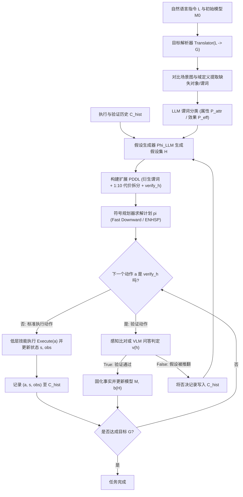
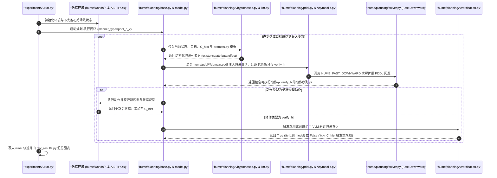

# Hypothesis-driven Model Expansion under Uncertainty for Open-World Robot Planning

## 一句话定义

**HUME**（Hypothesis-driven Uncertainty-aware Model Expansion）是一种面向开放世界机器人任务规划的神经符号框架，将基础模型提出的未知物体位置、属性与动作效果显式表示为**带不确定性的假设**，并通过扩展 PDDL 规划器在执行任务的同时主动调度验证动作，根据感官反馈迭代修正世界模型。

## 英文缩写速查

| 缩写 | 英文全称 | 简要说明 |
|---|---|---|
| HUME | Hypothesis-driven Uncertainty-aware Model Expansion | 本文提出的不确定性感知假设驱动模型扩展规划框架 |
| PDDL | Planning Domain Definition Language | 形式化符号规划域与问题定义语言（如 Fast Downward / ENHSP 求解） |
| MDP / BAMDP | Markov Decision Process / Bayes-adaptive MDP | 将世界模型不确定性纳入信念状态的贝叶斯自适应决策视角 |
| SPL | Success weighted by Path Length | 导航与移动操作任务中兼顾成功率与路径效率的综合指标 |
| BT | Behavior Tree | 本文真机系统中用于封装可复用低层技能与反应式控制的执行结构 |
| VLM | Vision-Language Model | 用于细粒度物体属性判别与按键数值效果验证的视觉语言模型 |

## 为什么重要

在真实家庭环境中，服务机器人往往只拥有静态家具地图与基础技能库，对**新物体在哪、物体具有什么细粒度属性（如无糖饮料、带红键遥控器）、以及未知设备按键或处理器的真实效果**一无所知：

- **传统经典规划器（PDDL / TAMP）：** 在封闭世界假设下逻辑严密且满足长程约束，但一旦关键物体或效果缺失即无法求解（infeasible）。
- **纯大语言模型规划器：** 具备丰富常识泛化能力，但难以在长程任务中严格遵守单臂抓取、容器开关等前提约束，且容易把模型幻觉当作既定事实执行，造成“静默失败（silent failures）”。
- **已有语言增强符号规划：** 虽然引入 LLM 补充域知识，但往往将 LLM 推理结果直接视为确定事实（deterministic facts），缺乏对假设真伪的主动验证机制。

HUME 的核心洞察是：**不要用 LLM 替代形式化规划器，而是让 LLM 作为“不确定模型扩展的假设生成器”，把约束推理与不确定性管理交还给规划系统，从而将主动信息获取直接融入目标导向规划。**

## 核心信息

| 字段 | 内容 |
|---|---|
| **作者** | Anxing Xiao, Hanbo Zhang, Tianrun Hu, David Hsu |
| **机构** | School of Computing & Smart Systems Institute, National University of Singapore（NUS） |
| **发表载体** | Robotics: Science and Systems (RSS) 2026 / [arXiv:2607.06501](https://arxiv.org/abs/2607.06501)（2026-07-07） |
| **论文链接** | [arXiv HTML 全文](https://arxiv.org/html/2607.06501) \| [arXiv 摘要](https://arxiv.org/abs/2607.06501) |
| **项目与代码** | [threefruits/HUME](https://github.com/threefruits/HUME)（MIT 协议） |
| **清单分类** | `model.planning`（来源条目：`survey_ax_2607_06501`） |
| **开源状态** | **部分开源**（完整开源 Block Processing World 与 AI2-THOR/ProcTHOR 仿真规划及评测代码；不包含真机 Fetch 与微波炉操作工程组件） |

## 核心原理

### 1. 问题形式化：基于不确定模型扩展的规划

设机器人初始不完备模型为 $\mathcal{M} = \langle \mathcal{S}, \mathcal{P}, \mathcal{A}, T \rangle$（由环境场景图与 PDDL 域文件构成），真实环境由未知的 $\mathcal{M}_{\text{gt}}$ 支配。HUME 通过任务相关生成函数 $g: (\mathcal{M}, L) \rightarrow \mathcal{H}$ 生成一组对象中心假设 $\mathcal{H} = \{h_1, \ldots, h_n\}$，每个假设 $h_i$ 具有未知真值 $v(h_i) \in \{0, 1\}$。系统维护三值信念状态：

$$b(v(h)) \in \{\texttt{True}, \texttt{False}, \texttt{Unknown}\}$$

并将动作空间扩展为 $\mathcal{A}' = \mathcal{A} \cup \{A_{\text{verify}}^i\}$，从决策论上将其视为信念空间 $(s_0, b(\mathcal{H}))$ 上的 Bayes-adaptive MDP，求解既推进任务目标又降低关键模型不确定性的动作序列 $\pi$。

### 2. 面向任务的假设结构与生成

1. **目标解析与缺失识别：** 将自然语言指令 $L$ 解析为一阶逻辑合取目标 $\mathcal{G}$（例如 `(exists (?o ?l) (and (burger ?o) (veggie ?o) (hot ?o) (desk ?l) (at ?o ?l)))`），对比当前场景图与域定义提取缺失物体 $\mathcal{O}_{\text{miss}}$ 与缺失谓词 $\mathcal{P}_{\text{miss}}$。
2. **谓词分类：** 利用分类 Prompt 将 $\mathcal{P}_{\text{miss}}$ 拆分为固定**属性谓词** $\mathcal{P}_{\text{attr}}$（如 `plastic`、`blue-floral`）与动作**效果谓词** $\mathcal{P}_{\text{eff}}$（如 `toasted`、`hot`）。
3. **结构化假设生成：** $\Phi_{\text{LLM}}$ 基于当前状态 $s_0$、目标 $g$、分类谓词及执行/验证历史 $C_{\text{hist}}$ 生成最可能的假设：
   $$H = \Phi_{\text{LLM}}(s_0, g, \{\mathcal{P}_{\text{attr}}, \mathcal{P}_{\text{eff}}\}, C_{\text{hist}}, \mathcal{M})$$
   每条假设包含三类类型之一（`object_existence`、`object_attribute`、`action_effect`），并显式声明结构化模型补丁 `content`（向 PDDL 问题或动作增加事实/条件效果）、前置依赖假设 `condition`（例如先假设某处有盘子 `h1`，再条件生成该盘子为橙色 `h2`）以及可观测前提 `verification_condition`（如 `(At ?r fridge2) (IsOpen fridge2)` 或 `(Holding ?r plate*)`）。

### 3. 全结果决定化、剪枝与代价拆分

由于验证动作 $a_{\text{verify}}^h$ 在执行前具有非确定性结果（确认或推翻），HUME 对其采用**全结果决定化（All-Outcomes Determinization）**：

- **乐观分支剪枝：** 将 $a_{\text{verify}}^h$ 拆分为正结果 $a_{\text{verify}}^{h+}$ 与负结果 $a_{\text{verify}}^{h-}$，并在规划图中显式**剪除负分支 $a_{\text{verify}}^{h-}$**（因为被证伪的假设无法满足当前目标），使规划器保持乐观策略；若执行时假设被证伪，则在外部闭环中记录到 $C_{\text{hist}}$ 并触发重新假设与重规划。
- **基于代价值的动作拆分（Cost-Based Action Splitting）：** 为防止规划器直接拿着未经验证的物体去放置或加工，系统扩展派生谓词 `(hypothesis_related ?x)` 与 `(true ?h)`，并将所有操作动作（`navigate`、`pick`、`place`、`open`、`close`、`trigger`）拆分为正常低代价版本（`total-cost` +1，要求 `not (hypothesis_related ?o)`）与依赖未验证假设的高代价版本（`total-cost` +10）。由此，Fast Downward 倾向于在关键路径上尽早调度 `verify_h` 将假设标记为 `(true ?h)`，以低代价完成后续操作。

### 4. 闭环验证与模型更新

执行规划序列时，遇到标准动作由底层技能库执行；遇到验证动作 $a_{\text{verify}}^h$ 时：

- **物体存在性假设：** 到达目标地点且容器打开后，将假设对象与目标检测器新观测构建的场景图节点进行比对。
- **属性与动作效果假设：** 调用 VLM 结合当前或最近多帧图像进行视觉问答验证。若确认（`True`）且不与已知事实冲突，则写入扩展世界模型；若证伪（`False`），将其写入 $C_{\text{hist}}$ 防止重复猜错，重新触发假设生成器与规划器。

## 流程总览

## 源码运行时序图

官方仓库 `threefruits/HUME` 开源了 Block Processing World 与 AI2-THOR/ProcTHOR Mobile Manipulation World 的仿真实验闭环代码。主入口通过 `experiments/block_processing/run.py` 或 `experiments/mobile_manipulation/run.py` 启动（`--planner_type pddl_h_v` 对应完整的 HUME 方案），调度 `hume/planning/` 下的假设生成、PDDL 扩展、Fast Downward 求解与验证反馈循环。

## 实验与评测

作者统一使用 `gpt-4.1-2025-04-14` 作为底层语言模型，沿**表示方式**（无模型扩展 / 确定性模型扩展 / 不确定性感知模型扩展）与**推理方式**（PDDL 形式规划器 / LLM 规划器）两个维度对比 6 类配置，并在三大类环境中评测：

1. **仿真环境 1 — Block Processing World（积木加工世界）：**
   - **设置：** 扩展经典 Blocks World，设置 3–8 块积木与 3–8 个带触发开关的处理器区域（对应 `hot`、`frozen`、`wet`、`steamed`、`baked`、`cleaned`、`toasted`、`fried`、`boiled`、`brewed` 10 种隐藏效果）；随机隐藏一半处理器名称模拟真实 OCR/识别缺失；每组随机采样 10 个初始状态与目标配置。
   - **观察结论与已报告指标：** 无模型扩展的规划器几乎全面失效；加入显式假设后，形式规划器恢复可解性，LLM 规划器也获得显著提升；进一步加入不确定性感知与主动验证（HUME）在成功率与 SPL 上持续优于确定性扩展方案。在长程开放积木任务中，假设驱动形式规划相比纯 LLM 方法**将重规划触发次数降低约 38.5%**；单轮平均耗时为假设生成与更新 **7.6s** + 符号规划 **0.25s**（直接 LLM 规划为 **7.0s**）。
2. **仿真环境 2 — AI2-THOR / ProcTHOR 未知环境移动操作：**
   - **设置：** 在 5 套 ProcTHOR 房屋（平均每套含 52 个物体、34 个位置）中评测 8 个任务（T1–T8，如寻找透明碗、锦缎枕头、带 Logo 马克杯泡咖啡、湿青色抹布等），每套房屋测试 3 次。
   - **观察结论：** 模型扩展与不确定性感知推理均显著提升成功率与 SPL；但由于房屋内物体与位置数量大幅增加，LLM 规划器在执行复杂验证前提和单臂约束时收益明显小于 PDDL 规划器，显示形式规划器在长程约束维护上的优势。
3. **真机实验 1 — Fetch 移动操作机器人（家庭三室环境）：**
   - **设置：** 涵盖厨房、客厅、会议室共 5 个长程任务（T1 寻找零糖饮料、T2 寻找带红键遥控器放入柜中、T3 笑脸马克杯放冰箱、T4 加热鸡肉汉堡上桌、T5 丢弃蓝花碗并关闭客厅灯），每任务 3 次试验。为剥离低层执行随机噪声，对可行低层技能重试并人工重置意外掉落状态。
   - **行为与耗时分析：** 规划时间平均仅占真机总任务时长的 **7.6%**。真实轨迹表明，HUME 会在拿起待选饮料/遥控器后触发旋转腕部 4 视角拍照并由 VLM 识别；在 T5 中能先验证开关 1 无效后自动重规划去按开关 2。
4. **真机实验 2 — Autolife S2 人形机器人微波炉面板数值操作：**
   - **设置：** 任务为“用微波炉解冻食物 40 秒”，改用支持数值流（numeric fluents）的 ENHSP 规划器与 Unified-Planning 库，`qwen3-vl-235b-a22b-instruct` 识别按钮边界框。
   - **验证过程：** 机器人坐下平视面板，初始假设按 `+` 键增加 10 秒；执行并对比前后两帧屏幕读数后验证实际增量为 5 秒，随即修正数值效应假设并直接完成 40 秒设定。

> **注：** arXiv HTML 论文中仿真与真机的对比曲线和柱状图（Fig. 6–8, 10, 29, 30）以图片形式呈现，原文文本未附逐柱原始数值表格，上述结果均严格依据论文正文与附录所载文字及数值。

## 与其他工作对比

| 方案类别 | 代表工作 | 世界模型扩展方式 | 假设不确定性建模 | 长程约束与可行性保障 | 典型失效模式 |
|---|---|---|---|---|---|
| **无扩展经典规划** | 传统 PDDL / PDDLStream | 固定初始封闭模型 | 无 | 高（严格符号/几何约束） | 缺失物体或未知效果直接无解 |
| **无扩展 LLM 规划** | Inner Monologue, Code-as-Policies, LLM-Planner | 无显式模型，隐式推理 | 无 | 弱（上下文变长易遗忘） | 拿取未开柜门内物体、满手重复抓取导致死锁 |
| **确定性语言增强规划** | Ding et al. (2023), Chen et al. (2024) | 静态生成 PDDL 事实/效果 | 视为确定事实（无验证） | 高 | 将错误猜测直接执行到底（如拿错遥控器/错误汉堡） |
| **概率/信念空间规划** | MOMDP / POMDP / Tru-POMDP | 需人工构建观测与先验或局部搜索 | 连续概率或粒子信念 | 高，但建模/计算成本高 | 难扩展到跨物体属性、容器与动作效果联合推理 |
| **HUME（本文）** | — | 任务按需生成对象中心假设 $\mathcal{H}$ | 三值信念 + 乐观决定化 + 1:10 代价偏置 | 高（Fast Downward / ENHSP） | 依赖验证器（VLM）准确度与任务指令覆盖缺失抽象 |

## 结论

**一句话总判：在开放世界任务规划中，LLM 的最佳定位不是直接替代经典规划器输出动作序列，而是提出“可被证伪的结构化假设”，由形式规划器负责在约束与代价引导下把验证本身编排进执行计划。**

1. **显式不确定性比规划器选型更关键：** 当环境开放度提高时，是否建立假设与主动验证对成功率的决定作用大于“用 LLM 还是 PDDL 规划”，不过长程物理约束多时 PDDL 依然显著更稳。
2. **用 1:10 代价拆分替代昂贵 POMDP 求解：** 通过把未验证对象动作代价设为已验证的 10 倍，并剪除负验证分支，HUME 在保持 Fast Downward 平均 0.25s 实时规划速度的同时逼近主动信息收集行为。
3. **验证前提需与低层感知耦合：** 真机实验发现手持抓取姿态（如握住遥控器底部挡住红键、侧抓汉堡遮挡包装文字）会直接决定 VLM 验证成败，操作本身就是信息获取行为。
4. **真机瓶颈在执行而非规划：** 真机全任务中规划仅占 7.6% 时长，且仿真代码库完整开源，适合作为研究长程符号规划与 VLM 主动验证结合的干净基线。

## 工程实践

- **仿真环境快速复现路径（官方开源部分）：**
  1. 使用 `uv sync --all-extras` 安装 Python 依赖与 AI2-THOR / ProcTHOR；
  2. 运行 `bash scripts/install_fast_downward.sh` 编译 Fast Downward 并导出 `HUME_FAST_DOWNWARD`；
  3. 配置 `OPENAI_API_KEY`，先运行 `uv run pytest -q` 验证两个仿真域与求解器回归测试；
  4. 通过 `uv run python -m experiments.block_processing.run --planner_type pddl_h_v --model_index normal` 或 `experiments.mobile_manipulation.run` 运行评测（README 提示单域完整扫表约产生 100 美元 API 费用，可用 `--limit N` 调试）。
- **真机系统工程设计要点（论文附录披露、未开源）：**
  - **感知与重识别：** 采用 OWLv2 + SAM + 深度反投影维护 3D 场景图，新观测物体按类别与最近邻点云匹配重识别；Fetch 低分辨率头部相机需通过腕部每 90° 旋转采集 4 个视角图片送入 VLM。
  - **技能栈组合：** 移动抓取采用 VAMP 运动规划、预计算无障碍逆可达性图与多方向预抓取 IK 评分，并封装为行为树（BTs）；开门/关门等复杂接触技能使用约 50 条 VR 遥操数据微调 $\pi_{0.5}$。
  - **数值规划器替换：** Fast Downward 不支持 `:numeric-fluents`，涉及微波炉时间增减等数值效果时需切换为 Unified-Planning + ENHSP。

## 局限与风险

1. **三值信念与乐观剪枝的风险敏感缺陷：** 仅采用 `True/False/Unknown` 三值状态且在规划阶段剪除负分支，无法处理概率校准或不可逆代价（例如推开一扇从背面打不开的门去验证物体）。
2. **缺失抽象必须由指令显式编码：** 假设生成高度依赖将自然语言目标解析为已知/未知谓词；若遇到指令未提及的隐含前置障碍（如环境异常导致技能失败），当前缺乏从失败归因中发明全新概念的能力。
3. **验证条件与抓取视角的脆弱性：** 论文依赖 LLM 预测有效的 `verification_condition`，但复杂几何遮挡与物理交互验证往往需要几何感知的主动感知规划；且 VLM 误判（如将鱼肉汉堡误认为鸡肉汉堡）会导致系统带着错误知识继续执行。
4. **假设类型与探索终止边界：** 目前主要面向单对象存在、属性与局部动作效果，难以推理复杂机构内部原理；且为避免 LLM 过早悲观放弃，系统默认任务可行并仅靠最大步数/重试上限终止。
5. **代码开源边界：** 官方仓库仅释放两个仿真域代码，真机 Fetch（VAMP + 行为树 + $\pi_{0.5}$ 微调）与 Autolife S2 家电控制组件未开源。

## 关联页面

- [Agentic Robots 综述](paper-towards-agentic-robots-survey.md)
- [全量项目节点清单](../overview/awesome-agentic-robots-node-index.md)
- [VLA 方法背景](../methods/vla.md)
- [机器人智能体执行框架](../methods/robot-agent-harness.md)：对照规划、执行接口与反馈机制。
- [智能体规划与反馈机制](../methods/agent-planning-feedback.md)：对照验证反馈驱动的重规划闭环。
- [智能体操作策略](../methods/agentic-manipulation-policies.md)：对照长程家用移动操作与技能编排。
- [机器人导航工作流](../methods/robot-navigation-workflow.md)：对照移动操作中的室内导航与重定位流程。
- [操作任务综述](../tasks/manipulation.md)：对照桌面与移动操作任务评测体系。
- [自主探索任务](../tasks/autonomous-exploration.md)：对照未知环境主动信息收集问题。

## 推荐继续阅读

- [HUME 项目官网](https://open-world-planning.github.io)（论文摘要中披露的项目主页）
- [HUME 官方 GitHub 仓库（仿真代码与实验脚本）](https://github.com/threefruits/HUME)
- [Fast Downward 经典规划器官方文档](https://www.fast-downward.org/)

## 参考来源

- [论文全文归档：arXiv:2607.06501（RSS 2026）](../../sources/papers/paper-agentic-2607-06501.md)
- [官方 Awesome 快照归档](../../sources/repos/awesome-agentic-robots-survey-index.md)
- [官方开源仓库核对：threefruits/HUME](../../sources/repos/paper-agentic-2607-06501.md)
- [论文官方 arXiv HTML 全文](https://arxiv.org/html/2607.06501)
- [官方代码仓库 threefruits/HUME](https://github.com/threefruits/HUME)
