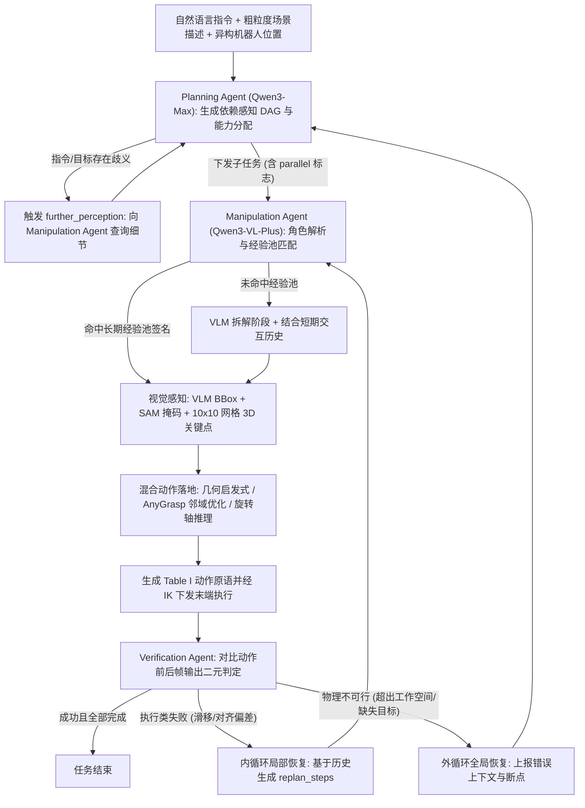

# A Closed-Loop Multi-Agent Framework for Robust Multi-Robot Manipulation

## 一句话定义

这是一个面向异构多机器人系统的分层闭环多智能体操作框架，通过 **Planning Agent（高层依赖分解与能力匹配）— Manipulation Agent（工具增强视觉定位与原语落地）— Verification Agent（前后帧视觉校验与局部/全局分级恢复）** 的闭环协作，将大模型语义推理可靠地落到真实物理操作与跨工作空间协同中。

## 英文缩写速查

| 缩写 | 英文全称 | 简要说明 |
|---|---|---|
| LLM | Large Language Model | 大语言模型，本文 Planning Agent 采用 `Qwen3-Max` 完成子任务图规划与全局重分配 |
| VLM | Vision-Language Model | 视觉语言模型，本文 Manipulation 与 Verification Agent 采用 `Qwen3-VL-Plus` 负责检测、关键点选择、旋转推理与成败校验 |
| DAG | Directed Acyclic Graph | 有向无环图，Planning Agent 用于表达子任务先后依赖与 `parallel` 并行调度关系 |
| SAM | Segment Anything Model | 通用图像分割模型，接收 VLM 输出的 2D 边界框生成像素级目标掩码 |
| EEF | End-Effector | 机器人末端执行器，本文所有动作原语统一以末端位姿指令表示并通过 IK 求解执行 |
| IK | Inverse Kinematics | 逆运动学，在 Agilex 平台使用 PyRoki、在 ABB YuMi 上使用 YumiPy 将末端位姿转为关节角 |
| SR | Success Rate | 任务成功率，用于衡量无扰动及三级外部扰动条件下的端到端真机完成率 |

## 为什么重要

1. **填补“单机精操作”与“多机开环规划”之间的断层**：现有 LLM 单臂操作方法（如 Code as Policies、VoxPoser、ReKep）具备较好的物理约束接地能力，但缺乏跨工作空间调度机制；而多机器人 LLM 规划框架（如 RoCo、SMART-LLM、Coherent）多将底层操作抽象为“理想化原语”，一旦真机遇到抓取滑移、物体移位或超出固定臂工作空间，便会引发级联失败。
2. **提出可执行层与规划层分离的双循环纠错机制**：不同性质的失败不应全由高层大模型推倒重来。本文让 Verification Agent 在可执行失败时触发内循环局部纠错，仅在目标不可达或物体缺失等物理不可行约束下才上报 Planning Agent 触发跨机器人重分配（例如由固定臂切换调度移动双臂机器人）。
3. **验证工具增强几何接地对接触密集型与长程任务的关键作用**：在 6 项真机任务（含双臂桌面操作与三机跨工作空间协同）及外部人工扰动测试中，该框架显著高于端到端 VLA 基线（OpenVLA-OFT、$\pi_0$）与无工具关键点基线，直接说明结构化感知工具与闭环校验对真机鲁棒性的决定性贡献。

## 核心信息

| 字段 | 内容 |
|---|---|
| 作者 | Yi-Xiang He, Lan Wei, Haoming Cen, Jian-Jian Jiang, Zhuohao Li, Guanxing Lu, Yihan Yang, Dandan Zhang, Wei-Shi Zheng |
| 机构 | 中山大学（SYSU）、教育部机器智能与先进计算重点实验室、帝国理工学院、清华大学深圳国际研究生院、深圳河套研究院 |
| 发表时间 / 会议 | 2026-07-08 提交 arXiv；RSS 2026 |
| 论文链接 | [arXiv:2607.06990](https://arxiv.org/abs/2607.06990) / [HTML 全文](https://arxiv.org/html/2607.06990) |
| 项目与代码 | 截至 2026-11-27 未公布官方源码仓库或独立项目主页（依赖云端 API 与已有开源底层库集成） |
| 清单分类 | `harness.monitoring_and_recovery` |
| 来源条目 | `survey_ax_2607_06990` |
| 开源状态 | 未确认开源代码 |

## 核心原理

整个系统接收自然语言任务指令与粗粒度场景描述（机器人位姿与物体大致位置），在统一末端执行器（EEF）动作空间下由三类智能体协同完成闭环执行：

### 1. Planning Agent：依赖感知分解与能力匹配

- **底层模型**：`Qwen3-Max`（快照 `qwen3-max-2026-01-23`，通过阿里云 DashScope API 调用）。
- **依赖感知任务分解**：将指令分解为带 `parallel` 标志的子任务 DAG（JSON 数组），显式区分必须串行执行的步骤与可由异构机器人并行执行的独立分支（例如导航与另一桌面操作并行）。
- **能力匹配与双向精细感知**：根据子任务需求（搬运、精细双臂操作、单臂放置等）匹配移动双臂（Agilex Cobot Magic）、固定单臂（Agilex Piper）与高精度双臂（ABB YuMi）。当指令或场景存在歧义（如 `"Tidy up"` 未指明具体杂物）时，发出 `further_perception` / `further_allocation` 标志向对应 Manipulation Agent 发起自底向上的精细感知查询，再细化任务图。
- **交接与双臂约束**：提示词约束多机协作优先通过“桌面中转放置”交接（尤其液体操作）而非空中直接交接；双臂同时抓取可合并指令，但向同一容器放置时强制串行以避免自碰撞。

### 2. Manipulation Agent：角色解析、工具增强感知与双层记忆

每个机器人平台配备独立的 Manipulation Agent（底层模型为 `Qwen3-VL-Plus`，快照 `qwen3-vl-plus-2025-12-19`）：

- **基于角色的交互拆解（Role-Based Operation Resolution）**：将单个逻辑子任务进一步拆为原子操作阶段，区分主动操作物体（Active）与被动承接物体（Passive）及其语义部件（如 `"handle"`、`"surface"`），并判定该阶段是否需要双臂协同（`dual_arms`）。
- **工具增强视觉感知（Appendix B）**：
  1. **检测与分割**：`Qwen3-VL-Plus` 输出目标 2D 边界框 JSON，送入 SAM 生成像素级掩码。
  2. **网格视觉提示关键点选择**：参照 ReSemAct 思路，对分割 ROI 做 Canny 边缘蓝线高亮与标准分辨率归一化，叠加 $10 \times 10$ 网格索引（按前景像素密度布局），将关键点定位转化为 VLM 对网格编号的离散分类；随后在目标像素 $7 \times 7$ 邻域采样点云，经离群值剔除与空间中值滤波得到稳定 3D 关键点 $\mathbf{p}_{key} \in \mathbb{R}^3$。
  3. **混合 6-DoF 抓取位姿生成**：对小物体（高度 $\le 0.05\text{ m}$）、关节物体与双臂对称任务，直接基于 3D 投影 BBox 法向量与最短边计算几何启发式抓取位姿；对一般物体，调用 AnyGrasp 生成候选抓取 $\mathcal{G}=\{g_i\}_{i=1}^N$，经运动学可达性与碰撞方向过滤后，在关键点邻域半径 $r_k = r_{init} + k \cdot \Delta r$ 内迭代求解最大化抓取分数 $s_i$ 的最优位姿：
     $$g^* = \underset{g_i \in \mathcal{S}_k}{\arg\max}\ s_i,\quad \mathcal{S}_k = \{g_i \in \mathcal{G} \mid \|\mathbf{t}_i - \mathbf{p}_{key}\|_2 \le r_k\}$$
  4. **旋转工具（Rotation Tool）**：将末端局部坐标轴（红 X、绿 Y、蓝 Z）投影到目标点云几何中值点图像上，由 VLM 结合当前末端旋转矩阵与任务指令推理旋转轴、正反方向与离散角度（$60^\circ / 75^\circ / 90^\circ / 100^\circ$）。
- **动作原语库（Table I）**：共 11 个原语，分三类生成可执行 Python 序列——基础操作（`Grasp`、`Place`、`Lift Up` $+\Delta z$、`Put Down` $-\Delta z$、`Reset Home`）、空间调整（`Move XY`、`Move Pose`、`Rotate`、`Align`）及约束交互（`Open`、`Close`）。
- **双层记忆机制**：
  - **短期记忆**：维护当前交互历史，消解顺序子任务歧义（如收到 `"Pour water"` 时依据历史判断水杯是否已在夹爪中）；
  - **长期记忆（经验池）**：抽取 `<Action> Active -> Passive` 模板签名（剥离具体位置描述），在子任务成功执行后缓存其阶段拆解与原语代码，后续命中相同签名时跳过 VLM 推理直接进入感知阶段以降低 API 耗时与生成方差。

### 3. Verification Agent：视觉成败校验与分层恢复

每台机器人的 Manipulation Agent 均配对一个 Verification Agent（`Qwen3-VL-Plus`）：

- **离散视觉结果校验**：对比子操作前图像 `#Image_PRE#` 与后图像 `#Image_POST#`，结合指令判断抓取状态与物体位移，输出二元 JSON（`{"is_success": true}` 或附带原因的 `false`）。
- **内循环——局部恢复（Local Recovery）**：若失败属于“可执行但未成功”（如抓取滑移或状态回退 Condition Loss、动作未产生效果 Ineffective Action），结合交互历史 `#HISTORY#` 直接构造严格匹配历史指令词表的恢复序列 `replan_steps` 发回 Manipulation Agent 执行，不惊动全局规划器。
- **外循环——全局恢复（Global Recovery）**：若判定失败源于物理不可行（如目标移出固定机械臂工作空间或视野内目标缺失），将错误上下文 `#ERROR_MESSAGE#` 与当前场景状态上报 Planning Agent；Planning Agent 保留已成功执行的步骤，仅从失败节点起重新分配更匹配的机器人（如调度移动平台 Cobot Magic 前往处理）。

## 流程总览

## 源码运行时序图

**不适用**（截至 2026-11-27 核查结果：arXiv:2607.06990 原文及项目元数据均未公布可运行的官方源码仓库或独立项目主页，仅说明了调用 `Qwen3-Max` / `Qwen3-VL-Plus` DashScope API 及集成 SAM、AnyGrasp、PyRoki、FAST-LIO、YumiPy 的系统流程，故无法给出对齐官方仓库真实运行入口的源码时序图。）

## 实验与评测

作者在三类真机平台（Agilex Cobot Magic 移动双臂、Agilex Piper 固定单臂、ABB YuMi 双臂）上设计了 **6 项真机任务**：
- **桌面双臂 3 项**：Block Stacking（在两圆柱间架桥并叠放方块）、Table Organization（模糊指令下分轮将 5 件杂物收入篮中）、Object Stowing（拉开抽屉、放入物体并关闭抽屉）；
- **异构多机协同 3 项**：Basket Shelving（Piper 装箱 + Cobot Magic 双臂搬运上货架）、Collaborative Pouring（Cobot Magic 取碗送至 ABB 桌面由 ABB 倒水）、Food Preparation（三机协同：ABB 往泡面杯倒水放回、Piper 在另一桌摆盘两种食物、Cobot Magic 将餐盘运至 ABB 桌面）。

### 1. 桌面双臂基线对比（Table II，每任务 20 次试验）

OpenVLA-OFT 与 $\pi_0$ 均使用单任务 50 条真机演示微调；ReKep 人工提供真值关键点标注以隔离感知误差。

| 方法 | Block Stacking Succ. | Block Stacking Comp.(%) | Table Org. Succ. | Table Org. Comp.(%) | Object Stowing Succ. | Object Stowing Comp.(%) |
|---|---:|---:|---:|---:|---:|---:|
| OpenVLA-OFT | 1/20 | 35 | 5/20 | 55 | 4/20 | 31 |
| $\pi_0$ | 9/20 | 46 | 9/20 | 75 | 8/20 | 60 |
| ReKep Annot. | 7/20 | 56 | 6/20 | 44 | 0/20 | 0 |
| **Ours（本文）** | **14/20** | **85** | **11/20** | **76** | **14/20** | **78** |

### 2. 三级外部扰动鲁棒性（Table III & Table IV，每任务 10 次试验）

实验设计三类扰动：**Action Level**（执行中人工移走或挪动物体）、**Sub-task Level**（子任务完成后重置环境状态测试多步恢复）、**Global Level**（将物体置于固定臂工作空间之外，迫使系统跨机器人调度）。

| 方法（Table III） | Stacking SR | Table Org. SR | Stowing SR | Avg. (%) |
|---|---:|---:|---:|---:|
| OpenVLA-OFT | 0/10 | 0/10 | 2/10 | 7 |
| $\pi_0$ | 2/10 | 1/10 | 3/10 | 20 |
| **Ours（本文）** | **5/10** | **6/10** | **8/10** | **63** |

Verification Agent 在外部扰动下的分环节指标（Table IV）：

| 场景 | 任务 | 失败识别率 ID (%) | 重规划成功率 Re-Plan (%) | 物理恢复率 Phy-Rec (%) | 最终成功率 Final SR (%) |
|---|---|---:|---:|---:|---:|
| Dual-Arm | Block Stacking | 90 | 100 | 78 | 50 |
| Dual-Arm | Table Organization | 100 | 100 | 80 | 60 |
| Dual-Arm | Object Stowing | 90 | 100 | 100 | 80 |
| Multi-Robot | Basket Shelving | 90 | 100 | 89 | 40 |

### 3. 全六任务消融实验与失败归因（Table V & Section IV-F）

Full Model 为 20 次试验，各消融变体为 10 次试验（括号外为成功次数，括号内为平均任务完成度 %）：

| 模型变体 | Block Stacking | Table Org. | Object Stowing | Collab. Pouring | Basket Shelving | Food Prep. |
|---|---|---|---|---|---|---|
| Full Model (Ours) | 14/20 (85%) | 11/20 (76%) | 14/20 (78%) | 11/20 (79%) | 12/20 (84%) | 10/20 (69%) |
| `w/o Keypoint Perception Tool` | 0/10 (35%) | 0/10 (32%) | 2/10 (45%) | 0/10 (16%) | 0/10 (50%) | 0/10 (26%) |
| `w/o Verification Agent` | 6/10 (85%) | 3/10 (71%) | 7/10 (80%) | 3/10 (70%) | 7/10 (87%) | 3/10 (56%) |
| `w/o History in Planning` | 5/10 (78%) | 2/10 (46%) | 6/10 (83%) | 3/10 (61%) | 7/10 (95%) | 1/10 (51%) |
| `w/o Exp.`（长期经验池） | 5/10 (78%) | 5/10 (65%) | 6/10 (80%) | 5/10 (84%) | 6/10 (80%) | 4/10 (70%) |

- **核心消融结论**：用 ReKep 特征聚类替代本文网格关键点感知后性能崩塌（6 项任务中 5 项降至 `0/10`）；去掉 Verification Agent 对长程多步任务（Table Org. 与 Food Prep. 均降至 `3/10`）影响尤为显著；去掉短期记忆在 Food Prep. 降至 `1/10`；去掉长期经验池对成功率影响较小（0 失败归因），主要提供效率与稳定性增益。
- **失败分布（IV-F）**：统计 Full Model 在 Table V 中全部 48 例失败，**关键点选择误差**为最主要瓶颈，其次为**动作原语生成失败**（无逆解或 VLM 空间关系误判），验证器误判、抓取滑移及碰撞/深度噪声/导航漂移占比较小。

## 与其他工作对比

| 维度 | 端到端 VLA（OpenVLA-OFT / $\pi_0$） | 单机约束优化（ReKep） | 已有 LLM 多机规划（RoCo / SMART-LLM / Coherent） | 本文闭环多智能体框架 |
|---|---|---|---|---|
| 训练数据要求 | 需每任务采集演示微调（本文基线用 50 条/任务） | 免训练，依赖 VLM + 优化器 | 免训练或少样本提示 | **免任务微调，依赖工具链与提示工程** |
| 多机与跨空间协同 | 无原生跨工作空间调度 | 局限于单工作空间 | 支持多机分配或对话协商 | **支持异构多机 DAG 并行分配与中转协同** |
| 底层执行接地 | 隐式端到端预测，易发生接触碰撞 | 关键点约束求解；关节物体终态关键点难定义 | 常将操作抽象为理想化原语 | **VLM + SAM + 网格关键点 + AnyGrasp/旋转工具 + 11 类原语** |
| 执行期失败恢复 | 缺显式校验，物体被移走后常继续空跑 | 开环或局部重采样，缺语义诊断 | 多为执行前验证，缺执行期反馈闭环 | **前后帧视觉校验 + 局部自愈内循环 / 全局重分配外循环** |

## 结论

**一句话总判：在没有统一端到端多机大模型的前提下，把“高层多机 DAG 调度 + 精细几何关键点工具链 + 局部自愈与全局跨机重分配双闭环”显式解耦，比直接微调单任务 VLA 或使用开环 LLM 多机规划更能扛住真实桌面与跨工作空间扰动。**

1. **工具增强的精确关键点落地是物理执行的前提**：消融实验显示失去基于轮廓与网格视觉提示的关键点定位后 5/6 任务成功率归零，且全系统 48 例失败中关键点定位仍是首要瓶颈。
2. **闭环校验在长时程与扰动场景收益最大**：Verification Agent 在外部扰动下保持 `90%–100%` 故障识别率与 `100%` 重规划成功率，将平均扰动成功率从 $\pi_0$ 的 `20%` 提升到 `63%`。
3. **短期记忆决定顺序一致性，长期经验池主要降本增稳**：缺少短期交互历史会显著削弱多阶段任务（Food Prep. 从 50% 降至 10%）；经验池则以缓存签名方式减少重复 VLM API 调用。
4. **选型边界清晰**：该方案适合由预定义运动学原语可覆盖、需要异构多机协作与容错恢复的中长程准静态操作任务，不适用于高频力控或超出 11 类原语表达能力的灵巧连续操作。

## 工程实践

- **硬件与底层控制解耦**：异构机器人统一抽象为末端执行器位姿空间，通过 `PyRoki`（Agilex Cobot Magic / Piper）和 `YumiPy`（ABB YuMi）屏蔽不同自由度与控制器差异；移动平台采用 `Livox Mid-360 + FAST-LIO + ROS1` 导航栈，RGB-D 采用 RealSense D435 / L515。
- **工程落地关键细节**：
  - 针对小物体（高 $\le 0.05\text{ m}$）与关节物体，用 BBox 几何启发式替代通用 AnyGrasp 以避免小目标点云采样稀疏导致的抓取失败；
  - 对 2D 选中的网格中心采用 $7 \times 7$ 邻域采样与空间中值滤波，显著缓解深度相机单像素空洞与边缘噪声；
  - Verification Agent 的局部恢复强制要求输出严格匹配 `#HISTORY#` 中的原语字符串格式，区分 Condition Loss（补回前置步骤再重试）与 Ineffective Action（直接重试当前步）。
- **代码复用提醒**：目前未见官方代码库发布，复现时需自行对接云端 VLM/LLM API（DashScope Qwen3 系列或同类视觉推理模型）、SAM、AnyGrasp 及各自机器人的 IK/导航接口。

## 局限与风险

1. **动作空间受限于固定原语库**：系统依赖人工设计的 11 个动作原语，论文明确指出这限制了对更复杂非刚性或灵巧操作任务的扩展（需后续引入学习型原语发现）。
2. **缺少全局时间感知动态调度**：Planning Agent 仅基于依赖关系和 `parallel` 标志做逻辑并行，未建模异构机器人执行速度差异以最小化整体等待空闲时间。
3. **不可逆物理失败与视觉盲区**：在 Block Stacking 扰动测试中虽有 90% 识别率与 100% 重规划率，最终成功率仍为 50%，因为积木倒塌等不可逆状态或物体滑出相机视野后缺乏主动视角搜寻策略。
4. **关键点瓶颈与云端推理依赖**：VLM 空间网格选择仍占全系统失败主因，且三智能体闭环频繁调用云端 `Qwen3-Max` / `Qwen3-VL-Plus` 带来较高的推理延迟、网络稳定性依赖及 API 成本。

## 关联页面

- [Agentic Robots 综述](paper-towards-agentic-robots-survey.md)
- [全量项目节点清单](../overview/awesome-agentic-robots-node-index.md)
- [VLA 方法背景](../methods/vla.md)
- [π₀ 通用流匹配策略](../methods/pi0-policy.md)
- [Robot Agent Harness · 机器人智能体执行框架](../methods/robot-agent-harness.md)
- [Agent Planning and Feedback Loops · 智能体规划与反馈执行](../methods/agent-planning-feedback.md)
- [Agentic Manipulation Policies · 智能体操作策略](../methods/agentic-manipulation-policies.md)
- [Grasp Pose Estimation（抓取位姿估计）](../methods/grasp-pose-estimation.md)
- [机器人操作](../tasks/manipulation.md)：了解物体操作和抓取任务。
- [双臂协调操作](../tasks/bimanual-manipulation.md)：了解桌面与移动双臂协同控制挑战。

## 推荐继续阅读

- [arXiv:2607.06990 论文全文（HTML 版）](https://arxiv.org/html/2607.06990)
- [ReKep: Spatio-Temporal Reasoning of Relational Keypoint Constraints for Robotic Manipulation](https://proceedings.mlr.press/v270/huang25g.html)
- [AnyGrasp: Robust and Efficient Grasp Perception in Spatial and Temporal Domains](https://doi.org/10.1109/TRO.2023.3281153)
- [PyRoki: A Modular Toolkit for Robot Kinematic Optimization](https://arxiv.org/abs/2505.03728)

## 参考来源

- [arXiv:2607.06990 原文通读与核对归档](../../sources/papers/paper-agentic-2607-06990.md)
- [官方 Awesome 快照归档](../../sources/repos/awesome-agentic-robots-survey-index.md)
- [论文原始入口（arXiv:2607.06990）](https://arxiv.org/abs/2607.06990)
