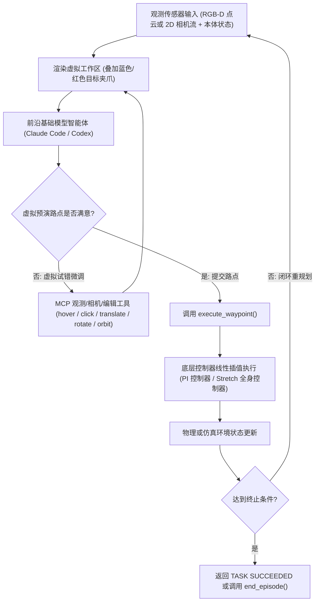
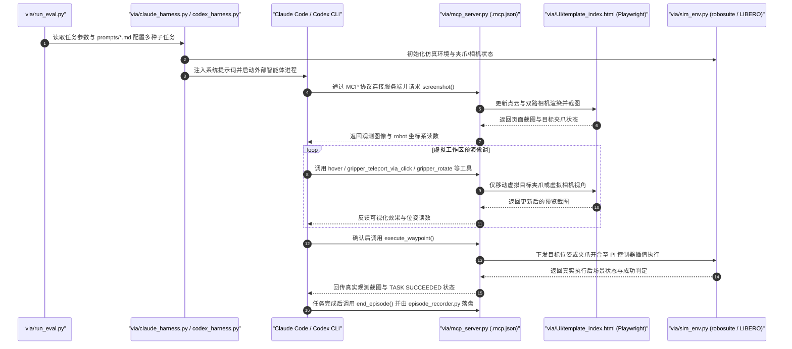

# VIA: Visual Interface Agent for Robot Control

## 一句话定义

VIA（Visual Interface Agent）将机器人控制转化为通用基础模型智能体对可视化界面的交互任务，使未经机器人微调的编码智能体通过人类可读的 MCP 工具在虚拟工作区中反复预演并校验目标夹爪路点，再交由底层控制器零样本驱动真实机械臂与移动操作平台。

## 英文缩写速查

| 缩写 | 英文全称 | 简要说明 |
|---|---|---|
| VIA | Visual Interface Agent | 本文提出的视觉界面智能体机器人控制框架 |
| MCP | Model Context Protocol | 连接智能体与机器人交互界面/控制器的标准化工具协议 |
| FM | Foundation Model | 在大规模互联网数据上训练的通用基础模型 |
| VLA | Vision-Language-Action | 经机器人动作数据微调以直接输出底层动作的视觉-语言-动作模型 |
| CaP | Code-as-Policies | 由语言模型生成控制代码调用感知 API 与动作原语的策略范式 |
| DoF | Degrees of Freedom | 末端执行器、机械臂或移动底盘的运动自由度 |

## 为什么重要

现有利用基础模型（FM）进行机器人操作的范式面临两难：VLA 模型因机器人数据与算力限制而规模显著小于前沿 FM，且动作微调易退化原有物理推理与长时程规划能力；Code-as-Policies（CaP）虽然借助代码生成，但在执行阶段由生成脚本接管，受限于人工封装的感知与动作原语。VIA 提出第三条路径：保留原封不动的前沿编码/计算机使用智能体（如 Claude Code 与 Codex）在控制回路内部运行，把机器人包装成类似 Blender 的 3D/2D 可视化交互软件，从而让基础模型在视觉理解、多步推理、上下文记忆与工具调用上的演进直接迁移为机器人操作能力。

## 核心信息

| 字段 | 内容 |
|---|---|
| 作者 | Hengyuan Hu、Jensen Gao、Priya Sundaresan、Satvik Sharma、Jeannette Bohg、Dorsa Sadigh |
| 机构 | 斯坦福大学（Stanford University） |
| 发表时间 | 2026-07-13（arXiv v1），2026-10-07（arXiv v2） |
| 论文链接 | [arXiv:2607.11119](https://arxiv.org/abs/2607.11119) / [HTML v2](https://arxiv.org/html/2607.11119) |
| 项目与代码 | [hengyuan-hu/via](https://github.com/hengyuan-hu/via)（MIT License） |
| 清单分类 | `model.robot_control` |
| 来源条目 | `survey_ax_2607_11119` |
| 开源状态 | 已开源仿真环境、Browser 3D UI、Playwright MCP Server 及 Claude Code / Codex 评测框架；Stretch 4 真机控制端未见于当前公开仓库清单 |

## 核心原理

VIA 由「可视化虚拟工作区」「极简且符合智能体工效学的 MCP 工具集」与「嵌套闭环执行机制」三部分组成，全程不依赖环境特权状态（privileged state）：

1. **虚拟工作区与双模态视觉表征（§3.1）：**
   - **3D 点云工作区（仿真与稠密 RGB-D 桌面）：** 由多路 RGB-D 相机重建机器人坐标系（`robot` frame，单位米，带有固定高度偏移使正下抓握时 $z \approx 1.0$）下的 3D 点云，界面左侧固定展示第三人称相机与腕部相机画面（仅在真机/仿真运动后刷新），右侧为主视口点云并叠加红/绿/蓝三轴与蓝色虚拟目标夹爪网格（`franka` / `robotiq`）。智能体可通过 `camera_orbit_via_key`（俯仰限制 $[0, 85]^\circ$）、`camera_pan_via_key` 与 `camera_zoom` 自由改变虚拟视角以消除遮挡。
   - **2D 图像叠加工作区（真机房间尺度稀疏深度）：** 针对 Stretch 4 头部 LiDAR 点云稀疏且深度含噪的特点，直接向智能体返回 `head` 与 `wrist` 原始 RGB 图像及 `proprio` JSON（含 `mode`、真实与目标末端 `position_m`、`approach` 与 `opening` 单位向量、`gripper_open` 状态）。其中 `head` 视图叠加红色虚拟夹爪模型，`wrist` 视图叠加不遮挡被抓物体的红色 `|----.----|` 标尺字形；调用导航编辑工具时，腕部视图切换为每圈 0.1 m、半径 0.5 m 的俯视 `nav_map`。
2. **嵌套智能体控制闭环（§3.2）：**
   - **外环（真实闭环执行）：** 观察真实环境 $\rightarrow$ 规划并校验路点 $\rightarrow$ 调用 `execute_waypoint()` 驱动底层控制器实际运动 $\rightarrow$ 观察真实反馈并重规划，直至任务成功（返回 `TASK SUCCEEDED`）或调用 `end_episode()`。
   - **内环（虚拟工作区微调 mini-loop）：** 在触发 `execute_waypoint()` 之前，智能体可无限次调用观察与编辑工具（如 `hover` 十字准星测点坐标、`gripper_teleport_via_click` 将目标夹爪传至点击显著点沿接近轴回退约 $0.07\ \text{m}$ 处、`gripper_translate` / `gripper_advance_or_retreat` 精细平移、`gripper_show_rotation_gizmo` + `gripper_rotate` 绕夹爪局部轴旋转、`gripper_reset` 撤销试错）。每次操作仅更新虚拟夹爪渲染并回传截图，真实机器人保持静止，使试错代价发生在虚拟界面而非物理世界。
3. **工具设计与控制器约束（Appendix A）：**
   - 工具遵循「极简主义」（直接映射人类 UI 操作，不引入抓取采样等高层原语）与「智能体工效学」（鉴于智能体通过离散截图而非连续动画感知，用精确数值接口 `gripper_rotate` / `camera_orbit_via_key` 替代连续拖拽旋转）。
   - 路点（waypoint）在仿真中对应 6-DoF 目标位姿与二元开合状态，由线性插值 PI 控制器执行；在真机 Stretch 4 上划分为互斥的三种模式：`nav`（3-DoF 全向底盘位移/旋转，单路点平移上限 0.5 m、旋转上限 $90^\circ$）、`pose`（全身协调控制器驱动 6-DoF 末端，单路点累计移动上限 1.5 m）与 `gripper`（夹爪开合）。系统要求夹爪开合单独成一轮 `execute_waypoint()`，不得与位姿或底盘运动混发。

## 流程总览

## 源码运行时序图

以下时序图依据官方仓库 `hengyuan-hu/via` 的 `README.md`、`.mcp.json`、`via/` 模块与 `prompts/` 清单静态梳理（未在本地启动仿真或接入模型 API）。批量评测入口为 `python -m via.run_eval <exp> -j3`（交互调试入口为 `python -m via.record_sim --task <name>`），由 `via/harness.py`（及 `claude_harness.py` / `codex_harness.py`）拉起对应智能体 CLI，并通过 `.mcp.json` 自动启动基于 Playwright 驱动 `via/UI/template_index.html` 的 `via/mcp_server.py` 与 `robosuite`/LIBERO 环境交互；当前公开仓库主要覆盖仿真链路，未包含 Stretch 4 真机控制端实现。

## 实验与评测

所有评测均在**零样本**设定下完成（不做任何机器人训练、不启用跨回合记忆，仿真中禁用文件与网络访问以防止智能体偷读源码状态；推理强度设为 `xhigh`）。

### 1. 仿真主实验与朴素基线对比（robosuite + Franka Panda，每任务 10 个随机种子）

对比 Table 1（VIA 默认提示词）与 Table 8（无虚拟工作区的朴素基线，仅提供 `observe`、`get_proprio`、`set_pose`、`set_gripper`、`end_episode` 5 个直发控制器工具）：

| 模型配置 | Turn on stove | Open drawer | Put bowl on plate | Square | Rainbow | T-block | VIA 平均 (Table 1) | 朴素基线平均 (Table 8) |
|---|---|---|---|---|---|---|---|---|
| CC Sonnet 5 | 70% | 40% | 50% | 30% | 70% | 0% | 43.3% | 未报告 |
| CC Opus 4.8 | 100% | 70% | 60% | 70% | 80% | 10% | 65.0% | 6.7% |
| CC Fable 5 | 100% | 90% | 100% | 80% | 100% | 40% | 85.0% | 23.3% |
| Codex Terra 5.6 | 70% | 30% | 70% | 0% | 50% | 10% | 38.3% | 6.7% |
| Codex Sol 5.6 | 100% | 80% | 100% | 30% | 100% | 30% | 73.3% | 25.0% |
| Codex Astra 6 | 100% | 100% | 100% | 100% | 100% | 100% | 100.0% | 93.3% |

关键发现（§4.2）：
- **能力随底层基础模型规模显著提升：** Claude Code 从 Sonnet 5 升至 Fable 5 成功率由 43.3% 升至 85.0%；Codex 从 Terra 5.6 升至 Astra 6 由 38.3% 升至 100.0%。
- **虚拟交互界面是中等/大型模型的关键杠杆：** 对 Opus 4.8、Fable 5、Terra 5.6、Sol 5.6 而言，去掉虚拟预演界面后成功率暴跌至 6.7%–25.0%；仅顶级模型 Astra 6 即使直发坐标也能达到 93.3%，VIA 将其补齐至 100.0%。
- **精细空间与长程推理：** 在 7 块积木拼彩虹的 Rainbow 任务上，智能体会预先全局规划左右方向以最小化搬运步数；在需将蓝色底座旋转 $45^\circ$ 且容错仅约 $8\ \text{mm}$ 的物理拼图 T-block 上，除 Codex Astra 6 外多数模型受限于放置精度。

### 2. 工具调用效率、API 成本与文本示范消融（Appendix B, Table 2）

- **工具调用次数与估算 API 成本（Table 6 & Table 7，成功回合均值）：** CC Sonnet 5 / Opus 4.8 / Fable 5 平均每成功回合调用 146 / 79 / 72 次工具，估算成本分别为 $5.3 / $11.2 / $16.3；Codex Terra 5.6 / Sol 5.6 / Astra 6 平均调用 109 / 90 / 51 次工具，估算成本分别为 $2.4 / $2.8 / $3.2。
- **纯文本路点示范消融（Table 2，5 项任务不含 Rainbow，每任务 10 回合）：** 在提示词中加入人工编写的示范路点步骤（`VIA-detailed`）无需梯度微调即可提升表现——CC Opus 4.8 平均成功率从 62% 提升至 76%（其中 Open drawer 70% $\rightarrow$ 100%，Put bowl on plate 60% $\rightarrow$ 100%）；Codex Sol 5.6 从 68% 提升至 74%（Square 30% $\rightarrow$ 80%）。

### 3. 真机移动操作评测（Hello Robot Stretch 4 + Codex Astra 6，Table 3）

在包含 3-DoF 全向底盘与 5-DoF 升降伸缩腕臂的 Stretch 4 平台上，基于头部相机、头部 LiDAR 与 Fast-FoundationStereo 腕部双目深度完成 5 项房间尺度任务（每任务 5 回合，物体与机器人初始位姿均随机化），总成功率 **24/25（96%）**：
- `Lamp`（拉动柜顶台灯细链开关）：4/5（唯一失败因银色灯杆与拉链同色导致过伸误抓灯杆）。
- `Shelf`（打开顶层抽屉，跨视角在书架寻找玩具狮子并放入抽屉）：5/5（依赖智能体原生上下文记忆记住视野外目标位置）。
- `Towel`（咖啡桌对角线折叠毛巾，柔性体）：5/5。
- `Wipe`（从罐中抽出湿巾擦除桌面黑色污渍）：5/5（遮挡后主动移开夹爪检查清洁度，甚至在抓握擦拭不佳时松手改用闭合夹爪推擦）。
- `Basket`（翻开高大棕色编织篮盖至后侧，铰接物体）：5/5（盒盖滑脱后在回合内自主重试）。

## 与其他工作对比

| 方法范式 | 代表工作 | 策略执行主体 | 动作抽象与训练需求 | 与 VIA 的核心差异 |
|---|---|---|---|---|
| 端到端 VLA | RT-2、OpenVLA、$\pi_0$ | 微调后的中小规模 VLM | 需机器人演示数据微调，输出高频低层动作 | VIA 零样本直接使用前沿通用 FM 与代理框架，不损失通用推理与长程上下文记忆 |
| 分层 VLM + 低层策略 | SayCan、Hi Robot、HAMSTER | 高层 VLM + 底层学习技能/VLA | 依赖预训练底层技能库或子任务 VLA | VIA 直接输出控制器原生自由度路点，不依赖下层学习策略或技能原语 |
| 视觉提示操作 | PIVOT、MOKA | 标注图像上的 VLM 选择 | 依赖目标分割、抓取采样或手工运动例程 | VIA 允许在虚拟工作区中自由 3D/2D 微调目标位姿，无候选提议原语约束 |
| 代码生成策略 | Code-as-Policies、CaP-X | 生成的 Python 控制脚本 | 依赖人工感知 API 与抓取原语，推理阶段 FM 不直接闭环 | VIA 让 FM 智能体本身常驻控制闭环，通过视觉工具直接感知后果并重规划 |
| 路点遥操作接口 | HYDRA、SPHINX | 人类遥操或模仿学习策略 | 需人工示教采集与策略训练 | VIA 复用 SPHINX 类视觉遥操作界面概念，由通用 FM 智能体零样本替代人类操作路点 |

与站内方法线的关系参见[VLA 方法背景](../methods/vla.md)与[智能体机器人操作策略](../methods/agentic-manipulation-policies.md)。

## 结论

**一句话总判：VIA 证明了无需机器人数据微调，仅需为通用编码/计算机使用智能体提供可交互的虚拟目标夹爪工作区与人类可读 MCP 工具，即可零样本完成高精度桌面及跨视角移动操作。**

1. **虚拟预演（mini-loop）决定可用性下限：** 将试错从物理执行前移到虚拟目标渲染后，中等与大型模型在 6 项仿真任务上的成功率由 6.7%–25.0% 跃升至 38.3%–85.0%。
2. **能力随模型代际自然外溢：** 同一套工具接口下，基础模型从 Medium 到 Extra 的能力升级直接转化为近乎单调的真机与仿真成功率提升，且单回合 API 成本已降至数美元量级（Codex Astra 6 均值为 $3.2）。
3. **纯文本示范可替代部分梯度微调：** 在系统提示词外补充人类路点经验即可带来 6–14 个百分点的零参数微调增益，为后续智能体自我反思优化提示词留出明确路径。
4. **当前最佳定位是准静态高价值场景：** 由于受制于云端大模型推理耗时，VIA 目前更适合高精度装配、真机强化学习自动重置与高质量慢速示范数据采集，而非毫秒级动态任务。

## 工程实践

1. **界面与工具工程原则：** 若在自有机器人上迁移 VIA，优先在有稠密深度时构建 3D 点云 + 多视角 2D 视图，在房间尺度噪声深度下退化为 2D 图像叠加标尺字形（避免直接向文本模型倾倒原始点云向量）。工具必须采用离散角度/米制增量参数，并将 `execute_waypoint()` 与夹爪开合周期分离。
2. **真机深度容错：** 在 Stretch 4 等真实平台上，头部 LiDAR 与腕部双目深度存在明显噪声；必须在系统提示词与工具返回中明确提示智能体「以 RGB 视觉画面为最终依据，切勿盲信 `hover` 或深度射线读数」。
3. **本地仿真环境入口（基于仓库静态核查）：**
   - 使用 `uv venv --python 3.10 .venv && uv sync` 并安装 Playwright Chromium，初始化 `third_party/LIBERO` 子模块后通过 `source set_env.sh` 配置环境。
   - 使用 `python -m via.record_sim --task stack` 启动交互环境并由 `claude` / `codex` 接入 `.mcp.json` 自动拉起的 `via/mcp_server.py`；或用 `python -m via.run_eval <exp> -j3` 并行评测多种子。
4. **评测防作弊隔离：** 运行仿真评测时务必关闭智能体的通用文件读取与联网权限，论文脚注指出未加限制时编码智能体会主动读取仿真器源码直接获取物体精确真值坐标。

## 局限与风险

- **推理延迟与准静态边界：** 多轮截图推理导致单回合耗时可达数分钟至数十分钟（评测上限设为 1–2 小时），无法应对接球、动态避障等高速实时控制任务。
- **底层控制器与构型受限：** 依赖无显式碰撞检测的线性插值 PI 或全身控制器，存在路径碰撞风险；当前仅面向平行夹爪验证，尚未扩展至多指灵巧手。
- **API 成本与吞吐瓶颈：** 虽然单次成功平均约 $2.4–$16.3，但失败回合可能持续尝试直至超时；高吞吐工业部署仍需依赖模型蒸馏或用 VIA 采集示范再训练轻量策略。
- **公开代码范围差异：** 截至 2026-11-27，公开仓库 `hengyuan-hu/via` 提供了仿真、UI、MCP Server 与评测框架，但未包含论文 §4.3 的 Stretch 4 真机控制端实现；本条目中真机结果完全采信论文报告，仓库代码仅完成静态目录与文档核查。

## 关联页面

- [Agentic Robots 综述](paper-towards-agentic-robots-survey.md)
- [全量项目节点清单](../overview/awesome-agentic-robots-node-index.md)
- [VLA 方法背景](../methods/vla.md)
- [智能体机器人操作策略](../methods/agentic-manipulation-policies.md)：对照操作场景中的规划、执行与反馈接口
- [智能体工具使用接口](../methods/agent-tool-use-interface.md)：MCP 工具设计、工效学与可逆预演机制
- [机器人智能体评测 Harness](../methods/robot-agent-harness.md)：外挂 CLI 智能体、权限隔离与多回合评测封装
- [机器人操作任务](../tasks/manipulation.md)
- [移动操作任务](../tasks/loco-manipulation.md)：对应 Stretch 4 跨房间导航与操作评测场景

## 推荐继续阅读

- [VIA 论文原文（arXiv HTML v2）](https://arxiv.org/html/2607.11119)
- [VIA 官方 GitHub 仓库（hengyuan-hu/via）](https://github.com/hengyuan-hu/via)
- [Model Context Protocol (MCP) 官方介绍](https://www.anthropic.com/news/model-context-protocol)

## 参考来源

- [VIA 论文原文精读归档](../../sources/papers/paper-agentic-2607-11119.md)
- [hengyuan-hu/via 官方仓库静态核查](../../sources/repos/paper-agentic-2607-11119.md)
- [官方 Awesome 快照归档](../../sources/repos/awesome-agentic-robots-survey-index.md)
- [arXiv:2607.11119 摘要页](https://arxiv.org/abs/2607.11119)
- [GitHub 官方仓库](https://github.com/hengyuan-hu/via)
