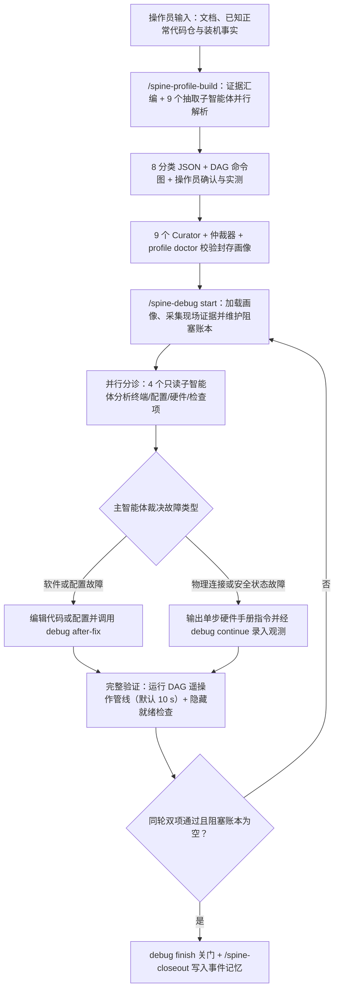

# SPINE: Bridging the Cyber-Physical Gap with Agentic AI

## 一句话定义

**SPINE**（Scalable Physical Integration with ageNtic Expertise）是一个基于 Claude Code 技能工作流与 Python 后端的机器人部署前排障智能体框架，通过编译并封存平台画像，并在“观察–分诊–修复–验证”闭环中协同代码修复与分步物理干预，帮助缺乏机器人工程经验的操作员将故障双臂平台恢复至可遥操作状态（teleoperation-ready）。

## 英文缩写速查

| 缩写 | 英文全称 | 简要说明 |
|---|---|---|
| SPINE | Scalable Physical Integration with ageNtic Expertise | 本文提出的面向物理–信息集成层排障的智能体框架 |
| DAG | Directed Acyclic Graph | 有向无环命令图，用于刻画一次配置、常驻 bringup 与遥操作启动命令及依赖 |
| OSS | Outcome Success Score（论文记为故障解决比例） | 单次试验中成功排除的植入故障占比，区分部分修复与完全恢复 |
| TTO | Time-to-Teleoperation | 从开始排障到双臂主从遥操作与相机流恢复可用所耗费的时间 |
| CAN | Controller Area Network | AgileX PiPER 平台使用的机械臂总线通信协议（经 USB-to-CAN 适配器接入） |
| VLA | Vision-Language-Action | 视觉–语言–动作基础模型，其真机部署仍依赖底层可工作的硬件与中间件栈 |

## 为什么重要

1. **直击基础模型落地的“脊髓”瓶颈**：无论是 [VLA](../methods/vla.md) 还是语言引导策略，通常默认机器人已经暴露可用的传感流与控制接口；然而实际部署中，设备驱动、USB/网络标识、Python 环境漂移、CAN 总线连接、急停锁存与固件版本门控等集成层故障往往并发且表现相似（例如相机流缺失既可能是序列号配置错误，也可能是线缆损坏或二者叠加）。
2. **打破纯软件编码智能体的数字闭环局限**：传统软件工程智能体（如 SWE-agent）仅依赖单元测试或编译通过作为结束信号，但机器人上线涉及线缆插拔、硬件枚举与实时控制器响应等无法仅凭源码静态检查判定的物理状态。
3. **降低双臂遥操作运维门槛**：在 DOBOT X-Trainer 与 AgileX PiPER 两个异构双臂平台上，由无机器人专业背景的初学者操作 SPINE，能够在复合软件、硬件及混合故障下实现更完整的故障清除与更短的平均恢复耗时。

## 核心信息

| 字段 | 内容 |
|---|---|
| 论文标题 | *SPINE: Bridging the Cyber-Physical Gap with Agentic AI* |
| 作者 | Minkyu Ham, Dongho Kim, Chan Lee, Min Jun Kim, Yixi Zhang, Jiayi Wang, Han Liu |
| 机构 | 西北大学（Northwestern University，统计与数据科学系、计算机科学系） |
| 发表时间 | arXiv:2607.13049v2（v1 提交于 2026-06-29，v2 修订于 2026-09-21） |
| 论文链接 | [arXiv:2607.13049](https://arxiv.org/abs/2607.13049)（[HTML 全文](https://arxiv.org/html/2607.13049)） |
| 项目与代码 | 论文页首标注项目网址 `magics-lab.github.io/SPINE-web`；本地缓存核查未见公开 GitHub 代码仓库链接 |
| 清单分类 | `harness.monitoring_and_recovery` |
| 来源条目 | `survey_ax_2607_13049` |
| 开源状态 | **未确认开源代码**（截至 2026-11-27，论文正文及本地抓取上下文均未提供可公开访问的源码仓库 URL，亦无独立可运行代码仓供静态核对） |

## 核心原理

SPINE 将机器人排障拆分为两个由 Claude Code `SKILL.md` 规范约束、Python 后端负责执行与状态校验的工作流：离线/装机阶段的 **画像构建（`/spine-profile-build`）** 与运行时阶段的 **闭环调试（`/spine-debug`）**，辅以 `/spine-init`、`/spine-check` 和 `/spine-closeout` 管理内存与局部取证。

### 1. 机器人画像构建（`/spine-profile-build`）

在系统正常工作时，操作员提供文档、已知正常的软件仓库与现场配置事实，构建出面向特定平台的持久化参考：

- **证据汇编与并行抽取**：Python 编译器先从文档、配置与脚本中组装带源码引用的证据包；随后并行派发 **9 个抽取子智能体**——前 8 个分别提取机器人身份（identity）、硬件组件（components）、接口（interfaces）、软件栈（software）、配置项（configuration）、操作流程（procedures）、安全约束（safety）与诊断信息（diagnostics），第 9 个专门重建遥操作管线的 **有向无环命令图（DAG）**（区分一次性初始化命令、常驻 bringup 进程与最终遥操作命令，并将相机序列号、设备路径等易变值标记为可被现场观测推翻的部署假设）。
- **规范化画像与运行时适配器**：编译器将 JSON 草稿与确定性抽取结果合并为 **8 个分类 JSON 文件 + 1 个 manifest**，并由适配器暴露三类运行时原语：**运行契约（contracts）**、**探针与检查（probes and checks）** 以及将物理处置与验证绑定起来的 **硬件手册（hardware playbooks）**。
- **操作员确认与仲裁封存**：操作员须逐项确认命令 DAG、必需接口、硬件手册与 **隐藏就绪检查（hidden readiness checks，用于捕捉短时遥操作不易暴露的配置/设备隐患且不含预设故障标注）**，并记录一次完整命令图的实测通过；随后 **9 个并行 curator 子智能体** 交叉审阅证据覆盖度，**1 个仲裁子智能体** 消解跨类别冲突，最终由 Python 后端运行 `profile doctor`（校验 schema 一致性、证据覆盖、运行时兼容性、DAG 结构、人工确认与构建期实测记录）后封存画像。

### 2. 观察–分诊–修复–验证闭环（`/spine-debug`）

当遥操作失效时，`/spine-debug` 结合封存画像、现场终端证据与历史事件记忆执行闭环恢复，关键约束在于 **LLM 的诊断意见不等于修复完成，只有 Python 后端实测通过才允许结案**：

- **启动与阻塞账本（`debug start`）**：加载画像并收集终端输出或执行声明的遥操作管线与遥操作作用域隐藏就绪检查；后端维护 **阻塞账本（blocker ledger）**，将每个活跃故障与其来源检查和证据绑定，每轮验证刷新状态并保留历史。
- **四路并行只读分诊（Parallel Triage）**：当需深度诊断时，同时派发 **4 个只读诊断子智能体** 分别检查：（1）终端运行输出；（2）软件与配置偏差；（3）硬件设备可见性；（4）就绪检查相关性。它们禁止修改代码、禁止直接指挥操作员、禁止宣布成功，仅向后端提交有证据支撑的评估，由主智能体裁决“数字可修 vs 物理干预”。
- **分离的修复接口（`debug after-fix` vs `debug continue`）**：
  - **软件修复**：主智能体编辑源码、配置或环境（要求保留原有功能，禁止通过关闭组件或屏蔽报错来伪装通过），调用 `debug after-fix` 记录变更并重跑验证。
  - **物理修复**：主智能体每次仅从对应组件的硬件手册中向操作员给出 **单步物理操作指引**；操作员执行后通过 `debug continue` 录入结果，后端随后触发指定探针或记录人工观测，避免重复已确认的步骤。
- **联合关门门禁（`debug finish`）**：完整验证重新拉起确认过的 DAG 命令图及其依赖，在默认 **10 秒观测窗** 内检查进程输出与成功判据并清理进程，同时执行隐藏就绪检查。`debug finish` 仅在 **最近一次干预后的同一轮验证中，实时遥操作管线与隐藏就绪检查双双通过且阻塞账本清零** 时才允许关闭；因画像数据不全而无法执行的检查标为 `inconclusive` 且当前不阻塞关门。`/spine-closeout` 仅将带有通过验证记录的修复沉淀为事件记忆。

## 流程总览

## 源码运行时序图

**不适用**（核查结果：截至 2026-11-27，论文仅在页首标注 `magics-lab.github.io/SPINE-web`，论文全文及本地工作区缓存 `context.json` 均未提供公开 GitHub 源码仓库地址，`candidate_repos` 为空，无法对官方可运行源码入口与模块调用进行静态核实）。

## 实验与评测

### 1. 测试平台与故障注入基准（Table I）

实验在两套硬件、总线与中间件完全不同的双臂遥操作平台上构建了 **12 个受控注入故障场景**（除 `D-HW1` 为单故障急停锁存外，其余每场景均同时植入 **2 个故障**，专门检验排障流程是否会因修完表层错误而过早停止，以及能否区分同子系统下的软件配置错误与硬件损坏）：

- **DOBOT X-Trainer（7 场景）**：包含双从臂、双主臂、RealSense 相机、工作站与静态以太网 SDK。
  - `D-SW1`（纯软件）：服务端与遥操作客户端通信端点不匹配 + 启动器占用所需本地端口。
  - `D-SW2`（纯软件）：篡改启动兼容性检查拒绝已安装控制器/库版本 + 为单路相机分配不存在的序列号。
  - `D-HW1`（纯硬件）：急停按钮锁存，阻止机械臂致动。
  - `D-HW2`（纯硬件）：拔掉右腕相机线缆 + 将左腕相机线缆替换为已知损坏线缆。
  - `D-HW3`（纯硬件）：断开一侧主臂线缆与一侧从臂以太网线。
  - `D-HY1`（混合）：更换右腕相机为损坏设备 + 为同一相机角色配置不存在的序列号。
  - `D-HY2`（混合）：拔掉控制网线 + 在启动器中将两台控制器 IP 改入错误子网。
- **AgileX PiPER（5 场景）**：基于 ROS Noetic 与 CAN 总线的四臂系统（4 台 6-DoF PiPER 臂、USB-to-CAN 适配器与 RealSense 相机）。
  - `P-SW1`（纯软件）：左 CAN 适配器 USB 总线地址配置错误 + 优先加载 user-site Python 包导致不兼容的 Pinocchio 导入。
  - `P-SW2`（纯软件）：左腕相机序列号错误 + 遥操作 launch 文件的逆运动学参数路径指向不存在文件。
  - `P-HW1`（纯硬件）：断开左从臂 CAN 信号线/接头 + 拔掉左腕相机 USB 线。
  - `P-HY1`（混合）：拔掉左腕相机 USB 线 + 在 launch 文件中配置错误序列号。
  - `P-HY2`（混合）：拔掉左侧 USB-to-CAN 适配器 USB 连接 + 将配置脚本期望适配器数量从 2 改为 3。

### 2. 双平台定量结果（Table II）

对照组为使用同一底座模型（**Claude Sonnet 5.0**）和相同参考资料、但不具备 SPINE 画像/技能/编排/记忆的**人工操作员 + 标准 Claude Code**（DOBOT 人工 $n=7$，PiPER 人工 $n=9$；SPINE 由初学者操作，每场景 $n=3$；TTO 统计包含未完全恢复的失败试验）：

| 平台与场景 | 故障类型 | SPINE OSS | SPINE TTO | 人工+Claude Code OSS | 人工+Claude Code TTO |
|---|---|---|---|---|---|
| **DOBOT X-Trainer** | — | — | — | — | — |
| `D-SW1` | 纯软件 | `1.00 ± 0.00` | `6:20 ± 0:01` | `0.36 ± 0.38` | `7:28 ± 3:05` |
| `D-SW2` | 纯软件 | `1.00 ± 0.00` | `6:41 ± 1:19` | `0.57 ± 0.45` | `20:11 ± 13:25` |
| `D-HW1` | 纯硬件 | `1.00 ± 0.00` | `13:35 ± 0:13` | `1.00 ± 0.00` | `20:46 ± 6:12` |
| `D-HW2` | 纯硬件 | `1.00 ± 0.00` | `9:59 ± 0:34` | `1.00 ± 0.00` | `17:54 ± 17:52` |
| `D-HW3` | 纯硬件 | `1.00 ± 0.00` | `11:18 ± 1:44` | `1.00 ± 0.00` | `13:01 ± 7:47` |
| `D-HY1` | 混合 | `1.00 ± 0.00` | `14:55 ± 0:55` | `0.64 ± 0.38` | `11:55 ± 7:44` |
| `D-HY2` | 混合 | `1.00 ± 0.00` | `9:34 ± 0:32` | `0.71 ± 0.27` | `12:43 ± 9:14` |
| **DOBOT 汇总** | 7 场景 | **`1.00 ± 0.00`** | **`10:20 ± 3:11`**（降 30%） | `0.76 ± 0.36` | `14:51 ± 10:44` |
| **AgileX PiPER** | — | — | — | — | — |
| `P-SW1` | 纯软件 | `1.00 ± 0.00` | `11:32 ± 0:11` | `0.94 ± 0.17` | `16:00 ± 10:16` |
| `P-SW2` | 纯软件 | `1.00 ± 0.00` | `8:28 ± 0:06` | `1.00 ± 0.00` | `10:56 ± 13:01` |
| `P-HW1` | 纯硬件 | `1.00 ± 0.00` | `2:45 ± 0:22` | `1.00 ± 0.00` | `13:36 ± 13:23` |
| `P-HY1` | 混合 | `1.00 ± 0.00` | `10:44 ± 0:19` | `1.00 ± 0.00` | `13:43 ± 8:07` |
| `P-HY2` | 混合 | `1.00 ± 0.00` | `5:33 ± 0:04` | `1.00 ± 0.00` | `8:14 ± 7:27` |
| **PiPER 汇总** | 5 场景 | **`1.00 ± 0.00`** | **`7:48 ± 3:27`**（降 38%） | `0.99 ± 0.07` | `12:30 ± 10:35` |

- **平台差异解读**：在 DOBOT 上，SPINE 的主要优势体现在 **软件与混合场景的完整修复率**（人工在 `D-SW1`/`D-SW2`/`D-HY1`/`D-HY2` 的 OSS 仅为 `0.36`–`0.71`）；在 `D-HY1` 上 SPINE 耗时（`14:55`）长于人工（`11:55`），原因是人工未完全修复全部故障。在 PiPER 上，人工已能解决几乎全部故障（`0.99`），SPINE 的主要优势转化为 **全场景稳定提速**（尤其 `P-HW1` 从 `13:36` 降至 `2:45`，降幅约 80%）。

### 3. DOBOT 消融实验（Table III）

在 DOBOT 7 个场景上分别移除机器人画像（No Profile）或硬件排障手册（No Hardware Playbook），消融变体每场景仅执行 **单次试验（$n=1$）**，对照完整 SPINE（$n=3$）：

- **完整 SPINE**：Overall OSS **`1.00`**，平均 TTO **`10:20`**。
- **移除 Profile**：Overall OSS 降至 **`0.79`**，平均 TTO 升至 **`17:00`**（`D-HW2` 仅解决 `0.50` / `45:00`，`D-HY1` 为 `0.00` / `20:37`，纯软件场景保持 `1.00`）。
- **移除 Hardware Playbook**：Overall OSS 降至 **`0.57`**，平均 TTO 升至 **`31:25`**（约为完整版的 3 倍；`D-HW1` 与 `D-HW2` 均降至 `0.00` / `45:00`，`D-HY1` 与 `D-HY2` 降至 `0.50`，纯软件场景仍保持 `1.00`）。

## 与其他工作对比

| 对比维度 / 代表工作 | 问题阶段与假设 | 验证闭环与物理介入 | 与 SPINE 的核心差异 |
|---|---|---|---|
| **人工 + 标准 Claude Code**（本文基线） | 相同排障目标与底层模型（Claude Sonnet 5.0） | 自由探索代码与终端，无结构化画像与硬件手册 | 在复杂软件/混合故障易漏修或耗时波动大；SPINE 用封存画像与联合门禁将两平台 OSS 提至 `1.00` 并降 TTO `30%`/`38%` |
| **SWE-agent** 等软件工程智能体 | 纯数字代码仓 issue 修复 | 单元测试 / 编译通过即闭环 | 无法覆盖 USB 枚举、线缆状态、急停与实时控制链路 |
| **DROC / RACER / CoPAL / Self-Recovery Prompting** | 任务执行期（假设传感与控制接口已可用） | 策略/重规划级反馈或语言修正蒸馏 | 解决“执行期动作失败”；SPINE 解决“上线前遥操作与中间件不可用” |
| **ROS-LLM / ROSA** | 自然语言调用已运行的 ROS 节点与工具 | 基于既有可用接口执行指令 | 偏重操作与调用接口；SPINE 在接口失效时下探源码契约、设备探针与物理排障 |
| **[ASPIRE](../methods/aspire.md)** | 仿真/真机 code-as-policy 控制程序迭代修复 | 逐原语多模态执行 trace 与技能库 | 假设底层遥操作/原语执行栈正常；SPINE 保障该底层物理通信与驱动就绪 |

## 结论

**一句话总判：SPINE 的核心价值不在于替机器人“做高层决策”，而在于把零散的文档、装机常识和物理检查步奏编译成可校验的“画像 + 分诊–修复–联合验证门禁”，从而将双臂遥操作上线前排障从依赖专家经验的试错转为初学者可执行的可复现工作流。**

1. **双故障与混合故障的防漏修关键在于“联合关门”**：实验表明单靠“程序不再报错”或局部探针通过不足以确认恢复，必须在最近一次改动后在同一轮内同时跑通真实遥操作 DAG 与隐藏就绪检查。
2. **结构化画像与硬件手册在物理/混合场景最关键**：DOBOT 消融显示，去掉硬件手册或画像并不影响纯软件故障修复（保持 `1.00`），但会使物理与混合场景修复率骤降（总体 OSS 分别跌至 `0.57` 和 `0.79`）。
3. **耗时指标必须与修复率联合解读**：例如 `D-HY1` 中 SPINE 耗时高于人类基线（`14:55` vs `11:55`），是因为人类部分尝试未能完成全部修复而提前结束，不可单看 TTO 评判优劣。
4. **明确适用边界**：通过 SPINE 验证仅证明在配置检查项与默认 10 s 观测窗内“可遥操作”，不代表系统具备长期运行可靠性、安全认证或自主策略部署能力。

## 工程实践

- **把启动流程显式建模为 DAG**：构建平台画像时将一次性环境初始化、常驻驱动/节点 bringup 与最终遥操作指令拆成带成功判据和依赖边的 DAG，并将相机序列号、IP、USB 端口等易变参数标为可覆写假设，避免硬编码误导诊断。
- **严格隔离诊断权限与修复动作**：借鉴 SPINE 的 4 路只读分诊架构，诊断阶段禁止代理直接改代码或让操作员盲目重启；每次仅派发 1 条硬件手册动作并通过独立探针确认，避免多变量同时改动掩盖真实根因。
- **隐藏就绪检查与“禁用即修复”禁令**：除启动进程外，为采样率、相机流、机械臂使能状态配置独立就绪检查；并在代理指令中明确禁止通过注释报错或屏蔽传感器分支来绕过验证。
- **记录可追溯的 Incident Memory**：仅在取得通过验证的证据链后才将修复方案沉淀为平台历史记忆，后续遇到同类症状时仍需用当前现场探针重新证实后再执行变更。

## 局限与风险

1. **未衡量建库成本与画像时效性**：实验计时均从画像构建完成之后开始，未计入首次编写文档、人工确认 DAG/硬件手册及维护画像随固件/SDK 升级同步更新的人力与时间开销；同时若画像数据缺失导致检查被标为 `inconclusive`，当前设计并不阻止关门。
2. **受控小样本评测限制**：评测仅覆盖 2 个双臂平台上的 12 个人工植入场景（主要为 1–2 个故障），且消融实验每个变体仅做 $n=1$ 次试验，尚不足以支撑统计显著性检验或外推至自然发生的复杂多机故障、长时间运行退化及自主闭环策略场景。
3. **依赖外部物理介入与观测窗假设**：SPINE 仍需人类操作员配合完成物理插拔与状态观察，且默认 10 s 遥操作观测窗无法替代硬件急停验证、接触力安全测试或长时间稳定性压测。
4. **源码复现边界**：当前未确认公开可运行的官方代码仓库，工程落地需参照论文第三节自行实现 `SKILL.md` 编排与 Python 状态/验证后端。

## 关联页面

- [Agentic Robots 综述](paper-towards-agentic-robots-survey.md)
- [全量项目节点清单](../overview/awesome-agentic-robots-node-index.md)
- [VLA 方法背景](../methods/vla.md)
- [机器人智能体执行框架](../methods/robot-agent-harness.md)：对照规划、执行接口与限额恢复边界
- [Coding Agent 验证闭环](../methods/coding-agent-verification-loops.md)：面向真实系统运行与证据门禁的验证范式
- [Claude Code 动态工作流](../methods/claude-code-dynamic-workflows.md)：基于技能与子智能体编排的运行时范式
- [Agent 技能封装（SKILL.md）](../methods/agent-skill-packaging.md)：SPINE `/spine-profile-build` 与 `/spine-debug` 的技能载体形式
- [ASPIRE](../methods/aspire.md)：聚焦代码策略与执行器 trace 学习的对照工作
- [Teleoperation（遥操作）](../tasks/teleoperation.md)：SPINE 恢复目标对应的任务定义与硬件栈
- [Bimanual Manipulation（双臂操作）](../tasks/bimanual-manipulation.md)：DOBOT X-Trainer 与 AgileX PiPER 所在的双臂平台域

## 推荐继续阅读

- [arXiv:2607.13049 论文摘要页](https://arxiv.org/abs/2607.13049)
- [arXiv:2607.13049v2 HTML 全文](https://arxiv.org/html/2607.13049)
- [Claude Code 官方文档概览](https://code.claude.com/docs/en/overview)

## 参考来源

- [SPINE 论文原文精读归档](../../sources/papers/paper-agentic-2607-13049.md)
- [官方 Awesome 快照归档](../../sources/repos/awesome-agentic-robots-survey-index.md)
- [arXiv:2607.13049v2 官方页面](https://arxiv.org/abs/2607.13049)
