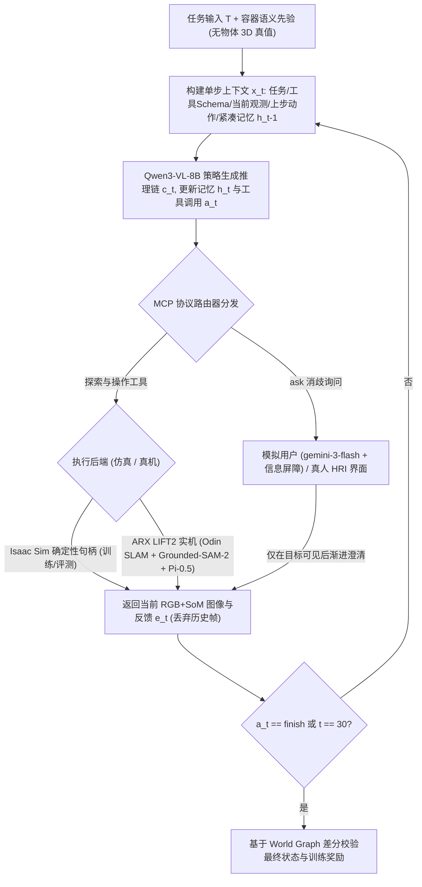
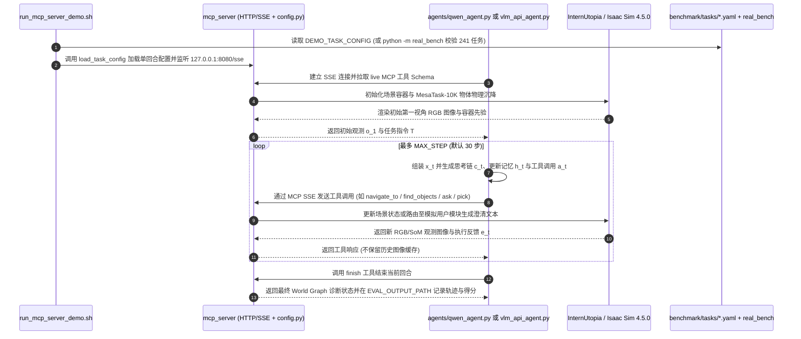

# Exploratory, Communicative, and Deployable: Vision-Driven Embodied Agents for Open-World Mobile Manipulation

## 一句话定义

**REAL**（explo**R**atory, communicativ**E**, **A**nd, deploy**L**able）是一个面向开放世界移动操作（Mobile Manipulation）的闭环视觉具身智能体框架：智能体在不获取任何仿真器特权物体状态的条件下，仅凭先验容器地图与第一视角 RGB/SoM 观测执行多级主动探索、通过标准 MCP 工具接口操作环境、并在指令存在歧义时向用户主动提问消歧，最终零样本迁移至双臂移动机器人真机完成长程家居任务。

## 英文缩写速查

| 缩写 | 英文全称 | 简要说明 |
|---|---|---|
| REAL | exploRatory, communicativE, And, deployLable | 本文提出的具备主动探索、对话消歧与真机可部署能力的具身智能体框架 |
| MCP | Model Context Protocol | 模型上下文协议；本文用其统一隔离仿真后端与真机硬件后端的工具调用接口 |
| POMDP | Partially Observable Markov Decision Process | 部分可观测马尔可夫决策过程；用于将长程决策建模为紧凑单步记忆更新闭环 |
| GSPO | Group Sequence Policy Optimization | 组序列策略优化；以序列级几何平均重要性比率替代 token 级裁剪的免评论家 RL 算法 |
| SoM | Set-of-Mark | 视觉标记提示；将检测或投影得到的编号彩色掩码叠加在 RGB 图像上供动作索引 |
| WG | World Graph | 世界图状态表示；记录各容器及其内部物体集合，用于任务定义、奖励差分与成功判定 |
| VLA | Vision-Language-Action | 视觉-语言-动作模型；本文中经微调的 $\pi_{0.5}$ 负责执行真机底层 6-DoF 物理操作原语 |

## 为什么重要

现有具身智能体基准与框架在迈向物理部署时普遍存在两类结构性脱节：

1. **特权感知依赖（Privileged Perception Gap）：** 多数仿真环境向高层策略直接暴露全局物体清单、目标精确 3D 位姿或按类别直接定位的 oracle API（如 Embodied Agent Interface、ManiTaskGen、EmbodiedBench、VoTa-Bench 等），而纯文本对象索引的探索方案（如 PARTNR、EMMOE）又难以在同类多干扰物下做细粒度视觉消歧。真机上无法获取这类特权信息，导致策略迁移严重掉点。
2. **开环完整指令假设（Open-Loop Instruction Assumption）：** 传统评测默认用户对环境了如指掌并一次性给出无歧义指令，而真实人类用户往往对场景局部盲区并不知情，指令天然含糊，需要智能体先自主探索局部容器，再结合所见向用户发起上下文对齐的澄清对话（`ask`）。

REAL 将“无特权多级视觉探索”“受信息边界约束的人机澄清对话”与“MCP 前后端解耦部署”三者纳入同一个训练与评测闭环，为 8B 量级开源多模态大模型（`Qwen3-VL-8B-Instruct`）在交互消歧任务上超越闭源商用 VLM 并在 ARX LIFT2 上实现 78.3% 端到端真机成功率提供了可复现范式。

## 核心信息

| 字段 | 信息 |
|---|---|
| 作者 | Boyu Mi, Mengchen Ma, Yifei Yao, Xing Gao, Junting Chen, Yangzi Li, Zihou Zhu, Guohao Li, Zhenfei Yin, Tai Wang, Yao Mu, Jiangmiao Pang, Hanqing Wang |
| 机构 | 上海人工智能实验室（Shanghai Artificial Intelligence Laboratory，致谢显式署名；代码托管于 InternRobotics / Sage-PhysicalAI） |
| 发表时间 | ECCV 2026 录用；arXiv:2607.13653v2（2026-07-15 提交 v1，2026-07-27 更新 v2，共 57 页） |
| 论文链接 | [arXiv:2607.13653](https://arxiv.org/abs/2607.13653) / [arXiv HTML v2](https://arxiv.org/html/2607.13653) |
| 项目与代码 | [Sage-PhysicalAI/REAL](https://github.com/Sage-PhysicalAI/REAL)（官方仓库，别名 [InternRobotics/REAL](https://github.com/InternRobotics/REAL)） · [项目主页](https://internrobotics.github.io/REAL/) |
| 清单分类 | `data.annotation`（来源条目：`survey_ax_2607_13653`） |
| 开源状态 | **部分开源**（MIT 协议；已公开 241 条 REAL-Bench 任务 YAML 与校验器、MCP 服务端、Qwen/VLM API Agent、程序化任务生成与轨迹标注代码、SFT 与 `gspo` 分支在线 RL 代码；未随仓发布 GRScenes 场景资产、MesaTask-10K USD 物体文件、录制轨迹与模型权重） |

## 核心原理

### 1. 无特权视觉环境与多级主动探索工具链

环境基于 GRUtopia（Isaac Sim 4.5.0）构建，将场景划分为静态大型容器（Receptacles，如 `table_2`、`cabinet_1`）与可操作物体（Objects）。初始化时，智能体仅获得物理建图栈可获取的 3D 占位图与容器 ID/类别先验列表，**完全无法访问全局物体列表、3D 目标位姿或目标位置**。

为完成探索与操作，策略仅能调用 11 个可真机落地的 MCP 工具（对应开源仓库中的工具接口名见下节）：
- **多级主动探索：** `nav_to`（基于占位图导航至容器前无遮挡视角）→ `walk_around`（环绕当前容器多视角扫描并建立临时开放词汇物体索引）→ `show_object_by_category`（在当前第一视角隔离指定类别目标并反投影至 3D，在 RGB 上叠加编号 SoM 彩色掩码）→ `gaze_at`（抵近目标并将其居中对齐到视野中心，保持操作可达距离）。此外 `show_receptacles` 对视野内容器叠加编号 SoM 掩码，供 `place` 等调用索引。
- **物理操作：** `pick`、`place`、`open`、`close` 均通过视觉标记 ID（marker ID）参数化执行，而非坐标或真值 UUID。
- **动态用户交互（`ask`）：** 仿真器内置由 `gemini-3-flash` 驱动的模拟用户模块。该模块持有初始/目标 World Graph（$\mathcal{W}_{\mathrm{init}}, \mathcal{W}_{\mathrm{goal}}$）与模糊指令，并受四条规则约束：**目标导向**、**信息屏障**（禁止直接泄露目标在哪件家具上）、**渐进式澄清**（仅当辅助可见性文本摘要显示机器人视野中已出现目标物体时，才可具名确认目标）及**禁止输出内部原始 ID**，从而逼真模拟人类用户的局部盲区与渐进反馈。

### 2. 紧凑单步 POMDP 记忆建模

长程移动操作中若持续拼接历史多帧图像与完整对话，极易导致上下文爆炸和时序幻觉。REAL 将决策过程建模为 $\mathcal{M}=\langle\mathcal{S},\mathcal{A},\mathcal{O},\mathcal{P},\mathcal{R},\Omega,\gamma\rangle$（$\gamma=0.99$，最大步长 $H_{\max}=30$）。在决策步 $t$，环境返回当前观测 $o_t^{\mathrm{env}}\sim\Omega(\cdot\mid s_t)$（仅保留当前步骤视觉图像与上一步工具执行反馈 $e_t$，历史图像全部丢弃），策略上下文仅拼接固定模板、单步历史动作与双字段紧凑长期记忆：

$$x_t = \left(T,\;\operatorname{Serialize}(\mathcal{A}),\;o_t^{\mathrm{env}},\;a_{t-1},\;h_{t-1}\right),\qquad h_t = (\sigma_t, q_t)$$

其中 $\sigma_t$ 为经工具反馈 $e_t$ 验证的已执行结果摘要，$q_t$ 为当前活跃任务阶段分析。策略输出 $(c_t, \sigma_t, q_t, a_t) \sim \pi_\theta(\cdot\mid x_t)$，即 `<think>...</think>` 推理链与包含更新记忆 $h_t$ 及工具调用 $a_t\in\mathcal{A}$ 的 JSON 对象，训练与闭环推理严格采用同一格式。

### 3. 程序化数据引擎与两阶段训练（SFT + GSPO）

- **场景与资产构建：** 训练集采用 GRScenes 的 6 个室内场景（`S1`–`S6`，共 82 件家具、157 条标注描述），留出 `S7`（6 类房间、18 件家具，含洗衣机、电饭煲等未在训练集中重点出现的铰接电器）用于评测；物体库来自 MesaTask（3,204 个 3D 资产、810 个细粒度类别，覆盖日用品 1,865、容器 1,185、食物 127、家具 27），由 LLM 结合语义相容性生成 291 组跨容器转移三元组。
- **两阶段过滤与双轨轨迹标注：** 先在 2D 占位图（~5 cm 分辨率、边距 $\delta=0.05\text{ m}$、边缘可达带 $d_{\max}=0.5\text{ m}$）执行几何静态放置检查（Algorithm B.1），再在 Isaac Sim 中上抬 $+0.1\text{ m}$ 运行 500 物理步（$\Delta t=1/240\text{ s}$，跌落阈值 $\epsilon_{\mathrm{fall}}=0.3\text{ m}$）验证稳定性。通过的任务由规则规划器生成无特权动作轨迹，再经过：**（1）Social Annotation**（Strategy A 模糊指令前置澄清 + Strategy B 多同类家具消歧插入 `ask`）与 **（2）`gemini-3-pro` 离线认知标注**（仅离线向教师模型注入真值元数据以生成高精度 $c_t$ 与经脚本校验的 $\sigma_t$，最终 SFT 数据只保留无特权输入 $x_t$）。
- **Stage 1（SFT 范式对齐）：** 以 `Qwen3-VL-8B-Instruct` 为基座，**冻结 411M 参数 ViT 视觉编码器**，对完整输出 $y_t=\operatorname{Serialize}(c_t,h_t,a_t)$ 做交叉熵行为克隆：

$$\mathcal{L}_{\text{SFT}}=-\frac{1}{N_{\mathrm{tok}}}\sum_{i=1}^{N}\sum_{t=1}^{L_{i}}\sum_{k=1}^{|y_{t}^{(i)}|}\log\pi_{\theta}\!\left(y_{t,k}^{(i)}\mid x_{t}^{(i)},y_{t,<k}^{(i)}\right)$$

- **Stage 2（GSPO 在线强化学习）：** 为克服 2-epoch SFT 的行为克隆过拟合并学会主动触发 `ask` 与失败恢复，从 1-epoch SFT 检查点出发采用 **GSPO**（Group Sequence Policy Optimization）联合 144 个并发 Isaac Sim MCP 端点训练。GSPO 以整条生成序列 $z_i$ 的长度归一化几何平均比率替代 GRPO 的 token 级比率并做序列级裁剪（组大小 $G=8$、LoRA $r=32,\alpha=64$、KL 系数 $\beta=0.04$、学习率 $5\times 10^{-6}$）：

$$s_i(\theta)=\exp\!\left[\frac{1}{|z_i|}\sum_{k=1}^{|z_i|}\log\frac{\pi_\theta(z_{i,k}\mid\xi_{i,k})}{\pi_{\theta_{\mathrm{old}}}(z_{i,k}\mid\xi_{i,k})}\right],\qquad \mathcal{L}_{\mathrm{GSPO}}=-\frac{1}{G}\sum_{i=1}^{G}\min\!\left(s_i(\theta)\widehat{A}_i,\operatorname{clip}(s_i(\theta),1-\epsilon,1+\epsilon)\widehat{A}_i\right)+\frac{\beta}{G}\sum_{i=1}^{G}\kappa_i(\theta)$$

- **世界图差分密集奖励：** 基于 $\Delta_{\mathrm{task}}=\Delta_{\mathrm{goal}}\cup\Delta_{\mathrm{aux}}$（$\Delta_{\mathrm{goal}}=\text{WG}_{\mathrm{goal}}\ominus\text{WG}_{\mathrm{init}}$ 加上导航/开关辅助目标），设计六项分步奖励 $r_t = r_t^{\mathrm{task}}+r_t^{\mathrm{prog}}+r_t^{\mathrm{phys}}+r_t^{\mathrm{ask}}+r_t^{\mathrm{time}}+r_t^{\mathrm{safe}}$：每命中一个未完成子目标 $+1.5$、全部完成额外 $+2.0$、归一化进度差分 $+2.0(\rho_{t+1}-\rho_t)$、合法抓取 $+0.3$、有效持物 $+0.5$、错抓后恢复 $+1.0$、错误放置 $-2.0$、回退已达成状态 $-0.5$、在预算 $B_{\mathrm{ask}}\le 3$ 内有效消歧提问 $+1.0$、第 3 步之后每步时间惩罚 $-0.03$、以及依据回溯日志惩罚安全/格式错误（$-0.5$ 或 $-0.3$）。

## 流程总览

## 源码运行时序图

开源仓库主分支 `main` 通过 `scripts/demo/run_mcp_server_demo.sh` 拉起绑定在 SSE 端口的 MCP 仿真服务，并由 `agents/qwen_agent.py` 或 `agents/vlm_api_agent.py` 连接该端点以“单步单轮”闭环执行各任务 YAML（仓库中暴露的工具名为 `list_receptacles`、`navigate_to`、`explore_receptacle`、`find_objects`、`highlight_receptacles`、`focus_on`、`pick`、`place`、`open`/`close`、`ask`、`finish`）。

## 实验与评测

### 1. REAL-Bench 仿真基准主结果（241 任务，Held-out 场景 `S7`）

REAL-Bench 包含四个任务族：**FDP**（72 题，家具干扰物 Pick-and-Place）、**FODP**（56 题，家具与开放词汇同类物体双干扰物）、**FDO**（48 题，家具干扰物铰接开关门操作）、**SUL**（65 题，含蓄模糊指令需向模拟用户主动 `ask` 消歧）。Table 1 汇报各模型成功率（%）：

| 模型 / 训练阶段 | FDP (72) | FODP (56) | FDO (48) | SUL (65) | 关键观察 |
|---|---:|---:|---:|---:|---|
| `gemini-3-pro-preview`（Zero-shot，SFT 标注教师） | **81.9** | 39.3 | 50.0 | **53.8** | 闭源商业模型整体基线强，但在 FODP 同样受限于细粒度遮挡与混淆 |
| `gemini-2.5-pro`（Zero-shot） | 66.7 | **41.1** | 43.8 | 49.2 | — |
| `gpt-5`（Zero-shot） | 68.1 | 30.4 | 47.9 | 52.3 | — |
| `claude-haiku-4-5`（Zero-shot） | 45.8 | 16.1 | **52.1** | 47.7 | — |
| `gpt-4o`（Zero-shot） | 30.6 | 28.6 | 27.1 | 40.0 | — |
| `Qwen3-VL-235B-A22B-Instruct`（Zero-shot） | 22.2 | 14.3 | 14.6 | 18.5 | 开源超大参数模型未经具身工具对齐仍难以闭环 |
| `Qwen3-VL-8B-Instruct`（Zero-shot 基座） | 0.0 | 0.0 | 0.0 | 1.5 | 未对齐前几乎无法遵循无特权工具协议 |
| `Ours-8B-SFT-only (1 epoch)` | 45.8 | 30.4 | 35.4 | 36.9 | 1 轮 SFT 快速完成工具调用与推理格式对齐 |
| `Ours-8B-SFT-only (2 epochs)` | **65.3** | 28.6 | **43.8** | 50.8 | 2 轮 SFT 提升常规操作，但 FODP 从 30.4% 跌至 28.6%（行为克隆过拟合） |
| `Ours-8B-SFT+RL (GSPO)` | 58.3 | **33.9** | 41.7 | **56.9** | 从 1-epoch SFT 出发做 GSPO：SUL 达 **56.9%** 超越所有零样本闭源基线 |

### 2. RL 过程诊断、失败归因与用户泛化

- **在线 RL 行为演化（7,304 条 rollout，Appendix D.6）：** 训练中总体成功率收敛至 39.3%（因训练池无课程排序、组内难度波动大而低于离线均衡基准）；`ask` 工具在 SFT 中极少触发，RL 阶段出现在 15.8% 的轨迹中，其中 90.3% 能准确识别多个视觉干扰物并主动暂停询问。在 4,431 条失败 rollout 中，**94.3% 并非流程错误，而是正确执行了探查-抓取-放置序列却抓错相似物体**；由于 411M ViT 编码器全程冻结（`max_pixels=100,352`），对齐分辨率控制仅带来约 $\pm 3\%$ 波动，印证视觉表征是核心上限瓶颈。
- **人工失败分类（100 个测试回合，53 例失败，Fig. 3）：** Object Confusion 25 例（含颜色/外观属性选错及近似家具混淆）、Key Action Missing 17 例（如未在模糊指令下触发 `ask`）、Lost Memory 9 例（压缩摘要未记录已排查家具，导致在 `desk_1` 与 `desk_2` 间反复往返振荡直至耗尽 30 步预算）、Other Error 2 例。
- **模拟用户保真度与真人迁移（Appendix E.3）：** 抽检 50 条 `gemini-3-flash` 回复中，47 条准确充分、2 条方向正确但细节不足、1 条错误；在 50 个 SUL 子集任务上对比模拟用户与真人测试，真人回复平均仅 4.3 词（Gemini 平均 30.2 词），智能体仍取得 27/50 成功率（Gemini 为 29/50），说明交互能力可迁移至真实短句用户但对欠定回复敏感。

### 3. ARX LIFT2 真机零样本部署评测（Table 2 & Table G.1）

高层次策略未做任何真机微调，仅将 MCP 后端替换为：Odin1+RealSense D455 双追踪定位（重定位误差由 $>5\text{ cm}$ 降至 $<1\text{ cm}$）、ConceptGraph+A*+DWA+PID 导航（预留 $\ge 0.6\text{ m}$ 操作距）、Grounded-SAM-2 开放词汇分割+SoM 提示、以及基于 980 条遥操作轨迹微调的云端 $\pi_{0.5}$ 双臂动作原语（单原语执行 1,000 步 / 50 步块，约耗时 60 s）：

- **导航与凝视可重复性（30 次试验）：** 里程计误差 $1.78\pm 0.40\text{ cm}$，航向角误差 $0.74\pm 0.57^\circ$，图像像素偏移 $21.5\pm 10.4\text{ px}$（RMSE $1.96\text{ px}$）。
- **底层 $\pi_{0.5}$ 原语可执行率（600 次调用，每项 120 次）：** `Open` 63.3%、`Close` 100.0%、`Pick` 89.2%、`Place-desk` 100.0%、`Place-micro.` 74.2%，总计 **85.3%**。
- **60 回合端到端真机评测：**
  - **FDO：** SR 80.0%，平均步数 12.2，SPL 67.0%，Ask 0.90 次，VLM 累计推理延迟 71.1 s。
  - **FODP：** SR 100.0%，平均步数 9.6，SPL 86.9%，Ask 0.70 次，VLM 延迟 53.5 s。
  - **SUL：** SR 55.0%，平均步数 13.0，SPL 35.4%，Ask 0.55 次，VLM 延迟 80.5 s。
  - **总计：** **端到端成功率 78.3%**，平均 11.6 步，SPL 63.1%，平均提问 0.72 次，VLM 累计延迟 68.4 s，零次不可恢复系统崩溃；60 回合中仅 2 例由冻结视觉编码器高层误判导致，其余多源于底层 VLA 失败、物理超时或未及时 `ask`。

## 与其他工作对比

| 对比维度 | 早期/主流基准（EAI / ManiTaskGen / EmbodiedBench / VoTa-Bench） | 文本探索框架（PARTNR / EMMOE） | REAL（本文） |
|---|---|---|---|
| 感知接口 | 常暴露全局物体列表、3D 真值位姿或 oracle 类别检索 | 非特权 RGB/传感器输入，但高层以文本引用已发现物体 | **无特权视觉界面**，通过 `walk_around`/`show_object_by_category` + 编号 SoM 掩码对齐实例 |
| 指令与人机交互 | 多为静态完整指令、开环执行（TEACh / ADAPT 侧重文本对话或偏好记忆） | 偏重多智能体规划或固定指令执行 | **嵌入式模拟用户 + 物理探索同步**，必须先看见候选再触发 `ask` 渐进消歧 |
| 记忆与训练范式 | 易随步数拼接多轮图像导致上下文膨胀，或主要采用 SFT / DPO | 离线 DPO / 蒸馏先验 | **单步紧凑历史摘要 $(\sigma_t,q_t)$ + 1-epoch SFT + GSPO 在线序列级 RL** |
| 真机迁移机制 | 仿真工具签名与真机栈差异大 | 需针对低层策略或文本管线适配 | **MCP 标准化路由解耦前后端**，8B 策略零样本迁移至 ARX LIFT2 + $\pi_{0.5}$ |

结合站内综述 [Agentic Robots 综述](paper-towards-agentic-robots-survey.md) 与 [VLA 方法背景](../methods/vla.md)，REAL 清晰示范了“高层 VLM 负责无特权探索、记忆管理与对话消歧 + 底层 VLA（$\pi_{0.5}$）负责连续操作”的分层职责边界。

## 结论

**一句话总判：REAL 通过取消仿真特权感知 API、引入信息受限的渐进式用户交互以及采用“单步紧凑记忆 + 1-epoch SFT + GSPO 在线 RL”，验证了 8B 开源视觉语言模型无需修改权重即可凭借标准 MCP 接口零样本迁移至双臂移动机器人真机，但也明确暴露了冻结 ViT 编码器带来的细粒度物体混淆上限。**

1. **宁可 1 轮 SFT 接在线 RL，不要盲目拉长行为克隆轮次：** 实验中 2-epoch SFT 虽将 FDP 从 45.8% 推高至 65.3%，却使开放词汇干扰物任务 FODP 从 30.4% 下滑至 28.6%；从 1-epoch SFT 接入 GSPO 才同时恢复探索（FODP 33.9%）并把交互消歧 SUL 推到 56.9%。
2. **使用序列级比率（GSPO）稳定长程工具调用 RL：** 在免评论家设定下，将重要度比率与裁剪从 token 级改到序列几何平均级，可直接与整条多轮探索轨迹的离散/差分奖励对齐，避免单步格式 token 异常值破坏策略更新。
3. **以“紧凑校验摘要”替代无限多图历史上下文：** 只输入当前帧并把历史压入工具反馈验证过的 $(\sigma_t, q_t)$，能大幅降低每步显存与推理时延；但工程上需注意在摘要结构中显式记录“已排查但未命中的否定证据”，防止多候选家具间往返死循环。
4. **分层架构下优先把算力留给物理视觉精细化：** 当真机 $\pi_{0.5}$ 单次原语耗时约 60 s 时，高层次 VLM 推理并非时延主因；真正限制上限的是冻结视觉编码器的颜色/纹理细粒度分辨力，后续改进应优先放开或引入属性级视觉监督而非继续堆砌纯规划步数。

## 工程实践

- **环境与依赖隔离：** 仓库 `requirements.txt` 固定 `mcp==1.9.4` 与 `httpx==0.28.1`（在 Isaac Sim 4.5.0 + Python 3.10.15 下验证）；不可与 InternUtopia 可选 Agent 依赖（要求 `httpx==0.25.2`）混装在同一 conda 环境。
- **资产与分支准备：** 241 条 `benchmark/tasks/*.yaml` 已内置在 `main` 分支（可用 `python -m real_bench` 直接无仿真校验），但实际仿真需另备 GRScenes 场景文件及从 HuggingFace 下载的 [MesaTask-10K](https://huggingface.co/datasets/InternRobotics/MesaTask-10K) 物体 USD（通过 `MESATASK_USD_ROOT` 指定，共锁定 287 个文件名见 `benchmark/mesa_required.txt`）。SFT 模板在 `training/qwen3vl_sft/train_qwen3vl_sft.sh`，而在线 RL（`training/mcp_gspo/`）维护在独立 `gspo` 分支。
- **关键训练超参数：** 1-epoch SFT 使用 `lr=5e-6`、单卡 batch size 2、梯度累积 4、warmup 0.08、上下文 8,192 tokens、`max_pixels=100,352`（8×A800 bf16）；GSPO 使用 LoRA（$r=32,\alpha=64$，全线性层）、`lr=5e-6`、$\beta=0.04$、组大小 $G=8$、每步有效独立 prompt 6、1,000 步（8×RTX 4090，其中 2 卡跑 vLLM rollout、6 卡 DeepSpeed ZeRO-2 训练，对接 144 个并发 Isaac Sim MCP 端点）。
- **真机部署要点：** 若在实机复现 `nav_to` 与 `gaze_at`，单靠 RealSense D455 重定位误差会超过 5 cm，需配合 LiDAR+RGB（Odin1 SLAM）双追踪压至 1 cm 以内，并在 Grounded-SAM-2 生成的掩码 ID 上直接微调底层 $\pi_{0.5}$ 策略（本文共采集 980 条遥操作轨迹）。启动无仿真回归测试可运行 `python -m unittest tests.test_agents_mcp_e2e` 与 `pytest tests/test_demo_launcher.py tests/test_mcp_regressions.py`。

## 局限与风险

- **冻结视觉编码器的属性分辨瓶颈：** 411M ViT 在训练中保持冻结，SFT/RL 仅通过文本损失与稀疏奖励间接影响选中哪个 SoM ID，导致同类别多颜色/多几何干扰物混淆仍是仿真失败首因（53 例人工诊断失败中占 25 例，RL 失败轨迹中占 94.3%）。
- **压缩记忆丢失否定证据引发死循环：** 由于刻意不回放历史图像与完整对话，若模型自摘要 $\sigma_t$ 未显式记下“已检查 `desk_1` 无目标”，在两个相似家具间可能连续振荡调用 `nav_to` 直至耗尽 30 步上限（Lost Memory 占 9/53 失败）。
- **任务表达与容器粒度限制：** 当前任务集中于跨容器物体搬运与开关门，尚未覆盖严格时序多子任务或空间相对位置目标（如“把杯子放在盘子左侧”）；容器按整件建模（如 `cabinet_1`）而非层板/抽屉部件级建模，限制了细粒度空间探查精度。
- **模拟用户的行为边界：** 模拟用户（`gemini-3-flash`）的偏好局限于初始场景已存在物体且严格围绕历史轨迹作答，尚未覆盖真实人类在中途临时变更目标或使用隐含线索的场景。
- **开源覆盖范围：** 公开仓库暂未提供模型权重、预录制轨迹及 GRScenes/MesaTask 资产包，且底层真机依赖专有硬件与自采 980 条遥操作数据微调的 $\pi_{0.5}$，外部复现需要完整自行准备资产与训练算力。

## 关联页面

- [Agentic Robots 综述](paper-towards-agentic-robots-survey.md)
- [全量项目节点清单](../overview/awesome-agentic-robots-node-index.md)
- [VLA 方法背景](../methods/vla.md)
- [Agent 工具调用接口](../methods/agent-tool-use-interface.md)：理解 MCP 标准化工具抽象与多后端调度机制。
- [Agentic Manipulation Policies](../methods/agentic-manipulation-policies.md)：理解高层视觉推理规划与底层操作技能的协同架构。
- [GRPO（组相对策略优化）](../methods/grpo.md)：对比 token 级裁剪的 GRPO 与本文序列级裁剪 GSPO 的设计差异。
- [Sim2Real 迁移工作流](../methods/sim2real-transfer-workflow.md)：了解接口一致性与双追踪定位如何支撑零样本真机迁移。
- [移动操作](../tasks/loco-manipulation.md)：了解移动底盘导航与双臂操作的协同。
- [自主探索](../tasks/autonomous-exploration.md)：了解非特权视角下的多级主动探索策略。
- [双臂操作](../tasks/bimanual-manipulation.md)：了解 ARX LIFT2 双臂移动平台上的长程家居操作任务。

## 推荐继续阅读

- [REAL 官方项目主页（internrobotics.github.io/REAL）](https://internrobotics.github.io/REAL/)：包含真机 12 步长程任务视频演示与实验补充展示。
- [MesaTask-10K 数据集（Hugging Face）](https://huggingface.co/datasets/InternRobotics/MesaTask-10K)：REAL-Bench 3,204 个 3D 可操作物体资产与 287 个锁定 USD 对象的来源库。
- [GSPO 原论文（arXiv:2507.18071）](https://arxiv.org/abs/2507.18071)：深入理解序列级重要度比率与裁剪在长程强化学习中的数学推导。

## 参考来源

- [REAL 论文原文核对归档（arXiv:2607.13653v2）](../../sources/papers/paper-agentic-2607-13653.md)
- [REAL 官方仓库核对归档（Sage-PhysicalAI/REAL）](../../sources/repos/paper-agentic-2607-13653.md)
- [官方 Awesome 快照归档](../../sources/repos/awesome-agentic-robots-survey-index.md)
- [arXiv:2607.13653 官方入口](https://arxiv.org/abs/2607.13653)
- [Sage-PhysicalAI/REAL GitHub 仓库](https://github.com/Sage-PhysicalAI/REAL)
