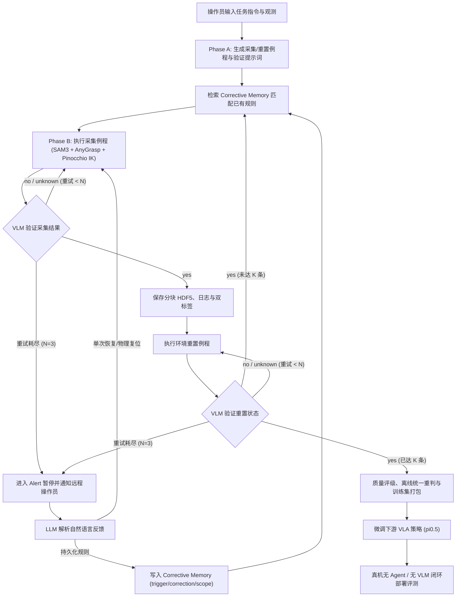
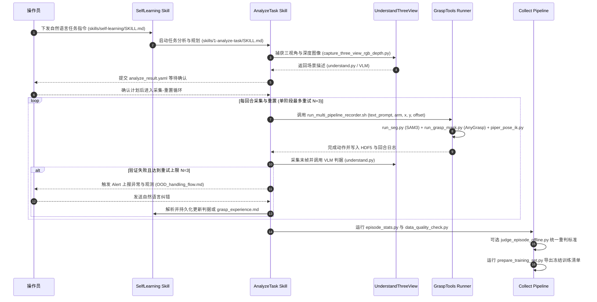

# Zero2Skill: Bootstrapping Robot Skills through Autonomous Data Collection, Training, and Deployment

## 一句话定义

Zero2Skill 是一个基于 OpenClaw 的人机共生具身数据采集系统，它用显式重试预算门控的“采集-验证-重置”闭环自主采集真机演示，并将操作员的自然语言纠错持久化为可跨回合复用的文本规则，用于在无需持续遥操作的前提下生产可直接微调 VLA 策略的高质量轨迹数据。

## 英文缩写速查

| 缩写 | 英文全称 | 简要说明 |
|---|---|---|
| VLA | Vision-Language-Action | 视觉-语言-动作策略模型，本文中 $\pi_{0.5}$ 作为下游微调与部署评测基座 |
| VLM | Vision-Language Model | 视觉语言模型，本文中 Seed1.8 担任采集与重置阶段的二值成败验证器 |
| LLM | Large Language Model | 大语言模型，本文中 DeepSeek-V3.2 将自然语言纠错解析为结构化系统调整 |
| TpHM | Trajectories-per-Human-Minute | 每分钟人类工作时间产出的成功轨迹数，联合衡量采集吞吐与人力成本 |
| SAM3 | Segment Anything Model 3 | 文本提示分割模型，在抓取前端根据任务提示提取前景目标掩码 |
| RMS | Root Mean Square | 均方根，本文中用于计算 12 维机械臂关节加加速度指标 $J_{\mathrm{RMS}}$ |

## 为什么重要

1. **解决长时域采集的“重复纠错”瓶颈：** 现有遥操作（ALOHA、UMI）人力成本与轨迹量线性绑定；而常规交互式或语言纠错系统通常把人类反馈局限在单回合或单一策略更新周期内，长时域采集时同一类失败（判据过严、分割漏检、抓取偏浅、选臂不当）会反复触发人工接管，导致监督成本随采集时长而非“新问题种类”增长。
2. **明确“模型内不变、模型间更新”的双时间尺度边界：** 在单次采集会话内部，系统不更新底层策略或感知权重，完全依靠持久化文本规则修正判断准则与工具参数；在会话之间，只用经纠错后准则认证并质检的轨迹微调策略，使人工语言经验既能在当前会话立竿见影降本，又能以一致标准沉淀进最终模型权重。

## 核心信息

| 属性 | 内容 |
|---|---|
| 作者 | Boyuan Wang, Zhenyuan Zhang, Zhiqin Yang, Peijun Gu, Shuya Wang, Xiaofeng Wang, Xianghui Ze, Yifan Chang, Guosheng Zhao, Jiangnan Shao, Guan Huang, Hengyu Liu, Yonggang Zhang, Wei Xue, Chunyuan Guan, Chenglin Pu, Yike Guo, Xingang Wang, Zheng Zhu |
| 机构 | 极佳视界（GigaAI）、中国科学院大学（UCAS）、香港科技大学（HKUST）、利兹大学（University of Leeds）、康奈尔大学（Cornell University）、清华大学（Tsinghua）、南京理工大学（NJUST）、香港中文大学（CUHK）、FAWTD |
| 发表时间 | 2026-07-22（arXiv v3；v1 提交于 2026-07-15） |
| 论文链接 | [arXiv:2607.14047](https://arxiv.org/abs/2607.14047) · [HTML 全文](https://arxiv.org/html/2607.14047) |
| 项目与代码 | [项目页](https://open-gigaai.github.io/Zero2Skill) · [open-gigaai/Zero2Skill](https://github.com/open-gigaai/Zero2Skill)（Apache-2.0） |
| 清单分类 | `data.collection, data.annotation, data.refinement` |
| 来源条目 | `survey_ax_2607_14047` |
| 开源状态 | **部分开源**（已发布第一方采集/抓取管线、运动辅助脚本、数据统计质检工具及 4 个 Agent Skills；不重分发第三方专有 AnyGrasp `.so`/license/checkpoint、SAM3 与外部 HDF5 录制器 `COLLECT_RECORDER_PY`） |

## 核心原理

Zero2Skill 构建在 OpenClaw 智能体运行时之上，将具身数据采集设计为两个时间尺度解耦的系统：**会话内仅通过文本与内存规则适配行为，会话间仅通过认证轨迹微调策略权重**。

### 1. 任务分析与验证门控自主采集循环（Algorithm 1）

- **Phase A（一次性任务分析与规划）：** 接收操作员自然语言指令（如“learn to tidy the tabletop”）并读取相机观测，结合技能与工具库在单次规划中产出四部分内容：采集动作例程 $c_{\mathrm{col}}$、采集成功验证提示词 $p_{\mathrm{col}}$、重置例程 $c_{\mathrm{res}}$、重置成功验证提示词 $p_{\mathrm{res}}$，经操作员确认后进入运行。
- **Phase B（双阶段验证门控循环）：** 为采集 $K$ 条有效轨迹，系统交替调用 `RunPhase(c_col, p_col)` 与 `RunPhase(c_res, p_res)`。每个阶段执行后等待场景稳定，采集新图像送入 VLM 验证器（Seed1.8），要求回复以 `yes` 或 `no` 开头并附一句原因。
  - 若判定 `yes`，阶段通过；否则重试，单阶段最多重试 $N$ 次（默认 $N=3$）。
  - 无法解析出合法判决（含 API 超时或连接中断）绝不放行，且记为 `unknown`。
  - 当连续失败耗尽预算 $N$ 时，机械臂停止并转入 `Alert` 状态，异步通知远程操作员。
- **为何独立验证重置阶段：** 抓取失败通常表现为夹爪空抓、易于自检，而重置失败常表现为物体位置发生隐蔽偏移；若不对重置结果进行独立门控，后续采集会从持续漂移的场景状态中继续录制并悄然失效。

### 2. 语言干预与持久化纠正记忆（Corrective Memory）

在 `Alert` 状态下，操作员通过同一自然语言通道发送自由格式反馈（如指出半入筐即算成功、要求特定低矮物体加深抓取深度或改用另一只手），由 LLM 解析器（DeepSeek-V3.2）结合当前状态与既有记忆将其分流为两类处理：

- **持久化规则：** 绑定显式适用条件后写入结构化 Markdown 文件（`Corrective Memory`），并在后续所有回合开始前检索匹配。每条记录包含四个字段：`trigger`（触发条件）、`correction`（具体调整）、`scope`（作用阶段或对象边界）和 `source utterance`（原始指令留档）；按作用组件划分为验证提示词、条件化抓取策略、物体采样优先级与重试上限等分组。
- **单次干预：** 如“这次往左微调一点”等仅解救当前卡顿的指令直接执行一次而不写入长期记忆。

### 3. 语言条件化抓取工具与运动执行（Appendix A.1–A.3）

采集与重置例程通过五元组接口调用底层 `grasp-tool`：$(\texttt{text\_prompt}, \texttt{arm}, x_{\mathrm{place}}, y_{\mathrm{place}}, \delta_{\mathrm{depth}})$，其中 `arm` $\in \{\texttt{left}, \texttt{right}\}$。执行链路如下：
1. **感知与点云反投影：** 固定头戴 RealSense 采集 $640\times 480$ 对齐 RGB-D，结合标定内参与手眼外参 $T_{\mathrm{cam}\rightarrow\mathrm{base}}$ 重建全场景彩色点云；同时 SAM3 根据 `text_prompt` 生成最高分前景掩码（仅用于抓取过滤，点云仍保留桌面几何以供避碰）。
2. **6-DoF 抓取规划与四级过滤：** AnyGrasp 在全场景点云预测带碰撞检测的候选抓取，依次经过：(i) 掩码投影过滤（TCP 中心落入 SAM3 前景）、(ii) NMS 与分数排序、(iii) `camera-up` 规范化（绕接近轴翻转消除平行夹爪 $180^\circ$ 二义性）、(iv) 高架斜向接近方向与置信度融合重排，叠加 $\delta_{\mathrm{depth}}$ 得到 7-D 法兰位姿 $(x, y, z, \text{rpy}, w_{\mathrm{grasp}})$。
3. **运动学与安全约束：** 入口脚本先校验安全工作空间（放置坐标 $x\in[0.05,0.60]\text{ m}$、$|y|\le 0.60\text{ m}$、深度偏置 $|\text{offset}|\le 0.05\text{ m}$），随后用 Pinocchio 对 Piper URDF 求解各阶段逆运动学并缓存，以 30 Hz 向 `/master/joint_{left,right}` 发布轨迹并通过从端关节反馈校验到位。录制仅在机械臂运动期间开启，将三视角图像与关节状态分块写入 HDF5。

### 4. 轨迹认证、离线重判与质量指标（Appendix A.4, B.2, C.2）

- **双标签与预检：** 每个时间戳会话目录保存执行标签（动作链是否完整走完）与结果标签（`success`/`failure`/`unknown`），并在运动前预检所有相机与关节 ROS topic 是否正常发布，防止“死节点空录”。
- **离线统一重判：** 因每回合保留末帧观测，当验证提示词经语言纠错修订后，可通过离线重判工具按最终统一标准重新标注历史轨迹，再筛选“脚本走完 + 视觉判据通过 + 质量非 `bad`”的轨迹打包训练。
- **质量诊断指标（Appendix C.2）：** 对 30 Hz 采样的 12 个臂关节（$\Delta t = 1/30\text{ s}$），通过三阶前向有限差分计算均方根加加速度 $J_{\mathrm{RMS}}$ 与帧间跳变计数 $D = \sum_{t=0}^{T-2} \mathbf{1}\{\max_{k}|q_{t+1,k}-q_{t,k}| > 0.10\text{ rad}\}$，并定义平滑度得分：
  $$S = \operatorname{clip}\!\left(100\exp\!\left(-\frac{J_{\mathrm{RMS}}}{1200}\right) - 5D,\, 0,\, 100\right)$$
  同时基于采样帧亮度 $B_f$、拉普拉斯清晰度 $s_f$、色彩丰富度 $c_f$ 与过/欠曝惩罚 $e_f$ 计算美学启发式得分 $A_f = 100(0.4 s_f + 0.3 c_f + 0.3 e_f)$，由绝对规则与数据集分位规则评级为 `good`、`marginal` 或 `bad`。

## 流程总览

## 源码运行时序图

仓库主运行路径先配置 `configs/paths.env` 中的双环境与机械臂/相机标定参数，再通过 `skills/self-learning/SKILL.md` 与 `skills/1-analyze-task/SKILL.md` 编排 `grasp-tools/run_multi_pipeline_recorder.sh` 执行分割-抓取-录制，最后由 `grasp-tools/collect/prepare_training_set.py` 完成质检、离线重判与训练数据集导出。

## 实验与评测

全部实验在双臂 Agilex Piper 平台（头戴 RealSense RGB-D + 双腕相机）的桌面清理（Desktop Clearing）测试平台上完成，VLM 验证器使用 Seed1.8，LLM 解析器使用 DeepSeek-V3.2，下游策略基于 $\pi_{0.5}$ 微调，单阶段重试上限设为 $N=3$。

### 1. 采集效率与人力成本（Table 1，每种模式尝试 50 回合）

| 指标 | Human Teleop（全人工遥操作） | Scripts（无验证脚本循环） | Zero2Skill |
|---|---|---|---|
| 尝试回合数（Attempted） | 50 | 50 | 50 |
| 成功回合数（Successful） | 50 | 35 | 50 |
| 失败回合数（Failed） | 0 | 15 | 0 |
| 总墙钟时间（min） | 35.0 | 31.0 | 53.0 |
| 人类遥操作时间（min） | 30.0 | 1.0 | 0.0 |
| 人类总工作时间（min） | 30.0 | 31.0 | 4.8 |
| 单回合采集成功率（%） | 100.0 | 70.0 | 100.0 |
| TpHM（成功轨迹/人类工作分钟）↑ | 1.67 | 1.13 | 10.42 |

Zero2Skill 在保持 100.0% 单回合采集成功率的同时，将人类遥操作时间降至 0.0 min，人类总工作时间降至人工遥操作的 16%（4.8 min vs. 30.0 min），TpHM 达到 10.42（约遥操作的 6 倍）；代价是因闭环验证与重试带来更长的总墙钟时间（53.0 min vs. 35.0 min）。

### 2. 语言引导纠错对验证器与执行器的直接收益（Table 2、Fig. 4、Fig. 5、Table 3）

- **验证器准则纠错（Table 2，每类场景 10 个判定样例）：**
  - Basket desktop clearing（部分包含判据）：4/10 (40.0%) → 10/10 (100.0%)，+60.0 个百分点；
  - Basket desktop reset（放宽重置位置判据）：0/10 (0.0%) → 10/10 (100.0%)，+100.0 个百分点；
  - Box fruit clearing（较难，遮挡/边界模糊）：0/10 (0.0%) → 4/10 (40.0%)，+40.0 个百分点；
  - Two-basket object sorting（按类别分筐判据）：2/10 (20.0%) → 10/10 (100.0%)，+80.0 个百分点。
- **执行侧累积纠错（Fig. 4，8 类物体 × 每类 5 次首次尝试 = 40 次）：** 在不计入回合内重试的首次尝试成功率（Single-attempt collection success rate）上，Agent 初始规划为 12.5%（5/40），叠加 SAM3 分割重提示后升至 25.0%（10/40，+12.5 个百分点，集中改善 avocado、grape、gourd、carambola 4 类），再叠加抓取接近深度偏置后升至 47.5%（19/40，+22.5 个百分点，8 类物体全员提升）。
- **选臂策略控制对比（Fig. 5，固定 SAM3 提示、关闭深度偏置）：** 纠正默认“最近臂优先”偏置后，8 类物体平均首次尝试成功率从 20.0% 提升至 50.0%（+30.0 个百分点，7 类提升）；唯一例外是 carambola，由 20.0% 降至 0.0%，说明持久化规则在条件不适配该物体时会覆盖原本更优的默认选择。
- **在线采集累积干涉表现（Table 3）：** 在实机持续采集中，4 组场景里有 3 组的最终累积成功率高于干预前（Banana：57.14% → 61.11%；Banana & Pepper：42.86% → 47.50% → 46.00%；Banana & Grape：60.87% → 66.67%）；Banana & Chili 组在首次干预后由 80.00% 降至 70.59%，经后续纠错回升至 75.86% 与 76.47%，表明持久化规则虽可稳定复用，但能否提升成功率取决于是否击中真实物理或工具瓶颈。

### 3. 数据质量诊断与下游策略部署（Table 4 & Table 5）

- **数据质量对比（Table 4，各 50 条轨迹，均值 ± 样本标准差）：**
  - Full human teleop：Smoothness $78.1 \pm 7.7$，Aesthetics $55.2 \pm 1.6$，Brightness $133 \pm 2$，RMS jerk $267 \pm 66\text{ rad/s}^3$；
  - Zero2Skill collector：Smoothness $64.2 \pm 22.7$，Aesthetics $61.2 \pm 1.1$，Brightness $130 \pm 2$，RMS jerk $191 \pm 97\text{ rad/s}^3$。
- **下游 $\pi_{0.5}$ 微调部署（Table 5，各用 50 条有效演示微调，20 次真机盲测且移除 Agent、VLM 验证器、记忆检索与人工介入）：**
  - Scripted data：55.0%（为凑齐 50 条有效轨迹，按 70% 有效率需约 72 次尝试、约 44 分钟现场人工盯守）；
  - Full human teleop：80.0%（采集耗时 30.0 人类工作分钟）；
  - Zero2Skill data：80.0%（采集耗时 4.8 人类工作分钟）。

## 与其他工作对比

| 路线代表 | 典型工作 | 监督与恢复机制 | 纠错知识复用粒度 | 与 Zero2Skill 差异 |
|---|---|---|---|---|
| 纯人类遥操作 | ALOHA、UMI、DROID | 人工全程遥操作 | 无规则复用（直接记录动作） | Zero2Skill 遥操作时间为 0，以 16% 人类工作时间取得同等 80.0% 下游策略成功率 |
| 全自主采集管线 | RoboClaw、RADAR | 预设状态机 / VLM 自动规划与自重置 | 固定控制逻辑，难以在线诊断长尾失效 | Zero2Skill 用显式重试上限 $N$ 在漂移前暂停求助，并将反馈沉淀到循环准则与参数 |
| 交互式风险门控 | ThriftyDAgger、Fleet-DAgger、Sirius-Fleet | 基于新颖性/风险阈值切回遥操作接管 | 接管轨迹仅用于下次策略更新，会话内不沉淀规则 | Zero2Skill 用远程自然语言替代现场遥操作接管，会话内即可文本生效 |
| 执行期语言/代码自进化 | YAY Robot、DROC、IROSA、ENPIRE、ASPIRE、ABot-Claw | 语言微调、知识检索或编码 Agent 修复技能 | 聚焦单次任务执行或策略微调 | Zero2Skill 将同一语言接口同时作用于采集验证准则、重置准则与抓取工具参数，直接服务长时域数据飞轮 |

## 结论

**一句话总判：Zero2Skill 证明了“显式重试预算门控 + 持久化文本纠错记忆”能在不改动底层模型权重的前提下，把长时域真机采集中重复出现的人工接管成本压低至遥操作的 16%，并产出足够支撑 $\pi_{0.5}$ 达到同等 80.0% 部署成功率的数据。**

1. **用“纠错一次、全会话复用”取代逐回合救火：** 将人类语言翻译为带触发条件的 Markdown 规则后，TpHM 从人工遥操作的 1.67 提升至 10.42，把人力开销从“与轨迹数量成正比”转为“与新增问题种类相关”。
2. **重置验证与离线重判缺一不可：** 对重置阶段单独做 VLM 门控能拦截静默状态漂移，而保存末帧并用最终修订后的提示词统一重判（`judge_episode_offline.py`），是避免同一批训练数据混入前后矛盾标注的关键工程环节。
3. **验证器与工具参数可用同一条语言通道修复：** 对桌面清理类抓取任务，调整抓取深度偏置（+22.5 个百分点）与重选更优视角手臂（+30.0 个百分点）的收益远大于单纯重新提示分割模型（+12.5 个百分点）。
4. **注意持久规则的负迁移边界与数据连续性差距：** 持久化规则会无条件匹配后续触发对象，在规则与特定物体不匹配时（如 carambola 选臂从 20.0% 降至 0.0%）会引入回退；此外 Zero2Skill 数据虽然 $J_{\mathrm{RMS}}$ 更低，但平滑度 $S$ 方差更大（$64.2 \pm 22.7$ vs. $78.1 \pm 7.7$），提示分段轨迹拼接仍存在关节跳变差距。

## 工程实践

- **硬件与环境解耦：** 通过复制配置模板 `configs/paths.env.example` 为 `configs/paths.env` 绑定独立 Conda 环境（`zero2skill`、`CONDA_ENV_SAM3`、`CONDA_ENV_ANYGRASP`）、机械臂 ROS topic、相机内参与外参（`configs/camera_extrinsics.example.json`），从而从参考栈（双臂 Piper + RealSense）迁移到其他双臂平台。
- **采集与质量守卫组合使用：** 运行 `grasp-tools/run_multi_pipeline_recorder.sh` 时，建议优先使用 `--mode diligent` 在每个任务前重采 RGB-D 以防前期操作扰动物体位姿；同时保留静态关节与相机 topic 预检，防止录制空帧或死节点轨迹进入训练集。
- **离线统一重判与清单冻结：** 会话结束后若对判定准则做过语言修订，先运行 `grasp-tools/collect/judge_episode_offline.py` 刷新历史回合标签，再执行 `grasp-tools/collect/prepare_training_set.py` 生成固定 manifest 的训练集，保证实验可复现。

## 局限与风险

- **操作复杂度上限：** 受限于前端工具（SAM3 + AnyGrasp 平行夹爪抓取 + 固定阶段运动学轨迹）与相机深度精度，系统当前尚不适用于强接触、高频灵巧操作任务（原文 §5）。
- **多轮数据飞轮尚未完成实验闭环：** 原文仅完整验证了“采集—纠错—整理—微调 $\pi_{0.5}$—真机部署”单轮闭环，用微调后更强策略替代脚本抓取器反哺下一轮采集的效果仍待后续工作验证（原文 §3.4、§5）。
- **模糊场景与误匹配规则风险：** 在边界模糊或遮挡严重的容器场景（如 Box fruit clearing），即使语言修正判据后 VLM 验证准确率也仅从 0/10 升至 4/10（Table 2）；且全局生效的持久化规则若覆盖到不适用的目标类别（如 carambola 选臂、Banana & Chili 组）会拉低单次成功率。
- **第三方闭源依赖：** 官方仓库虽以 Apache-2.0 开源了第一方脚本与技能编排，但不包含 AnyGrasp 专有 `.so` 运行时/授权/权重及外部 `COLLECT_RECORDER_PY`，复现完整真机采集需自行补齐外部环境。

## 关联页面

- [Agentic Robots 综述](paper-towards-agentic-robots-survey.md)
- [全量项目节点清单](../overview/awesome-agentic-robots-node-index.md)
- [VLA 方法背景](../methods/vla.md)
- [智能体机器人操作策略](../methods/agentic-manipulation-policies.md)：对照操作场景中的规划、执行与反馈接口
- [机器人学习数据管线](../methods/robot-learning-data-pipelines.md)：采集、质检、离线重判与训练集固化链路
- [智能体规划与反馈](../methods/agent-planning-feedback.md)：验证门控与跨回合语言纠错机制
- [智能体技能封装](../methods/agent-skill-packaging.md)：`self-learning` / `1-analyze-task` / `grasp-tool` 技能组织方式
- [智能体工具调用接口](../methods/agent-tool-use-interface.md)：五元组抓取接口与安全工作空间边界校验
- [操作任务概述](../tasks/manipulation.md)
- [遥操作数据采集](../tasks/teleoperation.md)：与人工遥操作在 TpHM 与部署效果上的基线对比

## 推荐继续阅读

- [Zero2Skill 论文主页（arXiv:2607.14047）](https://arxiv.org/abs/2607.14047)
- [Zero2Skill 官方项目页](https://open-gigaai.github.io/Zero2Skill)
- [Zero2Skill 官方代码仓库（open-gigaai/Zero2Skill）](https://github.com/open-gigaai/Zero2Skill)

## 参考来源

- [Zero2Skill 论文全文核对笔记](../../sources/papers/paper-agentic-2607-14047.md)
- [open-gigaai/Zero2Skill 仓库核对归档](../../sources/repos/paper-agentic-2607-14047.md)
- [官方 Awesome 快照归档](../../sources/repos/awesome-agentic-robots-survey-index.md)
- [arXiv:2607.14047v3 HTML 原文](https://arxiv.org/html/2607.14047)
- [Zero2Skill 官方项目页](https://open-gigaai.github.io/Zero2Skill)
- [Zero2Skill 官方 GitHub 仓库](https://github.com/open-gigaai/Zero2Skill)
