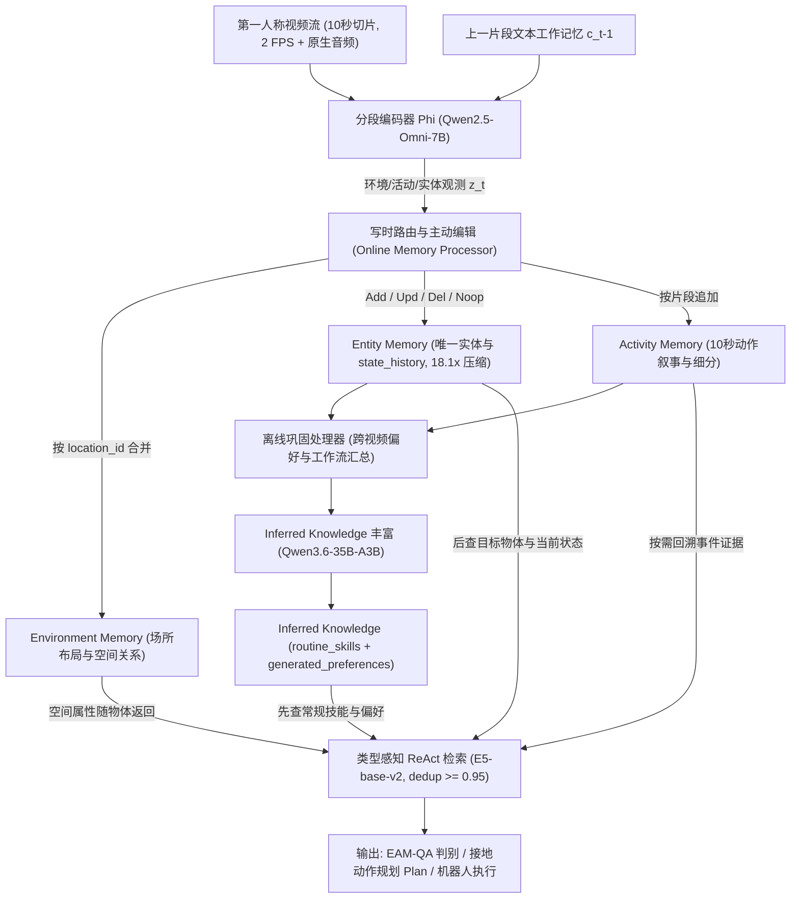
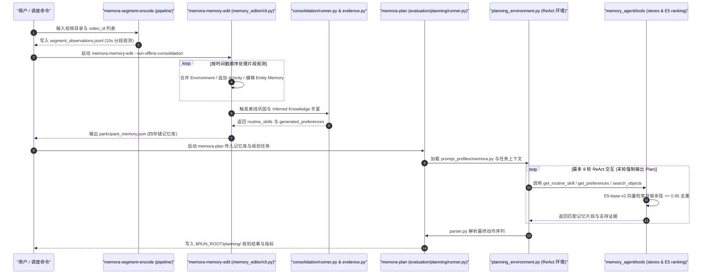

# MEMORA: Embodied Action Memory from Egocentric Videos for Reasoning and Planning

## 一句话定义

MEMORA 是面向具身智能体的长期行动记忆框架：它将连续的第一人称（egocentric）人类活动视频流在线编码并主动编辑为环境（Environment）、实体（Entity）、活动（Activity）与推断知识（Inferred Knowledge）四类持久化世界记忆，再经离线巩固提炼可复用常规流程与个体偏好，从而在测试时不回看原始视频的条件下支撑溯因问答与长程机器人规划。

## 英文缩写速查

| 缩写 | 英文全称 | 简要说明 |
|---|---|---|
| EAM | Embodied Action Memory | 具身行动记忆：从连续具身经验中形成、维护并使用持久化记忆状态的能力形式化定义 |
| EAM-QA | Embodied Action Memory Question Answering | MEMORA-Bench 中的溯因记忆忠实度多选评测（含 `SPref`、`SHabit`、`SRoutine`、`ERecall` 与不可答对照 `E`） |
| RGP | Robot-Grounded Plan score | MEMORA-Planning 的综合规划得分，定义为条件级 `OrderExec`、`KeyObj` 与 `PrefAdh` 的无权均值 |
| OOD | Out-of-Distribution | 分布外泛化设定，对应 `Generalize` 规划拆分中无直接匹配历史片段的迁移与组合目标 |
| ReAct | Reasoning and Acting | 交错推理与工具调用的智能体执行循环，MEMORA 在评测期借此检索四类记忆存储 |

## 为什么重要

1. **填补“从连续第一人称经验到可执行长期记忆”的断层**：现有第一人称视频工作多将其用于模仿学习或跨本体策略蒸馏，而传统长视频 QA 需在推理时重新输入原始视频；MEMORA 验证了无需重放原始视频，仅依赖持久化的结构化记忆即可为下游规划提供个体专属的环境与偏好上下文。
2. **揭示“简单记忆检索反而有害”的现象并给出解法**：在需跨片段组合的分布外规划（`Generalize`）中，朴素文本块检索（Flat-1D）或未区分存储语义的图记忆（Graph-2D）会因上下文污染导致表现低于无记忆基线；MEMORA 通过写时主动编辑与“先查常规技能与偏好、再接地具体物体”的类型隔离检索，将抽象流程与实体状态解耦。
3. **提供完全可复现的开源记忆基准与流水线**：MEMORA-Bench 基于 45 小时、18 名参与者的 EPIC-KITCHENS-100 扩展视频同时检验“记得准不准”（溯因忠实度）与“能不能指导行动”（前瞻规划），且整条建库与评测主线完全运行在开源权重模型之上。

## 核心信息

| 字段 | 内容 |
|---|---|
| 作者 | Zihao Yu, Xiu Yuan, Chongjie Zhang |
| 机构 | Washington University in St. Louis |
| 发表与版本 | arXiv:2607.14252v2（2026-08-31 修订，v1 提交于 2026-07-15）；v1 获 RSS 2026 FM4RoboPlan Oral；v2 已被 EMNLP 2026 录用 |
| 论文链接 | [arXiv:2607.14252](https://arxiv.org/abs/2607.14252)（HTML 全文：[arXiv HTML](https://arxiv.org/html/2607.14252)） |
| 项目与代码 | [GitHub 仓库（yuzihaowashu/MEMORA）](https://github.com/yuzihaowashu/MEMORA) · [项目主页](https://yuzihaowashu.github.io/MEMORA/) · [HuggingFace 数据集](https://huggingface.co/datasets/DependableDavid/MEMORA) |
| 清单分类 | `harness.memory` |
| 来源条目 | `survey_ax_2607_14252` |
| 开源状态 | **已开源**（源码采用 MIT License；18 名参与者四存储记忆库、EAM-QA/Planning 任务集及已保存模型输出已公开发布于 GitHub 与 HuggingFace，派生数据继承 EPIC-KITCHENS CC BY-NC 4.0，原始视频需从 EPIC-KITCHENS 获取） |

## 核心原理

### 1. 问题形式化与四存储世界记忆架构

论文将具身行动记忆（EAM）定义为经验写入 $F$ 与决策读取 $G$ 两个分离映射：

$$\mathcal{M}_t = F(\mathcal{M}_{t-1}, o_t), \qquad d_\tau = G(\mathcal{M}_\tau, x_\tau)$$

其中 $o_t$ 为时刻 $t$ 的连续观测，$\mathcal{M}_t$ 为持续演化的记忆状态，$x_\tau$ 为后续推理问题或规划目标。为避免单一追加日志混杂异构信息，MEMORA 将记忆状态显式划分为四个按更新动力学特化的存储 $\mathcal{M}_t = (\mathcal{M}_t^{\text{env}}, \mathcal{M}_t^{\text{ent}}, \mathcal{M}_t^{\text{act}}, \mathcal{M}^{\text{inf}})$：

| 存储类型 | 记录单元 | 更新策略 | 读取期作用 |
|---|---|---|---|
| **Environment Memory** ($\mathcal{M}_t^{\text{env}}$) | 场所记录（布局描述、命名分区与空间关系） | 按稳定 `location_id` 确定性合并并保留历史 | 将动作与物体接地到具体场所（如水槽区、沥水架相对位置） |
| **Entity Memory** ($\mathcal{M}_t^{\text{ent}}$) | 物体记录（外观属性、位置、当前状态与 `state_history`） | LLM 主动编辑：`Add` / `Upd` / `Del` / `Noop` | 在跨片段移动与交互中保持物体同一性与当前状态 |
| **Activity Memory** ($\mathcal{M}_t^{\text{act}}$) | 10 秒片段对齐事件（摘要、叙事与细分 `action_breakdown`） | 按时间片段确定性追加（append-only） | 回溯单事件证据、动作时序与细粒度过程 |
| **Inferred Knowledge** ($\mathcal{M}^{\text{inf}}$) | 常规技能、习惯、偏好与工作流模式（含 `supporting_evidence_ids`） | 跨视频离线巩固 + 参与者级丰富生成 | 为跨事件泛化与分布外规划提供可复用程序骨架 |

### 2. 两时间尺度记忆构建：在线编辑与离线巩固

1. **分段感知编码（Perception Processor / Segment Encoder $\phi$）**：每段视频切分为互不重叠的 10 秒片段 $v_t$（按 2 FPS 解码、上限 24 帧，连同原生音频流输入多模态模型 **Qwen2.5-Omni-7B**），结合上一片段的文本工作记忆摘要 $c_{t-1}$，输出结构化观测 $(z_t, c_t) = \phi(v_t, c_{t-1})$，其中 $z_t = (z_t^{\text{env}}, z_t^{\text{ent}}, z_t^{\text{act}})$。前一片段的原始视频帧不保留在 KV 缓存中。
2. **写时主动编辑（Online Memory Processor `Edit`）**：环境与活动记录采用低开销确定性规则更新；对实体观测，**Qwen3-30B-A3B-Instruct-2507** 针对当前精简实体表执行 $\delta_j \in \{\textsc{Add}, \textsc{Upd}, \textsc{Del}, \textsc{Noop}\}$ 决策（注册表超预算时通过密集检索预筛候选实体）。在 18 名参与者语料上，这一主动编辑相比无编辑追加存储实现 **中位数 18.1×** 的实体条目压缩（最少 9×，3 名参与者超 30×），且在 P01–P04 的 37,648 次观测中 `Noop`（45.8%）与 `Upd`（44.4%）占 90.2%、`Del` 占 1.8%，证明编辑器主要是在维护与修正既有实体状态而非无限扩表。
3. **离线巩固与丰富（Offline Consolidation & Enrichment）**：在参与者所有视频在线建库完成后，Offline Consolidation Processor（复用 Qwen3-30B-A3B-Instruct-2507）跨视频总结存储偏好、组织习惯与工作流模式；随后 Inferred Knowledge Enrichment Processor（确定性规则骨架 + **Qwen3.6-35B-A3B**）生成结构化的 `routine_skills`（常规目标、规范步骤、关键物体）和 `generated_preferences`（带关键词、置信度与证据 ID）。

### 3. 类型感知检索与内存接地规划

在决策读取端 $G(\mathcal{M}_\tau, x_\tau)$，MEMORA 采用 **E5-base-v2**（`intfloat/e5-base-v2`，top-$k=10$，余弦相似度 $\ge 0.95$ 去重）驱动的 ReAct 工具调用循环：
- **EAM-QA（最大 5 轮）**：通过统一调度接口 `search` 及历史查询工具 `get_object_history`、`get_state_at_time`、`search_patterns` 访问目标参与者固定记忆库，在 A–D 选项与“E（信息不可用）”之间作答。
- **MEMORA-Planning（最大 8 轮，末轮强制输出 `Plan:`）**：提示词引导智能体先调用 `get_routine_skill` 与 `get_preferences` 获取“怎么做”的程序骨架与个人偏好，再调用 `search_objects`（返回含环境位置属性）与 `search_activities` 绑定“用哪个具体物体、在何处操作”，最终输出动作-实体-位置三元组序列 $\pi = ((a_1, e_1, \ell_1), \dots, (a_n, e_n, \ell_n))$。这种“程序骨架与物理实体解耦”的检索机制使规划器能将已学技能迁移到从未直接观测过的新组合目标上。

## 流程总览

## 源码运行时序图

以下时序图基于官方仓库 `yuzihaowashu/MEMORA` 的 `README.md` 与 `files_sample` 已核实模块（`pyproject.toml` 公开的三个阶段 CLI 入口及 `src/memora/pipeline/`、`src/memora/memory_agent/`、`src/memora/evaluation/planning/` 下的核心实现），展示从第一人称视频构建持久化记忆并生成接地规划的完整运行链路。

## 实验与评测

论文构建了 **MEMORA-Bench**（基于 EPIC-KITCHENS-100 扩展集 18 名参与者、201 段视频、约 45 小时第一人称录像），包含 **2,763 道 EAM-QA 题目**（2,212 道可答 + 551 道跨参与者不可答 E-correct 对照）与 **360 项规划任务**（207 项 `Replay` + 153 项分布外 `Generalize`），在四款开源权重回答底座上与 5 个对比条件展开系统评测。

### 1. 溯因记忆忠实度（MEMORA-Bench EAM-QA，Tables 3, 9, 10）

在 `Parametric-missed + MEMORA-committed`（无记忆基线答错且 MEMORA 给出 A–D 内容选项，不以正确性过滤）诊断视角下，Gemma-4-31B-it（18 名参与者，$N=1{,}122$）各类别准确率（%）如下：

| 记忆条件 | `SPref`（跨视频） | `SHabit`（跨视频） | `SRoutine`（跨视频） | `ERecall`（单视频） | Overall |
|---|---:|---:|---:|---:|---:|
| `Flat-1D (raw)` | 63.2 | 36.8 | 53.8 | 51.2 | 52.0 |
| `Graph-2D (raw)` | 50.9 | 21.4 | 37.1 | 55.4 | 40.0 |
| `Flat-1D (processed)` | 62.4 | 41.4 | 56.8 | 53.0 | 54.0 |
| `Graph-2D (processed)` | 57.1 | 27.0 | 48.6 | 57.1 | 47.0 |
| `MEMORA-Episodic`（无巩固） | 67.4 | 47.0 | 56.8 | 73.8 | 60.1 |
| **`MEMORA (full)`** | **76.8** | **60.7** | **81.5** | **79.8** | **74.5** |
| 巩固净增益（$\Delta$ 分） | +9.4 | +13.7 | +24.6 | +6.0 | +14.4 |

- **跨底座与全集视角（Tables 9 & 10）**：同一诊断视角下，MEMORA 在四款底座上均全面领先：`Gemma-4-31B-it` 74.5%（+20.5）、`Qwen3.6-27B` 69.1%（+19.3）、`Gemma-4-26B-A4B-it` 54.1%（+9.6）、`Qwen3.6-35B-A3B`（12-PID 交集 $N=1{,}141$）63.5%（+11.8），且离线巩固对 4 类题型 × 4 个底座全部带来正增益。若不作条件筛选而看全集 2,763 题准确率（Table 9），四底座分别为 50.2%（Q3.6-35B-A3B，$\Delta=-3.4$）、39.3%（G4-26B，$\Delta=-9.9$）、51.7%（Q3.6-27B，$\Delta=+1.5$）与 46.1%（G4-31B，$\Delta=-0.5$），反映模型在信息不足时选择拒答选项 E 的保守度差异。

### 2. 前瞻规划与分布外泛化（MEMORA-Planning，Figure 3, Table 16, Figure 15）

- **跨底座整体胜出**：在 4 个底座 × `Replay`/`Generalize` 共 8 个评测单元中，MEMORA 系列取得 **8/8 最佳表现**；在 3 个底座上 `Generalize` 相对增益大于 `Replay`。在 Gemma-4-31B-it 上，`MEMORA-Episodic` 在 `Replay`（$n=207$）实现 **+7.2%** 相对 RGP 提升，而完整 `MEMORA` 在 `Generalize`（$n=153$）实现 **+16.4%** 相对 RGP 提升（全矩阵最高达 **+16.6%** 相对增益），其中流程顺序 `OrderExec` 相对提升 43%、偏好遵循 `PrefAdh` 提升 14%；与此同时，所有非 MEMORA 检索基线（Flat-1D / Graph-2D）在 `Generalize` 上均低于无记忆 `Parametric` 基线。
- **Qwen3.6-35B-A3B 细项分解（Table 16）**：`Replay` 上 MEMORA-Episodic RGP 达 **.345**（MEMORA full .338，Flat-1D proc. .330，Parametric .207）；`Generalize` 上完整 MEMORA RGP 达 **.450**（OrderExec .243 / KeyObj .650 / PrefAdh .458），高于 MEMORA-Episodic（.425）、Flat-1D raw（.386）、Graph-2D proc.（.356）与 Parametric（.320）。
- **工具调用迁移与延迟（Tables 17 & 24）**：1,440 次规划运行（7,163 次工具调用）显示 `search_objects` 占 58.4%、`get_routine_skill` 占 35.3%、`get_preferences` 占 4.8%、`search_activities` 占 1.4%；当移除 Inferred Knowledge（`MEMORA-Episodic`）时，35.0% 的调用迁移至 `search_activities`。在 A100/vLLM 上单目标平均规划耗时 **10.40 s**（中位 9.61 s），记忆检索工具仅占 **1.06 s**。

### 3. 受控消融与真机验证（Section 5.4, Appendices D–E, Tables 20–22）

- **建库模块消融（14 名留出参与者 2,017 题，基于 MEMORA-Episodic）**：将在线编辑器由 Qwen3-30B-A3B 降为 Qwen3-14B（`A1-14B`）导致 Gemma-4-26B 准确率下降 **5.8 个百分点**（46.7% → 40.9%）、拒答率由 42.8% 飙升至 62.3%（写入实体状态变更数减少 24.5%）；改用纯视觉 Qwen2.5-VL-7B 替换含音频的 Qwen2.5-Omni-7B（`A2-VL7`）仅下降 **2.7 个百分点**（46.7% → 44.0%），说明在线编辑器的语义归并能力比音频通道更具决定性。在 Qwen3.6-35B-A3B 回答底座上同样复现这一排序（-3.3 vs -1.3 分）。
- **开源 vs 闭源巩固一致性**：用 `gpt-4o-mini` 替换开源 `Qwen3.6-35B-A3B` 做离线丰富时，Gemma-4-26B（35.76% vs 35.92%）与 Gemma-4-31B（36.4% vs 35.8%）结果统计等价，验证主流程完全不依赖闭源 API。
- **Unitree G1 真机验证**：以人类第一人称演示视频离线建库、不提供任何机器人示教，由固定规则底层控制器执行 MEMORA 语言规划：在 `Prepare Drink`（从雪碧/芬达干扰物中选出瓶装可口可乐与橙色塑料杯）与 `Breakfast`（按序选取黄色碗、肉桂茶、黄色勺与面包）上实现 **2/2 一次成功**。

## 与其他工作对比

| 系统 / 记忆接口 | 记忆组织形式 | 写时主动编辑 | 跨事件离线巩固 | 类型感知读工具 | 测试时不回看原始视频 | 在 `Generalize` 相对无记忆表现 |
|---|---|---|---|---|---|---|
| **MEMORA（本文）** | 环境 / 实体 / 活动 / 推断知识四存储 | 支持（Add/Upd/Del/Noop） | 支持（常规技能 + 偏好） | 支持（先常规后实体） | 是 | **Qwen3.6-35B-A3B RGP .450（vs 无记忆 .320）** |
| **Flat-1D（仿 Socratic Models）** | 按时间排列的文本观测日志 | 仅 processed 变体间接受益 | 不支持 | 仅关键词检索 | 是 | Gemma-4-31B-it 上低于无记忆基线；Q3.6-35B 上 .386/.369 |
| **Graph-2D（仿 M3-Agent）** | 实体-关系图结构 | 仅 processed 变体间接受益 | 不支持 | 图实体/活动检索 | 是 | Gemma-4-31B-it 上低于无记忆基线；Q3.6-35B 上 .336/.356 |
| **MEMENTO（同构适配版）** | 按物体语义与用户模式分组 | 不含本文四存储编辑 | 有限模式分组 | 统一检索 | 是 | 39.8% EAM-QA，RGP .370（MEMORA 为 42.0% / .450） |
| **EgoMimic / EgoScale** | 第一人称视频模仿/动作策略学习 | 不适用（权重内化） | 不适用 | 无显式记忆读取 | 策略参数化 | 聚焦动作技能迁移而非显式个体偏好与场所记忆 |

## 结论

**一句话总判：MEMORA 证明“有类型边界的四存储架构 + 写时状态维护 + 离线经验巩固”比单纯堆砌原始检索片段更能支持具身长程规划，尤其在需要跨片段组合与偏好迁移的分布外目标上拉开显著差距。**

1. **记忆怎么写比多模态通道更敏感** — 在线编辑模型容量降级（30B → 14B）带来的损失（-5.8 分）远大于去掉音频模态（-2.7 分），因弱编辑器会漏记 24.5% 的跨片段状态变迁而非更紧凑去重。
2. **分布外规划需要“先流程、后接地”的解耦检索** — 直接检索原始日志虽能在文本块拷贝指标（`KBGround`）上占优，但在 `Generalize` 规划中会污染上下文；分离 `Inferred Knowledge` 流程骨架与 `Entity Memory` 实体状态才带来真实可执行的顺序与偏好提升。
3. **巩固收益受限于规划器自身推理能力** — 离线巩固对较强推理模型（Qwen3.6-35B-A3B、Gemma-4-31B-it）带来稳定提升（+0.025 / +0.022 RGP），而较弱模型难以充分利用抽象常规知识。
4. **定位是高层语义记忆层而非底层控制替代品** — MEMORA 为下游 VLA 或规则控制器提供个体专属物体、地点与顺序约束，实际长程闭环部署仍需配合进度监控与重规划模块。

## 工程实践

- **分阶段契约化运行**：源码将流程拆为 `memora-segment-encode`（视频 → `segment_observations.jsonl`）、`memora-memory-edit --run-offline-consolidation`（观测 → `participant_memory.json`）与 `memora-plan` / `memora-eam-qa`（记忆 → 评测结果）三步，各阶段通过运行目录中的 JSON/JSONL 交换，便于单独替换感知器或回答底座。
- **推理预算与思维链开关**：在 64K 上下文窗口下运行 Qwen3.x 系列回答智能体时，工程配置显式设置 `enable_thinking=false`（Appendix F），防止长思维链挤占 ReAct 多轮工具返回的 token 预算；单机仅复现指标可选 `bash scripts/setup_environment.sh analysis` 在 CPU 上重算。
- **实体注册表预算控制**：当单参与者视频跨度变长导致 `object_registry` 超出编辑 Prompt 上限时，使用 E5-base-v2 密集检索预筛相关候选实体送入在线编辑器，兼顾上下文可控性与合并准确率。

## 局限与风险

1. **领域与时间跨度受限**：全部基准评测局限于 EPIC-KITCHENS-100 厨房场景（每名参与者 8–15 个会话），尚未检验跨月/跨年的环境剧变、季节性物体迁移以及主动遗忘与容量淘汰机制。
2. **误差沿建库链路向上游传播**：若 `Qwen2.5-Omni-7B` 漏检物体或 `Online Memory Processor` 未记录状态变化，后续 `Inferred Knowledge` 巩固难以无中生有；反之，重复出现的感知误判若未被后续片段推翻，可能被巩固为错误习惯。
3. **评测粒度与规则指标局限**：已发布的 EAM-QA 面板针对完整记忆库评测，未包含按问题时间戳回滚的在线前缀测试（`ask_turn_id`）；`MEMORA-Planning` 的 `OrderExec`/`KeyObj`/`PrefAdh` 均为基于词干匹配的规则指标，尚无法取代物理仿真或真机闭环成功率评测。
4. **真机验证范围与隐私边界**：Unitree G1 仅完成 2 个桌面任务、固定规则控制器的定性接地检查；此外，持久化记录个人家庭生活习惯与物体偏好的系统在实际部署时面临显著隐私暴露风险，必须落实知情同意、端侧/加密存储与单人访问隔离。

## 关联页面

- [Agentic Robots 综述](paper-towards-agentic-robots-survey.md)
- [全量项目节点清单](../overview/awesome-agentic-robots-node-index.md)
- [VLA 方法背景](../methods/vla.md)
- [机器人智能体执行框架](../methods/robot-agent-harness.md)：对照规划、执行接口与反馈机制。
- [智能体工具调用接口](../methods/agent-tool-use-interface.md)：参考 ReAct 循环中的结构化存储工具设计与调用解析。
- [智能体规划与反馈机制](../methods/agent-planning-feedback.md)：对照语言规划与下游进度监控、重规划闭环的衔接。
- [具身智能体基准评测](../methods/embodied-agent-benchmarking.md)：参考 MEMORA-Bench 将记忆忠实度与前瞻规划配对评测的设计思路。
- [机器人操作任务](../tasks/manipulation.md)：了解记忆接地规划在桌面抓取与多步骤操作中的下游执行需求。

## 推荐继续阅读

- [MEMORA 官方项目主页与 MEMORA-Bench 交互浏览器](https://yuzihaowashu.github.io/MEMORA/)
- [MEMORA 官方 GitHub 仓库（yuzihaowashu/MEMORA）](https://github.com/yuzihaowashu/MEMORA)
- [MEMORA 原文（arXiv:2607.14252）](https://arxiv.org/abs/2607.14252)
- [MEMORA 参与者记忆与评测输出数据集（HuggingFace）](https://huggingface.co/datasets/DependableDavid/MEMORA)

## 参考来源

- [MEMORA 论文全文核对档案](../../sources/papers/paper-agentic-2607-14252.md)
- [MEMORA 官方仓库核对档案](../../sources/repos/paper-agentic-2607-14252.md)
- [官方 Awesome 快照归档](../../sources/repos/awesome-agentic-robots-survey-index.md)
- [arXiv 原文（2607.14252v2）](https://arxiv.org/abs/2607.14252)
- [MEMORA 官方 GitHub 仓库](https://github.com/yuzihaowashu/MEMORA)
