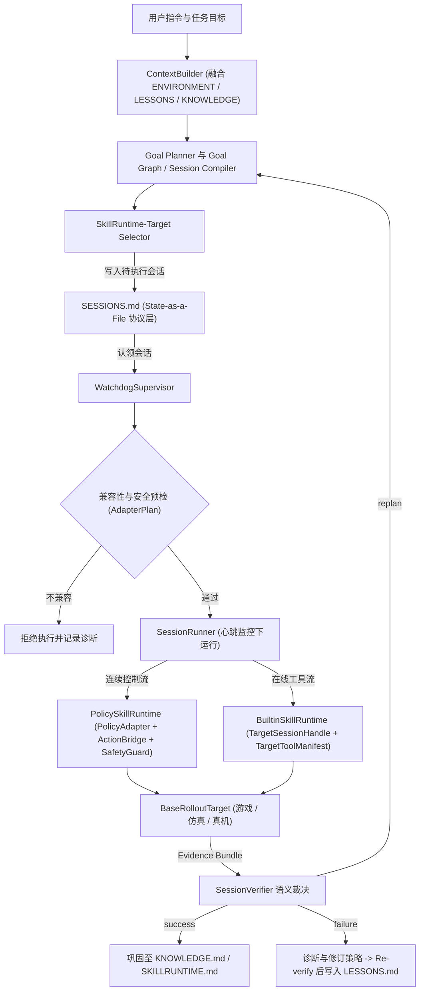
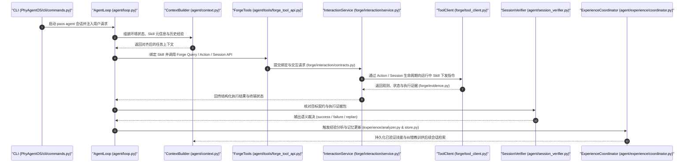

# PhyAgentOS: A Self-Evolving Operating System for Embodied Agents with Decoupled Cognitive Planning and Physical Execution

## 一句话定义

**PhyAgentOS** 是一个面向具身智能体的自演化运行时操作系统，通过 **State-as-a-File** 文件协议解耦高层认知规划与底层物理执行，并以会话中心运行时（Session-Centered Runtime）、`SessionVerifier` 语义验收、认知记忆闭环及五层安全栈统一协调 VLA 策略、世界模型与工具型智能体。

## 英文缩写速查

| 缩写 | 英文全称 | 简要说明 |
|---|---|---|
| PhyAgentOS | Physical Agent Operating System | 本文提出的具身智能体运行时操作系统架构 |
| VLA | Vision-Language-Action Model | 视觉-语言-动作端到端策略模型，作为 `PolicySkillRuntime` 的可插拔后端接入 |
| ROS | Robot Operating System | 传统机器人发布-订阅通信中间件，本文将其定位为下层通信底座而非任务级 OS |
| RSI | Recursive Self-Improvement | 递归自我改进，指开源核心仓 `PhyAgentOS-core` 中通过已验证经验迭代优化技能与教训的闭环 |
| DAG | Directed Acyclic Graph | 有向无环图，用于 `TASK.md` 中对长时程子任务依赖关系的建模与局部重规划 |

## 为什么重要

1. **填补“执行终止”与“语义完成”之间的验证鸿沟**：传统 VLA 控制器、世界模型与工具规划器常以控制器返回码或轨迹跟踪容差作为成功信号，导致“夹爪空抓却判定成功”的系统性误判；PhyAgentOS 引入基于多模态证据包的 `SessionVerifier`，把物理状态变更与目标契约对齐。
2. **解决多范式组合时的跨层耦合与故障归因难题**：当 Agent、VLA 与世界模型混用时，三者抽象层级（符号调用、像素/关节轨迹、隐空间动力学）互不兼容且共享同一进程边界；PhyAgentOS 用显式文件协议隔离认知与执行，使失败能独立归因到规划、适配器或物理目标。
3. **不重训神经网络即可实现跨会话自演化**：通过把已验证的成功模式（`KNOWLEDGE.md`）与失败纠错记录（`LESSONS.md`）沉淀为结构化外置记忆，系统可在游戏、仿真与多型真机之间积累可迁移方法并避免重复犯错。
4. **评测与部署共享同一运行时路径**：基准测试不再使用独立外挂脚本，而是直接复用生产级 `WatchdogSupervisor`–`SessionRunner`–`SessionVerifier` 链路，使实验增益与错误分类可追溯到真实执行轨迹。

## 核心信息

| 字段 | 内容 |
|---|---|
| 论文标题 | *PhyAgentOS: A Self-Evolving Operating System for Embodied Agents with Decoupled Cognitive Planning and Physical Execution* |
| 作者 | Yang Liu, Weixing Chen, Xinshuai Song, Tao Pu, Siwen Mo, Yongjie Bai, Zihao Chen, Qianran Sun, Liruo Zhong, Ying Shen, Liang Lin |
| 机构 | X-Era Lab；中山大学 HCP Lab（Sun Yat-sen University）；鹏城实验室（Peng Cheng Laboratory） |
| 发表时间 / 版本 | arXiv:2607.16636v1 [cs.RO]（2026-07-18 提交；论文标注 `v0.1.6`，GitHub 核心仓于 2026-11-22 发布 `v1.2.0`） |
| 论文链接 | [arXiv:2607.16636](https://arxiv.org/abs/2607.16636) / [HTML 全文](https://arxiv.org/html/2607.16636) |
| 项目与代码 | [PhyAgentOS-core（GitHub 主仓）](https://github.com/PhyAgentOS/PhyAgentOS-core) · [项目主页](https://phy-agent-os.net) · [DSH 插件仓](https://github.com/PhyAgentOS/PhyAgentOS-DSH-Plugin) |
| 清单分类 | `harness.monitoring_and_recovery` |
| 来源条目 | `survey_ax_2607_16636` |
| 开源状态 | **已开源**（MIT 协议，含完整 Python 包 `PhyAgentOS`、CLI 工具 `paos`、Forge/Dora Skill 运行时与多平台快速开始文档） |

## 核心原理

PhyAgentOS 将具身智能重塑为由**两个独立推理平面（Agent Layer / Runtime Layer）**与**显式协议边界（Protocol Layer）**构成的会话中心系统，并通过五项核心机制形成闭环：

1. **双平面分离与会话中心抽象**：
   - **Agent Layer（决策“做什么”）**：由 `Goal Planner`、`Goal Graph and Session Compiler`、`SkillRuntime-Target Selector`、`ContextBuilder` 与受约束的 `ToolRegistry` 组成。系统严禁 Agent 直接调用底层硬件 SDK，而是编译包含目标、前置条件、执行上限与验收标准的结构化会话契约（Session）。
   - **Runtime Layer（决策“怎么做”）**：遵循四级收敛链 `WatchdogSupervisor → SessionRunner → SkillRuntime → Target`（`BaseRolloutTarget`）。`WatchdogSupervisor` 认领待执行会话、完成预检与心跳监管，并将逐步观测-动作循环下放给 `SessionRunner`。
2. **State-as-a-File 协议与统一认知状态空间**：
   - 跨进程交互全部物化为“Markdown + 嵌入式 YAML”文件，形成天然可审计、可版本控制、语言无关的认知状态空间：
     - `SESSIONS.md`（事务中心与情景记忆）、`SKILLRUNTIME.md`（可执行技能与程序性记忆）、`TARGETS.md`（目标本体能力与约束）、`ENVIRONMENT.md`（从原始传感提炼的实体关系工作记忆）、`LESSONS.md`（失败原因与已验证纠错记录）与 `KNOWLEDGE.md`（已验证成功模式），辅以 `TASK.md`、`LOG.md`、`RUNTIME_SIGNAL.md` 及 `sensors.yaml`、`perception.yaml`、`runtime_contract.yaml`、`safety.yaml`。
   - 这一边界自然定义了**云边协同**：重推理与记忆检索留在远端/云侧，高实时控制与安全联锁留在边缘物理设备侧。
3. **双执行流收敛**：
   - **策略驱动流（`PolicySkillRuntime`）**：面向 VLA 等连续控制策略，$A_t = \mathrm{Policy}(I, O_t, S_t, H_t)$。经 `PolicyAdapter`、`Action Runtime`（动作块缓冲、截断与频率对齐）、`ActionBridge` 与 `TargetAdapter` 将动作块安全下发至目标。
   - **智能体工具流（`BuiltinSkillRuntime`）**：无独立 Policy Server 时，Agent 通过受过滤的 `TargetToolManifest` 与 `TargetSessionHandle` 执行受控在线工具调用（`observe`、`reset`、`invoke_tool`、`step`、`query_state`），即 $T_t = \mathrm{Agent}(I, O_t, S_t, H_t)$。两条流最终交汇于同一证据收集与验收接口。
4. **SessionVerifier 语义验收与六阶段自演化闭环**：
   - 会话终止后，`SessionVerifier` 基于任务目标 $G$、初始/终态环境 $S_0, S_T$、执行轨迹 $\tau$ 与历史上下文 $H$ 输出三值裁决：
     $$\mathcal{V}(G, S_0, S_T, \tau, H) \rightarrow \{\mathtt{success}, \mathtt{failure}, \mathtt{replan}\}$$
   - 若判定 `replan`，系统保持父会话记录不可变，并编译带有更新前置条件或策略的子会话；所有裁决与原始观测指针均以只追加方式写入 `attempts` 记录。
   - 经验巩固遵循 **`Execute → Verify → Diagnose → Revise → Re-verify → Consolidate`** 六阶段流程：诊断出的假设**只有经过重执行并再次验证有效后**才写入 `LESSONS.md`，从而防止未经验证的猜测污染语义记忆。
5. **五层纵深安全栈**：
   - **兼容性预检（Compatibility Preflight）**：核对观测模态、动作空间、频率与权限并生成 `AdapterPlan` 与 `TargetToolManifest`，不匹配则拒绝建链。
   - **动作桥接（Action Bridges）**：执行坐标系变换、单位归一化、关节重排与维数投影，拒绝不连续或病态指令。
   - **安全守卫（SafetyGuard）**：在指令下发前拦截 `NaN/Inf`、关节/工作空间越界、速度/加速度超限及急停状态，并记录结构化违规码。
   - **心跳监控（Heartbeat Monitoring）**：监督 `SessionRunner`、策略服务端与目标端健康状态，超时即传播取消信号并回收动作块权限。
   - **目标本地约束（Target-Local Constraints）**：保留真机硬件急停、碰撞检测、力矩/速度限制或仿真/游戏内部规则作为最终权威防线。

## 流程总览

## 源码运行时序图

在官方开源仓库 `PhyAgentOS/PhyAgentOS-core` 中，用户通过 CLI 命令 `paos`（入口为 `PhyAgentOS/__main__.py` 与 `PhyAgentOS/cli/commands.py`）启动智能体与技能运行时，核心闭环经由 `PhyAgentOS/agent/loop.py` 调度受限工具 `PhyAgentOS/agent/tools/forge_tool_api.py` 及 `PhyAgentOS/forge/interaction/service.py` 与物理目标交互，并由 `PhyAgentOS/agent/session_verifier.py` 和 `PhyAgentOS/agent/experience/coordinator.py` 完成验收与经验演化。

## 实验与评测

论文采用“**游戏层（剥离物理干扰）→ 仿真层（引入刚体动力学与控制延迟）→ 真机层（硬件噪声与安全验证）**”的渐进式验证路径，且认知层在三层中保持不变：

### 1. 游戏层认知验证（§5.1）

- **Optimus-67（Minecraft 长时程基准，7 组 67 个任务；高层 `qwen3.5-plus` + `qwen3-vl-flash`，底层 `STEVE-1`）**：
  - Wood `0.99 ± 0.01`、Stone `0.96 ± 0.05`（超过基线 Optimus-3 的 `0.95 ± 0.02`）、Iron `0.52 ± 0.19`（Optimus-3 `0.55 ± 0.03`）、Gold `0.06 ± 0.08`、Diamond `0.19 ± 0.07`（超过 Optimus-3 的 `0.15 ± 0.02`）、RedStone **`0.30 ± 0.16`**（全部基线中最高，高于 Optimus-3 的 `0.29 ± 0.02`）、Armor `0.15 ± 0.06`。
- **StarDojo Lite-100（星露谷 100 项多资源调度任务，纯文本 `deepseek-v4-flash`）**：
  - 总成功率 **`22.0%`**，高于对比基线 `SPIKE (GPT5.4)` `20.3%`、`SPIKE (Qwen3.5-397B)` `18.0%`、`SPIKE (Gemini-3.1-pro)` `17.7%`、`CRADLE` `13.0%`、`StarDojo` `12.3%` 及多模态 GPT-4.1 参考值 `12.7%`。
  - 分项表现：Farming `28.6%`、**Crafting `50.0%`**（对比 SPIKE Qwen3.5-397B 的 `23.8%` 翻倍以上）、Exploration `17.9%`、Combat `16.7%`、Social `8.0%`；按难度分，Easy（56 题）`37.5%`、Medium `3.7%`、Hard `0.0%`，平均进度率 `0.236`。
- **DST-Dojo（饥荒 Autumn Day 0 起 10 局生存测试，`deepseek-v4-flash`）**：
  - 平均生存天数从 Raw LLM 的 `1.02 ± 0.08` 提升至 **`2.10 ± 0.88`（`+106%`）**；第 3 天存活率从 `0%` 提升至 **`30%`（`+30 pp`）**；因黑暗（Charlie）致死率从 `90%` 降至 `80%`，因存活延长而出现 `10%` 饥饿致死。

### 2. 仿真层物理回归（§5.2，策略权重完全冻结，`First` 对比 `Final` 验证后恢复）

| 基准 | 策略后端 | First（首次尝试） | Final（PhyAgentOS 介入恢复后） | 绝对增益 / 关键细节 |
|---|---|---:|---:|---|
| **LIBERO** (Overall) | OpenVLA | 74.5% | **75.5%** | `+1.0`（LIBERO-10: `52.6% → 53.4%`） |
| LIBERO (Overall) | $\pi_0$ | 92.8% | **93.2%** | `+0.4`（Spatial: `96.8% → 97.6%`） |
| LIBERO (Overall) | $\pi_{0.5}$ | 97.0% | **97.8%** | `+0.8`（LIBERO-10: `92.8% → 94.6%`） |
| LIBERO (Overall) | X-VLA | 97.3% | **98.6%** | `+1.3`（LIBERO-10: `96.6% → 98.6%`） |
| **CALVIN ABC→D** (5/5 链) | X-VLA | 74.3% | **75.7%** | `+1.4`（Avg. Len.: `4.310 → 4.329`） |
| CALVIN ABC→D (5/5 链) | $\pi_0$ | 38.9% | **45.6%** | **`+6.7`**（Avg. Len.: `3.125 → 3.249`） |
| CALVIN ABC→D (5/5 链) | $\pi_{0.5}$ | 85.3% | **89.4%** | **`+4.1`**（Avg. Len.: `4.690 → 4.753`） |
| **RoboCasa365** (`target50`, 250 eps) | $\pi_{0.5}$ | 17.6% | **26.8%** | **`+9.2`**（Atomic `41.1%→56.7%`，挽救 23 局） |
| RoboCasa365 (`target50`, 250 eps) | RLDX-1 | 35.6% | **42.8%** | **`+7.2`**（Composite `16.2%→24.4%`，挽救 18 局） |
| RoboCasa365 (`target50`, 250 eps) | WorldDreamer | 34.0% | **42.4%** | **`+8.4`**（Composite `15.6%→25.0%`，挽救 21 局） |

### 3. 真机与跨本体验证（§5.3，Table 7）

- 论文 Table 7 共列出 **19 个**仿真与真机平台（涵盖机械臂 Agilex PIPER、Franka FR3 / Panda、RealMan RM65-B、Dobot Nova 2（正文提及）、ViperX300、SO100/SO101、XLerobot、灵巧手 Stella Gaia Hand 20、四足 Unitree Go2 及人形 Unitree G1 / G1-D / R1、Fourier GR-3、Huibo Astra-Pro、Zerith_H1_PRO 等）。
- 在 Franka Research 3、AgileX PIPER 与 Dobot Nova 2 上验证了不修改认知层、仅替换 `TargetAdapter` 与 `PolicyAdapter` 的零样本跨本体迁移，并定性检验了兼容性预检拒绝、`SafetyGuard` 速度/工作空间截断及急停响应。

## 与其他工作对比

| 维度 | ROS / ROS 2 | CaP-X / ASPIRE | ROSClaw / RoboOS / ABot-Claw | PhyAgentOS (本文) |
|---|---|---|---|---|
| 核心定位 | 发布-订阅通信中间件 | 代码生成式具身控制与技能发现 | 面向机器人的工具发现、层级调度与协同框架 | **具身智能体操作系统底座（调度+状态+验证+记忆+安全）** |
| 跨层接口形态 | Topic / Service / Action 消息总线 | 预设 Python 原语 / 代码函数 | 进程内 API 或框架内置接口 | **State-as-a-File（Markdown + YAML 审计协议，零代码耦合）** |
| 完成度判定 | 应用层自定义 | 代码执行无报错或规则检查 | 批判/监控信号或子任务回调 | **`SessionVerifier` 基于证据包输出三值语义裁决** |
| 经验与演化 | 无原生跨会话学习机制 | 积累可复用程序技能 | 多模态记忆或批判重规划 | **已验证经验分流沉淀至 `KNOWLEDGE.md` 与 `LESSONS.md`，且评测复用生产运行时** |

## 结论

**一句话总判：PhyAgentOS 的真正突破不在于提出新的端到端动作模型，而在于把“会话契约、文件化状态空间、语义验收与五层安全”抽象为模型无关的具身操作系统底座，在不改动策略权重的前提下稳定挽救长时程与复杂场景中的可恢复失败。**

1. **用“会话”替代“单步动作”作为调度粒度**：兼容预检、心跳监管、重试子会话与证据归档必须绑定在有界会话生命周期上，单步动作校验无法约束长时程耦合错误。
2. **State-as-a-File 以可控轮询延迟换取极致的跨栈可审计性**：Agent 与 Runtime 之间零代码导入，使得游戏引擎、MuJoCo 仿真与真机机械臂能复用完全相同的认知决策层。
3. **语义验收收益在长时程与复杂家务任务中尤为显著**：LIBERO 上因基线接近饱和仅提升 `+0.4~+1.3 pp`，但在 CALVIN 5/5 长链（`+4.1~+6.7 pp`）与 RoboCasa365（`+7.2~+9.2 pp`）上，通过拦截假阴性与触发受控恢复获得了显著净增益。
4. **记忆写回必须经由二次验证门控**：`LESSONS.md` 只巩固经过重执行验证有效的纠错方案，避免错误归因在多轮试错中持续放大。

## 工程实践

- **安装与基础启动**：`PhyAgentOS-core`（`v1.2.0`）要求 Python 3.11 或 3.12，可通过 `pip install -e .` 或 `pip install "PhyAgentOS-ai==1.2.0"` 安装，执行 `paos onboard` 初始化配置，使用 `paos provider configure` / `paos provider use` 配置大模型网关，并通过 `paos status` 与 `paos agent` 启动交互会话。
- **物理技能与 Dora 数据流集成**：物理能力以版本化 Forge/Dora Skill 发布，提供 Piper MuJoCo 仿真（`docs/quickstart-mujoco.md`）、Piper 真机 CAN 联调（`example/quickstart/piper-quickstart.md`）与 LIBERO-10 评测（`example/quickstart/libero-quickstart.md`）；若长时程会话中断，可通过 `paos skill reconcile <skill>` 同步保留的 Action/Session 状态并恢复绑定。
- **DeepSeek Harness 生态接入**：配套开源的 `PhyAgentOS-DSH-Plugin`（`@x-era/dsh-forge`）支持在 DSH Web/CLI 中完成环境诊断（`forge_environment_check`）、Skill 安装预检（`forge_skill_doctor`）、启动与 Tool API 调用。
- **评测纪律**：在接入新 VLA 或策略时，应严格区分 `First`（单次冻结首秀）与 `Final`（验证器恢复后）指标，避免将带重试的智能体恢复成绩误报为策略自身首轮精度。

## 局限与风险

1. **轮询式文件协议的调度延迟**：当前协议依赖 Watchdog 周期性轮询 `SESSIONS.md` 与 Agent 轮询状态更新，会引入与轮询间隔成正比的延迟；未来转向文件系统事件通知（filesystem hooks）时仍需严格保证单写者语义与原子写入，防止读到半截文件。
2. **长期记忆缺乏理论压缩与召回保障**：随着运行上千个会话，`LESSONS.md` 和 `KNOWLEDGE.md` 单调增长，当前基于任务类型与近期权重的检索策略在复杂对抗序列下尚无召回保证，且技能晋升到 `SKILL.md` 的回归验证仍偏半人工与基准驱动。
3. **多机 DAG 调度与真机统计覆盖尚处早期**：论文 §6.3 明确指出，用于跨智能体/跨本体依赖编排的 `Goal Graph and Session Compiler`（`TASK.md` DAG）在论文版尚未完全落地；同时 §5.3 的真机实验侧重安全边界与少平台零样本迁移验证，缺乏大规模真机任务成功率统计表与定量急停延迟基准值。
4. **困难认知任务仍有明显天花板**：在 StarDojo Lite-100 的 Hard 难度任务上成功率为 `0.0%`、Medium 仅 `3.7%`，且在 Optimus-67 的 Gold（`0.06`）与 Armor（`0.15`）任务上依然受限于长周期资源规划瓶颈。

## 关联页面

- [Agentic Robots 综述](paper-towards-agentic-robots-survey.md)
- [全量项目节点清单](../overview/awesome-agentic-robots-node-index.md)
- [VLA 方法背景](../methods/vla.md)
- [机器人智能体执行框架](../methods/robot-agent-harness.md)：对照规划、工具调用与反馈的系统边界
- [智能体规划与执行反馈](../methods/agent-planning-feedback.md)：闭环重规划与失败诊断机制背景
- [智能体工具调用接口](../methods/agent-tool-use-interface.md)：对比受限 ToolManifest 与标准工具契约
- [智能体技能封装](../methods/agent-skill-packaging.md)：对应 `SKILLRUNTIME.md` 与可复用 Forge Skill 打包
- [具身智能体评测基准](../methods/embodied-agent-benchmarking.md)：与“评测即运行时编排”的指标对齐
- [生成式世界模型](../methods/generative-world-models.md)：作为 PhyAgentOS 中可插拔预测推理资源
- [CLAW 架构参考](../methods/claw.md)：同类具身智能体系统基础设施与能力抽象对照
- [机器人操作任务](../tasks/manipulation.md)：LIBERO、CALVIN、RoboCasa365 与机械臂真机操作场景

## 推荐继续阅读

- [PhyAgentOS 官方论文（arXiv:2607.16636）](https://arxiv.org/abs/2607.16636)
- [PhyAgentOS-core 官方 GitHub 仓库与文档](https://github.com/PhyAgentOS/PhyAgentOS-core)
- [PhyAgentOS 项目主页](https://phy-agent-os.net)
- [PhyAgentOS DeepSeek Harness 插件仓库](https://github.com/PhyAgentOS/PhyAgentOS-DSH-Plugin)

## 参考来源

- [PhyAgentOS 论文原文通读归档](../../sources/papers/paper-agentic-2607-16636.md)
- [PhyAgentOS-core 官方仓库归档](../../sources/repos/paper-agentic-2607-16636.md)
- [官方 Awesome 快照归档](../../sources/repos/awesome-agentic-robots-survey-index.md)
- [arXiv:2607.16636 HTML 全文](https://arxiv.org/html/2607.16636)
- [PhyAgentOS/PhyAgentOS-core GitHub 仓库](https://github.com/PhyAgentOS/PhyAgentOS-core)
