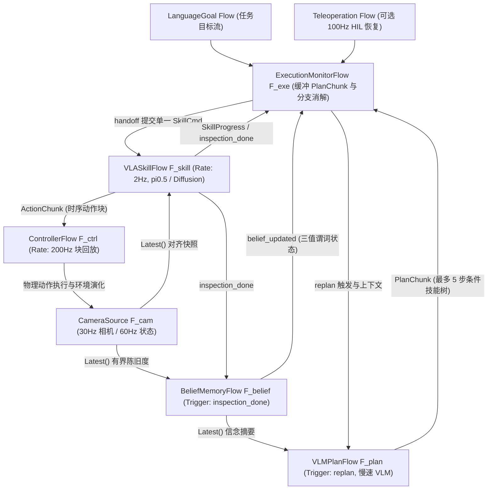
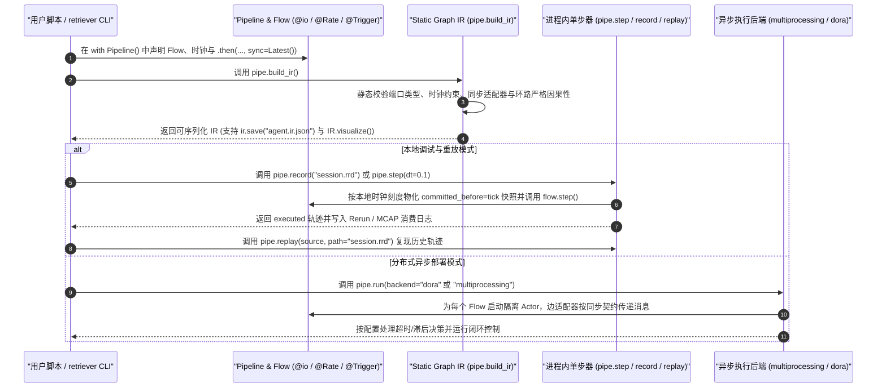

# Retriever: Composing the Perception-Reasoning-Action Loop for Long-Horizon Manipulation

## 一句话定义

Retriever 是斯坦福大学、MIT 与美国东北大学提出的闭环机器人智能体编程模型与运行时框架：它将异步多速率的感知、信念记忆、VLM 规划、VLA 技能与底层控制模块声明为绑定显式时钟（Clock）和边缘同步契约（Sync）的因果流函数（CSF）图，从而把定时与数据对齐语义从隐式回调胶水代码中抽离出来，支持进程内单步调试、Dora/多进程分布式部署与确定性轨迹重放。

## 英文缩写速查

| 缩写 | 英文全称 | 简要说明 |
|---|---|---|
| CSF | Causal Stream Function | 因果流函数，Retriever 形式化模型中的计算语义单元，输入/输出均为连续时间上的流 |
| IR | Intermediate Representation | 中间表示，Retriever 将 Python 声明式图编译为静态可序列化的图 IR 以对接不同执行后端 |
| VLM | Vision-Language Model | 视觉语言模型，在 Retriever-0 中承担低频高层规划（产出 `PlanChunk`）与信念状态推理 |
| VLA | Vision-Language-Action | 视觉-语言-动作模型，在 Retriever-0 中以 ~2Hz 执行技能指令并产出 `ActionChunk` 与进度预测 |
| KPN | Kahn Process Networks | 卡恩进程网络，经典的调度无关确定性并发数据流模型，为 Retriever 的函数确定性提供理论渊源 |
| FRP | Functional Reactive Programming | 函数式响应式编程，强调时变信号与因果反馈组合，启发 Retriever 的流与同步原语设计 |

## 为什么重要

1. **弥合算法离散时间假设与系统异步现实之间的鸿沟**：强化学习与模仿学习常用的 MDP/POMDP 形式化假设存在单一全局同步时间步且忽略推理延迟；而真实机器人中 30Hz 相机、秒级 VLM 规划、2Hz VLA 技能与 200Hz 底层控制并行运行，一旦采用阻塞调用会让控制卡顿，采用无协调非阻塞回调又会产生依赖线程调度的陈旧动作（stale actions）。
2. **把“何时运行、读哪一帧历史”显式化为图契约**：ROS / ROS 2 等中间件仅负责消息传输，时间对齐、陈旧度容忍与多速率缓冲往往散落在应用回调与共享状态里。Retriever 将模块逻辑（`Flow`）、触发时钟（`Rate` / `Trigger`）与边级采样契约（`Latest` / `Window` / `Chunking`）解耦并写入静态图 IR，使同一份图定义即可在本地单步调试与分布式部署间切换。
3. **提供可用于调试与策略学习的确定性重放能力**：只要记录外部输入流、时钟/提交轨迹（含滞后决策）及随机调用的种子或模型输出，Retriever 即可消除并发交错带来的不确定性，这不仅能复现真机异常，还能在混合动力可微仿真中固定离散事件路径以获得一致的路径梯度。

## 核心信息

| 字段 | 内容 |
|---|---|
| 作者 | Linfeng Zhao, Haojie Huang, Jiayuan Mao, Weiyu Liu, Lawson L. S. Wong, Mykel J. Kochenderfer |
| 机构 | 斯坦福大学（Stanford）、麻省理工（MIT）、美国东北大学（Northeastern University） |
| 发表时间 | arXiv:2607.17213v2（2026-09-11 修订，v1 提交于 2026-07-19） |
| 论文链接 | [arXiv:2607.17213](https://arxiv.org/abs/2607.17213)（HTML 全文：[arXiv HTML](https://arxiv.org/html/2607.17213)） |
| 项目与代码 | [项目主页（retriever.systems）](http://retriever.systems) · [OpenRetriever 主站](https://openretriever.org) · [文档站（retriever.build）](https://retriever.build) · [官方仓库（openretriever/retriever）](https://github.com/openretriever/retriever) · [应用示例（GoldenRetriever）](https://golden.retriever.build) |
| 清单分类 | `harness.orchestration` |
| 来源条目 | `survey_ax_2607_17213` |
| 开源状态 | **已开源**（Apache-2.0 License；核心运行时已发布为 PyPI 包 `retriever-core`，含 Flow/Clock/Sync DSL、IR 编译、单步调试器与 multiprocessing/Dora 后端及教程；论文实操机器人示例管线位于配套仓库 `openretriever/golden-retriever`） |

## 核心原理

### 1. 连续物理时间上的异步智能体—环境环（Sec. III, Appendix B–C）
Retriever 摒弃单一全局同步时间步，假设全局连续物理时间集合为 $\mathbb{T} = \mathbb{R}_{\ge 0}$。值域 $\mathcal{V}$ 上的流定义为部分函数 $s: \mathbb{T} \rightharpoonup \mathcal{V}$（即时间戳有序的离散事件流 $s_e$ 或全定义连续行为 $s_c$）。时钟 $\mathcal{C}$ 是一个无量纲触发事件流，对应局部有限触发时刻集合 $\mathrm{supp}(\mathcal{C}) = \{t_k\}$。

每个计算模块在语义上是一个**因果流函数（CSF）** $\mathcal{F}: \mathsf{Stream}(\mathcal{I}) \to \mathsf{Stream}(\mathcal{O})$，满足前缀因果性：
$$s_{\mathrm{in}}|_{\le t} = s'_{\mathrm{in}}|_{\le t} \;\Longrightarrow\; \mathcal{F}(s_{\mathrm{in}})|_{\le t} = \mathcal{F}(s'_{\mathrm{in}})|_{\le t}$$
在运行时，将 CSF 绑定到时钟 $\mathcal{C}$ 即构成 `Flow(F, C)`。在每个本地时钟刻度 $t_k \in \mathrm{supp}(\mathcal{C})$ 上，边缘同步策略先从上游已提交历史中物化出对齐输入快照 $x_{t_k}$，随后执行单线程有状态局部转移：
$$(h_{t_k^+}, y_{t_k}) = f(h_{t_k^-}, x_{t_k})$$
结果在声明的提交时刻 $c_k$（常为 $c_k = t_k$；变延迟推理可为 $c_k > t_k$）向下游可见。闭环系统必然存在“感知—推理—控制—物理世界”的有向反馈环，Retriever 要求每个有向环至少包含一条严格因果边或状态延迟（只读取 $< t$ 时刻的已提交事件），避免产生 $x_t = f(x_t)$ 的瞬时代数环。

基于该模型，论文给出两个核心定理：
- **可表示性定理（Theorem 1 / Theorem 3）**：任何具有局部有限决策时刻、固定大小记忆、通过确定性同步策略消费已提交历史并满足严格因果反馈的确定性有界记忆策略，均可由包含无状态 `Map`、有状态 `Scan`、时钟与确定性同步边的 Retriever 图实现；若将随机策略（如 RL 高斯采样或带温度参数的 VLM 解码）的随机种子或实现样本外显为输入流 $a_k = f(z_k, \epsilon_k)$，结论同样适用于随机策略。
- **函数确定性 / 轨迹确定性定理（Theorem 2 / Theorem 4）**：只要固定确定性 `Flow` 代码、同步策略、初始状态、外部输入历史、时钟与提交时间戳轨迹（含超期/滞后处理决策）、严格因果反馈（或显式无环同刻顺序），以及随机节点的已记录种子/输出，则整个图产生的输出流唯一确定且与线程或进程调度交错无关。

### 2. 编程模型、算子与三层编译器/运行时（Sec. IV, Appendix D）
用户通过嵌入式 Python DSL 声明计算图（声明阶段不启动线程）：
- **数据与节点**：`@io` 装饰器定义类型化消息；继承 `Flow[I, O]` 实现 `reset()` 与纯同步转换 `step(inp)`；用 `@Rate(hz=...)` 或 `@Trigger(...)` 绑定运行时钟。核心原语包括无状态逐点变换 `Map`、有状态折叠 `Scan`、零阶保持采样 `Latest`（可选有界陈旧度检查）、时间窗口缓存 `Window` 以及多端口输入聚合 `Join`。
- **边与滞后语义**：通过 `Pipeline` 上下文和 `.then(dst, sync=...)` 声明有向边与输入采样规则（如 `Latest()`、`Window(0.30)` 或基于缓冲的 chunk 回放）。针对计算超期，框架支持显式配置保留旧值时长、标记过期/缺失、触发安全回退，或在 `Rate` 时钟上选择丢弃滞后刻度、追赶或报错。
- **IR 编译与双模式执行**：调用 `pipe.build_ir()` 会校验端口类型、时钟与适配器并生成可序列化静态图 IR（支持 `ir.save("agent.ir.json")`、`IR.visualize()` 与 `IR.compile()`）。同一份 IR 可用 `pipe.step(dt=...)` 在主进程内逐步推进以便打断点调试和 `pipe.record` / `pipe.replay`（配合 MCAP / Rerun），也可通过 `pipe.run(backend="multiprocessing" | "dora")` 编译为隔离的 Actor 进程部署运行。

### 3. 长程操作实例 Retriever-0：双层时间分块与监视器驱动闭环（Sec. V, Appendix E）
为验证部分可观测长程操作，论文用六个主 `Flow` 构建了分层智能体 **Retriever-0**：
1. **`F_cam`（`CameraSource`，30Hz / 60Hz）**：发布带时间戳的顶部/腕部相机图像（30Hz）和机器人关节状态（60Hz）。
2. **`F_belief`（`BeliefMemoryFlow`，`@Trigger("inspection_done")`）**：仅在检查类技能完成时更新内部任务信念，维护三值谓词状态（`Yes / No / Unknown`，如 `contains(top_left_drawer, spice)`），并发出 `belief_updated`。
3. **`F_plan`（`VLMPlanFlow`，`@Trigger("replan")`）**：接收自然语言目标与紧凑信念状态，调用多模态大模型（如 Gemini）生成至多 5 个技能的有界 `PlanChunk`，其中常包含基于信念谓词的条件分支（例如 `OpenDrawer -> InspectDrawer -> IF contains(drawer, spice) = yes THEN Pick -> Season ELSE CloseDrawer`）。
4. **`F_exe`（`ExecutionMonitorFlow`，`@Trigger("belief_updated", "progress")`）**：整个闭环的调度中枢。它从不中途打断正在执行的技能，而是缓冲新到达的 `PlanChunk`（检查其生成时的信念与技能上下文是否仍兼容以避免采纳过期计划），在信念更新后立即消解 `IF/THEN/ELSE` 分支，并在技能进度预测指示交接边界时向技能层下发下一条具体的 `SkillCmd`。
5. **`F_skill`（`VLASkillFlow`，`@Rate(hz=2)`）**：通过 `Latest` 采集 30Hz 腕部相机、60Hz 机器人状态与当前 `SkillCmd`（如 `OpenDrawer`、`InspectDrawer`、`Pick`、`CloseDrawer`），以 ~2Hz 推理输出时序动作块 `ActionChunk` 与进度预测 `SkillProgress`（检查技能还会发出 `inspection_done`）。底层技能层在实验中验证了微调 $\pi_{0.5}$ 与从头训练多任务扩散策略两种实现。
6. **`F_ctrl`（`ControllerFlow`，`@Rate(hz=200)`）**：通过确定性动作块回放机制在 200Hz 控制频率下逐拍消费 `ActionChunk` 驱动电机，使安全关键控制完全不受慢速 VLM/VLA 推理阻塞。

此外，系统可挂载 `LanguageGoal`（1Hz 轮询）和 `Teleoperation`（100Hz Meta Quest 3 遥操作恢复与示教采集）辅助源 `Flow`，所有覆盖动作同样进入重放日志。

## 流程总览

## 源码运行时序图

以下时序图依据官方仓库 `openretriever/retriever` 的 `README.md`、`docs/` 接口规范与论文 Appendix D–E 契约绘制，展示从 Python DSL 声明、静态图 IR 校验编译到 `step()` 本地单步重放及 `run(backend=...)` 异步部署的执行时序；具体入口详见仓库 `README.md` 与 `docs/guide_runtime.md`、`docs/guide_execution.md`。

## 实验与评测

论文从真实双臂机器人长程任务、消息传输开销以及混合动力系统确定性梯度三个维度评估 Retriever（全部数值源自原文 Section VI、Table IV 与 Appendix F）：

### 1. 真机双臂长程操作与消融实验（PiperX 平台，Table IV）
底层共享技能策略在两项任务共约 200–300 条完整专家示教（每条 1–3 分钟，共数小时数据）上训练，评价指标为归一化任务进度 $p \in [0, 1]$ 与进度归一化预计总时间 $\widehat{T} = T_{\mathrm{best}} / p$（用于使未完成运行可比，并非真实总耗时）：

| 实验配置 | 香料搜寻与调味（Proj. time / Task progress） | 购物袋取物与分类（Proj. time / Task progress） | 关键观察 |
|---|---|---|---|
| **Retriever-0 (full)** | **56s / 73%** | **36s / 100%** | 完整闭环在 4 抽屉平均达到 73%，瓶颈主要在底层策略执行而非高层切换 |
| **− Plan chunking** | 65s / 63% | 37s / 93% | 退化为单技能阻塞规划，交接边界等待推高预计时间 |
| **− Progress prediction** | – / 12.5% | – / 25% | 改用 VLM 询问完成状态，首个技能交接处即因误判而停滞 |
| **− Belief memory** | – / 20% | 45s / 66% | 抽屉任务无法记住已搜查位置，反复重开首个抽屉且永不终止 |
| **− Replanning** | – / 15% | – / 47% | 仅规划一次导致信念更新后计划失效，中途停滞 |
| **+ Human-in-the-loop** | **50s / 100%** | **35s / 100%** | 结合 Meta Quest 3 遥操作恢复或采数，两项任务均达到满进度 |
| **$\pi_{0.5}$（仅 VLA）** | – / 0% | 41s / 41% | 无搜索与信念结构，在全关闭抽屉任务上无法启动 |
| **仅多任务扩散策略** | – / 0% | 40s / 23% | 同样无法在部分可观测多抽屉任务中完成搜索决策 |

### 2. 消息延迟基准与代码体积（Fig. 8a / 10a, Appendix F-A）
- **延迟开销**：在基于 `dora-rs >= 0.3.12` 的生产者—消费者延迟扫频基准中，使用 Dora 后端的 Retriever 延迟曲线紧贴原生 `dora-rs`，并快于多进程 ROS 2 Python / C++ 基线；单进程模式的 Retriever 在小载荷控制消息上获得所有对比栈中的最低延迟（优于单进程 ROS 2 C++ 可组合节点）。
- **基准脚本体积**：实现同一延迟测试的用户脚本中，Retriever 为单个文件 **117 行**；原生 Dora 为 `32 + 53 = 85` 行（发布+订阅两脚本）；ROS 2 Python 为 `79 + 95 = 174` 行（正文统计含构建配置在内 4 个 ROS 2 Python 文件共 191 行）。

### 3. 混合动力物理系统函数确定性实验（Sec. VI-C, Appendix F）
在可微弹跳球（带离散碰撞切换的混合动力学）路径梯度测试中，学习初始速度 $\theta$ 以最小化终局位置误差 $L = (x_T - x_{\text{target}})^2$，对比事件时间语义（Retriever）与到达时间语义（受随机抖动影响产生陈旧读取的 Pub/Sub 基线）：
- **标准配置**（$T=200, \theta=3.0, e=0.8, dt=0.01$，抖动概率 $p=0.2$，$K=100$ 次运行）：Retriever 产生 **1 条唯一轨迹**与 **1 个唯一路径梯度**（标准差 $\sigma_g \approx 3.5 \times 10^{-18}$，正文简记为 $\approx 10^{-18}$）；Pub/Sub 基线产生 **100 条不同轨迹**、**35 个不同梯度**（$\sigma_g \approx 0.177$，轨迹失配率 **99%**）。
- **高抖动配置**（$T=150, \theta=4.0, e=0.85, dt=0.01, p=0.4, K=50$ 次运行）：Retriever 依然保持 **1 条唯一轨迹**与确定性梯度；Pub/Sub 基线产生 **50 条不同轨迹**（$\sigma_g \approx 0.110$，失配率 **98%**），甚至出现路径梯度符号反转。

## 与其他工作对比

| 范式 / 框架 | 抽象核心 | 时间语义 | 确定性保障 | 在 Retriever 体系中的定位与差异 |
|---|---|---|---|---|
| **Retriever（本文）** | 行为级有状态流图（Flow / Clock / Sync） | 显式物理时间流与边级同步策略 | 函数确定性（调度无关轨迹重放） | 专注多速率闭环机器人智能体的时空编排与可重放运行时 |
| **ROS / ROS 2** | Pub/Sub 传输与节点回调 | 隐式挂钟时间与回调队列 | 尽最大努力（依赖回调与队列顺序） | 擅长设备驱动与生态集成，但对齐/分块/陈旧度处理隐含于应用胶水代码 |
| **Dora (`dora-rs`)** | 有向数据流与共享内存/Arrow 传输 | 传输与节点调度层面 | 部分支持（需应用层配合） | Retriever 可直接编译至 Dora 作为高性能传输与 Actor 后端 |
| **KPN / FRP** | 进程网络与 FIFO / 连续信号函数 | 逻辑流或连续信号 | 调度无关 / 函数确定性 | 经典 KPN 阻塞读难以直接满足实时丢帧与有界陈旧度约束，Retriever 对此做了机器人化适配 |
| **Ray / Actor 模型** | 隔离 Actor 与异步消息传递 | 事件驱动 | 非确定性（默认不约束跨消息消费顺序） | 提供分布式扩展能力，但不原生提供多速率输入快照与因果同步契约 |
| **MDP / POMDP (Gym)** | 单一同步步进环 | 全局离散步长 | 顺序确定 | 抽象掉了推理耗时与多频率并行控制，难以直接描述异步闭环延迟 |

## 结论

**一句话总判：Retriever 的核心价值不在于发明新的 VLM 或 VLA 算法，而在于为多速率机器人闭环系统补齐了“显式时钟 + 边缘同步契约 + 静态图 IR + 确定性重放”这层缺失的编程抽象，使复杂分层智能体得以像模块化神经网络一样可组合、可单步调试且不牺牲异步部署性能。**

1. **把“频率与同步规则”提升为策略定义的一部分**：在异步闭环中，更改模块的触发时钟或 `Latest`/`Window` 采样策略会直接改变闭环反馈特性；将它们显式写入图边契约而非藏在回调里，是保证可复现性的前提。
2. **用“不打断当前技能的监视器 + 双层分块”解耦慢推理与快控制**：`PlanChunk`（计划层）与 `ActionChunk`（动作层）共同掩盖模型延迟，配合专门训练的进度预测信号而非 VLM 轮询判终（消融中仅用 VLM 判终在首个交接点即停滞，进度仅 12.5%–25%），才能稳定驱动多阶段技能切换。
3. **以显式随机流和提交日志换取可重放性**：对于带温度采样的 VLM/VLA 或多核 GPU 算子，必须在日志中记录消费输入 ID、时钟/提交轨迹及采样种子或原始模型输出，才能把线上偶发故障转化为可离线单步复现的确定性案例。
4. **复用而非替代现有中间件**：将 Retriever 置于 `dora-rs` 或 ROS 2 之上作为编排与契约层，既保留了原生共享内存传输延迟优势，又能在无硬件环境下通过 Mock 流替换（图像文件夹与模拟策略）完成大部分图逻辑与 Prompt 调试。

## 工程实践

- **安装与快速验证**：核心运行时通过 `pip install retriever-core`（Python 3.11+）安装，以 `import retriever` 引入；安装演示依赖 `pip install "retriever-core[demo]" rerun-sdk` 后可执行 `retriever demo webcam --visualize rerun` 拉取 Hub 示例验证闭环可视化。源码开发通过 Pixi 封装命令 `retriever install` 与 `retriever run test` 运行测试套件。
- **Mock-to-Robot 渐进移植**：利用 `Flow` 端口契约，开发期可将 `CameraSource` 与 `VLASkillFlow`/`ControllerFlow` 替换为本地图像序列源和 Mock 策略，在不连接双臂真机的情况下优先联调 `BeliefMemoryFlow`、`VLMPlanFlow` Prompt 约束与 `ExecutionMonitorFlow` 状态机。
- **Prompt 与技能边界工程约束**：为避免 VLM 幻觉出不存在的物体或漏掉收尾动作，案例中通过 Prompt 显式限定有限物体/可供性词表（如区分容器 `top_left_drawer` 与把手 `top_left_handle`）、三值谓词记忆以及强制收尾规则（如调味后必须放回并关闭抽屉）。
- **重放日志设计**：部署记录除常规传感器/动作数据包（MCAP / Rerun `.rrd`）外，还需一并落盘边缘同步消费的输入 ID、滞后决策（drop/hold/timeout）与 VLM 原始输出，否则无法满足 Theorem 2 的精确重放前提。

## 局限与风险

1. **底层策略仍是整条流水线的主要成功率瓶颈**：在抽屉香料搜索任务中，即使完整闭环加上高层规划与监视器也只达到 73% 任务进度（需结合 Meta Quest 3 人工干预才达 100%），论文明确指出失败主要来自约 200–300 条数据训练出的底层技能策略执行精度不足。
2. **重放的“语义边界”不自动等同于物理世界与硬件安全取消**：论文常见问题与理论备注均指出，Retriever 保证的是给定消费历史与时钟轨迹下的**离散事件路径确定性**，并不保证跨机器/多核 GPU 浮点的逐位一致性；同时，同步策略可丢弃过期 `PlanChunk`，但安全打断队列中已下发的底层动作或急停物理机械臂仍需依赖应用层与硬件安全层规则。
3. **模型与硬件复现存在外部依赖边界**：`openretriever/retriever` 本身聚焦轻量运行时内核；论文中的 Retriever-0 闭环案例依赖外部 VLM 服务（如 Gemini）、微调 $\pi_{0.5}$ / 多任务扩散策略权重以及双臂 PiperX 与 Meta Quest 3 设备（相关应用示例位于配套 `GoldenRetriever` 生态层），且目前尚未提供开源即插即用的全套实机训练权重。
4. **尚未与“强通用大模型+工具/记忆”单智能体做同等算力对照**：项目主页公开说明 Retriever 聚焦于表达计算、记忆与时序组合结构，并未宣称在同等强模型与工具调用配置下优于端到端单一大模型基线。

## 关联页面

- [Agentic Robots 综述](paper-towards-agentic-robots-survey.md)
- [全量项目节点清单](../overview/awesome-agentic-robots-node-index.md)
- [VLA 方法背景](../methods/vla.md)
- [机器人智能体执行框架](../methods/robot-agent-harness.md)：对照规划、执行接口与反馈机制。
- [动作分块（Action Chunking）](../methods/action-chunking.md)：Retriever 将其推广至控制动作块（`ActionChunk`）与高层技能计划块（`PlanChunk`）双层时间分块。
- [智能体规划与反馈机制](../methods/agent-planning-feedback.md)：对应 `BeliefMemoryFlow`、进度预测与监视器介导的重规划闭环。
- [机器人软件集成与中间件](../methods/robot-software-integration.md)：对照 ROS 2、Dora 等通信中间件与 Retriever 的语义编排层分工。
- [机器人控制架构](../methods/robot-control-architecture.md)：多速率分层控制（慢速推理与 200Hz 底层控制协同）。
- [Diffusion Policy](../methods/diffusion-policy.md)：论文低层技能策略验证方案之一（与 $\pi_{0.5}$ 微调并列）。
- [机器人操作任务](../tasks/manipulation.md)
- [双臂操作（Bimanual Manipulation）](../tasks/bimanual-manipulation.md)：论文真机评测基于双臂 PiperX 平台开展抽屉搜索与可形变购物袋取物。
- [遥操作任务](../tasks/teleoperation.md)：Retriever-0 中可选 100Hz Meta Quest 3 遥操作流用于人工恢复与示教数据记录。

## 推荐继续阅读

- [Retriever 官方文档站（retriever.build）](https://retriever.build/)
- [Retriever 项目主页与交互式仿真回放（retriever.systems）](http://retriever.systems)
- [GoldenRetriever 应用示例生态（golden.retriever.build）](https://golden.retriever.build/)
- [Retriever 官方 GitHub 仓库（openretriever/retriever）](https://github.com/openretriever/retriever)
- [arXiv 原文（2607.17213v2）](https://arxiv.org/abs/2607.17213)

## 参考来源

- [Retriever 论文全文核对档案](../../sources/papers/paper-agentic-2607-17213.md)
- [openretriever/retriever 官方仓库核对档案](../../sources/repos/paper-agentic-2607-17213.md)
- [官方 Awesome 快照归档](../../sources/repos/awesome-agentic-robots-survey-index.md)
- [arXiv 原文 HTML 版（2607.17213v2）](https://arxiv.org/html/2607.17213)
- [Retriever 项目主页](http://retriever.systems)
- [Retriever 官方 GitHub 仓库](https://github.com/openretriever/retriever)
