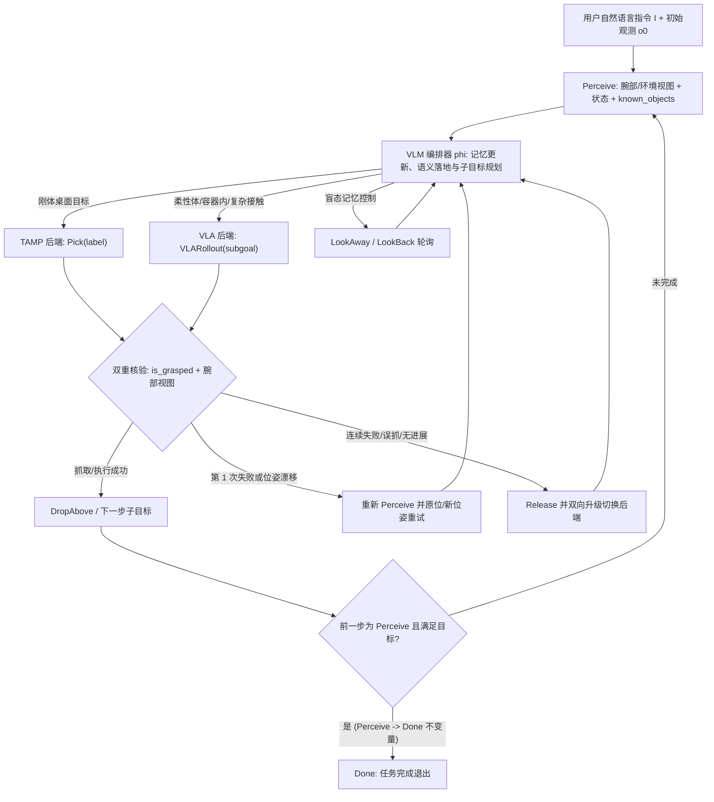
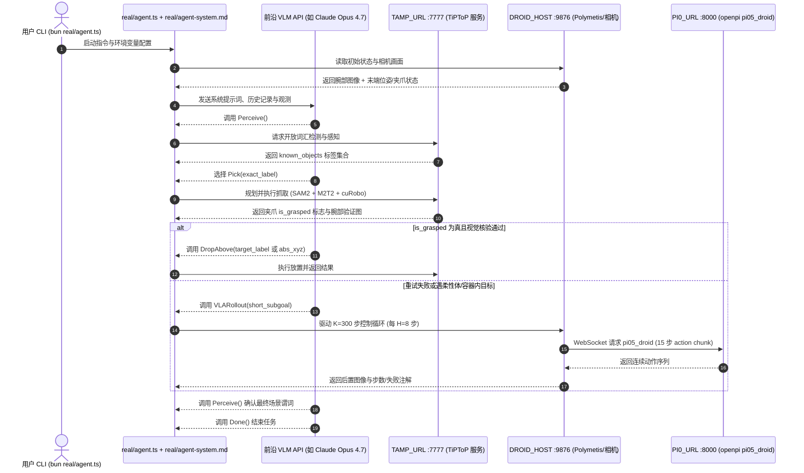

# Addressing the Orchestration Gap in Generalist Robots via Physical Agency

## 一句话定义

**Pigey**（Physical Agency）是一个面向通用机器人操作的**推理时闭环智能体编排器**：它不采集额外机器人数据也不微调底层策略权重，而是由前沿视觉语言模型（VLM）承担高层规划、子目标分解、技能路由、传感+视觉双重验证与异常恢复，调度冻结的运动规划器（TiPToP）与视觉-语言-动作策略（$\pi_{0.5}$）协同完成复杂推理操作任务。

## 英文缩写速查

| 缩写 | 英文全称 | 简要说明 |
|---|---|---|
| Pigey | Physical Agency | 本文提出的推理时闭环物理智能体编排框架 |
| VLA | Vision-Language-Action | 视觉-语言-动作策略模型，本文主要以冻结 $\pi_{0.5}$ 作为底层连续控制后端 |
| VLM | Vision-Language Model | 视觉语言模型，在 Pigey 中充当高层工具选择与状态核验推理器 |
| TAMP | Task and Motion Planning | 任务与运动规划，本文基于 TiPToP 构建可拆分验证的刚体抓取/放置后端 |
| DROID | Distributed Robot Interaction Dataset | 本文真机实验遵循的 Franka FR3 双相机桌面操作硬件与控制栈 |
| LIBERO-PRO | LIBERO Perturbed Robustness Benchmark | 本文用于评测物体、空间与目标扰动泛化性的仿真基准套件 |

## 为什么重要

现有通用机器人操作主要通过扩大遥操作演示数据规模来训练端到端 VLA 策略，但在实际指令（如“小孩要来了——把玩具放到盘子上，把不安全的物品放进盒子里”或“把除杯子外的所有东西放到盘子上”）中，策略失败往往不是因为底层抓放动作不会做，而是缺失常识推理、否定/条件逻辑、状态记忆、进度跟踪以及抓取滑脱后的失败恢复。作者将“冻结低层运动技能单独直接执行”与“将其放入闭环编排器内部执行”之间的成功率落差命名为 **编排鸿沟（Orchestration Gap）**，并证明在采集昂贵机器人数据去教策略“学会推理”之前，推理时编排循环就已经能释放冻结策略的大量潜在能力。

## 核心信息

| 字段 | 内容 |
|---|---|
| 作者 | Liane Galanti, Dhruv Shah, Tri Dao |
| 机构 | Princeton University, Together AI |
| 发表时间 | 2026-07-23（arXiv:2607.21725v1） |
| 论文链接 | [arXiv:2607.21725](https://arxiv.org/abs/2607.21725) / [arXiv HTML 全文](https://arxiv.org/html/2607.21725) |
| 项目与代码 | [GitHub: lianegalanti/Pigey](https://github.com/lianegalanti/Pigey) · [项目主页](https://lianegalanti.github.io/Pigey/) |
| 清单分类 | `harness.orchestration`（来源条目：`survey_ax_2607_21725`） |
| 开源状态 | **已开源**（公开 `real/agent.ts`、`real/agent-system.md` 真机编排与 `sim/agent_sim.py`、`sim/spatial_tools.py` 仿真编排；上游依赖 `openpi`、`tiptop`、`DROID`、`LIBERO-PRO` 均为公开仓库；仓库根目录未附带独立 LICENSE 文件） |

## 核心原理

### 1. 问题形式化与分层解耦

在标准端到端调用中，底层策略直接接收完整自然语言指令 $\pi(o, I)$；当 $I$ 包含抽象语义或长时程条件时，策略容易忽视关键约束。Pigey 将系统显式拆分为高层编排器 $\phi$ 与冻结低层后端 $\pi_b$：

$$\phi: \mathcal{O} \times \mathcal{H} \times \mathcal{I} \rightarrow \mathcal{T}, \qquad \pi_b: \mathcal{O} \times \mathcal{S} \rightarrow \mathcal{A}_{\mathrm{motor}},\ b \in \{\textsc{tamp}, \textsc{vla}\}$$

其中 $\mathcal{I}$ 为用户原始指令，$\mathcal{H}$ 为包含历史子目标、工具结果与物体状态的工作记忆，$\mathcal{T}$ 为离散工具调用集合，$\mathcal{S} \subset \mathcal{I}$ 为面向低层执行器的**短具体子目标**（如 `"put the red cup on the plate"`）。编排器 $\phi$ 自身从不输出连续关节或末端电机动作，仅在每轮决策中选择一个工具并在最大步数预算 $T_{\max}$ 内迭代闭环。

### 2. 观测通道与确定性失败注解

每步返回给编排器的观测定义为三元组 $o_t = (I_t^{\mathrm{ext}}, I_t^{\mathrm{wrist}}, x_t)$，包含第三视角 RGB、腕部相机 RGB 以及由控制器和日志生成的确定性文本注解 $x_t$。$x_t$ 包含末端执行器位姿、夹爪开度、基于夹爪宽度传感器判定的布尔值 `is_grasped`，以及结构化失败类型（无可用抓点 `no grasp found`、运动规划失败 `motion-planning failure`、不可达 `unreachable`、步数预算耗尽 `step-budget exhausted` 与丢帧提示）。同时，系统强制 `Pick`/`DropAbove` 的目标 `label` 必须精确取自最近一次 `Perceive` 返回的 `known_objects` 集合，防止 VLM 幻觉出未检测到的目标名称去诱导开放词汇检测器。

### 3. 双互补后端与闭环拆分

- **可验证 TAMP 后端（`Pick` / `DropAbove`）**：基于 [TiPToP](https://github.com/tiptop-robot/tiptop)（Gemini Robotics-ER 检测、SAM 2 分割、FoundationStereo 深度估计、M2T2 抓取预测、cuRobo/cuTAMP 规划）。原有 TiPToP 将整套抓取与放置打包为单个开环动作，一旦抓取偏移或滑脱仍会盲目执行放置。Pigey 将其拆为独立的两步工具，仅在 `Pick` 通过传感器与视觉验证成功后才发起 `DropAbove`（支持相对目标物体中心加偏置 `dx_m/dy_m` 或绝对世界坐标 `abs_x/abs_y/abs_z` 放置）。
- **冻结 VLA 后端（`VLARollout`）**：调用冻结的 $\pi_{0.5}$ 策略（真机为 $\pi_{0.5}$-DROID，仿真为 $\pi_{0.5}$-LIBERO）以闭环方式执行短子目标，每 $H=8$ 步生成长度为 15 的 action chunk，默认单次 rollout 运行 $K=300$ 个控制步（夹爪二值化并裁剪动作范围）。该后端主要负责线缆/布料等柔性体、容器内部或堆叠物体，以及 TAMP 失败后的升级接管。

### 4. 工具集、路由升级与防泄漏协议

真机环境提供 8 个 JSON 工具：`Perceive`、`Pick`、`DropAbove`、`VLARollout`、`Release`、`LookAway`、`LookBack` 与 `Done`；LIBERO-PRO 仿真环境提供 7 个工具：`Perceive`、`Grasp`、`Place`、`VLARollout`、`VerifyCandidate`（裁剪候选目标向 VLM 二次确认 `YES/NO/UNSURE`）、`GoHome` 与 `Release`。核心路由与恢复规则如下：

1. **双重验证（保守合并）**：只有当夹爪传感器 `is_grasped=true` 且腕部图像确认目标在夹爪内、桌面原位置已清空时，才认为抓取成功；若后端报告成功但传感器显示空爪，则强制覆盖为失败。
2. **先重试、再双向升级**：刚体表面物体优先走 `Pick`；首次未验证通过时先重新 `Perceive` 并在当前新位姿重试一次，第二次失败则升级至 `VLARollout`；反之若 `VLARollout` 无进展，也可切回重新感知后的 TAMP `Pick`。
3. **遮挡搜索与目标清理**：当目标不可见时（如被容器罩住），将可见容器视为遮挡物先移开再 `Perceive`；当目标容器被无关物体占用时先腾空再放置；误抓错误物体时用 `Release` 放回桌面而非目标位置。
4. **硬编码终止与盲区隔离不变量**：编排器在系统层拒绝任何紧邻前一步不是 `Perceive` 的 `Done` 调用；在长时程盲态恢复任务（LM1/LM2）中，`Perceive` 不返回第三视角图像，且 `LookAway` 将机械臂旋转约 180° 使腕部相机背向桌面，仅在通过 `LookBack(verify_only=true)` 轮询确认遮挡移开后才恢复观察，从物理和接口上杜绝提前偷看。

## 流程总览

## 源码运行时序图

官方仓库 `lianegalanti/Pigey` 提供了分别面向真实 Franka FR3 系统的 `real/agent.ts`（配合 `real/agent-system.md` 提示词）与面向 LIBERO-PRO 仿真的 `sim/agent_sim.py`（配合 `sim/spatial_tools.py` 解析式工具）；下图展示真机入口 `real/agent.ts` 经 HTTP/TCP/WebSocket 与上游服务交互的闭环执行时序。

## 实验与评测

作者在 **LIBERO-PRO** 仿真基准与 **DROID** 真机平台（Franka Research 3 + Robotiq 2F-85）上固定所有底层策略和规划器权重，仅改变推理时编排循环进行对比评测。

### 1. LIBERO-PRO 仿真基准（Table 2 & Table 15）

跨 6 个扰动套件（物体替换 `Obj swap`、物体任务扰动 `Obj task`、空间替换 `Sp swap`、空间任务扰动 `Sp task`、目标替换 `Goal swap`、目标任务扰动 `Goal task`），每任务评测 10 次（跨 9 个前沿 VLM 共约 5,400 次试验），底层均使用同一冻结 $\pi_{0.5}$-LIBERO 权重：

| 方法 / 推理器 | Obj swap | Obj task | Sp swap | Sp task | Goal swap | Goal task | 均值 (%) |
|---|---:|---:|---:|---:|---:|---:|---:|
| $\pi_0$-LIBERO | 0 | 0 | 0 | 0 | 0 | 0 | 0.0 |
| $\pi_{0.5}$-LIBERO（直接调用） | 17 | 1 | 20 | 1 | 38 | 0 | 12.8 |
| CaP-Agent0 | 22 | 18 | 12 | 14 | 26 | 17 | 18.2 |
| Pigey（GPT-5.5 low） | 44 | 26 | 52 | 74 | 42 | 28 | 44.3 |
| Pigey（Gemini 3.5 Flash） | 60 | 32 | 58 | 62 | 48 | 28 | 48.0 |
| Pigey（Gemini 3.1 Pro） | 64 | 34 | 60 | 68 | 44 | 22 | 48.7 |
| Pigey（GPT-5.5 high） | 60 | 36 | 60 | 74 | 38 | 26 | 49.0 |
| Pigey（Claude Sonnet 4.6） | 54 | 44 | 62 | 78 | 42 | 30 | 51.7 |
| **Pigey（Claude Opus 4.7）** | 54 | 54 | 66 | 80 | 44 | 22 | **53.3** |

在全部 9 个推理器（还包括 GPT-5.5 med 46.3%、Claude Haiku 4.5 47.7%、Gemini Rob-ER 1.6 48.0%）上，Pigey 均大幅超越未编排基线，说明增益主要源于闭环编排结构本身，推理器能力只决定增益幅度而非正负号。

### 2. DROID 真机 30 任务能力探针（Table 3 & Table 13）

真机共设计 8 类共 30 个任务、每任务 5 次试验（总计 150 次/方法，Pigey 使用 Claude Opus 4.7）：

| 能力探针类别 | 任务数 | $\pi_{0.5}$-DROID (%) | TiPToP (%) | Pigey (%) |
|---|---:|---:|---:|---:|
| Simple pick-place（基础抓放控制） | 4 | 95 | 80 | **100** |
| World knowledge（世界知识） | 4 | 0 | 90 | **100** |
| Conditional logic（条件/排他逻辑） | 4 | 0 | 95 | **100** |
| Multi-step reasoning（计数/堆叠/序列） | 4 | 0 | 25 | **100** |
| Spatial reasoning（空间/容量比较） | 4 | 20 | 75 | **100** |
| Obstacle/Safety reasoning（遮挡/清理/安全） | 4 | 0 | 0 | **90** |
| Error recovery（动态位移/扰动恢复） | 4 | 10 | 0 | **90** |
| Long-horizon memory（盲态还原/人手示教复现） | 2 | 0 | 0 | **100** |
| **Overall（150 次总成功率）** | **30** | **16.7** | **48.7** | **97.3** |

在推理受限的非基础控制探针上，原版 $\pi_{0.5}$-DROID 平均仅 4.6%，而同一权重在 Pigey 内达到 96.9%。其中遮挡包围抓取 `OB3`（3/5）、抓取中目标移走 `ER2`（4/5）与动态回退放置 `ER3`（4/5）构成了仅有的 4 次失败。

### 3. 首次失败模式分布（Table 14，150 次/方法）

| 首次失败模式 | $\pi_{0.5}$-DROID | TiPToP | Pigey |
|---|---:|---:|---:|
| Grounding（选错或随机目标） | 86 | 5 | 0 |
| Reasoning / planning（推理或规划错误） | 38 | 65 | 0 |
| Grasp（底层抓取执行失败） | 1 | 7 | 2 |
| Verifier false-success（验证器假阳性提前结束） | 0 | 0 | 2 |
| **总失败次数（/150）** | **125** | **77** | **4** |

## 与其他工作对比

1. **对比直接调用 VLA（[π0.5](paper-pi05-open-world-vla.md)）**：$\pi_{0.5}$ 在简单指令下可达 95% 成功率，但在同一场景下更换语义提示（如“素食者食物”“粘杯子的胶水”“除杯子外”）时几乎表现出提示词无关的固定动作（86/150 次为 grounding 失败）。Pigey 保持 $\pi_{0.5}$ 权重冻结，用 VLM 落地语义后再喂入短子目标，消除了 86 次 grounding 错误与 38 次规划错误。
2. **对比开环 TAMP（TiPToP）**：TiPToP 虽借助 Gemini Robotics-ER 解决了部分世界知识与条件选择，但因单次规划后盲目执行，甚至在简单抓放上仅获 80%（低于原始 VLA 的 95%），且无法处理多步排序、遮挡移除与执行中目标移动（65/150 次推理规划失败）。Pigey 拆开 `Pick` 与 `DropAbove` 并加入每次抓取前的重感知，使同一运动规划后端在真机多步与恢复类任务上达到 90%–100%。
3. **对比代码策略代理（CaP-Agent0）与专有推理/验证模块**：相比依赖手写符号原语或代码级动作空间的 CaP-Agent0（LIBERO-PRO 18.2%），Pigey 直接在真实相机像素上驱动学习型视觉策略，均值达 53.3%；相比需要额外训练高层规划器、思维链、记忆或奖励判别器的 Hi Robot、ECoT、MemER、RoboMonkey 与 Robometer（见论文 Table 1），Pigey 零新增训练即可同时提供显式可审计的上下文、状态、重试与验证闭环。

## 结论

**一句话总判：在扩大高成本机器人演示数据以强行提升端到端推理能力之前，推理时闭环编排（规划-路由-双重验证-恢复）已经能将同一冻结 VLA/TAMP 的任务成功率从“看似运动不行”抬升到其真实技能边界。**

1. **优先诊断瓶颈而非盲目采集数据** — 当 VLA 在未见指令上失败时，先用推理时编排循环测量“编排鸿沟”，区分究竟是底层接触控制受限还是高层接地、记忆与恢复缺失。
2. **把开环 TAMP 拆分为可验证工具** — 将 `Pick` 与 `DropAbove` 解耦并在中间插入 `is_grasped` 与腕部相机双重核验，能消除“抓空却继续去放”的级联失败。
3. **采用强约束的精确标签接口与防提前终止机制** — 强制工具参数只能引用最近一次 `Perceive` 返回的精确物体标签，并用硬约束要求 `Done` 前必须先执行 `Perceive`，显著减少检测幻觉与误判结束。
4. **混合互补后端优于单一范式** — 刚体桌面操作走几何精确的 TAMP，柔性体、容器内与重试失败升级到封闭视觉闭环的 $\pi_{0.5}$ VLA，二者双向兜底兼顾精度与鲁棒性。

## 工程实践

- **硬件与双机软件部署（Section 15）**：
  - 实时控制机（NUC）：运行 `PREEMPT_RT` 内核（6.8.0-rt8）与 `polymetis`（zerorpc 端口 `4242`、gRPC 端口 `50051`），驱动 Franka Research 3、Robotiq 2F-85 夹爪、两路第三视角 ZED-2i 与一路腕部 ZED-Mini 相机。
  - 推理工作站：AMD Ryzen 7 9800X3D + 32 GB RAM + 单张 RTX 5090 32 GB（Ubuntu 24.04 LTS）即可同时常驻 $\pi_{0.5}$-DROID（约 16 GB 显存）与 TiPToP 感知规划栈（FoundationStereo 约 8 GB 显存，加 SAM 2 / M2T2 / cuRobo）。
- **子目标提示词工程（Section 16）**：发送给 `VLARollout` 的子目标必须贴近 $\pi_{0.5}$ 训练分布（如 `"pick up the red cup"`），应避免附加修饰语或条件从句，否则会直接拉低策略执行率。
- **运行入口与成本边界（Section 18 & `README.md`）**：真机使用 `bun real/agent.ts "<instruction>"`（支持 `AGENT_MAX_STEPS`、`AGENT_FAIL_LIMIT`、`AGENT_LLM_TIMEOUT_MS` 等环境变量）；仿真使用 `python sim/agent_sim.py --mode harness ...` 经 LiteLLM 接入多厂商模型。单次真机试验通常耗时 2–6 分钟，调用 3–15 次 VLM API，单次推理成本约 $0.02–$0.50。

## 局限与风险

1. **受限于底层技能支持集**：Pigey 无法凭空创造底层 TAMP 或 VLA 完全不具备的灵巧接触能力，其能力上限受制于后端工具池的覆盖范围。
2. **部分可观测导致的验证器假阳性**：在被遮挡视角下，腕部图像可能误判物体已被抓稳或已达目标位姿（Table 14 中 Pigey 的 4 次失败有 2 次即来自 `verifier false-success`），并将错误状态延续至 `Done`。
3. **推理延迟与 API 成本约束**：每次工具决策需往返前沿 VLM API，单次任务耗时 2–6 分钟，不适用于毫秒级高频响应或高速动态接抛场景；仓库未提供标准开源协议文件，二次分发前需核查上游依赖许可。
4. **代码核对边界**：本页基于 arXiv 全文与仓库文档/入口清单完成静态核对，未在本地 Franka 硬件或 LIBERO-PRO 环境中实际复现运行。

## 关联页面

- [Agentic Robots 综述](paper-towards-agentic-robots-survey.md)
- [全量项目节点清单](../overview/awesome-agentic-robots-node-index.md)
- [VLA 方法背景](../methods/vla.md)
- [机器人智能体执行框架](../methods/robot-agent-harness.md)：对照规划、执行接口与反馈机制。
- [智能体操作策略](../methods/agentic-manipulation-policies.md)：高层语言推理与低层技能组合范式。
- [智能体工具调用接口](../methods/agent-tool-use-interface.md)：结构化 JSON Schema 工具约束与状态反馈。
- [智能体规划与反馈循环](../methods/agent-planning-feedback.md)：观察-验证-重规划闭环机制。
- [操作任务概述](../tasks/manipulation.md)
- [π0.5 论文实体](paper-pi05-open-world-vla.md)：本文低层 VLA 后端所依赖的冻结策略模型。

## 推荐继续阅读

- [arXiv:2607.21725 HTML 全文与完整附录（Prompt Template / Tool Schemas）](https://arxiv.org/html/2607.21725)
- [Pigey 官方项目主页（含未剪辑真机演示视频与轨迹回放）](https://lianegalanti.github.io/Pigey/)
- [Pigey 官方开源代码仓库（real/agent.ts 与 sim/agent_sim.py）](https://github.com/lianegalanti/Pigey)
- [TiPToP 官方仓库（本文 TAMP 后端基础）](https://github.com/tiptop-robot/tiptop)
- [openpi 官方仓库（π0.5 策略推理服务）](https://github.com/Physical-Intelligence/openpi)

## 参考来源

- [Pigey 论文源归档（arXiv:2607.21725 全文核对笔记）](../../sources/papers/paper-agentic-2607-21725.md)
- [官方 Awesome 快照归档](../../sources/repos/awesome-agentic-robots-survey-index.md)
- [lianegalanti/Pigey 官方仓库归档](../../sources/repos/paper-agentic-2607-21725.md)
- [论文官方入口 arXiv:2607.21725](https://arxiv.org/abs/2607.21725)
- [官方项目页面](https://lianegalanti.github.io/Pigey/)
