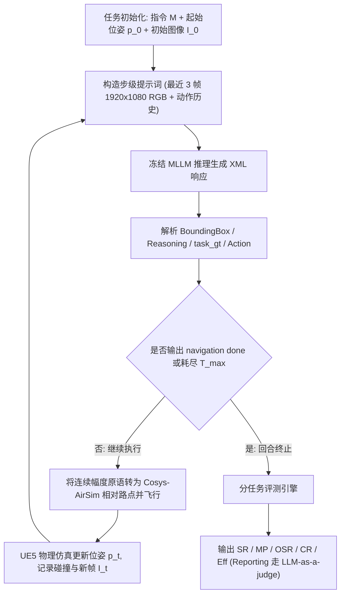
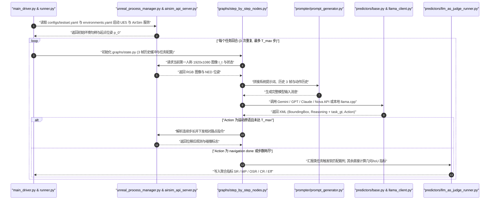

# Zero-Shot Mission-Level Evaluation for Aerial MLLM Agents

## 一句话定义

**MissionBench** 是一个面向冻结（frozen）、零样本通用多模态大语言模型（MLLM）的空中无人机闭环任务级评测基准，在 Unreal Engine 5 与 Cosys-AirSim 仿真的 5 类三维环境中包含 4 大类共 120 项长时程任务，评估智能体能否仅从单条自然语言高层指令与第一人称 RGB 观测自主完成规划、连续步长视角调整、物理执行与结果汇报。

## 英文缩写速查

| 缩写 | 英文全称 | 简要说明 |
|---|---|---|
| MLLM | Multimodal Large Language Model | 多模态大语言模型，在 MissionBench 中直接作为零样本闭环无人机控制与推理主体 |
| UAV | Unmanned Aerial Vehicle | 无人驾驶飞行器（无人机），对三维视角选择与避障高度敏感的空中具身载体 |
| VLN | Vision-Language Navigation | 视觉-语言导航，传统基准多提供分步路径指令并仅以到达距离阈值判成功 |
| SR | Success Rate | 任务成功率，按汇报、巡检、操作、巡逻四类任务各自的完成准则汇总 |
| OSR | Oracle Success Rate | 先知成功率，记录智能体在回合任意时刻是否曾进入目标 5 m 范围内 |
| MP | Mission Progress | 连续任务进度指标，衡量朝目标净缩短的相对距离比例或巡逻轨迹 IoU |
| CR | Collision Rate | 碰撞率，记录回合中无人机发生物理碰撞的动作步数比例 |
| Eff | Step Efficiency | 步数效率（$1 - T_{\text{used}}/T_{\max}$），用于区分早停、兜圈耗尽预算与高效完成 |

## 为什么重要

1. **填补“逐步路书导航”与“孤立感知子技能”之间的评测鸿沟：** 既往空中视觉-语言基准（如 AerialVLN、AVDN、OpenFly）多依赖分步路径指令或离散步长，且只检查是否抵达目标距离阈值；另一类基准（如 AeroVerse、SpatialRGPT）则脱离闭环控制单独评测静态空间问答，无法暴露感知、规划与报告误差在长时程闭环中的级联放大。
2. **引入视角敏感的 4-DoF 连续步长控制与任务结果汇报：** 空中巡检与侦察往往需要从高空远景逐步抵近并调整俯仰/偏航对准细节（如读取车牌、识别火情或空投定位），固定步长原语会限制视角微调。MissionBench 让 MLLM 在 8 种运动原语下同时预测连续运动幅度并输出文本报告，直接检验“看懂—飞到位—再确认—准确汇报”的闭环能力。
3. **量化通用模型规模扩展带来的能力收益与部署边界：** 在未做空中微调的前提下测试 22 个开闭源 MLLM，一方面验证模型规模与代际升级确实带来零样本具身能力提升（如 Gemini 3.1 Pro 达到 34.8% SR），另一方面证明静态单帧感知精度与端到端任务成功率仅呈弱到中等相关（$r_{\text{mIoU,MP}}=0.463$），且距离人类 70.0%–84.4% 的水平仍有显著差距。

## 核心信息

| 字段 | 内容 |
|---|---|
| 作者 | Suman Navaratnarajah, Taehyoung Kim, Jona Ruthardt, Ishaan Bhimwal, Ryousuke Yamada, Yannik Blei, Wolfram Burgard, Yuki M. Asano |
| 机构 | University of Technology Nuremberg（UTN）、Fraunhofer IVI、THWS、产业技术综合研究所（AIST） |
| 发表时间 | arXiv:2607.22014v1（2026-07-24 提交） |
| 论文链接 | [arXiv:2607.22014](https://arxiv.org/abs/2607.22014) · [arXiv HTML 全文](https://arxiv.org/html/2607.22014) |
| 项目与代码 | [GitHub: FraunhoferIVI/MissionBench](https://github.com/FraunhoferIVI/MissionBench) · [项目主页](https://gomtae.github.io/publications/missionbench) |
| 清单分类 | `environment.benchmarking` |
| 来源条目 | `survey_ax_2607_22014` |
| 开源状态 | **已开源**（仓库以 CC-BY-4.0 开源闭环评测框架、`main_driver.py`、`airsim_api_server.py`、LangGraph 状态机、提示词及 YAML 配置；120 条任务对应的打包 UE5/Cosys-AirSim 环境二进制在首次运行按配置自动下载） |

## 核心原理

### 1. 闭环任务建模与 4-DoF 动作空间（§3.1, Appendix D.3）

在每个回合初始时刻，冻结的 MLLM 智能体接收单条自然语言任务指令 $\mathcal{M}$、无人机初始 NED 坐标系位姿 $\mathbf{p}_0 = (x_0, y_0, z_0, \psi_0)$ 以及初始第一人称 RGB 图像 $I_0$。起始位姿由人工精心设定，确保目标或部分线索在初始画面中部分可见，但关键细节（如高空俯瞰下的车牌字符或林间烟雾源头）在当前视角下无法直接完成任务，迫使智能体主动规划接近路径与观测姿态。

在每一步 $t$，智能体接收当前图像 $I_t$、至多前两帧历史图像（共 3 帧 $1920 \times 1080$、水平 FOV $90^\circ$、固定相机俯仰角 $-45^\circ$）、当前位姿与已用步数及过去动作历史，并输出严格 XML 格式的结构化响应：

1. **`<BoundingBox>`**：归一化 $[0, 1000]$ 坐标目标框与估计深度（米），用作显式空间定位引导（终局指标不直接评测该框，但消融证明其显著影响成功率）。
2. **`<Reasoning>`**：当前视角分析、下一步动机及距离/角度估计，末尾须附 `task_gt: <value>`（汇报类任务给出提取结果，其余给出 `N/A` 或任务完成标识如 `drop` / `patrol complete`）。
3. **`<Action>`**：从 8 个相对运动原语（`move_forward`、`move_backward`、`strafe_left`、`strafe_right`、`move_up`、`move_down`、`turn_left`、`turn_right`）中任选 1 个并给出连续数值幅度，或输出 `navigation done` 结束回合。单步最大平移距离 $d_{\max}$ 自动设为起点至参考终点欧氏距离的 $1/4$，最大转向角为 $3 \times d_{\max}$ 度（提示词约束上限 $60^\circ$）；最大步数预算 $T_{\max}$ 在巡逻任务为 $50$ 步，其余为 $20$ 步。

### 2. 四类任务家族与五大仿真场景（§3.2–§3.3, Appendix C）

- **五大高保真场景：** 基于 Unreal Engine 5 与 Cosys-AirSim 构建与扩展，包括 `Neighborhood`（N）、`City`（C）、`Forest`（F，Unreal Fab 资产从零搭建）、`Savannah`（S）及 `AirSimNH`（NH）。参考人类飞手轨迹长度跨度 13 m 至 4,171 m，中位数 93 m，均值 260 m。
- **四类任务与 120 条数据集拆分（Table 2）：**
  - **Reporting（57 条）：** 侦察与信息提取（读车牌/路牌、计数、属性识别），通过 `Gemini-3-flash-preview` 担任 LLM-as-a-judge 对 $\mathcal{R}$ 做语义软匹配判定成功（150 条人工抽检上 Precision 1.00、Recall 0.94）。
  - **Inspection（38 条）：** 基础设施巡检与搜救定位，需抵达满足位置误差 $\|\mathbf{p}_i - \mathbf{p}^*\| < 5\text{ m}$ 且航向误差 $|\psi_i - \psi^*| < 15^\circ$ 的观测姿态。
  - **Manipulation（16 条）：** 降落、空投或采样，除满足位姿阈值外还需正确触发对应动作指令。
  - **Patrol（9 条）：** 沿道路、海岸线或设施边界巡逻，将预测轨迹 $\hat{\tau}$ 与参考轨迹 $\tau^*$ 均重采样为 $N=100$ 段并各自施加 $r=20\text{ m}$ 平面缓冲区，计算交并比：
    $$\text{IoU}_{\text{patrol}} = \frac{|\mathcal{B}(\tau^*, r) \cap \mathcal{B}(\hat{\tau}, r)|}{|\mathcal{B}(\tau^*, r) \cup \mathcal{B}(\hat{\tau}, r)|}$$
    以 $\text{IoU}_{\text{patrol}} > 0.5$ 判定巡逻成功。

### 3. 解耦诊断指标体系（§3.4）

除了二值任务成功率 $\text{SR}$ 外，基准通过四项辅助指标解耦失败成因：先知成功率 $\text{OSR}$（任意步是否曾进入目标 5 m 半径，用于对比 $\text{OSR} \gg \text{SR}$ 暴露的“飞到却未看清/未汇报”问题）、连续任务进度 $\text{MP} = \max\bigl(0, \sum_{t=1}^{T}(d_{t-1}-d_t)/d_0\bigr)$（巡逻任务直接取 $\text{IoU}_{\text{patrol}}$）、步数效率 $\text{Eff} = 1 - T_{\text{used}}/T_{\max}$ 以及碰撞率 $\text{CR}$。

## 流程总览

## 源码运行时序图

`FraunhoferIVI/MissionBench` 以 `main_driver.py` 为命令行驱动入口，通过 `experiment_automation/runner.py` 与 `simulator_interface/unreal_process_manager.py` 拉起打包的 UE5 场景及独立的 `airsim_api_server.py` HTTP 桥接服务，再调用 `graphs/` 中的 LangGraph 状态机逐回合循环驱动 `prompter/prompt_generator.py` 与 `predictors/` 多模态客户端（静态代码核对，未本地运行）：

## 实验与评测

论文将 120 条任务拆分为 **Proxy**（10 条，Neighborhood，单帧感知对比）、**Ablation**（5 条，Proxy 子集，框架消融）、**Test**（30 条：17 Reporting / 7 Inspection / 3 Manipulation / 3 Patrol，跨 N/F/C 三环境，主评测）与 **Held-out**（80 条，预留微调）。Test 集上共评测 **22 个冻结 MLLM**（温度 $T=0.7$，每任务重复 3 次取均值），部分代表性结果如下（Table 3, Table B5）：

| 模型 / 基线 | SR (%) ↑ | MP ↑ | OSR (%) ↑ | CR (%) ↓ | Eff (%) ↑ |
|---|---|---|---|---|---|
| Human baseline (keyboard control, $N=3$) | **84.4** | **94.2** | 51.1 | 0.0 | — |
| Human baseline (VLM interface, $N=2$) | 70.0 | 79.0 | 36.7 | 0.1 | 36.0 |
| **Gemini 3.1 Pro** | **34.8** | **73.3** | 17.2 | 4.3 | **53.6** |
| **Gemini Robotics 1.6** | 32.2 | 70.3 | 17.8 | **0.1** | 24.2 |
| **Gemma-4-31B-IT** | 26.7 | 59.3 | 11.1 | 1.6 | 13.6 |
| Qwen 3.5 27B | 10.0 | 53.2 | 8.9 | 0.0 | 16.7 |
| Gemini 2.5 Pro | 8.9 | 54.2 | 14.4 | 2.9 | 18.2 |
| Gemini 3 Flash | 7.9 | 54.0 | 20.2 | 4.9 | 30.8 |
| Qwen 3.6 35B-A3B-Q8 | 7.9 | 41.5 | 7.9 | 0.2 | 29.5 |
| Claude Sonnet 4.6 | 4.7 | 31.2 | 7.1 | 2.0 | 30.2 |
| Claude Opus 4.6 | 3.3 | 18.9 | 10.0 | 4.7 | 16.6 |
| GPT-5.4 | 2.0 | 45.0 | 0.0 | 4.0 | 17.9 |
| Nova Premier | 1.1 | 15.0 | 5.6 | 1.7 | 17.0 |
| Gemini Robotics 1.5 | 0.0 | 35.9 | 6.9 | 5.8 | 32.1 |
| Random baseline | 0.0 | 5.7 | 3.3 | 0.1 | 64.8 |

关键分析与消融结论（§4.2–§4.5, Appendix B–D）：

1. **分任务表现极不均衡（Table B5）：** Gemini 3.1 Pro 在 Reporting（17 题）达到 48.0% SR / 79.0 MP、Patrol（3 题）达到 33.3% SR / 42.5 MP、Inspection（7 题）19.0% SR / 67.4 MP，而在 Manipulation（3 题）SR 为 **0.0%**（尽管 MP 达 86.4，表明已接近但无法满足最终 5 m / $15^\circ$ 对齐与触发条件）。Qwen 3.5 27B 除 Reporting（17.6% SR）外其余三类 SR 均为 0.0%。
2. **家族内缩放增益与非单调性：** 在 Qwen 3.5 稠密系列中，2B → 4B → 9B → 27B 使 MP 从 18.1 稳步升至 53.2、SR 从 0.0% 升至 10.0%；Gemini 3.1 Pro（73.3 MP）亦大幅高于 Flash Lite（24.0 MP）。但趋势并非绝对单调：Claude Sonnet 4.6（4.7% SR / 31.2 MP）优于 Opus 4.6（3.3% SR / 18.9 MP），且 Qwen 3.6 27B（5.6% SR）低于 Qwen 3.5 27B（10.0% SR）。
3. **单帧感知代理与端到端表现弱相关（Table B1）：** 在 10 条 Proxy 任务上，单帧目标框 mIoU、距离 RMSE 与 MissionBench MP 的皮尔逊相关系数分别为 $r_{\text{mIoU,MP}} = 0.463$、$r_{\text{RMSE,MP}} = -0.315$。Claude Opus 4.6 测距 RMSE 最低（10.7 m）却在全任务中表现不佳（18.9 MP），而 Gemini 2.5 Pro 的单帧 mIoU 仅 0.01 仍取得 54.2 MP。
4. **失败模式呈模型分化（Table B4）：** GPT-5.4 的失败主要源于闭环控制不收敛导致的 **Drift and Oscillation**（36.6%）；Gemini 3 Flash 则主要死于 **Unmet Mission Objectives**（28.9%，到达附近却漏检或错报，对应 $\text{OSR}=20.2\% \gg \text{SR}=7.9\%$）、**Altitude / Align Failure**（24.4%）与 **Premature Termination**（14.4%）。
5. **框架设计消融（Table 4, Gemini 3 Flash on 5-mission Ablation split）：** 默认配置（$T=0.7$、FHD $1920\times 1080$、3 帧历史、含 BBox 与 Reasoning）取得 57.1% SR / 68.4 MP。移除 `<Reasoning>` 后 SR 暴跌至 20.0%（MP 58.9）；移除 `<BoundingBox>` 使 SR 降至 42.9%（MP 70.2）；历史缩为 1 帧降至 28.6% SR / 33.1 MP，扩至 5 帧同样因冗余信息稀释降至 30.8% SR（MP 69.6）；输入降至 SD $640\times 480$ 时 MP 为 75.3 但 SR 跌至 42.9%。

## 与其他工作对比

论文 Table 1 系统对比了 MissionBench 与既往空中视觉-语言导航及任务基准：

| 基准 | 任务范式 | 纯 RGB | 动作空间 | 自由度 (DoF) | 需自主选视角 | 成功判据 | 覆盖任务（Rep / Insp / Manip / Patrol） | 仿真底座 |
|---|---|---|---|---|---|---|---|---|
| **MissionBench（本文）** | Mission（单条高层指令） | **是** | **连续步长** | 4 | **是** | 任务完成度 | **全覆盖（4/4）** | **UE5 + Cosys-AirSim** |
| BEDI (2026) | Mission（分层子环） | 是 | 离散 / 路点 | 4 | 是 | 分层子环 | 仅 Insp / Manip（2/4） | AirSim + UE4 |
| ESARBench (2026) | Mission（搜救） | 否 | 离散 / 路点 | 4 | 否 | 任务完成 | 仅 Insp（1/4） | AirSim + UE5 |
| FlySearch (2025) | ObjNav | 是 | 连续步长 | 3 | 否 | 目标距离 | 无 | UnrealCV + UE5 |
| UAV-ON (2025) | ObjNav | 否 | 连续步长 | 4 | 否 | 目标距离 | 无 | AirSim + UE |
| OpenFly (2025) | Route（逐步路书） | 是 | 离散原语 | 4 | 否 | 目标距离 | 无 | AirSim / GTAV / 3DGS |
| CityNav (2025) | Goal（终点） | 否 | 离散原语 | 4 | 否 | 目标距离 | 无 | SensatUrban + Potree |
| OpenUAV (2025) | Route（逐步路书） | 否 | 路点 | 6 | 否 | 目标距离 | 无 | AirSim + UE4 |
| AerialVLN / AVDN | Route（逐步路书） | 否 / 是 | 离散 / 路点 | 4 / 3 | 否 | 目标距离 | 无 | AirSim + UE4 / xView |

## 结论

**一句话总判：MissionBench 通过高保真闭环仿真、连续步长 4-DoF 视角控制与结果导向的分任务评测，证明通用 MLLM 虽能随规模扩展涌现零样本空中规划潜力（34.8% SR），但距离人类级可靠闭环执行（84.4% SR）仍存在巨大鸿沟，且单帧感知精度不足以决定长程任务成败。**

1. **单帧空间定位不是唯一瓶颈，闭环序贯控制与多步对齐才是核心短板：** 感知代理与端到端进展相关性有限（$r_{\text{mIoU,MP}}=0.463$），大量失败集中于到达目标 5 m 附近后的振荡、过早结束或未能对齐细节视角（$\text{OSR} \gg \text{SR}$）。
2. **结构化推理标签与适中历史窗口显著决定成功率：** 在 5 任务消融中，去掉 `<Reasoning>` 会使 SR 从 57.1% 跌至 20.0%；视觉历史维持 3 帧 FHD（1920×1080）最平衡，1 帧丢失进度记忆，5 帧则会稀释近期关键观测。
3. **评测与调优必须采用多次运行统计：** 同一模型不同随机种子在 MissionBench 上方差较大（如 Gemini 3.1 Pro 在 Test 集 3 次运行 SR 标准差达 $\pm 13.5\%$，Gemini 3 Flash 在消融集 5 次运行 SR 标准差达 $\pm 17.9\%$），单次采样极易误判真实能力。
4. **汇报类任务的开放式答案评测需要语义裁判：** 精确字符串匹配因空格、连字符或同义表述导致召回率仅 0.44，用经过抽样校验的 `LLM-as-a-judge`（Precision 1.00 / Recall 0.94）能更真实反映视觉信息提取能力。

## 工程实践

- **硬件与环境准备：** 官方仓库推荐在 **Ubuntu 22/24**（Vulkan 1.3.275）、i7 12代+ CPU、NVIDIA RTX 3050（4 GB+ 显存）、16 GB+ 内存与 **至少 250 GB 可用磁盘** 上部署；执行 `./env_setup.sh` 自动分离安装仿真接口环境 `airsim_env` 与推理驱动环境 `missionbench_env`（Python 3.10.12）。
- **验证链路与算力成本控制：** 建议先以 `python main_driver.py --config_file configs/unit_testset.yaml` 跑通 3 场景各 1 条单元测试再运行完整 `configs/testset.yaml`。因每步需传入 3 张 $1920 \times 1080$ 图像，完整 Test 集（30 任务 × 3 次）约消耗 **12.8M 输入 token 与 0.3M 输出 token**，闭源商业 API 单模型成本约 $19.2–$71.9（Table D7），本地开源模型（如 Gemma-4-31B-IT、Qwen 3.5/3.6）可通过 `predictors/llama_client.py` 接入 `llama.cpp` 服务运行。
- **提示词与安全保护边界：** 系统提示词显式要求保持目标在视野内、禁止相反动作连续振荡、近距（$<5\text{ m}$）限制在 1–2 m 小步长、维持高度距地 $\ge 1\text{ m}$ 并禁止输出绝对 GPS 坐标；但在实机迁移前必须注意，仿真中碰撞仅记录 CR 而不中断回合，且 3 张高分辨率视觉输入与云端 API 延迟完全不满足实时机载闭环安全要求。

## 局限与风险

1. **Sim-to-Real 鸿沟与静态环境假设：** 虽然基于 UE5 + Cosys-AirSim，但场景缺少真实传感器噪声、风扰、动态障碍物及对抗性干扰，仿真得分不能等同于真实飞行安全性与可部署性（论文 Appendix A.1–A.2）。
2. **任务类型数量分布不均：** 全库 120 条任务中 Reporting（57）与 Inspection（38）占主导，而 Manipulation（16）与 Patrol（9）数量较少，Test 集中 Manipulation 与 Patrol 各仅 3 条，导致这两类的跨模型统计稳定性相对受限。
3. **固定输入接口限制人类与模型上限：** 3 帧历史、固定 $-45^\circ$ 俯仰角及文本单步指令本身即会制约执行效率——人类飞手从键盘连续控制（84.4% SR）切到相同 VLM 接口后成功率即降至 70.0%。
4. **未覆盖动态机载算力约束与受控微调评测：** 论文当前主要评测冻结零样本闭源/开源 MLLM，80 条 Held-out 划分留待未来领域微调研究；此外依赖大参数量云端推理与高分辨率图像吞吐，存在明显延迟、断联与失控能力涌现风险。

## 关联页面

- [具身大模型评测基准选型闭环](../queries/embodied-eval-benchmark-selection-loop.md)：对照评测基准设计与指标选型闭环。
- [Agentic Robots 综述](paper-towards-agentic-robots-survey.md)
- [全量项目节点清单](../overview/awesome-agentic-robots-node-index.md)
- [VLA 方法背景](../methods/vla.md)
- [具身智能体评测方法](../methods/embodied-agent-benchmarking.md)：对照任务设置、接口与评估指标。
- [机器人仿真集成](../methods/robot-simulation-integration.md)：Unreal Engine 5 与 Cosys-AirSim 物理及视觉仿真管线背景。
- [机器人导航工作流](../methods/robot-navigation-workflow.md)：闭环感知—决策—路点执行系统架构参考。
- [智能体规划与执行反馈](../methods/agent-planning-feedback.md)：多步闭环重规划、状态历史与防振荡纠偏机制。
- [视觉-语言导航（VLN）](../tasks/vision-language-navigation.md)：传统逐步路径导航任务与 MissionBench 任务级设定的对比基线。
- [零样本目标导航（Zero-Shot Object Navigation）](../tasks/zero-shot-object-navigation.md)：无需特定任务微调的目标定位与视角主动探索背景。

## 推荐继续阅读

- [MissionBench 原论文 arXiv HTML 全文（2607.22014v1）](https://arxiv.org/html/2607.22014)
- [MissionBench 官方开源代码仓库（FraunhoferIVI/MissionBench）](https://github.com/FraunhoferIVI/MissionBench)
- [MissionBench 官方项目主页](https://gomtae.github.io/publications/missionbench)

## 参考来源

- [MissionBench 论文原文核对归档](../../sources/papers/paper-agentic-2607-22014.md)
- [MissionBench 官方代码仓库核查归档](../../sources/repos/paper-agentic-2607-22014.md)
- [Awesome-Agentic-Robots 官方索引归档](../../sources/repos/awesome-agentic-robots-survey-index.md)
- [arXiv:2607.22014 官方摘要与原文入口](https://arxiv.org/abs/2607.22014)
- [GitHub: FraunhoferIVI/MissionBench](https://github.com/FraunhoferIVI/MissionBench)
