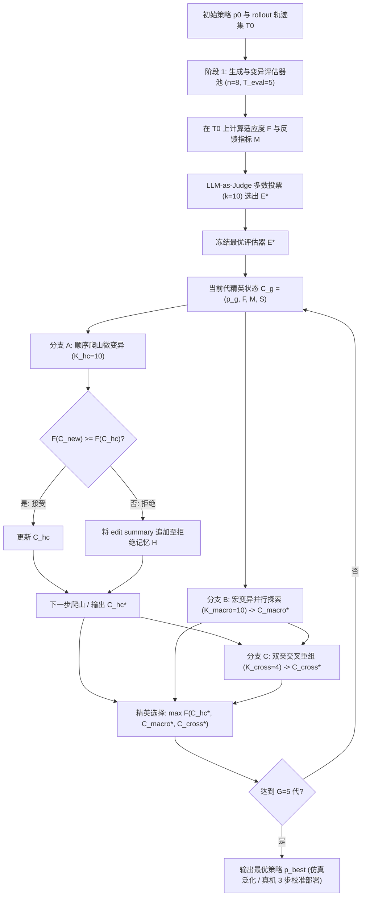
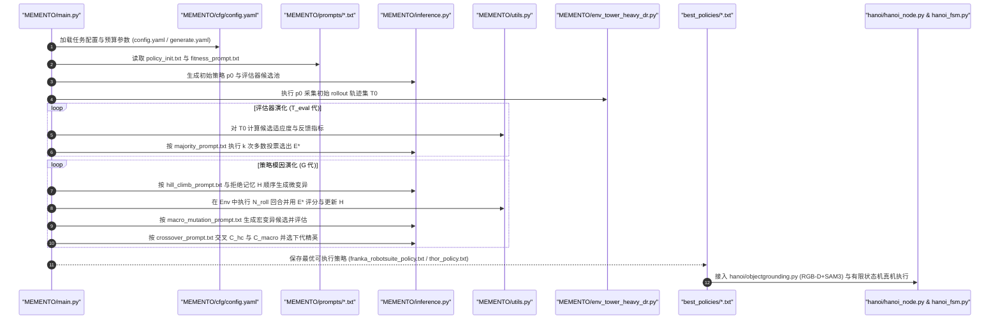

# MEMENTO: Memory-Guided Memetic Code-as-Policy Evolution

## 一句话定义

MEMENTO 是一种用于长时域具身控制任务的记忆引导单精英模因（Memetic）策略代码演化框架：它先演化一个输出标量适应度与结构化反馈指标的固定回合评估器，再在该评估器指导下以“带拒绝记忆的顺序爬山局部搜索 + 宏变异 + 交叉重组”联合演化可执行 Python 控制程序。

## 英文缩写速查

| 缩写 | 英文全称 | 简要说明 |
|---|---|---|
| CaP | Code-as-Policy | 策略即代码，将具身控制决策逻辑表示为可检查、可执行的控制程序 |
| LLM | Large Language Model | 大语言模型，在 MEMENTO 中承担评估器多数投票裁判与策略/评估器代码变体提议（实验采用 GPT-5.2） |
| POMDP | Partially Observable Markov Decision Process | 部分可观测马尔可夫决策过程，用于形式化包含观测受限与状态依赖的有限时域序贯决策问题 |
| DR | Domain Randomization | 域随机化，通过在仿真中随机扰动摩擦、质量、观测噪声与偏置提升演化代码策略的真机鲁棒性 |
| SAC+HER | Soft Actor-Critic with Hindsight Experience Replay | 柔性演员-评论家结合后见经验回放，本文用作 Robosuite 连续控制强化学习对比基线 |
| FSM | Finite-State Machine | 有限状态机，演化出的 Robosuite/Franka 策略通过显式状态机组织抓取、校验、放置与局部重试 |

## 为什么重要

1. **解决长时域稀疏反馈下的“策略代码定位改写”难题**：在需要连续执行十余个强依赖动作的具身任务中，仅靠回合末二值成功指示 $\sigma(\tau)\in\{0,1\}$ 无法指示程序哪一部分逻辑出错，而人工为长时域任务手写密集阶段性反馈指标成本高、易漏掉瓶颈。
2. **补齐已有 LLM 演化框架缺少局部精炼与失败记忆的短板**：以往用于奖励或策略搜索的 LLM 演化方法（如 Eureka、REvolve）主要在独立采样的候选之间择优，既不会沿着已接受候选做顺序微调（local search），也不会记录失败的改动历史，容易在局部缺陷上反复试错。
3. **验证可执行代码策略的强结构泛化与低成本 Sim-to-Real 潜力**：演化出的程序基于对象中心状态与闭环几何校验，而非过拟合立方体接触动力学或单一厨房布局；配合 3 步物理常数校准即可迁移到真实 Franka 机械臂（10 次试验成功 9 次）。

## 核心信息

| 字段 | 内容 |
|---|---|
| 作者 | Alkis Sygkounas, Victor Aregbede, Amy Loutfi, Andreas Persson |
| 机构 | Center for Applied Autonomous Sensor Systems (AASS), Örebro University（瑞典）；Linköping University（瑞典） |
| 发表时间 | arXiv:2607.22832v1（2026-07-24 提交） |
| 论文链接 | [arXiv:2607.22832](https://arxiv.org/abs/2607.22832) · [HTML 全文](https://arxiv.org/html/2607.22832) |
| 项目与代码 | [GitHub（sygkounas/MEMENTO）](https://github.com/sygkounas/MEMENTO) |
| 清单分类 | `model.robot_control, harness.skills` |
| 来源条目 | `survey_ax_2607_22832` |
| 开源状态 | **已开源**（公开提供演化搜索主代码 `MEMENTO/`、Prompt 模板 `MEMENTO/prompts/`、配置 `MEMENTO/cfg/`、最优策略文本 `best_policies/`、物理 Franka 部署模块 `hanoi/` 及演示视频；仓库元数据未标明开源协议） |

## 核心原理

MEMENTO 将任务建模为有限时域 POMDP $\mathcal{M}_{\mathrm{PO}} = (\mathcal{S},\mathcal{A},\mathcal{O},T,Z,R,\rho_0,L)$，但不直接优化环境奖励 $R$，而是在可执行程序空间 $\mathcal{P}$ 上搜索带内部状态 $z_t \in \mathcal{Z}_p$ 的确定性策略 $(a_t, z_{t+1}) = p(o_t, z_t)$。给定 $N_{\mathrm{roll}}$ 次回合轨迹 $\mathcal{T}_{N_{\mathrm{roll}}}(p)$，固定评估器 $E^\star$ 将其映射为：

$$E^\star\!\left(\mathcal{T}_{N_{\mathrm{roll}}}(p)\right) = \bigl(F(p), \mathbf{M}(p)\bigr), \qquad S(p)=\frac{1}{N_{\mathrm{roll}}}\sum_{e=1}^{N_{\mathrm{roll}}}\sigma(\tau_e(p))$$

其中 $F(p)\in[0,1]$ 为标量聚合适应度（用于选择与精英更新），$\mathbf{M}(p)$ 为结构化回合反馈指标（用于条件化后续 LLM 代码改写），任务成功率 $S(p)$ 仅作记录，不直接参与搜索选择。

### 1. 阶段一：评估器演化（Evaluator Evolution）
在搜索策略前，先将初始策略 $p_0$ 执行 $N_{\mathrm{roll}}=10$ 回合，采集固定轨迹集 $\mathcal{T}_0$ 与基线成功率 $S_0$。随后运行 $T_{\mathrm{eval}}=5$ 代评估器演化（每代候选池大小 $n=8$）：
- 候选评估器 $E_i^{(j)}$ 作用于同一轨迹集 $\mathcal{T}_0$，产出 $(F_i^{(j)}(p_0), \mathbf{M}_i^{(j)}(p_0))$。
- 通过 **LLM-as-judge 多数投票**（$k=10$ 次独立判断）对候选池 $\mathcal{D}_i$ 排序，选出本代最优评估器 $E_i^\star = \mathcal{V}_k(\mathcal{D}_i)$，再经评估器宏变异 $q_{\mathrm{eval}}^{\mathrm{macro}}$ 生成下一代池，最终冻结 $E^\star = E_{T_{\mathrm{eval}}-1}^\star$。
- 实际演化出的评估器结合了阶段进度分、里程碑时间、交互质量与违规惩罚：例如 Robosuite 中按接近 $A_t$、抓举 $G_t$、搬运 $T_t$、放置 $L_t$、排列 $R_t$ 及非法叠放惩罚 $U_t$ 组合逐帧得分并融合时均/峰值/终态分；AI2-THOR 中综合目标可见度、状态谓词进展、有效交互 $Q_{\mathrm{int}}$、阻塞惩罚 $C_{\mathrm{blocked}}$ 与滞留惩罚 $C_{\mathrm{carry}}$ 并设定里程碑下界。

### 2. 阶段二：记忆引导的单精英模因策略演化
在固定 $E^\star$ 下，从 $\mathcal{C}_0 = \mathcal{C}(p_0)$ 出发迭代 $G=5$ 代，每代预算 $B = K_{\mathrm{hc}}+K_{\mathrm{macro}}+K_{\mathrm{cross}} = 24$ 个新候选，围绕当前代精英 $\mathcal{C}_g = (p_g, F(p_g), \mathbf{M}(p_g), S(p_g))$ 并行组织三大分支：
1. **带拒绝记忆的顺序爬山分支（Hill-climb，$K_{\mathrm{hc}}=10$）**：初始化 $\mathcal{C}_{g,0}^{\mathrm{hc}} = \mathcal{C}_g$ 与空拒绝记忆 $\mathcal{H}_{g,0}=\emptyset$。每步采样微变异 $p_{g,h}^{\mathrm{new}} \sim q_{\mathrm{hc}}(\mathcal{C}_{g,h-1}^{\mathrm{hc}}, \mathcal{H}_{g,h-1})$；若 $F(\mathcal{C}_{g,h}^{\mathrm{new}}) \ge F(\mathcal{C}_{g,h-1}^{\mathrm{hc}})$ 则接受更新，否则将该候选内嵌的修改摘要 $\mathrm{history}(p_{g,h}^{\mathrm{new}})$ 追加到 $\mathcal{H}_{g,h}$，在同代内避免重复无效局部修改。
2. **宏变异分支（Macro-mutation，$K_{\mathrm{macro}}=10$）**：从 $\mathcal{C}_g$ 独立采样较大结构改写 $p_{g,u}^{\mathrm{macro}} \sim q_{\mathrm{macro}}(\mathcal{C}_g)$，在 $\mathcal{C}_g$ 与所有变异体中取最高适应度作为 $\mathcal{C}_g^{\mathrm{macro}}$。
3. **交叉重组分支（Crossover，$K_{\mathrm{cross}}=4$）**：联合条件化 $\mathcal{C}_g^{\mathrm{hc}}$（局部精炼产物）与 $\mathcal{C}_g^{\mathrm{macro}}$（结构探索产物）生成 $p_{g,r}^{\mathrm{cross}} \sim q_{\mathrm{cross}}(\mathcal{C}_g^{\mathrm{hc}}, \mathcal{C}_g^{\mathrm{macro}})$，择优得到 $\mathcal{C}_g^{\mathrm{cross}}$。
4. **精英选择（Elitist Selection）**：下一代精英为 $\mathcal{C}_{g+1} = \arg\max_{\mathcal{C}\in\{\mathcal{C}_g^{\mathrm{hc}}, \mathcal{C}_g^{\mathrm{macro}}, \mathcal{C}_g^{\mathrm{cross}}\}} F(\mathcal{C})$。

### 3. 真机迁移与精简校准
在物理 Franka 部署中，保持最优演化程序 $p_{\mathrm{best}}$ 的符号化 15 步 Hanoi 调度与闭环状态机不变，仅将仿真状态替换为 **RGB-D + SAM3 分割** 物体位姿估计 $\Psi_R(y_t^R)$、将末端增量替换为运动规划与夹爪控制 $\Gamma_R$；同时引入无适应度标量的精简真机评估器 $E_R(\tau_i^R) = \mathbf{M}_i^R$，经 $N_{\mathrm{cal}}=3$ 步 LLM 辅助校准更新 $\kappa_{i+1} = \mathcal{L}_{\mathrm{cal}}(p_{\mathrm{best}}, c_R, \kappa_i, \mathbf{M}_i^R)$ 调整 4 项物理执行常数。

## 流程总览

## 源码运行时序图

以下时序图依据官方仓库 `sygkounas/MEMENTO` 已核实的入口脚本与目录模块（`MEMENTO/main.py`、`MEMENTO/cfg/config.yaml`、`MEMENTO/prompts/`、`MEMENTO/inference.py`、`MEMENTO/utils.py`、`MEMENTO/env_tower_heavy_dr.py`、`best_policies/` 与真机模块 `hanoi/`）绘制，展示演化搜索主循环及后续物理机械臂部署的数据流向。

`MEMENTO/main.py` 读取 `MEMENTO/cfg/` 配置与 `MEMENTO/prompts/` 中的 6 套提示模板，经 `MEMENTO/inference.py` 调度 LLM 生成评估器与策略变体，并由 `MEMENTO/utils.py` 在 `MEMENTO/env_tower_heavy_dr.py`（或 AI2-THOR 环境）中执行评估与状态更新；产出的最优策略文本存入 `best_policies/`，其中 Franka 策略进一步由 `hanoi/hanoi_node.py`、`hanoi/hanoi_fsm.py` 与 `hanoi/objectgrounding.py` 桥接物理机械臂部署。

## 实验与评测

所有试验均以 **GPT-5.2** 作为 LLM 后端，演化预算统一为 $G=5$ 代、每代 $B=24$ 候选、每候选 $N_{\mathrm{roll}}=10$ 回合，报告 **3 个随机种子**的均值 ± 标准差（Table 1 及 Sections 5.1–5.4）。

### 1. 主演化结果与泛化表现（Table 1 & Section 5.1）

| 方法 | Robosuite Cube (训练域) | Robosuite Asym. (新几何) | Robosuite Cyl. (圆柱盘) | AI2-THOR Search (3 厨房) | AI2-THOR Held-out (FloorPlan4–29) |
|---|---:|---:|---:|---:|---:|
| **MEMENTO** | **0.97 ± 0.06**（适应度 0.99 ± 0.02） | **0.87 ± 0.23** | **0.63 ± 0.17** | **1.00 ± 0.00**（适应度 0.98 ± 0.00） | **0.78 ± 0.08** |
| **REvolve**（改写为 CaP 基线） | 0.53 ± 0.12（适应度 0.72 ± 0.08） | 0.23 ± 0.15 | 0.00 ± 0.00 | 0.40 ± 0.10（适应度 0.67 ± 0.05） | 0.08 ± 0.04 |
| **Eureka**（改写为 CaP 基线） | 0.00 ± 0.00（适应度 0.45 ± 0.04） | 0.00 ± 0.00 | 0.00 ± 0.00 | 0.00 ± 0.00 | 0.00 ± 0.00 |
| **SAC+HER sparse**（50M 步） | 0.00 ± 0.00 | – | – | – | – |
| **SAC+HER dense**（50M 步） | 0.00 ± 0.00 | – | – | – | – |

- **评估器与任务成功率一致性**：跨越 3 方法 × 3 种子 × 6 代共 54 个选中候选，评估器适应度 $F$ 与实际成功率 $S$ 在 Robosuite 上呈强正相关（Pearson $r=0.922$，Spearman $\rho=0.755$），在 AI2-THOR 上同样高度一致（$r=0.871$，$\rho=0.801$）。

### 2. 消融实验（Section 5.3）

| 消融设置 | Robosuite 适应度 / 成功率 | AI2-THOR 适应度 / 成功率 | 核心结论 |
|---|---:|---:|---|
| **Zero-shot**（单轮采样 24 候选，无演化） | 0.37 ± 0.12 / 0.00 ± 0.00 | 0.22 ± 0.10 / 0.00 ± 0.00 | 只能推进部分密集进度，无法满足完整任务成功条件 |
| **No-evaluator-evolution**（零样本评估器替代 $E^\star$） | 0.42 ± 0.05 / 0.00 ± 0.00 | 0.33 ± 0.05 / 0.00 ± 0.00 | 未经演化的评估器无法将搜索引导至完整任务成功 |
| **Hill-only**（$K_{\mathrm{hc}}=24, K_{\mathrm{macro}}=0, K_{\mathrm{cross}}=0$） | 0.50 ± 0.04 / 0.00 ± 0.00 | 0.46 ± 0.04 / 0.00 ± 0.00 | 仅靠局部爬山难以跳出策略结构瓶颈 |
| **Without-Crossover**（$K_{\mathrm{hc}}=12, K_{\mathrm{macro}}=12, K_{\mathrm{cross}}=0$） | 0.55 ± 0.02 / 0.00 ± 0.00 | 0.51 ± 0.04 / 0.00 ± 0.00 | 缺少交叉分支将无法把局部精炼策略与宏变异策略有效融合 |
| **单厨房场景演化**（仅 1 个训练厨房后测 29 场景） | – | 全集成功率 0.09 ± 0.02（2/29, 3/29, 3/29） | 搜索阶段的多场景多样性对部分可观测泛化至关重要 |

### 3. 物理 Franka 真机部署（Section 5.4 & Appendix A.4）

- 在 Robosuite 三个种子中选出最优策略 $p_{\mathrm{best}}$，保留其 15 步汉诺塔状态机与闭环重试逻辑，结合 SAM3 RGB-D 物体定位及 $N_{\mathrm{cal}}=3$ 步物理执行常数校准后，在 $N_{\mathrm{real}}=10$ 次真实机械臂试验中取得 **0.90（9/10）** 成功率；唯一一次失败源自感知估计误差。

## 与其他工作对比

| 维度 | Code as Policies (2023) | Eureka (2024) | REvolve (2025) | SAC+HER | MEMENTO (本文) |
|---|---|---|---|---|---|
| 优化对象 | 单次/少样本生成的控制代码 | 强化学习奖励函数代码 | 奖励代码 / 含人工反馈种群 | 神经网络参数（连续动作策略） | **可状态化控制程序 + 回合评估器** |
| 评估器来源 | 无演化评估器 | 环境已知稀疏成功指标 | 人类偏好/适应度反馈 | 人工定义稀疏或距离塑形奖励 | **先由 LLM 多数投票演化并冻结 $E^\star$** |
| 搜索机制 | 无迭代演化 | 独立宏变异采样择优 | 种群选择 + 交叉 + 宏变异 | Off-policy RL + 未来目标重标注 | **单精英模因搜索（爬山+拒绝记忆、宏变异、交叉）** |
| 4 盘汉诺塔表现 | 零样本 24 次均 0.00 成功 | 改编版 0.00 ± 0.00 | 改编版 0.53 ± 0.12 | 50M 步稀疏/密集均 0.00 | **0.97 ± 0.06（真机 9/10）** |

- 相比 [Eureka](paper-eureka-llm-reward-design.md) 与 REvolve 等“独立变体采样”框架，MEMENTO 的关键差异在于**同代局部搜索链与失败记忆 $\mathcal{H}$**：局部算子在已有可运行策略上做安全增量修正（如引入位姿 EMA 滤波、调整横向对齐门控、增加抓后提升检查），宏变异负责结构跳转，交叉分支再将两者的局部改进合并。
- 相比 [Code as Policies](paper-pai-2209-07753-codeaspolicies.md) 的开环/单轮代码生成，MEMENTO 将代码生成置于带强仿真反馈闭环的演化搜索中，从而能产出具备失败重试与环境自检的复杂状态机。

## 结论

**一句话总判：MEMENTO 证明在长时域具身任务中，“先演化出对齐任务成功的结构化评估器，再以带拒绝记忆的局部爬山 + 宏变异 + 交叉重组演化代码策略”能稳定合成可跨几何、跨场景乃至真机迁移的可执行控制程序。**

1. **评估器演化是稀疏长时域代码搜索的前提**：未经演化的零样本评估器在两项长时域任务上均录得 `0.00` 最终成功率，只有经多数投票演化出能定位阶段性失败的 $E^\star$，后续代码改写才能有效收敛。
2. **三分支模因结构不可缺一**：在总候选预算 $B=24$ 不变时，纯爬山（Hill-only）与去交叉（Without-Crossover）均无法完成任务，说明局部修补、宏观结构探索与双亲重组具有强互补性。
3. **重度域随机化 + 闭环状态机简化真机迁移**：演化策略在强感知噪声/摩擦随机化下自发学出位姿 EMA 滤波、门控下降与局部重试逻辑，使真机部署无需重搜策略结构，只需 3 步物理执行常数校准即可达到 90% 成功率。
4. **训练场景多样性决定部分可观测泛化**：在 AI2-THOR 中仅用单个厨房演化的策略跨场景成功率仅 `0.09`，而用 3 个厨房演化可泛化至 26 个未见厨房达到 `0.78`，提示环境暴露覆盖度与搜索算法本身同等关键。

## 工程实践

- **Robosuite 域随机化与接口规范（Appendices A.1–A.3）**：策略需实现 `FrankaPolicy.reset()` 与 `compute_action(obs)`（20 Hz 输出 7 维增量+夹爪指令）；训练时启用滑动摩擦 `[0.3, 1.8]`、位置噪声标准差 `[0.002, 0.025]` m、位置偏置 `±0.015` m、世界坐标偏移 `±0.015` m、物体质量缩放 `[0.7, 1.5]` 等重度随机化（未注入观测延迟），容器孔位以局部偏移 $h_{\mathrm{local}}=[0.055,0,0]^\top$ 计算。
- **物理 Franka 校准参数（Appendix A.4 Table 4）**：真机部署将 `grasp_depth_offset` 从 `0.002 m` 调至 `0.045 m`、`pick_pregrasp_clearance` 从 `0.040 m` 调至 `0.090 m`、`peg_assign_xy` 从 `0.055 m` 调至 `0.075 m`、`place_hover_clearance` 从 `0.110 m` 调至 `0.100 m`，并针对夹爪接触与堆栈高度加入固定横向/高度修正。
- **部分可观测环境的合法动作约束（Appendix B）**：AI2-THOR 中策略每步必须从 `obs["action_space"][a_t]` 中选择当前合法的 `objectId`，演化出的成功策略会记录失败的 `move_ahead` 网格边与容器坏放置单元，并在未找到苹果时主动探测并打开冰箱搜寻，取出后再关闭冰箱门以避免后续碰撞。

## 局限与风险

1. **任务与基础模型依赖**：实验仅验证了 4 盘汉诺塔与单个 AI2-THOR 复合厨房任务，扩展新任务需针对性编写任务提示、评估模板与成功谓词；且全部演化与评估器投票仅基于 GPT-5.2 单一模型，尚未评测不同规模或开源大模型之间的敏感性差异。
2. **评估器冻结后的分布漂移**：$E^\star$ 仅依据初始策略 $p_0$ 的轨迹集 $\mathcal{T}_0$ 演化并全程冻结，当后期精英策略暴露出 $p_0$ 阶段未出现的新型失败模式时，静态评估器无法自适应更新诊断维度。
3. **爬山分支的串行瓶颈**：每代 $K_{\mathrm{hc}}=10$ 步爬山必须按顺序等待前一步的仿真评估与拒绝记忆 $\mathcal{H}$ 更新，相比种群并行采样限制了分支内的并发吞吐。
4. **真机感知与未本地复现边界**：物理 10 次试验中的 1 次失败仍归因于 RGB-D + SAM3 物体定位误差；仓库代码与视频已开源但 metadata 未声明开源许可证，且本条目仅完成了论文全文与仓库目录/README 的静态核对，未在本地执行仿真或真机复现。

## 关联页面

- [Agentic Robots 综述](paper-towards-agentic-robots-survey.md)
- [全量项目节点清单](../overview/awesome-agentic-robots-node-index.md)
- [VLA 方法背景](../methods/vla.md)
- [机器人智能体执行框架](../methods/robot-agent-harness.md)
- [Eureka：LLM 奖励函数自动设计](paper-eureka-llm-reward-design.md)
- [Code as Policies：机器人策略代码生成](paper-pai-2209-07753-codeaspolicies.md)
- [遗传编程（Genetic Programming）](../methods/genetic-programming.md)
- [智能体机器人操作策略](../methods/agentic-manipulation-policies.md)
- [智能体规划与反馈机制](../methods/agent-planning-feedback.md)
- [编码智能体闭环验证](../methods/coding-agent-verification-loops.md)
- [机器人操作（Manipulation）](../tasks/manipulation.md)

## 推荐继续阅读

- [MEMENTO 论文官方页面（arXiv:2607.22832）](https://arxiv.org/abs/2607.22832)
- [MEMENTO 官方开源仓库与最优演化策略示例（GitHub）](https://github.com/sygkounas/MEMENTO)

## 参考来源

- [MEMENTO 论文全文核对笔记](../../sources/papers/paper-agentic-2607-22832.md)
- [MEMENTO 官方开源仓库档案](../../sources/repos/paper-agentic-2607-22832.md)
- [官方 Awesome 快照归档](../../sources/repos/awesome-agentic-robots-survey-index.md)
- [arXiv:2607.22832v1 HTML 全文](https://arxiv.org/html/2607.22832)
