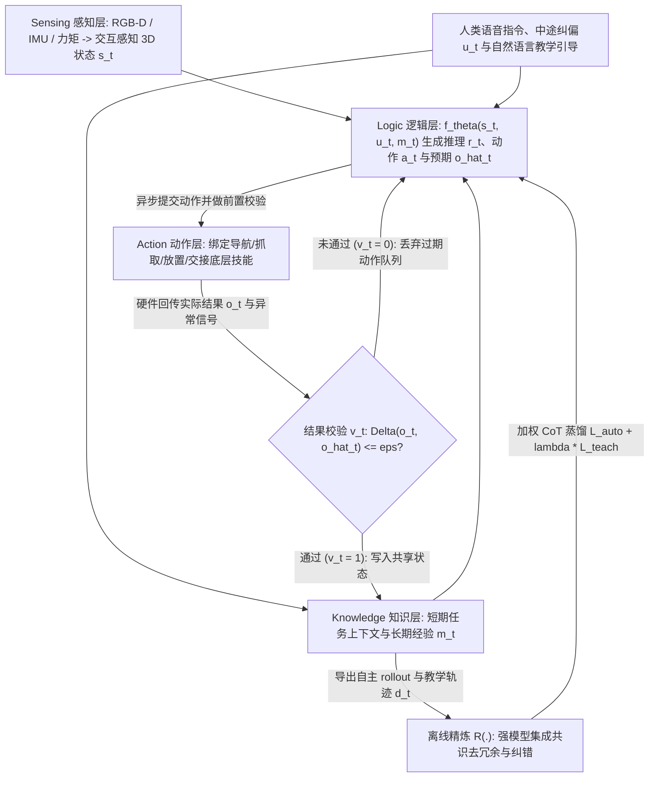

# WCM: World-Cognition Model for Generalizable Human-Robot Interaction

## 一句话定义

**World-Cognition Model（WCM）** 是一种面向真实世界人机交互（HRI）的具身智能体架构，通过 **SLAK**（Sensing-Logic-Action-Knowledge）四层显式解耦、并发异步运行时及“自主执行+人类教学”的思维链（CoT）蒸馏飞轮，使机器人能够在移动操作中实时解释意图、接受人类纠偏并持续进化。

## 英文缩写速查

| 缩写 | 英文全称 | 简要说明 |
|---|---|---|
| WCM | World-Cognition Model | 本文提出的以人为中心、支持交互解释与纠偏的具身智能体框架 |
| SLAK | Sensing, Logic, Action, and Knowledge | WCM 的四层显式系统架构，分别负责交互感知、增量推理校验、技能执行与共享记忆 |
| HRI | Human–Robot Interaction | 人机交互；本文核心评估方向，强调自然语言对话、中途重定向与教学闭环 |
| CoT | Chain-of-Thought | 思维链；WCM 将自主 rollout 与教学轨迹精炼为步骤级 CoT 监督信号 |
| VLA | Vision-Language-Action | 视觉-语言-动作策略模型；本文将其与 WCM 的显式推理/异步架构进行机制与案例对比 |
| NLL | Negative Log-Likelihood | 负对数似然；用于计算自举与教学 CoT 轨迹蒸馏的加权损失函数 |

## 为什么重要

1. **突破“单向指令执行”瓶颈：** 现有 VLA 策略与世界模型规划器主要针对“输入指令→输出动作”优化，语言往往仅作为动作解码的条件信号而非持久交互通道，人类在执行中难以得知决策原因或随时纠偏。
2. **异步非阻塞与高频安全校验兼具：** 通过显式状态接口将推理、动作执行与状态更新解耦为并发进程，避免推理阻塞机器人运动，同时依靠执行前后的一致性校验防止异步队列执行过期动作。
3. **以自然语言教学替代低层遥操作：** 面对长时序或未见任务（如“把螺丝刀放到抽屉里”），用户无需遥操作示教，只需通过口头分段引导即可帮助机器人快速掌握流程，并将其蒸馏内化为通用推理能力。

## 核心信息

| 字段 | 内容与状态 |
|---|---|
| 作者 | Yuzhen Chen（Harvard University）、KC Zhou（MIT） |
| 机构 | 哈佛大学（Harvard University）、麻省理工学院（MIT）（资助与知识产权：Cyberbrain, Inc.） |
| 发表时间 | 2026-07-25（arXiv v1）；2026-08-03（arXiv v2） |
| 论文链接 | [arXiv:2607.22999](https://arxiv.org/abs/2607.22999) · [arXiv HTML 全文](https://arxiv.org/html/2607.22999) |
| 项目与代码 | 截至 2026-11-27 未公布公开代码仓库或独立项目页 |
| 清单分类 | `model.planning`, `harness.monitoring_and_recovery` |
| 开源状态 | 未确认开源代码（论文致谢明确声明系统、数据集及相关知识产权归 Cyberbrain, Inc. 所有） |
| 来源条目 | `survey_ax_2607_22999` |

## 核心原理

WCM 的核心在于将端到端隐式策略拆解为显式可检查、可异步协同的四层结构（SLAK），并以步骤级决策记录驱动离线 CoT 蒸馏闭环。

### 1. SLAK 四层显式架构

- **Sensing（交互感知层）：** 融合 RGB-D（$640 \times 480$）、深度、音频、IMU 与力/力矩信号，将原始观测转化为交互感知局部 3D 场景状态 $s_t$。除几何占据与物体空间关系外，该层还估计像素级与部件级交互线索（抓取、开启、放置、丢弃）及粗粒度物理/材质属性（刚性、易碎性、抓取适用性）。
- **Logic（逻辑推理层）：** 基于当前场景状态 $s_t$、用户当前指令 $u_t$ 与从知识层检索的任务记忆 $m_t$，组成决策上下文 $x_t = (s_t, u_t, m_t)$，采用增量式“规划-推理-验证”循环生成自然语言推理轨迹 $r_t$、下一步动作 $a_t$ 与预期结果 $\hat{o}_t$，并在动作执行后对比实际结果 $o_t$：
  $$(r_t, a_t, \hat{o}_t) = f_\theta(x_t), \qquad v_t = \begin{cases} 1, & \Delta(o_t, \hat{o}_t) \le \epsilon, \\ 0, & \text{otherwise}. \end{cases}$$
  当校验通过（$v_t = 1$）时继续推进；若偏离预期（$v_t = 0$），则基于最新状态重新推理或主动向用户澄清。
- **Knowledge（知识记忆层）：** 作为跨层共享状态中心，维护**短期任务记忆**（当前目标、已观察物体、空间上下文、近期动作/结果与用户反馈）及**长期经验**（跨任务经验、物体交互历史、技能记忆、失败教训与人类教学步骤）。
- **Action（动作执行层）：** 将逻辑层选定步骤绑定至跨任务复用的底层技能原语（导航、伸手、抓取、放置、交接、简单关节物体操作），并在硬件执行期间持续向 Logic 与 Knowledge 回传状态、失败与实际结果 $o_t$，实现高层推理与底层控制硬件的解耦。

### 2. 异步运行时（Asynchronous Runtime）

在传统顺序控制流水线中，感知、推理、执行与反馈串行阻塞，长推理耗时会导致机器人停顿或响应人类纠偏迟滞。WCM 基于 SLAK 的显式状态接口将推理器（提议动作）、执行器（下发已提交动作）与状态更新器（融合新观测、执行结果与用户口头反馈）并发调度。为避免异步执行滞后队列引发错误，运行时在提交队列动作前及动作完成后持续执行一致性校验；一旦场景或用户指令发生变化，立即丢弃过期动作队列并触发重规划，实现“边移动、边对话、边重规划”。

### 3. 基于 rollout 与人机教学的 CoT 蒸馏飞轮

1. **统一决策记录：** 每段轨迹记录为 $e = \{d_t\}_{t=1}^T$，其中 $d_t = (s_t, u_t, m_t, r_t, a_t, \hat{o}_t, o_t)$。数据来源包括自主执行（含成功与失败）$\mathcal{D}_{\mathrm{auto}}$ 和人机交互教学片段 $\mathcal{D}_{\mathrm{teach}}$。
2. **人机交互教学模式（Human-in-the-Loop Teaching）：** 面对自主探索低效或长时序任务，用户通过自然语言分步指导注意力目标、目标物体/部件与阶段切换节点；教学过程以相同 $d_t$ 格式记录并存入 Knowledge 供即时复用。
3. **离线精炼与加权蒸馏：** 真实机器人轨迹常包含冗余推理、重复尝试或绕路；WCM 使用更强模型集成通过投票/共识机制对记录进行离线精炼 $\mathcal{R}(\cdot)$，清洗冗余轨迹并将失败推理修正为针对性纠错 CoT，得到 $\mathcal{D}'_{\mathrm{auto}}$ 与 $\mathcal{D}'_{\mathrm{teach}}$。随后采用加权负对数似然目标更新推理模型：
   $$\mathcal{L}_{\mathrm{distill}}(\theta) = \mathcal{L}_{\mathrm{auto}}(\theta) + \lambda \mathcal{L}_{\mathrm{teach}}(\theta), \qquad \lambda \ge 1$$
   其中 $\lambda \ge 1$ 用于放大高信息密度人类教学轨迹的监督权重，监督信号作用于步骤级推理链路而非底层电机关节动作。

## 流程总览

## 源码运行时序图

**不适用**（截至 2026-11-27，原文与 arXiv 元信息未确认可运行官方源码实现或公开仓库；论文致谢说明系统、数据集及相关知识产权归 Cyberbrain, Inc. 所有，无法进行静态源码入口与模块时序核对）。

## 实验与评测

### 1. 实验平台配置（Section III-A）

- **机器人本体：** 低成本移动操作平台，包括麦克纳姆轮全向底盘、5 自由度（5-DOF）机械臂（臂展约 $1.3\,\text{m}$）与 $640 \times 480$ RGB-D 相机，本体硬件总成本低于 **\$2,000**。
- **推理算力：** 推理模型通过局域网部署在共享的离线 **NVIDIA RTX 5090** GPU 上（论文将本体成本与算力成本分开报告）。

### 2. 九项真实世界人机交互任务基准（Table I, Appendix A）

所有任务均以语音指令发起，结合实时对话交互与物理抓取/交接/丢弃，平均成功率为 **73.8%**（含 4 项从 CoT 微调集中保留的 held-out 任务）：

| 任务（语音指令） | 训练分布 / 设置 | 成功率 SR (%) | 成功/总次数 | 典型耗时 (s) |
|---|---|---:|---:|---:|
| "Grab me the popcorn." | 常规任务 | 85 | 11/13 | 72 |
| "Hand me the honey." | 常规任务 | 79 | 11/14 | 34 |
| "Hand me the jacket." | 柔性/可变形物体 | 67 | 6/9 | 54 |
| "Hand me the green ratchet." | 车库工具检索 | 64 | 7/11 | 36 |
| "Hold the BBQ tongs." | 工具抓取与递送 | 86 | 12/14 | 48 |
| "Grab me the water bottle." | Held-out（零样本迁移） | 83 | 10/12 | 30 |
| "Take the screwdriver to the drawer." | Held-out + 交互教学 | **69**（蒸馏后 **82**） | 9/13 | 165 |
| "Put the cup in the trash can." (Outdoor) | Held-out（室外导航+丢弃） | 67 | 10/15 | 46 |
| "Put the bottle in the trash can." | Held-out（零样本迁移） | 64 | 9/14 | 34 |

- **教学与蒸馏闭环增益：** 在难度最高的两阶段任务 *"Take the screwdriver to the drawer."*（先开抽屉再放入螺丝刀）中，教学前成功率低于 **20%**；经过人机自然语言交互教学后提升至 **69%**（9/13）；经离线 CoT 蒸馏内化后进一步升至 **82%**。

### 3. 核心模块消融实验（Table III, Appendix C）

在 5 个代表性任务子集上分别移除“异步运行时（w/o Async，改为推理后停等执行）”与“交互感知层（w/o Sensing，替换为普通 VLM + 2D grounding，无部件级交互线索）”：

| 任务 | 完整 WCM 耗时 (s) | w/o Async 耗时 (s) | 完整 WCM SR (%) | w/o Sensing SR (%) |
|---|---:|---:|---:|---:|
| "Hand me the green ratchet." | 36 | 61 | 64 | 18 |
| "Grab me the water bottle." | 30 | 47 | 83 | 27 |
| "Take the screwdriver to the drawer." | 165 | 254 | 69 | 0 |
| "Put the cup in the trash can." (Outdoor) | 46 | 63 | 67 | 18 |
| "Put the bottle in the trash can." | 34 | 49 | 64 | 9 |

- **关键消融发现：** 去掉异步运行时导致端到端任务耗时增加至 **1.4–1.7×**；失去交互感知层提供部件级与物理属性线索后，所有任务成功率暴跌，涉及关节物体部件操作的长时序任务（Screwdriver-to-Drawer）直接从 **69% 降至 0%**。

## 与其他工作对比

### 1. 与 X-Square WALL-OSS 的六任务案例对比（Table II, Appendix B）

> 注：由于双方机器人本体构型、运动学、传感器配置与执行栈不同，原文明确说明本表为**说明性案例对比（illustrative case-study）**，并非严格受控同平台基准。由于 VLA 在每个控制步均需占用 GPU，基线 GPU 占用时间按全程运动时间估算；WCM 仅间歇性占用 GPU（含任务结束约 3–5 s 总结），其余时间可释放给其他机器人。

| 任务 | WCM 运动耗时 (s) ↓ | X-Sq. 运动耗时 (s) ↓ | WCM GPU 占用 (s) ↓ | X-Sq. GPU 估算 (s) ↓ | WCM 成功率 (%) ↑ |
|---|---:|---:|---:|---:|---:|
| ColorPlateSort | 25.0 | 109.0 | 19.4 | 109.0 | 92 |
| LabelRecognition | 36.0 | 116.0 | 18.4 | 116.0 | 90 |
| PickUpFruits | 16.6 | 18.5 | 6.4 | 18.5 | 90 |
| ThrowTrash | 80.5 | 258.0 | 22.5 | 258.0 | 86 |
| PickUpCube | 16.1 | 43.2 | 5.6 | 43.2 | 92 |
| SolveMathProblem | 57.0 | 76.0 | 59.9 | 76.0 | 78 |
| **Average** | **38.5** | **103.5** | **22.0** | **103.5** | **88.0** |

*注：X-Square WALL-OSS 未公开各任务成功率，故成功率为 WCM 单方记录。*

### 2. 范式对比：WCM vs. VLA 策略 vs. 世界模型规划器

| 维度 | 端到端 VLA（如 RT-2 / OpenVLA / $\pi_0$） | 想象/视频世界模型规划器 | WCM（SLAK + 异步运行时） |
|---|---|---|---|
| **语言接口定位** | 单次条件输入，难以途中纠偏 | 多用于目标生成或状态预测，缺少对话解释 | 持久化双向交互通道，支持解释与中途重定向 |
| **推理与控制耦合** | 视觉-语言骨干直接解码低层动作块 | 依赖隐式未来帧/潜空间 rollout | 显式分离 Sensing / Logic / Action / Knowledge |
| **监督信号形态** | 大规模遥操作状态-动作轨迹 | 视频帧预测或动力学重构误差 | 精炼后的步骤级决策与预期结果 CoT 轨迹 |
| **算力占用模式** | 高频控制步持续占用 GPU | 规划 rollout 期计算密集 | 间歇调用推理 GPU，空闲期可多机共享 |

## 结论

**一句话总判：WCM 证明了在长时序与高交互要求场景下，“显式分层感知-推理架构 + 异步结果校验 + 自然语言教学蒸馏”可以在低于 \$2,000 的硬件平台上实现比纯 2D VLM 规划高得多的实机成功率，且大幅降低推理 GPU 的持续占用时间。**

1. **交互感知是部件级操作的刚需：** 消融实验显示普通 VLM + 2D grounding 在螺丝刀入抽屉任务上成功率为 0%，而补齐部件级与物理属性线索后升至 69%，说明高层 Agent 若缺少几何/部件/物理交互状态接口无法落地复杂操作。
2. **异步运行时直接决定任务节奏：** 推理与执行并发解耦可避免约 1.4–1.7× 的等待开销，且前置/后置一致性校验 $v_t$ 防止了异步队列在动态环境中的动作失配。
3. **教学蒸馏打通高难任务的快速冷启动：** 通过自然语言分段引导使原本不足 20% 成功率的长时序任务先升至 69%、蒸馏后再升至 82%，提供了一种不依赖遥操作的具身数据飞轮思路。
4. **评测与可复现性须谨慎解读：** 当前系统与数据集属于商业闭源产权，且与 WALL-OSS 的效率对比属于跨平台案例比较，迁移到灵巧操作或高频接触任务仍受限于底层技能库能力。

## 工程实践

- **硬件与算力解耦：** 采用低成本本体（<$2,000）+ 局域网共享 GPU 服务器（RTX 5090）模式，适合多台移动操作机器人共用高算力推理节点（案例中 6 任务平均 GPU 忙时仅 22.0 s，低于总运动耗时 38.5 s）。
- **底层技能库复用边界：** Logic 层仅输出抽象步骤及预期结果 $\hat{o}_t$，Action 层通过导航、抓取、放置、交接与简单关节物体技能原语执行，使得更换底盘或机械臂控制栈时无需重写上层推理接口。
- **数据飞轮清洗要点：** 实机 rollout 往往包含无效试探与冗余恢复步骤，切忌直接用原始日志微调，应先经强模型集成投票清洗出因果清晰的 CoT 轨迹后再按 $\lambda \ge 1$ 加权蒸馏。

## 局限与风险

1. **闭源产权与复现门槛：** 论文未公开源码、权重、底层技能实现及训练集，致谢明确指出系统、数据集与相关 IP 归 Cyberbrain, Inc. 所有，外部团队难以直接复现或定量复测。
2. **底层技能与硬件能力上限：** 当前平台仅配备 5-DOF 机械臂与基础运动原语，面对高精度双臂协同、快速动态操作或复杂力控插拔时，系统上限受制于 Action 层预设技能库而非 Logic 层推理。
3. **非受控对比局限：** 与 X-Square WALL-OSS 的对比跨越了不同机器人本体与传感器套件，且基线缺少分任务成功率与真实 GPU 监控值（采用全时段估算），只能作为效率特征参考。
4. **未公开具体基础模型选型与超参细节：** 正文未详细披露 Sensing 各传感分支的具体骨干网络、Logic 模型参数量级、阈值 $\epsilon$ 的量化定义以及蒸馏权重 $\lambda$ 的具体取值。

## 关联页面

- [Agentic Robots 综述](paper-towards-agentic-robots-survey.md)
- [全量项目节点清单](../overview/awesome-agentic-robots-node-index.md)
- [VLA 方法背景](../methods/vla.md)
- [机器人智能体执行框架](../methods/robot-agent-harness.md)：对照规划、执行接口与反馈机制。
- [Agent 规划与反馈机制](../methods/agent-planning-feedback.md)：对照增量式规划-校验闭环与失败恢复。
- [智能体操纵策略](../methods/agentic-manipulation-policies.md)：对照视觉-语言推理与操纵技能绑定范式。
- [移动操作任务](../tasks/loco-manipulation.md)：了解移动底盘与机械臂协同操作任务框架。

## 推荐继续阅读

- [WCM arXiv HTML 原文](https://arxiv.org/html/2607.22999)
- [WCM arXiv 摘要页](https://arxiv.org/abs/2607.22999)
- [Inner Monologue: Embodied Reasoning through Planning with Language Models](https://arxiv.org/abs/2207.05608)（闭环语言反馈具身推理早期代表工作）

## 参考来源

- [WCM 原文核对归档](../../sources/papers/paper-agentic-2607-22999.md)
- [官方 Awesome 快照归档](../../sources/repos/awesome-agentic-robots-survey-index.md)
- [arXiv:2607.22999 摘要页](https://arxiv.org/abs/2607.22999)
- [arXiv:2607.22999 HTML 全文](https://arxiv.org/html/2607.22999)
