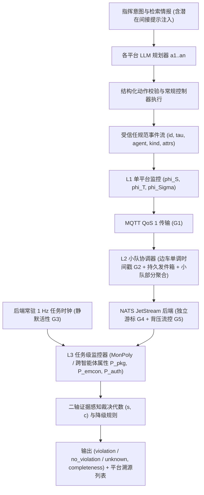

# Mission-Level Runtime Assurance for LLM-Assisted ISR Swarms over a Verification-Aware Fabric

## 一句话定义

**该论文提出面向 LLM 辅助侦察（ISR）无人集群的三层（平台/小队/任务）组合式运行时验证（RV）框架，通过证据感知的二轴裁决代数与可靠消息织体 RV-Fabric，检出单机合规但联合违规的任务拆分攻击，并在通信丢包或干扰时拒绝发出虚假的“全局无违规”放行。**

## 英文缩写速查

| 缩写 | 英文全称 | 简要说明 |
|---|---|---|
| ISR | Intelligence, Surveillance, and Reconnaissance | 情报、监视与侦察任务，本文多机协作的典型场景 |
| RV | Runtime Verification | 运行时验证，基于显式形式化规约持续检查系统执行流并输出带见证的裁决 |
| RV-Fabric | Verification-Aware Messaging Fabric | 基于 MQTT 与 NATS JetStream 构建的具备投递、定序与活性保障的监控消息织体 |
| MFOTL | Metric First-Order Temporal Logic | 度量一阶时序逻辑，MonPoly 等监控引擎用于表达带时间窗的跨智能体性质 |
| EMCON | Emission Control | 电磁发射控制，限制机群在给定时间窗内的射频总发射字节预算 |
| NSCR | No-Silent-Clear Rate | 无静默放行率，度量未被错误判定为干净 `no_violation` 的真实违规比例 |
| SITL | Software-In-The-Loop | 软件在环仿真，文中指基于 ArduPilot 与 MAVLink 的四旋翼飞行动力学验证层 |

## 为什么重要

随着大语言模型（LLM）被用于多无人系统（UAV/UGV）的高层任务理解与分配，安全失效不再局限于单个机器人的控制包络，而出现在**跨智能体组合**与**对抗通信**的交叉点：

1. **单机护栏结构性失明**：检索信息中的间接提示注入可诱导诚实的 LLM 规划器把禁用目标拆分成多机各自合规的小动作（例如 4 台平台分别采集坐标、图像、通信元数据与路线并低速率回传），每个单机（L1）监控器均通过检查，唯有在任务级（L3）聚合时才暴露违规。
2. **缺失证据不能等价于安全**：在电磁干扰或丢包环境下，尽力而为（best-effort）的中心监控器会因漏收关键见证或某台平台失联而把本应触发的违规误报为“无违规（all-clear）”。本工作将**“是否违规”**与**“证据是否完整”**解耦为正交维度，为多机器人任务保障（mission assurance）提供可审计、带责任溯源的运行时架构。

## 核心信息

| 字段 | 内容 |
|---|---|
| 论文 | Mission-Level Runtime Assurance for LLM-Assisted ISR Swarms over a Verification-Aware Fabric（[arXiv:2607.23532](https://arxiv.org/abs/2607.23532)，[v3 HTML](https://arxiv.org/html/2607.23532)） |
| 作者 | Nikolaos Kekatos, Michael Ioannou, Panagiotis Katsaros, Alexios Lekidis, Theodoros Nestoridis, Tom Nianios, Dimitrios Nikou |
| 机构 | Clone Systems、Bolton Technologies、亚里士多德大学（Aristotle University of Thessaloniki）、色萨利大学（University of Thessaly）、希腊国际大学（International Hellenic University） |
| 发表时间 | v1：2026-07-26；v3：2026-10-11（arXiv cs.CR 预印本） |
| 论文链接 | [arXiv:2607.23532](https://arxiv.org/abs/2607.23532) |
| 项目与代码 | 宣称将开源或未列链接：附录 0.A 提及以 artifact 形式提供 `swarm_rv`、`console/`、`ros2_realism/`、`sitl_mission/` 等模块，但截至 2026-11-27 论文及检索均未给出公开 GitHub 或项目页 URL |
| 清单分类 | harness.monitoring_and_recovery |
| 来源条目 | `survey_ax_2607_23532` |
| 开源状态 | 未列公开代码仓链接（已核读 arXiv v3 全文，无 `candidate_repos` 可供静态核查） |

## 核心原理

框架由**规范事件模型与分层规约**、**证据感知二轴裁决代数**与**三层分布式 RV-Fabric** 三部分构成，且监控层与底层飞控/避障控制器完全解耦：

1. **规范事件流与三层规约拆解**：
   - 每个平台 $a \in A = \{a_1,\dots,a_n\}$ 的 LLM 规划器输出经模式校验（schema validation）的结构化动作并交由传统控制器执行，同时通过受信任事件路径生成规范事件元组 $e = (\mathit{id}, \tau, a, k, \mathit{attrs})$，其中 $\mathit{id}$ 为单调持久事件标识（用于去重与缺口检测），$\tau$ 为任务时钟时间戳，$k \in \{\text{collect}, \text{transmit}, \text{enter}, \text{authorise}, \text{observe}, \text{tick}\}$。
   - **单平台（L1）** 检查本地迹线即可判定的三类方面：空间驻留 $\varphi_S$（禁区进入）、一阶过去时序义务 $\varphi_T$（本地预算与指派合规）和文本语义谓词 $\varphi_\Sigma$（合法传感器与接收端）。
   - **小队协调器（L2）** 聚合组内部分观测并检查联合区域占用数 $\le k$ 及重复任务分配，再把部分档案（partial profile）上报至任务层。
   - **任务监控器（L3）** 在联合事件流与滑动时间窗 $W$ 上判定跨智能体违规条件（论文主评估聚焦三项核心性质）：
     - 禁止联合情报包：$P_{\text{pkg}}(F,W) :\ \exists a_1,\dots,a_4\ \text{s.t.}\ \bigwedge_{x\in X}\text{collect}(a_x,x,F,[t-W,t]) \wedge \neg\text{authorised}(F,[t-W,t])$，其中 $X=\{\text{coords},\text{imagery},\text{comms},\text{access}\}$；
     - 机群 EMCON 总预算超限：$P_{\text{emcon}}(W) :\ \sum_{a\in A}\text{emit}(a,[t-W,t]) > B_{\text{mission}}$；
     - 跨智能体先授权后进入：$P_{\text{auth}}(a_j,Z,t) :\ \text{enter}(a_j,Z,t) \wedge \neg\exists a_i,\tau\in[t-W,t):\ \text{authorise}(a_i,Z,\tau)$。
2. **证据感知二轴裁决代数与条件可靠性**：
   - 每次跨智能体裁决输出二元组 $(s, c)$，分别表示安全结论 $s \in \{\textsf{violation}, \textsf{no\_violation}, \textsf{unknown}\}$ 与证据完整性 $c \in \{\textsf{sound} \succ \textsf{degraded} \succ \textsf{incomplete} \succ \textsf{unavailable}\}$，并附带平台级溯源列表（contributing `agents` 与见证事件 `witnesses`）。
   - 组合完整性取参与平台的格下确界（meet）：只要任一贡献流出现 $\mathit{id}$ 缺口（G1）、摄入乱序（G2）、高水位截断或任务时钟静默（G3），其完整性即降为非 `sound`；降级规则规定 **非 `sound` 证据下的 `no_violation` 必须降级为 `unknown`**，而带有完整见证的 `violation` 属于自证触发，可继续报出。对由有限见证集合认证且在超集下保持的单调见证性质（含 $P_{\text{pkg}}$、$P_{\text{emcon}}$、$P_{\text{auth}}$），该机制具备条件可靠性（conditional soundness）。
3. **RV-Fabric 五项系统保障**：
   - 将边缘物联网（edge-IoT）的“设备→网关→后端”织体复用为“平台→小队协调器→任务监控器”：平台经 **MQTT QoS 1** 上报至 L2 协调器，协调器边车（sidecar）写入可信单调摄入时间戳与持久 $\mathit{id}$，经 **持久化发件箱（durable outbox）** 转发至 **NATS JetStream** 后端；L3 监控器（支持参考监控器与 **MonPoly** MFOTL 引擎）通过**独立持久化游标（durable cursors）**消费，配合后端常驻 **1 Hz 任务时钟**（脱离平台在线状态推进）及 **JetStream 背压流控**，把断连、丢包与干扰转化为可观测信号。

## 流程总览

依据论文 Figure 1 与 Figure 3 绘制端到端三层组合式运行时监控数据与证据流：

## 源码运行时序图

**不适用**（截至 2026-11-27 核查：arXiv:2607.23532v3 附录 0.A 虽提及可复现核心 `swarm_rv`、交互式控制台 `console/`、`ros2_realism/run_ros2_demo.sh` 与 `sitl_mission/run_sitl_mission.sh` 等 artifact 模块命名，但论文正文、元信息及上下文 `candidate_repos` 均未提供公开 GitHub 或代码托管链接，无法获取并静态核查实际源码实现）。

## 实验与评测

作者在可控运动学仿真（4 平台 `uav_1`–`uav_3` + `ugv_1`，地面真值违规 $|I^{\star}|=3$：禁止联合情报包、EMCON 超限、未授权进区）、ROS 2 Humble DDS 无头容器、ArduPilot SITL（360 个位置采样）、真实 Mosquitto + NATS JetStream 部署以及 MonPoly 引擎上开展验证（以下均为原文报告数值，未本地复现）：

1. **主故障战役与防静默误放行（Table 4，$|I^{\star}|=3$）**：
   - **仅单平台护栏**：无故障 / 丢弃见证 / 干扰静默三种工况下均检出 `0/3`，累计产生 **9** 次静默虚假放行；
   - **中心尽力而为监控器**：三种工况下检出 `3/3`、`2/3`、`1/3`，丢弃图像见证或干扰 `uav_3` 后共产生 **3** 次静默虚假放行；
   - **RV-Fabric（证据感知）**：分别输出 `3/3`、`2/3 + 1u`、`1/3 + 2u`（其中 `u` 为显式标记的 `unknown`），静默虚假放行为 **0**；在合法协作任务中三者均保持 `0` 误报。
2. **多目标泛化与三层传递（Table 5–6）**：
   - 覆盖 4 类不同性质目标（语义组合禁止情报包、机群外泄总预算、空域防撞计数、有序目标打击链 `detect ≺ classify ≺ geolocate ≺ share`），3 类故障战役下静默虚假放行总数为单平台 `18`、中心基线 `9`、RV-Fabric **`0`**。
   - 双小队两级聚合（Table 6）：Squad 1 汇集 `{coords, imagery, comms}`、Squad 2 汇集 `{access}`；丢弃 `uav_2` 图像见证时，`L2[Sq1]` 完整性变为 `incomplete` 并向 L3 传播为 `unknown`，而忽视小队完整性的中心监控器错误输出 `no_violation`。
3. **溯源、消融、敏感性与系统开销（Table 7–9, §7.3–§7.5）**：
   - **责任溯源（RQ3）**：6 个存在明确地面真值贡献集的违规实例中，报告平台集匹配率 **`6/6 = 100%`**；在 500 次随机任务切分实验（seed 7）下，随机丢见证时 RV-Fabric 静默放行率为 **`0%`**（中心基线 `100%`）。
   - **保障消融（Table 8）**：完整织体在丢见证/干扰工况下静默漏报为 `0 / 0`；移除事件 `id` 缺口检测（`-G1`）在丢见证下漏报升至 `1`，移除后端任务时钟（`-G3`）在干扰工况下漏报升至 `2`。
   - **NSCR 与复合故障（Table 9）**：RV-Fabric 的 NSCR 达 **`100%`**（8 个小队同时故障时静默放行仍为 **`0`**），中心基线为 `50%`（8 小队同时故障时静默漏报 `8` 次）；400 次带 $\sigma=60$ B 高斯噪声的发射总和 ROC 实验 AUC 为 `0.96`（单平台视角的 ROC 仅 `0.50`）。
   - **切分基数挤压（Table 7）**：总外泄 1200 B（单机上限 500 B，EMCON 900 B）时，切分为 $N=2$（600 B/机）被 L1 捕获，$N=3,4,6$（400/300/200 B/机）单机合规但被 L3 捕获，攻击者无法同时绕过两层。
   - **参数扫描与真实系统性能**：300 次重尾通信抖动任务中，任务时钟静默超时设为 `5 s` 为权衡拐点（每任务约 `0.5` 次误静默标志，约 `4 s` 检出干扰）；7 类合法协作场景 `0` 误报；监控器评估时间随规模线性扩展，1000 平台耗时 **`1.2 ms`**（Fig. 7 显示千平台内低于 `2 ms`）；实测真实 Mosquitto + NATS JetStream（$n=1000$ 事件）无故障中位端到端延迟 **`3.7 ms`**，10% 丢包重传下中位 **`42 ms`** 且 `1000/1000` 送达；MonPoly 引擎在攻击迹线上于第 3、第 4 贡献平台准确触发。

## 与其他工作对比

| 对比维度 | 单平台运行时保障（SOTER / ROSMonitoring / Simplex） | 中心尽力而为跨机监控 | 本论文（三层 RV + RV-Fabric） |
|---|---|---|---|
| 跨智能体组合违规检出 | 无法表达，单机满足局部阈值即放行 | 无故障时可检出 | L1/L2/L3 分层配合跨智能体规约完整检出并附平台溯源 |
| 通信丢包/干扰下的行为 | 不涉及跨机见证缺失 | 缺乏完整性信号，常把漏收当作 `no_violation`（静默放行） | 通过 G1/G3 使缺失可观测，将无证据支持的放行显式降级为 `unknown` |
| 与既有容错/边缘工作关系 | 专注单机飞行控制安全包络，与本文任务层正交互补 | 依赖理想传输假设 | 将作者此前 edge-IoT 织体与 MonPoly 监控迁移到无人机群 ISR，应对类似 STAC 的多机工具链拆分诱导 |

更多多智能体任务执行与验证上下文可参考 [Towards Agentic Robots 综述](paper-towards-agentic-robots-survey.md) 及 [机器人智能体执行框架](../methods/robot-agent-harness.md)。

## 结论

**一句话总判：该研究把“单机合规但群体违规”的提示注入任务拆分问题与“对抗通信下缺失证据伪装为合规”的消息可靠性问题放进同一套证据感知运行时验证代数中解决，对无人集群任务保障具有明确工程参考价值，但目前公开资料尚未附可下载的开源仓库。**

1. **将安全真值与证据完整性严格分离**：工程上不应允许分布式监控器在出现 `event-id` 缺口或任务时钟静默时继续输出 `no_violation`，而应强制降级为带原因码的 `unknown`。
2. **利用“单机阈值—群体阈值”双层夹逼攻击空间**：小粒度拆分会被 L3 跨机汇总/组合规约捕获，大粒度集中则会触发 L1 本地限额，压缩了提示注入的逃逸窗口。
3. **重用成熟消息中间件并保留独立后端时钟**：MQTT QoS 1 + L2 持久发件箱 + NATS JetStream 独立游标 + 1 Hz 后端时钟可在毫秒级延迟内满足秒级任务决策周期。
4. **注意当前验证边界**：核心量化表来自确定性运动学仿真；若有平台恶意篡改自报数据（拜占庭故障），仍需外置独立旁证（如文中探索的 RF-sentry）。

## 工程实践

- **非侵入式部署路径**：监控器不介入底层飞控与避障回路，可通过适配节点订阅 ROS 2 `/<ns>/action` 话题或 ArduPilot MAVLink 遥测，将动作规范化为事件流接入 MQTT/JetStream，从而在不触动飞行安全认证控制器的前提下叠加任务层审计。
- **关键参数与流控选型**：
  - 任务时钟静默超时建议结合信道重尾延迟选取折中点（文中 300 次抖动实验显示 `5 s` 为误报与检出延迟的平衡拐点）；
  - 过载保护优先采用 `discard=new` 并触发显式健康告警，避免 `discard=old` 静默抹除早期见证；
  - 针对“慢速低频（low-and-slow）”跨越时间间隔 $S$ 的四步拆分，滑动窗口需满足 $W \ge 3S$，并权衡随 $W$ 线性增长的状态缓存成本。
- **复现接入现状**：论文附录 0.A 详述了单命令 Docker 与分层脚本入口，但截至 2026-11-27 尚未确认公开代码仓库地址，实际工程落地需等待作者释放 artifact 或依据论文中给出的 MQTT/JetStream/MonPoly 架构自行搭建。

## 局限与风险

1. **仿真与端到端集成缺口**：主表量化结果基于确定性运动学任务（检验设计不变量保持能力，不能直接等同于真实作战分布的检出率）；ROS 2/DDS 前端接入已独立运行验证，但尚未与真实 Mosquitto + NATS JetStream 链路合为单一端到端流程，且 Gazebo GPU 视觉渲染与大规模实机集群测试留待后续工作。
2. **信任边界与自适应逃逸**：核心威胁模型不覆盖被攻破平台主动谎报自身事件（除非引入类似 RF-sentry 的独立外部旁证传感器），也不覆盖跨任务周期（cross-mission）的极慢速拆分；非结构化文本协同路径的可靠性受限于语义抽取分类器质量。
3. **形式化证明与代码开放状态**：组合代数的完全形式化可靠性证明沿用并实例化了作者此前 edge-IoT 工作，完整证明留作未来工作；截至入库核对日未取得官方公开源码仓库 URL。

## 关联页面

- [Agentic Robots 综述](paper-towards-agentic-robots-survey.md)
- [全量项目节点清单](../overview/awesome-agentic-robots-node-index.md)
- [VLA 方法背景](../methods/vla.md)
- [机器人智能体执行框架](../methods/robot-agent-harness.md)：对照规划、执行接口与反馈机制。
- [智能体规划与反馈](../methods/agent-planning-feedback.md)：对照 LLM 高层任务规划、反馈修正与越界防护思路。
- [机器人软件集成](../methods/robot-software-integration.md)：对照 ROS 2/DDS 与多节点通信中间件集成边界。
- [机器人仿真集成](../methods/robot-simulation-integration.md)：对照 Gazebo 与 ArduPilot SITL 多层仿真接入方式。
- [自主探索](../tasks/autonomous-exploration.md)：对照多平台协同侦察与覆盖任务上下文。

## 推荐继续阅读

- [arXiv:2607.23532 摘要与 PDF](https://arxiv.org/abs/2607.23532) / [HTML 全文](https://arxiv.org/html/2607.23532)
- [NATS 与 JetStream 官方文档](https://nats.io)
- [OASIS MQTT 5.0 规范](https://docs.oasis-open.org/mqtt/mqtt/v5.0/mqtt-v5.0.html)
- [MonPoly 运行时验证工具主页](https://sourceforge.net/projects/monpoly/)

## 参考来源

- [论文全文精读归档（arXiv:2607.23532v3）](../../sources/papers/paper-agentic-2607-23532.md)
- [官方 Awesome 快照归档](../../sources/repos/awesome-agentic-robots-survey-index.md)
- [论文或官方原始入口](https://arxiv.org/abs/2607.23532)
